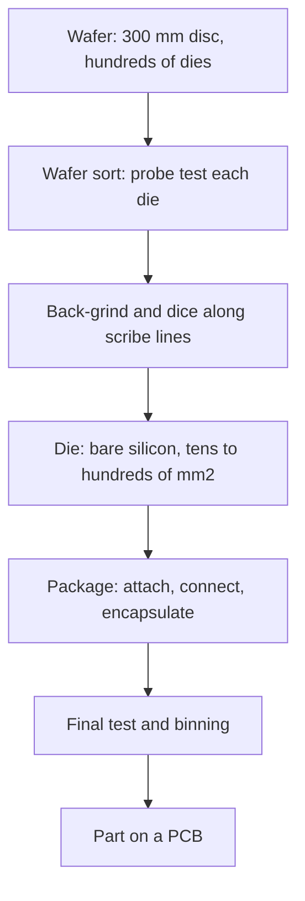

::: testing
Whether you have the correct mental model of how a chip becomes a product: a **wafer** is a thin disc of silicon processed in bulk, a **die** is one rectangular piece of that wafer containing a complete circuit, and a **package** is the housing that protects the die and connects it to a board. The interviewer wants the sequence (fabricate on wafer → test → dice → package → final test), the sizes involved (300 mm wafers, die areas from a few to hundreds of mm²), and the economic link: how many dies fit on a wafer, how die area drives cost and yield. Bonus points for naming what the package does (electrical connection, protection, heat, handling).
:::

::: why
These three words come up in every conversation about chips: "the die is 100 mm²", "we got 600 dies per wafer", "the package is a 15 mm BGA". Mixing them up is a quick red flag. Understanding the difference also unlocks cost reasoning (why large dies are expensive), packaging decisions (why chiplets exist, [[q0651]]), thermal discussions (junction to case to board), and test strategy (wafer sort versus final test). As a hardware intern you may work with datasheets that give die size, package type and thermal resistance, and you need to know which is which.
:::

::: concepts
- **Wafer**: thin round slice of (usually) single-crystal silicon, typically 300 mm in diameter today for leading-edge logic. See [[q0659]].
- **Die (chip)**: a rectangular piece of wafer containing one copy of the circuit; plural "dice" or "dies".
- **Package**: the enclosure and interconnect that makes the die usable on a board. See [[q0642]].
- **Fabrication flow**: lithography, deposition, etching and implantation repeated many times. See [[q0658]], [[q0660]].
- **Dicing**: cutting the wafer along scribe lines into dies.
- **Wafer sort vs final test**: electrical testing at wafer level and after packaging.
- **Yield and dies per wafer**: why die area drives cost. See [[q0650]].
:::

::: answer
"A wafer, a die and a package are three stages of the same thing at different scales. A **wafer** is a thin disc of silicon, for modern logic usually 300 millimetres across, and it's what goes through the fab. Hundreds of identical circuits are built on it at the same time with the repeated photolithography, deposition and etching steps. Each of those rectangular copies is a **die**: a bare piece of silicon, maybe 50 to 800 square millimetres, with the transistors and metal wiring on top and tiny bond pads or bumps around the edge or across the face. After the wafer is tested, it's cut up along scribe lines into dies, and the good ones are picked.

A bare die is fragile, microscopic in its connections, and can't be soldered to a board. The **package** solves that. It mounts the die, connects the die's pads to bigger balls or leads with wire bonds or bumps, protects it with mould compound or a lid, spreads the heat, and gives a standard footprint that machines can place and solder. The package might be a QFN, a BGA, or even something stacked or containing several dies.

The sequence is: fab the wafer, test it, dice it, package the good dies, then run a final test. And the economics follow from that: the number of dies per wafer is roughly the wafer area divided by die area, minus edge losses, so a die twice as big gives a bit under half as many candidates and also lower yield, which is why die area is so important to cost."
:::

::: technical
**Definitions and typical sizes.**

| Item | What it is | Typical size |
|---|---|---|
| Wafer | Disc of silicon (or other substrate), processed as a batch | 300 mm diameter for modern logic and memory, 200 mm for many analog/power/MEMS, 150 mm and smaller for legacy and specialty |
| Die | One rectangular IC cut from the wafer | A few mm² (small MCU, sensor) to hundreds of mm² (CPU, GPU); about 858 mm² is the practical single-exposure limit ([[q0651]]) |
| Package | Housing and interconnect for the die(s) | A few mm to tens of mm per side; may contain several dies |

Wafer thickness is standardised by SEMI: roughly 775 µm for 300 mm and 725 µm for 200 mm wafers, though wafers are typically thinned (back-ground) before packaging, to a few hundred micrometres or much less for some packages.

**Dies per wafer.** Gross dies per wafer for diameter $d$ and die area $A$ (a standard approximation that subtracts edge losses):

$$\text{DPW} \approx \frac{\pi (d/2)^2}{A} - \frac{\pi d}{\sqrt{2A}}.$$

For a 300 mm wafer (area 70 686 mm²): $A = 100$ mm² gives $706.9 - 66.6 = 640$ dies; $A = 800$ mm² gives $88.4 - 23.6 = 65$ dies (actually 64.8). A die eight times larger gives about ten times fewer dies because the edge loss grows relatively.

**Cost per good die.** With wafer cost $C_w$ and yield $Y$, cost per good die is $C_w/(\text{DPW}\cdot Y)$. Using an illustrative USD 10 000 wafer and defect density $D_0 = 0.1$ cm⁻² with Poisson yield $Y = e^{-AD_0}$:

| Die area (mm²) | DPW | Yield | Good dies | Cost per good die (USD) |
|---|---|---|---|---|
| 25 | 2694 | 97.5% | 2627 | 3.8 |
| 100 | 640 | 90.5% | 579 | 17.3 |
| 200 | 306 | 81.9% | 250 | 39.9 |
| 400 | 143 | 67.0% | 96 | 104 |
| 800 | 64 | 44.9% | 29 | 348 |

Doubling the die area from 100 to 200 mm² more than doubles the cost per good die (17.3 to 39.9). The wafer price is an illustrative round number, not a real quote; real wafer prices vary hugely by node and foundry. See [[q0650]] for yield models.

**Process flow.** Wafer fabrication (front end: transistors, back end: metal layers) → wafer sort (probe each die; mark bad ones) → back-grind and dicing → die attach → interconnect (wire bonds or flip-chip bumps) → encapsulation (mould or lid) → ball/lead formation → final test (and burn-in or speed binning if required). Some products do wafer-level packaging, where the package structure is built on the wafer before dicing (WLCSP).
:::

::: short
"A wafer is a thin disc of silicon, usually 300 millimetres, on which hundreds of identical circuits are fabricated at once. Each rectangular copy is a die. The wafer is tested, cut into dies, and the good dies are mounted in packages, which connect the tiny die pads to board-scale balls or leads, protect the silicon, remove heat and make it solderable. Dies per wafer is roughly wafer area over die area minus edge loss, so a bigger die costs disproportionately more."
:::

::: long
"These three are the same silicon at different stages. A wafer is a thin disc of silicon, for leading-edge chips 300 millimetres in diameter and a bit under a millimetre thick. In the fab it goes through hundreds of steps, lithography, deposition, etching, implantation, and all the dies on it are made at the same time. A die is one of those rectangular copies: a bare piece of silicon, anything from a few square millimetres for a small microcontroller to several hundred for a big processor, with transistors and metal layers on the top surface and tiny pads for connections.

After the wafer is made, it's tested at wafer sort, where probes touch each die and bad ones are marked. Then it's thinned, cut along the scribe lines, and good dies are picked up and attached into packages.

The package does four things: connects the die's very fine pads to a coarser grid of leads or solder balls that a PCB can use, protects against moisture and mechanical damage, carries heat out, and gives a standard footprint so machines can place and solder it. It could be a simple QFN with wire bonds, a BGA with flip-chip bumps, or a multi-die module.

The key link to cost is geometry. The number of dies per wafer is roughly pi r squared over die area, minus an edge loss term. On a 300 millimetre wafer, a 100 square millimetre die gives about 640 candidates, while an 800 square millimetre die gives only about 65. And bigger dies are also more likely to contain a defect, so yield falls too. With an illustrative 10 000 dollar wafer and 0.1 defects per square centimetre, the 100 square millimetre die costs about 17 dollars per good die and the 800 square millimetre one about 350. That's why designers care about die area and why chiplets exist."
:::

::: terms
- **Wafer**: thin disc of silicon (or other semiconductor) on which many dies are fabricated together.
- **Die / dice**: individual unpackaged chip cut from a wafer.
- **Package**: enclosure and interconnect that makes a die usable on a PCB.
- **Scribe line (saw street)**: narrow gap between dies where the saw cuts.
- **Wafer sort (probe)**: electrical test of each die on the wafer.
- **Known good die (KGD)**: die verified to work before packaging or stacking.
- **Back-grinding**: thinning the wafer from the back before dicing.
- **Wire bond / flip chip**: two ways to connect a die to its package (thin wires vs solder bumps).
- **Reticle**: the photomask field exposed at once; sets the maximum die size. See [[q0651]].
- **Yield**: fraction of dies that work.
:::

::: exceptional
**An average answer** says "the wafer is the big disc, the die is a chip cut from it, the package is the housing".

**An exceptional answer**:
- Gives the **sequence** and **sizes** (300 mm wafer, die mm², package mm) and the role of **testing at two stages**.
- Lists what the **package does** (electrical fan-out, protection, thermal path, handling) and names examples (wire-bond QFN, flip-chip BGA, WLCSP, multi-die).
- Computes **dies per wafer** with the edge-loss term and shows the **cost per good die** growth with area.
- Distinguishes **wafer-level** vs **die-level** packaging.
- Links to **thermal** ($T_J$ vs case vs board) and to **chiplets/yield** as consequences.
- Uses terminology correctly: die/dice, scribe, wafer sort, KGD.
:::

::: mistakes
- **Using "chip" for everything.** "Chip" is used loosely, but "die" (bare silicon) and "package" (the black thing) are different and matter in discussions of cost, thermals and yield.
- **Thinking a bigger package means a bigger die.** A tiny die can sit in a large package (for pin count or heat) and vice versa.
- **Forgetting edge loss in dies per wafer.** $\text{wafer area}/A$ overestimates, especially for large dies.
- **Assuming all dies on a wafer work.** Yield is rarely 100%, and varies across the wafer.
- **Thinking packaging happens before testing.** Wafer sort comes first so bad dies aren't packaged; final test comes after.
- **Confusing wafer diameter with node.** The 300 mm wafer size is unrelated to the 3 nm marketing node ([[q0646]]).
:::

::: deep
## From sand to a part on a board

Silicon is purified, grown into a single-crystal ingot, sliced into wafers, polished, and processed. At each stage the unit of handling changes, and so does the term.


Figure: The wafer is the batch unit; the die is the functional unit; the package is the product unit. Two test stages catch different faults: wafer sort stops bad dies from being packaged, final test catches assembly and packaging damage and bins parts by speed.

```svg
<svg viewBox="0 0 640 250" role="img" aria-label="A wafer with a grid of dies, one die enlarged, and the same die inside a package">
  <circle cx="120" cy="125" r="100" fill="var(--d-box)" stroke="var(--d-ink)" stroke-width="1.5"/>
  <g stroke="var(--d-muted)" stroke-width="1" fill="none">
    <line x1="40" y1="65" x2="200" y2="65"/><line x1="25" y1="95" x2="215" y2="95"/><line x1="22" y1="125" x2="218" y2="125"/><line x1="25" y1="155" x2="215" y2="155"/><line x1="40" y1="185" x2="200" y2="185"/>
    <line x1="60" y1="35" x2="60" y2="215"/><line x1="90" y1="26" x2="90" y2="224"/><line x1="120" y1="25" x2="120" y2="225"/><line x1="150" y1="26" x2="150" y2="224"/><line x1="180" y1="35" x2="180" y2="215"/>
  </g>
  <rect x="90" y="95" width="30" height="30" fill="var(--d-blue)" opacity="0.6" stroke="var(--d-ink)"/>
  <text x="50" y="245" font-family="Inter, sans-serif" font-size="13" fill="var(--d-ink)">Wafer (many dies)</text>
  <line x1="122" y1="100" x2="280" y2="60" stroke="var(--d-blue)" stroke-width="1"/>
  <line x1="122" y1="124" x2="280" y2="190" stroke="var(--d-blue)" stroke-width="1"/>
  <rect x="280" y="60" width="120" height="130" fill="var(--d-blue)" opacity="0.5" stroke="var(--d-ink)" stroke-width="1.5"/>
  <g fill="var(--d-orange)">
    <rect x="288" y="70" width="8" height="8"/><rect x="288" y="95" width="8" height="8"/><rect x="288" y="120" width="8" height="8"/><rect x="288" y="145" width="8" height="8"/><rect x="288" y="170" width="8" height="8"/>
    <rect x="384" y="70" width="8" height="8"/><rect x="384" y="95" width="8" height="8"/><rect x="384" y="120" width="8" height="8"/><rect x="384" y="145" width="8" height="8"/><rect x="384" y="170" width="8" height="8"/>
  </g>
  <text x="300" y="215" font-family="Inter, sans-serif" font-size="13" fill="var(--d-ink)">Die with bond pads</text>
  <rect x="460" y="55" width="160" height="140" fill="var(--d-muted)" opacity="0.35" stroke="var(--d-ink)" stroke-width="1.5"/>
  <rect x="505" y="95" width="70" height="60" fill="var(--d-blue)" opacity="0.7" stroke="var(--d-ink)"/>
  <g stroke="var(--d-ink)" stroke-width="1">
    <line x1="505" y1="105" x2="470" y2="85"/><line x1="505" y1="125" x2="470" y2="125"/><line x1="505" y1="145" x2="470" y2="165"/>
    <line x1="575" y1="105" x2="610" y2="85"/><line x1="575" y1="125" x2="610" y2="125"/><line x1="575" y1="145" x2="610" y2="165"/>
  </g>
  <text x="474" y="215" font-family="Inter, sans-serif" font-size="13" fill="var(--d-ink)">Package (die + leads)</text>
</svg>
```
Figure: Left, a wafer divided by scribe lines into many dies (one highlighted). Middle, one die with bond pads around its edge. Right, the die mounted in a package, with thin wires fanning out to larger leads. The die is a few mm to tens of mm across; the package adds the bigger pitch and protection.

## Dies per wafer and why area is king

A wafer of diameter $d$ has area $\pi d^2/4$; a 300 mm wafer has 70 686 mm². Dividing by die area gives an upper bound, but dies at the curved edge don't fit. The standard correction subtracts a perimeter term:

$$\text{DPW} \approx \frac{\pi d^2}{4A} - \frac{\pi d}{\sqrt{2A}}.$$

```plot
{"title":"Gross dies on a 300 mm wafer versus die area","x":{"label":"Die area","unit":"mm²","min":20,"max":1000},"y":{"label":"Gross dies per wafer","unit":"","min":0,"max":3000},
 "vars":{"d":300},
 "series":[{"label":"With edge-loss correction","fn":"pi*d^2/(4*x)-pi*d/sqrt(2*x)","color":"accent"},{"label":"Naive: wafer area / die area","fn":"pi*d^2/(4*x)","color":"muted","dashed":true}],
 "points":[{"x":100,"y":640,"label":"100 mm²: 640"},{"x":800,"y":65,"label":"800 mm²: 65"}]}
```
Figure: The dashed naive count overshoots, and the gap (the edge loss) is relatively larger for big dies: at 800 mm² the naive count is 88 but the corrected one is 65. Small dies are more efficient in using wafer area.

**Cost per good die.** Combine DPW with yield. With Poisson yield $Y = e^{-AD_0}$ and $D_0 = 0.1$ per cm²: 100 mm² gives $Y = e^{-0.1} = 90.5\%$ and 579 good dies; 800 mm² gives $Y = e^{-0.8} = 44.9\%$ and 29 good dies. For an illustrative USD 10 000 wafer that is USD 17.3 versus USD 348 per good die, a factor of 20 for an 8× area increase. Packaging, test and burn-in add per-unit costs on top.

## What the package really does

1. **Electrical fan-out.** Die pads are tens of micrometres apart; board pads are hundreds. The package routes between them with bond wires, flip-chip bumps and a multilayer substrate, ending in a standard footprint ([[q0642]]).
2. **Protection.** Mould compound or a lid shields the die from moisture, light, and mechanical damage. Moisture ingress is why parts have moisture sensitivity levels.
3. **Thermal path.** The die dissipates watts through a few mm²; the package spreads heat to the board and a heat sink. Junction temperature $T_J = T_A + P(\theta_{JC} + \theta_{CA})$ or via the board path ([[q0540]]).
4. **Handling and test.** Tape-and-reel, pick-and-place and sockets need a standard form.

**Interconnect styles.** *Wire bonding*: thin gold, copper or aluminium wires from die pads to package pads; cheap and flexible, but inductive and limited to the die perimeter. *Flip-chip*: the die is flipped and attached face-down by solder bumps across its surface, giving many more connections and lower inductance ([[q0656]]). *Wafer-level packaging (WLP, WLCSP)*: the redistribution layers and balls are formed on the wafer before dicing, so the package is the die size.

## Die size, reticle and packaging choices

A die can't exceed the reticle (the mask field that the scanner exposes at once) unless stitched; the practical limit is about 26 mm × 33 mm = 858 mm² for standard lithography scanners ([[q0651]]). When a design needs more silicon, packaging steps in: multiple dies (chiplets) in one package, connected on a substrate or interposer, so the package, not the die, defines the system ([[q0652]]).

## Where each term shows up in a datasheet

- **Wafer**: "300 mm wafer", process node, foundry; mostly in business and fab contexts.
- **Die**: die size, die thickness, bond pad layout; shown in bare-die and wafer-level products and in cost discussions.
- **Package**: package name, dimensions, ball/lead pitch, thermal resistances $\theta_{JA}$, $\theta_{JC}$, $\psi_{JT}$, moisture sensitivity level, land pattern.

## A sanity-check example

A microcontroller has a 4 mm × 4 mm die (16 mm²) in a 7 mm × 7 mm QFN with 48 pins. On a 200 mm wafer, DPW is about $31416/16 - \pi\cdot200/\sqrt{32} = 1963.5 - 111.1 = 1852$ dies. The package is 49 mm², about three times the die area. The package size is set by the 48 pins and the PCB footprint, not by the silicon: that is why die shrinks don't always shrink the package.

Compute check: $\pi\cdot100^2 = 31\,416$ mm²; $/16 = 1963.5$; $\pi\cdot200/\sqrt{32} = 628.3/5.657 = 111.1$; result 1852.

## Why wafers are thinned: a heat-flow example

A die is cut from a 775 µm wafer, but many packages grind it much thinner. One reason is thermal. Take a 100 mm² die dissipating 50 W, so the heat flux through its back is $q = 50\text{ W}/10^{-4}\text{ m}^2 = 5\times10^5$ W/m² (50 W/cm²). Conduction through silicon of thickness $t$ and conductivity about 150 W/m·K gives a temperature drop $\Delta T = qt/k$:

- Full 775 µm thickness: $5\times10^5\times775\times10^{-6}/150 = 2.6$ K.
- Thinned to 100 µm: $0.33$ K.
- A thermal interface material of 50 µm at $k = 3$ W/m·K on top of that: $5\times10^5\times50\times10^{-6}/3 = 8.3$ K.

So the interface material, not the silicon, dominates, but thinning still helps and also makes 3D stacking and short through-silicon vias possible. The numbers also show why $\theta_{JC}$ is a package property, not a die property: it depends on the die attach, spreader and lid.

> [!UNCERTAIN]
> Silicon's thermal conductivity falls with temperature (about 150 W/m·K at room temperature, noticeably lower near 100 °C), and thermal interface materials vary widely in conductivity and bond-line thickness. These are illustrative values.

## Test strategy across the stages

Each stage has its own test, because each can introduce defects and each defect is cheaper to catch earlier.

1. **In-line and wafer-level parametric tests** on test structures in the scribe lines check transistor and wiring parameters during fabrication.
2. **Wafer sort** probes every die for function and basic speed, marks bad ones, and sometimes repairs memory arrays with redundancy fuses.
3. **Known-good-die screening** is used when several dies go into one package, since one bad die would waste all the others ([[q0651]]).
4. **Final test** after packaging checks package-induced faults and bins the parts by speed, power and temperature range.
5. **Burn-in and reliability screens** for products that must filter early-life failures.

Compare the cost of finding a bad die at each point: at wafer sort you lose a few dollars of wafer area; after packaging you also lose the package and assembly cost; after the part is soldered onto a board you lose the board and rework time ([[q0635]]). That ladder of costs is why test sits at several stages and why probe card and test time are real line items in a chip's cost.

## Rectangular dies and the scribe lane

The DPW formula assumes a square die, but real dies are rectangles with an aspect ratio, and the saw lane (the scribe line, typically tens of micrometres wide) and edge exclusion shrink the usable area slightly. Pick-up and placement tolerances, test pads and process-control structures in the scribe lane mean that the step size on the reticle is a little larger than the die. A 10 mm × 10 mm die with an 80 µm scribe lane steps at 10.08 mm in each direction, consuming about 1.6% more wafer area per die than the bare die alone. At small die sizes the lane becomes a bigger fraction: a 2 mm × 2 mm sensor die with the same lane is a 4% overhead, so small-die products use narrow lanes and laser or plasma dicing.

:::

::: applications
- **Cost modelling**: estimating cost per good die from wafer cost, die area and defect density.
- **Datasheet reading**: understanding $\theta_{JC}$ (die to case) versus package footprint.
- **Packaging choices**: wire-bond QFN for cheap MCUs, flip-chip BGA for processors, WLCSP for wearables.
- **Test strategy**: wafer sort to avoid packaging bad dies, final test for speed binning.
- **Chiplet and 2.5D/3D designs**: dividing a large system into dies built on different processes and assembling them in one package.
- **Supply-chain conversations**: wafer starts, die banks, assembly and test (OSAT) capacity.
:::

::: assumptions
The dies-per-wafer formula is an approximation that ignores scribe-line width, edge exclusion and non-rectangular reticle fitting; real counts from a wafer map can differ by several percent. The wafer cost, defect density and Poisson yield model are illustrative; real foundries use more complex yield models and confidential prices. "300 mm" refers to current high-volume logic and memory; analog, power and MEMS fabs commonly use 200 mm or smaller wafers, and compound semiconductors use other sizes. Packaging details (wire bond vs flip chip) vary by product. Some people use "chip" to mean die and others to mean packaged part; in this answer die means unpackaged silicon. Wafer thinning thicknesses vary widely by package type.
:::

::: followups
### How many dies fit on a 300 mm wafer for a 100 mm² die?
Gross dies is about $\pi(150)^2/100 - \pi\cdot300/\sqrt{200} = 706.9 - 66.6 = 640$. That's an upper estimate: scribe lines, edge exclusion and test structures shave it a bit, and then yield (say 90%) leaves about 580 good dies. A wafer map from the fab gives the exact figure for that die shape.

### Why does a larger die cost disproportionately more?
Three effects stack: fewer dies fit (a bigger die wastes more at the wafer edge), a larger area catches more defects so yield falls as $e^{-AD_0}$, and larger dies are harder to package and test. With $D_0 = 0.1$ cm⁻², going from 100 to 800 mm² cuts gross dies from 640 to 65 (10×), yield from 90.5% to 44.9%, so cost per good die rises about 20× for an 8× larger area.

### What does a package do that a bare die can't?
It maps the die's fine-pitch pads to a board-friendly footprint, protects the silicon from moisture, light and mechanical damage, spreads heat to the board or a heat sink, and makes the part machine-handleable and testable. Bare die can be used (chip-on-board, flip-chip direct attach), but that needs special assembly and protection.

### What's the difference between wafer sort and final test?
Wafer sort probes each die on the wafer before it's cut, so you don't waste packaging cost on dead dies; it tests basic function and parametric limits. Final test happens after packaging and checks the finished part including package-induced failures, runs at-speed tests, and bins by performance and temperature grades. Some products also do burn-in to remove early failures.

### Can a package contain more than one die?
Yes: system-in-package, multi-chip modules, 2.5D interposers (CoWoS style), 3D stacks, PoP ([[q0647]]), and chiplet products. They combine dies of different technologies (logic, memory, RF) in one package to save board area or to build larger systems than a single die can be.

### Scenario: marketing wants a 1200 mm² die on a 300 mm wafer. What do you tell them?
First, it exceeds the roughly 858 mm² reticle limit, so it can't be exposed as one die with standard tools. Second, even if stitched, at 0.1 defects/cm² the Poisson yield is $e^{-12} \approx 0.0006\%$ without redundancy, and gross dies per wafer would be only about 40. I'd propose partitioning into chiplets of 200 to 400 mm² each, at 82% to 67% yield, assembled on an interposer or advanced package, with known-good-die testing before assembly ([[q0651]]).
:::

::: interpretations
In everyday speech "chip" can mean the die, the package, or the whole part. The page uses die for bare silicon and package for the housing. Another reading of the question is "what is the difference in terms of process stage": wafer = batch stage, die = singulated unit, package = assembled unit. Both are covered. The next questions in this section ([[q0646]], [[q0650]], [[q0651]]) build on these definitions.
:::

::: references
- Sze and Ng, *Physics of Semiconductor Devices*, chapter on fabrication overview; or Campbell, *Fabrication Engineering at the Micro- and Nanoscale* for wafer processing.
- Tummala, *Fundamentals of Microsystems Packaging*, chapters on package types and flip chip/wire bond.
- SEMI wafer specifications (e.g. wafer diameter and thickness standards); check current SEMI M1 documents.
- Hennessy and Patterson, *Computer Architecture: A Quantitative Approach*, section on integrated circuit cost (dies per wafer and yield).
:::

::: rubric
- Defines wafer, die and package with correct relationships :: The core of the question.
- Gives the process sequence including wafer sort and final test :: Shows understanding of the flow and test strategy.
- States what the package does (fan-out, protection, heat, handling) :: Completes the picture.
- Gives sizes (300 mm wafer, mm² dies, package size) :: Demonstrates scale awareness.
- Computes or explains dies per wafer with edge loss :: Shows quantitative understanding.
- Links die area to yield and cost :: The practical consequence.
- Mentions wire-bond/flip-chip/wafer-level packaging and multi-die packages :: Shows breadth.
:::

::: quiz
```json
[
 {"type":"mcq","level":"fundamental","q":"Which statement is correct?","options":["A die contains many wafers","A wafer contains many dies","A package contains many wafers","A die is the plastic housing"],"answer":1,"explain":"A wafer holds hundreds of identical dies, which are cut apart and then placed in packages."},
 {"type":"mcq","level":"fundamental","q":"Why is wafer sort done before dicing and packaging?","options":["To make dicing easier","To avoid spending packaging cost on bad dies","To measure wafer thickness","To apply solder balls"],"answer":1,"explain":"Testing at wafer level identifies bad dies so they aren't packaged, saving cost."},
 {"type":"numeric","level":"intermediate","q":"Estimate gross dies on a 300 mm wafer for a 200 mm² die using DPW ≈ πd²/(4A) − πd/√(2A).","answer":306,"tolerance":0.02,"unit":"dies","explain":"πd²/4A = 70686/200 = 353.4; πd/√(2A) = 942.5/20 = 47.1; DPW = 306."},
 {"type":"numeric","level":"intermediate","q":"Poisson yield with D0 = 0.1 cm⁻² for a 400 mm² die (4 cm²). What is the yield (%)?","answer":67,"tolerance":0.02,"unit":"%","explain":"Y = exp(−A D0) = exp(−0.4) = 0.670, so 67%."},
 {"type":"numeric","level":"advanced","q":"A USD 10 000 wafer gives 143 gross dies of 400 mm² with 67.0% yield. What is the cost per good die (USD)?","answer":104,"tolerance":0.03,"unit":"USD","explain":"Good dies = 143 × 0.670 = 95.8; cost = 10 000 / 95.8 = 104 USD (ignoring packaging and test)."},
 {"type":"truefalse","level":"intermediate","q":"A bigger package always means the die inside is bigger.","answer":false,"explain":"Package size is set by pin count, footprint and heat; a small die can sit in a large package."}
]
```
:::
