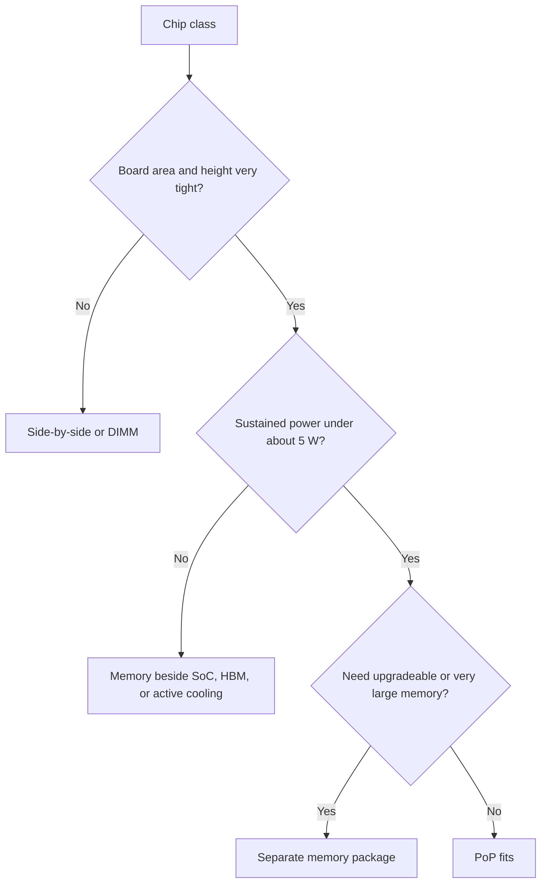

::: testing
Whether you can connect a packaging technique to the products and constraints that use it. The interviewer wants the typical PoP family (mobile application processors paired with LPDDR DRAM, plus a few compact single-board computers and small embedded SoCs), and a reasoned explanation of why those chips and not others: area, height, short low-power memory interface, moderate power, high volume. The mirror image matters too: why servers, desktop CPUs, GPUs and FPGAs don't use PoP (power and thermals, capacity, flexibility, bandwidth needs). Avoid claiming specific product facts you're unsure of; saying "commonly" and "for example" is the honest way to answer.
:::

::: why
Understanding where a technology fits tells you whether it will fit your design. If you're asked to choose a platform for a battery-powered camera, knowing that mobile application processors usually arrive with their DRAM stacked on top, that you can't choose the memory yourself, and that the board gets simpler as a result, is directly useful. It also gives you a sanity check for teardown photos and datasheets: a processor datasheet with a "PoP" ball map and a stated memory interface tells you the memory arrives by a separate part number, and the board must handle the stack's height and thermals ([[q0647]], [[q0648]]).
:::

::: concepts
- **Package-on-package structure and benefits**: memory stacked on logic, short interconnect, small area. See [[q0647]].
- **Mobile application processors**: SoCs with CPU, GPU, modem or multimedia blocks, designed for low power.
- **LPDDR memory**: the DRAM family used with them, with a wide interface and low-voltage signalling.
- **Power and thermal budgets**: why stacked memory limits the SoC's sustained power. See [[q0648]].
- **Memory capacity and bandwidth needs by product class**: phones vs servers vs GPUs.
- **Alternatives**: DIMMs/SO-DIMMs, side-by-side memory, GDDR, HBM on interposers, memory-on-package. See [[q0653]].
- **Supply chain and volume economics**: why vendor-validated stacks are attractive for huge volumes.
:::

::: answer
"The classic PoP chips are mobile application processors: the SoC in a smartphone or tablet, with LPDDR DRAM stacked on top. Many phone SoCs from the big mobile vendors have been sold or built that way, and some compact single-board computers and small embedded boards have used the same trick, for example the original Raspberry Pi stacked its SDRAM on top of the Broadcom processor. You also see it in other area-constrained, battery-powered products like wearables, cameras and some automotive infotainment modules.

Why those? Because they have the right mix of constraints. Board area and thickness are tight, so stacking the memory saves the footprint of a separate package. They use LPDDR, a wide, fast interface where a very short connection saves power and eases timing: a couple of millimetres through two substrates instead of 25 millimetres of PCB route. Their power is low enough, a few watts, that the thermal penalty from putting memory on the hot die is manageable. And the volumes are huge, so a standardised stack that a vendor tests as a unit is cheap and easy to ship.

On the other side, you don't see PoP on servers, desktop CPUs, GPUs or big FPGAs. They dissipate tens to hundreds of watts and need big heat sinks on the die; they need more memory capacity and flexibility than a stacked package gives, and their bandwidth needs go to DIMMs, GDDR or HBM instead. So the short answer is: low-power, area-constrained, high-volume SoCs with LPDDR."
:::

::: technical
**Typical PoP users.**

| Class | Examples (typical, not exhaustive) | Why PoP fits |
|---|---|---|
| Smartphone and tablet application processors | Many mobile SoCs paired with LPDDR | Area and height limits; LPDDR bandwidth; few-watt power; massive volume |
| Compact embedded/single-board computers | Some small boards with a processor and SDRAM stack | Board size and cost; simple routing; low power |
| Wearables, action cameras, drones | Small SoCs with stacked memory | Area and weight; battery |
| Automotive infotainment and cluster modules | Mobile-derived SoCs | Reuse of mobile-class devices, but with thermal care |

> [!UNCERTAIN]
> Product lineages change; foundry and vendor-specific variants exist (for example TSMC's InFO-based PoP used by some mobile processors), and whether a particular part number is PoP changes between generations and SKUs. I'm describing the pattern, not asserting the packaging of any specific chip. Check the datasheet or a teardown for the exact part.

**Typical non-PoP users and what they use instead.**

| Class | Memory approach | Reason |
|---|---|---|
| Servers, desktop and laptop CPUs | DIMM, SO-DIMM, soldered LPDDR beside the CPU | Capacity, upgradeability, power 15 to 300 W |
| GPUs and AI accelerators | GDDR on board, or HBM on an interposer | Bandwidth of hundreds of GB/s to TB/s; heat |
| FPGAs | DDR chips on board; HBM in high-end | Flexible memory choices; heavy logic power |
| Microcontrollers | On-chip flash/SRAM; small external SDRAM or PSRAM | Needs are small; cost |

**Quantifying the area benefit.** Take a 14 × 14 mm SoC (196 mm²) and an 11 × 11.5 mm LPDDR package (126.5 mm²). Side by side with a 1 mm gap and 1 mm keep-out around each, the bounding area is $(14 + 11 + 2\times1)\times14 = 378$ mm². Stacked, the footprint is the SoC's 196 mm²: a saving of 182 mm², or 48% of the side-by-side area. At 2 mm spacing the saving is 52%, at 4 mm it is 58%.

**Routing benefit.** A 16-bit LPDDR4 channel has on the order of 30 signals (16 data, 4 strobe, 2 mask, 6 command/address, 2 clock, plus chip-select and clock-enable); a 64-bit interface (four such channels) therefore has on the order of 130 high-speed nets. At 25 mm each, that is about 3.3 m of length-matched, impedance-controlled PCB routing that PoP eliminates (the nets run through the stack instead).

**Power and thermal context.** A mobile SoC in sustained use dissipates a few watts. With the thermal-circuit model of [[q0648]], the DRAM reaches its 85 °C refresh threshold at about 4 W at 25 °C ambient, which is why PoP is used in the few-watt class and not in the tens of watts.
:::

::: short
"PoP is mostly for mobile application processors, the SoCs in phones and tablets, with LPDDR stacked on top, and similar compact embedded SoCs. They fit because they're area- and height-constrained, use LPDDR where a very short link saves power and timing, run at a few watts so the thermal penalty is manageable, and ship in huge volumes. Servers, desktop CPUs, GPUs and FPGAs don't use it: too much power and heat, and they need DIMMs, GDDR or HBM for capacity and bandwidth."
:::

::: long
"The chips you find as PoP are mostly mobile application processors: the main SoC in a phone or tablet with LPDDR memory stacked on top of it. Many phone SoCs have been built that way. You also see it in small embedded boards, and as far as I remember the original Raspberry Pi stacked its SDRAM on the Broadcom chip, and in wearables, cameras and automotive infotainment modules that reuse mobile parts.

The reasons come from the constraints of those products. First, area and thickness. A phone board is tiny, and stacking the memory saves the footprint of a separate package. As an example, a 14 millimetre SoC and an 11 by 11.5 millimetre memory package side by side with a millimetre of spacing and keep-out take about 378 square millimetres; stacked, it's 196, a 48 percent saving.

Second, the memory interface. LPDDR is wide, about 130 signals for a 64-bit LPDDR4 interface, and fast, so routing it on the PCB means a few metres of length-matched, impedance-controlled trace. With PoP those nets run a few millimetres through the stack. That cuts delay from about 156 picoseconds for a 25 millimetre route to about 19, and the capacitance is lower, so I/O power is lower, which matters on a battery.

Third, power. Mobile SoCs sustain a few watts. At that level the thermal penalty of putting the memory on the hot die is manageable with copper, spreaders and throttling. Fourth, volume: a vendor-tested stack is simple for the phone maker to buy and assemble.

You don't see PoP in servers, desktop CPUs, GPUs or big FPGAs, because they dissipate tens to hundreds of watts and need a heat sink on the die, and they need much more memory capacity and bandwidth than a stacked LPDDR package gives. They use DIMMs, GDDR or HBM instead. So the pattern is low power, small area, high volume, LPDDR."
:::

::: terms
- **Application processor (AP)**: the main SoC of a phone or tablet, running the operating system.
- **LPDDR**: low-power DDR DRAM family used in mobile devices.
- **SoC**: system on chip, integrating CPU, GPU and peripherals on one die.
- **DIMM / SO-DIMM**: memory modules plugged into sockets on PCs and servers.
- **GDDR**: graphics DDR, a high-bandwidth DRAM soldered next to GPUs.
- **HBM**: high-bandwidth memory, stacked DRAM dies on an interposer next to the processor.
- **Memory-on-package**: memory dies mounted beside the SoC on a shared substrate (no second ball interface).
- **InFO-PoP**: a wafer-level fan-out based PoP variant from a foundry packaging process.
- **TDP**: thermal design power, the sustained power a cooling solution must handle.
:::

::: exceptional
**An average answer** says "phones use it" and stops.

**An exceptional answer**:
- Names the **product classes** and hedges specific examples ("commonly", "as far as I remember").
- Explains **why** with numbers: area saved (e.g. 48%), nets eliminated (≈130 nets, ≈3 m of routing), delay and capacitance, thermal ceiling (a few watts).
- Contrasts with **chips that don't use PoP** and what they use instead (DIMM, GDDR, HBM) and why.
- Links to **thermal and yield** constraints from [[q0648]] and [[q0647]].
- Mentions **supply-chain and volume** aspects and the **trend away** (memory on package, InFO, chiplets) where thermals or bandwidth demand.
- Is honest about **uncertain product facts**.
:::

::: mistakes
- **Asserting a specific product is PoP without checking.** Packaging changes by generation and SKU; hedge or verify.
- **"PoP is for high performance."** It's for compactness and low-power memory; high-performance chips use HBM or DIMMs.
- **"Servers can't use stacked memory."** They can and do (HBM, 3D stacks), but not as PoP LPDDR on the processor.
- **Mixing up PoP and chiplets or HBM.** PoP stacks packages; chiplets and HBM use interposers or advanced substrates.
- **Ignoring the thermal ceiling.** It's the main reason PoP doesn't extend to higher-power chips.
- **Saying the memory is on the same die.** In PoP the DRAM is a separate package and die.
:::

::: deep
## What kind of chip wants PoP

PoP is the answer to a specific question: "How do I connect a processor to a wide, fast, low-power DRAM in the smallest possible area, at modest power, in huge volumes?" The chips that ask this question are mobile application processors. Walk through the constraints to see why.


Figure: PoP passes three gates: area is critical, power is a few watts, and memory is fixed at assembly. Phone, tablet and similar AP-class chips pass all three; servers, GPUs and desktop CPUs fail at least one.

### Area and height

A phone board might be 60 to 70 mm wide with a battery taking most of the volume, so the logic board is a fraction of that. Every square millimetre saved on the memory footprint is a square millimetre that can go to the battery or the camera. The area example: 14 × 14 mm SoC (196 mm²) plus an 11 × 11.5 mm LPDDR package (126.5 mm²). Side by side with spacing $s$ between the packages and keep-out around each, bounding area $\approx (25 + 2s)\times14$ mm². The saving from stacking is $1 - 196/[(25+2s)\cdot14]$.

```plot
{"title":"Board area saved by stacking versus spacing between packages","x":{"label":"Package spacing and keep-out s","unit":"mm","min":0,"max":5},"y":{"label":"Area saved","unit":"%","min":0,"max":70},
 "series":[{"label":"1 − 196 / ((25 + 2s)·14)","fn":"100*(1-196/((25+2*x)*14))","color":"accent"}],
 "points":[{"x":1,"y":48.1,"label":"s = 1 mm: 48%"},{"x":4,"y":57.6,"label":"s = 4 mm: 58%"}]}
```
Figure: Even with zero spacing the stack saves 44% of the combined footprint, because the memory sits on top of area the SoC already uses. Practical keep-outs and routing channels around a separate package make the saving larger, up to the high 50s of percent at 4 mm spacing. Height is the price: the stack is taller than a single package.

### Memory interface

LPDDR4-class memory uses about 30 signals per 16-bit channel (data, strobes, masks, command/address, clock, control). A 64-bit interface therefore needs on the order of 130 high-speed nets, each length-matched and impedance-controlled on the PCB. Routing 130 nets at 25 mm is 3.3 m of controlled trace, plus layers to escape the BGA and the memory's own fan-out. With PoP these connections happen inside the stack: the PCB sees only the SoC's board balls, so layer count and routing congestion drop. The shorter links also reduce delay (156 ps → 19 ps for 25 mm → 3 mm) and capacitance (3.3 pF → ~1 pF), cutting I/O energy per transition from about 1.19 pJ to 0.36 pJ at 0.6 V ([[q0647]]).

### Power and thermal ceiling

At a few watts the SoC and DRAM can live in one thermal stack with board copper and a spreader. At 10 W or more, the junction-to-ambient resistance required for the same temperature limit falls below what a stacked package and a small enclosure can give ([[q0648]]); the memory is the binding constraint at about 4 W in the illustrative model. This is why PoP is generally paired with low-power processors and strong throttling.

### Volume and supply chain

Phone makers buy millions of identical stacks. The SoC vendor and memory vendor agree on a ball map and qualify combinations; the result is delivered as a tested unit. The product has little need for different memory sizes after design freeze. That economics suits a PoP stack but not a flexible motherboard where customers choose capacity.

## Why other chips don't use PoP

| Product | Typical power | Memory need | What it uses |
|---|---|---|---|
| Laptop CPU | 15 to 65 W | Large capacity, upgradeable (in some) | SO-DIMM, or soldered LPDDR beside the CPU |
| Desktop/server CPU | 65 to 300+ W | Hundreds of GB, many channels | DIMMs |
| GPU / AI accelerator | 100 to 700+ W | Hundreds of GB/s to TB/s | GDDR, or HBM on interposer |
| Large FPGA | 10 to 100+ W | Flexible interfaces | External DDR; HBM variants |
| Microcontroller | mW to 1 W | KB to MB | On-chip, or small external RAM |

The common thread: either power is too high for a stacked memory (heat can't escape the top), or capacity and bandwidth requirements exceed what a PoP LPDDR interface provides, or flexibility and serviceability matter. High-end mobile and laptop chips have moved to **memory on package** (memory dies next to the SoC on a shared substrate), which keeps the short link but avoids stacking memory over the hot die, so the SoC's top surface remains free for cooling.

## Examples to mention, carefully

Honest examples (with hedging) are fine: phone SoCs from major mobile vendors have commonly been shipped in PoP form with LPDDR; early Apple A-series processors were PoP and later ones used a foundry fan-out PoP variant; the original Raspberry Pi and Pi Zero boards stacked SDRAM on the Broadcom processor. All of these are public from teardowns, but details differ by generation; don't quote model-level facts you can't back up. A strong answer says "for example, many phone SoCs, and as far as I remember the original Raspberry Pi" and moves on to the reasoning.

## How PoP shows up on the design side

If you design a board around a PoP SoC, you don't route the memory interface at all. Your job is the board-level work: power delivery (the SoC's rails and the memory's rails), decoupling, thermal copper and vias, escape routing of the SoC's other interfaces, and a stencil and profile that handle the stack's warpage ([[q0644]]). If you design the stack (at a vendor), you also own the interface ball map, substrate routing, warpage control and test of the two packages.

## How the trend is moving

Where thermals or bandwidth require more, designers move away from stacking memory on the SoC: memory-on-package with the dies side by side on one substrate, wafer-level fan-out packages with memory integrated beside the SoC, or 2.5D interposers for extreme bandwidth ([[q0653]], [[q0651]]). PoP remains common in cost-sensitive mid-range mobile and embedded products because it's mature and cheap.
:::

::: applications
- **Smartphones and tablets**: application processor plus LPDDR stack.
- **Compact embedded Linux boards**: processor-with-memory stacks to keep boards small.
- **Action cameras, drones and wearables**: area and weight constraints.
- **Automotive infotainment modules and digital clusters**: mobile-derived SoCs, with automotive temperature grades.
- **Industrial handhelds and rugged tablets**: mobile platforms with long product lifecycles.
- **Reference teardown analysis**: identifying vendor, memory type and capacity from the stack.
:::

::: assumptions
The product-class pattern is broadly accurate, but individual chips vary by vendor, generation and SKU; the specific examples are hedged. Area, net-count and power numbers are illustrative for a typical LPDDR4-class mobile design: LPDDR5-class interfaces differ in signal count and speed. The thermal ceiling of about 4 to 5 W comes from the illustrative model of [[q0648]] and depends on board and enclosure. Some higher-end mobile and laptop designs now use memory-on-package rather than PoP; they are the same idea with a different thermal arrangement. A valid alternative answer lists processors by company or product line, but the reasoning is what interviewers care about. Memory vendors' stacking and ball maps differ between standards (e.g. LPDDR3, LPDDR4, LPDDR5), so a part is PoP-compatible only with specific memory families.
:::

::: followups
### Why isn't PoP used for GPUs?
GPUs dissipate 100 W or more and need very high bandwidth, hundreds of GB/s to TB/s. A stacked package over the GPU die would block the heat path, and the LPDDR interface width and speed of PoP are far too low. They use GDDR soldered around the die, or HBM stacks on a silicon interposer next to the GPU, so the GPU die's top surface stays free for a heat sink.

### If PoP gives such short links, why do some phone makers move to other packaging?
Mostly thermals and bandwidth. As SoC power rises, the memory on top limits sustained performance and the DRAM gets hot. Memory-on-package or fan-out packages with the memory beside the SoC keep short links but leave the SoC's top free for heat spreading. Also, higher memory bandwidth targets are easier with more interface pins than a stacked ball interface can offer.

### Can you buy PoP chips as a hobbyist?
Generally the stacks are sold as a pre-matched pair to large customers, and documentation and ball maps are under NDA for many mobile SoCs. Hobbyist boards use modules or single-board computers that integrate the stack for you. BGA and PoP assembly at home is impractical without X-ray and a rework station.

### What about microcontrollers with external RAM?
They rarely use PoP. Their memory needs are small and many have on-chip RAM or use PSRAM/SDRAM chips on the board; some modules stack a small SDRAM on the MCU package, but it's a niche. The key drivers of PoP, wide fast LPDDR and tight area at volume, apply to application processors.

### How would you decide between PoP and memory beside the SoC for a new product?
List the constraints: board area and height, sustained SoC power, memory capacity options, thermal budget, assembly capability, and volume. If power is under about 4 to 5 W, area is critical and the memory size is fixed, PoP fits. If the power is higher, you need flexible memory, or the product is low volume, put the memory beside the SoC (or choose memory-on-package if available). I'd also run the thermal model with realistic enclosure data before committing.

### Scenario: your team wants to use a PoP application processor in a rugged device that runs at 60 °C ambient. What concerns do you raise?
At 60 °C ambient, the headroom to 85 °C DRAM is only 25 K; in the illustrative model the DRAM slope of about 14.3 K/W gives only about 1.7 W of sustained SoC power before the refresh threshold. I'd ask for the extended-temperature memory options, a thermal design with a spreader and good conduction to the chassis, aggressive throttling, and test data at temperature. If those fall short, I'd propose a different packaging architecture or a lower-power SoC.
:::

::: interpretations
"Which chips are often PoP? Why?" invites a list, but a list of part numbers would be fragile and I'd risk stating facts I can't verify. The page answers at the level of product classes with a few hedged examples, and spends most of the effort on the "why". If the interviewer wants specific examples, mention well-known teardown facts only if you are confident, and say "as far as I remember" otherwise.
:::

::: references
- JEDEC LPDDR specifications (LPDDR4/4X/5) for the interface and signal counts; consult the current documents.
- Teardown analyses from reputable teardown organisations for specific products (verify any product-level claim there).
- Tummala, *Fundamentals of Microsystems Packaging*, chapter on stacked packages and system integration.
- Manufacturer application notes on PoP assembly and board-level reliability from the package vendors.
:::

::: rubric
- Names the main PoP users: mobile application processors with LPDDR :: The direct answer.
- Gives other plausible users (small embedded boards, wearables, cameras, infotainment) with hedging :: Shows breadth and honesty.
- Explains why: area, short interface, power, volume :: The "why" is the substance.
- Quantifies a benefit (area saved, nets eliminated, delay) :: Shows engineering reasoning.
- Explains why servers, GPUs, FPGAs, desktop CPUs don't use PoP :: Shows the boundary of the technique.
- Mentions thermal ceiling and trend toward memory-on-package and other approaches :: Shows current awareness.
- Avoids unverified product-specific claims :: Avoids fabrication.
:::

::: quiz
```json
[
 {"type":"mcq","level":"fundamental","q":"Which kind of chip is most commonly found as a PoP stack?","options":["Server CPU","Mobile application processor with LPDDR","High-end GPU","Analog op-amp"],"answer":1,"explain":"Mobile application processors with LPDDR stacked on top are the classic PoP product."},
 {"type":"mcq","level":"fundamental","q":"Why are GPUs not built as PoP stacks?","options":["They don't use memory","Power and bandwidth needs are far beyond what a stacked LPDDR package and its thermal path can provide","They are too small","PoP is patented"],"answer":1,"explain":"GPUs dissipate high power and need huge bandwidth, so they use GDDR or HBM beside the die with a free top surface for cooling."},
 {"type":"numeric","level":"intermediate","q":"SoC 14 × 14 mm; DRAM 11 × 11.5 mm. Side by side with 1 mm gap and 1 mm keep-out each side gives (14 + 11 + 2) × 14 mm. What fraction (%) of that area does PoP save?","answer":48.1,"tolerance":0.02,"unit":"%","explain":"Side-by-side area = 27 × 14 = 378 mm²; stacked = 196 mm²; saving = 1 − 196/378 = 48.1%."},
 {"type":"numeric","level":"intermediate","q":"About 130 LPDDR nets at 25 mm each: how many metres of controlled routing does PoP eliminate?","answer":3.25,"tolerance":0.03,"unit":"m","explain":"130 × 25 mm = 3250 mm = 3.25 m."},
 {"type":"numeric","level":"advanced","q":"Using the DRAM slope of 14.3 K/W from the thermal model, what sustained SoC power (W) keeps the DRAM bottom below 85 °C at 60 °C ambient?","answer":1.75,"tolerance":0.05,"unit":"W","explain":"(85 − 60)/14.3 = 1.75 W."},
 {"type":"truefalse","level":"intermediate","q":"PoP stacks bare DRAM dies on the processor die using through-silicon vias.","answer":false,"explain":"That describes die stacking such as HBM. PoP stacks two complete packages joined by solder balls."}
]
```
:::
