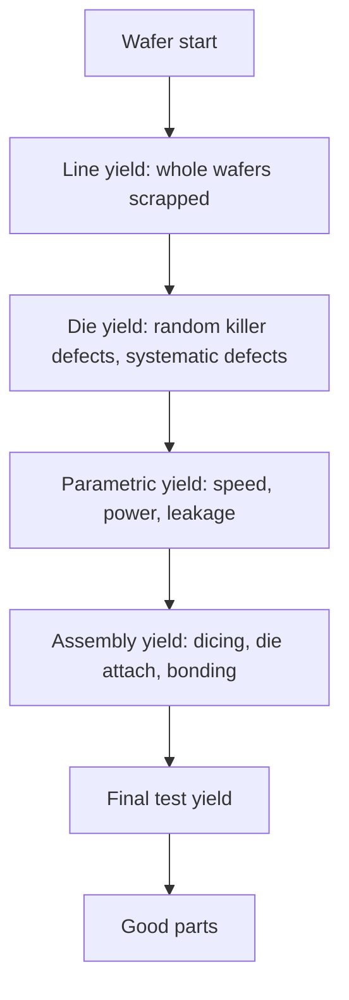

::: testing
Whether you understand yield as a statistical, economic and design problem, not just "some chips are bad". The interviewer wants the definition (fraction of good dies or good parts at each stage), the main drivers (defect density, die area, process maturity, systematic versus random defects), at least one model with a number ($Y = e^{-AD_0}$ and its variants), how yield feeds cost per good die, and the practical levers (redundancy, binning, design-for-manufacturing rules, smaller dies and chiplets, process learning). A candidate who also separates fab yield, wafer-sort yield, assembly yield and final-test yield, and multiplies them, shows system-level thinking.
:::

::: why
Yield decides whether a chip is profitable. A large die on a young process can have single-digit yield; a small die on a mature process can exceed 95%. Architects pick die sizes, core counts, SRAM redundancy and chiplet boundaries by yield. As a hardware engineer you meet yield in conversations about cost, binning ("this is the six-core version"), supply shortages, and why the biggest chips are the most expensive per unit area. It also links directly to [[q0651]] (why not make giant single dies) and [[q0652]] (chiplets), which are yield-driven answers.
:::

::: concepts
- **Yield**: fraction of units (wafers, dies, packaged parts) that pass. See [[q0645]].
- **Defect density ($D_0$)**: killer defects per unit area, typically per cm².
- **Die area ($A$)**: bigger area catches more defects.
- **Yield models**: Poisson, Murphy, Seeds, negative binomial (clustering).
- **Systematic vs random defects**: pattern-related (lithography, CMP hotspots) vs particles and contamination.
- **Parametric yield and binning**: dies that work but miss speed or power targets are sold in lower bins.
- **Redundancy and repair**: spare rows or cores to salvage dies with a defect.
- **Cost per good die**: wafer cost over dies per wafer times yield. See [[q0645]].
:::

::: answer
"Yield is the fraction of units that work, and for chips it shows up at several stages: fab or line yield for whole wafers, die yield at wafer sort, assembly yield after packaging, and final-test yield. They multiply, so a 98% line yield, 90% die yield, 99% assembly and 98% final test give about 86% overall.

The core idea is that defects, like particles, scratches or process excursions, land randomly on the wafer with some density $D_0$ per square centimetre. A die is killed if a killer defect lands in it, so the simplest model, Poisson, gives $Y = e^{-AD_0}$. With $D_0 = 0.1$ per cm², a 1 cm² die yields about 90%, and a 6 cm² die about 55%, so yield falls exponentially with area. Real defects cluster, so models like Murphy or negative binomial are a bit less pessimistic for large dies.

That drives cost: cost per good die is wafer cost over the number of dies per wafer times yield, so big dies are doubly penalised, fewer fit and fewer work. Designers fight back in several ways. They keep dies small or split them into chiplets. They add redundancy, such as spare SRAM rows or extra cores, so a single defect doesn't kill the die: an 8-core chip with one spare core can go from about 87% to 94% yield in my example. They sell partially defective dies as lower bins. They follow foundry design rules for yield, like double vias. And the foundry drives $D_0$ down as the process matures, which is why a new node is expensive and a mature one cheap. Beyond defects there's parametric yield, where dies work but are too slow or leaky, and that's handled by speed binning."
:::

::: technical
**Stage yields multiply.** Overall yield $Y = Y_{line}\,Y_{die}\,Y_{assembly}\,Y_{test}$. For example $0.98\times0.90\times0.99\times0.98 = 0.856$.

**Yield models for die yield** with area $A$ (cm²) and defect density $D_0$ (cm⁻²), $\lambda = AD_0$:

| Model | Formula | Notes |
|---|---|---|
| Poisson | $Y = e^{-\lambda}$ | Random uniform defects; pessimistic for large dies |
| Murphy | $Y = \left(\frac{1 - e^{-\lambda}}{\lambda}\right)^2$ | Defect density varies across wafer |
| Seeds | $Y = \frac{1}{1+\lambda}$ | Strong clustering; optimistic |
| Negative binomial | $Y = (1 + \lambda/\alpha)^{-\alpha}$ | Clustering parameter $\alpha$ (about 2 to 5 typical); reduces to Poisson as $\alpha\to\infty$ |

With $D_0 = 0.1$ cm⁻²:

| Area (cm²) | Poisson | Murphy | Seeds | Neg. binomial ($\alpha = 3$) |
|---|---|---|---|---|
| 0.5 | 0.951 | 0.951 | 0.952 | 0.952 |
| 1 | 0.905 | 0.906 | 0.909 | 0.906 |
| 2 | 0.819 | 0.821 | 0.833 | 0.824 |
| 4 | 0.670 | 0.679 | 0.714 | 0.687 |
| 6 | 0.549 | 0.565 | 0.625 | 0.579 |
| 8 | 0.449 | 0.474 | 0.556 | 0.492 |

They agree for small dies and diverge for large ones; which model fits depends on the fab's data.

**Cost per good die.** $C_{die} = \dfrac{C_{wafer}}{\text{DPW}\cdot Y}$ with $\text{DPW} \approx \frac{\pi d^2}{4A} - \frac{\pi d}{\sqrt{2A}}$. For 300 mm and an illustrative USD 10 000 wafer: 100 mm² gives 640 dies at 90.5%, USD 17.3; 800 mm² gives 64 dies (65 by the continuous formula) at 44.9%, USD 348 ([[q0645]]).

**Redundancy and salvage.** Take a die of 140 mm² with an uncore of 60 mm² (must be defect-free) and 8 identical cores of 10 mm² each, $D_0 = 0.1$ cm⁻². Uncore yield: $e^{-0.06} = 0.9418$. Per-core yield $p = e^{-0.01} = 0.99005$. All eight cores good: $p^8 = 0.9231$, so die yield $0.9418\times0.9231 = 86.9\%$. If a die with at most one bad core can be sold as a 7-core part: $P(\geq7) = p^8 + 8p^7(1-p) = 0.9973$, giving $0.9418\times0.9973 = 93.9\%$, a 7-point gain. Spare SRAM rows work the same way at a finer grain.

**Defect density evolves.** On a new process $D_0$ may be several times the mature value. For a 1 cm² die: $D_0 = 0.5$ gives 60.7%, 0.3 gives 74.1%, 0.1 gives 90.5%. For a 6 cm² die: 5.0%, 16.5%, 54.9%. That exponential sensitivity is why large dies arrive on a node only after $D_0$ drops.

> [!UNCERTAIN]
> Foundry defect densities and wafer prices are confidential and vary by node and maturity; the values here are illustrative round numbers. Real yield includes parametric loss, edge effects, and systematic defects not captured by these models.
:::

::: short
"Yield is the fraction of good units, and it multiplies across stages: line, die, assembly and test. For die yield the basic model is Poisson, $Y = e^{-AD_0}$: with 0.1 defects per cm², a 1 cm² die is about 90% and a 6 cm² die about 55%, so area hurts exponentially. That plus fewer dies per wafer makes big dies much more expensive per good die. Designers respond with smaller dies or chiplets, redundancy, binning, design-for-yield rules, while the foundry drives defect density down as the process matures."
:::

::: long
"Yield is the fraction of units that work, and for chips it's measured at several stages that multiply: wafer or line yield, die yield at wafer sort, assembly yield after packaging, and final test. Say 98, 90, 99 and 98 percent, and the overall is about 86.

The central driver is defects. Particles, scratches and process excursions land on the wafer at some density, say 0.1 killer defects per square centimetre. A die dies if one lands on it, so the simplest model is Poisson: yield equals e to the minus area times defect density. At 0.1 per cm², a 1 cm² die yields 90 percent, 2 cm² gives 82, and 6 cm² gives 55. Real defects cluster, so Murphy or negative binomial models are slightly more optimistic for big dies, but the message is the same: yield falls exponentially with area. Combine that with fewer dies per wafer, and cost per good die grows much faster than area. On a ten-thousand-dollar wafer, a 100 square millimetre die is about 17 dollars and an 800 square millimetre one about 350.

There are other yield terms. Systematic defects come from layout patterns that print badly; foundries publish recommended rules and designers use double vias and wider spacing where area allows. Parametric yield is dies that work but are too slow or leaky, so chips are speed-binned and sold at different grades.

The levers: keep dies small or use chiplets; add redundancy, like spare SRAM rows or extra cores, so one defect doesn't kill the die. In an example with eight cores of 10 square millimetres and a 60 square millimetre uncore, allowing one bad core lifts the yield from about 87 to 94 percent. And the foundry improves defect density with maturity: that same 6 cm² die is 5 percent yield at 0.5 defects per cm² and 55 percent at 0.1, which is why big chips wait until a process matures."
:::

::: terms
- **Yield**: fraction of units that pass at a given stage.
- **Defect density ($D_0$)**: killer defects per cm².
- **Killer defect**: a defect large or placed so that it makes a die fail.
- **Poisson / Murphy / Seeds / negative binomial**: models of die yield versus area and defect density.
- **Clustering parameter ($\alpha$)**: negative binomial parameter that sets how clustered defects are.
- **Parametric yield**: dies functionally good but outside speed, power or leakage specs.
- **Binning**: sorting good dies by performance and selling them as different products.
- **Redundancy / repair**: spare elements (rows, columns, cores) that replace defective ones.
- **Known good die (KGD)**: die tested before assembly into a multi-die package.
- **Learning curve**: improvement of yield over time as the process matures.
:::

::: exceptional
**An average answer** says "some chips come out defective, so yield is the percentage that work".

**An exceptional answer**:
- Splits **yield by stage** and multiplies them (with numbers).
- Presents the **Poisson model**, explains its assumptions, and mentions **Murphy/negative binomial** for clustering.
- Computes **examples** (1, 2, 6 cm² at 0.1 cm⁻²) and ties them to **cost per good die**.
- Distinguishes **random vs systematic vs parametric** loss.
- Describes **levers** quantitatively: redundancy (87% → 94% in an example), binning, chiplets, DFM rules, process learning.
- Notes **wafer-edge** and **reticle** effects and that foundry numbers are **confidential**.
- Connects to **chiplets and giant dies** ([[q0651]], [[q0652]]).
:::

::: mistakes
- **Treating yield as a fixed number for a node.** It depends on die area, design, and process maturity.
- **Using Poisson for everything.** Fine for a rough estimate; real fabs fit clustered models to data.
- **Ignoring packaging and test yield.** Multi-die and stacked packages lose more after assembly ([[q0647]]).
- **Equating yield with dies per wafer.** DPW is geometry; yield is the fraction that work.
- **Forgetting parametric loss.** A functional die may still be unsellable at the target speed or power.
- **Thinking redundancy is free.** It uses area and design effort, and it only helps where the defect can be repaired.
:::

::: deep
## Where the losses come from

A wafer goes through hundreds of steps, and at each step something can go wrong. Group the losses.


Figure: Each box removes some units. The first box loses whole wafers, the second loses dies to defects, the third loses dies that work but miss specs (which binning can partly recover), and the last two lose parts to packaging and test. The product of the stage yields is the number the business cares about.

**Random defects.** Particles, scratches, resist defects, and contamination. They occur anywhere and kill dies in proportion to area. Controlled by clean rooms, process control and inspection.

**Systematic defects.** Layout features that print or etch poorly: dense-to-isolated transitions, narrow spaces, hotspot patterns in lithography or chemical-mechanical polishing. They hit every die that contains the pattern, so the fix is in design rules and layout (and in the process recipe). Design-for-manufacturing rules, and recommended (relaxed) rules, such as double vias or wider spacing, trade area for yield.

**Parametric loss.** Variation in transistor threshold, length and resistance means that identical dies differ in speed and leakage. Dies outside spec are lost, or sold in lower bins.

**Edge and shot-map effects.** Dies at the wafer edge are partial or have lower yield from process non-uniformity. Large dies waste more of the edge ([[q0645]]).

## Yield versus area

```plot
{"title":"Die yield versus area at D0 = 0.1 per cm²","x":{"label":"Die area","unit":"cm²","min":0,"max":9},"y":{"label":"Yield","unit":"","min":0,"max":1.02},
 "vars":{"d":0.1,"al":3},
 "series":[{"label":"Poisson","fn":"exp(-x*d)","color":"red"},{"label":"Murphy","fn":"((1-exp(-x*d))/(x*d))^2","color":"orange"},{"label":"Negative binomial (α = 3)","fn":"(1+x*d/al)^(-al)","color":"blue"},{"label":"Seeds","fn":"1/(1+x*d)","color":"green"}]}
```
Figure: At small areas all models agree. At 8 cm² (800 mm²) Poisson says 45%, Murphy 47%, negative binomial 49% and Seeds 56%. Clustering helps large dies because defects pile up on a few dies and leave others clean. The practical lesson is the same: yield falls fast with area, and the model is chosen to match the fab's measured data.

**Why Poisson is pessimistic for big dies.** Poisson assumes defects are independent and uniform. Real defects cluster (the same particle shower or scratch kills many things nearby) so for a given average count some dies get several defects and others none, which gives more zero-defect dies than Poisson predicts. The negative-binomial $\alpha$ captures that: small $\alpha$ means heavy clustering.

## Cost impact

For wafer cost $C_w$: $C_{die} = C_w/(\text{DPW}\cdot Y)$. Compare areas at $D_0 = 0.1$ with a USD 10 000 wafer:

| Area (mm²) | DPW | Y (Poisson) | Cost per good die (USD) |
|---|---|---|---|
| 25 | 2694 | 97.5% | 3.8 |
| 100 | 640 | 90.5% | 17.3 |
| 200 | 306 | 81.9% | 39.9 |
| 400 | 143 | 67.0% | 104 |
| 800 | 64 | 44.9% | 348 |

An 8× area increase from 100 to 800 mm² raises cost per good die 20×. The extra factor of 2.5 beyond area comes from the combined effect of lower yield (2×) and edge loss (about 1.25×: 640/8 = 80 would be the DPW without edge penalty, and 64 is 20% less).

## Design for yield

1. **Keep dies as small as the product allows**, or partition into chiplets ([[q0652]]).
2. **Redundancy.** Memory (SRAM, DRAM, flash) arrays include spare rows and columns repaired at wafer sort by fuses; large processors include spare cores or units. Random defects in uniform arrays are then largely recoverable.
3. **Binning and salvage.** Products with fewer cores, lower clocks, or less cache are made from partly defective or slower dies, the same silicon sold as different SKUs.
4. **Recommended design rules.** Use the foundry's yield-enhancing rules: redundant vias, wider spacing and wire widths, dummy fill for uniform polishing, and avoid hotspot patterns.
5. **Test coverage and diagnostics.** Better test finds more bad dies early and gives data for yield learning.
6. **Yield-aware floorplanning.** Put critical single-point-of-failure blocks away from weaker regions, and keep non-redundant area as small as possible.

The earlier example shows redundancy's value: an eight-core die with 60 mm² uncore and 80 mm² of cores at $D_0 = 0.1$ yields 86.9% if all cores must work, and 93.9% if one bad core may be disabled. The cost is the extra silicon (none if the "spare" is just a core the chip would have anyway sold as a lower bin).

## Learning curve

A new process starts with high $D_0$ and improves over quarters as the fab finds and fixes yield detractors. Because yield is exponential in $AD_0$, big dies benefit most from learning:

| $D_0$ (cm⁻²) | 1 cm² die | 6 cm² die |
|---|---|---|
| 0.5 | 60.7% | 5.0% |
| 0.3 | 74.1% | 16.5% |
| 0.1 | 90.5% | 54.9% |
| 0.05 | 95.1% | 74.1% |

This is why products on a new node often start with small dies (phone SoCs) and big dies (server, GPU) come later, or come as chiplets.

## Beyond the die: packaging and assembly yield

After sorting, good dies are cut, attached, wire-bonded or bumped, encapsulated and tested. Each step has its own yield (typically high, 98 to 99.9%, but it multiplies). In multi-die packages the problem compounds: a package with $n$ dies of yield $y$ each has $y^n$ unless dies are tested first (known good die). A stacked memory with 8 dies at 99% each and no pre-test is 92.3%. [[q0647]] gave the PoP example; HBM and chiplet products rely on KGD testing for this reason ([[q0651]]).

## What can't be computed from the textbook

Real yield learning uses wafer maps, defect inspection data, electrical test signatures, and statistics to separate random from systematic loss. Foundry defect densities are confidential and customers see only whether a product meets its yield and cost targets. When estimating, use ranges and sensitivity: what if $D_0$ is twice as high, or the die 20% bigger? Yield's exponential nature makes that sensitivity large.
:::

::: applications
- **Die-size decisions**: choosing between a monolithic die and chiplets based on yield and cost.
- **Product line planning**: using binning to sell partly defective dies as lower SKUs.
- **Memory design**: spare rows and columns repaired at wafer sort.
- **Foundry process development**: tracking $D_0$ and yield learning on new nodes.
- **Pricing and supply**: predicting cost per good die and capacity.
- **Design-for-manufacturing**: using recommended rules, dummy fill and hotspot checks.
:::

::: assumptions
The models assume independent defects of a single killer type; reality has several defect types with different sizes, layers and clustering. $D_0$ is treated as constant across the wafer, whereas edge regions and process non-uniformity change it. Wafer prices and defect densities are illustrative: they vary by node, foundry and time, and aren't public. The redundancy example assumes defects in cores are independent and that the uncore cannot be repaired; in practice some uncore (caches) can. Parametric yield and speed binning are described qualitatively because they depend on the product. Different companies define "yield" at different points (wafer sort yield, final yield, cumulative yield), so check the definition when comparing numbers. For mature analog nodes, yields above 95% are common even for moderately sized dies.
:::

::: followups
### Why does yield fall so fast with die area?
Because the expected number of killer defects per die is $\lambda = AD_0$ and the probability of zero defects is $e^{-\lambda}$ (Poisson). With $D_0 = 0.1$ cm⁻², each additional cm² multiplies yield by $e^{-0.1} = 0.905$: 1 cm² gives 90.5%, 2 gives 81.9%, 4 gives 67.0%, 8 gives 44.9%. Clustering models soften it a little, but the exponential trend is the same. And a bigger die also means fewer dies per wafer, so cost grows faster than area.

### How do designers raise yield beyond waiting for the fab to improve?
Redundancy (spare memory rows and columns, extra cores), binning (sell partly defective or slower dies as lower SKUs), design-for-manufacturing rules (double vias, relaxed spacing, dummy fill), smaller dies or chiplets, and better test and diagnostics. In an example with eight cores and a 60 mm² uncore, allowing one bad core raises yield from 86.9% to 93.9%.

### What's the difference between functional yield and parametric yield?
Functional yield counts dies that work logically; parametric yield counts dies that also meet speed, power and leakage specs. Process variation spreads those quantities, so some working dies are too slow or too leaky for the target bin. Companies handle it with binning: the same die is sold as different grades, so a parametric miss is often a lower price rather than a total loss.

### How do the yields at different stages combine?
They multiply when the stages are independent. A 98% line yield, 90% die yield, 99% assembly and 98% final test give 85.6% overall. In multi-die packages, die yields also multiply (n dies at yield y gives $y^n$) unless dies are tested before assembly, so known-good-die testing is essential for chiplets and stacks.

### Why do new nodes start with small chips?
Defect density is highest early in a process's life, and yield is exponential in $AD_0$. At $D_0 = 0.5$ cm⁻² a 1 cm² die yields 61% but a 6 cm² die only 5%. Small dies are economically viable first; as $D_0$ falls to about 0.1, large dies become practical (55% at 6 cm²). That's why phone SoCs lead and big server or GPU dies follow, or use chiplets.

### Scenario: your 600 mm² die has 35% yield and the target is 60%. What do you propose?
First find out what's limiting yield: random defects (check the yield-versus-area slope and wafer maps), systematic hotspots (look for failures at repeating locations), or parametric fallout. If it's random, with $\lambda = -\ln0.35 = 1.05$ and $A = 6$ cm², $D_0 \approx 0.175$ cm⁻²; reaching 60% needs $\lambda = 0.51$, i.e. $D_0 \approx 0.085$, about half, or a smaller area (about 2.9 cm²). Options: add redundancy and salvage bins (which can lift effective yield), split into chiplets (e.g. two 300 mm² dies at about 59% each, tested first), apply DFM fixes, and wait for process learning. I'd quantify each against its cost and schedule.
:::

::: interpretations
"Describe any yield considerations when fabricating chips" is open-ended. The page covers the full list: yield stages, defect-driven die yield with models, cost per good die, parametric yield and binning, redundancy, DFM, process learning and assembly/test yield. In an interview, pick the three or four that match the follow-up: area vs yield and cost is the safest core. "Yield" in PCB assembly ([[q0635]]) uses the same maths with joints instead of dies.
:::

::: references
- Hennessy and Patterson, *Computer Architecture: A Quantitative Approach*, section on integrated circuit cost (dies per wafer and yield models).
- Stapper, Armstrong and Saji, "Integrated circuit yield statistics", for yield models (negative binomial and clustering); a classic reference, consult the literature.
- Rabaey, Chandrakasan and Nikolic, *Digital Integrated Circuits*, discussion of manufacturing and yield.
- May and Spanos, *Fundamentals of Semiconductor Manufacturing and Process Control*, chapters on yield modelling.
:::

::: rubric
- Defines yield and separates stages (line, die, assembly, test), multiplying them :: Shows system view.
- Presents a defect-density model with numbers (Poisson, e^{-AD0}) :: Core quantitative content.
- Explains why large dies are doubly penalised (fewer per wafer, lower yield) :: Link to cost.
- Mentions clustering and alternative models :: Shows awareness of limits.
- Distinguishes random, systematic and parametric yield :: Shows depth.
- Lists levers: redundancy, binning, DFM rules, smaller dies/chiplets, process learning :: Practical engineering.
- Notes confidentiality and illustrative nature of numbers :: Honesty about uncertainty.
:::

::: quiz
```json
[
 {"type":"mcq","level":"fundamental","q":"Which statement about die yield is correct for random defects?","options":["Yield increases with die area","Yield falls roughly exponentially with die area","Yield is independent of die area","Yield only depends on wafer size"],"answer":1,"explain":"With Poisson statistics, Y = e^{-A D0}, so yield falls exponentially as area grows."},
 {"type":"mcq","level":"fundamental","q":"What is binning?","options":["Throwing away defective dies","Sorting working dies by speed or features and selling them as different products","Packing dies into bins for shipping","Measuring wafer thickness"],"answer":1,"explain":"Binning recovers value from dies that work but differ in speed, power or number of functional blocks."},
 {"type":"numeric","level":"intermediate","q":"Poisson yield for a 2 cm² die with D0 = 0.1 cm⁻² (%)?","answer":81.9,"tolerance":0.01,"unit":"%","explain":"Y = e^{-0.2} = 0.8187, so 81.9%."},
 {"type":"numeric","level":"intermediate","q":"Overall yield from line 98%, die 90%, assembly 99% and final test 98% (%)?","answer":85.6,"tolerance":0.01,"unit":"%","explain":"0.98 × 0.90 × 0.99 × 0.98 = 0.8557, i.e. 85.6%."},
 {"type":"numeric","level":"advanced","q":"A die has 60 mm² uncore that must be perfect and eight 10 mm² cores, D0 = 0.1 cm⁻². If one bad core is allowed, what is the die yield (%)? (Per-core yield p = e^{-0.01}; P(≥7 good) = p^8 + 8p^7(1−p).)","answer":93.9,"tolerance":0.01,"unit":"%","explain":"Uncore = e^{-0.06} = 0.9418; cores P(≥7) = 0.9973; product = 0.9393, i.e. 93.9%."},
 {"type":"truefalse","level":"intermediate","q":"If a 600 mm² die yields 35% under a Poisson model, halving D0 would raise its yield above 55%.","answer":true,"explain":"λ = −ln 0.35 = 1.05; halving D0 gives λ = 0.525, Y = e^{-0.525} = 0.59, which is above 55%."}
]
```
:::
