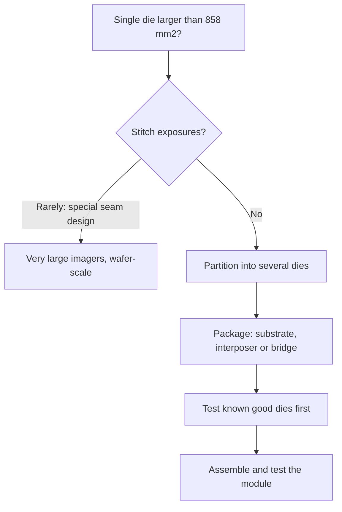

::: testing
Whether you can reason about the limits of a single die from physics, economics and manufacturing, then explain the engineering workarounds. The interviewer wants three layers. First, the hard limit: the **reticle** (the scanner exposes about 26 × 33 mm = 858 mm² at once). Second, the soft limit: **yield falls exponentially with area**, so cost per good die explodes. Third, the practical issues: power delivery, heat, clock distribution, defect tolerance. Then the workarounds: chiplets and advanced packaging (interposers, bridges, stacking), stitching, redundancy and routing around defects (wafer-scale integration), and known-good-die testing. A candidate who computes the yield and cost gap between a monolithic die and chiplets, and who knows that wafer-scale chips exist, gives an exceptional answer.
:::

::: why
This question links physics (optics), statistics (yield), economics (cost per good die) and system design (packaging). It explains why server processors and GPUs are increasingly built from multiple dies, why "chiplet" is everywhere in roadmaps, and why a few companies sell wafer-scale engines. If you ever have to choose between a big die and a multi-die module, or interpret a vendor's claim of "two dies acting as one", you need this model. It also trains the habit of sanity-checking a spec with a quick calculation.
:::

::: concepts
- **Reticle limit**: the lithography scanner's maximum exposure field, about 26 × 33 mm. See [[q0661]] and [[q0645]].
- **Yield versus area**: $Y = e^{-AD_0}$ and its variants. See [[q0650]].
- **Cost per good die**: wafer cost divided by dies per wafer times yield. See [[q0645]].
- **Redundancy and defect tolerance**: spare units and routing around defects. See [[q0650]].
- **Chiplets and advanced packaging**: several dies in one package via substrates, interposers, bridges or 3D stacking. See [[q0652]], [[q0653]].
- **Die-to-die interfaces**: high-bandwidth, short links between dies; latency, energy and area costs.
- **Power and thermal limits**: current delivery and heat removal from a very large die. See [[q0648]].
:::

::: answer
"There are three reasons, from hardest to softest. The hardest is the **reticle limit**. The lithography scanner exposes the mask pattern in a field of about 26 by 33 millimetres, which is about 858 square millimetres, so a die can't normally be bigger than that. Making a larger chip needs stitching several exposures together, which is only done in special cases.

The second is **yield and cost**. Random defects kill a die in proportion to its area: with Poisson statistics, yield is e to the minus area times defect density. At 0.1 defects per square centimetre, a 100 square millimetre die yields about 90 percent, but an 858 square millimetre die about 42 percent. And fewer big dies fit on a 300 millimetre wafer, about 59 instead of 640. On a ten-thousand-dollar wafer that's about 17 dollars per good small die versus about 400 for the reticle-sized one.

The third is physical design: delivering hundreds of amps, distributing a clock across a huge area, removing heat, and wires that are long and slow.

The workarounds are mostly about breaking the die up. **Chiplets**: build several smaller dies, which have much better yield, test them before assembly, and connect them in one package using a silicon interposer, bridge or organic substrate with very short, wide links. Four 215 square millimetre dies at 81 percent yield cost around half as much as one 858 square millimetre die in my example, even with a 10 percent area overhead for the die-to-die interfaces. Second, **redundancy**: spare cores, memory rows and routing around defects. The extreme case is wafer-scale, where a company builds a chip as big as the wafer, 46,000 square millimetres, out of hundreds of thousands of tiny cores, with enough spares and reconfigurable routing that a few dozen defects don't matter. The price is the packaging, power and cooling for something that size, and the cost of the die-to-die link, which is slower and more energy-hungry than on-die wires."
:::

::: technical
**1. Reticle limit.** A stepper/scanner exposes a field of about 26 mm × 33 mm = 858 mm² through the mask (reticle), then steps to the next position. Dies larger than the field can't be exposed in one shot. (High-NA EUV scanners have a smaller field, about half: 26 × 16.5 = 429 mm², which makes the limit tighter for the newest tools.) Stitching, in which two or more exposures are aligned across a seam, is possible but needs special design of the seam region; some very large imagers and wafer-scale chips use it.

**2. Yield.** With Poisson yield $Y = e^{-AD_0}$ and $D_0 = 0.1$ cm⁻²:

| Die area | Gross dies (300 mm) | Yield | Good dies | Cost per good die (USD 10 000 wafer) |
|---|---|---|---|---|
| 100 mm² | 640 | 90.5% | 579 | 17.3 |
| 215 mm² | 283 | 80.7% | 228 | 43.8 |
| 429 mm² | 132 | 65.1% | 86 | 116 |
| 858 mm² | 59 | 42.4% | 25 | 400 |

**3. Chiplet versus monolithic.** To replace one 858 mm² die with four chiplets, add about 10% area for die-to-die interfaces: four dies of 236.5 mm². Each has gross dies 255, yield 78.9%, so 201 good dies: USD 49.7 each, USD 199 for four. Adding assembly yield of $0.99^4 = 0.96$ and the packaging cost, the silicon cost is roughly half the monolithic die's USD 400, and the dies are tested before assembly (known good die).

> [!UNCERTAIN]
> The wafer price (USD 10 000), defect density (0.1 cm⁻²) and the 10% interface overhead are illustrative; real numbers are confidential and product specific. Packaging costs (interposer, bonding, extra test) can erase part of the saving, and the right partition depends on the design.

**4. Wafer-scale integration.** The largest commercial examples use nearly the whole wafer: about 46 000 mm² (≈ 462 cm²) holding hundreds of thousands of cores. The expected number of killer defects at $D_0 = 0.1$ is $462\times0.1 = 46$, so the probability of zero defects is $e^{-46} \approx 8\times10^{-21}$: a defect-free wafer is impossible. It works because the design is a regular array of tiny cores (about 0.05 mm² each, if there are on the order of 850 000 of them) with spare cores and reconfigurable routing: each defect disables at most a core or a link, so 46 defects out of 850 000 cores is 0.005%.

> [!UNCERTAIN]
> Specific product figures (core counts, transistor counts, areas) are as publicly reported by the vendor for the 2021 to 2024 generation of wafer-scale engines and may be revised; treat them as order-of-magnitude.

**5. Physical-design limits.** Power: a 800 mm² die at 400 W and 0.8 V draws 500 A, and the delivery network must supply it with millivolt droop (target impedance $\approx 0.05\,V_{DD}/I \approx 80\ \mu\Omega$). Clock: skew across 30 mm is hard to control. Interconnect: a wire 30 mm long has high RC and a time of flight of 200 ps at about 6.7 ps/mm in dielectric, so architectures partition. Thermal: heat flux and hot spots require good cooling and cause warpage. Mechanical: large dies warp and crack.
:::

::: short
"The hard limit is the reticle: the scanner exposes about 26 by 33 millimetres, around 858 square millimetres, in one shot. The softer, economic limit is yield: it falls exponentially with area, so an 858 square millimetre die yields about 42% at 0.1 defects per cm² versus 90% at 100 square millimetres, and fewer dies fit on a wafer, so cost per good die is about 20 times higher. Workarounds: chiplets in one package with short, wide die-to-die links, tested before assembly; redundancy; and for wafer-scale chips, tiny repeated cores with spares and routing around defects."
:::

::: long
"There are a few layers to this. The hard limit is the reticle. The lithography scanner exposes the mask in a field of about 26 by 33 millimetres, roughly 858 square millimetres, then steps to the next spot on the wafer. A die bigger than that field can't be printed in a single exposure, and stitching exposures together is possible but only done for special designs.

The economic limit is yield. Random defects kill a die in proportion to its area. With Poisson statistics, yield is e to the minus area times defect density. At 0.1 defects per square centimetre, a 100 square millimetre die yields 90 percent and a full-reticle 858 square millimetre die about 42. Fewer big dies fit on the wafer too, about 59 on a 300 millimetre wafer instead of 640, so on an illustrative ten-thousand-dollar wafer the cost per good die goes from about 17 dollars to about 400, for 8.6 times the area.

Then physical design: you need hundreds of amps at a fraction of a volt with tiny droop, clock distribution over 30 millimetres, long slow wires, and heat flux and warpage in a very large piece of silicon.

The workarounds start with splitting the design into chiplets. Four dies of about 215 square millimetres each yield about 81 percent. Even adding 10 percent area for die-to-die interfaces, the silicon costs around 200 dollars instead of 400, and each die is tested before assembly. They go into one package with a silicon interposer, a bridge, or an advanced organic substrate, connected by short, wide links. The costs are the packaging, the extra latency and the energy of die-to-die communication, and the need to partition the design.

Second, redundancy: spare cores, memory rows and caches. The extreme example is wafer-scale: one company builds a processor the size of the wafer, about 46,000 square millimetres, from roughly a million tiny cores. At 0.1 defects per square centimetre you expect about 46 defects, so a perfect wafer is essentially impossible, but each defect kills one tiny core of about 0.05 square millimetres, and spares and reconfigurable routing hide them. It works, but needs bespoke packaging, power delivery and cooling."
:::

::: terms
- **Reticle / mask**: the photomask whose pattern is projected onto the wafer; its field size limits die size.
- **Reticle limit**: maximum die size in one exposure, about 858 mm² for standard scanners.
- **Stitching**: aligning multiple exposures to build a structure larger than the reticle.
- **Chiplet**: a small die designed to be combined with others in one package.
- **Interposer**: intermediate substrate (often silicon) providing very fine-pitch wiring between dies.
- **Bridge (e.g. embedded)**: small silicon piece embedded in the package substrate connecting adjacent dies.
- **Known good die (KGD)**: die tested before assembly.
- **Wafer-scale integration**: building a system across (nearly) a whole wafer.
- **Die-to-die (D2D) interface**: short-reach, high-bandwidth link between chiplets.
- **Defect tolerance**: design features that let a chip work despite some defects.
:::

::: exceptional
**An average answer** says "bigger chips have more defects so they are expensive and some are too big for the lithography".

**An exceptional answer**:
- States the **reticle limit** with numbers (26 × 33 mm = 858 mm²; half for high-NA EUV) and what **stitching** is.
- Computes **yield and cost** numbers (e.g. 42% and ≈ USD 400 vs USD 17) with stated assumptions.
- Computes the **chiplet vs monolithic** comparison including overhead and assembly yield.
- Explains **defect tolerance** and the wafer-scale case with arithmetic (46 expected defects, tiny cores, spares).
- Mentions **non-yield limits**: power delivery, clock, heat, wires, warpage.
- Describes chiplet **costs**: D2D latency/energy, partitioning, packaging, test.
- Flags **illustrative and vendor-reported** numbers honestly.
:::

::: mistakes
- **"The limit is that we can't make wafers bigger."** The die limit is the reticle field and yield, not the wafer size.
- **"Chiplets are just cheaper packaging."** They also change yield economics, node mixing, and design partitioning, but add latency, energy and packaging cost.
- **"Wafer-scale means a defect-free wafer."** It means defect tolerance: expected defects are in the dozens.
- **Ignoring non-yield limits.** Even perfect yield wouldn't give a 5000 mm² monolithic die you can power and cool conventionally.
- **Assuming die-to-die links are free.** They consume area, power and add latency compared with on-die wires.
- **Treating the 858 mm² limit as permanent.** It's tied to current optics; high-NA EUV reduces the field.
:::

::: deep
## Layer 1: the lithography field

A scanner projects the mask pattern, reduced 4×, onto the wafer through a slit that scans across the field. The maximum field is set by the lens design and mask size: the standard field is 26 mm × 33 mm on the wafer. The scanner steps the wafer and exposes die after die. To print a larger single pattern, you must either use multiple exposures stitched across a seam (aligned to a few nanometres), or accept that the design is partitioned across dies.


Figure: Above the reticle limit the options are special stitching or partitioning. Partitioning produces multi-die modules whose dies are tested before assembly so that one bad die doesn't waste the rest.

High-NA EUV tools expose a half field (26 × 16.5 mm = 429 mm²), so a leading-edge die that was once reticle-sized would require stitching or splitting. Designs on those tools are heading toward chiplets by default.

## Layer 2: yield and cost versus area

Defects are random, so the probability that a die of area $A$ has none is $e^{-AD_0}$ (Poisson). Each doubling of area squares the yield: if $Y(A) = 0.9$ then $Y(2A) = 0.81$, $Y(4A) = 0.66$. Combine with the dies per wafer ($\text{DPW} \approx \pi d^2/4A - \pi d/\sqrt{2A}$, which falls faster than $1/A$):

```plot
{"title":"log10 of Poisson yield versus die area (D0 = 0.1 cm⁻²)","x":{"label":"Die area","unit":"mm²","min":10,"max":300000,"log":true},"y":{"label":"log10(yield)","unit":"","min":-24,"max":1},
 "vars":{"d":0.1},
 "series":[{"label":"log10(e^(−A·D0))","fn":"-x/100*d/ln(10)","color":"red"}],
 "vlines":[{"at":858,"label":"reticle limit"}],
 "points":[{"x":858,"y":-0.37,"label":"42%"},{"x":46225,"y":-20.1,"label":"1e-20"}]}
```
Figure: The vertical axis is the base-10 exponent of the yield, so −1 means 10%, −2 means 1%, and −20 means $10^{-20}$. The reticle limit lies at −0.37 (42% yield), still economical for premium products. At wafer scale the exponent is about −20, a zero-defect probability of $10^{-20}$: no strategy that requires a perfect die can work, so wafer-scale designs must tolerate defects.

**Cost.** At a USD 10 000 wafer: 858 mm² gives 59 gross dies, 42.4% yield, 25 good dies, USD 400 each; 100 mm² gives USD 17. The 8.6× area has cost 23× more.

**Chiplet partition.** Cut the 858 mm² design into four chiplets with 10% overhead for D2D interfaces (236.5 mm² each). Per chiplet: 255 gross dies, 78.9% yield, 201 good dies; USD 49.7 per chiplet; USD 199 for four. Assembly yield $0.99^4 = 96\%$ (with known-good dies) lifts that to about USD 207. Silicon cost is about half. Compare two chiplets of 472 mm² each (429 mm² plus 10%): 119 gross dies, 62.4% yield, USD 135 each, USD 269 for the pair. That saves less than four chiplets (USD 199), so more, smaller chiplets help more, until packaging and interface costs dominate.

> [!NOTE]
> The comparison covers silicon only. A multi-die package needs an interposer or bridge, more assembly steps, more test, and often a larger package. Whether the total beats monolithic depends on volume and technology. Chiplets also let each function use the best node: leading-edge for compute, older, cheaper nodes for I/O and analog.

## Layer 3: physical design at large size

- **Power delivery.** A die drawing 400 W at 0.8 V needs 500 A. To keep supply droop under about 5%, the power delivery network impedance must be about $0.05\times0.8/500 = 80\ \mu\Omega$, hard to achieve, and more so across the whole area. Large dies use many bumps, backside power, and on-package regulators.
- **Clock and timing.** Clock skew across 30 mm of silicon is a design problem: signal flight at about 6 to 7 ps/mm takes 200 ps to cross the die, a large fraction of a cycle at several GHz, so designs use local clocks and asynchronous crossings.
- **Wires.** Long wires have large RC; global wires need repeaters, burning power and area. Architectures keep data local.
- **Heat.** A hot spot with 100 W/cm² average flux over an 800 mm² area means 800 W: a large heat spreader and cooling system. Thermal gradients warp the die and package.
- **Mechanical.** Large silicon is brittle and warps with temperature; the substrate and bumps are stressed by CTE mismatch ([[q0644]] covers the equivalent for BGAs).
- **Test.** More logic to test per die, and a single defect can reject the whole expensive die.

## Workarounds in detail

**Chiplets on a substrate.** Dies connect through the package's organic substrate. Easiest and cheapest; limited wire density, so links are narrower and slower, with higher energy per bit. Used for many server CPUs.

**Silicon interposer (2.5D).** Dies sit side by side on a silicon interposer with several micron wiring pitch, so thousands of connections link neighbouring dies at high bandwidth and low energy. Used for GPUs with HBM. The interposer itself is limited by the reticle and costs a lot.

**Embedded bridges.** Small silicon bridges embedded in an organic package substrate provide dense links only where needed, so the package can be larger than a reticle and cheaper than a full interposer.

**3D stacking.** Dies are stacked face-to-face or with through-silicon vias, with very short links. Thermal coupling and test complexity increase ([[q0653]]).

**Reticle stitching and wafer-scale.** For specialised products, wires are routed across reticle boundaries by designing the seam. With defect-tolerant architecture, a wafer-scale processor with about 850 000 tiny cores (about 0.05 mm² each) sees ≈ 46 killer defects at $D_0 = 0.1$: only 0.005% of cores. Spare cores (say 1%) and a routing fabric that bypasses bad cores or links absorb them. The cost shifts to power delivery (hundreds of kW-class systems per rack), cooling, and a specialised package.

**Die-to-die interface costs.** Each link needs PHY area on both dies (the 10% in the example), consumes energy per bit (higher than on-die wires, lower than off-package SerDes), adds latency, and needs a protocol and test. Standards for chiplet interconnect exist to let dies from different vendors interoperate; the design must also handle test and known-good-die screening of each chiplet ([[q0652]]).

> [!UNCERTAIN]
> Energy per bit for die-to-die links differs by technology and by vendor; commonly quoted orders are on-die wires much below 1 pJ/bit, in-package links around 0.5 to 1 pJ/bit, and long-reach SerDes several pJ/bit or more. Treat as orders of magnitude only.

## When a big monolithic die is still right

If the design is latency-critical and tightly coupled (for example a big cache and cores), if volume is huge and yield is mature (low $D_0$), or if packaging cost and D2D overhead exceed the silicon saving, a monolithic die wins. Many mobile SoCs are monolithic for exactly these reasons, and small dies don't need partitioning. The break-even depends on $D_0$: at $D_0 = 0.05$ cm⁻² the 858 mm² die yields 65%, narrowing the chiplet advantage.
:::

::: applications
- **Server CPUs**: multiple compute chiplets plus an I/O die on one package.
- **GPUs and AI accelerators**: compute dies with HBM stacks on a silicon interposer or bridged substrate.
- **Two-die "ultra" processors**: two large dies joined by a very-wide die-to-die link so they act as one.
- **Wafer-scale AI engines**: a defect-tolerant array of tiny cores across the wafer.
- **Large image sensors and detectors**: stitched exposures across reticle boundaries.
- **FPGAs**: large devices built from several dies on an interposer to exceed one reticle.
:::

::: assumptions
All cost figures use a single illustrative wafer price and $D_0$, Poisson yield, and a flat 10% interface overhead. Real products differ: yield data are confidential, wafer prices vary, packaging costs are significant, and defect densities vary with node and maturity. The reticle field of 26 × 33 mm applies to standard 0.33 NA scanners; others differ. Product examples (wafer-scale engines, multi-die processors) are described from public announcements and may not be exact. The power-delivery calculation uses a simple target-impedance model. A valid alternative answer is purely economic ("it's not cost-effective"), but it should be backed by the yield calculation and the hard reticle limit.
:::

::: followups
### What exactly is the reticle limit, and can it be exceeded?
It's the maximum exposure field of the scanner, about 26 × 33 mm = 858 mm² for standard tools (half that for high-NA EUV). It can be exceeded by stitching, where two or more exposures are aligned across a seam designed to tolerate the overlap; that's used for very large image sensors and wafer-scale chips. For ordinary logic, designers partition into multiple dies instead.

### Why does yield matter more than the reticle limit for most products?
Because the economic limit hits first. A die half the reticle limit (429 mm²) yields 65% at $D_0 = 0.1$, and a full 858 mm² die 42%; the cost per good die is already 3.4× for twice the area. Most products can't sell at that cost, so they stay well below the reticle limit; only premium products use full reticle dies.

### How do chiplets improve cost?
Smaller dies have much better yield and more dies per wafer, and each is tested before assembly (known good die), so defects don't waste the whole system's silicon. Four 215 mm² chiplets at 81% yield cost roughly half the silicon of one 858 mm² die at 42%, even after adding 10% area for interfaces. They also allow different nodes per function. The costs are packaging, test, and die-to-die latency and energy.

### What are the downsides of chiplets?
Die-to-die links consume area and energy and add latency relative to on-die wires; the architecture must tolerate non-uniform memory and cache access times; packaging (interposer, bridge, substrate) adds cost and yield loss; and test and thermal design become more complex. For latency-critical, tightly coupled logic, monolithic can still be better.

### How can a wafer-scale chip work if defects are certain?
By design: it consists of hundreds of thousands of tiny, identical cores in a regular fabric, with spare cores and links and routing that can be reconfigured around defective ones. With $D_0 = 0.1$ cm⁻² and 462 cm², you expect about 46 killer defects among about 850 000 cores: each defect disables at most one tiny core. The system maps around them at power-up. The remaining engineering is power delivery, cooling and packaging at that scale.

### Scenario: a GPU architect wants a 1200 mm² die to avoid the complexity of chiplets. What do you say?
It exceeds the roughly 858 mm² reticle limit, so it can't be exposed as one die without stitching. Even setting that aside, at $D_0 = 0.1$ the Poisson yield would be $e^{-1.2} = 30\%$ with only about 39 gross dies per wafer, so about 12 good dies and roughly USD 850 of silicon each on an illustrative USD 10 000 wafer. Two 600 mm² dies have about 90 gross dies and 54.9% yield, so about 49 good dies and USD 202 each, or about USD 405 for the pair, before packaging. That is under half the monolithic cost, and each die can be tested first. The price is a very wide die-to-die link and packaging, so I'd check that against the bandwidth and latency the architecture needs before deciding.
:::

::: interpretations
"Ginormous" is informal; the question asks both why a very large single die is infeasible and what can be done. The page answers in layers (optics, yield and cost, physical design) and then lists workarounds. "Single die" in the question is the key: multi-die modules and wafer-scale arrays are the "workarounds". Product examples are described at a general level and flagged as public, order-of-magnitude figures.
:::

::: references
- Hennessy and Patterson, *Computer Architecture: A Quantitative Approach*, integrated-circuit cost section (dies per wafer, yield).
- Rabaey, Chandrakasan and Nikolic, *Digital Integrated Circuits*, chapters on interconnect, clocking and power delivery.
- Tummala, *Fundamentals of Microsystems Packaging*, chapters on interposers and 2.5D/3D integration.
- Public technical papers and vendor white papers on chiplet interconnect standards and wafer-scale engines (check the latest publications).
- Campbell, *Fabrication Engineering at the Micro- and Nanoscale*, on lithography fields and steppers.
:::

::: rubric
- States the reticle limit with numbers and what stitching is :: The hardest limit.
- Explains yield falling exponentially with area and shows a calculation :: The main economic limit.
- Computes or states cost per good die differences :: Quantifies why it matters.
- Mentions power, clock, wire, thermal and mechanical limits :: Shows system view.
- Explains chiplets with a quantitative comparison and the interface overhead :: The main workaround.
- Explains redundancy and wafer-scale defect tolerance :: Shows depth.
- Notes chiplet trade-offs (latency, energy, packaging, test) :: Balanced engineering view.
:::

::: quiz
```json
[
 {"type":"mcq","level":"fundamental","q":"What is the approximate maximum die size set by a standard lithography scanner's exposure field?","options":["100 mm²","400 mm²","858 mm²","46 000 mm²"],"answer":2,"explain":"The standard field is about 26 × 33 mm = 858 mm²."},
 {"type":"mcq","level":"fundamental","q":"Why does a large die have a lower yield than a small one?","options":["It is made from lower-quality silicon","A larger area is more likely to contain a killer defect","Large dies are tested less","The mask is blurrier"],"answer":1,"explain":"Defects land randomly; expected defects per die scale with area, so the probability of a defect-free die falls exponentially."},
 {"type":"numeric","level":"intermediate","q":"Poisson yield for an 858 mm² die at D0 = 0.1 cm⁻² (%)?","answer":42.4,"tolerance":0.01,"unit":"%","explain":"A = 8.58 cm²; Y = e^{-0.858} = 0.424."},
 {"type":"numeric","level":"intermediate","q":"Four chiplets of 236.5 mm² each have 255 gross dies per wafer and 78.9% yield. On a USD 10 000 wafer, what is the silicon cost of the four chiplets together (USD)?","answer":199,"tolerance":0.03,"unit":"USD","explain":"Good dies = 255 × 0.789 = 201.3; cost per chiplet = 10 000/201.3 = 49.7; ×4 = 199 USD."},
 {"type":"numeric","level":"advanced","q":"A wafer-scale chip has area 46 225 mm². Expected number of killer defects at D0 = 0.1 cm⁻²?","answer":46.2,"tolerance":0.02,"unit":"defects","explain":"A = 462.25 cm²; λ = A D0 = 46.2."},
 {"type":"multi","level":"advanced","q":"Select all true statements about chiplet-based designs.","options":["Each chiplet can be tested before assembly","Die-to-die links consume area and add latency relative to on-die wires","They can combine dies from different process nodes","They eliminate the need for any packaging cost"],"answer":[0,1,2],"explain":"Chiplets enable KGD testing and node mixing but cost area, latency, and packaging."}
]
```
:::
