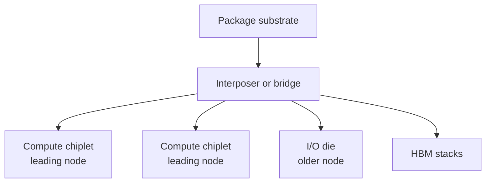

::: testing
Whether you understand **why** the industry broke big monolithic dies into pieces, not just the buzzword. The interviewer wants to hear the economics (yield and reticle limit), the engineering enablers (die-to-die links, advanced packaging, known-good-die testing) and the costs (latency, power per bit, thermal and test complexity). Hidden sub-skills: connecting wafer defects to cost, knowing a chiplet is a *die* while the product is a *package*, and being able to name real examples without overclaiming details of products you have not studied.
:::

::: why
Chiplets are how most high-end CPUs, GPUs and AI accelerators are built today. Anyone doing hardware work near silicon, boards or packaging will meet a part whose "chip" is really several dies on a shared substrate, which changes how you think about power delivery, thermals, bring-up and cost. It also ties together everything in the packaging section: yield ([[q0650]]), the limit on die size ([[q0651]]), flip-chip bumps ([[q0656]]) and 3D stacking ([[q0653]]). Interviewers like it because a good answer mixes physics, manufacturing and business in one minute.
:::

::: concepts
- **Die vs package**: the die is the diced piece of silicon, the package holds one or several of them. See [[q0645]].
- **Yield and defect density**: random defects kill dies, and bigger dies catch more of them. See [[q0650]].
- **Reticle limit**: a single exposure field is about 26 mm × 33 mm, so a monolithic die cannot grow past roughly 850 mm². See [[q0651]].
- **Die-to-die interconnect**: short, wide, low-energy links between chiplets (for example UCIe-style interfaces).
- **Advanced packaging**: organic substrate, silicon interposer or silicon bridge, with flip-chip bumps ([[q0656]]) or hybrid bonds.
- **Known good die (KGD)**: you test dies before assembly so one bad chiplet does not scrap a package full of good ones.
:::

::: answer
"A chiplet is a small die designed to be one piece of a bigger system. Instead of building one huge monolithic chip, you build several smaller dies, test them, and then assemble the good ones into a single package, and the package behaves like one chip.

The main reason is yield. Defects land randomly on a wafer, so a big die is much more likely to contain one than a small die. If I split an 800 mm² design into four 200 mm² chiplets and only keep the good ones, I throw away far less silicon. The second reason is flexibility: the compute dies can use the newest, most expensive process, while I/O and analog, which don't shrink well, stay on an older cheaper node. Third, you can reuse one chiplet across many products, like AMD does with its CPU chiplets and a separate I/O die.

The costs are real though. The links between chiplets are longer than on-die wires, so you pay latency and energy per bit, you need advanced packaging with fine-pitch bumps or an interposer, and you have to test known good dies up front. Heat also concentrates because many hot dies sit close together. So it's a trade of silicon cost against packaging complexity."
:::

::: technical
**Yield model.** A common first-order model is Poisson: $Y = e^{-A D_0}$ with die area $A$ and defect density $D_0$. With $D_0 = 0.1\ \text{cm}^{-2}$: an 800 mm² die has $Y = e^{-0.8} = 44.9\%$; a 200 mm² die has $Y = e^{-0.2} = 81.9\%$. On a 300 mm wafer the die-per-wafer estimate $\frac{\pi (d/2)^2}{A} - \frac{\pi d}{\sqrt{2A}}$ gives about 65 big dies or 306 small ones, so you get roughly 29 good big dies (23,300 mm² of good silicon) or 251 good small dies (50,200 mm²). Because chiplets are tested before assembly, four good 200 mm² dies make one product with about 4×200 mm² of silicon at 82% yield instead of 800 mm² at 45%.

**Reticle limit.** A single stepper/scanner field is about 26 × 33 mm ≈ 858 mm². Larger products *must* be built from multiple dies stitched in a package.

**Partitioning.** Logic that scales with the process (CPU cores, shader arrays) goes on the leading node. SRAM scales worse, and analog, PHYs and I/O scale worst, so they can use an older node (cheaper wafers, better analog behaviour, higher voltages).

**Interconnect.** Die-to-die links need high bandwidth density and low energy per bit. On-package links are typically well under 1 pJ/bit to a few pJ/bit, versus several pJ/bit for long-reach off-package SerDes, but exact figures depend on the technology. Open standards such as UCIe define the physical and protocol layers so chiplets from different vendors can interoperate.

**Packaging.** Options: organic substrate with fine-pitch flip-chip bumps (cheap, lower wiring density), silicon interposer or embedded silicon bridges (dense wiring, higher cost), and 3D stacking with hybrid bonds ([[q0653]]).

**Costs.** Extra die-edge area for PHYs, added latency of a few ns per hop, package yield (a bad assembly scraps all good dies in it), test access, and thermal density.
:::

::: short
"A chiplet is a small die that is one building block of a bigger chip. You make several small dies, test them, and combine the good ones in one package so it acts like a single processor. It wins on yield, because small dies catch fewer defects, it breaks past the reticle size limit, and it lets you mix process nodes. The cost is slower, more power-hungry links between dies and harder packaging, test and cooling."
:::

::: long
"Chiplets are small dies that you assemble into one package to build something that behaves like a single big chip. The easy way to see why is yield. Defects fall randomly across a wafer, and the chance that a die is clean drops roughly exponentially with its area. Using a defect density of 0.1 per square centimetre, an 800 square millimetre die yields about 45 percent, but a 200 square millimetre die yields about 82 percent. If I test the small dies first and only package the good ones, I waste much less silicon.

There's also a hard limit: the lithography field is about 26 by 33 millimetres, so you physically can't make a monolithic die much bigger than 850 square millimetres. Chiplets let you go past that.

The third benefit is mixing technologies. The compute cores benefit from the newest node, but I/O, analog and some memory interfaces don't scale well, so they can sit on an older, cheaper process. And you can reuse the same chiplet across a whole product family, which is how AMD builds its server parts from a few compute chiplets plus an I/O die.

What you pay for is the interconnect. Signals between dies go through bumps and package wiring, so you get more latency and more energy per bit than on-die wires, and you need a die-to-die standard such as UCIe or a proprietary one. You also need advanced packaging, like a silicon interposer or bridge, and you need known-good-die testing, otherwise a single bad chiplet scraps the whole package. Power and heat get trickier as well, since several hot dies sit side by side.

So it's a trade: lower silicon cost and more flexibility versus more packaging cost and communication overhead."
:::

::: terms
- **Chiplet**: a die designed to be combined with other dies in one package, usually through a standardized or proprietary die-to-die link.
- **Monolithic die**: all functions on one piece of silicon.
- **Known good die (KGD)**: a die tested and verified before packaging.
- **Reticle limit**: the maximum exposure field of a lithography scanner (about 26 × 33 mm).
- **Defect density ($D_0$)**: defects per unit area, used in yield models such as $Y = e^{-AD_0}$.
- **Die-to-die (D2D) interface**: the short-reach PHY and protocol between chiplets (UCIe, BoW and proprietary links).
- **Silicon interposer / bridge**: a passive silicon piece with fine wiring that connects dies in the package.
- **Heterogeneous integration**: combining dies of different process nodes or technologies in one package.
:::

::: exceptional
An average answer says "small chips put together, better yield." An exceptional answer:
- Puts numbers on the yield argument (Poisson, 45% vs 82%) and says that *test before assembly* is what makes it work.
- Names the reticle limit as a second, independent driver.
- Explains **what is partitioned where** (cores on the best node, I/O and analog on cheaper nodes) and why SRAM and analog scale poorly.
- Quantifies the costs: latency, pJ/bit, area for PHYs, package yield, thermal density.
- Gives concrete products (server CPUs with CCD + I/O die, GPUs with HBM on an interposer) and knows chiplets ≠ 3D stacking, though the two combine.
:::

::: mistakes
- **"Chiplets are just a multi-chip module."** Close, but the key distinction is that chiplets are designed as partial systems for a die-to-die interface with high bandwidth density; classic MCMs used ordinary I/O.
- **Claiming chiplets are always cheaper.** Package assembly, interposers, test and extra PHY area can outweigh the yield gain for small designs.
- **Forgetting known good die.** Without pre-assembly test, package yield falls multiplicatively and the benefit disappears.
- **Treating them as free in performance.** Crossing a die boundary costs latency and energy per bit; software and floorplan must account for it (NUMA-like effects).
- **Mixing up chiplets with 3D stacking.** Chiplets can sit side by side (2.5D) or stacked (3D). See [[q0653]].
:::

::: deep
## Why one big die is a bad bet

Silicon wafers have random point defects. Model them as a Poisson process with density $D_0$. The probability a die of area $A$ has zero killer defects is

$$Y = e^{-A D_0}$$

(Real fabs use more refined models such as negative binomial, which gives somewhat higher yields for large dies because defects cluster, but the trend is the same.) The cost per *good* die goes as roughly (wafer cost) / (dies per wafer × yield), and both factors fall as $A$ grows.

```plot
{"title":"Poisson die yield vs area","x":{"label":"Die area","unit":"mm²","min":0,"max":900},"y":{"label":"Yield","unit":"","min":0,"max":1.05},
 "vars":{"d0a":0.1,"d0b":0.25},
 "series":[{"label":"D0 = 0.10 /cm²","fn":"exp(-x/100*d0a)"},{"label":"D0 = 0.25 /cm² (immature process)","fn":"exp(-x/100*d0b)","color":"red","dashed":true}],
 "points":[{"x":200,"y":"exp(-2*d0a)","label":"200 mm²: 81.9%"},{"x":800,"y":"exp(-8*d0a)","label":"800 mm²: 44.9%"}]}
```
Figure: Yield falls exponentially with area. Splitting 800 mm² into four 200 mm² chiplets moves each piece from 45% up to 82% on the same process, and a worse process (dashed) punishes big dies even harder.

### Worked example: 800 mm² monolithic vs four 200 mm² chiplets

Take a 300 mm wafer and $D_0 = 0.1\ \text{cm}^{-2}$. Using the standard approximation $\text{DPW} \approx \frac{\pi d^2}{4A} - \frac{\pi d}{\sqrt{2A}}$ (ignores edge exclusion and scribe lines):

| | 800 mm² die | 200 mm² die |
|---|---|---|
| Gross dies/wafer | 64.8 | 306.3 |
| Yield | 44.9% | 81.9% |
| Good dies/wafer | 29.1 | 250.8 |
| Good silicon per wafer | 23,300 mm² | 50,200 mm² |

The chiplet wafer yields about 63 *products* (250.8 / 4), versus 29 monolithic, on the same wafer cost, a 2.2× improvement before packaging costs. Packaging adds an interposer or substrate plus assembly yield, so you subtract those. For a 100 mm² design, yield is already 90%, and chiplets would just add cost. So chiplets pay off for *large* designs on *young* processes.

> [!NOTE]
> Real defect densities are proprietary and change as a process matures. Treat the numbers above as a model, not as any foundry's data.

## The reticle limit

A lithography scanner exposes a field about 26 mm × 33 mm (≈858 mm²) at one time ([[q0661]]). A single die has to fit inside it, so ≈850 mm² is a hard ceiling for monolithic logic. Some products work around it by *stitching*, but chiplets plus a package are the usual route ([[q0651]]).

## Mixing nodes

Scaling is uneven. Logic density keeps improving, SRAM bit-cells scale more slowly, and analog circuits and high-speed I/O PHYs barely shrink because they are limited by device matching, voltage headroom and passive sizes. So a design can be split:


Figure: A typical chiplet package. Expensive leading-node compute dies are small and reusable; I/O and memory interfaces use cheaper processes; the interposer or bridge provides dense wiring between them.

## What the die-to-die link looks like

On-die wires have femtofarads of capacitance and need negligible energy. A package link has pad capacitance, bump and routing parasitics, and maybe ESD, so each bit costs more energy. Chiplet interfaces therefore:

- are **wide and slow** (many parallel lanes at modest rates) instead of narrow and fast like off-package SerDes;
- have very short reach (millimetres to a centimetre or so), which allows light equalization or none at all;
- use fine bump pitch, around tens of microns for microbumps (exact values depend on the technology and vendor).

Energy per bit scales like $E = \tfrac{1}{2}C V^2 \alpha$ for CMOS signalling, so low voltage swing and low capacitance both matter. A link carrying 1 Tb/s at 0.5 pJ/bit burns $10^{12} \times 0.5\times10^{-12} = 0.5$ W; at 5 pJ/bit it's 5 W. That's why on-package links are designed so much differently from board-level ones.

> [!UNCERTAIN]
> Quoted pJ/bit figures for die-to-die links vary widely between standards, bump pitches and vendors. Use them as ballpark ranges and cite the datasheet or standard if asked for a specific one.

## Test and assembly

Assembly bonds dies face-down with flip-chip bumps ([[q0656]]) or hybrid bonds. If one die in a four-die package is bad, the other three are lost. With a known-good-die test of 99% per die and 98% assembly yield per die attach, package yield is about $0.99^4 \times 0.98^4 \approx 88.6\%$, computed before any package-level defects. That's why wafer-level test and burn-in access matter so much for chiplets.

## Thermal and power delivery

Dies placed side by side spread heat over more area than one hot monolith, which can help. But stacking, or putting memory next to a hot compute die, creates local hotspots. Power delivery must now feed several dies through the substrate, and each die needs its own decoupling.

## Real examples

- **AMD EPYC and Ryzen**: several core-complex chiplets plus an I/O die on a substrate.
- **Intel's tile-based client parts (Foveros)** and **Apple's M-series Ultra parts**, which join two big dies with a dense die-to-die link.
- **GPUs and AI accelerators**: a large compute die with HBM stacks on a silicon interposer.

Check product details in vendor material before quoting specifics; architectures change generation to generation.
:::

::: applications
- **Server CPUs**: scale core count by adding compute chiplets around an I/O die, reusing the same die across SKUs.
- **AI/GPU accelerators**: compute die plus HBM stacks on a silicon interposer for terabytes per second of memory bandwidth.
- **Client SoCs with tiles**: CPU, graphics, SoC and I/O tiles on different nodes combined with 3D/2.5D packaging.
- **FPGAs**: large FPGAs have been built from multiple slices on an interposer to exceed single-die size.
- **Open ecosystems**: UCIe-style standards aim to let you buy a third-party PHY or accelerator chiplet and integrate it.
:::

::: assumptions
- The yield argument assumes defects are random and the process is not already near-perfect. For small dies or mature processes, a monolithic die is cheaper.
- The Poisson model is a first-order tool; real yield models include clustering and parametric yield loss (speed and leakage binning).
- Chiplets assume a die-to-die interface with enough bandwidth density; if the architecture needs tight, latency-critical communication between partitions, splitting can hurt performance.
- "Chiplet" is sometimes used loosely for any multi-die package, including simple MCMs. Valid alternative answer: emphasize *design for a standard D2D interface*.
- Cost trade-offs depend on packaging technology (organic vs silicon interposer), which changes by orders of magnitude between products.
:::

::: followups
### Why not just make the monolithic die and use redundancy?
Redundancy helps: extra cores or SRAM rows can be fused off, so a die with one bad core still ships as a lower bin. That recovers some yield, but you still cannot exceed the reticle size, and defects in non-redundant logic still kill the die. Chiplets plus redundancy are often combined.

### What are the downsides of chiplets?
More latency (a few ns per die hop), more energy per bit than on-die wires, extra silicon area for PHYs, packaging cost and assembly yield, tougher test access, and thermal/power-delivery complexity. Software may also see non-uniform memory or cache latency.

### How do you test a chiplet before assembly?
Wafer-level probe tests scan, BIST and basic die-to-die link loopback before dicing. The challenge is that fine-pitch microbumps are hard to probe, so designs include dedicated test pads or built-in self-test for the D2D PHY. Post-assembly you test again and can use die-to-die boundary-scan to localize faults.

### What if the chiplets use different process nodes and supply voltages?
Level shifting and the PHY handle the voltage difference: each side keeps its own supply and the link uses a defined I/O voltage. Thermal expansion and bump reliability also differ, so the package must be designed for mismatch. Power sequencing across supplies becomes a package-level requirement ([[q0706]]).

### Scenario: your accelerator package suffers from low assembly yield. Where do you look?
Separate die yield from assembly yield. Check known-good-die test coverage (are we escaping bad dies?), bump coplanarity and underfill voids, warpage of the substrate during reflow, and the thermal profile. Do failure analysis on failing packages: X-ray or acoustic microscopy to see opens or cracked bumps. If the fault is mostly in one chiplet position, suspect warpage or uneven thermal contact at that location.
:::

::: interpretations
"Chiplets" is the standard industry term, but some people use it broadly for any multi-die package. The strict meaning is a die designed to work only as part of a multi-die system through a die-to-die interface. For monolithic versus chiplet design from a die-size viewpoint, see [[q0651]]; for stacked implementations, see [[q0653]].
:::

::: references
- Hennessy & Patterson, *Computer Architecture: A Quantitative Approach*: integrated-circuit cost and yield sections (cost of a die, Poisson/negative-binomial yield).
- Weste & Harris, *CMOS VLSI Design*: manufacturing, yield and packaging chapters.
- UCIe Consortium, *Universal Chiplet Interconnect Express specification* (public overview by the consortium).
- Vendor package-technology overviews (for example from TSMC, Intel and AMD), which describe interposer, bridge and hybrid-bond packaging; check each vendor's current documents for specific numbers.
:::

::: rubric
- Defines a chiplet as a small die combined with others in one package to act as one system :: Establishes the core idea in the first sentence.
- Explains yield: bigger die means more chance of a defect, so small dies and known-good-die testing save silicon :: This is the primary economic reason.
- Mentions the reticle limit :: A second, independent reason that shows manufacturing awareness.
- Explains node mixing (compute on advanced node, I/O/analog on older) :: Shows you know what scales and what doesn't.
- States the costs: latency, energy per bit, packaging, test, thermals :: Balanced answers beat cheerleading.
- Names a concrete example (server CPU with I/O die, GPU with HBM) :: Proves the concept is grounded in real products.
- Distinguishes chiplets (partitioning) from 3D stacking (orientation) :: Prevents a common terminology mix-up.
:::

::: quiz
```json
[
 {"type":"mcq","level":"fundamental","q":"What is the main manufacturing reason chiplets can reduce cost?","options":["Smaller dies catch fewer random defects, so yield per die is higher","Smaller dies use less expensive silicon wafers","Chiplets eliminate the need for packaging","Chiplets run at lower voltage"],"answer":0,"explain":"Random defects are roughly Poisson distributed with area, so yield falls exponentially with die size. Smaller dies (tested before assembly) waste less silicon. Wafers cost the same, and chiplets add rather than remove packaging complexity."},
 {"type":"numeric","level":"intermediate","q":"With Poisson yield $Y=e^{-AD_0}$ and $D_0 = 0.1\\ \\text{cm}^{-2}$, what is the yield of a 400 mm² die, in percent?","answer":67.0,"tolerance":0.02,"unit":"%","explain":"$A = 4\\ \\text{cm}^2$, so $Y = e^{-0.4} = 0.670$, i.e. 67.0%."},
 {"type":"truefalse","level":"fundamental","q":"Chiplets always cost less than a monolithic die with the same function.","answer":false,"explain":"Chiplets add interposer or substrate cost, die-to-die PHY area, test and assembly yield loss. For small dies on mature processes, a monolithic die is usually cheaper."},
 {"type":"multi","level":"intermediate","q":"Select all that are real drivers for using chiplets.","options":["Dies larger than the reticle limit cannot be made as one piece","Different functions can use different process nodes","Chiplets remove the need for known-good-die testing","A chiplet can be reused across several products"],"answer":[0,1,3],"explain":"Reticle limit, node mixing and reuse are real drivers. Chiplets actually *increase* the importance of known-good-die testing, since one bad die scraps the assembled package."},
 {"type":"numeric","level":"advanced","q":"Four chiplets each have 99% known-good-die test coverage (so 99% of dies that pass test are truly good) and each die-attach has 98% yield. Ignoring other losses, what is the package yield in percent?","answer":88.6,"tolerance":0.02,"unit":"%","explain":"Per die: $0.99\\times0.98 = 0.9702$. Four dies: $0.9702^4 = 0.886$, i.e. 88.6%. Small per-die losses compound quickly."}
]
```
:::
