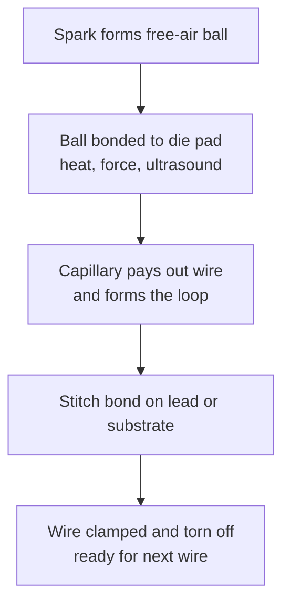

::: testing
Whether you know how a bare die is physically connected to the outside world and, more importantly, that a bond wire is **not an ideal wire**. The interviewer wants the construction (fine Au/Cu/Al wire from die pad to lead or substrate), the process (ball and wedge bonds), and the electrical consequences: roughly 1 nH per millimetre, a few tenths of an ohm, and current limits. Hidden sub-skills: parasitic inductance reasoning ($V = L\,di/dt$), material trade-offs, and comparing wire bonding with flip chip.
:::

::: why
Most ICs on the market are wire-bonded because it is cheap, flexible and mature. The wire's inductance and resistance show up as ground bounce, supply droop, ringing on outputs and limited RF performance, so you meet them while debugging boards, picking packages and reading datasheets (the "pin inductance" numbers). It also frames the next questions: how to carry high currents through thin wires ([[q0655]]), why chips flip over ([[q0656]]), and why ground moves ([[q0657]]).
:::

::: concepts
- **Die, pad and lead frame**: the die has metal bond pads on its top surface; the package has leads or substrate pads. See [[q0645]].
- **Wire resistance**: $R = \rho \ell / A$ for a round wire; tenths of an ohm for typical lengths.
- **Inductance**: a straight wire has roughly 0.5–1 nH/mm, so $\omega L$ becomes meaningful at hundreds of MHz. See [[q0039]].
- **Skin effect**: at GHz the current crowds toward the wire surface and the AC resistance rises. See [[q0056]].
- **Thermosonic and ultrasonic bonding**: heat, pressure and ultrasonic energy weld the wire to the pad.
- **Intermetallics**: Au on Al pads forms intermetallic compounds that can embrittle the joint over time.
:::

::: answer
"Bond wires are the tiny wires that connect the pads on the silicon die to the leads or substrate of the package. They're typically gold, copper or aluminum, around 15 to 50 micrometres in diameter, which is thinner than a human hair. A machine welds one end to a pad on the die, usually as a ball bond, then arcs the wire over and welds the other end to a lead finger or substrate pad as a stitch or wedge bond. It does this for every pin, many wires per second.

They're popular because they're cheap, flexible, and can connect any die layout to any package without special tooling. But they're not ideal wires. A few millimetres of wire is about a nanohenry per millimetre of inductance and a few tenths of an ohm of resistance. At fast edges that inductance matters: $L\,di/dt$ causes ground bounce and supply droop, and at GHz it limits RF and high-speed I/O. That's one reason high-performance chips go to flip chip, where the connection is a short solder bump instead. And since the wire is thin, current capacity is limited, so power pins use several wires in parallel."
:::

::: technical
**Construction.** A bond wire is a fine wire, typically 15–50 µm (25 µm = 1 mil is common) for ICs and up to hundreds of µm for power devices. Materials: gold (most traditional, low oxidation), copper (cheaper, lower resistivity, harder, needs care against oxidation), aluminum (wedge bonding, common for power and heavy wire), and silver alloys.

**Processes.**
- *Thermosonic ball bonding* (Au, Cu): a spark melts the wire tip into a free-air ball, which is pressed on the heated pad with ultrasonic energy to form the first bond; the wire is looped and stitch-bonded at the second site.
- *Ultrasonic wedge bonding* (Al, heavy Al, Au ribbon): no ball and no heat; ultrasonic scrubbing forms bonds at room temperature, and the wire leaves at a shallow angle.

**Electrical model.** Resistance $R = \rho\ell/(\pi d^2/4)$: for gold ($\rho\approx 2.4\times10^{-8}\ \Omega\text{·m}$), 25 µm diameter, 3 mm long: $R \approx 0.149\ \Omega$. Copper gives 0.103 Ω. Inductance of an isolated straight wire is $L \approx \frac{\mu_0}{2\pi}\ell\left[\ln\frac{2\ell}{r} - 0.75\right]$, which gives about 3.25 nH for a 3 mm, 25 µm wire (≈ 1 nH/mm); real loops over a ground plane or neighbouring leads are typically between 0.5 and 1 nH/mm. At 1 GHz that is $\omega L = 20.4\ \Omega$ reactance, far above the DC resistance.

**Skin effect.** $\delta = \sqrt{\rho/(\pi f\mu_0)}$: 2.5 µm for gold at 1 GHz, so the 12.5 µm radius wire has AC resistance roughly $r/(2\delta)\approx 2.5\times$ DC.

**Reliability.** Au wire on an Al pad forms intermetallics (the "purple plague" is an Au-Al compound); heel cracking from thermal cycling; wire sweep during moulding; corrosion in Cu systems with halides. Bond pitch limits I/O to the die periphery, roughly 35–50 µm pad pitch in fine-pitch processes.
:::

::: short
"Bond wires are the very thin gold, copper or aluminum wires, typically 15 to 50 microns, that connect pads on the die to the package leads. A machine welds them with ball and wedge bonds. They're cheap and flexible, but a few millimetres of wire has roughly a nanohenry per millimetre of inductance and a few tenths of an ohm, so they cause ground bounce and limit high-speed and RF performance. Power pins use several wires in parallel."
:::

::: long
"A bond wire is how most chips get from the silicon to the package pins. The die has small metal pads around its edge, the package has leads or substrate pads, and a wire bonder connects them one by one with a very fine wire, usually gold, copper or aluminum, around 25 micrometres in diameter. In the common ball-bond process a spark forms a little ball on the wire tip, the machine presses it onto the die pad with heat and ultrasonic energy to weld it, pulls the wire into a loop, and makes a stitch bond on the lead. Aluminum wires are usually wedge bonded with ultrasonic energy at room temperature, and heavy aluminum wire or ribbon is used for power devices.

The reason wire bonding is everywhere is cost and flexibility: no custom tooling per die, mature equipment, and you can wire almost any die into almost any package. But electrically a bond wire is a small component. A 3 millimetre gold wire at 25 micrometres has about 0.15 ohms of resistance and about 3 nanohenries of inductance, roughly a nanohenry per millimetre. At 1 GHz that's 20 ohms of reactance. So when a bunch of outputs switch together, the $L\,di/dt$ across the ground wires shows up as ground bounce, and a supply pin with a long bond wire can droop. That's also why datasheets quote package inductance and why decoupling needs to be on the die or really close.

The practical mitigations are shorter wires, multiple wires per power and ground pin, dedicated supply pins distributed around the die, and for high-speed or high-current parts, flip chip, where the die connects through solder bumps instead. The trade-off is that wire bonding is cheap but perimeter-limited, while flip chip is more expensive but has lower inductance and an area array of connections."
:::

::: terms
- **Bond pad**: metal landing area on the die surface where a wire is attached.
- **Ball bond**: the first bond, a compressed ball of wire welded to the pad (Au or Cu).
- **Stitch/wedge bond**: the second bond, a flattened wire welded to a lead or substrate pad.
- **Thermosonic bonding**: bonding using heat, pressure and ultrasonic energy.
- **Loop height**: how far the wire arcs above the die; affects inductance and moulding risk.
- **Intermetallic compound (IMC)**: alloy formed at the bond interface, such as Au-Al; excessive growth hurts reliability.
- **Wire sweep**: lateral displacement of wires by mould compound flow during encapsulation.
- **Fusing current**: the current at which a wire melts.
:::

::: exceptional
An average answer says "thin wires connecting the chip to the pins." An exceptional answer:
- Describes ball bond on the die pad and stitch/wedge bond on the lead, and states typical diameters.
- Quantifies the parasitics with numbers: ~1 nH/mm, ~0.15 Ω for 3 mm of 25 µm gold, and the resulting 20 Ω reactance at 1 GHz.
- Connects the physics to symptoms: ground bounce and supply droop via $L\,di/dt$.
- Mentions mitigations (parallel wires, shorter loops, more power/ground pins, flip chip).
- Knows reliability issues (intermetallics, heel cracks, wire sweep) and why Cu has become common.
:::

::: mistakes
- **Treating a bond wire as a short.** At fast edges it is mostly an inductor. 3 nH with 1 A/ns gives 3 V.
- **Saying "always gold".** Copper is widely used for cost and conductivity; aluminum for wedge and power bonds.
- **Confusing bond wire with PCB trace or bond pad.** Pads are the die-side metal; wires are the connection.
- **Thinking inductance halves if you double the wire diameter.** Inductance depends only logarithmically on radius, so fatter wire barely helps; parallel wires and shorter length help more.
- **Believing wire bonding is obsolete.** It is still the dominant interconnect by unit volume because it is cheap and flexible.
:::

::: deep
## What a bond wire is physically

Imagine a die glued to a lead frame paddle. The die's I/O and power pads sit at its periphery; the lead fingers surround it. A bonding machine moves a ceramic capillary tool through which the wire is threaded. The sequence for a ball-wedge bond is:


Figure: One wire-bond cycle. The machine repeats this for every pad, typically many wires per second, which is why wire bonding is cheap per I/O but serial.

The wire loop rises 100-300 µm above the die and spans 1–5 mm. Afterwards the whole assembly is encapsulated in mould compound that supports the wires.

## Electrical model: R, L and a little C

A bond wire is a series R–L element from pad to pin, and the pad adds capacitance (including ESD protection) to the die side.

```circuit
{"elements":[
 {"t":"region","at":[0.5,-3],"w":13,"h":5.5,"label":"bond wire","color":"orange"},
 {"t":"term","at":[0,0],"label":"die pad","side":"left"},
 {"t":"R","a":[0,0],"b":[5,0],"label":"R_w","value":"0.15 Ω"},
 {"t":"L","a":[5,0],"b":[10,0],"label":"L_w","value":"3 nH"},
 {"t":"wire","pts":[[10,0],[13,0]]},
 {"t":"dot","at":[13,0]},
 {"t":"term","at":[13,0],"label":"package pin","side":"right"},
 {"t":"text","at":[6.5,1.4],"text":"3 mm, 25 µm gold","muted":true,"anchor":"middle"}
]}
```
Figure: The wire is a series resistance and inductance. The resistance sets IR drop; the inductance dominates for fast currents.

**Resistance** is $R = \rho\ell/A$. For a 25 µm wire 3 mm long:

| Material | $\rho$ (Ω·m) | R (3 mm, 25 µm) |
|---|---|---|
| Gold | 2.44e-8 | 0.149 Ω |
| Copper | 1.68e-8 | 0.103 Ω |
| Aluminum | 2.65e-8 | 0.162 Ω |

**Inductance** of a straight round wire of length $\ell$ and radius $r$ (valid for $\ell \gg r$, ignoring the return path) is

$$L \approx \frac{\mu_0 \ell}{2\pi}\left[\ln\frac{2\ell}{r} - \frac34\right]$$

which gives 0.87 nH for 1 mm and 3.25 nH for 3 mm at $r = 12.5$ µm. The log dependence on $r$ means a wire 4× thicker lowers $L$ by only about 25% (for 3 mm: $\ln(480) - 0.75 = 5.42$ vs $\ln(120)-0.75 = 4.04$).

```plot
{"title":"Impedance of a 3 mm, 25 µm gold bond wire","x":{"label":"Frequency","unit":"Hz","min":1e6,"max":1e10,"log":true},"y":{"label":"|Z|","unit":"Ω","min":0.05,"max":300,"log":true},
 "vars":{"r":0.149,"l":3.25e-9},
 "series":[{"label":"|Z| = sqrt(R² + (ωL)²)","fn":"sqrt(r*r+(2*PI*x*l)^2)"},{"label":"DC resistance only","fn":"r","dashed":true,"color":"muted"}],
 "vlines":[{"at":"r/(2*PI*l)","label":"ωL = R at 7.3 MHz","color":"orange"}]}
```
Figure: Above about 7 MHz the wire is an inductor, not a resistor. At 1 GHz it is about 20 Ω, comparable to a transmission line's characteristic impedance.

## Why it matters: a worked example

A bank of outputs switches 100 mA each in 1 ns. Eight of them share one ground wire of 3 nH. Total $di/dt = 8\times0.1/1\text{ ns} = 0.8\ \text{A/ns}$, so the ground rise is $V = L\,di/dt = 3\text{ nH}\times 0.8\times10^9 = 2.4$ V. Real chips limit this by spreading ground pins, slowing edges, and the voltage reduces the drive current itself. We cover that in [[q0657]].

## Skin effect

Current crowds at the wire surface above $f$ where $\delta < r$: $\delta=\sqrt{\rho/(\pi f \mu)}$.

```sim
{"id":"skin-effect","material":"au","f":1000000000,"shape":"wire"}
```
Figure: Set material to gold and sweep frequency from MHz to 10 GHz. Skin depth falls from about 7.9 µm at 100 MHz to 2.5 µm at 1 GHz and 0.8 µm at 10 GHz. The sim's wire is much thicker than a bond wire, so read the skin depth rather than its R_ac/R_dc ratio: for a 12.5 µm-radius bond wire, r/(2δ) is about 2.5 at 1 GHz and about 8 at 10 GHz.

## Process trade-offs

| | Au | Cu | Al |
|---|---|---|---|
| Bond type | ball-wedge | ball-wedge | wedge-wedge |
| Typical use | high-reliability, RF | mainstream cost-driven | power, heavy wire |
| Pro | oxidation-free | cheap, lower R | room-temperature, thick wire possible |
| Con | cost, Au-Al IMC | oxidation, harder pad stress | slow, angle constraints |

Copper's harder metal can crack pad structures under the ball, so process control matters, especially on low-k dielectrics under the pad.

## Loop geometry and design rules

A wire bond is a mechanical structure as well as an electrical one, and package design rules come from that.

- **Ball and pad**: the bonded ball is typically about 2–3× the wire diameter, so a 25 µm wire needs a pad of roughly 50–80 µm minimum, and pad pitch of around 40–60 µm is what fine-pitch processes aim at.
- **Loop height and length**: loops rise about 100–300 µm above the die; very long spans sag or sweep, so vendors limit the span to a maximum ratio of length to diameter (often on the order of 100× or more, depending on wire material and mould process). Longer wires are thicker or are re-routed through a bond ring.
- **Wire sweep**: mould compound flowing during encapsulation pushes wires sideways; if neighbours touch they short. Higher wire stiffness (copper, thicker wire) and careful mould flow reduce this.
- **Crossing and stacking**: wires may not cross; for stacked dies the pads are staggered so lower wires pass under upper dies, adding loop height.

## Resonance with pad capacitance

The wire inductance resonates with the pad and ESD capacitance on the die side. For $L=3.25$ nH and $C=2$ pF, $f_0=1/(2\pi\sqrt{LC})=1.97$ GHz. Below $f_0$ the pin looks like an inductor in series with the pad capacitance; around it there is a peak (or a notch, depending on the topology) that limits useful I/O bandwidth and gives the "package resonance" seen in S-parameter plots. Designers push this resonance above the signalling band by shortening wires, or deliberately use it: RF modules use controlled bond-wire loops as matching inductors. A 1 nH loop has $X_L=2\pi\times2.4\ \text{GHz}\times1\ \text{nH}\approx15\ \Omega$ at 2.4 GHz, a sensible matching element, so loop height and length are tightly controlled in RF assembly.

## Wire bond versus flip chip

Wire bonding connects only from the die *perimeter*, with pad pitch limited to tens of µm, and every wire carries ~1 nH. Flip chip ([[q0656]]) connects from an area array of bumps with ~0.1 nH of connection inductance. So high-speed, high-pin-count, high-current dies prefer flip chip; low-cost microcontrollers, analog parts and memory often stay wire-bonded.

> [!UNCERTAIN]
> Datasheet package-inductance values (for example for QFN versus BGA) depend on the package layout and extraction method. Use the datasheet or an IBIS/SPICE package model rather than the 1 nH/mm rule for sign-off.
:::

::: applications
- **QFN, SOIC and QFP packages** for microcontrollers, op-amps and regulators: wire-bonded dies in lead-frame packages.
- **Stacked memory** (NAND flash stacks): many dies wire-bonded with staggered pads to a substrate.
- **Power MOSFETs and IGBTs**: heavy aluminum wire or ribbon, or copper clips for the highest current.
- **RF modules**: bond wires used deliberately as matching inductors, with tightly controlled loop length and height.
- **Sensors and MEMS**: low-cost wire bonding from a MEMS die to an ASIC or lead frame.
:::

::: assumptions
- Inductance numbers assume an isolated straight wire; the real value depends on the loop height, the nearby ground return and neighbouring wires. Typical range is about 0.5–1 nH/mm.
- Resistivity values are bulk room-temperature values; real bonded wire has slightly higher resistivity and bond-interface resistance.
- Skin effect is computed for a round solid conductor; surface roughness and plating alter it.
- "Bond wire" here refers to IC wire bonding; the same word is also used for the aluminum heavy-wire bonds in power modules.
- Alternative valid emphasis: for a hardware interview aimed at PCB or power electronics, spend more time on the parasitic effects; for a packaging role, spend more on process and reliability.
:::

::: followups
### What are bond wires made of and why?
Gold is traditional because it does not oxidize and bonds reliably; copper is cheaper, has about 30% lower resistivity, and is stiffer; aluminum is used for wedge bonding, including heavy wires in power devices. The choice depends on cost, reliability, pad metallurgy and current requirements.

### What is the inductance of a bond wire and why is it a problem?
About 0.5–1 nH per millimetre, so a typical wire is 1–4 nH. When current changes quickly, $V = L\,di/dt$ makes the on-die ground or supply move relative to the board. For 3 nH and 0.8 A/ns, that is 2.4 V of disturbance. It also resonates with on-die capacitance and limits RF bandwidth.

### How do you reduce the effect of bond wire inductance?
Use shorter loops, multiple parallel wires for supply and ground, more power and ground pins interleaved with signals, on-die decoupling capacitance, slower edge rates or controlled-drive outputs, or switch to flip chip or a BGA package.

### What is the "purple plague"?
A brittle gold-aluminium intermetallic (mainly AuAl2) that forms at Au-Al bonds, especially at high temperature. It increases resistance and can cause voids, so processes control temperature and pad metallurgy.

### Scenario: wire-bonded part works at 100 MHz but fails an intermittent test at 800 MHz. What bond-wire effects might you suspect?
The wire inductance and pad capacitance form a resonance, and at several hundred MHz the 3 nH wire has ~15 Ω reactance. Check simultaneous-switching noise on the supply, reflections from the impedance step, and whether a neighbouring wire couples. I'd look at the supply at the pin with a high-bandwidth probe, compare with the vendor's package model, and try reducing the number of simultaneously switching outputs.
:::

::: interpretations
"Bond wires" nearly always means the thin wires inside an IC package. In power electronics, the same term refers to thick aluminium wires in IGBT modules. The next question ([[q0655]]) uses the high-current reading: thin wires that must still carry large current.
:::

::: references
- Harper (ed.), *Electronic Packaging and Interconnection Handbook*: wire bonding chapter.
- Tummala, *Fundamentals of Microsystems Packaging*: interconnection technologies, wire bonding vs flip chip.
- Johnson & Graham, *High-Speed Digital Design: A Handbook of Black Magic*: inductance of wires and package parasitics.
- Datasheets and application notes from IC vendors on package parasitics (look for "package inductance" or IBIS package models).
:::

::: rubric
- Defines bond wires as thin wires linking die pads to package leads or substrate :: The basic definition must come first.
- Mentions material and size (Au/Cu/Al, ~15–50 µm) :: Concrete details show familiarity.
- Describes ball and wedge/stitch bonding :: Shows process understanding.
- States the parasitics with numbers (≈1 nH/mm, ~0.1–0.2 Ω) :: Turns a vague "parasitics exist" into usable engineering.
- Links inductance to ground bounce, supply droop or RF limits through $L\,di/dt$ :: Shows you can predict real problems.
- Compares with flip chip, including perimeter vs area array :: Demonstrates package-level reasoning.
- Mentions reliability aspects (intermetallics, heel cracks, wire sweep) :: Shows depth beyond the schematic.
:::

::: quiz
```json
[
 {"type":"mcq","level":"fundamental","q":"What does a bond wire connect?","options":["The die's bond pads to the package leads or substrate","The package to the PCB","The heat sink to the die","Two PCB layers"],"answer":0,"explain":"A bond wire is the inside-the-package connection from pads on the die to the lead frame or substrate. The package-to-PCB connection is made by leads or solder balls."},
 {"type":"numeric","level":"intermediate","q":"What is the DC resistance of a 25 µm diameter gold wire ($\\rho = 2.44\\times10^{-8}\\ \\Omega\\text{·m}$) that is 3 mm long, in ohms?","answer":0.149,"tolerance":0.03,"unit":"Ω","explain":"$A = \\pi (12.5\\ \\mu m)^2 = 4.909\\times10^{-10}\\ m^2$, so $R = 2.44\\times10^{-8}\\times 3\\times10^{-3}/4.909\\times10^{-10} = 0.149\\ \\Omega$."},
 {"type":"numeric","level":"intermediate","q":"Eight outputs each switch 100 mA in 1 ns through one shared 3 nH ground bond wire. What is the approximate ground voltage disturbance in volts?","answer":2.4,"tolerance":0.02,"unit":"V","explain":"$di/dt = 0.8\\ A/1\\ ns = 8\\times10^8$ A/s. $V = L\\,di/dt = 3\\times10^{-9}\\times 8\\times10^8 = 2.4$ V. Real parts reduce this with more ground pins and edge control."},
 {"type":"truefalse","level":"intermediate","q":"Doubling a bond wire's diameter roughly halves its inductance.","answer":false,"explain":"Inductance depends on the logarithm of $\\ell/r$, so doubling the radius only reduces it by roughly 10–15%. Parallel wires or a shorter wire are far more effective."},
 {"type":"mcq","level":"advanced","q":"At about what frequency does a 3 mm, 25 µm gold bond wire (R = 0.149 Ω, L = 3.25 nH) have reactance equal to its resistance?","options":["About 730 kHz","About 7.3 MHz","About 73 MHz","About 730 MHz"],"answer":1,"explain":"$f = R/(2\\pi L) = 0.149/(2\\pi\\times3.25\\times10^{-9}) = 7.3$ MHz. Above that, the wire is dominated by inductance."},
 {"type":"multi","level":"advanced","q":"Select all that are typical ways to reduce the electrical impact of bond-wire parasitics.","options":["Use multiple parallel wires on power and ground","Shorten the wire loops","Use a flip-chip package","Increase the wire length to add damping"],"answer":[0,1,2],"explain":"Parallel wires, shorter loops and flip chip all lower inductance. Increasing length raises inductance and makes ground bounce worse."}
]
```
:::
