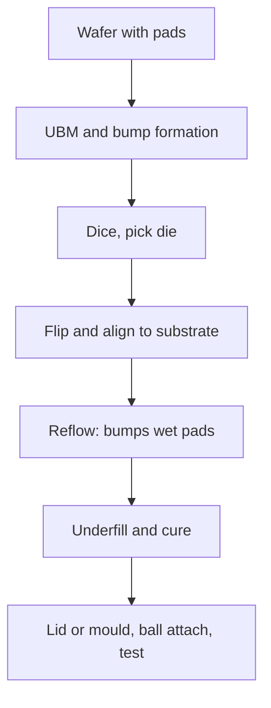

::: testing
Whether you know how a flip chip differs physically and electrically from a wire-bonded die, and can explain **why** it is used. A good answer covers: die is flipped face-down, connected by solder bumps (or copper pillars) over its whole area, underfill protects the joints, and the result is lower inductance, more I/O, better power delivery and a direct thermal path out the back. Then the costs: substrate, inspection, rework and CTE-driven stress. Hidden sub-skills: parasitic comparison with bond wires, thermal-expansion mismatch reasoning, and packaging cost awareness.
:::

::: why
CPUs, GPUs, FPGAs, SoCs and most high-speed or high-current ICs are flip-chip because wire bonding cannot supply enough I/O, supply current or low inductance. When you debug power integrity, choose a BGA package, or read a datasheet's package thermal numbers, you are looking at consequences of flip-chip design. It is the natural follow-up to bond wires ([[q0654]]) and sits under chiplets and stacked dies ([[q0652]], [[q0653]]).
:::

::: concepts
- **Die orientation**: in wire bonding the active side faces up; in flip chip the active side faces down toward the substrate.
- **Solder bump / copper pillar**: a small metal ball or post (tens to ~150 µm) on each pad that forms the electrical and mechanical joint.
- **Area array**: bumps can sit anywhere on the die, not just on the perimeter, giving thousands of I/Os.
- **Underfill**: epoxy between die and substrate that couples them mechanically and takes strain off the bumps.
- **CTE mismatch**: silicon expands about 2.6 ppm/K, organic substrates 14–17 ppm/K, so temperature changes shear the bumps.
- **Inductance and resistance**: a bump is far shorter than a wire (see [[q0654]]), so parasitics are much lower.
:::

::: answer
"A flip chip is a die that is mounted upside down. Instead of gluing the die face-up and connecting thin wires from the edge pads to the package, you put a solder bump or copper pillar on each pad, flip the die over so the active side faces the substrate, and reflow it so the bumps make the connection directly. Then you fill the gap with underfill epoxy.

Compared to wire bonding there are big advantages. The connection is tens of micrometres long rather than millimetres, so inductance drops from nanohenries to tens of picohenries, which is great for high-speed I/O and for power delivery. The bumps can be spread over the whole die as an array, so you can have thousands of connections instead of being limited to the perimeter, and you can feed power straight to the middle of the die. And the back of the die is free, so a heat spreader or heat sink can touch it directly.

The downsides are cost and mechanics. You need bumping on the wafer, a fine-pitch substrate, and underfill. Silicon and an organic substrate expand differently, so the bumps see shear stress when the temperature changes, which is why underfill is needed. You can't see the joints without X-ray, and rework is hard. So it's used for CPUs, GPUs, FPGAs and anything high-pin-count or high-current, while cheap, low-pin-count parts stay wire-bonded."
:::

::: technical
**Structure.** Bump metallurgy: under-bump metallization (UBM) on each die pad, then a solder bump (historically high-lead C4, now typically Sn-Ag-Cu) or a copper pillar with a solder cap for finer pitch. Typical pitch ranges from ~100–200 µm for traditional C4 down to ~40–55 µm for copper pillars, and lower for microbumps in stacks. The die is placed face-down, reflowed, then underfilled by capillary flow, or by no-flow/molded underfill.

**Electrical.** A bump about 100 µm tall has a partial self-inductance on the order of 10 pH (isolated rod formula: $\frac{\mu_0 h}{2\pi}[\ln(2h/r)-0.75]$ gives 12.7 pH for $h=100$ µm and $r=50$ µm), with real values of tens of pH once you include the return path, versus about 3 nH for a 3 mm bond wire. Bump resistance: $R = \rho h/A \approx 1.3\times10^{-7}\times80\times10^{-6}/(\pi (50\ \mu\text{m})^2) \approx 1.3\ \text{m}\Omega$ for a 100 µm solder bump, versus 149 mΩ for the wire.

**Capacity.** A 10 × 10 mm die with 150 µm pitch can hold up to $(10/0.15)^2 \approx 4400$ bumps, versus about 800 pads for a single perimeter row at 50 µm pitch. Many are power and ground, placed across the die to cut on-die IR drop.

**Thermal and mechanical.** The back of the die is exposed to a lid or heat sink. The mismatch strain at the corner bump is about $\gamma\approx\Delta\alpha\,\Delta T\,\text{DNP}/h$ (DNP is the distance from the neutral point, $h$ the standoff). With $\Delta\alpha=12$ ppm/K, $\Delta T=100$ K, DNP = 7 mm, $h = 80$ µm: $\gamma \approx 10.5\%$ without underfill, which would fatigue-fail the solder; underfill spreads this strain over the whole gap and extends life by large factors.

**Tradeoffs.** Substrate cost (fine-pitch build-up layers), underfill process, X-ray and acoustic inspection, electromigration limits in bumps, warpage, and difficult rework.
:::

::: short
"A flip chip is a die mounted face-down, connected to the package or board through solder bumps or copper pillars across its whole surface instead of wires from its edge. Connections are tens of microns long, so inductance and resistance are far lower, you can have thousands of I/Os, and the back of the die is free for cooling. Underfill is needed because silicon and the substrate expand differently. The cost is a fancier substrate and harder inspection and rework."
:::

::: long
"A flip chip is a die that's attached upside down. In wire bonding, the die sits face-up and thin wires go from the edge pads to the package. In flip chip, I put a solder bump or copper pillar on each pad on the wafer, dice it, flip the die so the active side is facing the substrate, and reflow it, so every bump makes a tiny electrical and mechanical joint at the same time. Then underfill epoxy goes in the gap.

What do you get? First, electrical performance. The connection is about 100 micrometres tall instead of several millimetres long, so inductance falls from a few nanohenries to roughly tens of picohenries, and resistance from around 150 milliohms to about a milliohm. That cuts ground bounce and supply droop, and it lets you run multi-gigabit I/O. Second, I/O count: bumps can be placed over the entire area, so a 10 by 10 millimetre die with 150 micrometre pitch can have over four thousand connections, and power can be fed directly into the middle of the die, reducing IR drop. Third, heat: the die's back is exposed, so a lid and heat sink can pull heat straight out.

The price is complexity. You need wafer bumping, a substrate with fine routing, and underfill. Silicon is about 2.6 ppm per kelvin and organic substrates are 14 to 17, so heating and cooling shear the bumps. Underfill couples the die to the substrate and distributes the strain, which is critical for fatigue life. You also can't see the joints, so you use X-ray and acoustic microscopy, and rework is hard.

So flip chip is the choice for CPUs, GPUs, FPGAs and anything high pin-count, high-speed or high-current, and wire bonding stays for cost-sensitive, lower-pin parts."
:::

::: terms
- **Flip chip**: a die mounted active-side down and connected through bumps.
- **C4 (controlled collapse chip connection)**: IBM's solder-bump flip-chip technology; the name is also used generally.
- **UBM (under-bump metallization)**: metal stack on the pad that bonds to the bump and blocks diffusion.
- **Copper pillar bump**: a copper post with a solder cap, enabling finer pitch than solder balls.
- **Underfill**: epoxy filling the die-to-substrate gap to take strain off the bumps.
- **CTE (coefficient of thermal expansion)**: fractional length change per kelvin.
- **Bump pitch**: centre-to-centre spacing of bumps.
- **Standoff height**: gap between die and substrate set by the bump.
:::

::: exceptional
An average answer says "the chip is flipped over and attached with solder bumps." An exceptional answer:
- Contrasts it with wire bonding: perimeter vs area array, nanohenries vs picohenries, face-up vs face-down.
- Gives numbers: bump L (tens of pH), R (~1 mΩ), I/O count for a given pitch.
- Explains that underfill exists because of CTE mismatch and quantifies the shear strain.
- Notes the thermal benefit (exposed die back) and the inspection/rework drawbacks.
- Places it in the landscape: C4, copper pillars, microbumps, hybrid bonding, chiplets.
:::

::: mistakes
- **Saying flip chip is a package type.** It is an *interconnect method*. Flip-chip dies go into BGAs, CSPs and modules. (FCBGA is the package.)
- **Forgetting underfill.** Without it, thermal cycling fatigues the bumps quickly.
- **Claiming it is always better.** It is more expensive for low-pin-count parts and harder to inspect and rework.
- **Mixing it up with BGA.** A BGA's balls connect the package to the board; flip-chip bumps connect the die to the substrate. A part can have both. See [[q0644]].
- **Assuming inductance is zero.** Bumps still add inductance and the package routing and planes dominate the total loop inductance.
:::

::: deep
## What "flip" means

Wafer processing builds transistors on the top surface and metal layers above them. Wire bonding leaves the die face-up and reaches over the edge. In flip chip:

1. **Wafer bumping**: deposit UBM on each pad, then plate or print solder (or plate a copper pillar capped with solder), then reflow so bumps become balls.
2. **Dice** the wafer and pick each die.
3. **Flip and place** it on the substrate with bump-to-pad alignment.
4. **Reflow**: bumps melt and wet the substrate pads; surface tension self-aligns the die.
5. **Underfill**: low-viscosity epoxy wicks into the gap by capillary action, then cures.
6. **Lid or overmould**, test, attach package balls.


Figure: Flip-chip assembly flow. All bumps are joined in one reflow, which is a parallel process, unlike wire bonding where each wire is made in series.

```svg
<svg viewBox="0 0 560 300" role="img" aria-label="Wire-bonded die compared with flip-chip die in cross-section">
 <text x="130" y="22" text-anchor="middle" font-family="Inter, sans-serif" font-size="14" fill="var(--d-ink)">Wire bond</text>
 <text x="410" y="22" text-anchor="middle" font-family="Inter, sans-serif" font-size="14" fill="var(--d-ink)">Flip chip</text>
 <rect x="20" y="220" width="220" height="24" fill="var(--d-box)" stroke="var(--d-ink)"/>
 <text x="130" y="237" text-anchor="middle" font-family="Inter, sans-serif" font-size="12" fill="var(--d-ink)">substrate</text>
 <rect x="70" y="170" width="120" height="30" fill="var(--d-box)" stroke="var(--d-blue)" stroke-width="2"/>
 <text x="130" y="190" text-anchor="middle" font-family="Inter, sans-serif" font-size="12" fill="var(--d-ink)">die (active up)</text>
 <rect x="70" y="200" width="120" height="6" fill="var(--d-muted)"/>
 <path d="M76 170 Q40 120 28 218" stroke="var(--d-accent)" stroke-width="2.5" fill="none"/>
 <path d="M184 170 Q220 120 232 218" stroke="var(--d-accent)" stroke-width="2.5" fill="none"/>
 <text x="130" y="130" text-anchor="middle" font-family="Inter, sans-serif" font-size="12" fill="var(--d-accent)">wires: ~mm, ~nH</text>
 <text x="130" y="272" text-anchor="middle" font-family="Inter, sans-serif" font-size="12" fill="var(--d-muted)">I/O only at the die edge</text>
 <rect x="300" y="220" width="220" height="24" fill="var(--d-box)" stroke="var(--d-ink)"/>
 <text x="410" y="237" text-anchor="middle" font-family="Inter, sans-serif" font-size="12" fill="var(--d-ink)">substrate</text>
 <rect x="330" y="140" width="160" height="30" fill="var(--d-box)" stroke="var(--d-blue)" stroke-width="2"/>
 <text x="410" y="160" text-anchor="middle" font-family="Inter, sans-serif" font-size="12" fill="var(--d-ink)">die (active down)</text>
 <rect x="330" y="170" width="160" height="8" fill="var(--d-muted)"/>
 <rect x="330" y="178" width="160" height="42" fill="var(--d-orange)" opacity="0.18"/>
 <g fill="var(--d-purple)"><circle cx="345" cy="199" r="8"/><circle cx="375" cy="199" r="8"/><circle cx="405" cy="199" r="8"/><circle cx="435" cy="199" r="8"/><circle cx="465" cy="199" r="8"/></g>

 <text x="410" y="272" text-anchor="middle" font-family="Inter, sans-serif" font-size="12" fill="var(--d-muted)">bumps over the whole area</text>
 <text x="410" y="124" text-anchor="middle" font-family="Inter, sans-serif" font-size="12" fill="var(--d-red)">back of die free for cooling</text>
 <text x="500" y="204" font-family="Inter, sans-serif" font-size="12" fill="var(--d-orange)">underfill</text>
</svg>
```
Figure: Left, wire bond: the die faces up and wires leave from its edge. Right, flip chip: the active side faces down and bumps (purple) connect across the whole area, with orange underfill between die and substrate, and the die's back is exposed to a heat path.

## Electrical benefits, with numbers

| | 3 mm Au bond wire | 100 µm solder bump |
|---|---|---|
| Inductance | ~3.25 nH (isolated formula) | ~13 pH isolated; tens of pH with return |
| Resistance | 0.149 Ω | ~1.3 mΩ |
| Placement | perimeter only | anywhere (area array) |
| Pad count, 10×10 mm die | ~800 (one row, 50 µm pitch) | ~4,400 (150 µm pitch) |

At 1 A/ns, 3.25 nH gives 3.25 V of $L\,di/dt$, while a 30 pH bump gives 30 mV. That is why high-speed I/O and CPU power delivery use flip chip: ground bounce ([[q0657]]) shrinks by ~100×.

> [!UNCERTAIN]
> Bump inductance depends on the neighbouring power/ground bump pattern and the package routing. The 13 pH rod-formula value is a lower bound for an isolated bump; practical per-connection values are commonly quoted as a few tens of pH, but vendor models are the right source.

Also, power distribution: feeding VDD and GND bumps all over the die makes the on-die power grid much shorter, so IR drop to the centre of the die falls. A wire-bonded die feeds power only from the edge and needs a thick on-die grid.

## Why underfill is mandatory

Silicon has CTE ≈ 2.6 ppm/K, an organic build-up substrate about 14–17 ppm/K. Raising temperature by 100 K, the substrate expands more than the die; the bump furthest from the die centre (neutral point) moves by $\Delta\alpha\,\Delta T\,\text{DNP}$:

$$\delta = (12\times10^{-6})(100)(7\ \text{mm}) = 8.4\ \mu\text{m},\qquad \gamma=\frac{\delta}{h}=\frac{8.4}{80}=10.5\%$$

```plot
{"title":"Corner-bump shear strain without underfill (ΔT = 100 K, h = 80 µm, Δα = 12 ppm/K)","x":{"label":"Distance from neutral point","unit":"mm","min":0,"max":10},"y":{"label":"Shear strain","unit":"%","min":0,"max":16},
 "vars":{"da":12e-6,"dt":100,"h":80e-6},
 "series":[{"label":"γ = Δα·ΔT·DNP / h","fn":"100*da*dt*x*1e-3/h"},{"label":"with taller 160 µm bumps","fn":"100*da*dt*x*1e-3/(2*h)","dashed":true,"color":"orange"}],
 "points":[{"x":7,"y":10.5,"label":"10×10 mm die corner: 10.5%"}]}
```
Figure: Strain grows linearly with distance from the die centre, so the largest die and corner bumps fail first. Solder fatigues quickly at strains of this size; underfill bonds die and substrate so they bend together, cutting the bump strain dramatically. Taller bumps also help, but cost routing density and inductance.

Underfill is an epoxy filled with silica particles to bring its CTE close to the solder's (about 25–35 ppm/K) and increase modulus. Voids or delamination in underfill are a major failure mechanism, found by acoustic microscopy.

## Current and thermal limits

Each bump carries a fraction of the load. Bump electromigration limits are in the range of a few hundred mA per bump for fine-pitch bumps; power supply designs use hundreds of power/ground bumps in parallel. At 500 bumps in parallel at 1.3 mΩ each, the total bump resistance is about 2.6 µΩ.

> [!UNCERTAIN]
> Bump current limits depend on bump size, metallurgy, temperature and lifetime criteria. Check the foundry's or package vendor's electromigration guidelines rather than quoting a universal number.

The die's back side is exposed, so the heat path is: junction, silicon, thermal interface material (TIM), lid, heat sink. Wire-bonded dies in plastic must push heat through the die attach and mould compound.

## Variations

- **C4**: solder bump on the die, 100–250 µm pitch.
- **Copper pillar**: finer pitch, better electromigration, used on phone SoCs.
- **Microbumps and hybrid bonds**: die-to-die in stacks ([[q0653]]) and chiplets ([[q0652]]).
- **WLCSP** (wafer-level chip-scale package): bumps directly on the die, soldered to the PCB, a flip chip with no substrate.
- **Flip chip on board / chip-on-glass**: die mounted directly onto the PCB or display glass.
:::

::: applications
- **CPUs and GPUs** in flip-chip BGA (FCBGA) packages.
- **FPGAs and high-speed SoCs** where thousands of I/Os and low supply inductance are needed.
- **Smartphone application processors**: copper-pillar flip chip, usually under a PoP memory package.
- **RF front-end modules and filters**: flip-chip dies on laminate modules for short, controlled interconnects.
- **WLCSP parts** on wearables: tiny flip-chip dies soldered directly to the PCB.
:::

::: assumptions
- Numbers use a 100 µm solder bump with SAC-type solder resistivity around $1.3\times10^{-7}\ \Omega\text{·m}$ and typical CTE values for silicon and an organic substrate. They are representative, not for a specific product.
- The strain estimate is a first-order geometric formula ignoring bump shape, underfill properties and warpage.
- Pitch values are typical ranges; leading-edge pitches are smaller.
- "Flip chip" can also describe any face-down die attach, including to a PCB or glass. The answer applies to those too.
- Alternative valid emphasis: for a manufacturing role, emphasise bumping and underfill; for an SI/PI role, emphasise parasitics and power delivery.
:::

::: followups
### What is the difference between flip chip and BGA?
Flip chip describes how the *die* connects to the package substrate (face-down bumps). BGA describes how the *package* connects to the board (an array of solder balls). A typical CPU is flip-chip inside and BGA outside: FCBGA.

### Why is underfill needed?
Silicon and the organic substrate expand by different amounts when heated, so bumps are sheared. Without underfill the strain concentrates in the solder; for 100 K, DNP 7 mm and 80 µm standoff it is about 10% and the joints fatigue quickly. Underfill bonds die and substrate so they deform together and shares the load across the whole area.

### How does flip chip help power delivery?
Bumps over the entire die let VDD and GND enter the die at many points, and each connection has tens of pH instead of nH. That reduces on-die IR drop and $L\,di/dt$ droop, and enables package-level decoupling close to the die.

### How do you inspect or debug a flip-chip joint?
Use X-ray (2D or CT) for bridging, voids and opens, acoustic microscopy (C-SAM) for underfill voids and delamination, and cross-section for failure analysis. Electrical continuity of daisy-chain test structures catches opens early. Because you can't probe or see the joints after assembly, design-for-test structures matter.

### Scenario: a flip-chip BGA passes at room temperature but has intermittent opens after thermal cycling. What do you suspect?
Fatigue of bumps at the die corners from CTE mismatch: look for underfill voids or delamination, a warped substrate, or cracked bumps or pad cratering. Confirm with acoustic microscopy and X-ray, then cross-section the corner bumps. Check whether the failures cluster at the largest-DNP bumps, which points to strain-driven fatigue and an underfill or die-size issue.
:::

::: interpretations
"Flip chip" is sometimes asked as a comparison with wire bonding, sometimes as a stand-alone definition. The answer here covers both. If the interviewer means the BGA package, see [[q0644]]; for stacking dies with microbumps and hybrid bonds, see [[q0653]].
:::

::: references
- Tummala, *Fundamentals of Microsystems Packaging*: flip-chip interconnection, underfill and reliability.
- Lau, *Flip Chip Technologies* (McGraw-Hill): bump technologies, underfill and reliability.
- JEDEC standards on solder-joint reliability and board-level testing (JESD22 series); consult the specific document for test conditions.
- Johnson & Graham, *High-Speed Digital Design*: package and via inductance effects.
:::

::: rubric
- Describes a die mounted face-down on bumps over its whole area :: The core definition.
- Contrasts with wire bonding (perimeter, long wires, face-up) :: Shows understanding of the alternative.
- Quantifies the electrical advantage (pH vs nH, mΩ vs hundreds of mΩ) :: Turns "better" into engineering.
- Explains area-array I/O and power delivery benefits :: Shows system-level insight.
- Explains underfill and CTE mismatch :: Reveals mechanical understanding.
- Mentions thermal advantage and the drawbacks (cost, inspection, rework) :: Balanced conclusion.
:::

::: quiz
```json
[
 {"type":"mcq","level":"fundamental","q":"What distinguishes a flip chip from a wire-bonded die?","options":["The die is mounted active side down and connected by bumps","The die uses thicker wires","The die is not packaged at all","The die is placed inside the PCB"],"answer":0,"explain":"A flip chip is mounted face-down with bumps or pillars connecting its pads directly to the substrate, instead of face-up with wires."},
 {"type":"numeric","level":"intermediate","q":"How many bumps can fit on a 10 mm × 10 mm die at 150 µm pitch on a full square grid (round to the nearest integer)?","answer":4444,"tolerance":0.02,"unit":"bumps","explain":"$(10/0.15)^2 = 66.67^2 = 4444$. Real designs reserve edge keep-out and are not fully populated."},
 {"type":"truefalse","level":"fundamental","q":"The main purpose of underfill is electrical insulation between bumps.","answer":false,"explain":"Underfill primarily provides mechanical coupling to share thermal-expansion strain and extends fatigue life; it also protects against moisture and contamination."},
 {"type":"numeric","level":"intermediate","q":"Corner-bump shear strain without underfill: $\\Delta\\alpha=12$ ppm/K, $\\Delta T=100$ K, DNP = 7 mm, standoff 80 µm. What is the strain in percent?","answer":10.5,"tolerance":0.03,"unit":"%","explain":"Displacement $=12\\times10^{-6}\\times100\\times7\\ \\text{mm} = 8.4\\ \\mu$m. Strain $=8.4/80 = 0.105 = 10.5\\%$."},
 {"type":"mcq","level":"advanced","q":"A flip-chip BGA is best described as...","options":["Flip-chip die-to-substrate bumps inside, solder-ball array to the PCB outside","A package with no die","A PCB made of glass","A through-hole package"],"answer":0,"explain":"Flip chip is the die-to-substrate interconnect; the BGA balls are the package-to-board interconnect. They are independent choices that are often combined."},
 {"type":"multi","level":"advanced","q":"Select all real advantages of flip chip over wire bonding.","options":["Lower interconnect inductance","Area-array I/O","Direct thermal path from the back of the die","Easier visual inspection of every joint"],"answer":[0,1,2],"explain":"Flip chip lowers inductance, allows area-array I/O and exposes the die back. The joints are hidden under the die, so inspection is harder, not easier."}
]
```
:::
