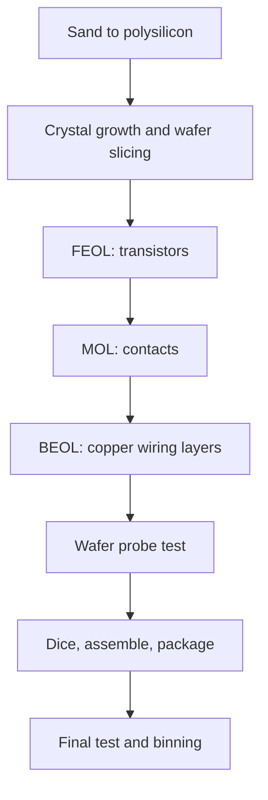
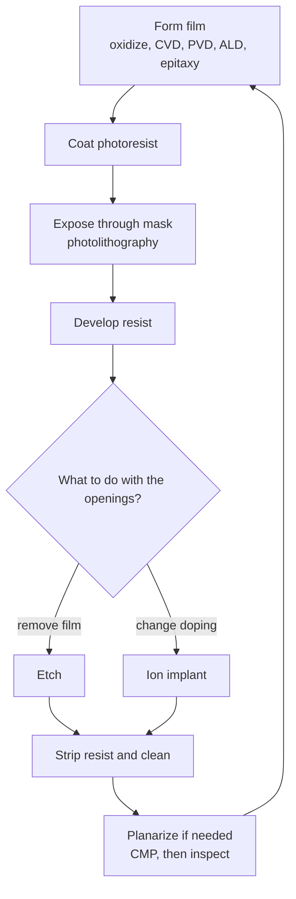

::: basics
### In plain words
An integrated circuit is built on a thin disc of pure silicon, layer by layer. The same loop repeats many times: add a thin film, pattern it using light, etch or implant, then clean. The first layers make transistors, and later layers add copper wiring. Then the wafer is tested, cut into dies, and the good dies go into packages.

### Picture it
Think of silk-screen printing a poster with many colors. Each color goes on through its own stencil, and every stencil must line up exactly with the ones before. Chips work the same way, with dozens of stencils. One difference matters: a chip loop also removes material, by etching, and it changes the silicon's electrical properties, not just its color.

### Words you need
- **Wafer**: the pure silicon disc the chips are built on. See [[q0659]].
- **Mask**: a plate with a pattern, used like a stencil.
- **Photoresist**: a light-sensitive coating. Light through the mask changes it, so some areas can be washed away.
- **Etch**: removing material only where the resist does not protect it. See [[q0662]].
- **Doping**: adding a few atoms of another element to change how well silicon conducts. See [[q0065]].

### The simplest example
Here is one trip around the loop. Grow a thin layer of glass (silicon dioxide) on the wafer. Dry oxygen at 1000 °C for an hour grows about 69 nm. Coat it with photoresist. Shine light through a mask, then develop, so resist remains only where you want to keep glass. Etch away the unprotected glass. Strip the leftover resist and clean. You now have glass in exactly the pattern you drew.

A modern chip needs this loop dozens of times, up to about a hundred, and every layer must align with the last. All the dies on a wafer are built at the same time.

That is the whole idea. The rest of this page covers the transistor stage and the copper wiring stage, why cleanrooms matter, and testing and packaging.
:::

::: testing
Whether you can give a coherent, end-to-end picture of chip manufacturing without drowning in details: starting from sand and a silicon wafer, building transistors and wiring layer by layer through a repeated loop of deposit, pattern, etch, implant and polish, then testing, dicing and packaging. The interviewer also listens for scale (billions of transistors, nanometre features, cleanrooms, months of processing) and for the key idea that lithography draws the pattern while the other steps give it material and electrical properties. Hidden sub-skills: knowing front-end vs back-end of line, why yield matters, and linking a process step to a circuit property.
:::

::: why
Even if you never work in a fab, process limits shape everything a hardware engineer does: why transistors have the speeds, leakage and variability they do, why analog and digital need different processes, why a new node costs so much, why dies have yield and cost, and why packages exist. In interviews, "how are ICs made?" is a gateway to the more specific questions that follow in this section: wafers ([[q0659]]), the wafer-to-chip flow ([[q0660]]), lithography ([[q0661]]), etching ([[q0662]]) and deposition ([[q0663]]).
:::

::: concepts
- **Silicon wafer**: a thin disc of single-crystal silicon on which hundreds of identical dies are built at once. See [[q0659]].
- **The patterning loop**: deposit or grow a film, coat resist, expose through a mask, develop, etch or implant, strip, clean. Repeated dozens of times.
- **Doping**: adding boron, phosphorus or arsenic atoms to set the carrier type and density; it creates the transistors' source, drain and wells. See [[q0065]].
- **FEOL / MOL / BEOL**: front-end-of-line builds transistors, middle-of-line contacts them, back-end-of-line is the copper wiring above.
- **Cleanroom and contamination control**: a single particle can kill a die, so yield depends on cleanliness. See [[q0650]].
- **Test and packaging**: wafer probe, dicing, assembly and final test turn a processed wafer into chips. See [[q0660]].
:::

::: answer
"At a high level, chips are made by building the transistors and wires on a silicon wafer, layer by layer, using a repeated cycle of deposit, pattern and etch.

You start from a very pure single-crystal silicon wafer, grown from sand that's been purified. Then in the front end you build transistors: you grow or deposit thin films like silicon dioxide and the gate material, you use photolithography to define patterns in a light-sensitive resist, you etch away material or implant dopants through the openings to make the source, drain and wells, and you polish the surface flat. That pattern, expose, etch loop is repeated for every layer, around fifty to a hundred times for a modern processor.

Once the transistors exist, the back end builds the wiring: several to more than a dozen layers of copper interconnect separated by insulators, with vias between them. When the wafer is done, you probe-test every die, cut the wafer into individual dies, put the good ones in a package with bond wires or bumps, and test again.

The whole thing takes weeks to months in a cleanroom, and the key challenges are tiny feature sizes and yield: one particle or defect can ruin a die, so process control matters enormously."
:::

::: technical
**Starting material.** Quartz sand (SiO₂) is reduced to metallurgical-grade silicon, converted to a volatile chlorosilane, distilled and deposited as electronic-grade polysilicon with impurity levels of parts per billion or better. A seed crystal is dipped in molten silicon (melting point 1414 °C) and slowly pulled to grow a single-crystal ingot (Czochralski), which is sliced into wafers, lapped, etched and polished ([[q0659]]).

**Front end of line (FEOL).** Isolation (shallow-trench isolation), wells (implants), gate dielectric (thin SiO₂ or high-k such as HfO₂, deposited by ALD, [[q0663]]), gate electrode, source/drain implants and anneal, spacers, silicide contacts. In FinFET and gate-all-around processes the channel is a fin or nanosheet etched into silicon.

**Each patterned layer** follows the loop: film formation (thermal oxidation, CVD, PVD, ALD, epitaxy) → resist coat → photolithography ([[q0661]]) → etch ([[q0662]]) or ion implantation → resist strip and clean → inspection, and chemical-mechanical planarization (CMP) when topography must be flattened.

**Middle and back end.** Contacts (tungsten or similar) connect transistors to metal 1. BEOL stacks 8–15+ copper layers in low-k dielectric, made by dual damascene: etch trenches and vias, deposit barrier and seed, electroplate copper, CMP away the excess.

**Thermal oxidation (example).** Deal-Grove: $x^2 + Ax = B(t+\tau)$. For dry O₂ at 1000 °C with $A\approx0.165\ \mu$m, $B\approx0.0117\ \mu\text{m}^2$/h, $\tau\approx0.37$ h, one hour gives about 69 nm of oxide.

**Test and assembly.** Wafer probe ("sort") marks good dies, the wafer is thinned and diced, good dies are attached and wire-bonded or flip-chipped ([[q0654]], [[q0656]]), moulded, and tested again.

**Scale.** Advanced logic wafers can need on the order of a hundred mask layers and months of cycle time; exact numbers vary by node and company.
:::

::: short
"ICs are built on a pure single-crystal silicon wafer by repeating a loop: deposit a film, pattern it with photolithography, etch or implant, and clean and polish. The front end builds transistors, and the back end adds copper wiring layers. Then you probe-test each die, dice the wafer, package the good dies and test again. It's done in a cleanroom because one particle can kill a die."
:::

::: long
"An integrated circuit starts as sand, but really as extremely pure silicon. The silicon is melted and a seed crystal is pulled out to form a single-crystal ingot, which is sliced into wafers, up to 300 millimetres across, and polished to a mirror finish. Hundreds of identical chips, called dies, are built on each wafer at the same time.

Then comes the repeated loop. For each layer you create a thin film, by oxidizing the silicon, or depositing materials by CVD or atomic layer deposition. You coat the wafer with photoresist, shine light through a mask in a lithography tool so the pattern is projected onto the resist, and develop it so only some areas stay covered. Then you either etch away the exposed film, or implant dopant atoms through the openings, and finally strip the resist and clean. Sometimes you polish the wafer flat, with chemical-mechanical polishing. That cycle repeats around fifty to a hundred times.

The first part is the front end, which builds the transistors: isolation, wells, gate stack, source and drain. The second part is the back end, which builds the wiring: contacts and then many layers of copper lines and vias in insulating dielectric, made with the damascene process, where you etch trenches, fill them with copper and polish.

Once the wafer is finished, each die is probe-tested and bad ones are marked. The wafer is thinned and cut apart, good dies go into packages with wire bonds or solder bumps, and the finished chips get final tests, burn-in and binning.

Everything happens in cleanrooms because particles ruin dies, and the whole process takes weeks to months. The big challenges are fine features, alignment between layers and yield."
:::

::: terms
- **Wafer**: thin disc of single-crystal silicon (commonly 300 mm) on which dies are built.
- **Die**: one rectangular chip on the wafer before packaging.
- **Photolithography**: using light and a mask to transfer a pattern into photoresist.
- **Etch**: removing material selectively to carve patterns.
- **Ion implantation**: shooting dopant ions into silicon to set conductivity type.
- **CVD / PVD / ALD**: deposition methods (chemical vapour, physical vapour, atomic layer).
- **CMP (chemical-mechanical planarization)**: polishing the wafer flat between layers.
- **FEOL / BEOL**: front-end (transistors) and back-end (metal wiring) of line.
- **Yield**: fraction of dies that work.
:::

::: exceptional
An average answer lists "wafer, mask, etch, package." An exceptional answer:
- Describes the **repeating loop** (film, pattern, etch/implant, clean, planarize) and states that it repeats tens of times.
- Separates **FEOL transistors** from **BEOL copper wiring**, and mentions damascene copper.
- Gives scale and context: 300 mm wafers, hundreds of dies each, months of cycle time, cleanroom contamination.
- Connects steps to circuit properties (doping sets Vt, gate oxide thickness sets capacitance, interconnect sets RC delay).
- Mentions yield and test (wafer sort, final test), and notes the process is parallel: all dies are made at once.
:::

::: mistakes
- **Saying chips are "printed" in one step.** Dozens of patterned layers are built up one at a time.
- **Skipping doping.** Without implants or diffusion there are no n and p regions, so no transistors.
- **Thinking packaging happens before the wafer is finished.** Packaging comes after the wafer is probe-tested and diced.
- **Confusing the wafer with the die.** A wafer holds hundreds or thousands of dies ([[q0645]]).
- **Forgetting that metal wiring takes many layers.** The BEOL is a large part of both process cost and delay.
:::

::: deep
## Big picture: from sand to a packaged chip


Figure: The main stages. Everything from FEOL to wafer probe happens on the whole wafer at once, in parallel. Only after probing is the wafer cut into individual dies.

### Stage 1: silicon wafers

Pure silicon is made into a single crystal by the Czochralski method, then sliced, lapped and polished to a flat mirror surface. Details in [[q0659]]. The wafer's doping (p-type with boron, typically) sets the substrate; the transistors are formed in the top few micrometres.

### Stage 2: the patterning loop

A modern chip needs on the order of dozens to a hundred mask layers. Every layer follows this loop:


Figure: The universal fab loop. Lithography only makes a temporary pattern in resist; etching or implanting is what transfers that pattern into the permanent structure. Because every layer must line up with the ones beneath it, overlay accuracy is a critical specification.

### Stage 3: building the transistor

In a planar or FinFET CMOS process the sequence is roughly:

1. **Isolation**: etch trenches in silicon and fill them with oxide (shallow trench isolation) so neighbouring transistors don't connect.
2. **Wells**: implant boron or phosphorus to make p-wells and n-wells. A quick feel for what doping does is in the sim below.
3. **Gate stack**: grow or deposit a very thin gate dielectric (≈1–2 nm equivalent oxide thickness in modern nodes; high-k HfO₂ by ALD) and the gate electrode.
4. **Source/drain**: implant dopants self-aligned to the gate, then anneal to activate them.
5. **Silicide/contacts** to lower resistance.

```sim
{"id":"doping-lab","material":"si","nd":1e16,"na":0,"t":300}
```
Figure: Doping sets carrier concentration and therefore resistivity. Increase the donor concentration and watch the electron density and conductivity rise by orders of magnitude, which is what implants do to make source, drain and wells.

### An example of a single step: thermal oxidation

Oxide growth on silicon follows the Deal-Grove model $x^2 + Ax = B(t+\tau)$, giving linear growth at first ($x\approx (B/A)t$) and parabolic growth later ($x\approx\sqrt{Bt}$) because oxygen must diffuse through the growing oxide.

```plot
{"title":"Dry oxidation of silicon at 1000 °C (Deal-Grove)","x":{"label":"Time","unit":"h","min":0,"max":4.6},"y":{"label":"Oxide thickness","unit":"nm","min":0,"max":170},
 "vars":{"a":0.165,"b":0.0117,"tau":0.37},
 "series":[{"label":"x(t)","fn":"1000*a/2*(sqrt(1+4*b*(x+tau)/(a*a))-1)"}],
 "points":[{"x":1,"y":68.6,"label":"1 h: 69 nm"},{"x":4,"y":158.2,"label":"4 h: 158 nm"}]}
```
Figure: Thickness grows fast then slows because oxygen must diffuse through the existing oxide. Quadrupling the time from 1 h to 4 h only gives 2.3× the thickness.

> [!UNCERTAIN]
> The Deal-Grove constants depend on temperature, crystal orientation, oxidant and the initial oxide. The values above (A ≈ 0.165 µm, B ≈ 0.0117 µm²/h, τ ≈ 0.37 h for dry O₂ at 1000 °C on (100) silicon) are textbook-type numbers used for illustration; check a process reference for real design.

### Stage 4: wiring (BEOL)

Transistors alone do nothing until they are wired. Contacts rise from the transistors to metal layer 1; above it come further layers, thin and tightly pitched at the bottom and thick and wide at the top for power and long wires. Copper is used because of its low resistivity but it cannot be etched easily, so the **dual damascene** process is used: etch trenches and vias into the dielectric, line with a barrier (to stop copper diffusing into silicon), deposit a copper seed, electroplate to overfill, and polish off the excess by CMP. Low-k dielectrics reduce capacitance so wire delay stays manageable. Wire resistance and capacitance (RC) are a large part of delay at advanced nodes.

### Stage 5: test, dice, package

The wafer is probed (see [[q0660]]), thinned, sawn into dies, and the good dies are assembled by wire bonding ([[q0654]]) or flip chip ([[q0656]]), encapsulated, marked and tested again.

### Why yield and cleanliness dominate

Each step can add defects. If a die has area $A$ and defect density $D_0$, a Poisson estimate is $Y = e^{-AD_0}$; with $A = 1\ \text{cm}^2$ and $D_0 = 0.1/\text{cm}^2$ that is 90%, but at $D_0=0.5$ it's 61%. Cleanrooms for leading-edge fabs are far cleaner than an operating theatre: ISO class 5 or better in process areas, meaning at most a few thousand particles of 0.5 µm or larger per cubic metre. (ISO 14644-1 class 5 allows 3,520 particles/m³ at ≥0.5 µm.)

> [!NOTE]
> Real fabs also recycle: reworked wafers, inline metrology and statistical process control drive each step into very tight tolerances. A modern fab runs hundreds of process steps; a wafer may spend 2–3 months moving through them (exact figures vary).

### A CMOS inverter, layer by layer

To make the "pattern, etch, deposit" loop concrete, consider the layers needed for just one inverter (two transistors), in rough order: **active area** mask (defines where silicon stays for transistors versus trench isolation); **n-well** mask (implant to make the PMOS region); **gate** (thin dielectric then polysilicon or metal gate, patterned); **p+ and n+ source/drain** implants (each masked, self-aligned to the gate); **contact** mask (holes to reach source, drain and gate); **metal 1** (copper or tungsten wiring) to connect drains and supply; **via 1** and **metal 2** for the next level. Each of those is one trip around the loop. A real microprocessor has the same transistor-level layers plus extra masks for threshold-voltage options, spacers, silicides and ten or more metal and via layers, which is how the count climbs into the dozens.

### Where the numbers come from

- **300 mm wafers**: about 70,700 mm² of area.
- **Dies per wafer**: for a 100 mm² die, about 640 candidate dies ([[q0659]]).
- **Process node names** like "5 nm" are marketing labels and no longer match any specific feature size ([[q0646]]).
:::

::: applications
- **Microprocessors, GPUs and SoCs** are made on leading-edge logic processes with EUV lithography and many metal layers.
- **DRAM and NAND memory** use specialised processes: DRAM has deep capacitors and high-aspect-ratio etches, 3D NAND stacks hundreds of layers.
- **Analog and power ICs** use older, larger nodes with high-voltage options (BCD processes).
- **MEMS sensors** use similar steps plus deep etching and release of moving structures.
- **Image sensors** stack a pixel wafer and a logic wafer bonded together.
:::

::: assumptions
- The description is for a CMOS silicon logic process. Memory, analog, power, compound-semiconductor (GaN, SiC, GaAs) and MEMS flows differ in details, though the deposit-pattern-etch loop is common.
- Mask layer counts, cycle times and cleanroom classes are typical ranges, not specific to any manufacturer or node.
- The process order varies: FinFET, gate-all-around and backside power flows change the transistor portion.
- If an interviewer wants a short answer, give the five-stage summary; if the role is process engineering, expand on lithography, etch, deposition and yield.
:::

::: followups
### What is the difference between the front end and back end of line?
Front end (FEOL) builds the transistors in and on the silicon: wells, gates, sources and drains. Back end (BEOL) builds the multilayer metal interconnect above them. FEOL sets device speed and leakage; BEOL sets wire delay, power distribution and routing density. Don't confuse this with "front end and back end" of packaging, where back end means assembly and test.

### Why is the process repeated so many times?
A chip is a 3D structure made of many differently patterned layers: isolation, wells, gate, contacts, and a dozen metal and via levels. Photolithography can only pattern one layer at a time, so each layer needs its own mask and the deposit-pattern-etch loop. Advanced nodes use multiple patterning, which adds even more exposures.

### Why use a cleanroom?
Particles larger than a fraction of the feature size can block an exposure or short two lines, killing the die. For a 1 cm² die, even $D_0 = 0.1/\text{cm}^2$ means 10% die loss. Cleanrooms, filtered air, gowned operators and enclosed wafer carriers (FOUPs) keep particles out.

### How do you get n-type and p-type regions?
By doping: implanting phosphorus or arsenic (donors) makes n-type, boron (acceptor) makes p-type. Implant energy sets the depth and dose sets the concentration; an anneal repairs the crystal and activates the dopants. Masks (resist) block implants from areas that should stay unchanged.

### Scenario: a new batch has a lower yield and defects cluster on one side of the wafers. What do you suspect?
A systematic, location-dependent cause rather than random particles: an edge-related etch or deposition non-uniformity, a contaminated chuck or a tool problem. Check the wafer maps for patterns (edge ring, radial, scratch lines), compare tools and lots, and look at inline metrology data. Random scattered failures point to particles; repeating patterns point to a specific tool or step.
:::

::: interpretations
"How are ICs made?" is broad. The answer here is the whole flow at overview level; detailed sub-questions follow: wafer ([[q0659]]), wafer-to-chip ([[q0660]]), photolithography ([[q0661]]), etching ([[q0662]]), ALD ([[q0663]]) and sub-wavelength patterning ([[q0664]]).
:::

::: references
- Plummer, Deal & Griffin, *Silicon VLSI Technology: Fundamentals, Practice and Modeling*: overview of CMOS process flow, oxidation, lithography, etching, deposition and interconnect.
- Campbell, *Fabrication Engineering at the Micro- and Nanoscale*: process steps and integration.
- Weste & Harris, *CMOS VLSI Design*: chapter on manufacturing and yield.
- Sze & Ng, *Physics of Semiconductor Devices*: process technology background.
:::

::: rubric
- Starts with a pure single-crystal silicon wafer :: Gives the right starting point.
- Describes the repeated deposit/pattern/etch (or implant) loop :: The core idea of chip manufacturing.
- Mentions photolithography and masks as the patterning step :: Shows you know how patterns are created.
- Explains doping/implantation to make n and p regions :: Explains how transistors arise.
- Distinguishes FEOL (transistors) from BEOL (copper wiring) :: Shows structural understanding.
- Mentions testing, dicing and packaging after the wafer is done :: Completes the story.
- Notes cleanroom, yield and scale (hundreds of steps) :: Shows awareness of real manufacturing constraints.
:::

::: quiz
```json
[
 {"type":"mcq","level":"fundamental","q":"Which step actually transfers the lithographic pattern into a permanent film?","options":["Spin-coating resist","Developing the resist","Etching (or implanting) through the resist openings","Wafer dicing"],"answer":2,"explain":"Lithography only creates a temporary pattern in resist. Etching removes the unprotected film (or implantation dopes the exposed silicon), which is what makes the pattern permanent."},
 {"type":"truefalse","level":"fundamental","q":"Dies are cut apart and packaged before the transistors are built.","answer":false,"explain":"Transistors and wiring are built on the whole wafer first. Only after wafer probe is the wafer diced and the good dies packaged."},
 {"type":"mcq","level":"intermediate","q":"Why is copper wiring made by the damascene process instead of etching copper lines?","options":["Copper is too soft to etch with a laser","Copper doesn't form volatile etch products easily, so trenches are etched in dielectric and filled with copper, then polished","Copper cannot be deposited on silicon","Damascene is cheaper than any other process"],"answer":1,"explain":"Copper is hard to dry-etch because its halides are not volatile. Dual damascene etches the dielectric, fills with plated copper and removes the excess by CMP."},
 {"type":"numeric","level":"intermediate","q":"Using Poisson yield $Y=e^{-AD_0}$, what is the yield (in %) of a 1 cm² die with $D_0 = 0.5\\ \\text{cm}^{-2}$?","answer":60.7,"tolerance":0.02,"unit":"%","explain":"$Y = e^{-0.5} = 0.6065$, so about 60.7%."},
 {"type":"numeric","level":"advanced","q":"Using Deal-Grove with $A=0.165\\ \\mu$m, $B=0.0117\\ \\mu\\text{m}^2$/h, $\\tau=0.37$ h, how thick is the oxide after 1 h of dry oxidation, in nm?","answer":68.6,"tolerance":0.03,"unit":"nm","explain":"$x = \\frac{A}{2}\\left[\\sqrt{1+\\frac{4B(t+\\tau)}{A^2}}-1\\right] = 0.0825\\times(\\sqrt{3.357}-1) = 0.0686\\ \\mu$m = 68.6 nm."}
]
```
:::
