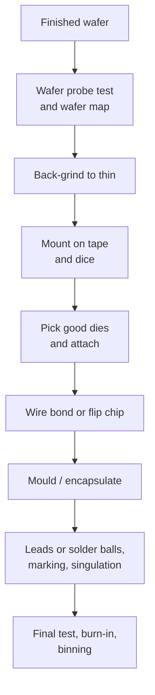

::: testing
Whether you know what happens *after* the wafer is processed: probe testing, thinning, dicing, die attach, interconnect (wire bond or flip chip), encapsulation, final test and binning. The interviewer wants the right order, a reason for each step (for example, test before packaging so you don't waste package cost on bad dies), and some feel for cost and yield. Hidden sub-skills: back-end-of-line vs back-end-of-packaging terminology, test economics, and linking assembly choices to electrical and thermal performance.
:::

::: why
Package, assembly and test often account for a large fraction of a chip's cost, and they determine electrical behaviour (inductance, thermal resistance), reliability and form factor. If you pick parts, design boards or debug failures, knowing how a die becomes a package explains datasheet items (speed grades, thermal resistance, MSL ratings), why some parts have exposed pads or bumps, and where defects come from. It is also the natural second half of "how are ICs made" ([[q0658]]).
:::

::: concepts
- **Wafer probe (sort)**: testing every die on the wafer with needle or cantilever probe cards before dicing.
- **Backgrinding (thinning)**: grinding the wafer back to reduce thickness for the package.
- **Dicing (singulation)**: cutting the wafer along scribe lanes with a saw or laser.
- **Die attach and interconnect**: gluing the die to a lead frame or substrate, then wire bonding ([[q0654]]) or flip chip ([[q0656]]).
- **Encapsulation**: moulding epoxy around the die to protect it.
- **Final test and binning**: testing packaged parts at speed and temperature and sorting them into grades.
:::

::: answer
"After the wafer has finished processing, the chips are all still joined together, and the flow to individual packaged chips goes like this.

First is wafer probe: a probe card with tiny needles touches each die's pads and a tester runs electrical tests, and bad dies are marked or recorded in a wafer map. Testing early matters because it's cheaper to throw away a bad bare die than a finished package.

Then the wafer is mounted on tape, usually thinned by grinding the back from about 775 micrometres down to something like 100 to 300, and cut along the scribe lanes with a diamond saw or a laser into individual dies. Good dies are picked and attached to a lead frame or substrate with epoxy or solder. Then you connect the die to the package: wire bonds from pads to leads, or flip-chip bumps. Next the assembly is encapsulated in moulding compound, and for a lead-frame package the leads are trimmed and formed, or for a BGA, solder balls are attached.

Finally, you do final test, sometimes with burn-in, to check function, speed and temperature performance. Parts are binned by speed or quality, marked, and shipped. The flow is all about not spending more on a die than it's worth: test early, package good dies, test again at the end."
:::

::: technical
**1. Wafer probe (wafer sort).** A probe card (cantilever or vertical needles, or MEMS probes for fine pitch) contacts the die pads, and automatic test equipment (ATE) applies vectors and measures parametric and functional tests. Results are stored as a wafer map with hard bins (pass/fail) and soft bins (speed or leakage grades). Probing at multiple temperatures is common for automotive parts.

**2. Back-grinding.** The wafer front is covered with protective tape and the back is ground to the target thickness. Standard thickness (e.g. 775 µm for 300 mm) is reduced to roughly 50–300 µm depending on package height and whether TSVs or stacking are used; thinner dies warp and crack more easily.

**3. Dicing.** The wafer is mounted on dicing tape and cut along scribe lanes (streets, typically tens to ~100 µm wide) by a diamond blade (kerf tens of µm), a laser, or "stealth dicing" which creates internal damage and then expands the tape to separate dies. Overhead: a 5 mm die with an 80 µm street consumes $(5.08/5)^2-1 = 3.2\%$ extra area.

**4. Die pick and attach.** Good dies (per the wafer map) are picked and bonded with epoxy, film adhesive or solder to a lead-frame pad or substrate. This provides mechanical support, thermal conduction and sometimes an electrical connection (e.g., a drain contact on a vertical MOSFET).

**5. Interconnect.** Wire bonding ([[q0654]]), flip chip ([[q0656]]), or other methods (TAB, copper clip).

**6. Encapsulation.** Transfer moulding of epoxy compound (or a lid on ceramic or lidded flip-chip packages), cured in an oven.

**7. Finishing.** For lead-frame packages: deflash, plate or dip leads, trim and form, mark. For BGA: solder ball attach and reflow. Singulate from the strip.

**8. Final test, burn-in and binning.** ATE tests at speed and temperature, perhaps stress/burn-in to catch early failures, then speed or grade binning, then tape and reel or trays.

**Yield stacking.** Total yield is the product of stages: for example $0.90\times0.98\times0.99 = 87\%$ from wafer-good dies through assembly and final test.
:::

::: short
"After processing, you probe-test every die on the wafer and map the good ones. Then the wafer is thinned by back-grinding, mounted on tape and diced into individual dies with a saw or laser. Good dies are attached to a lead frame or substrate, connected by wire bonds or flip-chip bumps, encapsulated in mould compound, and finished with leads or solder balls. Final test and binning sort the parts by performance before they ship."
:::

::: long
"Once the wafer finishes fabrication, every die on it is still joined to its neighbours, and the next steps turn it into packaged parts.

The first step is wafer probe. A probe card with fine needles lands on each die's pads, the tester runs a series of electrical and functional tests, and the result is a wafer map showing good and bad dies, and often speed or leakage bins. You do that before packaging because a bad die is worth nothing and putting it in a package wastes the package cost.

Next the wafer goes face-down on protective tape and the back is ground thin. A 300 millimetre wafer is about 775 micrometres thick, and dies are commonly thinned to 100 to 300 micrometres, depending on the package. Then the wafer is mounted on dicing tape and cut along the scribe lanes by a diamond saw, or by a laser, into separate dies. A pick-and-place machine takes only the good dies and glues or solders them onto a lead frame or substrate.

Then comes the connection to the outside world. In wire bonding, a machine welds a thin wire from each pad to the package lead. In flip chip, the die has solder bumps and is flipped onto the substrate. The whole thing is then encapsulated in epoxy mould compound to protect it from moisture and mechanical damage. Leaded packages get their leads trimmed and formed, BGAs get solder balls, and the part is marked.

Finally comes final test. The packaged chips are tested again at speed and often at temperature, sometimes burned-in to find early-life failures, and then binned: fast parts, slow parts, rejects. Then they're put on tape and reel and shipped.

The theme is economics: test at each stage so you don't keep spending money on parts that can't work."
:::

::: terms
- **Wafer probe / wafer sort**: electrical testing of every die while still on the wafer.
- **Wafer map**: a map of pass/fail and bin results for each die position.
- **Backgrinding**: thinning the wafer from the back before dicing.
- **Dicing / singulation**: cutting the wafer into individual dies.
- **Kerf**: width of material removed by the saw.
- **Die attach**: bonding the die to a lead frame or substrate.
- **Mould compound**: epoxy used to encapsulate the die and interconnect.
- **Binning**: sorting parts into performance grades after testing.
- **Burn-in**: stress at elevated temperature and voltage to precipitate early failures.
- **ATE (automatic test equipment)**: tester used at probe and final test.
:::

::: exceptional
An average answer lists "cut it up and put it in a package." An exceptional answer:
- Gives the order: probe → thin → dice → pick-and-place → attach → interconnect → mould → finish → final test → bin.
- Explains **why probe comes first** (known-good-die economics) and gives a small cost example.
- Gives typical numbers: 775 µm → 100–300 µm thickness, saw kerf, street width, yield stacking.
- Notes that interconnect choice (wire bond vs flip chip) and encapsulation determine inductance, thermal path and cost.
- Mentions binning: why the same wafer yields fast and slow parts, and how that shows up as speed grades.
:::

::: mistakes
- **Packaging the whole wafer first.** Dies are separated, then packaged one by one (except wafer-level packages).
- **Skipping probe because "final test will catch it".** Packaging bad dies wastes assembly cost and package material.
- **Ignoring thinning.** Full-thickness dies are too tall for most packages and cool poorly.
- **Thinking all packaging is done by a fab.** It is commonly done by an OSAT (outsourced assembly and test) company.
- **Believing every die on a wafer performs identically.** Process variation spreads speed and leakage, hence binning.
:::

::: deep
## The flow


Figure: Wafer to chip. Everything up to dicing is done on the whole wafer in parallel; after dicing, work proceeds one die or one strip of packages at a time, so cost scales with unit count.

## Wafer probe and the wafer map

A probe card has hundreds to thousands of probe needles matched to one or more dies' pads. The wafer prober steps the wafer under the card and the tester measures. Each die gets a hard bin (pass/fail) and often a soft bin for speed or leakage. The map shows patterns that reveal process problems.

```svg
<svg viewBox="0 0 340 345" role="img" aria-label="Wafer map with dies colored by test bin: green fast, orange slow, red failed">
 <circle cx="170" cy="165" r="140" fill="var(--d-box)" stroke="var(--d-ink)" stroke-width="2"/>
 <path d="M160 304 L170 293 L180 304" fill="var(--d-bg, #fff)" stroke="var(--d-ink)"/>
 <circle cx="170" cy="165" r="132" fill="none" stroke="var(--d-muted)" stroke-dasharray="4 4"/>
 <rect x="51" y="118" width="22" height="22" fill="var(--d-red)" fill-opacity="0.75" stroke="var(--d-accent)" stroke-width="0.8"/>
 <rect x="51" y="142" width="22" height="22" fill="var(--d-orange)" fill-opacity="0.7" stroke="var(--d-accent)" stroke-width="0.8"/>
 <rect x="51" y="166" width="22" height="22" fill="var(--d-green)" fill-opacity="0.7" stroke="var(--d-accent)" stroke-width="0.8"/>
 <rect x="51" y="190" width="22" height="22" fill="var(--d-orange)" fill-opacity="0.7" stroke="var(--d-accent)" stroke-width="0.8"/>
 <rect x="75" y="94" width="22" height="22" fill="var(--d-green)" fill-opacity="0.7" stroke="var(--d-accent)" stroke-width="0.8"/>
 <rect x="75" y="118" width="22" height="22" fill="var(--d-green)" fill-opacity="0.7" stroke="var(--d-accent)" stroke-width="0.8"/>
 <rect x="75" y="142" width="22" height="22" fill="var(--d-green)" fill-opacity="0.7" stroke="var(--d-accent)" stroke-width="0.8"/>
 <rect x="75" y="166" width="22" height="22" fill="var(--d-orange)" fill-opacity="0.7" stroke="var(--d-accent)" stroke-width="0.8"/>
 <rect x="75" y="190" width="22" height="22" fill="var(--d-green)" fill-opacity="0.7" stroke="var(--d-accent)" stroke-width="0.8"/>
 <rect x="75" y="214" width="22" height="22" fill="var(--d-red)" fill-opacity="0.75" stroke="var(--d-accent)" stroke-width="0.8"/>
 <rect x="99" y="70" width="22" height="22" fill="var(--d-orange)" fill-opacity="0.7" stroke="var(--d-accent)" stroke-width="0.8"/>
 <rect x="99" y="94" width="22" height="22" fill="var(--d-green)" fill-opacity="0.7" stroke="var(--d-accent)" stroke-width="0.8"/>
 <rect x="99" y="118" width="22" height="22" fill="var(--d-green)" fill-opacity="0.7" stroke="var(--d-accent)" stroke-width="0.8"/>
 <rect x="99" y="142" width="22" height="22" fill="var(--d-green)" fill-opacity="0.7" stroke="var(--d-accent)" stroke-width="0.8"/>
 <rect x="99" y="166" width="22" height="22" fill="var(--d-green)" fill-opacity="0.7" stroke="var(--d-accent)" stroke-width="0.8"/>
 <rect x="99" y="190" width="22" height="22" fill="var(--d-green)" fill-opacity="0.7" stroke="var(--d-accent)" stroke-width="0.8"/>
 <rect x="99" y="214" width="22" height="22" fill="var(--d-orange)" fill-opacity="0.7" stroke="var(--d-accent)" stroke-width="0.8"/>
 <rect x="99" y="238" width="22" height="22" fill="var(--d-orange)" fill-opacity="0.7" stroke="var(--d-accent)" stroke-width="0.8"/>
 <rect x="123" y="46" width="22" height="22" fill="var(--d-red)" fill-opacity="0.75" stroke="var(--d-accent)" stroke-width="0.8"/>
 <rect x="123" y="70" width="22" height="22" fill="var(--d-orange)" fill-opacity="0.7" stroke="var(--d-accent)" stroke-width="0.8"/>
 <rect x="123" y="94" width="22" height="22" fill="var(--d-green)" fill-opacity="0.7" stroke="var(--d-accent)" stroke-width="0.8"/>
 <rect x="123" y="118" width="22" height="22" fill="var(--d-green)" fill-opacity="0.7" stroke="var(--d-accent)" stroke-width="0.8"/>
 <rect x="123" y="142" width="22" height="22" fill="var(--d-orange)" fill-opacity="0.7" stroke="var(--d-accent)" stroke-width="0.8"/>
 <rect x="123" y="166" width="22" height="22" fill="var(--d-green)" fill-opacity="0.7" stroke="var(--d-accent)" stroke-width="0.8"/>
 <rect x="123" y="190" width="22" height="22" fill="var(--d-green)" fill-opacity="0.7" stroke="var(--d-accent)" stroke-width="0.8"/>
 <rect x="123" y="214" width="22" height="22" fill="var(--d-green)" fill-opacity="0.7" stroke="var(--d-accent)" stroke-width="0.8"/>
 <rect x="123" y="238" width="22" height="22" fill="var(--d-red)" fill-opacity="0.75" stroke="var(--d-accent)" stroke-width="0.8"/>
 <rect x="123" y="262" width="22" height="22" fill="var(--d-orange)" fill-opacity="0.7" stroke="var(--d-accent)" stroke-width="0.8"/>
 <rect x="147" y="46" width="22" height="22" fill="var(--d-green)" fill-opacity="0.7" stroke="var(--d-accent)" stroke-width="0.8"/>
 <rect x="147" y="70" width="22" height="22" fill="var(--d-orange)" fill-opacity="0.7" stroke="var(--d-accent)" stroke-width="0.8"/>
 <rect x="147" y="94" width="22" height="22" fill="var(--d-orange)" fill-opacity="0.7" stroke="var(--d-accent)" stroke-width="0.8"/>
 <rect x="147" y="118" width="22" height="22" fill="var(--d-green)" fill-opacity="0.7" stroke="var(--d-accent)" stroke-width="0.8"/>
 <rect x="147" y="142" width="22" height="22" fill="var(--d-green)" fill-opacity="0.7" stroke="var(--d-accent)" stroke-width="0.8"/>
 <rect x="147" y="166" width="22" height="22" fill="var(--d-orange)" fill-opacity="0.7" stroke="var(--d-accent)" stroke-width="0.8"/>
 <rect x="147" y="190" width="22" height="22" fill="var(--d-green)" fill-opacity="0.7" stroke="var(--d-accent)" stroke-width="0.8"/>
 <rect x="147" y="214" width="22" height="22" fill="var(--d-green)" fill-opacity="0.7" stroke="var(--d-accent)" stroke-width="0.8"/>
 <rect x="147" y="238" width="22" height="22" fill="var(--d-green)" fill-opacity="0.7" stroke="var(--d-accent)" stroke-width="0.8"/>
 <rect x="147" y="262" width="22" height="22" fill="var(--d-green)" fill-opacity="0.7" stroke="var(--d-accent)" stroke-width="0.8"/>
 <rect x="171" y="46" width="22" height="22" fill="var(--d-orange)" fill-opacity="0.7" stroke="var(--d-accent)" stroke-width="0.8"/>
 <rect x="171" y="70" width="22" height="22" fill="var(--d-orange)" fill-opacity="0.7" stroke="var(--d-accent)" stroke-width="0.8"/>
 <rect x="171" y="94" width="22" height="22" fill="var(--d-orange)" fill-opacity="0.7" stroke="var(--d-accent)" stroke-width="0.8"/>
 <rect x="171" y="118" width="22" height="22" fill="var(--d-green)" fill-opacity="0.7" stroke="var(--d-accent)" stroke-width="0.8"/>
 <rect x="171" y="142" width="22" height="22" fill="var(--d-green)" fill-opacity="0.7" stroke="var(--d-accent)" stroke-width="0.8"/>
 <rect x="171" y="166" width="22" height="22" fill="var(--d-green)" fill-opacity="0.7" stroke="var(--d-accent)" stroke-width="0.8"/>
 <rect x="171" y="190" width="22" height="22" fill="var(--d-green)" fill-opacity="0.7" stroke="var(--d-accent)" stroke-width="0.8"/>
 <rect x="171" y="214" width="22" height="22" fill="var(--d-orange)" fill-opacity="0.7" stroke="var(--d-accent)" stroke-width="0.8"/>
 <rect x="171" y="238" width="22" height="22" fill="var(--d-orange)" fill-opacity="0.7" stroke="var(--d-accent)" stroke-width="0.8"/>
 <rect x="171" y="262" width="22" height="22" fill="var(--d-orange)" fill-opacity="0.7" stroke="var(--d-accent)" stroke-width="0.8"/>
 <rect x="195" y="46" width="22" height="22" fill="var(--d-green)" fill-opacity="0.7" stroke="var(--d-accent)" stroke-width="0.8"/>
 <rect x="195" y="70" width="22" height="22" fill="var(--d-green)" fill-opacity="0.7" stroke="var(--d-accent)" stroke-width="0.8"/>
 <rect x="195" y="94" width="22" height="22" fill="var(--d-green)" fill-opacity="0.7" stroke="var(--d-accent)" stroke-width="0.8"/>
 <rect x="195" y="118" width="22" height="22" fill="var(--d-green)" fill-opacity="0.7" stroke="var(--d-accent)" stroke-width="0.8"/>
 <rect x="195" y="142" width="22" height="22" fill="var(--d-orange)" fill-opacity="0.7" stroke="var(--d-accent)" stroke-width="0.8"/>
 <rect x="195" y="166" width="22" height="22" fill="var(--d-red)" fill-opacity="0.75" stroke="var(--d-accent)" stroke-width="0.8"/>
 <rect x="195" y="190" width="22" height="22" fill="var(--d-orange)" fill-opacity="0.7" stroke="var(--d-accent)" stroke-width="0.8"/>
 <rect x="195" y="214" width="22" height="22" fill="var(--d-red)" fill-opacity="0.75" stroke="var(--d-accent)" stroke-width="0.8"/>
 <rect x="195" y="238" width="22" height="22" fill="var(--d-orange)" fill-opacity="0.7" stroke="var(--d-accent)" stroke-width="0.8"/>
 <rect x="195" y="262" width="22" height="22" fill="var(--d-orange)" fill-opacity="0.7" stroke="var(--d-accent)" stroke-width="0.8"/>
 <rect x="219" y="70" width="22" height="22" fill="var(--d-orange)" fill-opacity="0.7" stroke="var(--d-accent)" stroke-width="0.8"/>
 <rect x="219" y="94" width="22" height="22" fill="var(--d-orange)" fill-opacity="0.7" stroke="var(--d-accent)" stroke-width="0.8"/>
 <rect x="219" y="118" width="22" height="22" fill="var(--d-green)" fill-opacity="0.7" stroke="var(--d-accent)" stroke-width="0.8"/>
 <rect x="219" y="142" width="22" height="22" fill="var(--d-green)" fill-opacity="0.7" stroke="var(--d-accent)" stroke-width="0.8"/>
 <rect x="219" y="166" width="22" height="22" fill="var(--d-red)" fill-opacity="0.75" stroke="var(--d-accent)" stroke-width="0.8"/>
 <rect x="219" y="190" width="22" height="22" fill="var(--d-green)" fill-opacity="0.7" stroke="var(--d-accent)" stroke-width="0.8"/>
 <rect x="219" y="214" width="22" height="22" fill="var(--d-orange)" fill-opacity="0.7" stroke="var(--d-accent)" stroke-width="0.8"/>
 <rect x="219" y="238" width="22" height="22" fill="var(--d-orange)" fill-opacity="0.7" stroke="var(--d-accent)" stroke-width="0.8"/>
 <rect x="243" y="94" width="22" height="22" fill="var(--d-green)" fill-opacity="0.7" stroke="var(--d-accent)" stroke-width="0.8"/>
 <rect x="243" y="118" width="22" height="22" fill="var(--d-orange)" fill-opacity="0.7" stroke="var(--d-accent)" stroke-width="0.8"/>
 <rect x="243" y="142" width="22" height="22" fill="var(--d-orange)" fill-opacity="0.7" stroke="var(--d-accent)" stroke-width="0.8"/>
 <rect x="243" y="166" width="22" height="22" fill="var(--d-orange)" fill-opacity="0.7" stroke="var(--d-accent)" stroke-width="0.8"/>
 <rect x="243" y="190" width="22" height="22" fill="var(--d-green)" fill-opacity="0.7" stroke="var(--d-accent)" stroke-width="0.8"/>
 <rect x="243" y="214" width="22" height="22" fill="var(--d-green)" fill-opacity="0.7" stroke="var(--d-accent)" stroke-width="0.8"/>
 <rect x="267" y="118" width="22" height="22" fill="var(--d-red)" fill-opacity="0.75" stroke="var(--d-accent)" stroke-width="0.8"/>
 <rect x="267" y="142" width="22" height="22" fill="var(--d-red)" fill-opacity="0.75" stroke="var(--d-accent)" stroke-width="0.8"/>
 <rect x="267" y="166" width="22" height="22" fill="var(--d-orange)" fill-opacity="0.7" stroke="var(--d-accent)" stroke-width="0.8"/>
 <rect x="267" y="190" width="22" height="22" fill="var(--d-green)" fill-opacity="0.7" stroke="var(--d-accent)" stroke-width="0.8"/>
 <rect x="8" y="322" width="12" height="12" fill="var(--d-green)" fill-opacity="0.7"/><text x="24" y="333" font-family="Inter, sans-serif" font-size="11" fill="var(--d-ink)">fast bin</text>
 <rect x="94" y="322" width="12" height="12" fill="var(--d-orange)" fill-opacity="0.7"/><text x="110" y="333" font-family="Inter, sans-serif" font-size="11" fill="var(--d-ink)">slow bin</text>
 <rect x="184" y="322" width="12" height="12" fill="var(--d-red)" fill-opacity="0.75"/><text x="200" y="333" font-family="Inter, sans-serif" font-size="11" fill="var(--d-ink)">failed</text>
</svg>
```
Figure: A wafer map after probe. Failures and slow dies cluster toward the edge, which is typical when films and etches are less uniform there. Only green and orange dies are packaged; orange parts become a slower speed grade or a lower-spec SKU.

**Why test first?** Say a die costs 2.00 (in arbitrary currency units) and packaging plus assembly costs 1.00, with 90% die yield. Without probe, cost per good part is $(2+1)/0.9 = 3.33$, because bad dies get packaged and you still scrap them. With probe, you only package good dies: $2/0.9 + 1 = 3.22$, saving about 3.3% before test cost. The saving grows as packaging gets more expensive (multi-die, 2.5D) which is why known-good-die testing is critical for chiplets ([[q0652]]).

## Thinning and dicing

A 300 mm wafer is ~775 µm thick for mechanical strength during fabrication. Thinning to 100–300 µm reduces package height, improves heat flow and (for stacks) enables TSVs ([[q0653]]). A protective tape holds the wafer during grinding.

Dicing:
- **Blade dicing**: a diamond blade cuts a kerf tens of µm wide through the scribe lane. Chipping at the die edge is a risk.
- **Laser / stealth dicing**: a laser creates internal modified layers, then stretching the tape cracks the wafer cleanly, with no kerf, useful for very thin or brittle dies.

Scribe lanes also carry process control monitor (PCM) test structures that the fab measures.

Overhead from scribe lanes: for a die of side $s$ and street width $w$, area overhead is $((s+w)/s)^2 - 1$. For $s = 5$ mm, $w=80$ µm: 3.2%. For a 1 mm die it would be 17%, so tiny dies pay a heavy penalty.

## Die attach and interconnect

The die is attached with epoxy (cheap, thermally modest), solder or sintered silver (better thermal and electrical conductivity for power devices). Then:

| Interconnect | Typical for | Notes |
|---|---|---|
| Wire bond ([[q0654]]) | MCUs, analog, memory | Cheap, perimeter I/O, ~nH wires |
| Flip chip ([[q0656]]) | CPUs, GPUs, FPGAs | Bumps, area array, low inductance |
| Copper clip | Power MOSFETs | Low resistance, good thermal |
| Wafer-level (WLCSP) | Phones, wearables | Bumps on the die, no substrate |

## Encapsulation and finishing

Epoxy mould compound is transfer-moulded around the die and wires, then cured. Its CTE and moisture absorption matter: absorbed moisture can vaporize during reflow soldering and crack the package ("popcorning"), which is why parts have moisture sensitivity levels (MSL) and are shipped dry. For leaded packages, leads are plated, trimmed and formed. For BGAs ([[q0644]]), solder balls are attached and reflowed.

## Final test, burn-in, binning

Packaged parts are tested on ATE at room, hot and cold temperatures as required. Burn-in stresses parts at elevated temperature and voltage to precipitate early failures ("infant mortality") before shipping. Binning sorts parts into speed grades (for example CPUs of the same die sold at different clock speeds) based on measured performance. Because process variation spreads speed and leakage, binning turns a statistical distribution into a product line.

## Reliability screens and moisture sensitivity

After assembly, parts go through screens whose names appear on datasheets. **Burn-in** biases devices at elevated temperature and voltage for hours (conditions such as 125 °C are common, but they are product-specific) so that latent defects fail now rather than in the field; the failure-rate versus time curve of a population is the *bathtub curve*, with a high early-life failure rate, a flat useful-life region and a wear-out rise. **HTOL** (high-temperature operating life) and temperature-cycling tests qualify the design and package for lifetime. For plastic packages, moisture is the main assembly hazard: the package absorbs water, and reflow solder at about 245–260 °C vaporises it, which can crack the mould compound ("popcorning"). J-STD-020 classifies parts by **moisture sensitivity level**: MSL 1 has unlimited floor life, MSL 3 allows 168 hours out of the dry bag before reflow, and higher levels allow progressively less. That is why sealed dry bags, humidity indicator cards and bake-before-use instructions exist for BGAs and QFNs.

## Yield stacking

Overall yield is the product of the individual stage yields:

$$Y_{total} = Y_{fab}\times Y_{sort}\times Y_{assembly}\times Y_{final\ test}$$

Example: wafer-sort pass 90%, assembly 98%, final test 99% gives $0.90\times0.98\times0.99=87.3\%$. Multi-die packages multiply the assembly term for each die.

> [!NOTE]
> Different companies use "front end" and "back end" differently: in fabs, back end of line (BEOL) means the metal wiring on the wafer. In packaging, back end means assembly and test. Clarify when you hear the term.

> [!UNCERTAIN]
> Thinned thickness, kerf and street widths vary widely by package type and process; the numbers given are typical ranges, not specifications.
:::

::: applications
- **Microcontrollers and analog ICs** in QFN/SOIC: wire bond, mould compound, lead finishing.
- **CPUs and GPUs**: flip chip on a substrate with lid and heat spreader.
- **Smartphone chips**: WLCSP or flip chip, PoP with memory ([[q0647]]).
- **Power MOSFETs**: solder die attach, copper clips, thick Al wire bonds.
- **Memory stacks**: thinned dies stacked and wire-bonded or TSV-connected.
:::

::: assumptions
- The flow described is the standard assembly flow for lead-frame and substrate packages. Wafer-level packages skip many steps (bumping and dicing only), and multi-die packages add steps.
- Costs in the example are illustrative numbers, not market prices.
- Burn-in is not applied to every part; consumer parts may skip it and rely on screening.
- Test steps differ by product; automotive and aerospace parts have far more test coverage.
- Sequences differ slightly for advanced packages: some flows dice before thinning ("dice before grind") for very thin dies.
:::

::: followups
### Why is probe testing done before dicing and packaging?
Because bad dies cost nothing extra to find on the wafer, while a bad packaged die wastes package and assembly cost. For expensive packages (multi-die, large BGAs) it is essential. In the example with a 2.00 die and 1.00 package, probe saves 0.11 per good part; with a 20.00 package it saves much more.

### Why thin the wafer before dicing?
Thin dies fit low-profile packages, have lower thermal resistance to the back, enable stacking and through-silicon vias, and lower the resistance of a vertical power device's substrate. The wafer is thick during fabrication for strength, so thinning is done at the end.

### What is binning and why do parts end up in different grades?
Process variation makes some dies faster or leakier than others. After final test the parts are sorted by measured maximum frequency, leakage or voltage requirement into bins, which are sold as different speed grades or SKUs. This recovers value from dies that don't meet the top specification.

### How do you pick between blade and laser dicing?
Blade dicing is cheap and mature but causes chipping and kerf loss; laser or stealth dicing handles thin wafers, narrow streets and brittle low-k dielectrics with less mechanical damage, at higher equipment cost. Narrow scribe lanes increase dies per wafer.

### Scenario: a part passes wafer probe but a percentage fails final test after packaging. What could be the cause?
Assembly-induced defects: cracked dies from thinning or die attach stress, wire sweep or opens from moulding, popcorn cracking from moisture, or ESD damage during handling. Compare failing parts' locations, check X-ray and acoustic imaging, and compare test conditions (probe at wafer level may not test all pins at speed). The delta between sort yield and final yield isolates the assembly-induced loss.
:::

::: interpretations
"From wafer to chip" means *after* wafer fabrication: test, dice, package, test. Some answers also begin with wafer manufacturing; for that, see [[q0659]] and the whole flow in [[q0658]]. The distinction between wafer, die and package is in [[q0645]].
:::

::: references
- Tummala, *Fundamentals of Microsystems Packaging*: assembly flows, dicing, die attach, encapsulation.
- Harper (ed.), *Electronic Packaging and Interconnection Handbook*: assembly and test chapters.
- Weste & Harris, *CMOS VLSI Design*: manufacturing test chapter and yield discussion.
- JEDEC J-STD-020 (moisture/reflow sensitivity classification of non-hermetic surface-mount devices) for MSL levels.
:::

::: rubric
- Gives the correct sequence (probe, thin, dice, attach, interconnect, encapsulate, final test) :: Order shows you understand the flow.
- Explains why probe comes before packaging (cost of scrapped packages) :: Shows cost reasoning.
- Mentions thinning and dicing methods :: Specific, shows detail beyond "cut it up".
- Mentions wire bond or flip-chip interconnect :: Links to packaging and electrical performance.
- Mentions encapsulation/finishing (leads or balls) :: Completes the flow.
- Mentions final test, burn-in and binning :: Shows awareness of speed grades and reliability screens.
- Notes yield stacking or known-good-die economics :: Business-aware engineering.
:::

::: quiz
```json
[
 {"type":"mcq","level":"fundamental","q":"What is the correct order of these steps?","options":["Dice, probe, thin, package","Probe, thin, dice, package","Package, probe, dice, thin","Thin, package, dice, probe"],"answer":1,"explain":"Dies are probe-tested on the wafer, the wafer is thinned, then diced, and good dies are packaged."},
 {"type":"truefalse","level":"fundamental","q":"Wafer probe testing happens after the dies are packaged.","answer":false,"explain":"Probe (sort) tests bare dies on the wafer, so bad dies are never packaged. Final test occurs after packaging."},
 {"type":"numeric","level":"intermediate","q":"Die cost is 2.00, packaging cost is 1.00, die yield is 90%. With wafer probe (only good dies are packaged), what is the cost per good packaged part (ignoring test costs)?","answer":3.22,"tolerance":0.01,"unit":"","explain":"Per good die $2.00/0.9 = 2.222$, plus 1.00 packaging = 3.222. Without probe the cost would be $3.00/0.9 = 3.33$."},
 {"type":"numeric","level":"intermediate","q":"A 5 mm × 5 mm die has an 80 µm scribe lane. What is the area overhead from the lane, in percent?","answer":3.2,"tolerance":0.05,"unit":"%","explain":"Pitch 5.08 mm, so area per site is $5.08^2=25.81$ mm² versus 25 mm²: $25.81/25-1 = 3.2\\%$."},
 {"type":"mcq","level":"intermediate","q":"Why are some parts sold at different speed grades even though they are from the same wafer?","options":["The package is different","Process variation makes dies faster or slower, so they are binned after test","Each die is a different design","Wafer thickness varies"],"answer":1,"explain":"Variation in transistor speed and leakage spreads performance across dies. Final test measures it and sorts parts into speed bins."},
 {"type":"numeric","level":"advanced","q":"Wafer sort yield is 92%, assembly yield 97%, and final test yield 98.5%. What is the overall yield from good-at-fab dies to shipped parts, in percent?","answer":87.9,"tolerance":0.02,"unit":"%","explain":"$0.92\\times0.97\\times0.985 = 0.879$, about 87.9%."}
]
```
:::
