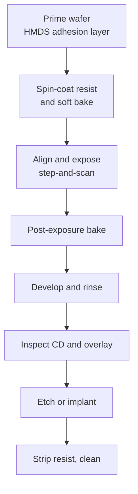

::: testing
Whether you can explain how patterns are transferred onto a wafer with light, step by step, and state the resolution limit with its equation. The interviewer wants: photoresist, mask/reticle, projection optics with reduction, exposure, develop; then the Rayleigh criteria $CD = k_1\lambda/NA$ and depth of focus; and the trade-offs behind wavelength, numerical aperture, immersion and EUV. Hidden sub-skills: why lithography sets cost and node progress, how overlay and focus matter, and not confusing the lithographic pattern with the final etched structure.
:::

::: why
Lithography is the step that defines how small features can be, and it is the most expensive and schedule-critical part of the fab. Process node progress, mask costs, design rules (pitch, line-end spacing, density limits) and even layout style (unidirectional metal) are consequences of lithography limits. For an engineer working with silicon, it explains why design rules are what they are and why a new node is so costly. It sits between wafer fabrication ([[q0658]]) and etching ([[q0662]]), and leads straight to the sub-wavelength question ([[q0664]]).
:::

::: concepts
- **Photoresist**: a light-sensitive polymer coated on the wafer; exposure changes its solubility in developer.
- **Mask / reticle**: a quartz plate with the pattern (chrome or absorber); usually 4× larger than the printed image.
- **Projection optics**: a lens (or mirrors for EUV) that images the mask onto the wafer and reduces it.
- **Resolution**: smallest printable half-pitch, $CD = k_1\lambda/NA$.
- **Depth of focus**: the focus range over which the image stays acceptable, $DOF = k_2\lambda/NA^2$.
- **Overlay**: how accurately each layer lines up with the previous one.
:::

::: answer
"Photolithography is how you transfer a pattern onto the wafer using light. It's basically a very precise photographic process.

You start by coating the wafer with photoresist, a light-sensitive polymer, spun on to a very uniform thin film. Then the wafer goes into a scanner, where light is shone through a mask, called a reticle, which has the pattern for that layer. A projection lens shrinks the image, typically by four times, and focuses it on the resist. The areas that get exposed change chemically. For a positive resist, exposed areas become soluble. Then you bake and develop, so the soluble resist washes away and you're left with a patterned resist film. That resist then acts as a stencil: you etch away the exposed material underneath, or implant dopants through the openings, and then strip the resist.

The smallest feature you can print is set by the Rayleigh equation, $CD = k_1\lambda/NA$: shorter wavelength, bigger numerical aperture, and better process factor k1 all shrink the features. That's why the industry went from 248 to 193 nanometre light, added immersion with water between lens and wafer, and moved to 13.5 nanometre EUV light. And since every layer must line up with the ones below, overlay accuracy is crucial."
:::

::: technical
**Process sequence (one layer).**
1. Surface prep and adhesion promoter (e.g. HMDS vapour prime).
2. Spin-coat resist to a thickness of tens to hundreds of nm; soft bake to drive off solvent.
3. Align and expose in a step-and-scan tool: the reticle and wafer scan synchronously through a slit of light; the reticle image is reduced (4× is common) at the wafer. A full field is about 26 × 33 mm.
4. Post-exposure bake (PEB), critical for chemically amplified resists: exposure generates photoacid, which catalyses a reaction during PEB that changes solubility.
5. Develop (aqueous TMAH for positive resist), rinse, optional hard bake, inspect critical dimension and overlay.
6. Pattern transfer by etch ([[q0662]]) or ion implantation, then strip the resist.

**Resolution.** $CD = k_1\,\lambda/NA$ (the half-pitch), with $NA = n\sin\theta$. The theoretical single-exposure limit is $k_1=0.25$. Depth of focus $DOF = k_2\lambda/NA^2$ shrinks quickly as NA rises.

| System | λ | NA | $CD$ at $k_1=0.3$ | $DOF$ ($k_2=1$) |
|---|---|---|---|---|
| KrF dry | 248 nm | 0.93 | 80 nm | 287 nm |
| ArF dry | 193 nm | 0.93 | 62 nm | 223 nm |
| ArF immersion | 193 nm | 1.35 | 43 nm | 106 nm |
| EUV | 13.5 nm | 0.33 | 12.3 nm | 124 nm |
| High-NA EUV | 13.5 nm | 0.55 | 7.4 nm | 45 nm |

**Immersion.** Water ($n\approx1.44$ at 193 nm) between the lens and wafer raises NA above 1.

**EUV.** 13.5 nm light is absorbed by all materials, so the tool uses reflective multilayer mirrors and masks in vacuum. The source is typically a laser-produced tin plasma.

**Overlay.** Each layer must align to prior layers within a few nm at advanced nodes.
:::

::: short
"Photolithography transfers a pattern to the wafer with light. You coat the wafer with photoresist, shine light through a mask or reticle, and project a reduced image onto the resist with a lens. After a bake and develop, the resist forms a stencil that you then etch through or implant through. The minimum feature is about $k_1\lambda/NA$, so the industry uses shorter wavelengths, immersion and higher NA, going from 248 to 193 nanometre to 13.5 nanometre EUV."
:::

::: long
"Photolithography is the step that draws the circuit pattern on the wafer using light. You can think of it as photography with a stencil.

The wafer is first coated with a thin, uniform layer of photoresist, a polymer that changes its solubility when exposed to light. Then it goes into a scanner. A reticle, a quartz plate carrying the pattern for one layer, is lit from behind, and a projection lens images it onto the wafer with a four-times reduction, so a 400 nanometre feature on the reticle becomes 100 nanometres on the wafer. The scanner steps across the wafer and exposes it one field at a time, about 26 by 33 millimetres per field.

After exposure there's a bake, then development. With a positive resist, the exposed regions dissolve, leaving a patterned resist film. That resist is just a temporary stencil: the next step either etches the layer underneath, or implants dopants, in the openings. Then the resist is stripped and the wafer is cleaned.

The limit on feature size comes from diffraction. The Rayleigh equation says the half-pitch resolution is $k_1$ times wavelength over numerical aperture. To go smaller, the industry reduced the wavelength from 248 to 193 nanometres, then to 13.5 nanometre EUV; increased NA, including immersion lithography where water between the lens and wafer lets NA exceed one; and reduced k1 using tricks like optical proximity correction, phase-shift masks and off-axis illumination. The trade-off is depth of focus, which falls as one over NA squared, so the wafer has to be extremely flat.

Besides resolution, overlay is crucial, since every one of dozens of layers must line up to within a few nanometres. And it's expensive: lithography tools cost tens to hundreds of millions of dollars, which is why lithography dominates node cost."
:::

::: terms
- **Photoresist**: light-sensitive polymer; positive resist dissolves where exposed, negative resist hardens where exposed.
- **Reticle (photomask)**: pattern master, usually at 4× the wafer scale.
- **Scanner / stepper**: the exposure tool; a scanner moves reticle and wafer synchronously.
- **Numerical aperture (NA)**: $n\sin\theta$, a measure of how much diffracted light the lens collects.
- **$k_1$ factor**: process-dependent coefficient in the resolution equation; lower is harder.
- **Immersion lithography**: filling the gap between lens and wafer with water to raise NA.
- **EUV**: extreme ultraviolet lithography at 13.5 nm.
- **Depth of focus (DOF)**: allowable focus error.
- **Overlay**: layer-to-layer alignment accuracy.
- **OPC (optical proximity correction)**: mask pre-distortion to compensate diffraction effects.
:::

::: exceptional
An average answer says "light and a mask make a pattern on the chip." An exceptional answer:
- Walks through coat → expose → bake → develop → transfer, and stresses that resist is a temporary stencil.
- Writes $CD = k_1\lambda/NA$ and $DOF = k_2\lambda/NA^2$ and uses them to explain 248→193→immersion→EUV with numbers.
- Mentions the 4× reduction, the ~26 × 33 mm field and step-and-scan.
- Notes overlay, depth of focus and cost as real constraints, and mentions OPC, phase-shift masks and multiple patterning as tools to push below the limit ([[q0664]]).
- Knows EUV uses reflective optics in vacuum.
:::

::: mistakes
- **Thinking the resist is the final structure.** It is a temporary mask; the film beneath is etched or implanted ([[q0662]]).
- **Mixing up wavelength and feature size.** Features can be smaller than the wavelength because of $k_1$, NA and tricks ([[q0664]]).
- **Saying a higher NA is free.** It reduces depth of focus quadratically and makes optics bigger.
- **Forgetting overlay.** Fine resolution is useless if layers do not align.
- **Treating "node name" as a lithographic dimension.** "5 nm" etc. is a marketing label ([[q0646]]).
:::

::: deep
## What the tool is doing

A scanner is basically a very good slide projector with a reduction lens, a robot that moves the wafer to nanometre precision, and a focus and alignment system.

```svg
<svg viewBox="0 0 520 330" role="img" aria-label="Projection lithography optical path from illumination through reticle and lens to resist on a wafer">
 <text x="260" y="20" text-anchor="middle" font-family="Inter, sans-serif" font-size="13" fill="var(--d-ink)">Light source and illuminator</text>
 <g stroke="var(--d-orange)" stroke-width="2.5"><line x1="200" y1="30" x2="200" y2="70"/><line x1="260" y1="30" x2="260" y2="70"/><line x1="320" y1="30" x2="320" y2="70"/></g>
 <rect x="150" y="70" width="220" height="14" fill="var(--d-box)" stroke="var(--d-ink)"/>
 <text x="135" y="82" text-anchor="end" font-family="Inter, sans-serif" font-size="12" fill="var(--d-ink)">reticle (4x)</text>
 <g fill="var(--d-ink)"><rect x="170" y="70" width="22" height="14"/><rect x="230" y="70" width="30" height="14"/><rect x="300" y="70" width="14" height="14"/></g>
 <g stroke="var(--d-orange)" stroke-width="1.5" fill="none"><path d="M181 84 L240 150"/><path d="M215 84 L240 150"/><path d="M245 84 L260 150"/><path d="M290 84 L270 150"/><path d="M307 84 L280 150"/></g>
 <ellipse cx="260" cy="150" rx="70" ry="14" fill="var(--d-box)" stroke="var(--d-blue)" stroke-width="2"/>
 <text x="135" y="154" text-anchor="end" font-family="Inter, sans-serif" font-size="12" fill="var(--d-ink)">projection lens (NA)</text>
 <g stroke="var(--d-orange)" stroke-width="1.5" fill="none"><path d="M240 164 L248 238"/><path d="M260 164 L260 238"/><path d="M280 164 L272 238"/></g>
 <rect x="170" y="238" width="180" height="10" fill="var(--d-accent)" fill-opacity="0.35" stroke="var(--d-accent)"/>
 <text x="135" y="246" text-anchor="end" font-family="Inter, sans-serif" font-size="12" fill="var(--d-ink)">resist</text>
 <rect x="150" y="248" width="220" height="22" fill="var(--d-box)" stroke="var(--d-ink)"/>
 <text x="260" y="264" text-anchor="middle" font-family="Inter, sans-serif" font-size="12" fill="var(--d-ink)">wafer on stage</text>
 <text x="260" y="300" text-anchor="middle" font-family="Inter, sans-serif" font-size="12" fill="var(--d-muted)">the lens must collect the diffracted orders from the reticle features</text>
 <text x="395" y="120" font-family="Inter, sans-serif" font-size="12" fill="var(--d-muted)">diffracted light</text>
 <text x="395" y="200" font-family="Inter, sans-serif" font-size="12" fill="var(--d-muted)">reduced image</text>
</svg>
```
Figure: Light passes through the reticle's pattern and diffracts. The lens collects as much diffracted light as its numerical aperture allows and converges it into a reduced image on the resist. Fine features diffract at large angles, so a higher NA is needed to capture them.

### The step-by-step process


Figure: One lithography module. The resist pattern is only a stencil for the next step. If inspection finds the pattern out of spec, the resist can be stripped and the wafer re-patterned (rework) before anything permanent is done.

**Positive vs negative resist.** In positive resist exposed regions dissolve in developer; in negative resist exposed regions harden and unexposed regions wash away. Modern leading-edge processes mostly use chemically amplified resists (CAR): exposure generates a small amount of acid from a photoacid generator, then during the post-exposure bake each acid molecule catalyses many deprotection reactions, so a small dose gives a large solubility change.

## Why diffraction limits resolution

Feature patterns act like diffraction gratings. For a grating with pitch $p$, the diffraction angles satisfy $\sin\theta_m = m\lambda/(np)$. To form an image the lens has to collect at least the 0th and ±1st orders; if the ±1 orders fall outside the lens aperture, only a uniform background arrives and the pattern is lost. The lens collects angles up to $\theta$ with $NA = n\sin\theta$. With off-axis illumination, the 0th order and one first order are both collected when $p \ge \lambda/(2NA)$, so the minimum half-pitch is

$$CD_{min}=\frac{p_{min}}{2}=\frac{\lambda}{4\,NA}\quad\Rightarrow\quad k_1=0.25$$

That is the physical origin of $k_1\ge0.25$ for single-exposure imaging. Real processes need $k_1$ of about 0.3–0.4 for manufacturable yield.

```plot
{"title":"Printable half-pitch CD = k1·λ/NA at k1 = 0.3","x":{"label":"Numerical aperture NA","unit":"","min":0.3,"max":1.4},"y":{"label":"CD (half-pitch)","unit":"nm","min":5,"max":100,"log":true},
 "vars":{"k":0.3},
 "series":[{"label":"KrF 248 nm","fn":"k*248/x"},{"label":"ArF 193 nm","fn":"k*193/x","color":"orange"},{"label":"EUV 13.5 nm","fn":"k*13.5/x","color":"green"}],
 "points":[{"x":0.93,"y":62.3,"label":"ArF dry: 62 nm"},{"x":1.35,"y":42.9,"label":"43 nm"},{"x":0.33,"y":12.3,"label":"EUV 0.33: 12 nm"},{"x":0.55,"y":7.4,"label":"EUV 0.55: 7.4 nm"}]}
```
Figure: Resolution improves with shorter wavelength and higher NA (the 43 nm point is ArF immersion at NA 1.35). EUV gets to single-digit nm half-pitch with modest NA because its wavelength is 14× shorter than ArF. (The EUV curve at NA > 0.55 is shown only for comparison; real systems have NA 0.33 or 0.55.)

### Depth of focus

$DOF = k_2\lambda/NA^2$. With $k_2 = 1$: ArF immersion at NA 1.35 gives 106 nm; EUV 0.33 gives 124 nm; high-NA EUV 0.55 gives only 45 nm. The resist is only tens of nm thick and the wafer must be flat and the scanner must level and focus within a few nm. This is why wafers are polished flat ([[q0659]]) and why chemical-mechanical polishing is used between layers.

> [!UNCERTAIN]
> $k_1$ and $k_2$ are process-dependent. The values used here (0.3 for $k_1$, 1 for $k_2$) are illustrative; real numbers depend on resist, illumination, mask type and tolerance for CD variation and are not published for specific fabs.

## Making k₁ smaller: resolution enhancement

- **Optical proximity correction (OPC)**: add serifs, assist features and bias to the mask so the *printed* shape matches the design.
- **Phase-shift masks**: alternate transmissive regions shift the phase by 180°, sharpening contrast.
- **Off-axis illumination**: illuminate at an angle (dipole, quadrupole) so the first diffraction order can be collected for finer pitch.
- **Source-mask optimization**: co-optimise the illumination shape and the mask.
- **Multiple patterning**: split a layer into two or more exposures or use spacer techniques ([[q0664]]).

## EUV

At 13.5 nm every material absorbs light, so the scanner is a vacuum system with reflective multilayer mirrors, not lenses. The mask is also reflective. Tin droplets hit by a CO₂ laser form a plasma that emits EUV. It removes the need for multiple patterning at some layers but the tools are far more expensive and complex than 193 nm immersion scanners.

## Overlay and throughput

Each layer must land on the previous one within a small fraction of the minimum half-pitch; modern requirements are a few nm. The wafer is aligned with marks on the wafer and the stage is controlled by laser interferometers. A 300 mm wafer needs roughly 70,686 / 858 ≈ 80 full-field equivalents; real wafers are exposed with 80–100 shots, so scanner throughput is on the order of hundreds of wafers per hour for 193 nm tools (EUV is lower). Exact numbers vary by tool.

## Why it dominates cost

Lithography tools cost tens to hundreds of millions of dollars each. A mask set for an advanced node can cost millions to tens of millions of dollars, which makes it a major factor in whether a chip is worth fabricating. Every extra exposure adds cost, which is why multiple patterning has such a financial impact.

> [!NOTE]
> Mask and tool prices are widely reported as very large but vary by node and vendor and aren't precisely public; treat them as order-of-magnitude.
:::

::: applications
- **Logic and memory fabs** use immersion ArF (193 nm) for most critical layers and EUV for the tightest ones.
- **Analog, power and MEMS fabs** use KrF (248 nm), i-line (365 nm) or even g-line lithography on older nodes because feature sizes are larger.
- **PCB and display fabrication** use related photolithographic processes at far coarser scales.
- **Mask shops** write reticles with electron-beam or laser mask writers and inspect them for defects.
- **Process engineers** monitor critical dimension, overlay and focus to keep yield high.
:::

::: assumptions
- The resolution equation $CD = k_1\lambda/NA$ is a scaling law with an empirically determined $k_1$; it describes the half-pitch of dense lines, not the smallest isolated feature, which can be reduced by etch trimming.
- All numbers assume aqueous immersion with $n = 1.44$ for 193 nm and ideal optics.
- EUV and high-NA EUV figures use published nominal wavelengths and NA values; high-NA EUV details (anamorphic optics, half-field) are only mentioned qualitatively.
- Wafer-edge shots, throughput and tool costs vary by fab and are approximate.
- If the interviewer asks about PCB photolithography (dry-film or liquid photoresist), the concept is the same with micrometre resolution.
:::

::: followups
### What is photoresist and why do we need it?
Photoresist is a polymer whose solubility in developer changes when it's exposed to light. It records the optical image as a physical relief pattern on the wafer, which then protects some areas from etching or implantation. We need it because light can't etch or dope by itself; the resist converts a light pattern into a physical mask.

### What limits the minimum feature size in lithography?
Diffraction. The lens must collect diffracted orders from the pattern, so the half-pitch is limited to $k_1\lambda/NA$ with $k_1\ge0.25$. Beyond that you need tricks: shorter wavelength, immersion, resolution-enhancement techniques and multiple patterning.

### Why is depth of focus a problem at high NA?
$DOF\propto\lambda/NA^2$ so increasing NA by 1.5× cuts DOF by 2.25×. With resists tens of nm thick and DOF around 100 nm (ArF immersion) or 45 nm (high-NA EUV), the wafer must be extremely flat and the tool must level and focus continuously.

### What is the difference between a stepper and a scanner?
A stepper exposes the whole field at once and then steps to the next position. A scanner moves the reticle and wafer synchronously past a slit of light, which allows a larger field with a smaller lens and better uniformity. Modern tools are scanners.

### Scenario: line widths vary across the wafer, and cross-sections show some lines narrower where the wafer is lower. What do you suspect?
Focus error. When the surface is out of the depth of focus the image loses contrast and the printed CD drifts. Check wafer flatness and chuck contamination, the scanner's leveling map, and film topography from previous steps (CMP uniformity). A focus-exposure matrix can show the process window, and you can adjust dose and focus offset to re-center it.
:::

::: interpretations
In the fabrication context photolithography means semiconductor lithography. The same word is used in PCB manufacturing (photoresist imaging copper traces), which uses the same principle at much coarser resolution. The next question [[q0664]] explores how patterns smaller than the wavelength are possible.
:::

::: references
- Plummer, Deal & Griffin, *Silicon VLSI Technology*: lithography chapter (resists, imaging, resolution and DOF).
- Mack, *Fundamental Principles of Optical Lithography*: Rayleigh criteria, resist chemistry and process control.
- Campbell, *Fabrication Engineering at the Micro- and Nanoscale*: optical lithography and resolution enhancement.
- ITRS/IRDS roadmap documents on lithography (public overviews); check current editions for details.
:::

::: rubric
- Describes coating resist, exposing through a reticle, and developing :: The basic process.
- Explains that resist is a temporary stencil for etch or implant :: Avoids the misconception that lithography makes the structure itself.
- States $CD = k_1\lambda/NA$ and what each term means :: The key engineering relation.
- Explains how the industry improved resolution (shorter λ, immersion, higher NA, lower k1, EUV) :: Shows awareness of the roadmap.
- Mentions depth of focus trade-off ($1/NA^2$) :: Shows that NA is not free.
- Mentions overlay and reduction (4×) and field size :: Practical details that distinguish depth.
- Mentions cost/throughput or resolution-enhancement techniques :: Context for why lithography dominates.
:::

::: quiz
```json
[
 {"type":"mcq","level":"fundamental","q":"What is the role of photoresist in lithography?","options":["It becomes part of the final transistor","It acts as a temporary stencil that is patterned by light","It cleans the wafer","It dopes the silicon"],"answer":1,"explain":"Photoresist records the pattern by changing solubility and then protects regions during etch or implant. It's stripped afterwards."},
 {"type":"numeric","level":"intermediate","q":"Using $CD = k_1\\lambda/NA$ with $k_1 = 0.3$, $\\lambda = 193$ nm and $NA = 1.35$, what is the printable half-pitch in nm?","answer":42.9,"tolerance":0.02,"unit":"nm","explain":"$0.3\\times193/1.35 = 42.9$ nm."},
 {"type":"numeric","level":"intermediate","q":"For EUV at 13.5 nm and NA = 0.33 with $k_1=0.3$, what is the half-pitch in nm?","answer":12.3,"tolerance":0.02,"unit":"nm","explain":"$0.3\\times13.5/0.33 = 12.27$ nm."},
 {"type":"mcq","level":"intermediate","q":"By what factor does depth of focus change when NA increases from 0.55 to 1.1 at fixed wavelength and $k_2$?","options":["It doubles","It halves","It drops to one quarter","It stays constant"],"answer":2,"explain":"$DOF\\propto1/NA^2$. Doubling NA makes DOF 1/4."},
 {"type":"truefalse","level":"intermediate","q":"The theoretical minimum $k_1$ for single-exposure imaging is about 0.25.","answer":true,"explain":"To capture the 0th and one first diffraction order the pitch must be at least $\\lambda/(2NA)$, giving half-pitch $\\lambda/(4NA)$ and $k_1=0.25$."},
 {"type":"multi","level":"advanced","q":"Select all that reduce the minimum printable feature.","options":["Shorter wavelength","Higher numerical aperture","Immersion fluid between lens and wafer","Using a thicker resist"],"answer":[0,1,2],"explain":"Shorter λ, higher NA (including via immersion's higher refractive index) and lower k1 improve resolution. Thicker resist doesn't help and can worsen the focus budget."}
]
```
:::
