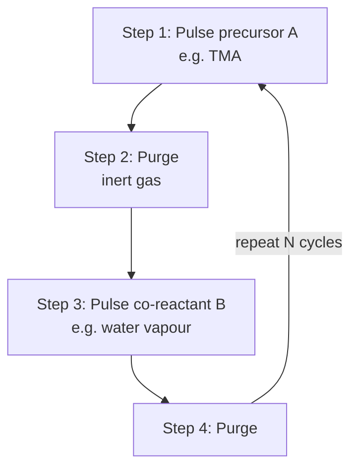
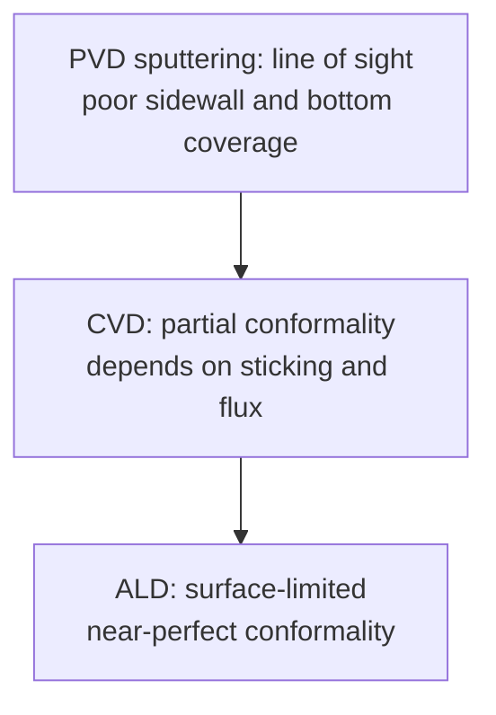

::: testing
Whether you know ALD as a **self-limiting, sequential-surface-reaction** deposition method and can say why chip makers need it: angstrom-level thickness control, perfect conformality on 3D structures, and uniform ultra-thin films such as high-k gate dielectrics. The interviewer wants the cycle (pulse, purge, pulse, purge), the chemistry example (TMA + water to Al₂O₃), a comparison with CVD and PVD, and the main drawback: slow growth. Hidden sub-skills: link to gate capacitance and EOT, and awareness of the temperature window and failure modes.
:::

::: why
At advanced nodes the critical films are only a few nanometres thick and must coat vertical fins, nanosheets, deep trenches and holes uniformly. CVD and PVD cannot reliably do that; ALD can. It is therefore behind the high-k metal gate, spacers for multiple patterning ([[q0664]]), DRAM capacitors, diffusion barriers and many 3D memory films. In an interview it shows that you understand what limits scaling beyond lithography: depositing and etching films with atomic precision ([[q0662]] has the opposite operation).
:::

::: concepts
- **Thin-film deposition**: adding material on a surface by physical (PVD) or chemical (CVD, ALD) means.
- **Self-limiting reaction**: a surface reaction that stops once all reactive sites are used, regardless of extra precursor.
- **Precursor and co-reactant**: the two (or more) reagents introduced alternately, e.g. trimethylaluminium and water.
- **Conformality (step coverage)**: how uniformly a film coats sidewalls and bottoms of features.
- **High-k dielectric and EOT**: a material with high dielectric constant lets a physically thicker film act like a thinner SiO₂ layer. See [[q0022]].
- **Aspect ratio**: depth/width of a trench or hole; deposition must reach the bottom.
:::

::: answer
"Atomic layer deposition is a way of growing thin films one atomic layer at a time. Instead of flowing all the reactants in at once like CVD, you pulse two reactants alternately, with a purge in between.

Take aluminium oxide. First you pulse trimethylaluminium, TMA. It reacts with the hydroxyl groups on the surface until every site is used up, and then it stops, because it can't react with itself. That's the self-limiting part. You purge the excess gas, then pulse water, which reacts with the methyl groups on the surface and re-forms hydroxyls, again until all sites are used. Purge again. That's one cycle and it adds roughly one angstrom, about a tenth of a nanometre. You repeat it as many times as you need, so ten nanometres is about a hundred cycles.

The reason it matters is control and conformality. Thickness is set by the number of cycles, not by time and flux, so it's extremely uniform and precise, and because the reaction happens on every exposed surface, it coats tall, narrow structures like fins and deep trenches evenly, which CVD and sputtering can't. It's used for high-k gate dielectrics like hafnium oxide, spacers, DRAM capacitors and barrier layers.

The downside is speed: one cycle per few seconds at about a tenth of a nanometre means it's only practical for thin films."
:::

::: technical
**Mechanism.** ALD splits a CVD-like reaction into two half-reactions, run sequentially and separated by an inert purge. For thermal Al₂O₃ (typically 150–300 °C):

1. Surface –OH + Al(CH₃)₃ → surface –O–Al(CH₃)₂ + CH₄ (self-limiting; no further TMA adsorbs).
2. Purge.
3. Surface –Al–CH₃ + H₂O → surface –Al–OH + CH₄ (self-limiting; restores –OH).
4. Purge.

**Growth per cycle (GPC).** About 0.1 nm per cycle for Al₂O₃ (typical range 1.0–1.2 Å), set by the number of reactive sites and molecule size, not by the dose once saturated. Thickness $t = N\cdot\text{GPC}$. Example: 10 nm needs $10/0.11\approx 91$ cycles; at 4 s per cycle that takes 6 minutes.

**ALD window.** Between a low-temperature limit (condensation or incomplete reactions) and a high-temperature limit (precursor thermal decomposition, which adds CVD-like uncontrolled growth). Inside the window GPC is nearly independent of temperature.

**Saturation test.** Increase precursor pulse time at fixed cycles; GPC should rise and then flatten. If it keeps rising, the process is not purely ALD.

**Conformality.** Because the reaction is surface-limited, you get close to 100% step coverage even at high aspect ratios, provided pulse and purge times are long enough for molecules to diffuse in; the required exposure grows roughly with the square of the aspect ratio (a commonly quoted diffusion-limited scaling).

**High-k example.** EOT $= t_{hk}\,(3.9/\kappa)$. For HfO₂ with $\kappa\approx20$ and $t=2$ nm: EOT = 0.39 nm of SiO₂-equivalent capacitance, while physically thick enough to cut direct-tunnelling leakage. About 20 cycles at ~0.1 nm/cycle.

**Variants.** Thermal ALD; plasma-enhanced ALD (PEALD, lower temperature, more reactive); spatial ALD (substrate moves under separate precursor zones, faster); area-selective ALD.
:::

::: short
"ALD builds a film one atomic layer at a time by alternating two self-limiting surface reactions with purges in between. For example, TMA reacts with surface hydroxyls until they're used up, then water restores the hydroxyls, adding about an angstrom per cycle. That gives atomic-level thickness control and perfect conformality on tall 3D structures, so it's used for high-k gate dielectrics, spacers and barriers. The trade-off is that it's slow."
:::

::: long
"Atomic layer deposition is a thin-film growth technique where you build the film one atomic layer at a time using self-limiting surface reactions.

The cycle has four steps. Using aluminium oxide as the example: first a pulse of trimethylaluminium. It reacts with hydroxyl groups on the wafer surface, and once every site is occupied, it simply stops, because it doesn't react with itself. That's what 'self-limiting' means. Then you purge the chamber with inert gas to remove the extra precursor and byproduct, methane. Third, a pulse of water, which reacts with the methyl groups left on the surface, replaces them with hydroxyls, and again saturates. Then you purge again. One cycle adds about one angstrom, roughly 0.1 nanometre. Thickness is just the number of cycles times the growth per cycle, so ten nanometres is about a hundred cycles.

Compared with CVD, where precursors react continuously in the gas and on the surface, ALD gives you thickness control at the angstrom level, very uniform films across a 300 millimetre wafer, and excellent conformality, meaning the film is the same thickness on the top, sidewalls and bottom of a deep trench or around a fin. PVD, which is line-of-sight, can't do that.

That's why ALD is everywhere in advanced chips: the hafnium-oxide high-k gate dielectric, titanium nitride work-function metals, spacers used for multiple patterning, barrier layers for copper, DRAM capacitor dielectrics and 3D memory.

The costs are throughput and chemistry. Each cycle takes seconds, so growing anything over about a hundred nanometres is impractical, and you need a temperature window where the surface reactions saturate but the precursor doesn't thermally decompose. Insufficient purging gives CVD-like growth and non-uniformity."
:::

::: terms
- **ALD (atomic layer deposition)**: deposition by sequential self-limiting surface reactions.
- **Precursor**: the reactive chemical delivered to the surface (e.g. TMA).
- **Self-limiting**: reaction that stops when surface sites are exhausted.
- **Purge**: inert gas flush between pulses.
- **GPC (growth per cycle)**: thickness added per ALD cycle (typically ~0.05–0.2 nm).
- **ALD window**: temperature range where growth is saturated and stable.
- **Conformality / step coverage**: uniformity of coverage on 3D topography.
- **High-k dielectric**: insulator with dielectric constant above SiO₂'s 3.9 (e.g. HfO₂, ~20).
- **EOT (equivalent oxide thickness)**: SiO₂ thickness giving the same capacitance.
- **PEALD**: plasma-enhanced ALD.
:::

::: exceptional
An average answer says "depositing thin films one layer at a time." An exceptional answer:
- Explains self-limiting half-reactions with a concrete chemistry (TMA/H₂O) and the four-step cycle.
- Gives a growth-per-cycle number and calculates cycles and time for a target thickness.
- Explains why it beats CVD/PVD: thickness set by cycle count, conformal on high aspect ratios, uniform over the wafer.
- Ties it to high-k gate dielectrics and EOT with a calculation, and to spacers and DRAM.
- Describes trade-offs and failure modes: slow throughput, temperature window, insufficient purge giving CVD-like growth, nucleation delay.
:::

::: mistakes
- **Saying ALD is "just slow CVD".** CVD continuous reaction growth is flux- and time-controlled; ALD is cycle-controlled and self-limiting.
- **Ignoring the purge.** Overlapping precursors react in the gas phase, creating particles and non-uniform CVD-like growth.
- **Assuming longer pulses always mean thicker films.** Beyond saturation, extra dose adds nothing.
- **Claiming ALD works at any temperature.** There is a process window; too hot causes precursor decomposition, too cold causes incomplete reaction.
- **Thinking ALD is used for thick films.** At 0.1 nm per cycle, hundreds of nm would take hours.
:::

::: deep
## Why we need ALD

As transistors shrank, the gate dielectric got so thin that SiO₂ at ~1 nm leaked too much by quantum tunnelling. The solution was a **high-k** material such as HfO₂. Capacitance per unit area is $C = \varepsilon_0\kappa/t$, so the SiO₂-equivalent thickness is

$$\text{EOT}=t_{hk}\,\frac{3.9}{\kappa}$$

With $\kappa\approx20$ and $t_{hk}=2$ nm: EOT = $2\times3.9/20=0.39$ nm, which would be only ~1–2 atomic layers of SiO₂ (hopelessly leaky) but is a robust 2 nm of HfO₂. To make such a film requires uniform, pinhole-free, atomic-scale thickness control over every fin sidewall: ALD.

> [!NOTE]
> Real gate stacks also have a thin interfacial oxide (~0.5 nm) under the HfO₂ and add a metal gate, so total EOT is somewhat larger than the HfO₂ contribution alone. $\kappa$ of HfO₂ films depends on crystallinity and doping; "about 20" is representative.

## The ALD cycle


Figure: One ALD cycle. The two reactants never meet in the gas phase because the purge separates them; each only reacts with the surface. Thickness increments by one GPC per loop.

```svg
<svg viewBox="0 0 600 260" role="img" aria-label="Four surface snapshots of an ALD cycle: hydroxylated surface, TMA adsorbed, purge, water exposure restoring hydroxyls">
 <g font-family="Inter, sans-serif" font-size="12" text-anchor="middle" fill="var(--d-ink)">
  <text x="75" y="18">1. start: -OH surface</text><text x="225" y="18">2. TMA pulse</text><text x="375" y="18">3. purge</text><text x="525" y="18">4. H2O pulse</text>
 </g>
 <g stroke="var(--d-ink)" fill="var(--d-box)">
  <rect x="10" y="190" width="130" height="30"/><rect x="160" y="190" width="130" height="30"/><rect x="310" y="190" width="130" height="30"/><rect x="460" y="190" width="130" height="30"/>
 </g>
 <g font-family="Inter, sans-serif" font-size="11" text-anchor="middle" fill="var(--d-ink)"><text x="75" y="210">substrate</text><text x="225" y="210">substrate</text><text x="375" y="210">substrate</text><text x="525" y="210">substrate</text></g>
 <g fill="var(--d-orange)"><circle cx="30" cy="180" r="7"/><circle cx="60" cy="180" r="7"/><circle cx="90" cy="180" r="7"/><circle cx="120" cy="180" r="7"/></g>
 <g fill="var(--d-purple)"><circle cx="180" cy="178" r="9"/><circle cx="210" cy="178" r="9"/><circle cx="240" cy="178" r="9"/><circle cx="270" cy="178" r="9"/>
  <circle cx="330" cy="178" r="9"/><circle cx="360" cy="178" r="9"/><circle cx="390" cy="178" r="9"/><circle cx="420" cy="178" r="9"/></g>
 <g fill="var(--d-purple)"><circle cx="480" cy="178" r="9"/><circle cx="510" cy="178" r="9"/><circle cx="540" cy="178" r="9"/><circle cx="570" cy="178" r="9"/></g>
 <g fill="var(--d-muted)"><circle cx="175" cy="156" r="5"/><circle cx="185" cy="156" r="5"/><circle cx="205" cy="156" r="5"/><circle cx="215" cy="156" r="5"/><circle cx="235" cy="156" r="5"/><circle cx="245" cy="156" r="5"/><circle cx="265" cy="156" r="5"/><circle cx="275" cy="156" r="5"/>
  <circle cx="325" cy="156" r="5"/><circle cx="335" cy="156" r="5"/><circle cx="355" cy="156" r="5"/><circle cx="365" cy="156" r="5"/><circle cx="385" cy="156" r="5"/><circle cx="395" cy="156" r="5"/><circle cx="415" cy="156" r="5"/><circle cx="425" cy="156" r="5"/></g>
 <g fill="var(--d-orange)"><circle cx="480" cy="155" r="6"/><circle cx="510" cy="155" r="6"/><circle cx="540" cy="155" r="6"/><circle cx="570" cy="155" r="6"/></g>
 <g fill="var(--d-accent)" fill-opacity="0.7"><circle cx="200" cy="90" r="9"/><circle cx="250" cy="70" r="9"/><circle cx="230" cy="115" r="9"/>
  <circle cx="500" cy="90" r="8" fill="var(--d-blue)"/><circle cx="550" cy="70" r="8" fill="var(--d-blue)"/></g>
 <g font-family="Inter, sans-serif" font-size="11" fill="var(--d-muted)" text-anchor="middle">
  <text x="225" y="138">Al keeps CH3</text><text x="375" y="138">excess removed</text><text x="525" y="138">Al-CH3 becomes Al-OH</text><text x="225" y="55" fill="var(--d-accent)">TMA</text><text x="525" y="55" fill="var(--d-blue)">H2O</text>
 </g>
 <text x="300" y="245" text-anchor="middle" font-family="Inter, sans-serif" font-size="12" fill="var(--d-ink)">orange = hydroxyl, purple = aluminium, grey = methyl groups; one full cycle adds about one Al-O layer</text>
</svg>
```
Figure: Four snapshots of a single cycle. TMA can only react with free hydroxyls and cannot attach to itself, so once every site is occupied (2) nothing more adsorbs even if you keep dosing. Purge (3) removes the excess. Water (4) converts the methyl-covered surface back to hydroxyls, ready for the next TMA pulse.

## Self-limiting growth: the saturation curve

A surface with a finite number of reactive sites follows Langmuir-type saturation. If pulse time is $x$ and the characteristic time is $\tau$, the fraction of sites reacted is $1-e^{-x/\tau}$, so

```plot
{"title":"ALD saturation: growth per cycle vs precursor pulse time","x":{"label":"Precursor pulse time","unit":"s","min":0,"max":2},"y":{"label":"Growth per cycle","unit":"Å","min":0,"max":1.3},"vars":{"g":1.1,"tau":0.2},"series":[{"label":"GPC = GPC_sat · (1 − exp(−t/τ))","fn":"g*(1-exp(-x/tau))"}],"hlines":[{"at":"g","label":"saturated GPC","color":"muted"}],"vlines":[{"at":"3*tau","label":"≈95% at 3τ","color":"orange"}],"params":[{"name":"g","label":"Saturated GPC","min":0.5,"max":1.25,"value":1.1,"step":0.05,"unit":"Å"},{"name":"tau","label":"Time constant τ","min":0.05,"max":0.5,"value":0.2,"log":true,"unit":"s"}],"readouts":[{"label":"Pulse for 95% saturation (3τ)","expr":"3*tau","unit":"s"},{"label":"GPC at 0.3 s","expr":"g*(1-exp(-0.3/tau))","unit":"Å"}]}
```
Figure: Growth per cycle rises with pulse time, then flattens: the surface is full. Choose a pulse a bit beyond saturation (here > 0.6 s for τ = 0.2 s) so the film is uniform even where the precursor arrives late (inside deep trenches). Pushing pulse time far beyond just wastes throughput; if GPC keeps climbing the process is leaking into CVD. Drag τ up to 0.5 s (a low-vapor-pressure precursor): the same 0.3 s pulse now leaves the film well short of saturation.

> [!UNCERTAIN]
> The saturation time constant and GPC values shown are illustrative. Real ALD processes are characterised experimentally for each precursor, temperature, and reactor; typical Al₂O₃ from TMA/H₂O at 200–300 °C is around 1.0–1.2 Å per cycle.

## Thickness control: just count cycles

Thickness is linear in cycle count: $t=N\cdot\text{GPC}$.

| Film | Typical GPC | Cycles for target | Time at 4 s/cycle |
|---|---|---|---|
| Al₂O₃, 10 nm | ~0.11 nm | 91 | ~6 min |
| HfO₂, 2 nm | ~0.10 nm | 20 | ~1.3 min |
| Al₂O₃, 100 nm | ~0.11 nm | 909 | ~1 hour |

This is why ALD is reserved for thin films: a 100 nm film takes an hour, while CVD could do it in a minute or two.

## Conformality and aspect ratio


Figure: Increasing conformality from PVD to ALD. In a deep narrow trench, PVD pinches off at the top, CVD thins towards the bottom, and ALD gives equal thickness everywhere if pulses are long enough.

| Method | Control | Conformality | Speed | Typical use |
|---|---|---|---|---|
| PVD (sputtering/evaporation) | time, power | poor (line of sight) | fast | Metals, seed layers, flat films |
| CVD | flux, time, T | good but varies | fast | Thick dielectrics, poly, W |
| ALD | cycle count | excellent | slow (~0.1 nm/cycle) | Gate dielectrics, spacers, barriers, ultra-thin films |

## The temperature window, thermal versus plasma ALD

Every ALD chemistry has a window. Plotting GPC against temperature, you see four regimes: at low temperature the precursor may condense on the surface (GPC too high) or the reaction may be too slow to saturate (GPC too low); in the window GPC is flat; above the window the precursor starts to decompose on its own, adding CVD-like growth that no longer self-limits; at still higher temperature desorption of surface groups can lower GPC. For TMA/water the window is roughly 150–300 °C, which is conveniently compatible with a partly finished chip (copper and low-k dielectrics cannot tolerate much more than about 400 °C).

When the chemistry needs a more reactive co-reactant, or a lower temperature, **plasma-enhanced ALD (PEALD)** replaces the second pulse (water) with a plasma (O₂, N₂ or H₂). The radicals are far more reactive, so films such as SiN or metals can be grown at lower temperature. The cost is that radicals recombine on surfaces and cannot reach the bottom of very deep features as well, so conformality at high aspect ratio is worse than thermal ALD. This is a typical trade-off fabs make: thermal ALD for the deepest structures, PEALD for films that can't be made thermally.

## A worked estimate: how long does it take to saturate a deep feature?

Take a DRAM-style hole with aspect ratio 50:1. Because molecules must diffuse to the bottom, the required exposure scales roughly with $AR^2$. A flat surface that saturates in, say, 0.1 s of dosing would need on the order of $50^2\times0.1\ \text{s}=250$ s of equivalent exposure at the same pressure to saturate the hole bottom. Fabs shorten this by raising precursor pressure or using long "soak" pulses with static (non-flowing) exposure, but it shows why deep-hole ALD cycle times balloon from seconds to tens of seconds.

> [!UNCERTAIN]
> The $AR^2$ scaling and the 0.1 s flat-surface saturation time are illustrative; real exposure needs depend on sticking probability, pressure, geometry and reactor design.

## Failure modes

- **Insufficient purge**: precursors mix in the gas phase and react (CVD-like), giving particles and non-uniform thickness.
- **Insufficient dose**: not saturated, so growth depends on pulse time and is non-uniform at feature bottoms.
- **Temperature out of window**: too low gives condensation or low GPC; too high gives decomposition (extra CVD growth).
- **Nucleation delay**: on hydrogen-terminated silicon or some metals the first cycles don't grow, so very thin films may have pinholes (a surface pre-treatment fixes this).
- **Impurities**: leftover carbon or hydrogen from precursors degrade film quality and k.

## Where ALD is used in a chip

- **High-k/metal gate**: HfO₂ gate dielectric and TiN/TaN-based work-function layers, conformal around fins and nanosheets.
- **Spacers**: ALD SiO₂ or SiN coats a patterned line uniformly; an anisotropic etch ([[q0662]]) leaves sidewall spacers used in self-aligned multiple patterning ([[q0664]]).
- **DRAM capacitors**: high-k stacks (such as ZrO₂/Al₂O₃) coated inside very deep holes.
- **Copper barriers/liners**: TaN, TiN or Co/Ru liners in narrow vias.
- **3D NAND**: conformal films in the channel-hole stack.
- **Encapsulation**: thin Al₂O₃ moisture barriers for OLEDs and sensors.
:::

::: applications
- **Gate dielectrics in FinFET and gate-all-around transistors**: HfO₂ by ALD.
- **Spacer-defined patterning**: ALD SiO₂/SiN spacers used for self-aligned double and quadruple patterning.
- **DRAM and 3D NAND**: conformal dielectrics and conductors inside deep holes.
- **Interconnect barriers and liners**: ultra-thin conformal TaN/TiN/Co or Ru.
- **Moisture barrier films** on flexible displays and MEMS packaging.
:::

::: assumptions
- The Al₂O₃ TMA/H₂O example is the textbook ALD process; other materials (HfO₂, TiN, SiO₂, metals) use different precursors and have different GPC and temperature windows.
- Numbers (GPC about 0.1 nm, 4 s per cycle) are typical illustrations; real values depend on the reactor, temperature and purge times.
- The $AR^2$ exposure scaling is a diffusion-limited approximation and varies with sticking probability and pressure.
- ALD is the standard for ultra-thin conformal films, but thick films are normally CVD, and flat metal films PVD, because of throughput.
- If an interviewer asks about a related method, note that ALE (atomic layer etching) is the reverse operation ([[q0662]]).
:::

::: followups
### Why not just use CVD for gate dielectrics?
CVD growth depends on flux and time, so thickness is hard to control at the 1–2 nm level and conformality on vertical fin sidewalls and in high-aspect-ratio structures is imperfect. ALD sets thickness by cycle count (±1 cycle, about 0.1 nm) and coats every surface evenly, which is what a nanometre-scale gate dielectric requires.

### What does "self-limiting" mean physically?
Each half-reaction can only proceed while there are reactive surface sites. Once they are all consumed, no more molecules attach, regardless of dose, because the precursor does not react with itself or with its own adsorbed layer. This is why thickness per cycle is constant and independent of how much extra precursor you add past saturation.

### How would you check that a process is truly ALD?
Run a saturation test (growth per cycle vs precursor pulse and purge time, and flatten), check that thickness is linear in cycle count with a straight line through (or near) the origin, check uniformity across the wafer and in test trenches, and examine the temperature window for flat GPC. If GPC keeps rising with pulse time or purge time, there's CVD-like contribution.

### Why is ALD slow, and how do fabs cope?
Each cycle needs a pulse and purge of both reagents, at seconds per cycle and ~0.1 nm per cycle. Fabs use batch ALD (many wafers at once), spatial ALD (substrate moves between precursor zones), and apply ALD only for films a few nm thick, using CVD or PVD for thicker layers.

### Scenario: your ALD HfO₂ film is thicker at the top of a deep trench than at the bottom, and thickness increases with pulse time. What's wrong?
It is not saturated: precursor reaches the top first and depletes before reaching the bottom, and/or there's CVD-like growth from decomposition or insufficient purge. Increase precursor exposure (longer pulses, higher partial pressure) until thickness at the bottom stops changing, lengthen purges, and check that the temperature is within the ALD window. Verify with cross-section TEM.
:::

::: interpretations
"Atomic layer deposition" is unambiguous. The question sits next to etching and lithography in the fabrication list, so it can be answered both as a standalone definition and as the deposition counterpart in the pattern/etch/deposit loop ([[q0658]]). Do not confuse it with "atomic layer *etching*".
:::

::: references
- George, S. M., "Atomic Layer Deposition: An Overview," *Chemical Reviews* (2010): a widely cited review of ALD chemistry and applications.
- Plummer, Deal & Griffin, *Silicon VLSI Technology*: thin-film deposition chapters (CVD, PVD, and dielectric films).
- Sze & Ng, *Physics of Semiconductor Devices*: gate dielectrics, tunnelling and high-k concepts.
- Weste & Harris, *CMOS VLSI Design*: manufacturing and gate-stack background.
:::

::: rubric
- Defines ALD as sequential self-limiting surface reactions giving one layer per cycle :: The core definition.
- Describes the four-step cycle (pulse, purge, pulse, purge) with an example chemistry :: Shows concrete understanding.
- Gives growth per cycle and computes cycles/time for a thickness :: Quantitative sense of throughput.
- Explains advantages: thickness control, uniformity and conformality on 3D structures :: The reason ALD is used.
- Compares with CVD/PVD :: Shows contextual knowledge.
- Names applications (high-k gate, spacers, DRAM, barriers) and links to EOT :: Connects to chip design.
- Mentions limits: slow, temperature window, purge issues :: Balanced engineering view.
:::

::: quiz
```json
[
 {"type":"mcq","level":"fundamental","q":"What makes ALD growth 'self-limiting'?","options":["The wafer rotates at constant speed","Each half-reaction stops when all reactive surface sites are used","The chamber pressure is constant","The film cannot grow thicker than one micron"],"answer":1,"explain":"Each precursor only reacts with specific surface sites; when they are exhausted, no further adsorption occurs, so growth per cycle saturates."},
 {"type":"numeric","level":"intermediate","q":"Growth per cycle of Al₂O₃ is 0.11 nm. How many cycles are needed for 10 nm (round to the nearest integer)?","answer":91,"tolerance":0.02,"unit":"cycles","explain":"$10/0.11 = 90.9 \\approx 91$ cycles."},
 {"type":"numeric","level":"intermediate","q":"At 4 s per cycle, how long does it take to deposit 10 nm of Al₂O₃ at 0.11 nm/cycle, in minutes?","answer":6.06,"tolerance":0.03,"unit":"min","explain":"$91\\times4\\ \\text{s}=364\\ \\text{s} = 6.06$ min."},
 {"type":"numeric","level":"intermediate","q":"A 2 nm HfO₂ film with $\\kappa=20$ has what EOT (nm of SiO₂-equivalent, $\\kappa_{SiO_2}=3.9$)?","answer":0.39,"tolerance":0.02,"unit":"nm","explain":"$\\text{EOT}=2\\times3.9/20=0.39$ nm."},
 {"type":"truefalse","level":"fundamental","q":"Increasing the precursor pulse time well beyond saturation in a true ALD process makes the film grow thicker per cycle.","answer":false,"explain":"Once the surface is saturated, extra dose adds nothing. If growth keeps increasing with pulse time, there is a CVD-like component."},
 {"type":"multi","level":"advanced","q":"Select all that are typical ALD failure modes.","options":["Insufficient purge causing gas-phase reaction","Temperature above the precursor's decomposition point","Insufficient dose leaving the bottom of a trench thinner","Too-high conformality"],"answer":[0,1,2],"explain":"Poor purging, decomposition and unsaturated dosing all break the self-limiting behaviour. High conformality is the goal, not a failure."}
]
```
:::
