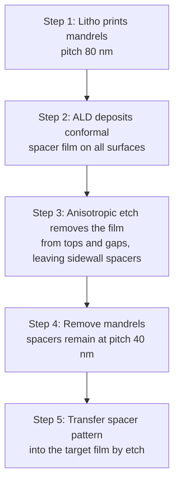

::: testing
Whether you understand that the minimum printable feature is **not** set by the wavelength alone but by the Rayleigh relation $CD = k_1\lambda/NA$, and that the industry gets from 193 nm light to ~20 nm features through a stack of tricks: immersion (higher NA), resolution enhancement (OPC, phase-shift masks, off-axis illumination), multiple patterning (spacer-based pitch splitting using ALD and etch), EUV at 13.5 nm, and etch trimming. Hidden sub-skills: diffraction and interference intuition, pitch versus linewidth, and awareness that node names do not equal feature size.
:::

::: why
This is the "how is that even possible" question of fabrication. A candidate who can explain it shows they understand that lithography is an imaging problem governed by diffraction, and that modern chips depend on layered process innovation rather than a single magic light source. It also explains design-rule restrictions (regular, one-direction layouts), the huge cost of masks and multiple patterning, and why EUV matters. The answer builds on lithography ([[q0661]]), etching ([[q0662]]) and ALD ([[q0663]]), which are the ingredients of spacer patterning.
:::

::: concepts
- **Diffraction**: a pattern of lines scatters light into discrete angles set by pitch; the lens must collect enough of them to form an image. See [[q0661]].
- **Resolution equation**: half-pitch $= k_1\lambda/NA$, with $k_1\ge0.25$ for a single exposure.
- **Immersion**: water raises the refractive index, so NA can exceed 1 and the effective wavelength in the medium shrinks to $\lambda/n$.
- **Resolution enhancement techniques (RET)**: OPC, phase-shift masks, off-axis illumination and source-mask optimisation lower $k_1$.
- **Multiple patterning**: splitting one layer into several exposures or using spacers to divide the pitch.
- **EUV**: 13.5 nm light, which shrinks $\lambda$ by 14×.
:::

::: answer
"You can print features much smaller than the wavelength, and the reason is that resolution isn't set by wavelength alone. It's about $k_1\lambda/NA$, so there are several levers.

First, the optics. With 193 nanometre light you can add immersion, a thin film of water between the lens and wafer, which raises the numerical aperture above 1. That alone gets the half-pitch to about 40 nanometres. Second, you reduce k1 with computational tricks: you pre-distort the mask with optical proximity correction, use phase-shift masks, and shape the illumination so that the lens captures the diffraction orders that carry the fine detail. The physical limit of a single exposure is a half-pitch of lambda over four NA, which is around 36 nanometres for 193 immersion.

To go below that, you don't print the final pitch at all. You use multiple patterning, for example self-aligned double or quadruple patterning: print a relaxed pitch, say 80 nanometres, deposit a thin conformal film by atomic layer deposition on the sidewalls, etch it back so only the spacers remain, and now you have lines at half the pitch, and again to get a quarter, 20 nanometres. And then there's EUV, 13.5 nanometre light, which reaches these dimensions in a single exposure for the tightest layers.

Also, the 'nanometre' in a node name is mostly a label and isn't a measured feature size."
:::

::: technical
**Resolution.** $CD_{half\text{-}pitch} = k_1\lambda/NA$, with $NA = n\sin\theta$. Single-exposure physical limit: $k_1 = 0.25$, i.e. $p_{min} = \lambda/(2NA)$.

- ArF immersion: $\lambda = 193$ nm, $NA = 1.35$ (water, $n\approx1.44$): $p_{min} = 193/(2\times1.35) = 71.5$ nm (half-pitch 35.7 nm). Production single exposures are limited to about 80 nm pitch ($k_1 = 0.28$ at 40 nm half-pitch).
- The effective wavelength in water is $193/1.44 = 134$ nm.

**Why sub-wavelength works.** The mask is a diffraction grating; lens collects the 0th and ±1st orders; interference of two beams at angles $\pm\theta$ produces fringes with period $\lambda/(2n\sin\theta) = \lambda/(2NA)$. The fringe period can be well below λ because it depends on the *difference* of wave vectors, which is up to $2\times$ the free-space wave number times NA. Resist is a threshold (nonlinear) detector that converts the continuous intensity into on/off.

**Resolution enhancement.** OPC (serifs, assist features, bias), phase-shift masks (180° phase differences sharpen edges), off-axis illumination (dipole/quadrupole), source-mask optimization, and computational lithography.

**Multiple patterning.**
- *LELE* (litho-etch-litho-etch): two masks interleaved; overlay between them is critical.
- *SADP/SAQP* (self-aligned double/quadruple patterning): litho prints mandrels at pitch $P$; an ALD spacer ([[q0663]]) is deposited, etched anisotropically ([[q0662]]) so only sidewalls remain, mandrels are removed, and spacer lines at pitch $P/2$ transfer into the film. Repeat for $P/4$. Example: 80 nm → 40 nm → 20 nm.

**EUV.** $\lambda=13.5$ nm, $NA=0.33$: half-pitch $=0.3\times13.5/0.33=12.3$ nm ($k_1=0.3$). High-NA EUV (0.55): 7.4 nm. Issues: stochastic effects (few photons per feature), reflective optics, vacuum, and cost.

**Linewidth vs pitch.** A gate or fin can be thinned below the half-pitch with etch trim or spacers, so critical dimensions can be smaller than the lithographic limit of the pitch.
:::

::: short
"Resolution isn't set by wavelength alone: it's $k_1\lambda/NA$. With 193 nm light you push NA above 1 using water immersion, lower k1 with OPC, phase-shift masks and off-axis illumination, and then go beyond the single-exposure limit with multiple patterning, where spacers deposited by ALD and etched back divide the pitch by two or four. EUV at 13.5 nm does it in one shot for the finest layers. And node names aren't real feature sizes."
:::

::: long
"The short answer is that the wavelength of the light is not the limit on feature size, because what matters is diffraction and interference. The resolution formula is half-pitch equals $k_1$ times lambda over numerical aperture, and there are three levers: wavelength, NA and k1.

For 193 nanometre light, the industry raised NA from below 1 to 1.35 by putting water between the lens and wafer, and water also shortens the effective wavelength to about 134 nanometres. That gets a half-pitch of about 36 nanometres in the best case, which is the theoretical limit with k1 equal to 0.25. In practice, using computational lithography to reduce k1, you pre-distort the mask patterns with optical proximity correction, use phase-shift masks that sharpen edges, and illuminate off-axis so the lens captures the first diffraction orders. And importantly the resist behaves like a threshold, so a smooth intensity pattern gets turned into sharp lines.

Beyond that, you stop printing the final pitch. In self-aligned double patterning you print lines at, say, 80 nanometre pitch. Then you deposit a thin conformal film, typically by atomic layer deposition, over those lines, etch it anisotropically so that it only remains on the sidewalls, and remove the original lines. What's left are spacers at 40 nanometre pitch, twice as dense. Do it again for quadruple patterning, and you're at 20 nanometres. The cost is extra deposition and etch steps and tight overlay control.

The other path is EUV light at 13.5 nanometres, which is more than ten times shorter, so a single exposure can print half-pitches of about 12 nanometres. It needs mirrors in vacuum, and has issues like photon shot noise and cost, so fabs use EUV for the tightest layers and 193 for the rest.

Finally, node names like '3 nanometre' are marketing labels. The real dimensions, like fin pitch or metal pitch, are larger numbers, and they are measured in tens of nanometres."
:::

::: terms
- **Rayleigh criterion**: $CD = k_1\lambda/NA$, the resolution scaling.
- **Numerical aperture (NA)**: $n\sin\theta$, light-gathering ability of the lens.
- **Immersion lithography**: using water between lens and wafer to raise NA.
- **OPC (optical proximity correction)**: pre-distorting mask shapes to correct diffraction effects.
- **Phase-shift mask (PSM)**: mask using phase differences to enhance contrast.
- **Pitch**: distance between repeating features; half-pitch is half of that.
- **SADP/SAQP**: self-aligned double/quadruple patterning using spacers.
- **LELE**: litho-etch-litho-etch double patterning.
- **EUV**: extreme ultraviolet lithography at 13.5 nm.
- **Stochastic defects**: random errors due to photon shot noise and resist chemistry.
:::

::: exceptional
An average answer says "they use shorter wavelengths like EUV." An exceptional answer:
- Writes $CD=k_1\lambda/NA$ and explains that NA and $k_1$ are levers, not just wavelength.
- Explains the physics: diffraction orders and two-beam interference with period $\lambda/(2NA)$, and why that can be below λ.
- Gives numbers: ArF immersion single-exposure limit about 72 nm pitch; SADP/SAQP from 80 nm to 40 and 20 nm.
- Describes spacer patterning step by step, naming ALD and anisotropic etch, and notes overlay and cost trade-offs.
- Mentions EUV (and photon shot noise) and clarifies that node names are not feature sizes.
:::

::: mistakes
- **"The wavelength sets the smallest feature."** Wavelength is one factor; NA and $k_1$ matter equally, and multiple patterning bypasses the single-exposure limit.
- **Confusing resolution with accuracy.** Printing a line is different from placing it at the right location (overlay).
- **Thinking EUV replaced everything.** DUV immersion with multiple patterning remains the workhorse for many layers.
- **Mixing up pitch and linewidth.** A 20 nm pitch means 10 nm line plus 10 nm space; fins and gates can be narrower than half-pitch through trimming.
- **Reading "5 nm node" as a 5 nm feature.** The name is a generation label ([[q0646]]).
:::

::: deep
## The apparent paradox

Seen through a naive picture, light "cannot see" things smaller than its wavelength: you can't image details smaller than about λ/2 with a microscope. That is true of *imaging a single point* in the far field. But lithography isn't imaging arbitrary objects; it prints a **regular pattern** onto a **threshold detector** (resist), and uses **interference**. These make the situation very different.

### Two-beam interference

Suppose a periodic mask (pitch $p$ at the wafer scale) is illuminated at an angle so that two diffracted beams, the 0th order and the −1st order, travel at angles $\pm\theta$ to the optical axis after the lens. They interfere on the wafer and produce an intensity pattern $I(x)=\tfrac12\left[1+\cos(2\pi x/\Lambda)\right]$ with fringe period

$$\Lambda=\frac{\lambda}{2\,n\sin\theta}=\frac{\lambda}{2\,NA}.$$

For ArF immersion ($\lambda=193$ nm, $NA=1.35$): $\Lambda=71.5$ nm: the fringe pitch is 2.7× smaller than the free-space wavelength.

```plot
{"title":"Two-beam interference fringes from 193 nm light at NA = 1.35","x":{"label":"Position on wafer","unit":"nm","min":0,"max":250},"y":{"label":"Relative intensity","unit":"","min":0,"max":1.1},
 "vars":{"lam":193,"na":1.35,"pitch":"lam/(2*na)"},
 "series":[{"label":"I(x)","fn":"0.5*(1+cos(2*PI*x/pitch))"}],
 "vlines":[{"at":"pitch","label":"period 71.5 nm","color":"orange"},{"at":"lam","label":"λ = 193 nm","color":"red"}],
 "hlines":[{"at":0.5,"label":"resist threshold (example)","color":"muted"}]}
```
Figure: Interference of the two beams makes bright and dark fringes every 71.5 nm, less than half of the 193 nm free-space wavelength. Resist acts as a threshold (dashed line): where intensity exceeds it, the resist is exposed; below it, not. The fringes can be arbitrarily precise in position but the pitch cannot go below λ/(2NA); with a single exposure, beyond that the 1st order is outside the lens aperture and no fringes form.

### Resolution lever 1: raise NA with immersion

Between lens and wafer, replace air ($n=1$) by water ($n\approx1.44$ at 193 nm). The maximum $\sin\theta$ remains below 1, but $NA=n\sin\theta$ can reach 1.35. Water also shortens the wavelength inside the medium to $193/1.44=134$ nm. Going from dry NA = 0.93 to immersion 1.35 reduces $p_{min}=\lambda/(2NA)$ from 103.8 nm to 71.5 nm.

### Resolution lever 2: lower $k_1$ with resolution enhancement

The ideal $k_1=0.25$ requires perfect conditions. Real layouts have 2D shapes, line ends, contact holes and mixed pitches, so the image degrades. Techniques recover it:

- **Off-axis illumination**: placing the source off the axis tilts the incident beam so the 0th and 1st orders both fall inside the lens pupil, enabling the two-beam interference above.
- **Optical proximity correction**: add serifs at corners, assist (sub-resolution) features next to isolated lines, and bias line widths so the printed result matches the design.
- **Phase-shift masks**: alternating regions shift the phase by 180°, so the field goes through zero at the edge, producing a sharp dark line.
- **Source-mask optimization (SMO)** and **inverse lithography**: computationally design the source shape and the mask together.

Combined, production processes achieve $k_1\approx0.28$–0.35 for demanding layers, i.e. 80 nm pitch ($k_1=40\times1.35/193=0.28$) with ArF immersion.

### Resolution lever 3: pitch division with spacers

Single exposure can't go below about 72 nm pitch with ArF immersion, so process steps divide the pitch. In **SADP**:


Figure: Self-aligned double patterning. Each mandrel produces two spacers, so line density doubles. The spacer width is set by ALD film thickness (angstrom-level control), not by lithography, which is why ALD ([[q0663]]) and anisotropic etch ([[q0662]]) are central. Repeating the sequence on the spacers (SAQP) gives pitch 20 nm.

$$P_{final}=\frac{P_{litho}}{2^m},\qquad 80\ \text{nm}\xrightarrow{m=1}40\ \text{nm}\xrightarrow{m=2}20\ \text{nm}$$

The line width equals the spacer thickness, which can be well below the lithographic half-pitch. Disadvantages: more steps (cost, defects), layout restricted to regular one-directional lines with separate "cut" masks, and spacer-width variation (pitch walking).

**LELE** instead uses two separate litho-etch passes with interleaved masks; it handles arbitrary 2D layouts but requires exceptional overlay between the two exposures.

### Resolution lever 4: shorter wavelength (EUV)

With $\lambda=13.5$ nm and $NA=0.33$: $CD=0.3\times13.5/0.33=12.3$ nm half-pitch. Photon energy $E=1240\ \text{eV·nm}/\lambda$ is 91.9 eV at 13.5 nm versus 6.4 eV at 193 nm: 14× more energetic photons, so, at the same dose in mJ/cm², 14× fewer photons. For an example dose of 30 mJ/cm² there are about 20 photons per nm² at 13.5 nm versus about 290 per nm² at 193 nm. A feature that is 10 nm × 10 nm sees about 2000 EUV photons, so shot noise ($1/\sqrt N\approx2\%$) causes line-edge roughness and stochastic defects, which is one of the key EUV challenges.

> [!UNCERTAIN]
> The 30 mJ/cm² dose is a representative figure; actual resist doses vary with resist and layer and are optimized against throughput and defectivity.

## Feature size vs pitch vs node name

Lithography limits **pitch**, but transistors depend on **line width** (gate length, fin width). Etch trim and spacer techniques make lines narrower than half-pitch. And the "3 nm" or "5 nm" node name no longer corresponds to any measured dimension: contacted gate pitch and metal pitch are tens of nanometres ([[q0646]]).

## Summary table

| Technique | Mechanism | Effect |
|---|---|---|
| Shorter λ (248 → 193 → 13.5 nm) | Smaller diffraction angles for the same pitch | Direct scaling of CD |
| Immersion | Higher NA, shorter λ in medium | 0.93 → 1.35 NA |
| OPC, PSM, off-axis, SMO | Lower $k_1$ (0.4 → 0.28) | Fine pitch with good yield |
| SADP/SAQP | ALD spacer divides pitch | 80 → 40 → 20 nm |
| LELE | Two interleaved exposures | Doubles density, needs tight overlay |
| EUV | 13.5 nm light | Single-exposure ~25 nm pitch class |
| Etch trim | Narrow lines after printing | Linewidth below half-pitch |
:::

::: applications
- **Leading-edge logic fins and metal lines**: SADP/SAQP with 193 nm immersion and EUV for the tightest layers.
- **DRAM and NAND memory**: very regular arrays, ideal for spacer-based pitch division.
- **Computational lithography software**: OPC/ILT engines run on thousands of CPUs to generate masks.
- **Mask shops**: write complex masks with sub-resolution assist features.
- **Design rules**: restricted design rules (unidirectional metal, regular gate pitch) exist because of these patterning tricks.
:::

::: assumptions
- The scaling law $CD=k_1\lambda/NA$ is empirical; $k_1$ depends on resist, illumination, mask, and allowed CD tolerance.
- The two-beam derivation assumes a periodic, dense grating; isolated features and 2D shapes behave differently and typically need OPC.
- "Production single-exposure limit about 80 nm pitch for ArF immersion" is a representative figure; some processes publish slightly different values.
- EUV photon numbers use a representative dose and ignore resist absorption efficiency.
- Alternate valid framing: describe sub-wavelength printing as a combination of "better optics" and "cleverer patterning", with equal weight.
:::

::: followups
### Why can fringes be smaller than the wavelength?
Because the pattern period depends on the *difference* between the wave vectors of the interfering beams. For two beams at ±θ, the difference is $2k\sin\theta$ so the period is $\lambda/(2\sin\theta)$. With immersion NA = 1.35 this is 71.5 nm for 193 nm light, much smaller than λ even though no single wave oscillates faster than λ.

### What is the single-exposure limit for ArF immersion?
$k_1=0.25$, so half-pitch $=0.25\times193/1.35=35.7$ nm, pitch 71.5 nm. In production, around 80 nm pitch ($k_1\approx0.28$). Below that you need multiple patterning or EUV.

### How does SAQP get to 20 nm pitch from an 80 nm print?
Each spacer pass doubles the line density: first round gives 40 nm pitch, second round (spacers on the spacers) gives 20 nm. The line widths are set by ALD thickness. The lithography only prints the 80 nm mandrels, which is within the immersion capability.

### What are the downsides of multiple patterning?
More process steps (deposition, etch, strip) and masks, which raises cost and defects; more tolerance stacking such as overlay between exposures (LELE) and pitch walking (SADP/SAQP); and layout restrictions, because shapes must be decomposable into the available masks.

### Scenario: your SAQP fin array shows alternating wide and narrow fins ("pitch walking"). What do you suspect?
Imbalance between the spacer sets from the two spacer passes: variations in mandrel CD, spacer thickness or etch profile make alternating gaps unequal. I'd check the first mandrel's CD uniformity and sidewall angle, the ALD thickness and uniformity, and the spacer etch's profile (corner rounding). Tighter control of each step or a different process sequence reduces the walk.
:::

::: interpretations
The wording "wavelengths of light used may not be in that same range" refers to 193 nm DUV compared with feature sizes of tens of nm. Some interviewers also mean "nm" node names, so it's worth adding that node names are not literal feature sizes ([[q0646]]). The Rayleigh basics are in [[q0661]]; deposition and etching steps in spacer patterning are in [[q0663]] and [[q0662]].
:::

::: references
- Mack, *Fundamental Principles of Optical Lithography*: resolution, immersion, RET and process windows.
- Plummer, Deal & Griffin, *Silicon VLSI Technology*: lithography chapter.
- Campbell, *Fabrication Engineering at the Micro- and Nanoscale*: optical lithography and resolution enhancement.
- IRDS (International Roadmap for Devices and Systems) lithography and patterning documents: public overviews; check the current edition for specific numbers.
:::

::: rubric
- States $CD=k_1\lambda/NA$ and that resolution is not set by λ alone :: The key concept that resolves the apparent paradox.
- Explains immersion (NA>1, water) and shows the number :: One of the biggest practical advances.
- Mentions OPC, phase-shift masks, off-axis illumination to reduce $k_1$ :: Shows computational/optical tricks.
- Describes spacer-based multiple patterning (SADP/SAQP) with ALD and etch :: Shows deep process understanding.
- Mentions EUV at 13.5 nm with its trade-offs :: Knows the roadmap.
- Distinguishes pitch/linewidth from node name :: Avoids a common misconception.
:::

::: quiz
```json
[
 {"type":"numeric","level":"fundamental","q":"Using $CD=k_1\\lambda/NA$ with $k_1 = 0.25$, $\\lambda=193$ nm, $NA=1.35$, what is the minimum single-exposure half-pitch in nm?","answer":35.7,"tolerance":0.02,"unit":"nm","explain":"$0.25\\times193/1.35=35.7$ nm, i.e. a pitch of 71.5 nm."},
 {"type":"mcq","level":"fundamental","q":"What is the main purpose of immersion lithography?","options":["Cool the wafer","Increase the numerical aperture by using a fluid with n>1","Remove resist","Clean the mask"],"answer":1,"explain":"Water ($n\\approx1.44$) between lens and wafer allows $NA=n\\sin\\theta>1$, improving resolution."},
 {"type":"numeric","level":"intermediate","q":"A SAQP process starts with lithography at 80 nm pitch. What is the final pitch in nm?","answer":20,"tolerance":0.01,"unit":"nm","explain":"Each spacer pass halves the pitch: $80/2/2=20$ nm."},
 {"type":"numeric","level":"intermediate","q":"What is the wavelength of 193 nm light inside water ($n=1.44$), in nm?","answer":134,"tolerance":0.02,"unit":"nm","explain":"$\\lambda_{medium}=\\lambda/n=193/1.44=134$ nm."},
 {"type":"truefalse","level":"intermediate","q":"A '3 nm node' chip has transistor features that are literally 3 nm.","answer":false,"explain":"The node name is a marketing generation label; actual gate pitches, fin pitches and metal pitches are tens of nanometres."},
 {"type":"multi","level":"advanced","q":"Select all that help print features below the single-exposure limit.","options":["Spacer-based pitch division (SADP/SAQP)","Optical proximity correction and phase-shift masks","Using a thicker mask","EUV lithography at 13.5 nm"],"answer":[0,1,3],"explain":"Pitch division, resolution enhancement (lower $k_1$) and shorter wavelength all help. A thicker mask does not improve resolution."}
]
```
:::
