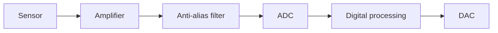

::: testing
Whether you can state the distinction precisely (analog = continuous in time **and** amplitude; digital = discrete in both) and then go beyond it: how a signal becomes digital through sampling and quantization, why digital is robust to noise, what you lose (bandwidth, quantization error, latency), and the point that real digital signals on a wire are analog waveforms with thresholds. Hidden sub-skills: noise margin reasoning, bit-depth arithmetic, and awareness of mixed-signal systems.
:::

::: why
Every sensor, audio path, radio and power system crosses the boundary between the analog world and digital processing. Understanding that boundary tells you where noise enters, why an ADC's bit count and sample rate matter, why clock edges ring, and why a "digital" bus can fail for analog reasons. It also sets up sampling theory ([[q0668]], [[q0669]], [[q0670]]) and converter questions ([[q0808]]).
:::

::: concepts
- **Continuous-time, continuous-amplitude signal**: an analog voltage that can take any value at any instant.
- **Sampling**: measuring the signal at discrete instants, turning continuous time into discrete time. See [[q0668]].
- **Quantization**: rounding each sample to one of $2^N$ levels; this introduces quantization error.
- **Noise margin**: the voltage cushion between what a driver outputs and what a receiver needs to read the right logic level.
- **Regeneration**: digital gates restore signals to clean levels at every stage, so noise doesn't accumulate.
- **Bandwidth and bit rate**: representing an analog signal digitally costs $N\times f_s$ bits per second.
:::

::: answer
"An analog signal is continuous: at any instant it can take any value in a range, like the voltage from a microphone or a temperature sensor. A digital signal is discrete: it only takes values from a finite set, usually just two, high and low, and it only changes or is only read at specific times.

You get from one to the other with an ADC. It samples the analog signal at regular intervals, so time becomes discrete, and then quantizes each sample into one of $2^N$ levels, so amplitude becomes discrete. A 12-bit converter with a 3.3 volt range has 4096 levels, each about 0.8 millivolts. That rounding adds quantization noise, about LSB over root twelve rms.

The big reason we like digital is noise immunity. As long as noise stays within the noise margin, the receiver still decodes the right bit, and every gate regenerates a clean level, so noise doesn't accumulate along the chain. Digital data can also be stored perfectly, copied, compressed, error-corrected and processed with flexible software.

The trade-offs: digital needs bandwidth and conversion hardware, has quantization error and latency, and sampling can alias if you violate Nyquist. And I'd add that digital signals are really analog underneath: real logic edges have finite rise time, ringing and noise, and signal integrity problems are analog problems."
:::

::: technical
**Definitions.** An analog signal $x(t)$ is continuous in time and amplitude. A digital signal is a sequence $x[n]$ with values from a finite alphabet. A *discrete-time* signal (sampled but not quantized) is neither; "digital" requires both sampling and quantization.

**Conversion.** Sampling at $f_s$ (must exceed $2f_{max}$ to avoid aliasing, [[q0669]]), then quantizing to $N$ bits over full-scale range FSR:

$$\text{LSB}=\Delta=\frac{\text{FSR}}{2^N},\qquad e_{rms}=\frac{\Delta}{\sqrt{12}}$$

For a full-scale sine, the ideal signal-to-quantization-noise ratio is $\text{SQNR}=6.02N+1.76$ dB. Example: 12 bits, 3.3 V: $\Delta=0.806$ mV, $e_{rms}=0.233$ mV, SQNR = 74.0 dB. 16 bits: 98.1 dB.

**Digital voltage levels.** For a receiver with thresholds $V_{IL},V_{IH}$ and driver levels $V_{OL},V_{OH}$: $NM_L=V_{IL}-V_{OL}$, $NM_H=V_{OH}-V_{IH}$. For classic 3.3 V LVTTL ($V_{OL}\le0.4$, $V_{IL}=0.8$, $V_{IH}=2.0$, $V_{OH}\ge2.4$): both margins are 0.4 V.

**Data rate.** Digitizing at $f_s$ with $N$ bits costs $N f_s$ bits/s per channel; CD audio is $16\times44{,}100\times2 = 1.411$ Mb/s.

**Advantages of digital.** Noise immunity and regeneration; exact copying; programmability; error correction. **Advantages of analog.** No conversion loss or quantization; potentially lower power/area for simple tasks; native interface to physical quantities; continuous bandwidth up to RF and beyond without sampling.

**Reality check.** A "digital" waveform on a PCB trace is analog: it has rise time, overshoot, crosstalk and jitter. Digital correctness depends on analog quantities meeting setup/hold and threshold requirements.
:::

::: short
"Analog signals are continuous in time and amplitude, like a microphone voltage. Digital signals are discrete in both: sampled at intervals and quantized to a finite number of levels, usually represented as bits. An ADC converts analog to digital, adding quantization error of about LSB over root 12. Digital wins on noise immunity, because gates regenerate clean levels, and on storage and processing. Analog is still needed at the interfaces, and real digital edges are analog waveforms."
:::

::: long
"The difference comes down to continuous versus discrete. An analog signal is continuous in time and in amplitude. The voltage from a microphone, a thermocouple or an antenna can take any value and is defined at every instant. A digital signal is discrete in both: it takes a finite set of values, in the simplest case just high or low, and it's defined at specific instants, typically on clock edges.

To convert between them you use an ADC. First it samples: it measures the signal every $1/f_s$ seconds, and to keep all the information the sample rate has to be more than twice the highest frequency, otherwise you get aliasing. Then it quantizes: it rounds each sample to the nearest of $2^N$ levels. For example a 12-bit ADC with a 3.3 volt range has 4096 levels, about 0.8 millivolts per step, and the rounding error is roughly the LSB divided by root twelve, so around 0.23 millivolts rms. The ideal signal to quantization noise ratio is 6.02 times N plus 1.76 dB, which is 74 dB for 12 bits.

Why bother? Because digital is robust. If a receiver only needs to decide whether a voltage is above or below a threshold, noise smaller than the noise margin does nothing, and every logic gate restores the level, so noise doesn't accumulate over long chains or copies. You can store, copy, compress, encrypt and error-correct digital data without degradation, and process it with flexible software.

The costs are conversion hardware, quantization error, latency, and the bits-per-second you need: CD audio is about 1.4 megabits per second, for example.

Finally, I'd stress that these are not totally separate worlds. A digital line on a PCB is an analog waveform with a finite rise time, ringing, crosstalk and jitter, and most real systems are mixed-signal: sensor, amplifier, anti-alias filter, ADC, processor, DAC and output driver."
:::

::: terms
- **Analog signal**: continuous in time and amplitude.
- **Digital signal**: discrete in time and amplitude, usually binary-coded.
- **Sampling**: capturing the signal at discrete time instants.
- **Quantization**: mapping a continuous value to one of a finite set of levels.
- **LSB**: least significant bit; the step size $\text{FSR}/2^N$.
- **SQNR**: signal-to-quantization-noise ratio, about $6.02N+1.76$ dB for a full-scale sine.
- **Noise margin**: voltage difference between a driver's output level and the receiver's threshold.
- **ADC / DAC**: converters between analog and digital domains.
- **Mixed-signal**: systems or chips containing both analog and digital circuits.
:::

::: exceptional
An average answer says "analog is continuous, digital is 1s and 0s." An exceptional answer:
- States continuity in **both time and amplitude**, and explains that digital needs sampling and quantization.
- Computes an example: bit depth, LSB size, quantization noise and SQNR ($6.02N+1.76$).
- Explains noise margin and regeneration as the reason digital is robust, with numbers from a logic family.
- Names costs: bandwidth/bit rate, latency, aliasing, quantization error.
- Observes that digital signalling is analog at the physical layer (edges, ringing, jitter) and gives a mixed-signal chain.
:::

::: mistakes
- **"Digital means binary."** Digital means discrete-valued; PAM-4 signals have four levels but are still digital.
- **Forgetting the time dimension.** A sampled but unquantized signal is discrete-time, not digital.
- **Believing digital is noise-free.** Noise exists; digital just tolerates it up to the noise margin and via error correction.
- **Ignoring quantization error.** More bits reduce but never eliminate it; 6 dB per bit.
- **Thinking logic levels are perfect.** Edges ring and overshoot; thresholds and timing are analog properties.
:::

::: deep
## Two axes: time and amplitude

Classify any signal by whether its time axis and amplitude axis are continuous or discrete:

| | Continuous amplitude | Discrete amplitude |
|---|---|---|
| **Continuous time** | Analog (microphone voltage) | Quantized continuous-time (a comparator output, bilevel) |
| **Discrete time** | Sampled-data (switched-capacitor circuits, sample-and-hold output) | **Digital** (ADC output codes) |

The name "digital" applies to the bottom-right cell. Sample-and-hold and switched-capacitor circuits are discrete-time analog, which is why "analog" circuits can have clocks.

```plot
{"title":"A 1 Hz sine, sampled and quantized (default 12 samples per cycle, 3 bits)","x":{"label":"Time","unit":"s","min":0,"max":2},"y":{"label":"Amplitude","unit":"(normalized)","min":-1.2,"max":1.2},"vars":{"m":"pow(2,bits-1)-0.5"},"series":[{"label":"analog (continuous)","fn":"sin(2*PI*x)","color":"muted","dashed":true},{"label":"digital: sampled + quantized","fn":"(floor(m*sin(2*PI*floor(x*fs)/fs))+0.5)/m","n":3000}],"params":[{"name":"fs","label":"Samples per cycle","min":3,"max":40,"value":12,"step":1},{"name":"bits","label":"ADC bits","min":1,"max":6,"value":3,"step":1}],"readouts":[{"label":"Quantizer levels 2^bits","expr":"pow(2,bits)"},{"label":"Sample interval 1/fs","expr":"1/fs","unit":"s"}]}
```
Figure: The dashed analog curve is defined everywhere. The solid trace holds each sample for 1/12 s (sample-and-hold) and rounds it to one of 8 levels, which is what a 3-bit ADC followed by a DAC would produce. The difference between the curves is the quantization error plus the time-discretization error. Drag the bits to 1 and the staircase collapses to a two-level square wave; drag samples per cycle to 3 and the held steps become too coarse to show the sine at all.

## Going digital: the chain


Figure: A typical mixed-signal path. Noise and distortion are added before the ADC; after the ADC the numbers are exact (until the DAC). The anti-alias filter is needed because sampling folds frequencies above $f_s/2$ back into the band ([[q0670]]).

### Quantization in numbers

An $N$-bit converter has $2^N$ levels. With full-scale range FSR the step is $\Delta=\text{FSR}/2^N$. Rounding error is uniformly distributed in $[-\Delta/2,\Delta/2]$, so its rms is

$$e_{rms}=\sqrt{\frac{1}{\Delta}\int_{-\Delta/2}^{\Delta/2}e^2\,de}=\frac{\Delta}{\sqrt{12}}.$$

A full-scale sine has rms $=\text{FSR}/(2\sqrt2)$, so

$$\text{SQNR}=20\log_{10}\frac{\text{FSR}/(2\sqrt2)}{\Delta/\sqrt{12}}=20\log_{10}\left(2^N\sqrt{\tfrac{3}{2}}\right)=6.02N+1.76\ \text{dB}.$$

| Bits | Levels | LSB at 3.3 V | SQNR |
|---|---|---|---|
| 8 | 256 | 12.9 mV | 49.9 dB |
| 10 | 1024 | 3.22 mV | 62.0 dB |
| 12 | 4096 | 0.806 mV | 74.0 dB |
| 16 | 65,536 | 50.4 µV | 98.1 dB |

Each extra bit gives about 6 dB, i.e. halves the quantization error. In practice thermal noise and the converter's own non-idealities limit the *effective* number of bits (ENOB) well below the nominal count; see [[q0819]] for ADC precision.

```sim
{"id":"adc-lab","bits":3,"vref":3.3}
```
Figure: Lower the resolution to 3 bits and watch the staircase and quantization error grow; at 12 bits the staircase is invisible. By default the sim truncates, so the error saws between 0 and 1 LSB; tick "Rounding" to see the ±LSB/2 error assumed in the $\Delta/\sqrt{12}$ formula.

## Why digital is robust: noise margin and regeneration

Consider a 3.3 V LVTTL-style output: a driver guarantees $V_{OH}\ge2.4$ V and $V_{OL}\le0.4$ V; a receiver reads anything above $V_{IH}=2.0$ V as high and below $V_{IL}=0.8$ V as low. The noise margins are $NM_H=2.4-2.0=0.4$ V and $NM_L=0.8-0.4=0.4$ V. Noise up to 400 mV causes no error. Each gate then re-drives a full-swing output, so noise doesn't pile up across stages: this is **regeneration**.

An analog signal has no such protection. If it passes through a cable that adds 10 mV of noise, the receiver can't tell the noise from signal; cascade ten stages and the noise accumulates (adds in quadrature, $\sqrt{10}\times$). That's why long-distance and multi-copy storage went digital.

## Costs of going digital

- **Bit rate**: $N f_s$ per channel. CD audio: $16\times44{,}100\times2=1.411$ Mb/s.
- **Bandwidth limit**: only frequencies below $f_s/2$ can be represented ([[q0669]]).
- **Quantization noise**: a fundamental floor.
- **Latency and power**: conversion plus processing takes time and energy; converters can dominate system power at high speed or resolution.
- **Aliasing and clock jitter**: sampling clock jitter limits SNR at high input frequency: $\text{SNR}_{jitter}=-20\log_{10}(2\pi f_{in}\,t_j)$. For $f_{in}=10$ MHz and $t_j=1$ ps: $-20\log_{10}(2\pi\times10^7\times10^{-12})=84$ dB.

## Digital is analog underneath

A 1 ns edge on a PCB trace is a wideband analog event: a 1 ns rise time has bandwidth about $0.35/t_r=350$ MHz ([[q0666]]). The receiver sees a waveform with overshoot, ringing and noise, and decides based on thresholds at a clock instant. Setup and hold times are analog requirements about when the voltage must be stable. When a bus fails, it is usually an analog reason: reflections, crosstalk, ground bounce ([[q0657]]), or supply droop.

## Beyond binary: multi-level signalling

"Digital" does not have to mean two levels. PAM-4 signalling, used on fast serial links, uses four voltage levels per symbol, carrying 2 bits per symbol, so a 56 Gbaud link moves 112 Gb/s. The cost is that the eye is split into three smaller eyes: the vertical spacing between levels is one third of the binary swing, so the noise margin is about 9.5 dB smaller for the same peak swing ($20\log_{10}3=9.5$ dB). Link designers accept that trade because doubling the symbol rate runs into channel loss, so the extra analog care (equalisation, linearity) buys bandwidth. The same logic underlies QAM in wireless: the more levels you pack into an analog amplitude and phase, the more SNR you need, and the more the "digital" link depends on analog performance.

## Oversampling and dither: resolution is not just bits

Because quantization noise is spread over $0$ to $f_s/2$, sampling faster than needed and filtering to the signal band removes part of it: each doubling of $f_s$ (oversampling ratio 2) lowers the in-band quantization noise by 3 dB, so $\text{OSR}=4$ gains 6 dB, about one extra bit. Noise shaping (as in sigma-delta ADCs) pushes the noise out of band so that the gain is much larger. A small amount of added random noise, dither, decorrelates the rounding error from the signal, trading a slightly higher noise floor for the removal of harmonic distortion at low signal levels. The practical lesson is that effective resolution is a system property: converter bit count, noise, sample rate and filtering all matter.

## Where analog still matters

Anything that touches the physical world: sensors (thermocouples, photodiodes, microphones), RF front ends (low-noise amplifiers, mixers), power conversion (switching regulators operate on continuous-time analog feedback), and the ADC and DAC themselves. Even inside digital chips, SRAM sense amplifiers, PLLs and I/O drivers are analog circuits.
:::

::: applications
- **Audio**: microphone (analog) → ADC → DSP/storage → DAC → speaker.
- **Sensor systems**: thermistor or strain gauge → amplifier → ADC in a microcontroller.
- **Communications**: bits modulate an analog carrier; digital modulation like QAM maps bits to analog amplitudes and phases.
- **Instrumentation**: oscilloscopes digitize analog signals for display and measurement.
- **Control systems**: digital controllers sample analog plant outputs and drive the plant via DACs or PWM.
:::

::: assumptions
- "Digital" here means sampled and quantized signals and binary logic. Some texts use "digital" for any discrete-valued signal.
- SQNR formula assumes a full-scale sine and ideal uniform quantization with no dither or noise shaping.
- The LVTTL levels are a representative logic family; modern low-voltage logic has smaller absolute margins.
- Ideal converters assumed; real ones have INL/DNL, thermal noise and jitter that reduce ENOB.
- A valid alternative framing is by representation: analog signals are *analogous* (proportional) to the physical quantity, while digital signals encode it as numbers.
:::

::: followups
### What is quantization noise and how does it scale with bits?
Rounding to the nearest level gives an error uniformly distributed over ±LSB/2, rms $\Delta/\sqrt{12}$. Each extra bit halves $\Delta$, so noise falls 6 dB per bit. A 12-bit, 3.3 V ADC has an rms quantization noise of 0.23 mV.

### Why is digital more noise-immune than analog?
Because a receiver only has to decide between a finite set of levels, noise smaller than half the level spacing (or the noise margin) has no effect, and digital gates regenerate the signal so noise doesn't accumulate. Analog signals carry information in the exact value, so any noise is a direct error.

### Is a PWM signal analog or digital?
It is a digital-valued waveform (two levels) in amplitude but its *duty cycle* encodes an analog value in time. Low-pass filtering PWM recovers an analog voltage. It shows that the boundary can be blurred.

### How many bits do you need to measure a 0–3.3 V signal to ±1 mV?
You need a step size of at most 2 mV (±1 mV), so $2^N\ge3.3/0.002=1650$, so $N=11$ bits (2048 levels, LSB 1.6 mV). In practice you'd add margin for noise and non-linearity, so a 12-bit ADC.

### Scenario: your ADC reading is noisier than its bit count suggests. What do you check?
Compare the measured noise to the ideal $\Delta/\sqrt{12}$. If much larger, the noise is analog: reference noise, input source impedance and sampling kickback, power supply ripple, ground bounce, or a missing anti-alias filter that lets high-frequency noise alias into the band. Also check the clock jitter at high input frequency. Compute ENOB from the measured SNR: $\text{ENOB}=(\text{SNR}-1.76)/6.02$.
:::

::: interpretations
In many interviews this question is purely about definitions, in which case the answer is "continuous vs discrete" plus the advantages of digital. The wider version also asks about conversion and noise, which is why the answer here covers sampling, quantization and signal-integrity reality. See [[q0668]] for the sample-rate requirement and [[q0670]] for aliasing.
:::

::: references
- Oppenheim & Willsky, *Signals and Systems*: classification of signals and sampling.
- Horowitz & Hill, *The Art of Electronics*, 3rd ed.: digital logic levels and noise margins; analog-to-digital conversion.
- Sedra & Smith, *Microelectronic Circuits*: digital logic circuits and data converters.
- Kester (ed.), *Data Conversion Handbook* (Analog Devices): quantization noise, SQNR and ENOB.
:::

::: rubric
- States analog = continuous in time and amplitude; digital = discrete in both :: The precise definition.
- Explains sampling and quantization as the conversion steps :: Shows you know what an ADC does.
- Quantifies quantization (LSB, $\Delta/\sqrt{12}$, $6.02N+1.76$ dB) :: Turns the concept into numbers.
- Explains noise margin and regeneration as the benefit of digital :: The key engineering reason digital dominates.
- Lists the costs (bandwidth/bit rate, quantization error, latency, aliasing) :: Balanced view.
- Notes real digital signals are analog waveforms and gives mixed-signal context :: Shows practical insight.
:::

::: quiz
```json
[
 {"type":"mcq","level":"fundamental","q":"Which statement correctly defines a digital signal?","options":["Continuous in time and amplitude","Discrete in both time and amplitude","Continuous in time, discrete in amplitude only","Any signal on a PCB trace"],"answer":1,"explain":"Digital signals are discrete in time (sampled) and amplitude (quantized). A signal that is sampled but not quantized is only discrete-time."},
 {"type":"numeric","level":"fundamental","q":"A 12-bit ADC has a 3.3 V full-scale range. What is one LSB in mV?","answer":0.806,"tolerance":0.01,"unit":"mV","explain":"$3.3/4096=0.806$ mV."},
 {"type":"numeric","level":"intermediate","q":"What is the ideal SQNR in dB of a 14-bit ADC for a full-scale sine?","answer":86.0,"tolerance":0.01,"unit":"dB","explain":"$6.02\\times14+1.76=86.04$ dB."},
 {"type":"numeric","level":"intermediate","q":"A logic family has $V_{OH}=2.4$ V and $V_{IH}=2.0$ V. What is the high-level noise margin in V?","answer":0.4,"tolerance":0.01,"unit":"V","explain":"$NM_H=V_{OH}-V_{IH}=0.4$ V."},
 {"type":"truefalse","level":"intermediate","q":"A sample-and-hold output (sampled in time but with continuous amplitude) is a digital signal.","answer":false,"explain":"It is discrete-time but still continuous in amplitude. Digital also requires quantization to a finite set of values."},
 {"type":"numeric","level":"advanced","q":"What is the minimum number of ADC bits needed to resolve a 0–3.3 V signal to within ±1 mV (i.e. step ≤ 2 mV)?","answer":11,"tolerance":0.01,"unit":"bits","explain":"Need $2^N\\ge3.3/0.002=1650$, so $N=11$ ($2^{11}=2048$)."}
]
```
:::
