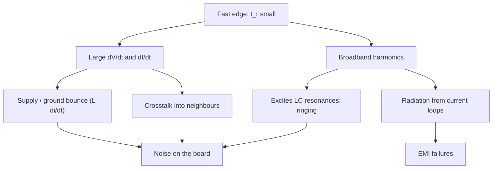

::: basics
### In plain words
A square wave jumps from low to high and back almost instantly. Those sudden jumps are the noisy part. A sharp jump holds a lot of fast changes. Fast changes push strong, brief currents into wires, leak into neighbors, and radiate as radio noise. The best fix is usually to slow the jumps a little.

### Picture it
Think of a hand clap versus a slow handshake. A clap is sudden, so it makes a sharp crackle full of high pitches. A slow, smooth motion makes almost no sound. A square wave's edge is the clap. Slowing the edge removes the high pitches without changing how often you clap. Unlike sound, this noise also travels through shared wires and power pins.

### Words you need
- **Edge**: the moment the signal switches from low to high or high to low.
- **Rise time**: how long an edge takes. Shorter means sharper.
- **Harmonic**: a sine wave at a whole-number multiple of the signal's repeat rate. A sharp edge needs many high harmonics to build it.
- **Capacitance**: any two nearby conductors act like a tiny bucket that must fill with charge before the voltage changes.
- **Crosstalk**: unwanted signal that leaks from one wire into a neighbor ([[q0694]]).

### The simplest example
Take a 10 MHz clock whose edges take 1 ns. The clock repeats only 10 million times a second, but each edge is as abrupt as a 350 MHz wave. A rule of thumb is 0.35 divided by the rise time, so real energy reaches the hundreds of MHz.

Now charge a 15 pF load (picofarads: tiny, typical of a wire and pin) through 3.3 V in 1 ns. That takes about 50 mA, since current is capacitance times voltage change per second. Stretch the edge to 5 ns and the surge falls to about 10 mA.

That is the whole idea: sharp edge, big brief current, lots of high-frequency energy. The rest of this page shows how it couples into neighbors and supplies, and how to reduce it.
:::

::: testing
Whether you can connect **spectrum, edge rate and physical coupling** into one coherent story. "Square waves are noisy" is really three ideas stacked: sharp edges contain a very wide band of harmonics ([[q0673]]), fast edges force large $dV/dt$ and $dI/dt$ through unavoidable capacitance and inductance, and those couple into neighbours, supplies and the air. The second half asks for a toolbox (slow the edge, shrink the loop, filter, shield, spread, damp) and the third part checks that you can attack a *specific* frequency, using nulls from duty cycle or rise time, notch/trap filters, ferrites, or resonance damping.
:::

::: why
EMI test failures, jittery ADC readings next to a clock, and flaky I2C near a motor driver all come from switching waveforms. In an interview, "make it quieter" is a daily task: you are given a failing emissions plot with a peak at 250 MHz and asked what to do. Knowing which lever (edge rate, loop area, filter, duty) acts on which frequency is the difference between guessing and engineering. This question also leads naturally into [[q0677]] (trade-offs of sharper edges) and the SI topics later in the section.
:::

::: concepts
- **Harmonic content of edges**: sharp transitions contain energy out to roughly $0.35/t_r$ to $0.5/t_r$ ([[q0676]]).
- **$I = C\,dV/dt$**: charging line and load capacitance draws current spikes that scale with edge rate.
- **$V = L\,dI/dt$**: current spikes through package, via and trace inductance create supply and ground disturbances ([[q0688]]).
- **Coupling paths**: capacitive (voltage-driven), inductive (current-driven), common impedance, and radiation ([[q0565]], [[q0559]]).
- **Loop radiation**: a current loop radiates in proportion to area, current and $f^2$.
- **Filtering and damping**: RC/LC/ferrite filters and series damping resistors remove or absorb specific bands.
:::

::: answer
"A square wave is noisy because the sharp edges are really a huge stack of high-frequency sinusoids. Ideal harmonics fall as one over n, so even a 10 MHz clock has meaningful content out into the hundreds of MHz. On a real board those frequencies hit all the parasitics. The edge charges trace capacitance, which pulls a current spike, I equals C dV/dt. That spike flows through the inductance of the package and the return path, giving L di/dt disturbances on the supply and ground. The same fast edges couple into neighbouring traces through mutual capacitance and inductance, and the current loop acts as a small antenna whose radiation grows with frequency squared.

To reduce noise, the biggest lever is slowing the edge, because high harmonics scale inversely with rise time. I'd use a series resistor or slew-rate control, lower the frequency if the design allows, keep the current loop small with a solid return plane, add decoupling, filter or ferrite the lines that leave the board, and use differential signalling for fast links. Spread-spectrum clocking lowers peak emissions.

For a particular frequency, I can place a null on it: choosing a duty cycle of one over n kills the nth harmonic, and a rise time of one over f puts a null at f. Otherwise I'd use a notch or LC trap, pick a ferrite whose impedance peaks there, or damp the resonance that's amplifying it."
:::

::: technical
**Why noisy: three layers**
1. **Spectrum.** A trapezoid with rise time $t_r$ has harmonics $\approx 1/n$ up to the knee near $1/(\pi t_r)$, then $1/n^2$. Beyond both knees the harmonic amplitude is inversely proportional to $t_r$: making an edge $7\times$ slower lowers high harmonics by $20\log_{10}7 = 17$ dB.
2. **Parasitics turn edges into disturbances.**
   - Charging a load: $i = C\,dV/dt$. A 15 pF load swung 3.3 V in 1 ns draws about 50 mA.
   - Inductive drop: $v = L\,di/dt$; 5 nH with 20 mA/ns gives 0.1 V per output, multiplied by the number of simultaneous outputs.
   - Shoot-through current in CMOS during the transition (both devices partially on).
   - LC resonances ring: 5 nH with 10 pF rings at $1/(2\pi\sqrt{LC}) = 712$ MHz.
3. **Coupling to the world.** Crosstalk amplitude scales with $dV/dt$ (capacitive) and $dI/dt$ (inductive). A current loop of area $A$ carrying a harmonic current $I$ at frequency $f$ radiates a field proportional to $f^2 A I$.

**Reducing noise (broadband)**
- **Slow edges** ($R_s C_L$ gives $t_r \approx 2.2R_sC_L$; 33 Ω with 10 pF gives 0.73 ns).
- **Lower frequency or swing**, lower-speed logic family, smaller $\Delta V$.
- **Small loop area**: continuous reference plane directly under the trace; decouple at the pins.
- **Termination/damping** to avoid ringing ([[q0526]]).
- **Filter and ferrite** on cables and power entry; **shielding**.
- **Spread-spectrum clocking** reduces the peak at each harmonic by spreading it over a band.
- **Differential or current-balanced** signalling so currents cancel in the return path.

**Reducing noise at one frequency $f_x$**
- **Duty cycle null**: $D = 1/n$ removes harmonic $n$ (and multiples of $n$). $D = 1/3$ removes the 3rd, 6th, 9th.
- **Rise-time null**: the $\text{sinc}(ft_r)$ factor is zero at $f = 1/t_r$, so $t_r = 1/f_x$ nulls $f_x$ and its multiples (exact for a linear ramp; real edges soften the null).
- **Notch / series-LC trap** to ground at the offending line; or a band-stop in the supply.
- **Ferrite bead** selected so its impedance peaks near $f_x$ (check the datasheet impedance curve).
- **Damp the resonance** that amplifies $f_x$: series $R \approx 2\sqrt{L/C}$ gives critical damping (45 Ω for 5 nH and 10 pF).
- **Shift** the clock or switching frequency so the harmonic misses the sensitive band.

> [!UNCERTAIN]
> Spread-spectrum benefit depends on modulation depth, profile and the measurement detector and resolution bandwidth. Typical quoted peak reductions are several dB to over 10 dB, but the exact figure is design- and standard-specific.
:::

::: short
"Square waves are noisy because sharp edges contain a very wide band of harmonics. On a real board those edges charge capacitance and force current spikes through inductance, which disturbs supplies and grounds, couples into neighbouring traces, and radiates from current loops. To reduce it, I'd slow the edges, since high harmonics scale as one over rise time, keep loops small over a solid return plane, decouple, filter or ferrite the exits, and use spread-spectrum. For one frequency I can null it with a duty cycle of one over n or a rise time of one over f, or use a notch or ferrite tuned to it."
:::

::: long
"There are three reasons a square wave is noisy. First, the spectrum. A fast edge is a broadband event: harmonics fall as one over n until about one over pi times the rise time, then a bit faster. So a 10 MHz clock with a 1 ns edge still has energy at a few hundred MHz.

Second, the board's parasitics convert that into disturbances. Charging trace and pin capacitance draws a current of C times dV/dt. Those currents run through package and via inductance, giving L di/dt bounces on the supply and ground, which is the same mechanism as ground bounce. The same edges couple capacitively and inductively into neighbouring traces. And the loop that carries the current is a little antenna: radiation scales with loop area, current, and frequency squared, so the high harmonics radiate best.

To reduce the noise, the cheapest, most effective knob is edge rate. Above the knee the harmonic amplitudes are inversely proportional to rise time, so a series resistor that makes the edge seven times slower buys me about 17 dB. Beyond that, I keep the current loop small with a solid return plane, decouple close to the pins, terminate or damp ringing, filter or ferrite cables and power entries, shield if needed, and use spread-spectrum clocking or differential signalling for fast links.

If the problem is one specific frequency, there are targeted fixes. A duty cycle of one over n puts a null on the nth harmonic, so a third duty kills the third. Setting the rise time to one over the frequency also puts a null there. Otherwise I'd add a notch or LC trap, choose a ferrite whose impedance peaks at that frequency, or damp the resonance that's amplifying it, for example with a series resistor equal to two times root L over C."
:::

::: terms
- **Harmonic**: spectral component at an integer multiple of the signal frequency; a source of broadband noise.
- **Edge rate / slew rate**: $dV/dt$ of the transition; the main control over high-frequency content.
- **Knee frequency**: point where the spectral envelope steepens, about $1/(\pi t_r)$ for a linear edge.
- **Ground bounce / SSN**: voltage disturbance from $L\,di/dt$ when many outputs switch ([[q0688]]).
- **Crosstalk**: unwanted coupling from an aggressor to a nearby victim.
- **Loop area**: area enclosed by a signal and its return; sets inductance and radiation.
- **Spread-spectrum clocking**: deliberate slow modulation of the clock frequency to spread harmonic energy.
- **Ferrite bead**: lossy inductor that absorbs high-frequency noise.
- **Notch / trap filter**: circuit with a deep rejection at a chosen frequency.
:::

::: exceptional
**An average answer** says "sharp edges have lots of harmonics" and lists "add filters and slow the edges".

**An exceptional answer**:
- Explains the chain: edge $\to$ broadband spectrum $\to$ $C\,dV/dt$ and $L\,di/dt$ $\to$ coupling and radiation.
- Quantifies one fix: e.g. $t_r = 2.2RC$ and "7$\times$ slower edge is $-17$ dB above the knee".
- Mentions loop area/return path as the main layout lever, not only components.
- Handles the particular-frequency part concretely: $D = 1/n$ nulls, $t_r = 1/f$ nulls, notch/ferrite/damping, and notes limitations (real edges blur nulls; ferrites saturate or resonate).
- Flags the trade-offs of slowing edges (timing margin, switching loss) ([[q0677]]).
:::

::: mistakes
- **Blaming only the frequency.** A slow clock with a very fast edge is still noisy; edge rate matters more than repetition rate for the high harmonics.
- **Adding a bypass capacitor and calling it done.** Above its self-resonance a capacitor is an inductor; mounting inductance often dominates ([[q0509]]).
- **Using the wrong ferrite.** A ferrite helps only where its impedance is high and lossy; at the wrong frequency it can resonate with nearby capacitance and make things worse.
- **Expecting a perfect null from $D = 1/n$ or $t_r = 1/f$.** Real edges are not linear ramps and duty varies with temperature and jitter, so you get a dip, not a hole.
- **Slowing edges everywhere.** It costs timing margin and increases switching loss in power stages.
- **Ignoring return current.** Fixing the signal trace but breaking the return path (plane split) keeps the loop area large.
:::

::: deep
## Edges are broadband

Section [[q0673]] showed the spectrum of a trapezoid: flat to $1/(\pi\tau)$, then $-20$ dB/decade to $1/(\pi t_r)$, then $-40$ dB/decade. The consequence is that what you hear as "noise" is mostly the *edge*, not the repetition. Compare two 10 MHz clocks, one with 5 ns edges and one with 0.5 ns edges. At 1 GHz and above, the faster one has about 20 dB more energy. Both have the same fundamental.

```plot
{"title":"Same 3.3 V, 50 MHz clock, three edge speeds (upper envelope of the odd harmonics)","x":{"label":"frequency","unit":"Hz","min":100000000,"max":10000000000,"log":true},"y":{"label":"envelope (dBV, peak)","min":-70,"max":10},
 "vars":{"v":3.3,"f0":50000000},
 "series":[
  {"label":"t_r = 0.2 ns","fn":"20*log10(2*v*f0/(pi*x))-20*log10(max(1,pi*x*0.2e-9))","color":"red"},
  {"label":"t_r = 1 ns","fn":"20*log10(2*v*f0/(pi*x))-20*log10(max(1,pi*x*1e-9))","color":"orange"},
  {"label":"t_r = 5 ns","fn":"20*log10(2*v*f0/(pi*x))-20*log10(max(1,pi*x*5e-9))","color":"accent"}
 ]}
```
Figure: All three share the same low-frequency envelope. Beyond its own knee each curve drops at $-40$ dB/decade, and at any fixed high frequency (say 2 GHz) the 5 ns edge is $20\log_{10}(5/0.2) = 28$ dB below the 0.2 ns edge. The cheapest 28 dB you will ever buy is a slower edge.

## How edges become voltages and currents

Every node has capacitance to ground, and every current path has inductance. Take a driver switching a 15 pF load across 3.3 V in 1 ns:
$$i = C\frac{dV}{dt} = 15\ \text{pF}\times 3.3\ \text{V/ns} = 49.5\ \text{mA}$$
Sixteen such outputs switching at once demand about 0.8 A for about 1 ns. The supply path (pin, bond wire, via, plane) has inductance of the order of a few nH, so $v = L\,di/dt$ matters: 5 nH and a 20 mA/ns slope is 0.1 V per output, and if eight of them switch together the ground node moves by about 0.8 V. That is **ground bounce**, covered in [[q0688]].

```sim
{"id":"ground-bounce","n":8,"l":2e-9,"cl":15e-12,"tr":1e-9,"vdd":3.3}
```
Figure: Halve the edge time and the bounce grows by roughly two to four times: with a capacitive load the current step $C\,dV/dt$ doubles as well as happening in half the time, so the open-loop $L\,di/dt$ scales as $1/t_r^2$, and the driver's own resistance pulls the real figure below that. Increase $n$ and it grows roughly linearly. The same mechanism disturbs the supply when the output switches the other way.

In the same way the loop of signal current and return current is an inductor. Parasitic L and C ring: the pair 5 nH and 10 pF rings at 712 MHz with a characteristic impedance $\sqrt{L/C} = 22\ \Omega$. A square-wave edge has plenty of energy at 712 MHz, so the ring is strongly excited. You see it as overshoot, undershoot, and a ringing burst on the supply that radiates.

## Coupling and radiation

- **Capacitive**: aggressor $dV/dt$ drives a displacement current $C_m\,dV/dt$ into the victim.
- **Inductive**: aggressor $dI/dt$ induces $M\,dI/dt$ in the victim loop. See the crosstalk sim in [[q0694]].
- **Common impedance**: shared return or supply path.
- **Radiation**: for an electrically small loop, the far field is proportional to $f^2AI$. Doubling the harmonic frequency at the same current gives 4$\times$ (12 dB) the field, so high harmonics radiate disproportionately. That is why a nicely filtered fundamental can still fail emissions at 300 MHz.

```sim
{"id":"return-path","h":0.2,"slot":true,"slotLen":20,"fix":"none","f":100}
```
Figure: Radiation scales with loop area, and a slot in the reference plane enlarges that loop by forcing the return current to detour. Toggle the slot off to see the tight return under the trace, then switch to the stitching fix and compare.


Figure: A single design variable, rise time, feeds every noise mechanism. That is why slowing the edge is the first thing to try.

## Reducing noise: the toolbox

1. **Slow the edge.** A series resistor $R_s$ with load $C_L$ gives $t_r\approx2.2R_sC_L$ (33 Ω and 10 pF gives 0.73 ns). Many drivers have selectable slew control. It also improves termination (series termination, [[q0533]]).

```circuit
{"caption":"Series resistor slows the edge (R_s C_L sets t_r) and damps ringing","elements":[
 {"t":"Vsq","a":[0,2],"b":[0,6],"label":"driver"},
 {"t":"wire","pts":[[0,2],[0,0],[3,0]]},
 {"t":"R","a":[3,0],"b":[8,0],"label":"R_s","value":"33 Ω"},
 {"t":"wire","pts":[[8,0],[11,0]]},{"t":"dot","at":[11,0]},
 {"t":"C","a":[11,0],"b":[11,5],"label":"C_L","value":"10 pF"},
 {"t":"wire","pts":[[11,0],[14,0]]},
 {"t":"term","at":[14,0],"label":"to load","side":"right"},
 {"t":"wire","pts":[[0,6],[0,7],[11,7],[11,5]]},{"t":"gnd","at":[5,7]}
]}
```
Figure: With $R_s = 33\ \Omega$ and $C_L = 10$ pF the edge becomes 0.73 ns. Compared with a 0.1 ns edge that is 17 dB less high-frequency energy. Place $R_s$ at the driver.

2. **Shrink the loop.** Route over an unbroken reference plane, keep decoupling capacitors at the pins ([[q0504]]), use return vias beside signal vias.
3. **Filter and absorb.** Ferrite beads and RC/LC filters at connectors, power entry and cable exits.
4. **Spread-spectrum clocking.** A slow triangular modulation of $f_0$ by, say, 0.5% to 2% spreads each harmonic over a band, lowering the peak that a fixed-RBW instrument sees. The total energy is unchanged.
5. **Shield or go differential** for the fastest interfaces ([[q0679]]).

## Killing one frequency

Suppose an emissions scan shows a peak at 250 MHz, the 5th harmonic of a 50 MHz clock.

- **Rise-time null.** The edge's sinc factor is zero at $f = 1/t_r$. Choosing $t_r = 1/250\ \text{MHz} = 4$ ns places a null at 250 MHz and 500 MHz, and so on. This is easiest when the edge is set by an RC you control, but it dents timing margin and real edges are curved, so expect a 10 to 20 dB dip, not infinite.
- **Duty-cycle null.** $D = 1/5$ kills harmonic 5, 10, 15 of the 50 MHz clock. For a PWM or converter switch this is free to choose; for a data clock it is not.
- **Notch.** A series LC trap (resonant at 250 MHz) to ground, or a tuned stub; use a capacitor whose self-resonance falls at 250 MHz as a deliberate low-impedance shunt ([[q0512]]).
- **Ferrite.** Pick a bead with high impedance near 250 MHz and small DC resistance; check its curve.
- **Damp the amplifier.** If the peak is a resonance of trace and package, add series resistance $R\approx2\sqrt{L/C}$ or a snubber.
- **Move it.** If a receiver is sensitive at 250 MHz, shift the clock slightly or choose a clock whose harmonics miss the band.

> [!INTERVIEW]
> When asked "what about a particular frequency?", answer in two parts: (1) tell them you would identify *why* that frequency is strong (harmonic, resonance, cable length), (2) then give the targeted fix. Naming duty-cycle and rise-time nulls shows you understand the maths behind the spectrum.
:::

::: applications
- **Clock and PWM output pins**: slew-rate control registers on MCU GPIOs set edge rate to trade noise for speed.
- **Buck converter switch node**: gate resistor and snubber to slow the $V_{SW}$ edge and damp the ring; spread-spectrum on the switching frequency in many converter ICs.
- **Motor drivers**: slew-rate-controlled H-bridges and ferrites on motor leads.
- **Ethernet and USB connectors**: common-mode chokes and ferrites on data lines.
- **Mixed-signal boards**: filtering a digital supply feeding an ADC reference.
- **FCC/CISPR pre-compliance debugging** using near-field probes and a spectrum analyzer.
:::

::: assumptions
- **Linear ramp edges** for the sinc-null statements. Real edges are rounded (closer to Gaussian), so nulls are shallow.
- **Electrically small loops** for $f^2AI$ scaling. Once the loop is a fraction of a wavelength the dependence changes.
- **Constant driver strength** when quoting $t_r = 2.2RC$; a real driver's output impedance is non-linear and slows less than predicted with large $C_L$.
- **Single-ended signalling** unless stated. Differential pairs ([[q0679]]) change coupling and radiation drastically.
- **Spread-spectrum** reduces peak but not total emission, and is limited by PLL tracking and the receiving circuit's tolerance to frequency modulation.
:::

::: followups
### How much does a series resistor reduce the highest harmonics?
Above both knees, amplitude $\propto 1/t_r$. If a 33 Ω resistor into 10 pF changes $t_r$ from 0.1 ns to 0.73 ns, harmonics above about 3 GHz fall by $20\log_{10}(7.3) = 17$ dB. Below the knee (the fundamental and first few harmonics) there is almost no change.

### Why does a very fast edge on a slow clock still fail emissions?
The repetition rate sets the line spacing, but the edge sets the highest harmonics. A 1 MHz clock with a 0.5 ns edge has substantial energy at 600 MHz. Antennas (loops, cables, slots) radiate better at those high harmonics, so the emissions may peak in the hundreds of MHz even though the fundamental is harmless.

### How does a duty cycle of 1/3 help?
Harmonic amplitudes go as $|\sin(n\pi D)|$, zero for $n = 3, 6, 9\dots$. A switch node at 33% duty has no 3rd harmonic. It still has the 2nd, 4th, 5th, and the edge-rate envelope applies as usual. Note that converter duty is set by $V_{out}/V_{in}$ so you cannot simply choose it.

### The emissions plot shows a peak at 712 MHz that does not look like a clock harmonic. What is it?
Probably a resonance. 5 nH and 10 pF resonate at 712 MHz, and the broadband edge excites it. Confirm by changing $t_r$ (the ring amplitude drops) or capacitance (the peak moves). Fix by damping (series R near $2\sqrt{L/C} = 45\ \Omega$ for those values) or by changing L or C to push the resonance out of the band.

### What if slowing the edge breaks timing?
Slowing the edge costs data-valid window. Options: slow only the aggressive signals (clocks, strobes) and not data; add differential signalling at high speeds; fix noise at the source with a smaller loop and better return path; or use spread-spectrum and filtering at the connector. At high-speed serial rates the answer is usually "use differential, control impedance and shield", not slow the edge.
:::

::: references
- Henry Ott, *Electromagnetic Compatibility Engineering*: sources of emissions, loop radiation, spectrum of digital signals, and mitigation techniques.
- Howard Johnson & Martin Graham, *High-Speed Digital Design: A Handbook of Black Magic*: edge rate, spectral knee, ground bounce and series termination.
- Eric Bogatin, *Signal and Power Integrity: Simplified*: rise time, bandwidth and sources of noise on interconnects.
- Clayton Paul, *Introduction to Electromagnetic Compatibility*: crosstalk and radiated emissions models.
:::

::: rubric
- Explains sharp edges $\to$ broadband harmonics $\to$ high-frequency content even at low clock rates :: Core reason for "noisy".
- Links edges to $C\,dV/dt$ and $L\,di/dt$ disturbances and coupling :: Shows understanding of the physical mechanisms.
- Mentions loop radiation and the role of the return path :: Layout-level thinking.
- Lists slow edges, small loops, decoupling, filtering, shielding, spread-spectrum, differential :: Complete broadband toolbox.
- Quantifies edge slowing (e.g. $t_r = 2.2RC$, $20\log$ of the ratio) :: Turns advice into engineering.
- Gives targeted fixes for one frequency (duty/rise-time nulls, notch, ferrite, damping, shifting) :: Answers the final clause directly.
- Notes trade-offs (timing margin, switching loss, spread-spectrum limits) :: Balanced judgement.
:::

::: quiz
```json
[
 {"type":"mcq","level":"fundamental","q":"Which change reduces high-frequency harmonics of a clock the most for a given frequency?","options":["Increasing the supply voltage","Slowing the edge (longer rise time)","Lowering the duty cycle","Using a thinner trace"],"answer":1,"explain":"Above the knee the harmonic amplitudes scale as $1/t_r$, so a slower edge directly reduces high-frequency energy. Supply voltage scales amplitudes up, and the others have little effect on the high harmonics."},
 {"type":"numeric","level":"fundamental","q":"A driver switches a 20 pF load through 3.3 V in 2 ns. What is the average charging current in mA?","answer":33,"tolerance":0.02,"unit":"mA","explain":"$i = C\\,\\Delta V/\\Delta t = 20\\text{ pF}\\times3.3\\text{ V}/2\\text{ ns} = 33$ mA."},
 {"type":"numeric","level":"intermediate","q":"A 47 Ω series resistor drives a 12 pF load. Estimate the 10-90% rise time in ns using $t_r = 2.2RC$.","answer":1.24,"tolerance":0.03,"unit":"ns","explain":"$2.2\\times47\\ \\Omega\\times12$ pF $= 1.24$ ns."},
 {"type":"mcq","level":"intermediate","q":"Which duty cycle puts a null on the 3rd harmonic of a pulse train?","options":["50%","25%","33.3%","20%"],"answer":2,"explain":"Harmonic $n$ is zero when $nD$ is an integer. For $n=3$, $D = 1/3$ gives $3D=1$. At 50% the nulls are the even harmonics, at 25% every 4th, at 20% every 5th, so none of those removes the 3rd."},
 {"type":"numeric","level":"intermediate","q":"Choose a linear rise time that puts a null of the edge sinc at 400 MHz, in ns.","answer":2.5,"tolerance":0.02,"unit":"ns","explain":"The factor $\\sin(\\pi f t_r)/(\\pi f t_r)$ is zero at $f = 1/t_r$, so $t_r = 1/400\\text{ MHz} = 2.5$ ns."},
 {"type":"truefalse","level":"advanced","q":"Spread-spectrum clocking reduces the total radiated energy of a clock.","answer":false,"explain":"It spreads each harmonic over a wider band, reducing the peak seen by a fixed-bandwidth detector. The total energy is essentially unchanged."}
]
```
:::
