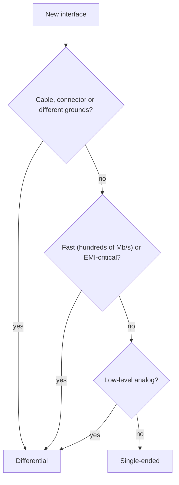

::: testing
Whether you can compare the two signalling styles cleanly: **what is measured** (one wire against a ground reference vs the voltage *between* two wires), what each costs and what each buys. The interviewer is looking for the reference-dependence point (single-ended signals break when grounds differ or move, differential ones do not), the noise, EMI and swing implications, and an honest accounting of the price: twice the pins and traces, matching rules and more complex drivers and receivers. A good answer ends with how you choose between them.
:::

::: why
Every interface decision (GPIO vs LVDS, I2C/SPI vs RS-485/CAN, on-board vs cable, slow vs fast) is a choice between these two styles. In an interview, being able to say "single-ended is cheap and fine for short, slow, local connections; differential wins when ground is noisy, cables are long or speeds are high" is a basic sign of system-level thinking. It also frames the follow-up questions about noise immunity and common-mode voltage ([[q0682]], [[q0683]]).
:::

::: concepts
- **Single-ended signal**: one conductor carries a voltage measured relative to a shared ground/reference.
- **Differential signal**: two conductors carry complementary voltages; information is $V_+-V_-$ ([[q0679]]).
- **Ground reference and ground offset**: single-ended levels are only meaningful relative to the receiver's ground ([[q0657]]).
- **Common-mode rejection**: a differential receiver ignores what is common to both wires ([[q0683]]).
- **Return current path**: single-ended returns through ground; differential pairs return through each other.
- **Swing and noise margin**: logic levels vs differential thresholds.
:::

::: answer
"A single-ended signal is one wire whose voltage is measured against ground. Think of a GPIO or an SPI clock: high is something like 3.3 V above the common ground, low is near 0 V. A differential signal uses two wires with opposite polarity, and the information is the voltage between them.

The practical difference is what each one depends on. A single-ended signal depends on the ground reference, so if the ground at the receiver is a few hundred millivolts different from the ground at the driver, or if noise couples onto the signal wire, the receiver sees a corrupted level. A differential signal doesn't care, because any shift or noise that is common to both wires disappears when you subtract them.

So differential gives you better noise immunity, tolerance to ground offsets, lower EMI because the currents cancel, and you can use smaller swings, which means faster and lower-power signalling. The price is two wires, two pins, matched routing, and a differential driver and receiver.

I'd use single-ended for short, slow, on-board connections where it's cheap and ground is solid. I'd use differential for long cables, noisy environments, and anything fast: USB, Ethernet, CAN, RS-485, LVDS, PCIe."
:::

::: technical
| Aspect | Single-ended | Differential |
|---|---|---|
| Signal definition | $V_{sig}-V_{gnd}$ | $V_+-V_-$ |
| Conductors per signal | 1 (+ shared ground) | 2 |
| Reference dependence | Strong: ground offset adds directly | Weak: offset is common-mode, rejected by CMRR |
| Noise pickup | Full coupled noise on the wire | Mostly common-mode, cancelled |
| Threshold | Fixed level (e.g. $V_{DD}/2$) | Crossing of the two legs ($V_d=0$) |
| Swing needed | Large (rail-to-rail) | Small (100 mV to ~2 V typical) |
| Signal amplitude for same per-wire swing | $V_s$ | $2V_s$ (+6 dB) |
| EMI | Return currents spread in the plane; larger loops | Equal/opposite currents; fields cancel |
| Ground bounce / SSN | Switching current through ground | Nearly constant supply current (current-steering) |
| Routing | Simple, single trace | Matched length, constant spacing, symmetric |
| Cost | Low | Higher: pins, board area, drivers/receivers |
| Typical use | GPIO, I2C, SPI, UART, on-board | USB, Ethernet, PCIe, LVDS, CAN, RS-485, audio balanced |

**Numerical illustration.** A ground offset $V_{off}=0.5$ V adds 0.5 V to a single-ended signal: a 3.3 V CMOS input with $V_{IH}=2.0$ V and $V_{IL}=0.8$ V loses much of its noise margin on one side (low level appears at 0.5 V, margin falls from 0.8 to 0.3 V to $V_{IL}$). For an LVDS pair, 0.5 V common-mode shift leaves $V_d=\pm0.35$ V unchanged; the receiver still needs $V_{cm}$ within its input range and its CMRR sets the residual.

**Noise coupling.** Interference of amplitude $v_n$ onto a single wire appears at the receiver at $v_n$. If it couples equally onto both wires of a pair, the differential error is $\approx v_n/CMRR$ (plus mode conversion from imbalance).

**When single-ended wins**: short on-board nets, low speed, tight cost, signals with a solid ground plane and no cable. **When differential wins**: cables, high speed, large ground differences (industrial), low-level analog (sensors, microphones), EMI-sensitive designs.

> [!NOTE]
> Some "single-ended" buses use a differential *receiver* with a reference (e.g. DDR with $V_{REF}$). They are still referenced to a supply or ground and have the single-ended drawbacks.
:::

::: short
"Single-ended means one wire measured against a shared ground; differential means two complementary wires and the signal is the voltage between them. Single-ended depends on the ground reference, so ground offset and noise on the wire go straight into the signal. Differential cancels anything common to both wires, tolerates ground shifts, has lower EMI because the currents cancel, and can use smaller, faster swings. The cost is two wires and matched routing, so I use single-ended for short slow nets and differential for cables, noisy environments and high speed."
:::

::: long
"A single-ended signal is one wire, and its value is the voltage between that wire and a reference, normally ground. A GPIO, an SPI clock, a UART line are all single-ended. A differential signal uses two wires that carry opposite polarity, and the value is the voltage between the two wires, V-plus minus V-minus.

The big distinction is reference dependence. A single-ended receiver has to compare the signal to its own ground. If the transmitter's and receiver's grounds differ by half a volt, or a nearby trace couples noise onto the wire, all of that adds straight into the signal. A differential receiver only looks at the difference between the wires. If the noise or the ground shift lands on both wires equally, which it does if they're routed together, it cancels out, up to the receiver's common-mode rejection and input range.

That has a few consequences. Differential gets better noise immunity and works across ground offsets, which is why RS-485 and CAN work on long cables between devices with different grounds. The signal is twice as big for the same swing per wire, so you can use small swings, 350 millivolts for LVDS, which gives lower power and faster edges. And because the currents are equal and opposite, the fields cancel, so EMI and ground bounce are lower.

The cost is real, though. Two traces and two pins per signal, a differential driver and receiver, length matching and symmetric routing, and termination. So I don't use it everywhere. Single-ended is perfectly good for short, slow, on-board nets over a solid ground plane. I'd go differential once there's a cable, a noisy environment, a ground offset, or a data rate where single-ended can't meet noise and EMI requirements."
:::

::: terms
- **Single-ended**: one signal wire referenced to ground.
- **Differential**: two complementary wires; information is their difference.
- **Ground offset**: voltage difference between driver and receiver grounds.
- **Common-mode noise**: interference appearing equally on both wires of a pair.
- **CMRR**: ability of a receiver to reject common-mode voltage.
- **Noise margin**: voltage tolerance before a logic level is misread.
- **Swing**: peak-to-peak voltage of the signal.
- **Return current**: current flowing back to the source to close the loop.
- **Pseudo-differential**: two single-ended wires compared by a differential receiver, without a truly complementary driver.
:::

::: exceptional
**An average answer** says "single-ended is one wire, differential is two, and differential is less noisy".

**An exceptional answer**:
- Defines each by what is measured: $V_{sig}-V_{gnd}$ vs $V_+-V_-$, and points to reference dependence as the root difference.
- Quantifies one case (e.g. 0.5 V ground offset shrinks single-ended noise margin but leaves $V_d$ unchanged).
- Covers EMI and return currents, +6 dB signal, small swings and constant supply current as secondary advantages.
- States the costs (pins, routing, matching, termination, cost) and when single-ended is the right answer.
- Notes the limit of differential: finite CMRR and common-mode range, and skew/imbalance.
:::

::: mistakes
- **"Differential is always better."** It costs pins, area and design effort; for a 100 kHz on-board GPIO it is overkill.
- **"Single-ended can't be fast."** Many fast single-ended buses exist (DDR data, SRAM), with careful termination and layout; they just need more care.
- **Forgetting the ground reference exists in differential links.** The receiver still needs $V_{cm}$ in its range; the ground reference is relaxed, not removed.
- **Saying differential doubles noise immunity.** The improvement depends on CMRR and symmetry; it can be 40 to 80 dB, or little if the pair is unbalanced.
- **Counting "twice the swing" as a free gain.** It is relative to the per-wire swing; it does not increase total power.
- **Assuming a pseudo-differential pair is truly differential.** If only one wire swings, you do not get cancellation of currents or doubling.
:::

::: deep
## What is actually measured

In a single-ended link, the receiver measures the voltage of one wire relative to its own ground pin:
$$V_{rx}=V_{wire}-V_{gnd,rx}.$$
The transmitter produced $V_{tx}=V_{wire}-V_{gnd,tx}$. The two agree only if $V_{gnd,tx}=V_{gnd,rx}$, which is only true when the ground path between them has negligible impedance and carries no current. Real ground paths have resistance and inductance, and they carry return currents, so
$$V_{rx}=V_{tx}+(V_{gnd,tx}-V_{gnd,rx})+v_{n}$$
where the middle term is ground offset (including ground bounce) and $v_n$ is coupled noise.

```circuit
{"caption":"Single-ended link: the receiver sees the signal plus the ground offset","elements":[
 {"t":"Vsq","a":[0,2],"b":[0,6],"label":"driver"},
 {"t":"wire","pts":[[0,2],[0,0],[14,0]]},
 {"t":"term","at":[14,0],"label":"V_{in} (vs. receiver ground)","side":"right"},
 {"t":"wire","pts":[[0,6],[0,9],[3,9]]},
 {"t":"V","a":[3,9],"b":[8,9],"label":"V_{off}","value":"0.5 V"},
 {"t":"wire","pts":[[8,9],[12,9]]},{"t":"gnd","at":[12,9]},
 {"t":"text","at":[5.5,11.2],"text":"ground-path offset (IR drop, bounce)","anchor":"middle","muted":true}
]}
```
Figure: The voltage across the receiver's input is the driver's output plus whatever voltage the ground path drops. With 0.5 V of offset, every level is shifted by 0.5 V. There is no way to separate offset from signal at the receiver because it only sees one wire.

In a differential link, the receiver measures $V_{rx}=V_+-V_-$ and both wires see the same ground offset, so $V_{rx}=V_d+(V_{off}-V_{off})=V_d$. The reference dependence has been *differenced out*.

## A numerical side-by-side

Take a 3.3 V single-ended LVCMOS link with $V_{IL}=0.8$ V and $V_{IH}=2.0$ V (typical-ish values; check the datasheet), and an LVDS link with 350 mV swing around 1.2 V common-mode and a receiver threshold of $\pm100$ mV. Both are subjected to a 0.5 V positive ground offset:

| | Single-ended | LVDS |
|---|---|---|
| Nominal levels | low 0 V, high 3.3 V | $V_d=\pm350$ mV |
| Levels at the receiver | low 0.5 V, high 3.8 V | $V_d=\pm350$ mV; $V_{cm}$ 1.7 V (within 0 to 2.4 V range) |
| Margin to threshold, low state | $0.8-0.5=0.3$ V (was 0.8 V) | $350-100=250$ mV (unchanged) |
| Margin, high state | 1.8 V (was 1.3 V; and the high may exceed the input's absolute max if the supply is 3.3 V) | 250 mV |

A 0.5 V offset eats 60% of the single-ended low-state margin; the differential margin does not change. Increase the offset to 1 V and the single-ended low level (1.0 V) is already above $V_{IL}$: the link is broken. The LVDS receiver would still be fine until the common-mode leaves its range.

```sim
{"id":"diff-signaling","noise":0.5,"skew":0}
```
Figure: Compare the single-ended and differential receiver outputs under the same 0.5 V disturbance. Then add skew to see where differential loses its advantage.

## Noise, EMI and return paths

- **Noise pickup**: a nearby aggressor couples a voltage $v_n$ into a trace. For a single-ended trace the full $v_n$ reaches the receiver. For a coupled pair, $v_n$ couples nearly equally to both traces and becomes common-mode.
- **Radiated EMI**: a single-ended signal returns through the ground plane, forming a current loop; the loop area (trace plus return path) sets radiation. A differential pair's two currents are equal and opposite, so the loop is the tiny area between the two traces and the far fields cancel. Radiation is determined by the *common-mode* current, which a balanced pair keeps small ([[q0518]]).
- **Supply current**: current-steering differential drivers draw almost constant current from the supply, so $L\,di/dt$ noise and ground bounce are small ([[q0688]]).

## Swing, speed and power

Because the receiver's threshold is the point where the two wires cross, no absolute voltage level is needed, so the swing can shrink to a few hundred mV. A smaller swing means less $C\,dV/dt$ current and faster edges for a given driver, which is why gigabit interfaces are differential. A 3.3 V single-ended swing at 1 Gb/s needs 3.3 V charging each trace capacitance; LVDS needs 0.35 V.

## Where the return current goes

A single-ended signal is half a circuit: the other half is the return current, which at high frequency flows in the plane directly beneath the trace, because that path has the smallest loop inductance. For a microstrip a height $h$ above its plane, the return current density falls off as $1/(1+(d/h)^2)$ with lateral distance $d$ from the trace; the fraction within $\pm w$ of the trace is $(2/\pi)\arctan(w/h)$. That is 80% within $\pm3h$ and 94% within $\pm10h$. So the return is tightly bound to the trace as long as the plane is continuous, and a slot or split in the plane forces it around the obstacle, enlarging the loop and the radiation. A differential pair does not depend on this: the return current of each leg is mostly the other leg, so a plane gap under a well-balanced pair is much less harmful (though common-mode current still needs a path). That is one reason differential links are tolerant of connectors and board transitions where single-ended ones are not.

## Cost accounting

For $N$ signals, single-ended uses $N$ wires plus one ground (often many ground pins/planes); differential uses $2N$ wires and shields/returns. The board space, connector pins and cable cost double. Routing must keep each pair matched in length (skew), spaced consistently (impedance), and symmetric, plus termination. Drivers and receivers are more complex (and often need level-matching and AC-coupling, e.g. PCIe, HDMI, DisplayPort).

## Choosing

1. Is there a cable or connector, or will grounds differ? Differential.
2. Is the data rate high enough that noise and EMI margins are tight (hundreds of Mb/s and up)? Differential.
3. Is the signal low-level analog (microphone, sensor bridge)? Differential/balanced.
4. Short, slow, on-board, solid ground plane, tight cost? Single-ended.
5. In between (e.g. 50 MHz SPI to a flash on the same board)? Single-ended, with series termination and a good return path.


Figure: A rough decision flow. The first question, grounds and cables, usually decides it.

> [!INTERVIEW]
> Always bring up the **reference** point. "Single-ended measures against ground, so it inherits every ground problem; differential measures between wires, so it ignores them." That one sentence usually satisfies the question and leads naturally to noise immunity.
:::

::: applications
- **Single-ended**: GPIO, SPI, I2C (open-drain), UART at logic levels, DDR data/address on-board with termination.
- **Differential**: USB, Ethernet, PCIe, SATA, HDMI/DisplayPort, LVDS displays/cameras, MIPI.
- **Industrial buses**: RS-485 and CAN across long cables with ground differences.
- **Analog**: microphones (XLR balanced), bridge sensors, differential ADC inputs.
- **Clocking**: differential clocks (LVPECL, LVDS, HCSL) to ADCs and SerDes for jitter and noise immunity.
- **Hybrid**: single-ended CMOS clocks with series termination on short on-board links.
:::

::: assumptions
- **Ideal reference/ground** in the single-ended case unless stated; real ground impedances create the problems described.
- **Differential receiver within its common-mode range** and with adequate CMRR.
- **Symmetric pair**: equal coupling and loading on each leg.
- **Typical logic thresholds** are examples; consult the actual logic family and receiver datasheets.
- Short, slow, same-board links can use either; the choice may come down to pin count, cost and legacy.

If the interviewer defines "differential" more broadly (e.g. a differential amplifier input measuring any two nodes), the same reasoning applies: the output depends on the difference of the inputs.
:::

::: followups
### What happens if only one leg of a differential pair swings (pseudo-differential)?
The difference still carries the signal, but the swing is half what a true complementary drive gives, and the currents no longer cancel, so there is net return current in ground and more EMI. Noise rejection on the receiver side still works (common-mode noise cancels), but you lose the 6 dB and the return-path benefits.

### A single-ended signal has 0.2 V of noise; a differential pair sees the same noise coupled equally. How do their errors compare?
Single-ended: 0.2 V directly. Differential: $0.2/CMRR$; with 40 dB (100) that is 2 mV, with 60 dB 0.2 mV. In practice imbalance limits the improvement, but 20 to 40 dB is routine.

### Why does RS-485 use differential signalling for long cables?
Remote nodes may have ground potentials differing by several volts due to ground currents in a building. A single-ended link would break; RS-485 receivers accept $-7$ to $+12$ V common-mode and look only at the difference (threshold $\pm200$ mV), and the twisted pair cancels coupled noise.

### Is a differential receiver connected to a single wire and a fixed reference differential signalling?
No, that is single-ended signalling with a differential receiver. It still depends on the reference; any noise or offset on the reference or the signal passes through. True differential needs both wires to carry the signal and noise to affect them similarly.

### What if the board has a ground plane split between two domains and the signal crosses it?
A single-ended signal would lose its return path and create a large loop, causing noise and EMI. A differential pair crossing the split is better (each leg is the other's return) but still creates a common-mode current that finds the larger loop; it is better to avoid the split or provide a bridge/stitching capacitor.
:::

::: interpretations
This question is asked from the **signals** perspective, as the section note says: what each signal type is and how they differ, not how to lay out the pair ([[q0518]] to [[q0521]]). Treat "signal" as any voltage waveform, including analog (balanced audio) and digital.
:::

::: references
- Horowitz & Hill, *The Art of Electronics*, 3rd ed.: single-ended vs differential amplifiers, balanced lines, common-mode rejection.
- Howard Johnson & Martin Graham, *High-Speed Digital Design*: differential signalling and ground-offset effects.
- Henry Ott, *Electromagnetic Compatibility Engineering*: balanced circuits and common-mode currents.
- TIA/EIA-485 and TIA/EIA-644 standards (RS-485, LVDS): interface levels and common-mode ranges (check current revisions).
:::

::: rubric
- Defines each style by what is measured (vs ground vs between wires) :: The root of every other difference.
- States the reference/ground-offset dependence of single-ended signals :: Core engineering insight.
- Explains common-mode rejection for differential :: The main benefit.
- Mentions EMI, return paths, swing/speed and +6 dB :: Broader advantages.
- States the costs (pins, routing, matching, complexity) :: Balanced judgement.
- Gives a quantified example (e.g. 0.5 V offset or CMRR calculation) :: Shows engineering rigour.
- Gives a selection guideline with examples :: Practical application.
:::

::: quiz
```json
[
 {"type":"mcq","level":"fundamental","q":"In a single-ended link, what does the receiver measure?","options":["The voltage between two signal wires","The voltage of one wire relative to its own ground","The current in the ground wire","The average of two wires"],"answer":1,"explain":"A single-ended receiver compares one wire to its local reference (ground), so any ground offset or noise on the wire adds directly to the signal."},
 {"type":"truefalse","level":"fundamental","q":"A ground offset of 0.5 V between driver and receiver changes the differential voltage of a differential link by 0.5 V.","answer":false,"explain":"The offset appears equally on both wires (common-mode) and cancels in $V_+-V_-$; it only has to stay within the receiver's common-mode range."},
 {"type":"numeric","level":"intermediate","q":"A differential receiver has 40 dB CMRR. Common-mode noise of 0.3 V is present. What error appears at the differential input, in mV?","answer":3,"tolerance":0.03,"unit":"mV","explain":"40 dB is a factor of 100: $0.3\\text{ V}/100=3$ mV."},
 {"type":"mcq","level":"intermediate","q":"Each wire of a differential pair swings 0.5 V peak-to-peak (complementary). What is the peak-to-peak differential voltage?","options":["0.25 V","0.5 V","1.0 V","2.0 V"],"answer":2,"explain":"$V_d=V_+-V_-$; when one leg goes up 0.5 V and the other down 0.5 V, the difference swings 1.0 V peak-to-peak (+6 dB relative to a single wire)."},
 {"type":"multi","level":"intermediate","q":"Select all advantages that differential signalling usually has over single-ended.","options":["Tolerance to ground offset","Lower radiated EMI","Fewer pins and traces","Smaller swing is acceptable"],"answer":[0,1,3],"explain":"Ground-offset tolerance, EMI reduction from cancelling currents and low-swing operation are standard benefits. It uses twice as many pins and traces, not fewer."},
 {"type":"mcq","level":"advanced","q":"An industrial network links nodes in different buildings with ground potentials differing by up to 5 V. Which choice is best for the data lines?","options":["3.3 V single-ended UART","Single-ended with a long ground wire","RS-485 differential over twisted pair","I2C with stronger pull-ups"],"answer":2,"explain":"RS-485 accepts common-mode from -7 V to +12 V and looks only at the difference. Single-ended options would see the 5 V offset directly in their logic levels."}
]
```
:::
