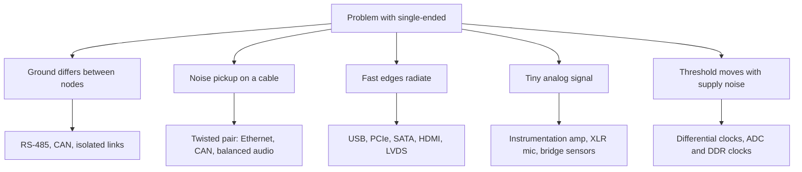

::: basics
### In plain words
Differential signaling sends a signal as the difference between two wires. Engineers use it when the signal has to survive noise, differences in ground voltage, or very high speed, or when the wires must not radiate much interference. Short, slow connections between nearby chips usually stay single-ended because they do not need the extra wire.

### Picture it
Picture a 100 m cable running through a factory past motors and welders. Each throws interference at the cable. With a twisted pair, the two wires sit almost in the same place, so the interference lands on both of them nearly equally. The receiver reads only the difference between the wires, so it barely notices. A single wire in that cable would pick up the full interference with nothing to cancel it.

### Words you need
- **Differential pair**: two wires carrying opposite signals, read as a difference ([[q0679]]).
- **Noise**: unwanted voltage from motors, radios or other circuits.
- **Ground offset**: the ground at one end of a long cable can sit at a different voltage from the ground at the other end.
- **Common-mode rejection**: a receiver's ability to ignore what both wires share ([[q0682]]).
- **EMI**: unwanted radio-frequency energy that a circuit gives off or picks up.

### The simplest example
Two machines on a factory floor talk over an RS-485 link, a standard for long industrial cables. One drives at least 1.5 V between the two wires. Their grounds differ by 3 V, so both wires sit 3 V higher at the far end. The difference is still 1.5 V. The receiver accepts shifts from -7 V to +12 V, so it still reads the data correctly.

A single-ended 3.3 V signal with a 3 V ground shift would be badly corrupted.

That is the whole idea: pay for a second wire when noise, ground differences or speed are the problem. The rest of this page covers the main use cases and standards, and when not to use it.
:::

::: testing
Whether you can connect the properties of differential signalling to **real interfaces and design situations**: which standards use it, and which problem each use case solves (noise, ground offset, speed, EMI, low-level analog). The interviewer is not after a memorized list; they want you to say *why* each application chose differential, and to know when it is not worth it. Examples with specifics (USB, Ethernet, CAN, RS-485, LVDS, PCIe, HDMI, balanced audio, differential ADC inputs) show breadth.
:::

::: why
Interface selection is a core system-design skill. Knowing that CAN and RS-485 are differential because of long cables and ground offsets, that PCIe and HDMI are differential because of data rate and EMI, and that microphones and bridge sensors use differential/balanced connections because the signal is tiny, lets you pick the right interface for a project and defend it. It also tells you which layout and termination rules to expect when you meet one on a board.
:::

::: concepts
- **Differential vs single-ended** and what each depends on ([[q0680]]).
- **Common-mode rejection** is the property being purchased ([[q0682]], [[q0683]]).
- **Ground offset tolerance** in long or multi-building links.
- **Speed and swing**: small-swing differential allows high data rates with low EMI.
- **Balanced analog signals**: microphones, bridge sensors, instrumentation.
- **Termination and impedance**: differential interfaces specify $Z_{diff}$ ([[q0679]]).
:::

::: answer
"Differential signalling gets used wherever noise, ground offsets, speed, or EMI are a problem, which is most of the interesting interfaces.

There are a few categories. First, long cables and noisy environments: RS-485, CAN, and Ethernet on twisted pair. The nodes can have different ground potentials and the cable picks up interference, so you need the common-mode rejection. Second, high-speed digital links: USB, PCIe, SATA, HDMI and DisplayPort, LVDS displays and camera interfaces. At those rates single-ended swings would cause too much EMI and be too sensitive to noise, so they use small differential swings and controlled impedance pairs. Third, low-level analog signals: microphones, which use balanced XLR cables, and sensors like bridges and thermocouples, which use differential amplifier inputs, because the signal is millivolts and the noise is much bigger, but common-mode. And fourth, precision conversion: differential ADC inputs and clock distribution, where you want the extra 6 dB, lower even-order distortion and rejection of supply noise.

I wouldn't use it for short, slow, on-board lines like a GPIO or an I2C bus. The extra pins and routing aren't worth it there."
:::

::: technical
**Why choose differential** (each reason maps to a mechanism):
1. **Common-mode noise rejection** over cables and across boards: $V_{err}\approx V_{noise}/CMRR$.
2. **Ground-offset tolerance**: receiver common-mode range (RS-485 $-7$ to $+12$ V; LVDS about 0 to 2.4 V).
3. **High speed with low swing**: small $\Delta V$ reduces $C\,dV/dt$ current and EMI; typical swings 200 to 800 mV.
4. **Low EMI and low ground bounce**: equal and opposite currents.
5. **+6 dB** signal for a given per-leg swing; better SNR in analog chains.
6. **Even-order distortion cancellation** (analog, fully-differential amplifiers and ADCs).
7. **Supply-noise rejection** (PSRR improves because supply noise is common-mode).

**Typical interfaces** (levels quoted are typical; check the standard):
| Interface | Pair | Notes |
|---|---|---|
| USB 2.0 | D+/D- | 90 Ω differential; differential receiver; high-speed signalling uses about 400 mV swing |
| Ethernet (10/100/1000BASE-T) | twisted pairs + magnetics | transformer isolates and rejects common-mode |
| RS-485 | A/B | $\ge$1.5 V differential into 54 Ω; threshold $\pm200$ mV; $-7$ to $+12$ V common-mode |
| CAN | CANH/CANL | dominant $V_d\approx2$ V (CANH ~3.5 V, CANL ~1.5 V); 120 Ω terminations |
| LVDS | P/N | 350 mV swing, 1.2 V common-mode, 100 Ω |
| PCIe, SATA | TX/RX pairs | AC-coupled, controlled impedance, multi-Gb/s |
| HDMI (TMDS), DisplayPort | data lanes + clock | differential, controlled impedance |
| DDR clock/strobe | CK/CK#, DQS/DQS# | differential timing references on single-ended data buses |
| Balanced audio | XLR hot/cold | microphones, long runs, rejects hum |
| Instrumentation | sensor bridge, thermocouple | differential amplifier, low-level |
| ADC inputs/clocks | VIN+/VIN-, CLK+/CLK- | high-resolution, high-speed ADCs |

**When not to**: short, slow, on-board links with solid ground and tight cost/pin budget (GPIO, I2C, simple SPI).

> [!UNCERTAIN]
> Interface voltage levels and impedances above are the commonly cited values. Exact specifications (and tolerances) depend on the standard revision and speed mode; verify against the spec before designing.
:::

::: short
"Differential signalling is used wherever noise, ground offset, speed or EMI matter. Long cables and different grounds: RS-485, CAN, Ethernet. High-speed links: USB, PCIe, SATA, HDMI, LVDS, where small differential swings give low EMI. Low-level analog: balanced microphone lines and sensor bridges, where the signal is tiny and noise is common-mode. And precision ADC inputs and clocks. I would not bother for short, slow on-board nets like GPIO or I2C."
:::

::: long
"I'd group the uses by the problem they solve.

The first is long cables and electrically noisy places. RS-485, CAN, and Ethernet are the standard examples. The nodes are metres to kilometres apart, so their grounds differ by volts and the cable picks up noise from motors and power lines. A differential receiver ignores anything common to both wires; RS-485 tolerates minus 7 to plus 12 volts of common-mode, and CAN uses a twisted pair with 120 ohm terminations. Ethernet adds transformers, which also give isolation.

The second is high-speed digital. USB, PCIe, SATA, HDMI, DisplayPort, LVDS camera and display links. At hundreds of megabits to tens of gigabits, a full-swing single-ended signal would radiate too much and couldn't hold its threshold in the presence of supply and ground noise. A differential pair with a swing of a few hundred millivolts, a controlled 85 to 100 ohm impedance, and equal and opposite currents gives low EMI and a clean threshold. Memory systems use it for clocks and strobes even when data is single-ended.

The third is low-level analog. A microphone produces millivolts, and the cable runs past mains wiring. Balanced XLR carries the signal as hot and cold, and the preamp subtracts, cancelling hum. The same idea applies to bridge sensors, thermocouples and biopotential electrodes with an instrumentation amplifier.

The fourth is precision conversion: differential ADC inputs and clocks, which give 6 dB more signal, cancel even-order distortion, and reject supply noise.

And where I wouldn't use it: short, slow on-board nets, where two pins, two traces and matching aren't worth it."
:::

::: terms
- **RS-485**: differential multipoint serial standard for long industrial cables.
- **CAN**: differential automotive/industrial bus with dominant and recessive states.
- **LVDS**: low-voltage differential signalling, about 350 mV swing, 100 Ω.
- **TMDS**: transition-minimized differential signalling used by HDMI/DVI.
- **Balanced line**: two conductors with equal impedance to ground, carrying signal differentially (e.g. XLR).
- **Instrumentation amplifier**: differential amplifier with high CMRR and high input impedance for sensors.
- **Fully differential amplifier**: differential in and out, with a common-mode feedback loop.
- **AC coupling**: capacitors in series with each leg to block DC and set common-mode at the receiver.
- **Magnetics**: transformers/chokes used on Ethernet and similar interfaces.
:::

::: exceptional
**An average answer** lists "USB, Ethernet, HDMI, CAN" and says "because of noise".

**An exceptional answer**:
- Groups uses by the problem (ground offset and long cable, speed/EMI, tiny analog signals, precision conversion) and ties each to a property of differential signalling.
- Gives specifics: RS-485 common-mode range, CAN dominant/recessive, LVDS 350 mV and 100 Ω, balanced microphone.
- Mentions both digital and analog usage, including differential ADC inputs and clocks.
- Says when *not* to use it (short, slow, on-board) and why (cost, pins, routing).
- Mentions practical companions: controlled impedance, termination, AC coupling, magnetics, common-mode chokes.
:::

::: mistakes
- **"Only for high speed."** RS-485 and CAN are slow (kb/s to Mb/s) but differential because of cable length and ground offset.
- **"It removes the need for a ground."** The receiver still needs a common-mode range; many links also share a ground or have a drain wire.
- **Mixing up "differential" with "twisted pair".** Twisting helps keep pickup equal on both wires; it is not the same as differential signalling.
- **Assuming all differential interfaces are 100 Ω.** USB is 90 Ω, CAN/RS-485 are 120 Ω, some PCIe use 85 Ω.
- **Using differential on a board but not matching lengths.** The benefits shrink with skew and imbalance ([[q0520]]).
- **Ignoring AC coupling and common-mode requirements** (PCIe, HDMI) when connecting different interfaces.
:::

::: deep
## The decision is about what goes wrong with single-ended

Each use case of differential signalling is a way of fixing one failure of single-ended signalling. The cleanest way to remember them is to list the failures:

1. **The ground is not the same ground** (distance, ground currents).
2. **The wire is an antenna** (picks up or radiates interference).
3. **The threshold floats** (supply and ground noise move $V_{DD}/2$).
4. **The signal is tiny** (microvolts to millivolts against a noisy world).
5. **Swing is expensive** (capacitance charging, EMI, speed).


Figure: Each branch is a problem; each leaf is where differential signalling shows up. Many interfaces solve several at once.

## Category 1: long cables and ground offsets

Take RS-485. A cable of several hundred metres carries a differential signal on a twisted pair terminated with 120 Ω at each end. Ground currents (from motors, loads, the building) develop voltage differences between nodes of a few volts. RS-485 transceivers accept common-mode from $-7$ to $+12$ V, a 19 V window, and decide on the difference with a threshold of $\pm200$ mV. A single-ended UART over the same cable would see the ground offset directly in its logic levels.

CAN works similarly. In the dominant state CANH is about 3.5 V and CANL about 1.5 V (difference about 2 V); in the recessive state both sit near 2.5 V (difference near 0). A node's ground can shift and both wires move together; the receiver decides on the difference (roughly a threshold in the 0.5 to 0.9 V range). Because the bus has dominant and recessive states, the differential levels also implement the bitwise arbitration wired-AND.

Ethernet over twisted pair adds transformers: the magnetics provide galvanic isolation, block DC, and further reject common-mode, so a link can span buildings with different ground potentials.

## Category 2: high-speed digital links

The data rates (hundreds of Mb/s to tens of Gb/s) mean edges of tens to hundreds of picoseconds. A single-ended signal at that speed needs a large swing for noise margin, and the resulting $dV/dt$ and loop currents would radiate heavily ([[q0674]]). Differential links use small swings: LVDS 350 mV; PCIe and SATA a few hundred mV to about a volt depending on the generation. Because the return current is the other wire, each pair has a small loop; because the receiver thresholds on the difference, supply and ground noise are rejected; and because the swing is small, driver power and crosstalk are low.

These links also tend to use **AC coupling** (a series capacitor in each leg) so that the transmitter and receiver common-mode levels can differ, and **embedded clocks / encoding** so there is no separate clock wire to skew.

```sim
{"id":"diff-signaling","noise":0.3,"skew":0.1}
```
Figure: Increase skew to see the loss of benefit: at high speeds, skew of a few picoseconds starts to matter, which is why these standards specify intra-pair skew limits.

## Category 3: low-level analog

A dynamic microphone outputs a few millivolts. The cable runs for tens of metres next to mains wiring that couples 50/60 Hz and its harmonics, volts of hum, nearly equally onto both conductors. A balanced line (XLR: hot, cold, shield) presents equal impedance to ground on each conductor, so the induced hum is common-mode. The preamp's differential input subtracts, achieving 60 to 80 dB of rejection. For a hum of 100 mV and a 70 dB CMRR the residual is about 32 µV, small against a mV-level signal.

The same logic applies to **bridge sensors** (strain gauges, load cells), thermocouples and ECG/EEG electrodes. The bridge output is a small difference on top of a large common-mode level (half the excitation). An **instrumentation amplifier** with 100 dB CMRR extracts it.

## Category 4: precision conversion and clocking

High-resolution ADCs have differential inputs because the pair gives 6 dB more full-scale signal for the same per-leg swing, cancels even-order harmonic distortion in the driving amplifier (fully differential amplifier), and rejects supply noise. Sample clocks are often differential (LVDS, LVPECL, HCSL) because a single-ended clock's threshold moves with supply and ground noise, which becomes jitter ($\Delta t=v_n/\text{slew}$) and degrades SNR at high input frequency. DDR memory uses a differential clock and data strobe for the same reason, even though data is single-ended.

## When *not* to

For a 400 kHz I2C bus between a microcontroller and a sensor on the same board, differential would double pin count and board area with no benefit: ground is a solid plane, the signal is slow, and noise margin is large. The same goes for SPI at a few MHz on a board. When the same bus goes off-board over a cable (long I2C, for example), people use a differential I2C extender or switch to CAN/RS-485. The decision tracks the problem ([[q0680]]).

## Practical companions

- **Controlled impedance** pairs and termination (100 Ω, 90 Ω, 120 Ω by standard).
- **Common-mode chokes** and shielding at connectors (USB, Ethernet, HDMI) for EMI.
- **ESD protection** arrays with low capacitance on each leg.
- **AC coupling capacitors** and bias networks where the standard requires them.
- **Length and skew matching** between the legs and between pairs/lanes ([[q0520]]).

> [!INTERVIEW]
> When asked "when are differential signals used", answer with **problems**, not just names: "when ground differs, when the cable is noisy, when it is fast enough to radiate, when the signal is tiny". Then name an interface for each. It shows you chose the architecture, not the part.
:::

::: applications
- **Industrial automation**: RS-485 (Modbus, Profibus) and CAN (CANopen) networks.
- **Automotive**: CAN, CAN FD, FlexRay and automotive Ethernet on twisted pair.
- **Consumer and PC**: USB, HDMI/DisplayPort, PCIe, SATA.
- **Embedded vision/display**: MIPI and LVDS camera and panel interfaces.
- **Pro audio**: balanced XLR microphone and line connections.
- **Instrumentation**: bridge sensor amplifiers, ECG, thermocouple front-ends.
- **Data conversion**: differential ADC/DAC and clock distribution.
:::

::: assumptions
- Standard-specific numbers (levels, impedances, ranges) are typical and vary by revision and mode.
- The decision to use differential also depends on cost and pin availability, not only technical merit.
- "Used" means as the main signalling method; some interfaces mix (DDR has single-ended data and differential clock).
- Balanced/differential analog assumes equal source/line impedances on each leg, otherwise common-mode converts to differential.
- Long-distance links often add isolation, which is related but separate from differential signalling.

Alternative answer: some interviewers want the *physical* answer ("whenever you need common-mode noise rejection"). The first-principles view is that differential signalling is selected for each of the five failures listed above.
:::

::: followups
### Why is CAN differential, and what are its bus levels?
CAN is used in vehicles and machinery with large ground shifts and strong electrical noise. It uses a twisted pair (CANH, CANL) terminated with 120 Ω at both ends. Dominant state: CANH about 3.5 V, CANL about 1.5 V (about 2 V difference). Recessive: both about 2.5 V (near 0 V difference). The receiver works on the difference, so a common-mode shift of a few volts does not corrupt the bit.

### What is the common-mode range of an RS-485 receiver, and why is it so wide?
About $-7$ V to $+12$ V. It is wide because nodes at the ends of a long cable can have ground potentials differing by several volts, and the link must still decode a differential signal of at least $\pm200$ mV.

### Why do ADCs have differential inputs?
A differential drive gives 6 dB more full-scale amplitude for the same per-leg swing, cancels even-order distortion from the driver, rejects supply and ground noise, and is easy to AC-couple through a transformer or balun. At high resolution and bandwidth these benefits are worth the extra pin.

### A product has an on-board 100 kHz sensor bus and a 3-metre cable to a motor driver. Which signalling would you pick for each?
On-board: I2C or SPI single-ended; solid ground plane, slow, low cost. 3-metre cable in a motor environment: differential (RS-485 or CAN), perhaps with isolation, because of ground offsets and inductive noise from the motor.

### What if a differential interface is routed on a board with a poor ground plane?
The pair is less sensitive to the plane than single-ended, but the common-mode current that results from imbalance, skew, or an asymmetric environment still needs a return path. A bad plane (splits, gaps) leads to common-mode radiation, EMI failures and mode conversion. Keep the pair over a continuous plane and symmetric.
:::

::: interpretations
"When are they often used?" is a continuation of Q679/Q680, so "they" means differential pairs/signals. The question can be answered at the interface level (USB, CAN, etc.) or the problem level (noise, ground offset, speed). This page gives both.
:::

::: references
- TIA/EIA-485 and ISO 11898 (CAN) standards and transceiver datasheets: signalling levels and common-mode ranges.
- TIA/EIA-644 (LVDS) and TI's LVDS application material: swing, common-mode and termination.
- Horowitz & Hill, *The Art of Electronics*, 3rd ed.: instrumentation amplifiers and balanced lines.
- Howard Johnson & Martin Graham, *High-Speed Digital Design*: differential signalling in high-speed buses.
:::

::: rubric
- Names several real interfaces/applications :: Shows breadth and practical knowledge.
- Ties each to the problem it solves (ground offset, noise, speed/EMI, tiny signals) :: Shows understanding of why, not memorization.
- Includes both digital and analog uses :: Complete coverage.
- Gives specifics (levels, common-mode ranges, impedances) :: Demonstrates real familiarity.
- Mentions practical companions (termination, chokes, AC coupling, magnetics) :: Practical engineering depth.
- States when single-ended is the better choice :: Balanced judgement.
:::

::: quiz
```json
[
 {"type":"mcq","level":"fundamental","q":"Which of these interfaces is NOT typically differential?","options":["USB 2.0 data lines","RS-485","CAN","A standard I2C bus on one board"],"answer":3,"explain":"I2C is a single-ended open-drain bus intended for short on-board connections. USB, RS-485 and CAN use differential pairs."},
 {"type":"mcq","level":"fundamental","q":"Why is RS-485 differential?","options":["To reduce pin count","To tolerate large ground-potential differences and noise over long cables","To allow full-duplex over one wire","To save power only"],"answer":1,"explain":"RS-485 nodes can be far apart with different ground potentials; differential receivers with a wide common-mode range ($-7$ to $+12$ V) decode the difference."},
 {"type":"numeric","level":"intermediate","q":"A balanced microphone line picks up 80 mV of hum equally on both wires. The preamp has 70 dB CMRR (a factor of about 3162). What hum remains at the input, in µV?","answer":25.3,"tolerance":0.03,"unit":"µV","explain":"$80\\text{ mV}/3162=25.3$ µV."},
 {"type":"numeric","level":"intermediate","q":"In the CAN dominant state, CANH is 3.5 V and CANL is 1.5 V. What is the differential voltage, in V?","answer":2,"tolerance":0.02,"unit":"V","explain":"$V_d=3.5-1.5=2.0$ V."},
 {"type":"multi","level":"intermediate","q":"Select all situations where differential signalling is a strong choice.","options":["A 3-metre cable between a motor driver and controller in a noisy plant","A 400 kHz sensor bus between two chips on a board","A 5 Gb/s serial link on a PCB","A millivolt bridge sensor connected through a long cable"],"answer":[0,2,3],"explain":"Noise and ground offset (motor cable), high speed (serial link) and low-level analog (bridge sensor) are the classic reasons. A slow on-board bus does not need it."},
 {"type":"truefalse","level":"advanced","q":"Differential signalling is only useful at high data rates.","answer":false,"explain":"RS-485, CAN and balanced audio are low-rate (or analog) but use differential signalling for ground-offset and noise tolerance. Speed is one reason, not the only one."}
]
```
:::
