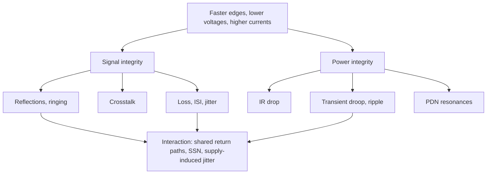

::: basics
### In plain words
Signal integrity (SI) asks whether a signal arrives at the receiver intact: the right voltage, at the right time, with a clean shape. Power integrity (PI) asks whether a chip gets a steady supply voltage even when its demand for current suddenly jumps. They are linked: a noisy supply spoils signals, and switching signals make supply noise.

### Picture it
Think of a house's water system. Sending a pulse down a pipe and getting a clean pulse out the other end is signal integrity. Keeping the water pressure steady at one tap when a neighbor flushes a toilet is power integrity. A sudden flush makes pressure sag everywhere on that line. Likewise, a chip's sudden current demand makes the supply voltage sag, and that sag can shift the moment the chip's outputs switch.

### Words you need
- **Signal integrity (SI)**: signals arriving with the right level, timing and shape.
- **Power integrity (PI)**: the supply staying within its allowed voltage range.
- **Reflection**: part of a signal bouncing back from an abrupt change in the wire ([[q0711]]).
- **Crosstalk**: a signal leaking into a neighboring wire ([[q0694]]).
- **Decoupling capacitor**: a small energy store placed next to a chip that supplies sudden bursts of current ([[q0501]]).

### The simplest example
A chip runs from a 1 V supply that may only wobble by 3%, which is 30 mV. Its demand suddenly jumps by 10 A. The supply path, capacitors included, behaves like a small resistance R (engineers call it impedance), and it drops 10 A × R. To stay within 30 mV, R must be at most 30 mV / 10 A = 3 mΩ. No single capacitor is that good, which is why PI uses many decoupling capacitors side by side.

Meanwhile, SI covers the signals leaving that chip: reflections, crosstalk and timing. If the supply sags, the chip's output edges shift in time, which shows up as timing error called jitter ([[q0695]]).

That is the whole idea: clean signals need a clean supply. The rest of this page lists the main SI and PI effects and how they interact.
:::

::: testing
Whether you can define signal integrity (SI) and power integrity (PI) as **two linked halves of one problem**, give concrete examples of what each covers, and explain why they matter now: lower voltages, faster edges, higher currents and tighter noise budgets mean old rules of thumb stop working. A strong answer lists the SI effects (reflections, ringing, crosstalk, loss and ISI, jitter, skew, ground bounce), the PI effects (DC drop, ripple, transient droop, resonances, decoupling), explains the target-impedance idea with a number, and says how they interact (noise on the supply becomes jitter on the signal; return-path discontinuities cause both).
:::

::: why
A board that passes its schematic review can still fail because a bus rings, a rail droops when the CPU wakes up, or a clock jitters from supply noise. SI/PI is the discipline of preventing and diagnosing those failures *before* the board is built, using calculation, simulation and measurement. Respinning a high-speed board costs weeks and tens of thousands of dollars, and many interfaces (DDR, PCIe, USB, HDMI) cannot be made to work at all without it. In interviews, a short, correct, quantitative answer shows you have the right mental model for high-speed design.
:::

::: concepts
- **Transmission lines and reflections**: edges see impedance, not just wires ([[q0708]], [[q0711]]).
- **Crosstalk, ringing, jitter**: the main SI effects ([[q0694]], [[q0695]], [[q0696]]).
- **Rise time and bandwidth**: why faster edges bring SI problems ([[q0676]], [[q0677]]).
- **Decoupling and target impedance**: the PI design rule ([[q0501]], [[q0509]]).
- **Return paths and ground bounce**: where SI and PI meet ([[q0688]]).
- **Supply ripple and spikes**: how PI is characterised ([[q0704]], [[q0705]], [[q0707]]).
:::

::: answer
"SI and PI are the two halves of making a high-speed board actually work.

Signal integrity is about whether a signal arrives at the receiver intact: the right voltage at the right time. The things that can go wrong are reflections from impedance mismatches, ringing, crosstalk between traces, loss and distortion in the channel, timing jitter and skew, and ground bounce. They all get worse as edges get faster, because the edge then sees every trace as a transmission line.

Power integrity is about delivering a clean, stable supply to the chips: DC drop through the planes and connectors, ripple from the regulator, and especially the transient droop when a processor or FPGA suddenly demands current. The design target is a power distribution network whose impedance stays below a target of allowed voltage ripple divided by the transient current. For a 1 V rail with 3 percent ripple and a 10 A step, that's 3 milliohms, from DC up to the frequencies the chip switches at. You do that with the regulator, bulk capacitors, many ceramic decoupling capacitors, and the plane pair.

They're linked. Noise on the supply modulates driver and receiver timing, so it becomes jitter on the signal. Switching currents flowing through shared ground and supply inductance disturb other signals. And a signal that crosses a plane split has a broken return path, which is both an SI and a PI problem.

They matter because voltages are low, so noise margins are tens of millivolts, edges are fast, and currents are big. A board that violates these rules may work on the bench and fail with temperature, or never boot at all."
:::

::: technical
**Signal integrity (SI)**: quality of the signal as seen at the receiver. Typical effects and rules:
- **Reflections**: reflection coefficient $\Gamma=(Z_L-Z_0)/(Z_L+Z_0)$. A line is a transmission line when its delay exceeds about $t_r/6$ (about 1 in for 1 ns edges in FR4). Fix: controlled impedance, termination.
- **Ringing/overshoot**: parasitic LC resonance excited by fast edges ([[q0696]]).
- **Crosstalk**: coupling $\propto dV/dt$ and $dI/dt$; reduced by spacing (3W), ground planes ([[q0694]]).
- **Loss and ISI**: skin effect and dielectric loss attenuate high frequencies; closes the eye ([[q0722]], [[q0723]]).
- **Jitter and skew**: timing error from noise, ISI, supply modulation ([[q0695]]).
- **Ground bounce/SSN**: $V=N L\,di/dt$ ([[q0688]]).
- **Metrics**: eye diagram, TDR, S-parameters, BER ([[q0698]]).

**Power integrity (PI)**: quality of the power delivery to the load.
- **DC**: IR drop $=I R_{path}$. 10 A through 5 mΩ is 50 mV, 5% of a 1 V rail.
- **AC**: PDN impedance $Z_{PDN}(f)$ must satisfy $Z_{PDN}\le Z_{target}=\dfrac{V_{rail}\cdot\text{ripple}\%}{\Delta I_{transient}}$ over the frequency range of load activity. Example: 1 V, 3%, 10 A: $0.03/10=3\ \text{m}\Omega$.
- **Structure**: VRM (to about 100 kHz to 1 MHz), bulk capacitors, ceramic decoupling (to tens of MHz, limited by mounting inductance), plane capacitance and package/die capacitance (above).
- **Resonances**: anti-resonance peaks between capacitor families; damped by ESR or by choice of values ([[q0506]], [[q0512]]).
- **Sequencing and noise**: rails power up in order; supply ripple and spikes characterised on the scope ([[q0705]], [[q0706]], [[q0707]]).

**Coupling between them**: supply noise $v_{n,PDN}$ modulates gate delay; delay sensitivity of order a few ps per 10 mV in a high-speed driver (device dependent) becomes supply-induced jitter. Return current discontinuities (via transitions, plane splits) change the loop inductance and radiate.

> [!UNCERTAIN]
> Supply sensitivity of delay/jitter (ps per mV) is device- and process-specific. Use the vendor's data or a measurement; the example above is an order of magnitude only.
:::

::: short
"Signal integrity is whether a signal arrives intact: reflections, ringing, crosstalk, loss, jitter and ground bounce. Power integrity is whether the chips get a clean, stable supply: IR drop, ripple, and transient droop, handled by designing the power delivery network impedance below a target of allowed ripple over transient current. They are linked, because supply noise becomes jitter and shared return paths couple signals. They matter because voltages are low, edges are fast and currents are large, so margins are tens of millivolts and picoseconds."
:::

::: long
"SI and PI are the two sides of getting a high-speed board to work in practice.

Signal integrity is about the quality of the signals themselves. A fast edge doesn't just travel along a wire, it travels along a transmission line with a characteristic impedance, and anything that changes that impedance, like a stub, a via, a connector, or a load, reflects part of the edge. That causes ringing and overshoot. Neighbouring traces couple into each other, which is crosstalk. The channel itself has loss, so high frequencies are attenuated and the eye closes. And noise turns into timing error, which is jitter. All of those get worse as the rise time gets shorter, because the edge then resolves features it used to ignore.

Power integrity is about the supply. The chip demands current in sharp steps, and the board has to supply that without the rail moving more than a few percent. There's an IR drop at DC, regulator ripple, and above all the transient droop. The design rule is the target impedance: allowed ripple voltage divided by transient current. For a 1.0 volt rail with 3 percent allowed and 10 amps of step, that's 3 milliohms, and the power delivery network has to stay under that from DC up to tens or hundreds of MHz. I do that with the regulator, bulk capacitors, a ladder of ceramic capacitors placed close with low-inductance connections, and the plane capacitance.

The reason they're considered together is that they interact. Supply noise shifts the switching thresholds and delays, so it becomes jitter. Simultaneous switching pushes current through shared ground and supply inductance and disturbs quiet signals. And a return path interrupted by a plane split is an SI problem and an EMI problem.

Why it matters: rails are at 1 volt or below, so noise margins are tens of millivolts, interfaces run at gigabits, and the cost of a respin is high. So I'd rather simulate and follow layout rules than debug a marginal board on the bench."
:::

::: terms
- **Signal integrity (SI)**: the quality of signals at the receiver: amplitude, timing and shape.
- **Power integrity (PI)**: the quality of the power delivered to the loads.
- **Characteristic impedance ($Z_0$)**: ratio of voltage to current of a travelling wave on a line.
- **Reflection coefficient ($\Gamma$)**: fraction of an incident wave reflected at an impedance step.
- **Crosstalk**: unwanted coupling between nearby signals.
- **Jitter**: timing deviation of edges from their ideal positions.
- **PDN (power distribution network)**: regulator, planes, decoupling capacitors, package and die.
- **Target impedance**: $Z_{target}=\Delta V_{allowed}/\Delta I$, the maximum PDN impedance allowed.
- **SSN / ground bounce**: disturbance when many outputs switch together.
- **Eye diagram**: overlay of many bit periods showing timing and voltage margins.
:::

::: exceptional
**An average answer** says "SI is signal quality, PI is power quality, both matter for high-speed boards".

**An exceptional answer**:
- Defines each with specific effects and a metric (eye diagram, TDR; PDN impedance vs target).
- Gives the target-impedance formula with a worked example (1 V, 3%, 10 A gives 3 mΩ) and the IR-drop example.
- Explains why now: faster edges (transmission-line behaviour at shorter lengths), lower voltages and bigger currents.
- Describes the interactions: supply noise to jitter, SSN, return-path discontinuities.
- Names the practical toolbox: controlled impedance and termination, stack-up and plane design, decoupling strategy, simulation (pre/post-layout), and measurement (TDR, VNA, scope).
- Acknowledges what can't be computed by hand and where simulation is needed.
:::

::: mistakes
- **Treating SI and PI as separate.** They share the return path and the supply; noise crosses between them.
- **Thinking decoupling is "a capacitor near each pin".** It is a network whose impedance vs frequency must meet a target, with resonances and mounting inductance to manage ([[q0509]]).
- **Only checking DC.** A rail that measures 1.00 V on a meter can droop 100 mV for 1 µs under load.
- **Thinking SI problems appear only at GHz.** A 1 ns edge on a 5 cm trace needs care; slow clocks with fast edges still ring.
- **Believing simulation replaces measurement.** Models are only as good as inputs (stack-up, materials, package models); correlation is needed.
- **Ignoring the return path.** Signals are loops; a good trace over a broken plane is a bad link.
:::

::: deep
## Why this field exists

Three trends created SI/PI as a discipline:

1. **Edges got faster.** An edge of rise time $t_r$ has spatial length $\ell=t_r/t_d$ on the board. At 1 ns in FR4 (about 170 ps/in) that is about 6 in; at 100 ps it is 0.6 in. Once the trace is longer than about $\ell/6$, it must be treated as a transmission line with a defined impedance and termination ([[q0709]], [[q0711]]).
2. **Voltages dropped.** A 5 V logic system had volts of noise margin; a 1.0 V core rail with a 3% tolerance has 30 mV. The allowed noise did not scale with the signals, so the same physical noise now matters.
3. **Currents rose.** Processors draw tens to hundreds of amps with slew rates of hundreds of A/µs. $L\,di/dt$ through nanohenries of connection inductance is no longer negligible: 1 nH and 1 A/ns is 1 V.


Figure: SI and PI are driven by the same trends and meet in the return path and the supply. Supply noise becomes jitter; switching current becomes ground bounce.

## Signal integrity in one paragraph of physics

A fast edge launches a wave onto a line. The wave sees the line's characteristic impedance $Z_0=\sqrt{L'/C'}$, set by geometry (trace width, dielectric height, $\varepsilon_r$). At any impedance step, a fraction $\Gamma=(Z_2-Z_1)/(Z_2+Z_1)$ is reflected. A 50 Ω trace driving an open end has $\Gamma=+1$, so the receiver sees double the voltage at first and the reflection bounces back and forth, ringing with period $4t_d$ for an open end. Terminating at the source with $R_s=Z_0-R_{driver}$, or at the load with $Z_0$, cuts the reflections ([[q0716]]). Crosstalk is the same physics applied to two lines sharing mutual capacitance and inductance ([[q0694]]). Loss is the frequency dependence of the line (skin effect $\propto\sqrt f$, dielectric loss $\propto f$) that attenuates and disperses the edge and produces ISI ([[q0722]]). Jitter is what remains of all of it in the timing domain ([[q0695]]).

```sim
{"id":"tline-lab","z0":50,"rs":10,"rl":"open","td":1e-9,"tr":1e-10,"term":"none"}
```
Figure: A 10 Ω driver into an open 50 Ω line: the load voltage jumps to about 1.67 times the source step and rings. Try a series termination to see the ringing disappear.

## Power integrity in one paragraph of physics

A load that draws a current step $\Delta I$ needs charge. Until the regulator responds (hundreds of ns to µs), the charge comes from capacitors, each connected through inductance. The voltage dip is $\Delta V\approx L\,\Delta I/\Delta t+\Delta I\cdot ESR+\Delta Q/C$. To limit $\Delta V$ you keep the impedance $Z_{PDN}(f)$ seen by the load below
$$Z_{target}=\frac{V_{rail}\times\text{tolerance}}{\Delta I_{transient}}.$$
For 1.0 V, 3% and a 10 A step, $Z_{target}=3\ \text{m}\Omega$.

```plot
{"title":"One 1 µF capacitor (ESR 10 mΩ, mounted ESL 1 nH) vs a 3 mΩ target impedance","x":{"label":"frequency","unit":"Hz","min":100000,"max":100000000,"log":true},"y":{"label":"|Z|","unit":"Ω","min":0.001,"max":10,"log":true},
 "vars":{"c":"1e-6","l":"1e-9","r":0.01},
 "series":[{"label":"|Z| of 1 µF, 1 nH, 10 mΩ","fn":"sqrt(r^2+(2*pi*x*l-1/(2*pi*x*c))^2)","color":"accent","n":1200}],
 "hlines":[{"at":0.003,"label":"Z_target = 3 mΩ","color":"red"}],
 "vlines":[{"at":"1/(2*pi*sqrt(l*c))","label":"SRF ≈ 5 MHz","color":"orange"}]}
```
Figure: A capacitor is a capacitor below its self-resonant frequency (about 5 MHz here), a 10 mΩ resistor at resonance, and an inductor above. Even at its best a single part (10 mΩ) misses the 3 mΩ target. Above 5 MHz the 1 nH mounting inductance dominates: at 100 MHz it is 0.63 Ω, so 200 of them in parallel would be needed to hold 3 mΩ at that frequency. This is why PDNs use many parts, low-inductance mounting, closely spaced plane pairs, and on-package/on-die capacitance for the highest frequencies ([[q0506]], [[q0509]]).

```sim
{"id":"decap-network","preset":"mixed","ztarget":0.003}
```
Figure: Switch presets between a single capacitor, many identical capacitors, mixed values and far placement. Watch the anti-resonance peaks between capacitor families and how placement (added loop inductance) pushes the impedance above the target.

## The interactions

- **Supply-induced jitter**: a driver or PLL whose delay depends on supply voltage turns supply ripple into timing error. If a 1.8 V receiver has a delay sensitivity of 1 ps/mV (illustrative), 20 mV of noise at the supply means 20 ps of jitter, which for a 1 Gb/s link (1 ns UI) is 2% and for 10 Gb/s is 20%.
- **SSN**: $N$ outputs switching through shared supply/ground inductance; the supply and ground move by $N L\,di/dt$ and corrupt the quiet signals ([[q0688]]).
- **Return paths**: a signal and its return current form a loop; if the return plane has a split or the signal changes layers without a nearby stitching via, the loop inductance rises and common-mode noise is injected into the PDN. The result is both an SI failure (reflection, crosstalk) and a PI/EMI problem.
- **Plane resonances**: power/ground plane pairs act as cavities that resonate in the hundreds of MHz to GHz; noise injected by via transitions excites them.

## How it is done in practice

1. **Rules first**: controlled impedance from the stack-up, termination, length matching, spacing, return-path continuity, decoupling placement.
2. **Pre-layout simulation** of topology with IBIS models and transmission-line elements to choose termination and routing constraints.
3. **Post-layout extraction** of the actual routing: S-parameters for channels, impedance vs frequency for the PDN, with 3D or 2.5D field solvers for vias and connectors.
4. **Measurement and correlation**: TDR/VNA of the bare board, eye and jitter on the scope, probing of rail noise with a short ground spring.
5. **Margining**: PVT corners, tolerance and temperature; leave room for what the model leaves out.

> [!INTERVIEW]
> Summarise it as "does the signal get there, and does the supply stay put". Then show you know one number from each side: a termination or reflection example for SI, and the target impedance for PI. If you then add one interaction (supply noise becomes jitter), you've covered the whole picture.
:::

::: applications
- **DDR memory interfaces**: SI (matched lengths, termination, crosstalk) and PI (tight VDDQ/VREF noise limits).
- **FPGAs and processors**: PDN design with target impedance for core rails, often with simulation of the package.
- **PCIe, USB, Ethernet channels**: loss, reflection and jitter budgets, S-parameter and eye analysis.
- **Mixed-signal boards**: clean supplies and returns for ADC/DAC and PLLs to avoid spurs and jitter.
- **Switching converters**: switch-node ringing (SI-like) and input/output ripple (PI-like).
- **EMC debugging**: loop area, return paths and decoupling are common fixes for emissions failures.
:::

::: assumptions
- **SI/PI definitions vary**: some authors include EMI/EMC as a third element, some fold SSN into PI, others into SI. This page uses the usual signal/power split with interactions noted.
- **Rules of thumb** ($t_r/6$ critical length, 3 mΩ example, 170 ps/in) are typical and depend on stack-up and tolerance.
- **Linear models** (S-parameters, impedance) are assumed for the passive network; the active loads (drivers, cores) are nonlinear and need their own models.
- **Target impedance** is a simplification: it assumes a worst-case current step and a flat requirement across frequency. Modern design uses time-domain simulations with realistic current profiles.
- Numbers like delay sensitivity (ps/mV) are device-specific.

Alternative answer: in a short interview setting, "SI is about signals reaching their destination with the right shape and timing, PI is about delivering clean power" is perfectly acceptable if followed with an example of each.
:::

::: followups
### What is the target impedance for a 1.2 V rail, 5% ripple, and a 6 A transient?
$Z_{target}=1.2\times0.05/6=10$ mΩ. The PDN impedance should stay below 10 mΩ over the frequency range of the load current spectrum.

### Give an example where an SI problem is caused by a PI problem.
A DDR address bus that fails at one temperature because the supply droops when other outputs switch together: the droop shifts input thresholds and output delay, shrinking the timing margin. Or a PLL reference clock with jitter induced by regulator ripple. Fix at the supply: more decoupling, better layout, local filtering.

### Why does a 1 ns edge make a 2 inch trace matter, but a 10 ns edge doesn't?
Edge extent on the trace is $t_r/t_d$: about 5.9 in for 1 ns (FR4, 170 ps/in) and 59 in for 10 ns. A 2 in trace is a third of the 1 ns edge's length, so reflections are visible and it needs treating as a line (the $t_r/6$ rule is 1 in), whereas for a 10 ns edge it is a lump and a few percent of the edge length.

### Why can't you just add more capacitors until the PDN meets the target?
Each capacitor has mounting inductance in series (1 nH or more with pads and vias); above its self-resonant frequency it is an inductor and adding more only divides that inductance by the count, and capacitors of different values create anti-resonances between them. At hundreds of MHz you would need hundreds of parts. Practical solutions combine low-inductance placement, closely spaced plane pairs, on-package and on-die capacitance, and damping.

### What if the interviewer asks what you would simulate first on a new high-speed board?
First the channel for the fastest interface: pre-layout topology and termination with IBIS and transmission-line models, then the PDN impedance of the core rails against the target. Then post-layout, check the key interfaces for return-path discontinuities, via transitions and length/skew. I would also plan measurement points (TDR coupons, rail test points) to correlate the models.
:::

::: interpretations
"SI/PI" is treated as the joint topic: signal integrity and power integrity. The section note says power integrity has crossover with the power electronics section; [[q0704]] to [[q0707]] cover characterisation of the supply. [[q0686]] asks about simulation experience; [[q0687]] begins the SI-specific questions.
:::

::: references
- Eric Bogatin, *Signal and Power Integrity: Simplified*: rise time, transmission lines, crosstalk, PDN and decoupling.
- Howard Johnson & Martin Graham, *High-Speed Digital Design: A Handbook of Black Magic*: signal integrity fundamentals.
- Larry Smith, "Decoupling capacitor calculations for CMOS circuits" and related papers on PDN target impedance (check the original publications).
- Istvan Novak and Jason Miller, *Frequency-Domain Characterization of Power Distribution Networks*: PDN impedance measurement and design.
:::

::: rubric
- Defines SI (signal quality at the receiver) with specific effects :: The first half of the definition.
- Defines PI (clean, stable power delivery) with DC, ripple and transient components :: The second half.
- Gives the target impedance formula with a worked example :: Shows quantitative PI understanding.
- Explains why it matters now (fast edges, low voltage, high current) :: Gives motivation.
- Describes at least one interaction between SI and PI (supply-induced jitter, SSN, return path) :: Shows the connection.
- Mentions tools: simulation (pre/post-layout) and measurement (TDR, eye, probing) :: Practical approach.
- Mentions design levers (impedance control, termination, decoupling, stack-up) :: Link to action.
:::

::: quiz
```json
[
 {"type":"mcq","level":"fundamental","q":"Which of these is primarily a signal-integrity problem?","options":["Regulator output ripple","IR drop across a power plane","Ringing caused by a reflection from an unterminated trace","Battery sag under load"],"answer":2,"explain":"Reflection and ringing on a signal trace are SI effects. Ripple, IR drop and sag are power-delivery (PI) effects."},
 {"type":"numeric","level":"fundamental","q":"A 1.0 V rail allows 3% ripple and sees a 15 A transient. What is the target impedance in mΩ?","answer":2,"tolerance":0.03,"unit":"mΩ","explain":"$Z_{target}=1.0\\times0.03/15=2$ mΩ."},
 {"type":"numeric","level":"intermediate","q":"10 A flows through a power-plane path with 4 mΩ resistance on a 1.2 V rail. What is the IR drop in mV and what percentage of the rail is it? Give the drop in mV.","answer":40,"tolerance":0.02,"unit":"mV","explain":"$10\\times0.004=0.040$ V = 40 mV, which is 3.3% of 1.2 V."},
 {"type":"numeric","level":"intermediate","q":"Estimate the self-resonant frequency of a 10 nF capacitor with 2 nH of total series inductance, in MHz.","answer":35.6,"tolerance":0.03,"unit":"MHz","explain":"$f=1/(2\\pi\\sqrt{LC})=1/(2\\pi\\sqrt{2\\text{ nH}\\times10\\text{ nF}})=35.6$ MHz."},
 {"type":"multi","level":"intermediate","q":"Select all examples of SI and PI interacting.","options":["Supply ripple causing jitter on a clock","Simultaneous switching causing ground bounce on quiet lines","A signal crossing a plane split enlarging its return loop","A resistor's tolerance changing a divider ratio"],"answer":[0,1,2],"explain":"Supply noise to jitter, SSN, and return-path discontinuities all link signals and power. A resistor's tolerance is a static accuracy issue, not an SI/PI interaction."},
 {"type":"truefalse","level":"advanced","q":"If the PDN impedance meets the target at DC and at the VRM bandwidth, the supply will be clean at all frequencies.","answer":false,"explain":"The target has to be met over the whole frequency range of load activity (up to hundreds of MHz). Capacitor mounting inductance and anti-resonances between capacitor families can push the impedance above the target in the mid and high-frequency range."}
]
```
:::
