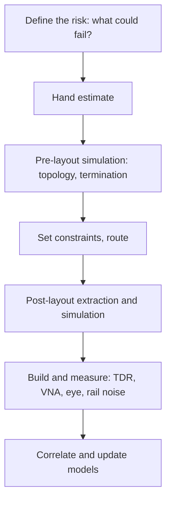

::: basics
### In plain words
The interviewer is not asking for a tool list. They want to know what you actually simulated, what the result told you, and whether you understand that a simulation is only as good as its models. Signal integrity (SI) simulation checks that signals arrive clean. Power integrity (PI) simulation checks that the supply stays steady ([[q0685]]). Be honest about how much hands-on work you have done.

### Picture it
A good answer reads like a very short lab report. It names the question, the tool, one number that surprised you, the design change that followed, and one thing you would not trust yet. A small honest experiment, checked against a hand calculation, beats naming five tools you never used.

### Words you need
- **Model**: the simplified stand-in a simulator uses for a real part or wire. What it leaves out is where simulations mislead.
- **Hand check**: a quick pencil calculation that you compare with the simulator's answer to catch mistakes.
- **Pre-layout / post-layout**: simulating before the board is drawn to pick a design, versus after, to verify the real routing.
- **Correlation**: comparing the simulation with a measurement on real hardware to see whether the model can be trusted.

### The simplest example
A skeleton to fill in with your own story:

"In *[project or course]* I wanted to understand *[problem, such as ringing on a fast output]*. I modeled it in *[tool]* with *[what you modeled]* and compared it with a hand calculation, which predicted *[number]*. The simulation gave *[number]*. That led me to *[change you made]*. What I would not trust is *[model limit]*, so on a real board I would *[check or correlate against measurement]*."

That is the whole idea: question, result, decision, limits. The rest of this page lists typical simulations, model types, and how to answer with little tool experience.
:::

::: testing
This is an **experience question**, so the interviewer is checking three things: (1) did you actually do something, what was it, and what did the simulation change about the design; (2) do you understand what the simulation assumes and where it can lie (models, extraction, correlation with measurement); and (3) if your experience is limited, are you honest and do you show you can learn and reason from first principles. They are not trying to catch you out on tool names. A strong answer is specific, technical and humble about limits, and shows you can predict the result by hand before trusting the tool.
:::

::: why
SI/PI simulation is how high-speed boards get de-risked before fabrication, so "have you simulated" is often a proxy for "can you be trusted near a DDR or PCIe layout". Many interns and new grads will have little or no formal experience, and interviewers know it. What distinguishes candidates is whether they can describe a *relevant* small experience (an LTspice transmission-line experiment, a decoupling calculation, a course project, a lab measurement), explain what it showed, and discuss the methodology. Never invent experience; a precise honest answer beats a vague inflated one, and follow-ups quickly expose the latter.
:::

::: concepts
- **What you simulate in SI**: reflections, termination, crosstalk, channel loss/eye, jitter, SSN ([[q0711]], [[q0694]], [[q0698]]).
- **What you simulate in PI**: DC drop, PDN impedance vs target, transient droop, plane resonance ([[q0501]], [[q0704]]).
- **Model types**: SPICE with ideal T-line elements, IBIS buffer models, S-parameters (Touchstone), 2.5D/3D field-solver extraction.
- **Pre-layout vs post-layout** simulation and the role of constraints.
- **Correlation**: validating models against measurement (TDR, VNA, scope).
- **Hand-calculation sanity checks** (bounce diagram, target impedance, rise-time rules) ([[q0676]], [[q0685]]).
:::

::: answer
"I'll tell you honestly where I am. [Your experience, for example: I haven't done full-board SI/PI extraction in a commercial tool, but I have simulated transmission-line behaviour and decoupling in LTspice and checked it against hand calculations / a bench measurement.]

Here's a concrete example. [On my project/course/lab] I wanted to understand ringing on a fast digital output driving a trace. I modelled a driver with about 20 ohms of output resistance, a 50 ohm, 1 ns transmission-line element, and a capacitive load. The bounce diagram predicts the load voltage jumps to about 4.7 volts from a 3.3 volt source, a 43 percent overshoot, then settles in a few round trips: 4.7, 2.7, 3.56, 3.19 and so on. The simulation matched that. Then I added a 30 ohm series resistor so the source resistance equals Z0, and the ringing disappeared, as the reflection coefficient at the source goes to zero. [If you measured it: and on the bench with a TDR/scope I saw X.]

What I took from it is how much a simulation depends on its models: the T-line is ideal, the driver is a resistor, the package parasitics aren't there. So in a real project I'd use the vendor's IBIS or S-parameter models, extract the actual stack-up and routing, run pre-layout to pick terminations and post-layout to verify, and correlate against a TDR or eye measurement. I'm keen to learn the production tools, but I'd always do the hand calculation first so I know whether the tool is giving me a believable answer."
:::

::: technical
**How to structure an answer to "do you have simulation experience?"** Situation, tool and model, what you checked, what it showed, what changed, what you learned.

**Typical SI simulations and the numbers behind them**
- *Reflection/termination.* Source $R_s$ into line $Z_0$ and load $R_L$: $\Gamma_s=(R_s-Z_0)/(R_s+Z_0)$, $\Gamma_L=(R_L-Z_0)/(R_L+Z_0)$. Example: 3.3 V step, $R_s=20\ \Omega$, $Z_0=50\ \Omega$, open load ($\Gamma_L=1$): launched $V=3.3\times50/70=2.357$ V; load sees $2\times2.357=4.714$ V at $t=T_d$, then 2.694, 3.560, 3.189, 3.348, 3.280, 3.309 V at successive $2T_d$ steps, converging to 3.3 V ($\Gamma_s=-0.429$, so it alternates). Adding 30 Ω series gives $R_s=50\ \Omega=Z_0$: no source reflection; the load goes straight to 3.3 V after $T_d$.
- *Crosstalk*: coupled-line models or field-solver extraction; check near/far-end noise vs spacing and edge rate.
- *Channel/eye*: S-parameters of the channel (VNA or extracted) with a driver model (IBIS, or IBIS-AMI for equalised SerDes) to produce eye height/width and BER estimates.

**Typical PI simulations**
- *DC drop*: copper plane resistance network solve; $10\ \text{A}\times5\ \text{m}\Omega=50$ mV.
- *PDN impedance*: VRM model, capacitors with ESR/ESL and mounting inductance, plane-pair capacitance, package/die model; compare $Z_{PDN}(f)$ to $Z_{target}=\Delta V/\Delta I$.
- *Transient*: load current profile into the PDN model; check droop and ripple.

**Model hierarchy** (each step costs more setup and gives more accuracy): hand calculation, SPICE with ideal elements, IBIS + transmission lines, S-parameter channel model, 2.5D/3D field solvers for vias, connectors and packages, full-wave system. Choose the simplest that captures the effect.

**Typical tools** (examples; availability and licensing vary by employer): SPICE-family simulators (LTspice, ngspice, Cadence/Keysight/Siemens tools), commercial SI/PI suites (e.g. Siemens HyperLynx, Cadence Sigrity, Ansys SIwave/HFSS, Keysight ADS), open-source options (scikit-rf for S-parameters, openEMS for field solving). You do not need to claim any of these; an LTspice T-line experiment is a legitimate, honest starting point.

> [!UNCERTAIN]
> Tool names and feature sets change; mention a tool only if you used it. The principle, not the product, is what interviewers evaluate.
:::

::: short
"[Honest version of your experience.] For example, I simulated a driver, 50 ohm transmission line and capacitive load in LTspice and checked it against the bounce diagram: with a 20 ohm source into an open line the load overshoots to 4.7 V from a 3.3 V step and rings, and adding a 30 ohm series resistor matches the source to the line and removes it. I know the limits: ideal models, no package parasitics. In a real design I'd use IBIS or S-parameter models, extract the layout, simulate pre- and post-layout and correlate against a TDR or eye measurement."
:::

::: long
"I'll start with the honest picture. [Fill in yours: for example, I haven't run a full commercial SI/PI flow on a production board, but I have done hands-on simulation and calculation of the underlying effects.]

The example I'd highlight is a transmission-line simulation. I built a model in LTspice of a driver with roughly 20 ohms output resistance, a 1 ns, 50 ohm line, and an open or capacitive load. Before running it, I did the bounce diagram by hand. The launched voltage is 3.3 volts times 50 over 70, so 2.36 volts. The load end doubles it, so 4.7 volts, a 43 percent overshoot. The reflection back at the source has a coefficient of minus 0.43, so the load then drops to 2.7, rises to 3.56, and converges to 3.3 over a few round trips. The simulation matched, which gave me confidence in the setup. Then I added a 30 ohm series termination so the source impedance equalled the line, and the ringing disappeared, because the source reflection coefficient became zero. [If true: I also measured the real board with a scope and saw the same trend but with extra ringing from the package inductance, which the ideal model left out.]

For power integrity I've done the target impedance calculation by hand. For a 1 volt rail with 3 percent ripple and a 10 amp step, that's 3 milliohms, and I've used a simple capacitor model with ESR and ESL to see why one capacitor can't meet it and why the inductance of the mounting limits it above a few MHz. [Add if you have: I also used a PDN impedance tool / sim.]

What I learnt is the process. Start with the hand calculation to know what to expect. Use the right model for the question: ideal T-lines for topology, IBIS for the buffers, S-parameters or a field solver for vias and connectors. Run pre-layout to choose terminations and constraints, post-layout to verify, and correlate with measurements like TDR and eye diagrams. And remember the model is only as good as its inputs: stack-up, materials, package models, tolerances.

I'm comfortable explaining what's going on and I'd be keen to learn your specific tools. I just wouldn't claim more than I've done."
:::

::: terms
- **IBIS**: Input/output Buffer Information Specification; behavioural I/V and timing models of drivers and receivers without disclosing transistor-level detail.
- **IBIS-AMI**: algorithmic models for equalisation in high-speed SerDes channel simulations.
- **S-parameters (Touchstone)**: frequency-domain description of a linear network (channel, via, connector).
- **TDR**: time-domain reflectometry; measures impedance vs distance.
- **VNA**: vector network analyzer; measures S-parameters.
- **Field solver (2.5D/3D)**: numerical solution of Maxwell's equations to extract parasitics or S-parameters.
- **Pre-layout / post-layout simulation**: topology exploration vs verification with the actual extracted layout.
- **Correlation**: demonstrating that the model matches measurement.
- **PDN impedance**: frequency-domain impedance of the power delivery network seen by the load.
:::

::: exceptional
**An average answer** says "yes, I used HyperLynx" or "no, not really" with no content.

**An exceptional answer**:
- Is truthful about the level of experience and then gives a *specific* example (what was modelled, with which parameters and why).
- Shows the hand calculation first (bounce diagram, target impedance) and compares it with the simulation.
- States what changed in the design because of the result (termination added, spacing changed, capacitor count altered).
- Names the model types and when each is appropriate (IBIS, S-parameter, field solver) and the limits of ideal models.
- Describes correlation with measurement (TDR, VNA, eye, rail noise) and sources of mismatch (stack-up tolerance, package, probe).
- Shows curiosity and a plan for learning the tools if experience is limited.
:::

::: mistakes
- **Inventing or inflating experience.** Follow-up questions ("what stimulus? which model? what did the eye look like?") will expose it, and trust is hard to regain.
- **Name-dropping tools without outcomes.** "I used Sigrity" says nothing about what you learned or decided.
- **Trusting the simulation blindly.** Garbage in, garbage out: wrong stack-up, ideal drivers, missing package parasitics.
- **Saying "I'd just simulate it" without hand estimates.** Interviewers want to see that you can predict the order of magnitude.
- **Ignoring PI.** SI-only answers miss the supply side of the same board.
- **Not mentioning measurement.** A simulation that was never compared with a measurement is unvalidated.
:::

::: deep
## What the interviewer is assessing

This is the behavioural/experience pattern described in the authoring rules: they want a story with substance, and an honest view of its limits. A good frame is:

1. **Situation**: what system or exercise (course project, lab, internship, personal board).
2. **Question asked of the simulation**: what risk were you checking (reflection on a clock, crosstalk on a bus, rail droop under load, eye margin on a link).
3. **Setup**: tool, models, stack-up, stimulus, and *why those choices*.
4. **Expectation**: your hand calculation, so the simulation isn't a black box.
5. **Result and action**: what it showed and what you changed.
6. **Validation/limits**: measurement correlation or what you would add.


Figure: The professional workflow. A good answer touches several of these boxes, even if your own experience covers only the first two or three.

## A starter experiment you can actually do (and then describe honestly)

If you have little experience, build one small experiment and own it. A transmission line in SPICE takes ten minutes and gives you something real to discuss.

```circuit
{"caption":"Experiment 1: driver with output resistance, ideal T-line, capacitive load","elements":[
 {"t":"Vsq","a":[0,2],"b":[0,6],"label":"V_s","value":"3.3 V step"},
 {"t":"wire","pts":[[0,2],[0,0],[3,0]]},
 {"t":"R","a":[3,0],"b":[8,0],"label":"R_s","value":"20 Ω"},
 {"t":"Z","a":[8,0],"b":[14,0],"label":"T-line","value":"Z_0 = 50 Ω, T_d = 1 ns"},
 {"t":"wire","pts":[[14,0],[17,0]]},{"t":"dot","at":[17,0]},
 {"t":"C","a":[17,0],"b":[17,5],"label":"C_L","value":"5 pF"},
 {"t":"wire","pts":[[17,0],[20,0]]},
 {"t":"term","at":[20,0],"label":"V_{load}","side":"right"},
 {"t":"wire","pts":[[0,6],[0,7],[17,7],[17,5]]},{"t":"gnd","at":[8,7]}
]}
```
Figure: A 20 Ω driver, a 1 ns lossless 50 Ω line and a 5 pF load. In SPICE the line is the ideal transmission-line element (delay and $Z_0$).

**Hand calculation (open-circuit load, i.e. $C_L\to0$):**
- $\Gamma_s=(20-50)/70=-0.429$, launched step $=3.3\times50/70=2.357$ V.
- At the load ($\Gamma_L=+1$): $v_L(T_d)=4.714$ V (43% overshoot above 3.3 V).
- Subsequent plateaus at the load: 2.694, 3.560, 3.189, 3.348, 3.280, 3.309 V, converging on 3.3 V with alternating over- and undershoot, each step $2T_d=2$ ns apart.
- With a 30 Ω series resistor: $R_s=50\ \Omega$, $\Gamma_s=0$; the load rises to 3.3 V at $T_d$ with no ring.

A 5 pF load slows the load edge and reduces the overshoot, but the structure is the same.

```sim
{"id":"tline-lab","z0":50,"rs":20,"rl":"open","td":1e-9,"tr":1e-10,"term":"none"}
```
Figure: Reproduce the numbers: the source resistance is already 20 Ω, and the sim uses a 1 V step, so multiply its plateaus by 3.3 (1.429, 0.816, 1.079 V become 4.714, 2.694, 3.560 V) to compare with the list above. Then choose series termination and confirm the ringing disappears.

Things to discuss from this experiment: why an ideal T-line has no loss; how rise time vs $T_d$ decides whether the ring is visible (try $t_r=2$ ns, about $2T_d$: the plateau structure blurs); and what is *missing* (package inductance, driver nonlinearity, via, loss).

## PI starter experiment

Model a decoupling capacitor as a series R-L-C. For $C=1\ \mu$F, ESR 10 mΩ, ESL 1 nH, the self-resonant frequency is $f_0=1/(2\pi\sqrt{LC})=5.03$ MHz and the impedance minimum is the ESR. Plot $|Z(f)|$ and compare with the target for your rail (e.g. 3 mΩ). Add a second capacitor of 100 nF in parallel and look for the anti-resonance peak between the two self-resonances. This is a legitimate PI experiment you can describe in a minute, and it motivates why real PDN tools exist.

```sim
{"id":"decap-network","preset":"many-same","ztarget":0.003}
```
Figure: Compare the "many-same" preset with "mixed" and "far-placement": identical capacitors lower the impedance at a single frequency, mixed values broaden the useful range, and extra loop inductance from distant placement raises the impedance above the target at high frequency.

## If you have real tool experience

Say what you simulated, not just which tool:
- The **model sources** (IBIS from the vendor, S-parameters from the connector manufacturer, stack-up from the fabricator).
- The **stimulus** (PRBS pattern, data rate, edge rates, voltage corners).
- The **metric** (eye height/width at a given BER, crosstalk noise in mV, PDN impedance vs target, droop in mV).
- The **decision** (add series resistors, change spacing, add decoupling, re-route a via transition).
- The **correlation** (what the measurement showed and why it differed).

## If you have no tool experience

Say so plainly, then pivot to the reasoning you can do:

> "I haven't used a commercial SI/PI suite. What I can do is estimate by hand: critical length from rise time and delay, reflection coefficients and bounce diagrams, crosstalk scaling with spacing, target impedance for a rail, capacitor SRF. I've checked some of these in LTspice [or the simulators on a learning platform] and I'd expect to correlate any tool I use against those estimates."

This is a strong answer if it is true, because it shows judgement and a plan.

## Technical knowledge that survives follow-ups

- **IBIS**: models the I/V curves and ramp rates of a buffer, plus package parasitics (R, L, C) and sometimes only a lumped $C_{comp}$; it does not model power-supply noise in the basic form (power-aware models exist). Use for SSN-free topology and reflection checks.
- **S-parameters**: a linear, passive description in frequency; $S_{21}$ is insertion loss, $S_{11}$ return loss. Convert to time domain for eye diagrams; check causality and passivity of the data.
- **When 3D is needed**: vias, connectors, packages, anything where the structure is not a uniform line.
- **PDN**: model the VRM as an output impedance rising with frequency, the capacitors as RLC with mounting inductance, planes as capacitance with spreading inductance, and the package/die as the load; compare with $Z_{target}$.
- **Pitfalls**: wrong stack-up thickness, ignoring copper roughness at high frequency, ignoring temperature/tolerance, and ignoring the probe's loading when correlating.

> [!INTERVIEW]
> Offer to walk through a quick bounce-diagram on the whiteboard. A candidate who can do that live with real numbers (source 20 Ω, line 50 Ω, 3.3 V: 2.36 V launched, 4.71 V at the open end) demonstrates simulation-grade understanding without a single tool name.
:::

::: applications
- **Choosing a series termination value** for a clock or address line using a quick transmission-line simulation.
- **Checking DDR/SDRAM topologies** (fly-by, T-branch) with IBIS models for reflections and timing.
- **Sizing decoupling** for an FPGA or MCU rail with an impedance sweep against a target.
- **Evaluating a connector or via transition** with S-parameters or a 3D solver for a multi-Gb/s link.
- **Eye-diagram prediction** before committing to a stack-up and layout for USB, PCIe or HDMI.
- **Debug correlation**: reproducing a measured ring with the right parasitics to find which component is responsible.
:::

::: assumptions
- **You must not claim experience you do not have.** The page gives structure and technical content to use honestly, with placeholders in brackets.
- **The numeric example** assumes a lossless line, a purely resistive driver and an open load; real drivers are nonlinear and loads capacitive.
- **Tool names** are examples; availability varies by employer. Experience with SPICE-level models is a valid start.
- **Hand calculations** assume the linear, single-reflection-sequence models of transmission-line theory.
- **Correlation**: measurement setup (probe, ground lead, bandwidth) affects how well it will match.

If the interviewer asks specifically about a tool you haven't used, say so and describe the equivalent concept in the tools you know (e.g. a transmission-line element and an AC sweep in SPICE for impedance).
:::

::: followups
### What would you simulate first on a new DDR design?
Pre-layout, the address/command topology (fly-by or T) with IBIS models of the controller and memories, to choose terminations and trace lengths; then the data byte lanes for reflection and crosstalk; and in parallel the PDN impedance of VDDQ and the core rail against targets. Post-layout, check length matching, via transitions and return paths, then verify with eye measurements on the first boards.

### The simulation shows 10% overshoot but the scope shows 30%. What do you suspect?
Missing parasitics in the model (package or pad inductance, via stubs), wrong driver strength or slew rate, probing artefacts (long ground lead rings at 30% by itself), under-estimated loading, or a stack-up/impedance different from the model. Check the probe first with a short ground spring, then the model against the measured TDR of the bare board.

### How accurate is a hand calculation of target impedance?
It gives a first-order requirement: $Z_{target}=\Delta V/\Delta I$ with the worst-case step. It over-constrains frequency ranges where the load has no current content and under-constrains real time-domain behaviour such as resonance excitation by periodic load patterns. Use it for sizing; verify with a time-domain transient on a PDN model and with measurement.

### How do you decide whether to use IBIS or SPICE models of a driver?
IBIS is enough for reflections, termination and basic timing; it is vendor-neutral and fast. Transistor-level SPICE is needed for effects IBIS misses (detailed supply interaction, SSN dependence on the die PDN, unusual output stages) if the vendor provides it. For SerDes with equalisation use IBIS-AMI. Also, simulate at slow/typical/fast corners.

### What if you've never simulated anything and the interviewer insists on an example?
Describe an analysis you did by hand or in SPICE and be explicit about it: for example the bounce diagram above, a rise-time versus critical-length calculation for a clock on a board you built, or a decoupling capacitor impedance plot. Say what you would do next to validate it (measure with a TDR or scope) and what tool you would use to scale it up. That shows the right instincts.
:::

::: interpretations
This is a **behavioural** question ("Do you have any SI/PI simulation experience?"), so no technical answer is the "right" one; the page gives a structure, a worked technical example you can legitimately reproduce, and honest-answer guidance. It follows [[q0685]], which defines SI/PI, and precedes the SI-specific topics from [[q0687]] onward. Compare with other experience questions such as [[q0633]].
:::

::: references
- Eric Bogatin, *Signal and Power Integrity: Simplified*: simulation-ready fundamentals (transmission lines, crosstalk, PDN) and measurement correlation.
- Howard Johnson & Martin Graham, *High-Speed Digital Design*: transmission lines, termination and bounce diagrams.
- IBIS Open Forum, *IBIS (I/O Buffer Information Specification)*: the model standard behind buffer simulations (check the current version for features).
- Istvan Novak and Jason Miller, *Frequency-Domain Characterization of Power Distribution Networks*: PDN modelling and measurement.
:::

::: rubric
- States honestly what experience you have (and do not have) :: Trust is the first thing evaluated in a behavioural question.
- Gives a specific example: what was modelled, with what parameters and why :: Specifics demonstrate real work.
- Shows a hand calculation and compares it to the simulation :: Proves you understand the physics and can sanity-check a tool.
- Describes the model types and when to use each (SPICE, IBIS, S-parameters, field solvers) :: Shows breadth and judgement.
- Explains the action taken from the result (termination, spacing, decoupling) :: Simulation is only useful if it changes decisions.
- Mentions correlation with measurement and model limits :: Shows engineering maturity.
- Shows a plan to learn production tools if experience is limited :: Signals growth mindset.
:::

::: quiz
```json
[
 {"type":"numeric","level":"fundamental","q":"A 3.3 V step source with $R_s=20\\ \\Omega$ drives a 50 Ω line. What voltage is launched onto the line, in V?","answer":2.357,"tolerance":0.02,"unit":"V","explain":"$V=3.3\\times50/(20+50)=2.357$ V."},
 {"type":"numeric","level":"intermediate","q":"The same line ends in an open circuit. What is the load voltage right after the first reflection returns, in V?","answer":4.714,"tolerance":0.02,"unit":"V","explain":"At an open end $\\Gamma_L=+1$, so the load sees the incident wave plus an equal reflected wave: $2\\times2.357=4.714$ V."},
 {"type":"numeric","level":"intermediate","q":"What series resistance added at the source makes the source impedance equal to the 50 Ω line when the driver has 20 Ω output resistance, in Ω?","answer":30,"tolerance":0.02,"unit":"Ω","explain":"$R_s=Z_0-R_{driver}=50-20=30$ Ω; the source reflection coefficient is then zero."},
 {"type":"mcq","level":"intermediate","q":"Which statement about IBIS models is most accurate?","options":["They give transistor-level netlists of the driver","They give behavioural I/V and ramp data of buffers plus package parasitics, enough for reflection and timing studies","They replace the need for stack-up information","They always include supply-noise interaction"],"answer":1,"explain":"IBIS provides behavioural buffer data (pull-up/pull-down I-V, ramp rates, capacitance, package R/L/C). It does not include the channel or, in basic form, supply interaction."},
 {"type":"truefalse","level":"advanced","q":"In a behavioural interview question about simulation experience, the safest strategy is to name as many commercial tools as possible.","answer":false,"explain":"Follow-up questions will probe what you actually simulated and decided. Specific, honest examples (even from SPICE or hand calculations) with correlation and limits are far stronger than a list of tool names."},
 {"type":"mcq","level":"advanced","q":"Simulation shows 10% overshoot but the measurement shows 30%. Which is the most sensible first check?","options":["Assume the simulation is correct and ignore the scope","Check probe ground-lead loop inductance and bandwidth, then compare model parasitics with the actual package and via structures","Add more series resistance immediately","Switch to a lower-bandwidth scope"],"answer":1,"explain":"Measurement artefacts (long ground leads) are a classic cause of apparent overshoot. After validating the measurement, compare the model's parasitics (package, vias, stack-up) with reality before changing the design."}
]
```
:::
