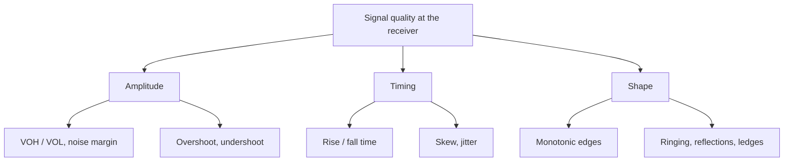

::: testing
Whether you have a **checklist in your head** for "is this signal good?" rather than a vague "it looks clean on the scope". The interviewer wants to hear that quality is judged against the *receiver's* needs: logic thresholds, setup/hold windows, noise margin. A strong candidate splits the answer into amplitude (levels, overshoot, noise), timing (rise time, skew, jitter), and shape (monotonic edges, ringing, reflections), then names how each is measured. They also know that the **measurement itself** (probe, scope bandwidth, ground lead) can fake or hide problems.
:::

::: why
A board can pass every DC check and still fail because an edge rings through a receiver threshold or the data eye is half closed. Signal-integrity (SI) problems show up as intermittent bugs: bit errors, double-clocking, random resets that move with temperature or a firmware change. Having a vocabulary and a measurement plan turns "it's flaky" into numbers you can compare with a datasheet. This is also the opening question of the SI section, so it sets up ringing ([[q0696]]), jitter ([[q0695]]), monotonicity ([[q0690]]) and eye diagrams ([[q0698]]).
:::

::: concepts
- **Logic thresholds and noise margin**: a receiver decides 1 or 0 by comparing against $V_{IH}$ and $V_{IL}$; the distance between the signal level and these is the noise margin. See [[q0692]].
- **Rise/fall time and bandwidth**: an edge of rise time $t_r$ carries significant energy up to about $0.35/t_r$ (single-pole) or a knee near $0.5/t_r$. See [[q0132]].
- **Transmission-line behaviour**: when the edge is fast compared with the trace delay, reflections shape the waveform. See [[q0711]].
- **Timing budget**: setup and hold margins at the receiver ([[q0693]]) consume jitter and skew.
- **Measurement fidelity**: scope bandwidth, probe capacitance and ground-lead inductance. See [[q0980]].
:::

::: answer
"I judge a signal against what the receiver needs, so I look at three groups of things. First, amplitude: do the high and low levels clear $V_{IH}$ and $V_{IL}$ with margin, how big is the overshoot and undershoot, and how much noise or ripple sits on the levels. Second, timing: rise and fall time, skew between related signals, and jitter, because those eat into the setup and hold window. Third, shape: is the edge monotonic through the threshold region, is there ringing or ringback, and are there reflections from impedance discontinuities.

For a single-ended line I'd put a scope at the receiver pin, not the driver, because that's where the receiver sees it, and check those numbers against the part's datasheet limits. For a high-speed serial link I'd fold the data into an eye diagram and read eye height, eye width, jitter and compare against a mask, or quote a bit-error rate. I'd also do a quick check that the measurement is trustworthy: a scope with at least three to five times the signal's knee frequency, a short ground spring instead of a long clip lead, because a long ground lead can create the ringing I'm trying to find."
:::

::: technical
Quality is defined at the **receiver input**, against the receiver's thresholds and timing window. Typical quantitative metrics:

**Levels and amplitude.** $V_{OH}$, $V_{OL}$ at the receiver; noise margins $NM_H = V_{OH} - V_{IH}$ and $NM_L = V_{IL} - V_{OL}$. Overshoot/undershoot relative to absolute-maximum ratings (clamp diodes conduct beyond about $V_{DD}+0.3$ V). Noise and ripple on settled levels (including ground bounce, [[q0688]], and crosstalk, [[q0694]]).

**Timing.** Rise/fall time ($10\%$–$90\%$ or $20\%$–$80\%$, state which). Propagation delay and skew between related signals. Jitter: period, cycle-to-cycle and time-interval error ([[q0695]]). Setup/hold margin at the capture flip-flop ([[q0693]]).

**Shape.** Monotonicity of each edge through the threshold window ([[q0690]]); ringing amplitude and settling time ([[q0696]]); plateaus ("ledges") from partial reflections; runt pulses.

**Edge-rate/bandwidth link.** For a single-pole edge, $BW \approx 0.35/t_r$. A $t_r = 1$ ns edge therefore has useful content to roughly 350 MHz, and $0.5/t_r = 500$ MHz is often used as the knee frequency for layout rules.

**Serial links.** Eye height/width, total jitter at a stated BER, mask margin, insertion/return loss and BER ([[q0698]]–[[q0703]]).

**Measurement correction.** A scope plus probe adds its own rise time: $t_{r,meas} \approx \sqrt{t_{r,sig}^2 + (0.35/BW)^2}$. A 350 MHz scope reading a true 1 ns edge shows $\sqrt{1 + 1} = 1.41$ ns. Scope bandwidth of three to five times the knee frequency keeps this error small.
:::

::: short
"I check the signal at the receiver against what the receiver needs. Amplitude: levels clear the thresholds with noise margin, with limited overshoot and undershoot. Timing: rise time, skew and jitter that leave enough setup and hold margin. Shape: monotonic edges with little ringing or reflections. For serial links I use an eye diagram, eye height and width, jitter and BER. And I make sure my scope bandwidth and probing are good enough that I'm not creating or hiding the problem."
:::

::: long
"I'd start by asking what the receiver needs, because quality is relative to that. For a normal single-ended digital signal there are three groups of checks.

Amplitude first. At the receiver pin, do the high and low levels clear $V_{IH}$ and $V_{IL}$ with real margin? How much overshoot and undershoot is there, and does it go beyond the clamp-diode or absolute-maximum limits? And how much noise sits on the settled levels, from ground bounce, crosstalk or supply ripple?

Timing second. I measure rise and fall time, because a slow edge makes the signal sensitive to noise and a fast edge makes reflections and crosstalk worse. Then skew between related signals, like a bus against its clock, and jitter on the clock or data. These all subtract from the setup and hold window.

Shape third. Is each edge monotonic through the threshold region, or does it ring back and cross twice? Is there a ledge from a reflection sitting near the threshold? Ringing and ringback are what cause double clocking.

For a high-speed serial link those individual numbers get replaced by an eye diagram. I'd fold the bits on top of each other and read eye height, eye width, total jitter at a stated BER, and compare against the standard's mask. If a mask is violated, I'd look at the channel: loss, reflections, crosstalk.

Last, I'd make sure my measurement is honest. The scope and probe need to be fast enough, I'd use a short ground spring, and I'd probe at the receiver, because a long ground clip adds nanohenries that ring with the probe capacitance and give me a fake problem."
:::

::: terms
- **Noise margin**: the gap between a driven logic level and the receiver's threshold; how much noise the link tolerates.
- **Rise time ($t_r$)**: time for an edge to go between two stated percentages (often 10%–90%) of its swing.
- **Overshoot/undershoot**: excursion beyond the final high or low level; stresses clamp diodes and eats margin.
- **Ringing / ringback**: oscillation after an edge; ringback is the dip back toward the threshold after overshoot.
- **Monotonic edge**: an edge that crosses the threshold region exactly once, with no reversal.
- **Jitter**: deviation of an edge's timing from its ideal position.
- **Skew**: timing offset between signals that should be aligned.
- **Eye diagram**: all unit intervals of a data stream overlaid; its opening shows the margin.
- **Knee frequency**: the frequency, near $0.5/t_r$, above which an edge's spectrum rolls off quickly.
:::

::: exceptional
An average answer lists "voltage levels, rise time, noise". An exceptional one **organizes** the metrics (amplitude, timing, shape, link-level), says they are all judged *at the receiver* against threshold and timing windows, and ties each to a cause: ringing to impedance mismatch, jitter to noise divided by slew rate, noise margin loss to ground bounce. It gives a number or two unprompted, like $BW \approx 0.35/t_r$, and brings up **measurement validity**: scope bandwidth, probe loading, ground lead. It also mentions that for serial links the right summary is an eye plus BER, not individual edges, and that "looks fine on the scope" at the *driver* pin proves little about the *receiver* pin.
:::

::: mistakes
- **Measuring at the driver and declaring victory.** Reflections and loading change the waveform along the line; measure at the receiver. Probe the pin, not a stub.
- **Judging by rise time alone.** A fast, clean edge into a matched line is better than a slow edge with ringing; shape and levels matter too.
- **Ignoring the scope's own bandwidth.** Measured rise time is $\sqrt{t_{r,sig}^2 + t_{r,scope}^2}$; a slow scope hides ringing and under-reports overshoot.
- **Using a long ground clip.** The loop inductance rings with probe capacitance and invents overshoot. Use a ground spring.
- **Quoting "10%–90%" and "20%–80%" interchangeably.** They differ by about 1.6x for a single-pole edge; state your definition.
- **Treating the eye as the only metric.** An open eye on a short, nice-looking capture can still hide low-probability failures; BER and mask hit ratios need many bits.
:::

::: deep
## Start from the receiver

A digital receiver is a comparator with a window. It samples (or reacts to) its input at some moment and asks "above threshold or not?" Everything we call signal quality is a statement about whether that answer is **reliably correct**. That gives three questions:

1. *Is the level far enough from the threshold at the decision moment?* (amplitude, noise margin)
2. *Is the decision moment inside a stable, predictable window?* (timing, jitter, skew)
3. *Does the waveform between decisions behave?* (monotonic, no ringing back through the threshold)


Figure: A mental checklist. Each leaf is a number you can measure on a scope and compare with a datasheet limit; notice that every branch ends at the receiver's input.

## What a real edge looks like

An unterminated trace driven by a CMOS output behaves like a series $L$ with a load $C$: an underdamped second-order system. For damping ratio $\zeta$ the step overshoot is $e^{-\pi\zeta/\sqrt{1-\zeta^2}}$. With $\zeta = 0.4$ that is 25%, so a 3.3 V step peaks at about 4.1 V, which would forward-bias the receiver's clamp diode.

```plot
{"title":"Underdamped edge (default ζ = 0.4, 200 MHz natural frequency, 3.3 V swing)","x":{"label":"time","unit":"s","min":0,"max":"14e-9"},"y":{"label":"receiver voltage","unit":"V","min":-0.3,"max":6},"vars":{"vdd":3.3,"z":0.4,"wn":"2*pi*f0","wd":"wn*sqrt(1-z^2)"},"series":[{"label":"v(t)","fn":"vdd*(1-exp(-z*wn*x)*(cos(wd*x)+z/sqrt(1-z^2)*sin(wd*x)))","n":900}],"hlines":[{"at":"vdd","label":"final level 3.3 V","color":"muted"},{"at":2.0,"label":"V_IH = 2.0 V","color":"orange"},{"at":0.8,"label":"V_IL = 0.8 V","color":"orange"}],"points":[{"x":"pi/wd","y":"vdd*(1+exp(-pi*z/sqrt(1-z^2)))","label":"first peak"}],"params":[{"name":"z","label":"Damping ζ","min":0.1,"max":0.95,"value":0.4,"step":0.01},{"name":"f0","label":"Natural frequency","min":100000000.0,"max":400000000.0,"value":200000000.0,"unit":"Hz","log":true}],"readouts":[{"label":"Overshoot","expr":"100*exp(-pi*z/sqrt(1-z^2))","unit":"%"},{"label":"Peak voltage","expr":"vdd*(1+exp(-pi*z/sqrt(1-z^2)))","unit":"V"},{"label":"Time of peak","expr":"pi/wd","unit":"s"}]}
```
Figure: The edge crosses V_IH once (monotonic through the threshold) but overshoots by 0.84 V and rings for several cycles. A threshold-crossing check would pass; an absolute-maximum or clamp-current check would not. Both kinds of metric are needed. Drag ζ below 0.2 and the peak passes 5 V (over 50% overshoot); push ζ toward 1 and the ringing disappears. A lower natural frequency stretches the same ringing out in time.

## The metrics, with numbers

| Metric | Typical definition | Why it matters |
|---|---|---|
| $V_{OH}$, $V_{OL}$ | settled levels at receiver | noise margin: $NM_H = V_{OH}-V_{IH}$ |
| Overshoot / undershoot | peak beyond final level, in V or % | clamp current, reliability, EMI |
| Rise/fall time | 10%–90% (or 20%–80%) | bandwidth, crosstalk, ground bounce, setup budget |
| Ringing | amplitude and settling time after edge | double-clocking, margin loss |
| Monotonicity | no reversal in threshold window | no multiple crossings ([[q0690]]) |
| Skew | $\Delta t$ between related signals | bus/clock alignment |
| Jitter | RMS / peak-to-peak, TIE, period, C2C | timing window ([[q0695]]) |
| Eye height/width, mask margin, BER | from eye plot | serial-link pass/fail ([[q0698]]) |

Note the rise-time and slew link to timing noise: a voltage noise of $\sigma_v$ on an edge with slew rate $SR$ moves the crossing by $\sigma_t = \sigma_v / SR$. A 3.3 V edge with 1 ns 10–90% rise has $SR = 0.8\cdot3.3/1$ ns $= 2.64$ V/ns. With 20 mV rms noise the crossing moves by $20/2640 \approx 7.6$ ps rms. Stretch the edge to 10 ns and the same noise gives 76 ps. This is why "slower is cleaner" is only half true ([[q0689]]).

## Reflections as the usual culprit

If the trace is electrically long compared with the edge, the line's characteristic impedance $Z_0$ and the driver/load impedances set reflection coefficients $\Gamma = (Z_L - Z_0)/(Z_L + Z_0)$. A 10 Ω driver ($\Gamma_s = -0.67$) into an open 50 Ω line launches $3.3 \cdot 50/60 = 2.75$ V, the open end doubles it to 5.5 V at the receiver, then the source reflection pulls it back to 1.83 V, then up to 4.28 V and so on. That is ringing that comes from *distributed* delay rather than lumped $L$ and $C$. It is explored in [[q0696]] and [[q0711]].

```sim
{"id":"tline-lab","z0":50,"rs":10,"rl":"open","td":1e-9,"tr":1e-10,"term":"none"}
```
Figure: Try changing the termination to "series" and watch the receiver waveform turn from a ringing mess into a single clean (slightly delayed) step. Quality improved with no change to the driver.

## Measuring honestly

The scope, probe and ground lead are part of the circuit. The sim below shows measured rise time from signal and instrument combined.

```sim
{"id":"measurement-bw","tr":1e-9,"bw":350e6,"fs":2e9}
```
Figure: With a 1 ns edge and a 350 MHz instrument, the measured rise time is about 1.4 ns: the instrument is as slow as the signal. Raise the bandwidth to 1 GHz and the reading approaches the true 1 ns.

A 10 cm ground clip is roughly 100 nH (rule of thumb of about 1 nH per mm); with 10 pF of probe tip capacitance this resonates at $1/(2\pi\sqrt{100\text{ nH}\cdot 10\text{ pF}}) \approx 159$ MHz, right in the spectrum of a 1 ns edge. You then see a ring that is not on the board. Always cross-check with a short ground spring.

> [!TIP]
> If ringing shrinks dramatically when you shorten the ground lead or probe somewhere else on the same net, the problem was the measurement, not the circuit.

## Serial links: eye, jitter, BER

At multi-gigabit rates individual edges don't mean much because each bit is shaped by the bits before it (inter-symbol interference). Instead fold the stream into an eye and quote eye height/width, total jitter at a BER target and mask margin ([[q0698]], [[q0700]], [[q0703]]). Total jitter and BER are tied by the Gaussian tail: BER $10^{-12}$ needs about $\pm 7.03\sigma$, so $TJ = DJ + 14.07\,\sigma_{RJ}$ in the dual-Dirac model ([[q0695]]).
:::

::: applications
- **Debugging an intermittent reset or bus error**: scope the receiver pin with a short ground spring, check ringback against $V_{IL}$ and the monotonicity of the edge.
- **DDR memory bring-up**: eye height/width and ringback margins per pin are part of validation against the JEDEC standard's receiver requirements.
- **USB, PCIe, HDMI compliance testing**: eye diagram against a standard mask using a high-bandwidth scope and a compliance fixture.
- **SPI/I²C over a ribbon cable**: slew control plus series resistors to keep overshoot below clamp limits.
- **Clock distribution**: jitter and duty-cycle checks on a reference clock before it feeds an ADC or PLL.
- **Pre-layout SI simulation with IBIS models**: predicts overshoot, ringback and delay before boards are built.
:::

::: assumptions
- **Single-ended CMOS-style receiver** with $V_{IH}$/$V_{IL}$ thresholds. For differential links the receiver compares two lines, and quality is measured in differential terms ([[q0697]]).
- **Threshold definitions vary**: LVTTL, LVCMOS and DDR families have different $V_{IH}$/$V_{IL}$ and some use a reference voltage with AC and DC thresholds. Use the actual datasheet.
- **Rise-time convention**: 10–90% versus 20–80%, and single-pole versus Gaussian edge, change $0.35/t_r$ (the constant is about 0.35 for 10–90% single-pole; 20–80% gives about 0.22).
- **"Signal" might mean analog**: for an analog signal, quality is SNR, THD, SFDR and bandwidth, not thresholds and eyes. If the interviewer is in an analog or ADC context, mention those.
:::

::: followups
### What would you check first if a digital line is "flaky"?
Probe the receiver pin with a short ground spring on a scope with enough bandwidth, and look at the edges against $V_{IH}$/$V_{IL}$. I'm looking for ringback crossing a threshold, a ledge near the threshold, overshoot beyond the clamp, and noise on the settled level coincident with other activity (ground bounce, crosstalk). Then I'd check the timing side: skew to the clock and jitter. Most flaky lines show up as one of those four.

### How much scope bandwidth do I need?
Enough that the instrument's rise time ($0.35/BW$) is well below the signal's. For a 1 ns edge, a 1 GHz scope has 0.35 ns rise time, so the measured edge is $\sqrt{1^2 + 0.35^2} = 1.06$ ns, a 6% error. A 350 MHz scope reads 1.41 ns, a 41% error. Rule of thumb: bandwidth of three to five times the knee frequency $0.5/t_r$, or at least 5x the clock for clean waveforms.

### Is a faster edge always better signal quality?
No. A faster edge improves timing sensitivity to noise ($\sigma_t = \sigma_v/SR$) and eats less of the setup window, but increases reflections, crosstalk, ground bounce and EMI. The best edge is the slowest one that still meets timing with margin. See [[q0689]].

### The eye looks open on the scope but the link has errors. Why?
Eye diagrams on a scope capture a limited number of bits, so rare events (maybe $10^{-9}$ probability) don't show. Real BER depends on the Gaussian tails of noise and random jitter, and on receiver-side effects (CDR, equalizer adaptation, sampling threshold) the scope doesn't see. I'd extrapolate with a bathtub curve or run a BERT, and check the scope probe point matches the actual receiver reference plane.

### How is signal quality different at 10 Mb/s versus 10 Gb/s?
At low rates there's one decision per bit and the waveform has time to settle, so levels and ringing near thresholds dominate. At high rates the channel's loss smears bits into each other (ISI), so the eye shape, equalization and jitter budgets dominate, and a pass/fail comes from an eye mask or BER rather than from single-edge measurements.
:::

::: interpretations
"Quality of a signal" can mean a **digital** signal (levels, edges, jitter, eye), an **analog** signal (SNR, distortion) or a **power** signal ([[q0704]] covers power-supply quality separately). Here it sits in the SI section, so I've answered for digital signals at the receiver and mentioned the serial-link version, which the following questions develop.
:::

::: references
- Howard Johnson & Martin Graham, *High-Speed Digital Design: A Handbook of Black Magic*: chapters on transmission lines, reflections and rise-time/bandwidth.
- Eric Bogatin, *Signal and Power Integrity: Simplified*: chapters on rise time and bandwidth, reflections, and measurement.
- Horowitz & Hill, *The Art of Electronics*, 3rd ed.: digital logic interfacing and transmission-line discussions.
- JEDEC logic-family standards (for example JESD8 series) define $V_{IH}$/$V_{IL}$ for each logic family; use the one that matches your part.
:::

::: rubric
- Frames quality relative to the receiver (thresholds, timing window) :: Signal quality only has meaning against what the receiving device needs.
- Covers amplitude: levels, noise margin, overshoot/undershoot :: These decide whether the logic level is read correctly and whether clamps or absolute-max limits are stressed.
- Covers timing: rise/fall time, skew, jitter :: Timing quality sets setup/hold margin and sensitivity to noise.
- Covers shape: monotonic edges, ringing, reflections :: Non-monotonic or ringing edges cause multiple threshold crossings.
- Mentions eye diagram/mask/BER for serial links :: Shows you know the high-speed version of the same idea.
- Mentions measurement validity (scope bandwidth, probe, ground lead) :: Bad measurement technique creates or hides problems; interviewers love hearing this.
- Gives at least one quantitative relation (e.g. $BW\approx0.35/t_r$, $\sigma_t=\sigma_v/SR$) :: Numbers show working knowledge instead of a memorized list.
:::

::: quiz
```json
[
 {"type":"mcq","level":"fundamental","q":"Where should you measure a digital signal to judge whether the receiver will interpret it correctly?","options":["At the driver output pin","At the receiver input pin","At the midpoint of the trace, whichever is easiest to probe","At the power supply pin of the driver"],"answer":1,"explain":"The receiver sees the waveform at its own input, after reflections and loading. The driver-side waveform can look fine while the receiver sees ringback or a ledge."},
 {"type":"numeric","level":"fundamental","q":"What is the approximate bandwidth, in MHz, of a single-pole 10%–90% edge with 1 ns rise time, using $BW \\approx 0.35/t_r$?","answer":350,"tolerance":0.02,"unit":"MHz","explain":"$BW = 0.35/(1\\text{ ns}) = 350$ MHz."},
 {"type":"numeric","level":"intermediate","q":"A signal with a true 1 ns rise time is measured on a 350 MHz-bandwidth scope. Using $t_{r,meas}=\\sqrt{t_{r,sig}^2+(0.35/BW)^2}$, what rise time is displayed?","answer":1.41,"tolerance":0.02,"unit":"ns","explain":"Scope rise time $=0.35/350\\text{ MHz}=1$ ns, so measured $=\\sqrt{1^2+1^2}=1.41$ ns."},
 {"type":"numeric","level":"intermediate","q":"Edge crossing with 20 mV rms of noise on a 3.3 V swing, 10%–90% rise time of 1 ns (take the slew rate as $0.8\\cdot3.3\\text{ V}/1\\text{ ns}$). What is the rms timing jitter added, in ps?","answer":7.6,"tolerance":0.03,"unit":"ps","explain":"$SR=2.64$ V/ns $=2.64$ mV/ps, so $\\sigma_t=20/2.64=7.6$ ps."},
 {"type":"mcq","level":"intermediate","q":"Which statement about a faster edge is most accurate?","options":["Always improves signal quality because jitter falls","Reduces noise-to-jitter conversion but worsens reflections, crosstalk and ground bounce","Has no effect on crosstalk, which only depends on trace spacing","Only matters for analog signals"],"answer":1,"explain":"Higher slew rate reduces $\\sigma_t=\\sigma_v/SR$, but reflections, crosstalk ($\\propto dV/dt$) and ground bounce ($\\propto dI/dt$) all grow with edge rate."},
 {"type":"truefalse","level":"advanced","q":"A waveform that crosses the receiver's threshold exactly once on every edge can still be a problem for signal quality.","answer":true,"explain":"Monotonic threshold crossing is necessary but not sufficient: overshoot beyond the clamp limit, a slow ledge near the threshold, excessive jitter or low noise margin can all still fail the link."}
]
```
:::
