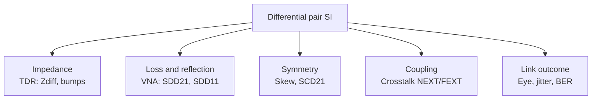

::: testing
Whether you know that a differential pair is characterised in **two modes** (differential and common) and that "good SI" means more than "the eye looks open". The interviewer wants a structured list: differential impedance and its uniformity (TDR), insertion loss (SDD21), return loss (SDD11), intra-pair skew and mode conversion (SCD21), crosstalk to neighbours, and the system-level outcome (eye height/width, jitter, BER). Tools and units matter: TDR for impedance, VNA for S-parameters, a scope or BERT for the eye. This question is explicitly about the **signal-integrity** view, not the layout rules.
:::

::: why
High-speed links (PCIe, USB, HDMI, Ethernet, DDR clocks, LVDS) rely on differential pairs, and compliance is judged by a handful of measurable quantities. Knowing which measurement catches which problem tells you how to debug: impedance bumps show up as reflections in TDR, loss closes the eye in a frequency-dependent way, skew converts differential signal to common mode (EMI and noise). In an interview it shows you can bridge the theory of differential signalling ([[q0679]], [[q0680]]) with real lab practice.
:::

::: concepts
- **Differential and common-mode voltage**: $V_d = V_+ - V_-$, $V_{cm} = (V_+ + V_-)/2$. See [[q0683]] and [[q0684]].
- **Differential impedance $Z_{diff}$**: the impedance seen by an odd-mode signal, $Z_{diff} = 2Z_{odd}$; typically 85–100 Ω by standard. See [[q0518]].
- **S-parameters**: $S_{dd21}$ (differential insertion loss), $S_{dd11}$ (return loss), $S_{cd21}$ (differential-to-common conversion).
- **Transmission-line effects**: reflections, loss and dispersion. See [[q0711]].
- **Eye diagram and BER**: the combined system view. See [[q0698]].
- **Crosstalk**: coupling to neighbouring pairs. See [[q0694]].
:::

::: answer
"I'd characterise a differential pair on three levels: the structure, the channel and the link.

For the structure, I'd measure its differential impedance, typically 100 ohms, with a TDR, and look for bumps from vias, connectors, and stubs. Also the length match within the pair, the intra-pair skew, because skew turns part of the differential signal into common mode.

For the channel, I'd get the S-parameters on a VNA: SDD21 is the insertion loss, which tells me how much the signal is attenuated at the Nyquist frequency; SDD11 is the return loss, which tells me about reflections; SCD21 is the mode conversion from differential to common mode; and the crosstalk terms to neighbouring pairs.

At the link level I'd fold the data into an eye diagram on a scope and read eye height, eye width, jitter, and compare against the standard's mask, or run a BERT and quote the bit error rate at a target level. If the eye is small I'd go back to the channel numbers to see whether it's loss, reflections, skew or crosstalk causing it."
:::

::: technical
**Structure (time domain).**
- *Differential impedance* $Z_{diff}$ via differential TDR/TDT. Target by interface (e.g. 100 Ω, or 90 Ω for USB); tolerance typically ±10% (varies by standard). An approximate microstrip estimate for an edge-coupled pair is $Z_{diff} \approx 2Z_0\left(1 - 0.48\,e^{-0.96\,s/h}\right)$ (from IPC-2141 style formulas; accuracy limited). For $Z_0 = 55\ \Omega$, $s/h = 1$: 89.8 Ω.
- *Intra-pair skew*: $\Delta t$ between $V_+$ and $V_-$. At 10 Gb/s ($UI = 100$ ps), 10 ps is 10% of a UI.
- *Common-mode impedance and symmetry*.

**Channel (frequency domain, mixed-mode S-parameters).**
- $S_{dd21}$: differential insertion loss. A loss of 10 dB at Nyquist leaves $10^{-10/20} = 31.6\%$ of the amplitude.
- $S_{dd11}$, $S_{dd22}$: differential return loss. A 90 Ω pair into 100 Ω gives $\Gamma = -0.053$, return loss 25.6 dB.
- $S_{cd21}$ (and $S_{dc21}$): mode conversion; $-30$ dB means 3.2% of the differential signal appears as common mode.
- $S_{dd}$ crosstalk terms: NEXT/FEXT to neighbouring pairs, also $S_{cc}$ for common-mode behaviour.

**Link (system view).** Eye height and width at the receiver, total jitter at a BER, mask margin, BER; with equalization the measurement is taken after the receiver's CTLE/DFE or at a reference receiver ([[q0698]]–[[q0703]]).

**Common-mode noise from skew.** For edge time $t_r$ and skew $\Delta t < t_r$, the peak common-mode bump is about $A\,\Delta t/(2t_r)$ for lines swinging by $A$. With $A = 400$ mV, $t_r = 50$ ps, $\Delta t = 10$ ps: 40 mV.
:::

::: short
"I'd look at three levels. The structure: differential impedance on a TDR, typically 100 ohms, and the skew within the pair. The channel: mixed-mode S-parameters on a VNA, so SDD21 for insertion loss, SDD11 for return loss, SCD21 for mode conversion, and crosstalk to neighbours. And the link: an eye diagram with eye height, width, jitter and mask margin, or a BER. The eye is the result; the others tell me why."
:::

::: long
"I'd characterise it at three levels, from the physical structure up to the link.

First, the structure itself, in the time domain. A TDR gives me the differential impedance along the pair, which I want close to the target, like 100 ohms, with no bumps from vias, connectors or stubs. I'd also check intra-pair skew, the timing difference between the plus and minus lines, because skew turns part of the differential signal into common mode, which radiates and degrades the eye. For example, 10 picoseconds of skew on a 50 picosecond edge with 400 millivolt swing produces about 40 millivolts of common-mode bump.

Second, the channel in the frequency domain, with mixed-mode S-parameters from a VNA. SDD21 is the differential insertion loss, I look at its value at the Nyquist frequency, say 10 dB, which means only 32 percent of the amplitude gets through. SDD11 is the differential return loss, how much reflects: a 90 ohm pair into a 100 ohm termination is around 25 dB return loss. SCD21 is the conversion from differential to common mode, which tells me about asymmetry. I'd also check crosstalk terms to neighbouring pairs.

Third, the link level. I'd fold the data into an eye diagram and read eye height, eye width, total jitter at a BER, and compare with the standard's mask. If I need real confidence I'd run a BERT and quote the BER or extrapolate with a bathtub curve.

The eye is the outcome; the TDR and S-parameters tell me the cause. If the eye is closed and SDD21 is steep, it's loss and I need equalization or a better material. If SDD11 shows a notch, it's a reflection from a via or connector."
:::

::: terms
- **Differential impedance ($Z_{diff}$)**: impedance seen by the differential (odd-mode) signal; about $2Z_{odd}$.
- **Mixed-mode S-parameters**: $S_{dd}$ (differential-to-differential), $S_{cc}$, $S_{cd}$, $S_{dc}$.
- **Insertion loss ($S_{dd21}$)**: attenuation through the channel versus frequency.
- **Return loss ($S_{dd11}$)**: how much of the incident signal reflects, in dB.
- **Mode conversion ($S_{cd21}$)**: differential signal turning into common mode because of asymmetry.
- **Intra-pair skew**: arrival-time difference between the two lines of a pair.
- **TDR / TDT**: time-domain reflectometry / transmission; shows impedance versus position.
- **Eye height / width**: vertical and horizontal opening at the receiver.
:::

::: exceptional
An average answer says "look at the eye diagram and jitter". An exceptional answer organises the measurements into **structure, channel and link**, names the right instrument for each (TDR, VNA, scope/BERT) and the right quantity ($Z_{diff}$, $S_{dd21}$, $S_{dd11}$, $S_{cd21}$, skew), gives numbers ("10 dB at Nyquist means 32% amplitude"; "90 Ω into 100 Ω is 25.6 dB return loss"), and links each metric to a failure mode (loss to ISI, reflections to ripple in the eye, skew to common-mode and EMI). It also points out that the measured eye depends on receiver equalization, and that **mode conversion** (SCD21) is the unique differential-pair metric people forget.
:::

::: mistakes
- **Judging a pair only by single-ended measurements.** Each line alone can look fine while the differential signal or common mode is bad; probe differentially and in both modes.
- **Specifying only $Z_{diff}$.** Two pairs with the same $Z_{diff}$ can have very different common-mode impedance and coupling; spacing and symmetry matter.
- **Ignoring skew within the pair.** A length mismatch of 5 mm of FR4 is roughly 33 ps: a third of a UI at 10 Gb/s.
- **Quoting insertion loss at one frequency.** Loss rises with frequency (skin effect, dielectric loss); Nyquist is the number that matters, plus the shape.
- **Reading the scope eye as the whole story.** The scope shows the signal before the receiver's equalizer; compliance often uses a reference equalizer.
- **Forgetting the fixture.** TDR/VNA includes probes, cables and fixtures; de-embed or calibrate them out.
:::

::: deep
## Characterising a pair in three layers

Think of the pair as a system you can examine at increasing levels of abstraction. At the bottom, the physical structure sets the impedance and symmetry. In the middle, the channel (traces, vias, connectors, cables) has frequency-dependent loss and reflections. At the top, the link (driver + channel + receiver) delivers an eye and a BER.


Figure: A measurement map. The first four boxes are properties of the channel you can measure without a live data stream; the last is the result with data running. When the eye is bad, work backwards through the other four to find which property is responsible.

## Impedance: $Z_{diff}$ and why it depends on spacing

For a pair, even-mode and odd-mode impedances differ because of coupling. A differential signal excites the odd mode, so $Z_{diff} = 2Z_{odd}$, and tight coupling reduces $Z_{odd}$ below $Z_0$. A classical estimate for edge-coupled microstrip:

$$Z_{diff} \approx 2Z_0\left(1 - 0.48\,e^{-0.96\,s/h}\right)$$

```plot
{"title":"Differential impedance versus spacing / height (edge-coupled microstrip estimate)","x":{"label":"s / h (edge spacing over dielectric height)","min":0.2,"max":4},"y":{"label":"Z_diff","unit":"Ω","min":60,"max":125},
 "series":[{"label":"Z0 = 50 Ω","fn":"2*50*(1-0.48*exp(-0.96*x))","color":"blue"},{"label":"Z0 = 55 Ω","fn":"2*55*(1-0.48*exp(-0.96*x))","color":"green"},{"label":"Z0 = 60 Ω","fn":"2*60*(1-0.48*exp(-0.96*x))","color":"orange"}],
 "hlines":[{"at":100,"label":"100 Ω target","color":"muted"},{"at":90,"label":"90 Ω (USB)","color":"muted"}],
 "points":[{"x":1,"y":89.78,"label":"Z0 = 55, s/h = 1: 89.8 Ω"}]}
```
Figure: Widening the gap raises $Z_{diff}$ toward $2Z_0$; tight coupling lowers it. To hit 100 Ω you can either pick a higher $Z_0$ (narrower trace) and tight spacing, or a lower $Z_0$ and loose spacing; the tight option reduces crosstalk to neighbours and adds noise rejection, which is why differential layout guidance prefers tight coupling ([[q0518]]).

> [!UNCERTAIN]
> The exponential formula is an approximation with limited validity (roughly $0.1 < w/h < 2$ and $0.2 < s/h < 3$ in the commonly quoted form) and ignores solder mask and thickness effects. Use a 2D field solver for real stack-ups, and verify with TDR.

**TDR view.** A differential TDR step shows $Z_{diff}$ versus time (position). A dip is a capacitive discontinuity (via pad, connector), a bump is inductive (a stub or neck). The reflection from a step in impedance from $Z_1$ to $Z_2$ is $\Gamma = (Z_2 - Z_1)/(Z_2+Z_1)$. A 90 Ω segment in a 100 Ω system has $\Gamma = -5.3\%$ and a return loss $RL = -20\log_{10}|\Gamma| = 25.6$ dB.

## Loss and reflection: $S_{dd21}$ and $S_{dd11}$

A VNA gives frequency-domain responses. $S_{dd21}(f)$ falls with frequency because of skin effect (proportional to $\sqrt f$) and dielectric loss (proportional to $f$). The loss at Nyquist ($f_N = $ bit rate/2) determines how much equalization is needed:

| $S_{dd21}$ at Nyquist | Amplitude remaining |
|---|---|
| −3 dB | 70.8% |
| −6 dB | 50.1% |
| −10 dB | 31.6% |
| −15 dB | 17.8% |
| −20 dB | 10% |

An 800 mV peak-to-peak launch through a 10 dB channel leaves about 253 mV at the receiver *before* ISI and noise. $S_{dd11}$ shows reflections as dips and ripples in the frequency response; reflections of 10% (−20 dB) from two discontinuities spaced by a delay $\tau$ create ripples with period $1/(2\tau)$ in the loss curve.

## Symmetry: skew and mode conversion

Differential receivers reject common-mode noise, but that only works if the signal stays differential. Two causes of conversion:

1. **Skew**: if $V_-$ lags $V_+$ by $\Delta t$ during an edge, the average of the two lines isn't constant. For lines swinging by $A$ with edge time $t_r$ and $\Delta t < t_r$, the common-mode bump has amplitude $A\Delta t/(2t_r)$. With $A = 400$ mV, $t_r = 50$ ps, $\Delta t = 10$ ps, that's 40 mV of common mode on every edge, which radiates (the two lines no longer cancel their fields) and enters the receiver.
2. **Asymmetric impedance or loss** (one line has a via the other doesn't, one is longer, a stub on one side): $S_{cd21}$ captures this. $S_{cd21} = -30$ dB means 3.2% of the differential signal appears as common mode.

```sim
{"id":"diff-signaling","noise":0.5,"skew":0.1}
```
Figure: Inject common-mode noise and watch the differential receiver reject it. Then increase the skew: part of the differential edge becomes common mode, and the rejection is imperfect. Note the "mode conversion" that appears at each transition.

## Crosstalk to neighbours

Characterised by $S_{dd}$ cross terms: NEXT (near-end) and FEXT (far-end) from adjacent pairs, summed over the aggressors ("power sum"). Tight coupling inside a pair concentrates fields between the two lines, so the pair couples *less* to others than two independent single-ended lines would, which is one of the advantages ([[q0694]]).

## The link result

Fold the data stream into an eye, read height and width, measure total jitter at a BER, and compare with a mask ([[q0698]], [[q0700]]). The eye already includes everything above: loss closes it vertically through ISI, reflections add deterministic jitter and amplitude ripple, skew and mode conversion add common-mode noise, crosstalk adds noise.

> [!INTERVIEW]
> A concise way to structure the answer: "impedance and symmetry, loss and reflections, coupling, then the eye, which is the sum of all of them." Then pick one measurement per layer and give a number for it.
:::

::: applications
- **PCIe, USB, SATA, Ethernet compliance**: channel compliance masks are specified in terms of $S_{dd21}$, $S_{dd11}$ and $S_{cd}$ limits plus eye masks.
- **DDR clock and strobe pairs**: skew and impedance of the differential strobe/clock.
- **LVDS camera and display links**: pair length matching and impedance tolerance across flex cables.
- **Backplane and cable design**: S-parameter based channel simulation and de-embedding of connectors.
- **Board bring-up**: TDR to find a via impedance bump or a stub that is causing reflections, then re-spin.
- **EMC debugging**: mode-conversion measurement to explain radiated emissions from a differential pair.
:::

::: assumptions
- **Linear, time-invariant channel** for S-parameter characterisation; drivers and receivers are not.
- **Coupled pair in a homogeneous reference environment** with $Z_{diff} = 2Z_{odd}$; non-ideal references (plane gaps, adjacent copper) shift the numbers.
- **Standards differ**: nominal $Z_{diff}$ (85, 90, 100 Ω), skew limits and S-parameter masks are interface-specific, so I quote typical values.
- **De-embedded measurements**: raw VNA/TDR data includes fixtures; the numbers here assume calibration or de-embedding.
- **Mixed-mode conversions** assume a balanced measurement set-up; poor cable symmetry or probes degrade $S_{cd}$ measurements.
:::

::: followups
### Why measure SDD21 at Nyquist specifically?
For NRZ data at bit rate $R$, the fastest alternating pattern (1010...) is a square wave at $R/2$, the Nyquist frequency, and its fundamental is the highest-frequency content that matters most. Loss at $f_N$ sets how much the highest-frequency pattern is attenuated relative to long runs of identical bits, which drives ISI and the amount of equalization needed.

### What does a TDR trace of a pair with a via stub look like?
The differential impedance shows a dip (capacitive) at the via and often a ripple; the stub appears as a delayed reflection whose delay is twice the stub length divided by propagation velocity. A 50 mil (1.27 mm) stub at about 6.7 ps/mm is $2 \times 8.5 = 17$ ps of round-trip delay, giving a resonance near $1/(4 \cdot 8.5\text{ ps}) \approx 29$ GHz; for longer stubs the notch moves into the signal band, so I'd back-drill or use blind vias.

### My S-parameters look fine but the eye is closed. What else could it be?
Things S-parameters of the passive channel don't include: driver output impedance and swing, receiver equalization settings, reference clock jitter, supply noise coupling into the clock, crosstalk from nearby aggressors that are active in the real system, and fixture effects. I'd check the transmitter output eye directly and the received eye after the receiver's equalizer.

### How much skew can a pair tolerate?
It depends on the interface. A rough way: keep skew small compared with the UI, say a few percent (10 ps at 10 Gb/s is 10% of UI, probably too much). At the layout stage, convert to length: with about 6.7 ps/mm, 5 ps is 0.75 mm. Match the pair to well under that, and put the compensation (serpentine) near the source of the mismatch.

### What would you do if $S_{cd21}$ is poor but skew and impedance look fine?
Look for asymmetry in the environment: a plane gap or reference change under one line only, a connector pin-out where one line has a longer path, ground vias on one side only, or a nearby copper pour affecting one line. Compare the two single-ended TDR traces; they should overlay. Fix the asymmetry; rebuild or simulate with 3D EM.
:::

::: interpretations
"SI of a differential pair" is explicitly the **signal-integrity** perspective as opposed to layout or signal-theory ([[q0679]], [[q0518]]). So I've listed measurable quantities (impedance, S-parameters, skew, eye, jitter, BER) rather than routing rules. If the interviewer wants "how would you *simulate* it", the same quantities apply: extract S-parameters from a field solver and run a channel simulation (statistical or time-domain) to get the eye.
:::

::: references
- Eric Bogatin, *Signal and Power Integrity: Simplified*: differential pairs, mixed-mode S-parameters and eye diagrams.
- Howard Johnson & Martin Graham, *High-Speed Digital Design: A Handbook of Black Magic*: differential signalling and crosstalk.
- IPC-2141, *Design Guide for High-Speed Controlled Impedance Circuit Boards*: impedance formulas for coupled microstrip (use as an estimate only).
- Interface standards for your protocol (e.g. PCI-SIG PCIe base spec, USB-IF specs): channel compliance parameters and masks.
:::

::: rubric
- Splits differential versus common-mode behaviour and names $Z_{diff}$ :: Differential pairs need both-mode characterisation.
- Mentions TDR for impedance/discontinuities :: Standard time-domain tool, finds the physical location of problems.
- Mentions insertion loss, return loss and mode conversion S-parameters :: Frequency-domain channel characterisation.
- Covers skew (intra-pair) and its effect (common mode/EMI) :: The differential-pair-specific error.
- Mentions crosstalk to neighbouring pairs :: Part of the channel's noise.
- Ends with eye diagram, jitter, BER, mask as the link outcome :: Shows the system view and ties causes to results.
- Gives at least one number (Nyquist loss, return loss, skew in ps) :: Turns the list into engineering practice.
:::

::: quiz
```json
[
 {"type":"mcq","level":"fundamental","q":"Which measurement tells you the differential impedance versus position along a pair?","options":["A spectrum analyzer sweep","A differential TDR","A DC resistance meter","A logic analyzer"],"answer":1,"explain":"TDR launches a fast step and shows reflections as impedance versus time/distance. Differential TDR gives $Z_{diff}$."},
 {"type":"mcq","level":"fundamental","q":"Which mixed-mode S-parameter quantifies conversion of a differential signal into common mode?","options":["$S_{dd21}$","$S_{dd11}$","$S_{cd21}$","$S_{cc11}$"],"answer":2,"explain":"$S_{cd21}$ is the common-mode output at port 2 per differential input at port 1; it measures asymmetry."},
 {"type":"numeric","level":"intermediate","q":"A pair with $S_{dd21} = -12$ dB at Nyquist carries an 800 mV pk-pk launch. Ignoring ISI and noise, what pk-pk amplitude (mV) arrives at the receiver?","answer":201,"tolerance":0.03,"unit":"mV","explain":"$10^{-12/20}=0.251$; $800\\cdot0.251=201$ mV."},
 {"type":"numeric","level":"intermediate","q":"A 100 Ω system contains a 88 Ω section of pair. What is the magnitude of the reflection coefficient, as a percent?","answer":6.4,"tolerance":0.03,"unit":"%","explain":"$\\Gamma=(88-100)/(88+100)=-0.0638$, so about 6.4% (return loss 23.9 dB)."},
 {"type":"numeric","level":"intermediate","q":"Edge-coupled microstrip estimate $Z_{diff}\\approx2Z_0(1-0.48e^{-0.96s/h})$ with $Z_0=55\\ \\Omega$, $s/h=1$. What is $Z_{diff}$ in Ω?","answer":89.8,"tolerance":0.02,"unit":"Ω","explain":"$e^{-0.96}=0.383$; $1-0.48\\cdot0.383=0.816$; $2\\cdot55\\cdot0.816=89.8\\ \\Omega$."},
 {"type":"truefalse","level":"advanced","q":"A clean differential eye guarantees that the pair has low mode conversion, so common-mode EMI is not a concern.","answer":false,"explain":"The differential receiver rejects common mode, so an open eye can coexist with substantial skew and common-mode emission. Mode conversion ($S_{cd21}$) and common-mode current must be assessed separately."}
]
```
:::
