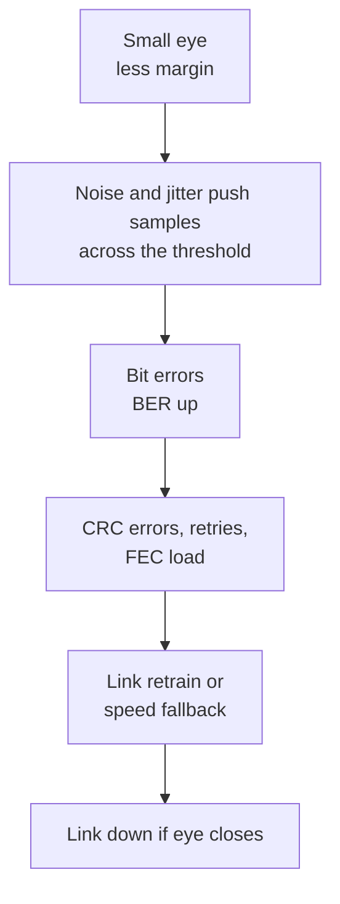

::: testing
Whether you can connect a **small eye** to its practical consequence (bit errors), explain *why* errors appear (noise and jitter push samples across the decision threshold), and name the metrics people use to put a number on it: eye height and eye width (mV, ps or % of UI), the **Q factor**, and the **bit error rate (BER)**, plus related views like the bathtub curve and mask margin. A strong answer gives the Gaussian relation $BER = \tfrac12\operatorname{erfc}(Q/\sqrt2)$ and an intuition for how steeply BER depends on eye margin.
:::

::: why
The eye is only useful if it can be turned into a pass/fail or a margin number. Link designers use Q and BER to decide whether a channel needs equalization, whether a design meets spec with margin, and how a few millivolts of noise or a few picoseconds of jitter translate into errors. Because BER depends exponentially on margin, a seemingly small closure can change the error rate by many decades, so understanding the relationship is essential for design reviews and debugging.
:::

::: concepts
- **Eye height / width**: voltage and timing margin at the sampling point. See [[q0698]].
- **Gaussian noise and the Q factor**: the number of standard deviations between decision level and signal level. See [[q0695]].
- **Bit error rate (BER)**: errors per bit received; link specs are typically $10^{-12}$ or better.
- **Decision threshold and sampling point**: the receiver compares the sampled value with a threshold.
- **ISI and jitter closing the eye**: [[q0687]], [[q0703]].
- **Forward error correction (FEC)**: allows a worse raw BER by correcting errors.
:::

::: answer
"If the eye is too small, the receiver has less margin, so noise and jitter can push a sample across the decision threshold and it reads the wrong bit. That's a bit error. Because noise is roughly Gaussian, the error rate goes up very steeply as the eye closes: a modest shrink can turn one error in $10^{12}$ bits into one in $10^{6}$. In a real system you see CRC errors, retransmissions, link retraining or fallback to a lower speed, or in the worst case the link doesn't come up at all.

To put a number on it, the usual metrics are the eye height and eye width, in millivolts and picoseconds or as a fraction of the unit interval; the Q factor, which is the separation between the signal levels divided by the sum of the noise standard deviations; and ultimately the bit error rate. They're connected: $BER = \frac12 \mathrm{erfc}(Q/\sqrt2)$, so Q of 7 corresponds to about $10^{-12}$ and Q of 6 to about $10^{-9}$.

You'd also look at a bathtub curve, which plots BER versus sampling position across the UI, and at mask margin for compliance. If the eye is small, you fix the causes: equalize the loss, reduce reflections, jitter and noise."
:::

::: technical
**Mechanism.** Let the received sample at the decision instant be $x = \pm\mu + n$ for bit values 1 and 0, with $n$ Gaussian of rms $\sigma$ (the symmetric case). The decision threshold sits midway; an error occurs when $n$ pushes the sample past it. With $\mu_1-\mu_0$ the separation of the two levels and noise $\sigma_1$, $\sigma_0$ on each level:

$$Q = \frac{\mu_1 - \mu_0}{\sigma_1 + \sigma_0},\qquad BER = \frac12\operatorname{erfc}\!\left(\frac{Q}{\sqrt2}\right)$$

| $Q$ | BER |
|---|---|
| 3 | $1.35\times10^{-3}$ |
| 4 | $3.2\times10^{-5}$ |
| 5 | $2.9\times10^{-7}$ |
| 6 | $9.9\times10^{-10}$ |
| 7 | $1.3\times10^{-12}$ |
| 8 | $6.2\times10^{-16}$ |

**Eye height at a BER.** $H_{eye}(BER) = (\mu_1 - \mu_0) - Q(BER)(\sigma_1+\sigma_0)$; for symmetric noise $\sigma$ and $Q = 7.03$ (BER $10^{-12}$), $H_{eye} = \Delta\mu - 14.07\sigma$.

**Example.** Level separation 400 mV and $\sigma = 15$ mV each: $Q = 400/30 = 13.3$, BER $\approx 7\times10^{-41}$. If ISI collapses the separation at the sample point to 200 mV: $Q = 6.67$, BER $= 1.3\times10^{-11}$, which fails a $10^{-12}$ requirement. The signal amplitude halved (a 6 dB closure) and BER got worse by about 30 decades.

**Timing axis.** Eye width $= UI - TJ(BER)$ with $TJ = DJ + 2Q\sigma_{RJ}$ ([[q0695]]). The *bathtub curve* is BER versus sampling position; the width of the bathtub at the target BER is the eye width.

**Compact measures of closure.** Eye opening ratio $= H_{eye}/A_{pp}$; eye closure penalty in dB, $20\log_{10}(H_{eye}/A_{pp})$ (e.g. $431/800$ mV is $-5.4$ dB); mask margin (how far a mask can be scaled before hits occur, [[q0700]]).
:::

::: short
"A small eye means little margin, so noise and jitter push samples across the threshold and you get bit errors. Because noise is Gaussian, BER rises exponentially as the eye closes. It's represented by eye height and width in mV and ps or UI, by the Q factor, which is level separation over the sum of noise sigmas, and by BER, related by $BER = \frac12\mathrm{erfc}(Q/\sqrt2)$. Q of 7 is about $10^{-12}$. Bathtub curves and mask margin give the timing and compliance views."
:::

::: long
"If the eye is too small, the receiver doesn't have enough margin. The eye height is how far apart the 1 and 0 levels are at the sampling point, and the eye width is how much time you have around that point. When either shrinks, noise and jitter can push a sample onto the wrong side of the threshold, and the receiver gets the bit wrong. So the direct consequence is bit errors.

What makes this nasty is that the noise is roughly Gaussian, so the error rate depends exponentially on the margin. Let's say my level separation is 400 millivolts with 15 millivolts of noise on each level. That's a Q of 400 over 30, about 13, and an error rate that is effectively zero. Now let ISI squash the separation at the sampling point to 200 millivolts, same noise. Q drops to 6.7, and the BER is about $10^{-11}$, which fails a $10^{-12}$ spec. Half the amplitude, but dozens of orders of magnitude in error rate.

In the system you'd see CRC errors, retransmissions, the link retraining or falling back to a lower speed, and with very small eyes the clock-and-data recovery can lose lock.

The numbers we use to represent the eye are eye height and eye width, in millivolts and picoseconds or as a fraction of the unit interval, the Q factor, and the BER. They're linked: BER equals one half erfc of Q over root 2, so Q equal to 6 is about $10^{-9}$ and Q equal to 7 about $10^{-12}$. For timing there's the bathtub curve of BER versus sampling position, whose width at the target BER is the eye width. And for compliance there's the mask margin."
:::

::: terms
- **BER (bit error rate)**: fraction of received bits that are wrong; spec targets like $10^{-12}$.
- **Q factor**: $(\mu_1-\mu_0)/(\sigma_1+\sigma_0)$; the number of effective sigmas of margin.
- **Eye height / eye width**: voltage and timing opening at the sampling point or at a BER contour.
- **Bathtub curve**: BER versus sampling position across the UI.
- **Eye closure penalty**: loss of eye opening expressed in dB.
- **Decision threshold**: the level the receiver compares the sample against.
- **FEC**: forward error correction; corrects bit errors and relaxes the raw BER requirement.
- **BERT**: bit error rate tester.
:::

::: exceptional
An average answer says "small eye means errors" and mentions BER. An exceptional answer shows **why the error rate is so sensitive** by giving $BER = \frac12\operatorname{erfc}(Q/\sqrt2)$ and a quick table (Q = 6, 7, 8 giving $10^{-9}$, $10^{-12}$, $10^{-16}$), works a numerical example where halving the level separation moves BER by ~30 decades, lists the other representations (eye height/width at a BER, bathtub, mask margin, closure penalty in dB), and states the system symptoms (CRC errors, retrain, fallback, CDR losing lock). It also notes that measured eyes on a scope show only about $10^{-6}$ probabilities, so deep BER needs extrapolation or a BERT, and that FEC changes the required raw BER.
:::

::: mistakes
- **Treating the eye size as linearly related to errors.** BER changes exponentially with margin, so small closures can have enormous effects.
- **Assuming noise is the only cause.** A small eye can come from ISI (loss), reflections, jitter or crosstalk; Q alone doesn't say which.
- **Using peak-to-peak noise instead of rms.** Q needs rms $\sigma$; peak-to-peak depends on how long you look.
- **Quoting eye height without the BER or probability level.** "Eye height 120 mV" means little unless it says at what BER or histogram percentile.
- **Ignoring non-Gaussian effects.** Deterministic noise (ISI, crosstalk) is bounded and shifts the level rather than adding a Gaussian tail; mixing them needs a proper statistical-eye or bathtub analysis.
- **Believing a clean scope eye proves $10^{-12}$.** A million UIs shows events down to roughly $10^{-6}$.
:::

::: deep
## From a small eye to a wrong bit

Look at the receiver's decision. It samples the signal at the centre of the eye and compares with a threshold midway between the two levels. If the signal level (after ISI) at that instant is $\pm\mu$ and noise is $n$, the sample is wrong when noise is bigger than $\mu$ and opposite in sign. The probability depends on how many standard deviations $\mu$ is from the threshold.


Figure: The chain from a marginal eye to a system-level failure. Each step can be seen in software (error counters, retrain events) long before the link actually fails.

For a Gaussian noise of rms $\sigma$ and a decision distance $d = (\mu_1-\mu_0)/2$ from the threshold, $P(\text{error}) = \tfrac12\operatorname{erfc}\!\big(d/(\sigma\sqrt2)\big)$ — for equal $\sigma$ on both levels that equals the $Q$ expression above, with $Q = d/\sigma$.

## BER versus Q

The Gaussian tail drops super-exponentially with $Q$:

```plot
{"title":"BER versus Q (Gaussian noise, NRZ)","x":{"label":"Q factor","min":1,"max":9},"y":{"label":"bit error rate","min":"1e-20","max":1,"log":true},
 "series":[{"label":"BER = 0.5 erfc(Q/√2)","points":[[1,0.1587],[2,0.02275],[3,0.00135],[4,0.00003167],[5,2.867e-7],[6,9.866e-10],[7,1.28e-12],[8,6.221e-16],[9,1.129e-19]]}],
 "hlines":[{"at":"1e-12","label":"1e-12 target","color":"orange"}],
 "points":[{"x":7,"y":"1.28e-12","label":"Q=7"},{"x":6,"y":"9.87e-10","label":"Q=6"}]}
```
Figure: Each unit of Q near Q = 7 changes the BER by about three decades. A link that should have Q = 8 (BER of $10^{-16}$) but has lost 25% of its margin lands at Q = 6 and an error every billion bits, which at 10 Gb/s is ten errors per second.

At 10 Gb/s, $BER = 10^{-12}$ means one error every 100 seconds; $BER = 10^{-9}$ means ten per second. If a protocol has a CRC/retry, those become retransmissions; at higher rates the retry load increases.

## A worked example: how ISI wrecks Q

Take a link with a level separation (at the sampling instant) of 400 mV in an ideal channel, and 15 mV rms of noise on each level:

| Case | Level separation | Noise $\sigma_1+\sigma_0$ | $Q$ | BER |
|---|---|---|---|---|
| Ideal channel | 400 mV | 30 mV | 13.3 | $7\times10^{-41}$ |
| ISI closes it by 25% | 300 mV | 30 mV | 10.0 | $8\times10^{-24}$ |
| ISI closes it by 50% | 200 mV | 30 mV | 6.67 | $1.3\times10^{-11}$ |
| 50% ISI and noise doubled | 200 mV | 60 mV | 3.33 | $4.3\times10^{-4}$ |

Minimum separation to hold BER $10^{-12}$ with 15 mV on each level: $Q\,(\sigma_1+\sigma_0) = 7.03 \cdot 30 = 211$ mV. So the receiver needs a sampling-point separation of at least about 211 mV, and the eye height that remains above it is the margin.

The same arithmetic applies in time with jitter: eye width $= UI - DJ - 2Q\sigma_{RJ}$.

## Numbers people actually quote

- **Eye height** in mV at a stated BER or histogram percentile (e.g. at the $10^{-12}$ contour). **Eye width** in ps or UI.
- **Eye opening ratio** $H_{eye}/A_{pp}$ and **closure penalty** in dB: with $H_{eye} = 431$ mV out of 800 mV, $20\log_{10}(431/800) = -5.4$ dB; a 50% eye is $-6.0$ dB.
- **Q factor** and **BER**; in optics, "Q in dB" is $20\log_{10}Q$ (Q = 7 is 16.9 dB).
- **Bathtub curve** (BER versus sampling position) and **BER contours** (statistical eye).
- **Mask margin** (percent a mask can be enlarged before it's hit, [[q0700]]).

```sim
{"id":"eye-diagram","rate":5e9,"bw":1.2e9,"noise":0.04,"jitter":0.05}
```
Figure: A bandwidth-limited channel with noticeable noise and jitter gives a small eye. Note the eye height and width readout and the mask violations. Then raise the bandwidth, lower the noise and jitter, or use pre-emphasis, and watch the opening recover; the metrics here are the numbers you'd quote.

## What the receiver sees versus what the scope sees

A scope eye is the analog waveform at the probe point. Real receivers contain a CTLE and/or DFE that can open an eye that looks closed on a scope; many standards therefore define the eye after a *reference receiver* (a specified equalizer). The BER you'd get is determined by the post-equalization eye plus the receiver's own noise. So "the eye is closed on the scope" does not automatically mean "link fails", but it does mean the receiver is working hard and has little margin to spare.

> [!INTERVIEW]
> A tidy way to close the answer: "Small eye means less margin, margin turns into BER exponentially, so I'd quantify with Q and BER, then find which impairment (loss, reflections, jitter, noise) dominates and fix that." This shows you think in causes.

## Bathtub and the 1e-12 problem

You can't measure $10^{-12}$ BER on a scope in a reasonable time (it needs trillions of bits). Instead, measure the Gaussian parts of noise and jitter at shallower probabilities (e.g. $10^{-6}$ to $10^{-8}$), fit the tails, and extrapolate to $10^{-12}$ ("bathtub extrapolation"). The deterministic parts are bounded and are added back. A BERT then confirms the final number, with the zero-error confidence rule: for 95% confidence of BER below $B$ you need about $3/B$ error-free bits (so $3\times10^{12}$ bits, about 5 minutes at 10 Gb/s).
:::

::: applications
- **Link compliance and margin testing**: BER and eye-height/width measurements at the receiver.
- **Equalizer tuning**: adapting CTLE/DFE/TX settings to maximise eye or minimise BER.
- **Optical communications**: Q factor and Q in dB are the standard link-quality figure; FEC relaxes the raw BER.
- **Memory interface margining (DDR)**: sweep sampling position and reference voltage to find the eye and pick the centre.
- **Cable and connector qualification**: eye closure versus length determines maximum reach.
- **Production test**: eye height or margin screening to remove marginal units.
:::

::: assumptions
- **Gaussian noise**, equal on both levels unless stated; real links have additional bounded (deterministic) noise and pattern-dependent effects.
- **NRZ signalling** with a mid-level threshold; PAM4 has three eyes and different Q and BER relations.
- **Level separation measured at the sampling instant** after ISI; the "ideal" separation uses the open-channel swing.
- **Independent bit errors** for the BER formula; burst errors (from DFE error propagation or supply events) change the statistics.
- **BER targets vary** by standard, and FEC-protected links tolerate raw BER many decades worse than $10^{-12}$.
:::

::: followups
### If the Q factor is 6, what is the BER and is that acceptable?
$BER = \tfrac12\operatorname{erfc}(6/\sqrt2) \approx 1\times10^{-9}$. For an uncoded link requiring $10^{-12}$ it isn't acceptable; at 10 Gb/s you'd get about 10 errors per second. If the link has FEC that corrects up to a raw BER of, say, $10^{-4}$ or so (depends on the code), it may be fine.

### Why does BER depend so steeply on eye height?
Because Gaussian tails fall off as $e^{-Q^2/2}$. Moving from Q = 7 to Q = 6 reduces the BER margin by a factor of about 770. The error probability depends on the *tail* of the noise distribution beyond the margin, and tails drop super-exponentially.

### How do you measure BER down to 1e-12 on a bench?
Directly with a BERT: send a PRBS and count errors, which takes $3/10^{-12} = 3\times10^{12}$ bits (5 minutes at 10 Gb/s) for 95% confidence of $<10^{-12}$ if zero errors occur. Or indirectly: measure noise and jitter histograms at shallow probabilities, extrapolate Gaussian tails (a bathtub), and add the deterministic components.

### My eye is small only at the high-temperature corner. What could be changing?
Channel loss increases with temperature (copper resistance, dielectric loss), driver swing may fall, receiver noise rises and PLL jitter can increase. I'd measure eye height and width at temperature extremes and see which one moves; if it's loss, retune equalization; if jitter, check supply and reference clock.

### What does "eye closure penalty of 3 dB" mean in practice?
The eye opening is $10^{-3/20} = 71\%$ of the ideal opening. Whether that's acceptable depends on the margin budget; since BER depends exponentially on Q, a 3 dB penalty reduces Q by 29%. If you had Q = 9 it becomes 6.4 (BER $10^{-10}$), so a link that was safe may now be marginal.
:::

::: interpretations
The question has a typo ("what happens of the eye diagram" means "what happens if the eye diagram"). The second part, "What is often used to represent this?", most naturally asks for the **bit error rate (BER)** and the **Q factor** (and eye height/width numbers). I've covered all of them and the relationship between them.
:::

::: references
- Eric Bogatin, *Signal and Power Integrity: Simplified*: BER, Q and the relationship to eye margin.
- Govind Agrawal, *Fiber-Optic Communication Systems*: the Q factor and BER formula for NRZ links (receiver performance chapter).
- Howard Johnson & Martin Graham, *High-Speed Digital Design: A Handbook of Black Magic*: timing margins.
- Oscilloscope and BERT vendor application notes on bathtub curves and BER extrapolation (consult your instrument documentation).
:::

::: rubric
- States that a small eye reduces margin so noise/jitter cause bit errors :: The core consequence.
- Explains the exponential/Gaussian sensitivity of BER to margin :: Why a small closure matters so much.
- Names the representations: eye height/width, Q factor, BER :: This directly answers "what is often used to represent this".
- Gives $BER=\frac12\mathrm{erfc}(Q/\sqrt2)$ and a reference point (Q=7 gives $10^{-12}$) :: Quantitative fluency.
- Mentions bathtub curve / mask margin / closure penalty :: Completes the toolkit.
- Describes system symptoms (CRC errors, retrain, fallback) :: Connects the number to the product behaviour.
:::

::: quiz
```json
[
 {"type":"mcq","level":"fundamental","q":"What is the most direct consequence of a very small eye?","options":["Higher power consumption","Bit errors at the receiver","Lower clock frequency","Lower supply voltage"],"answer":1,"explain":"With little margin, noise and jitter push samples across the decision threshold and cause bit errors."},
 {"type":"mcq","level":"fundamental","q":"Which pair is most commonly used to quantify link quality from an eye?","options":["Power and efficiency","Q factor and BER","Slew rate and overshoot","Duty cycle and frequency"],"answer":1,"explain":"Q (level separation over summed noise) and BER are linked by $BER=\\frac12\\mathrm{erfc}(Q/\\sqrt2)$."},
 {"type":"numeric","level":"intermediate","q":"Level separation at the sampling point is 350 mV with 25 mV rms noise on each level. What is Q?","answer":7,"tolerance":0.02,"unit":"","explain":"$Q=350/(25+25)=7.0$, which corresponds to a BER of about $1.3\\times10^{-12}$."},
 {"type":"numeric","level":"intermediate","q":"A channel has eye height 300 mV for an ideal 800 mV swing. What is the eye closure penalty magnitude in dB ($20\\log_{10}(800/300)$)?","answer":8.52,"tolerance":0.02,"unit":"dB","explain":"$20\\log_{10}(800/300)=20\\cdot0.426=8.52$ dB."},
 {"type":"numeric","level":"intermediate","q":"With Gaussian noise of 12 mV rms on each level and target $Q=7.03$, what minimum level separation (mV) is needed at the sampling point?","answer":169,"tolerance":0.02,"unit":"mV","explain":"Separation $=Q(\\sigma_1+\\sigma_0)=7.03\\cdot24=168.7$ mV."},
 {"type":"truefalse","level":"advanced","q":"Halving the level separation (same noise) changes the BER only by roughly a factor of two.","answer":false,"explain":"Q halves, and BER depends on $e^{-Q^2/2}$, so the change is many orders of magnitude (e.g. Q from 13 to 6.7 moves BER from $10^{-40}$ to $10^{-11}$)."}
]
```
:::
