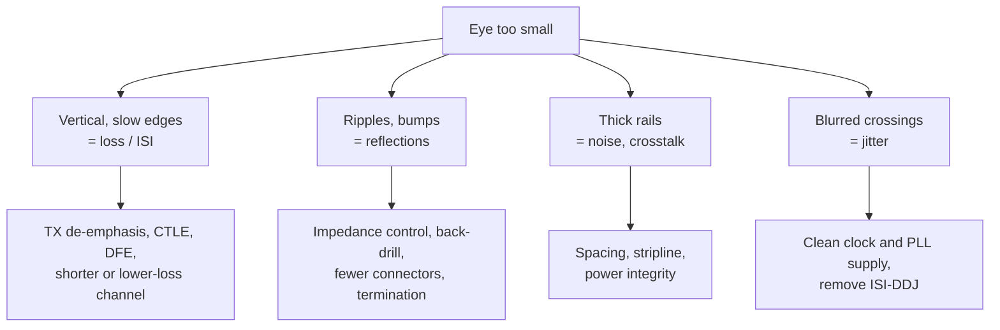

::: basics
### In plain words
To open up a small eye, diagnose first and fix second. Work out which direction is closed. If the eye is too short, the cause is signal loss, smearing between bits, reflections or noise. If it is too narrow, the cause is timing jitter. Each cause has its own fix.

### Picture it
Imagine a blurry photo. The blur could come from a shaky hand, a smudged lens or the wrong focus. Cleaning the lens does nothing for a shaky hand. You look at the blur first (is it a smear in one direction? a haze everywhere?) and then pick the cure. An eye diagram works like that photo: its shape tells you what is wrong before you touch anything.

### Words you need
- **Eye height / width**: the vertical and horizontal opening of the eye ([[q0698]]).
- **Inter-symbol interference (ISI)**: each bit smearing into the bits after it because the channel is slow.
- **Channel loss**: signal weakening along the trace or cable. High frequencies are weakened the most.
- **Equalization**: boosting what the channel weakened most, so the signal arrives more even.
- **Reflection**: part of a signal bouncing back where the wire's impedance (how it resists the traveling signal) suddenly changes ([[q0711]]).

### The simplest example
A 10 Gb/s signal runs through a lossy board trace. The eye is short and the edges look slow, so the cause is channel loss and ISI, not noise.

One fix is transmitter de-emphasis: send a transition at full strength, then send repeated bits at about two-thirds strength (about -3.5 dB). On an 800 mV swing, repeated bits go out at roughly 533 mV. The channel weakens fast transitions more than steady runs, so the two arrive closer in size, and the eye opens.

Other fixes: a receiver equalizer, a shorter or lower-loss trace, and a wire with uniform impedance to cut reflections.

That is the whole idea: find which axis is closed, then use the matching lever. The rest of this page covers equalizers, board changes, and a worked scenario.
:::

::: testing
Whether you can **diagnose before you prescribe**: first work out *which* axis of the eye is closed (vertical from ISI, noise, reflections or low swing; horizontal from jitter), then choose the right lever. A strong answer has two families of fixes: improve the **channel** (less loss, fewer reflections, less crosstalk, cleaner clock and supplies) and add **equalization** (TX de-emphasis/FFE, RX CTLE, DFE). Bonus: you know that equalization can over-correct and shrink an already open eye, that CTLE amplifies noise and DFE doesn't, and you can give a number for how much a de-emphasis setting helps.
:::

::: why
At multi-gigabit rates a channel is almost never good enough on its own: FR-4 loss at 5 GHz is significant, vias and connectors reflect, and everything couples to everything. The job of the SI engineer is to find the cheapest combination of layout, materials and equalization that opens the eye with margin. Interviewers ask this to see whether you reason from the impairment (loss, reflection, jitter) to the fix, rather than reciting a list.
:::

::: concepts
- **Eye height and width budget**: $H_{eye}\approx h_0-\sum|h_k|-2Q\sigma$ and $W_{eye}\approx UI-TJ$. See [[q0698]], [[q0699]].
- **Channel loss**: skin effect and dielectric loss grow with frequency, causing ISI. See [[q0697]].
- **Reflections**: impedance discontinuities create ripples and DJ. See [[q0711]].
- **Crosstalk**: noise from neighbouring lines. See [[q0694]].
- **Jitter sources and budgets**: [[q0695]], [[q0703]].
- **Mask and margin**: the target the eye must meet. See [[q0700]].
:::

::: answer
"I'd first look at what's closing the eye. If it's closed vertically with slow edges, it's loss and ISI. If there are ripples, it's reflections. If the rails are thick, it's noise or crosstalk. If the crossings are blurred, it's jitter.

For ISI from loss, equalization is the main tool. At the transmitter, de-emphasis or pre-emphasis boosts the high-frequency content of each transition relative to long runs of identical bits; at the receiver, a CTLE boosts high frequencies and a DFE subtracts the estimated ISI from earlier bits. I'd tune them together, because too much equalization over-corrects and closes the eye again.

At the channel level, I'd reduce loss with shorter, wider traces, a lower-loss laminate and smoother copper, and cut reflections by controlling impedance, fixing via stubs with back-drilling and avoiding connectors or stubs. For noise, increase spacing or use stripline to reduce crosstalk, and clean the power supplies. For jitter, use a low-jitter reference clock and quiet PLL supply. And if all else fails I can increase the swing within spec, or lower the data rate."
:::

::: technical
**Eye budget.** With pulse-response cursors $h_k$ (main cursor $h_0$) and Gaussian noise $\sigma$:

$$H_{eye} \approx h_0 - \sum_{k\neq0}|h_k| - 2Q\sigma,\qquad W_{eye}\approx UI - TJ(BER)$$

Each fix targets one term.

**Raise $h_0$ / signal.** Increase transmit swing (limited by the standard, power, EMI), reduce channel loss.

**Reduce ISI $\sum|h_k|$.**
- *Channel*: lower loss. Dielectric loss in dB/in $\approx 2.3\,f_{GHz}\tan\delta\sqrt{\varepsilon_r}$ (an approximation for the dielectric term only): FR-4 ($\tan\delta=0.02$, $\varepsilon_r=4.2$) at 5 GHz is about 0.47 dB/in, i.e. 4.7 dB for 10 in; a low-loss laminate ($\tan\delta=0.004$, $\varepsilon_r=3.6$) is about 0.087 dB/in, 0.87 dB for 10 in. Conductor loss (skin effect, copper roughness) adds on top.
- *TX de-emphasis (FIR)*: taps $[1-c,\,-c]$ keep the peak swing the same and reduce the amplitude of repeated bits: $20\log_{10}(1-2c)$ dB. With $c=1/6$, $-3.5$ dB.
- *RX CTLE*: an analog high-frequency boost (zero/pole pair) at Nyquist; also boosts high-frequency noise and crosstalk.
- *RX DFE*: subtracts the post-cursor ISI of already-decided bits; doesn't amplify noise, but has error propagation and can't remove pre-cursor or the first-tap timing constraint.

**Reduce reflections** (they add ripple and DDJ): controlled impedance, tight via design, back-drill stubs, minimise connectors, terminate or match ends.

**Reduce noise $\sigma$:** spacing/stripline for crosstalk ([[q0694]]), power-integrity (decoupling, low-noise regulators), receiver front-end design.

**Reduce jitter:** low-jitter reference clock, clean PLL supply, remove periodic supply coupling, equalize to remove ISI-based DDJ.

**Numerical example (single-pole channel).** For a channel with $-3$ dB bandwidth of $0.25/UI$ (1.25 GHz at 5 Gb/s), the peak-distortion eye (normalized to one bit's amplitude) is 0.584; a TX de-emphasis of $c=0.172$ ($-3.7$ dB) raises it to 0.656. For a worse channel at $0.15/UI$, it rises from 0.22 to 0.44 with $c=0.28$ ($-7.2$ dB).
:::

::: short
"First I'd see which direction the eye is closed. For vertical closure from loss and ISI, I'd add equalization: transmitter de-emphasis, a CTLE and DFE at the receiver, tuned together because over-equalizing closes the eye too. And I'd fix the channel: shorter or wider traces, lower-loss material, back-drilled vias and controlled impedance for reflections, spacing for crosstalk. For horizontal closure I'd reduce jitter with a cleaner clock and supply. Raising the swing or lowering the rate are the last resorts."
:::

::: long
"My approach is to diagnose first, then pick the lever, because the fixes are different depending on how the eye is closed.

If the eye is closed vertically and the edges look slow and the rails sag toward the middle, that's inter-symbol interference from channel loss. The main tool there is equalization. At the transmitter, de-emphasis or pre-emphasis reduces the amplitude of repeated bits relative to transitions, which pre-compensates for the channel's high-frequency loss. For example, one-sixth of the swing as a post-cursor tap gives about 3.5 dB of de-emphasis. At the receiver, a CTLE gives a high-frequency boost, and a DFE subtracts the interference from bits it has already decided. The key is to tune them together; too much equalization over-corrects and I've seen it shrink an eye that was already fine.

I'd also attack the channel. Loss rises with frequency from skin effect and dielectric loss, so shorter traces, wider traces, a lower-loss laminate and smoother copper help. If there are ripples or notches, it's reflections, so I'd control impedance, remove via stubs by back-drilling, and avoid unnecessary connectors. If the rails are thick, it's noise: spacing from aggressors, stripline, a cleaner supply. If the crossings are blurred, it's jitter: low-jitter reference and a quiet PLL supply, and equalization to remove data-dependent jitter.

If I've done all that and I still can't close the budget, I can increase the transmit swing within the standard, or lower the data rate. Then I'd measure the eye or mask margin to confirm that each change actually helped."
:::

::: terms
- **ISI**: inter-symbol interference; each bit smears into following bits because of limited bandwidth.
- **De-emphasis / pre-emphasis**: transmitter equalization that reduces repeated-bit amplitude relative to transitions.
- **FFE / FIR**: feed-forward equalizer built from a few taps on the transmitted symbols.
- **CTLE**: continuous-time linear equalizer; a receiver high-frequency boost.
- **DFE**: decision-feedback equalizer; subtracts post-cursor ISI using past decisions.
- **Insertion loss**: attenuation versus frequency through the channel.
- **Back-drilling**: removing the unused via stub with a larger drill to cut reflections and resonance.
- **Over-equalization**: too much boost, which creates pre-cursor ISI and amplifies noise.
:::

::: exceptional
An average answer lists "equalization, better PCB, lower jitter". An exceptional answer says **diagnose first** (vertical vs horizontal closure and the signature of each), maps each impairment to its fix, and quantifies at least one: the de-emphasis relation ($20\log_{10}(1-2c)$), the loss in dB/in for FR-4 versus a low-loss laminate, or a peak-distortion eye improvement. It explains **trade-offs**: CTLE boosts noise and crosstalk, DFE has error propagation, de-emphasis lowers the low-frequency amplitude, over-equalization closes the eye, and more swing raises EMI and power. It ends with **verification** by eye/mask margin or BER, not just "looks better".
:::

::: mistakes
- **Equalizing a channel that doesn't need it.** For a low-loss channel de-emphasis reduces the low-frequency amplitude and can shrink the eye.
- **Treating all closure as loss.** Reflections and jitter need different fixes; equalization can't undo a strong reflection or a stub resonance.
- **Cranking the swing.** It scales signal but also crosstalk and EMI, and the standard limits it; it doesn't fix ISI as a fraction of the eye.
- **Boosting with CTLE blindly.** It amplifies high-frequency noise and crosstalk as much as the signal.
- **Ignoring the receiver's equalizer when judging the eye.** A closed eye at the receiver pin can open after DFE/CTLE; evaluate the equalized eye.
- **Tuning TX and RX equalizers independently.** They interact; use the link training or sweep them together while watching margin.
:::

::: deep
## Where the eye closes, and what that tells you

The eye's shape is the story. Four characteristic closures:


Figure: A diagnostic tree from the eye's signature to the fix. The first row of boxes is what you see; the second is where to apply effort. Work from top to bottom and re-measure after each change.

## ISI as the main enemy: a one-pole channel example

For a channel with a single-pole low-pass response of bandwidth $BW$ (in units of $1/UI$), a one-UI pulse is smeared into later UIs. Sampling at the end of each bit, the pulse response is $h_0 = 1-a$ and the post-cursors are $h_k = (1-a)\,a^k$ with $a = e^{-2\pi\,BW}$. The peak-distortion eye opening (all ISI adding against you) is $h_0 - \sum_{k\ge1}h_k$:

| Channel $BW$ ($1/UI$) | $a$ | $h_0$ | Unequalized eye |
|---|---|---|---|
| 0.5 | 0.043 | 0.957 | 0.914 |
| 0.25 | 0.208 | 0.792 | 0.584 |
| 0.15 | 0.390 | 0.610 | 0.221 |

At $BW = 0.15/UI$ (750 MHz at 5 Gb/s) the eye is nearly closed before any noise or jitter.

**TX de-emphasis.** A two-tap FIR $[1-c,\,-c]$ (sum of magnitudes = 1, same peak swing) gives equalized cursors $g_0=(1-c)h_0$ and $g_k=h_0\,a^{k-1}\big[(1-c)a-c\big]$ for $k\ge1$. The post-cursor ISI vanishes when $c = a/(1+a)$, and the eye becomes simply $g_0 = h_0(1-c)$:

| $BW$ | optimum $c$ | de-emphasis $20\log_{10}(1-2c)$ | Eye at optimum |
|---|---|---|---|
| 0.5 | 0.041 | −0.75 dB | 0.917 |
| 0.25 | 0.172 | −3.7 dB | 0.656 |
| 0.15 | 0.280 | −7.2 dB | 0.439 |

So the worse the channel, the more de-emphasis it wants, and the eye roughly doubles for the bad channel.

```plot
{"title":"Peak-distortion eye vs de-emphasis coefficient c for three single-pole channels","x":{"label":"de-emphasis coefficient c (tap = -c)","min":0,"max":0.4},"y":{"label":"normalized eye opening","min":0,"max":1},
 "vars":{"a1":"exp(-2*pi*0.15)","a2":"exp(-2*pi*0.25)","a3":"exp(-2*pi*0.5)"},
 "series":[{"label":"BW = 0.15/UI","fn":"(1-a1)*((1-x)-abs((1-x)*a1-x)/(1-a1))","n":400,"color":"red"},{"label":"BW = 0.25/UI","fn":"(1-a2)*((1-x)-abs((1-x)*a2-x)/(1-a2))","n":400,"color":"blue"},{"label":"BW = 0.5/UI","fn":"(1-a3)*((1-x)-abs((1-x)*a3-x)/(1-a3))","n":400,"color":"green"}],
 "points":[{"x":0.28,"y":0.439,"label":"best for BW 0.15"},{"x":0.172,"y":0.656,"label":"best for BW 0.25"}]}
```
Figure: Each curve rises to a peak at the optimum c, then falls. Past its peak every channel lands on the same line, eye = 1 − 2c, because the equalizer then over-corrects by more than the channel hurts. The lossy channel (red) benefits a lot; the good channel (green) peaks at tiny c and is hurt by anything larger: at c = 1/6 (−3.5 dB) its eye drops from 0.91 to 0.67. This is over-equalization, which is why the setting must match the channel.

> [!NOTE]
> This is a peak-distortion model of a single-pole channel with a two-tap FIR, ignoring noise, reflections and jitter. Real channels (skin effect, dielectric loss, reflections) have pre-cursors and long tails; real equalizers use more taps and adapt. The *trend* — optimum grows with loss, over-equalization hurts — is what to remember.

## Receiver-side equalization

| | CTLE | DFE |
|---|---|---|
| What it does | analog high-frequency boost | subtracts ISI from past decisions |
| Noise | amplifies high-frequency noise and crosstalk | doesn't amplify noise |
| Handles | pre- and post-cursor ISI | post-cursor ISI only |
| Risk | noise enhancement | error propagation, timing closure on the first tap |

In practice modern SerDes combine TX FFE, RX CTLE and RX DFE with adaptation during link training.

## Channel and board improvements

- **Loss.** The dielectric term alone is about $2.3\,f_{GHz}\tan\delta\sqrt{\varepsilon_r}$ dB/in: 0.47 dB/in for FR-4 at 5 GHz versus 0.087 dB/in for a $\tan\delta=0.004$ laminate. Over 10 in that is 4.7 dB versus 0.9 dB, before conductor loss, which depends on $\sqrt f$ and copper roughness. Wider traces cut conductor loss; shorter lengths cut both.
- **Reflections.** Via stubs act as resonators; a stub of length $\ell$ resonates at $f \approx v/(4\ell)$; back-drill or use blind/buried vias. Keep impedance within tolerance, minimise connectors, and use matched terminations ([[q0711]]).
- **Crosstalk.** Spacing, stripline, tightly coupled pairs ([[q0694]]).
- **Power/clock.** Quiet supplies for PLLs and clock buffers; supply noise couples into jitter ([[q0695]]).
- **Swing and rate.** More TX swing (if the standard allows) raises $h_0$ and the eye in absolute volts but not relative ISI. Dropping the data rate is the guaranteed fix.

> [!UNCERTAIN]
> Laminate loss tangents and dielectric constants depend on frequency, resin content and glass weave; the values above are typical orders of magnitude. Use the laminate vendor's data and a field solver for real work.

## Try the equalization effect

```sim
{"id":"eye-diagram","rate":5e9,"bw":1e9,"noise":0.02,"jitter":0.02,"preemph":3.5}
```
Figure: A 5 Gb/s link through a 1 GHz (0.2/UI) channel with 3.5 dB of de-emphasis. Set de-emphasis to 0: the inner eye drops from about 420 mV to about 330 mV and the width from about 0.78 to 0.63 UI; then raise the channel bandwidth to 5 GHz and see whether the same 3.5 dB makes it better or worse. Try to find the setting that maximises eye height for each bandwidth.

## A scenario: eye closed at 16 in of FR-4 at 10 Gb/s

1. Measure the TX output eye first: is the source clean? If yes, the loss is in the channel.
2. Get the channel's SDD21 at 5 GHz (Nyquist): at about 0.47 dB/in dielectric plus conductor loss, ~16 in will be well over 10 dB.
3. Enable TX de-emphasis and RX CTLE (and DFE if available) per the link-training guidance; sweep them while watching eye height/BER.
4. If a stub resonance shows in SDD21 or TDR, back-drill or re-route; equalization can't undo a resonance notch.
5. If still short, move to lower-loss material for the next spin, shorten the trace, or add a retimer/redriver.
:::

::: applications
- **PCIe, SATA, USB 3, 10G Ethernet**: TX FFE, CTLE and DFE with link training to tune the eye.
- **Backplane and cable design**: low-loss laminate, back-drilled vias and connector selection to meet channel budgets.
- **Retimers and redrivers**: restore the eye in the middle of a long channel (a retimer re-clocks, a redriver only equalizes).
- **DDR memory**: write/read training sets timing and, in newer generations, DFE and equalization settings.
- **HDMI/DisplayPort cables**: active cables use built-in equalizers to open the eye at the sink.
- **Optical modules**: electrical interface equalization plus module-side CDR to open the eye at the host.
:::

::: assumptions
- **Linear, time-invariant channel** for the equalization numbers; nonlinear driver behaviour and adaptation are neglected.
- **Single-pole channel and two-tap FIR** in the worked example, a deliberate simplification of real channels.
- **Peak-distortion eye**: worst-case ISI, ignoring noise and jitter; statistical eyes are less pessimistic.
- **Loss-dominated closure** for the equalization story; reflection-dominated channels need layout fixes first.
- **Standards limit TX swing and de-emphasis ranges**; the chosen settings must stay within them, and some links use automatic adaptation.
:::

::: followups
### Why does de-emphasis reduce the low-frequency amplitude, and doesn't that hurt?
De-emphasis keeps the peak transition amplitude fixed and reduces the amplitude of repeated bits (the low-frequency content). On a lossy channel the high frequencies are attenuated more, so after the channel the two end up roughly equal and the eye opens. On a good channel there's nothing to compensate, so you've just reduced the low-frequency amplitude and shrunk the eye; that's the over-equalization case.

### CTLE or DFE: when would you pick which?
CTLE is cheap and simple and handles pre- and post-cursor ISI but amplifies noise and crosstalk. DFE removes post-cursor ISI without amplifying noise, so it's preferred on lossy, noisy channels; its limits are error propagation and a tight timing loop for the first tap. Most high-speed receivers use both, CTLE first to remove the bulk of the loss, then DFE for residual ISI.

### The eye is wide open at TX but closed at RX after 10 inches of FR-4 at 5 Gb/s. Which dB figures would you check first?
Insertion loss at the Nyquist frequency (2.5 GHz): FR-4 dielectric loss about $2.3\cdot2.5\cdot0.02\cdot2.05 = 0.24$ dB/in, so about 2.4 dB over 10 in plus conductor loss, perhaps 4–5 dB total. That is a modest loss, so I'd also check reflections (TDR for via and connector bumps) and crosstalk, because loss alone at that level should leave an eye open with some de-emphasis.

### Can you equalize away a reflection from a via stub?
Not really. A stub creates a resonant notch and long ringing; linear equalizers boost around the notch and amplify noise, and DFE can only cancel post-cursors that are within its tap span. Fix the stub (back-drill, shorten, blind via).

### What if you over-equalize? How would you notice?
The ISI changes sign: each transition bit overshoots (a peak right after the edge), and repeated bits sag back toward the threshold, so the rails are no longer flat. On a long-run pattern the 1 level droops after the first bit. Eye height and BER get worse as you increase the setting past the optimum, so a sweep of the equalizer setting shows a peak. I'd step back to the setting at the peak with some margin.
:::

::: references
- Eric Bogatin, *Signal and Power Integrity: Simplified*: interconnect loss, equalization and eye diagrams.
- Howard Johnson & Martin Graham, *High-Speed Digital Design: A Handbook of Black Magic*: losses and pre-emphasis.
- Behzad Razavi, *Design of Integrated Circuits for Optical Communications*: equalizer architectures (CTLE, DFE) in receivers.
- Standards for your interface (PCI Express base specification, IEEE 802.3, USB-IF) define transmitter equalization and receiver equalizer models.
:::

::: rubric
- Diagnoses the closure (vertical/ISI, ripples/reflections, thick rails/noise, blur/jitter) before choosing a fix :: A systematic approach is what the question tests.
- Covers equalization: TX de-emphasis/FFE, RX CTLE, DFE :: The main tools against ISI.
- Covers channel fixes: lower loss, controlled impedance, via stub removal, spacing :: The physical-design half of the answer.
- Covers noise and jitter fixes: supplies, clock quality, crosstalk :: Other axes of the eye.
- Mentions trade-offs and over-equalization :: Equalization is not free; engineering judgement.
- Gives a quantitative example (de-emphasis dB, loss per inch or eye improvement) :: Shows depth.
- Ends with verification (eye/mask margin, BER) :: Closes the loop.
:::

::: quiz
```json
[
 {"type":"mcq","level":"fundamental","q":"Which equalizer subtracts ISI using decisions on earlier bits?","options":["CTLE","DFE","De-emphasis FIR","Passive RC filter"],"answer":1,"explain":"A decision-feedback equalizer subtracts the estimated post-cursor ISI of previously decided bits; it doesn't amplify noise."},
 {"type":"mcq","level":"fundamental","q":"The eye is closed vertically, the edges are slow, and rails droop. What is the most likely cause?","options":["Excess clock jitter","Channel loss causing ISI","A faulty bypass capacitor","Too little supply ripple"],"answer":1,"explain":"Slow edges and sagging rails are the signature of bandwidth-limited ISI; equalization or a lower-loss channel are the fixes."},
 {"type":"numeric","level":"intermediate","q":"A TX FIR uses taps $[1-c,\\,-c]$ with $c=1/6$. What is the de-emphasis in dB (give the magnitude)?","answer":3.52,"tolerance":0.02,"unit":"dB","explain":"$20\\log_{10}(1-2c)=20\\log_{10}(2/3)=-3.52$ dB, so 3.52 dB of de-emphasis."},
 {"type":"numeric","level":"intermediate","q":"Estimate the dielectric loss (dB) of 8 inches of FR-4 ($\\tan\\delta=0.02$, $\\varepsilon_r=4.2$) at 5 GHz using $2.3\\,f_{GHz}\\tan\\delta\\sqrt{\\varepsilon_r}$ dB/in.","answer":3.77,"tolerance":0.03,"unit":"dB","explain":"$2.3\\cdot5\\cdot0.02\\cdot\\sqrt{4.2}=0.471$ dB/in; $\\times8=3.77$ dB (dielectric term only)."},
 {"type":"numeric","level":"advanced","q":"For a single-pole channel with $a=e^{-2\\pi BW}$ and $BW=0.25/UI$, the optimum FIR coefficient is $c=a/(1+a)$. What is $c$?","answer":0.172,"tolerance":0.03,"unit":"","explain":"$a=e^{-1.571}=0.208$; $c=0.208/1.208=0.172$, which corresponds to about 3.7 dB of de-emphasis."},
 {"type":"truefalse","level":"advanced","q":"A strong reflection from a via stub can be fully corrected by adding more transmitter de-emphasis.","answer":false,"explain":"Reflections and stub resonances create notches and long ringing that linear equalizers can't undo without amplifying noise; fix the physical stub (back-drill, shorten, re-route)."}
]
```
:::
