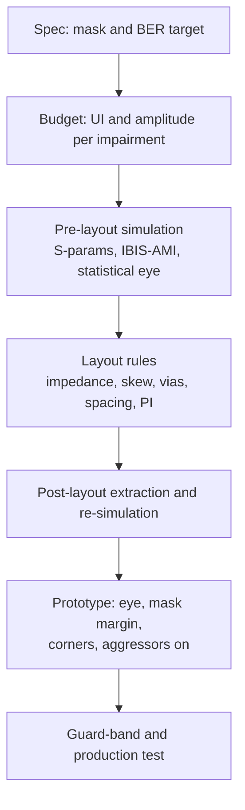

::: testing
Whether you think in **margin and process**, not just fixes. Question 701 asks how to make the eye bigger; this one asks how to make sure you *pass* and keep passing: allocate a jitter and noise budget against the mask, simulate before layout, follow layout rules that protect the budget, measure mask margin on real hardware across corners, and guard-band for production. The interviewer wants a closed-loop workflow (spec to budget to simulation to layout to measurement to margin), not a list of random tips.
:::

::: why
A prototype that barely passes on one bench at room temperature is not a product. Parts vary, temperatures change, connectors wear, and compliance labs use different fixtures. Teams that pass reliably do it by budgeting margin early, simulating the channel, and tracking mask margin through the programme. Interviewers use this question to find out whether you have seen a real design cycle or only the textbook eye.
:::

::: concepts
- **Mask and margin**: pass/fail template and percentage headroom. See [[q0700]].
- **Eye-opening levers**: equalization and channel quality. See [[q0701]].
- **Jitter budgeting**: random plus deterministic contributions adding to total jitter. See [[q0695]].
- **Channel simulation**: S-parameters, IBIS/IBIS-AMI models, statistical and time-domain eyes.
- **Corners**: process, voltage, temperature and part-to-part variation.
- **Power integrity**: supply noise feeding clock jitter. See [[q0704]].
:::

::: answer
"To keep the eye out of the mask I'd work from the specification down to a budget and then verify it with margin.

I start by turning the mask and BER target into budgets: how much of the unit interval and how much of the eye amplitude can be consumed by jitter, ISI, reflections, crosstalk and noise before the mask is hit. Then I simulate the channel early: extract S-parameters for the traces, vias and connectors, run a statistical or time-domain eye with the real driver and receiver models, including equalization, and see the margin before I lay out the board.

In layout I protect the budget: controlled impedance, length and skew matching, short or back-drilled via stubs, a low-loss material if required, spacing to avoid crosstalk, solid references, and clean, well-decoupled supplies and clock.

Then I measure: eye and mask margin on the prototype, not just pass or fail, across temperature, voltage and several units, with realistic aggressors running. I want a healthy margin, say a few tens of percent, to cover production variation. If the margin is thin, I tune equalization or revisit the worst budget item, and I add stress tests such as injected jitter to see how much headroom remains."
:::

::: technical
**1. Allocate the budget.** Convert the mask and BER target into time and voltage allowances.

Horizontal (time): $UI = W_{mask} + TJ_{total}(BER) + t_{margin}$, where $TJ_{total}$ combines contributions: TX jitter, ISI-induced DDJ from the channel, reflection-induced DJ, crosstalk jitter, supply/PLL jitter, RX sampling error. Deterministic terms add linearly; random terms add in root-sum-square: $\sigma_{RJ,tot} = \sqrt{\sum\sigma_i^2}$; then $TJ = DJ_{tot} + 2Q\sigma_{RJ,tot}$.

Vertical (amplitude): $A_{tx} - ISI - X_{refl} - X_{xt} - 2Q\sigma_n \ge H_{mask} + margin$.

**Illustrative numbers.** At 10 Gb/s ($UI = 100$ ps): TX jitter 12 ps, channel ISI 22 ps, reflections 6 ps, crosstalk 4 ps, supply/PLL 6 ps → 50 ps consumed; the mask's keep-out width 35 ps; margin 15 ps (15% of UI). Vertical: 800 mV swing − 180 mV ISI − 40 mV reflections − 30 mV crosstalk − 169 mV noise (12 mV rms, $2Q\sigma$ at $Q = 7.03$) = 381 mV; against a 300 mV keep-out height that leaves 81 mV, 27% of the mask height. These are for illustration, not from a standard.

**2. Simulate early.** Extract S-parameters of the channel (3D/2.5D EM for vias and connectors, 2D for traces); run channel simulation with models of the TX and RX including equalization (IBIS-AMI or vendor SerDes models), statistical eye at BER $10^{-12}$ or better; some standards define a figure of merit such as Channel Operating Margin (COM) computed from S-parameters (for example in IEEE 802.3 backplane and copper cable specifications).

**3. Layout rules that protect the budget.** Controlled impedance within tolerance; intra-pair skew matched; stub-free or back-drilled vias; continuous reference planes and via-stitching around layer changes; spacing/stripline for crosstalk; low-loss laminate if the loss budget needs it; connector and footprint optimisation (anti-pad sizing, ground vias); clean, decoupled PLL and clock supplies.

**4. Measure margin.** Eye and mask margin on several boards, at corners (cold/hot, low/high supply), with neighbouring aggressors active; use receiver eye-scan features where available; stress with injected sinusoidal jitter or attenuators to find headroom.

**5. Guard-band for production.** Require margin that covers part and board variation, fixture repeatability and ageing, and test a statistical sample or all units.
:::

::: short
"I'd work from the spec to a budget, simulate the channel before layout, protect the budget with controlled impedance, matched lengths, back-drilled vias, spacing and clean supplies, then measure mask margin on real hardware across corners with aggressors running. I'd aim for comfortable margin, not just a pass, and tune equalization or fix the biggest budget item if margin is thin."
:::

::: long
"I treat it as a margin management problem across the whole design cycle, not a single fix.

First, budgets. From the standard's mask and BER target I work out how much of the unit interval and how much of the eye amplitude I can spend. The horizontal budget splits into transmitter jitter, ISI-induced jitter from the channel, reflections, crosstalk and supply or PLL noise. Deterministic terms add up directly, random terms add as root-sum-square and get multiplied by the Q factor. At 10 gigabits that might look like 50 picoseconds consumed out of a 100 picosecond UI, a 35 picosecond keep-out, and 15 picoseconds of margin. The vertical budget works the same way: swing minus ISI, reflections, crosstalk and noise has to stay above the mask height with room.

Second, simulate before building. I'd extract S-parameters of the traces, vias and connectors, run a statistical eye with the real driver and receiver models and the equalization they'll use, and see where the margin is thin. Often a specific via or connector footprint dominates.

Third, layout rules that protect that budget: controlled impedance, length matching in the pair, back-drilled or stubless vias, solid references, spacing from aggressors, a low-loss material if the loss budget demands it, and clean, decoupled supplies and reference clock.

Fourth, measure, with margin as the metric. I'd test several boards at hot and cold and high and low supply, with other interfaces running, and look at mask margin and eye scans, not just pass or fail. I'd also inject jitter to see how much headroom is left.

If the margin is thin I'd tune equalization first, then go after the biggest budget item, and always leave guard band for production spread."
:::

::: terms
- **Budget**: allocation of the available UI and amplitude to each impairment.
- **Mask margin**: percentage the mask can be enlarged before failing.
- **Guard band**: extra margin beyond the minimum to cover variation.
- **Statistical eye**: eye computed from the channel's pulse response and noise statistics, down to low BER.
- **IBIS / IBIS-AMI**: behavioural models of I/O buffers (and their equalizers) for simulation.
- **COM (channel operating margin)**: a standardised figure of merit computed from channel S-parameters, used in some IEEE 802.3 specifications.
- **Corners (PVT)**: process, voltage and temperature extremes.
- **Eye scan**: receiver built-in measurement of the eye by shifting its sampling point and threshold.
:::

::: exceptional
An average answer lists "good routing, equalization, low jitter". An exceptional answer describes the **workflow** (budget, simulate, layout rules, measure at corners, guard band), gives a **worked budget** with numbers (horizontal and vertical), explains **how terms combine** (deterministic linear, random RSS then times Q), mentions concrete tools (S-parameter extraction, IBIS-AMI, statistical eye, COM, receiver eye scan, jitter injection), and insists on **margin as a metric** across corners and units rather than a single pass. It also notes that fixture, de-embedding and test setup are part of staying inside the mask.
:::

::: mistakes
- **Designing to just meet the spec.** Production variation, temperature and ageing will push some units over the edge; build in guard band.
- **Checking only room temperature, one board.** Loss, jitter and noise vary with temperature and part; sample corners and multiple units.
- **Adding random jitter linearly.** Random terms add as root-sum-square; adding them linearly over-estimates, adding deterministic terms in RSS under-estimates.
- **Simulating with idealized models.** Without real driver/receiver and equalizer models, the sim eye may be too optimistic or pessimistic.
- **Forgetting aggressors.** An eye measured with neighbouring interfaces idle ignores crosstalk and supply noise from real operation.
- **Ignoring the test setup.** Mask failures often come from the fixture, cable or de-embedding rather than the design; calibrate the setup before changing the board.
:::

::: deep
## Think in budgets

The mask defines a keep-out region the eye must clear. Everything that closes the eye, from jitter on the transmitter to loss in the channel, spends some of the available opening. Your job is to make sure the sum stays inside the budget with margin.

```svg
<svg viewBox="0 0 560 200" xmlns="http://www.w3.org/2000/svg" font-family="Inter, sans-serif" font-size="12">
<text x="30" y="24" fill="var(--d-ink)" font-size="14">Illustrative horizontal budget: 1 UI = 100%</text>
<rect x="30.0" y="70" width="60.0" height="44" fill="var(--d-orange)" fill-opacity="0.55" stroke="var(--d-ink)"/>
<text x="60.0" y="96" text-anchor="middle" fill="var(--d-ink)">12%</text>
<line x1="60.0" y1="114" x2="60.0" y2="124" stroke="var(--d-muted)"/>
<text x="60.0" y="136" text-anchor="middle" fill="var(--d-ink)">TX jitter</text>
<rect x="90.0" y="70" width="110.0" height="44" fill="var(--d-red)" fill-opacity="0.55" stroke="var(--d-ink)"/>
<text x="145.0" y="96" text-anchor="middle" fill="var(--d-ink)">22%</text>
<line x1="145.0" y1="114" x2="145.0" y2="142" stroke="var(--d-muted)"/>
<text x="145.0" y="154" text-anchor="middle" fill="var(--d-ink)">Channel ISI (DDJ)</text>
<rect x="200.0" y="70" width="30.0" height="44" fill="var(--d-purple)" fill-opacity="0.55" stroke="var(--d-ink)"/>
<text x="215.0" y="96" text-anchor="middle" fill="var(--d-ink)">6%</text>
<line x1="215.0" y1="114" x2="215.0" y2="160" stroke="var(--d-muted)"/>
<text x="215.0" y="172" text-anchor="middle" fill="var(--d-ink)">Reflections</text>
<rect x="230.0" y="70" width="20.0" height="44" fill="var(--d-blue)" fill-opacity="0.55" stroke="var(--d-ink)"/>
<text x="240.0" y="96" text-anchor="middle" fill="var(--d-ink)">4%</text>
<line x1="240.0" y1="114" x2="240.0" y2="124" stroke="var(--d-muted)"/>
<text x="246.0" y="136" text-anchor="end" fill="var(--d-ink)">Crosstalk</text>
<rect x="250.0" y="70" width="30.0" height="44" fill="var(--d-green)" fill-opacity="0.55" stroke="var(--d-ink)"/>
<text x="265.0" y="96" text-anchor="middle" fill="var(--d-ink)">6%</text>
<line x1="265.0" y1="114" x2="265.0" y2="142" stroke="var(--d-muted)"/>
<text x="265.0" y="154" text-anchor="middle" fill="var(--d-ink)">Supply / PLL</text>
<rect x="280.0" y="70" width="175.0" height="44" fill="var(--d-muted)" fill-opacity="0.55" stroke="var(--d-ink)"/>
<text x="367.5" y="96" text-anchor="middle" fill="var(--d-ink)">35%</text>
<line x1="367.5" y1="114" x2="367.5" y2="160" stroke="var(--d-muted)"/>
<text x="367.5" y="172" text-anchor="middle" fill="var(--d-ink)">Mask keep-out</text>
<rect x="455.0" y="70" width="75.0" height="44" fill="var(--d-accent)" fill-opacity="0.55" stroke="var(--d-ink)"/>
<text x="492.5" y="96" text-anchor="middle" fill="var(--d-ink)">15%</text>
<line x1="492.5" y1="114" x2="492.5" y2="124" stroke="var(--d-muted)"/>
<text x="492.5" y="136" text-anchor="middle" fill="var(--d-ink)">Margin</text>
<line x1="30" y1="62" x2="280" y2="62" stroke="var(--d-red)" stroke-width="2"/><text x="155" y="56" text-anchor="middle" fill="var(--d-red)">consumed by impairments: 50%</text>
</svg>
```
Figure: An illustrative horizontal budget at one unit interval. The impairments consume about half the UI, the mask's keep-out needs 35%, leaving 15% margin. If any item grows, the margin shrinks first; if margin goes negative the eye touches the mask.

**How budget items combine.** Not all terms add the same way:

- *Deterministic jitter* (ISI, reflections, crosstalk, DCD) is bounded: peak values add linearly (or via a statistical convolution).
- *Random jitter* is Gaussian: variances add, so $\sigma_{tot} = \sqrt{\sigma_1^2+\sigma_2^2+\dots}$; the peak-to-peak at BER is $2Q\sigma_{tot}$ with $Q = 7.03$ for $10^{-12}$.

Example: TX RJ 0.5 ps rms, supply/PLL RJ 0.6 ps rms and RX RJ 0.4 ps rms. RSS: $\sqrt{0.25+0.36+0.16} = 0.88$ ps. Peak-to-peak at $10^{-12}$: $14.07\cdot0.88 = 12.3$ ps. Adding linearly (1.5 ps rms) would give 21 ps, a pessimistic over-estimate by 70%. And ignoring the $Q$ multiplier by taking "rms" as the peak would make the eye look 14x better than it is.

## The vertical budget

For amplitude, take the transmitter swing and subtract each effect at the BER level:

| Item | Value | Notes |
|---|---|---|
| TX swing (pk-pk) | 800 mV | standard-limited |
| ISI after equalization | −180 mV | channel loss residual |
| Reflections | −40 mV | via and connector bumps |
| Crosstalk | −30 mV | adjacent aggressors |
| Noise at BER ($2Q\sigma$, $\sigma$ = 12 mV) | −169 mV | $14.07\cdot12$ |
| **Eye height at BER** | **381 mV** | |
| Mask keep-out height | 300 mV | |
| **Margin** | **81 mV (27% of mask)** | |

Seeing it as a table makes decisions concrete: do you spend design effort on the 180 mV of ISI (equalization, better channel) or the 169 mV of noise (supply, receiver)? Whichever is the largest and cheapest to reduce.

## The workflow


Figure: The closed loop. Failures found at the prototype stage feed back to the budget, not just to a layout tweak: ask which line of the budget was wrong.

**Pre-layout.** Simulate with expected stack-up, via models, connector S-parameters, and the real IBIS-AMI models. Sweep equalization settings and channel length to see the margin versus reach. Standards like IEEE 802.3 for backplane use a figure of merit computed from the S-parameters (COM) so a channel can be pre-qualified.

**Layout.** The rules are about protecting the budget terms: impedance control (reflections), skew matching (common mode), stub removal (reflection/resonance), reference-plane continuity (crosstalk and return paths), spacing/stripline (crosstalk), low-loss laminate (ISI), PI for PLL and clock (RJ).

**Measure.** Use mask margin (scale until hits), eye height and width at a BER contour, and where available the receiver's own eye scan. Repeat at temperature, supply extremes, with aggressors active. Inject sinusoidal jitter or add attenuation to find how much headroom remains.

```sim
{"id":"eye-diagram","rate":5e9,"bw":4e9,"noise":0.012,"jitter":0.012,"preemph":2}
```
Figure: A healthy link with no mask violations. Increase jitter and noise until hits first appear; the amount of increase you can add before the first violation is your margin. Then lower the channel bandwidth to see how channel loss eats the same margin.

## Corners and the production reality

- **Temperature**: conductor and dielectric loss increase with temperature (and humidity affects dielectric), driver swing and receiver sensitivity shift: check hot and cold.
- **Voltage**: supply tolerance changes swing, PLL jitter and receiver threshold.
- **Process/part-to-part**: transmitter jitter and receiver sensitivity vary between parts; test multiple units, ideally including parts from different lots.
- **Board-to-board**: stack-up and etch variation shift impedance and loss.
- **Fixtures and cables**: connectors and cables add loss and reflections; the compliance setup specifies them for repeatability.

> [!UNCERTAIN]
> How much margin is "enough" is a company or programme decision. It depends on the interface, volume, cost of field failures and the statistics of the part-to-part spread. I would not quote a universal percentage in an interview; I'd explain how I'd pick it from measured spread (for example mean minus several standard deviations of margin across units and corners).

## If the margin is thin

1. **Reallocate**: find the biggest budget item and ask whether it can be reduced cheaply (equalization settings, a via fix, a quieter supply).
2. **Tune equalization** across channels (sweep TX/RX settings, look for the optimum rather than the default).
3. **Make the channel better**: shorter route, lower-loss laminate, back-drill, better connector.
4. **Reduce noise sources** active during test: staggering aggressors, better decoupling, shielding.
5. **Ask whether the specification is the right one**: a retimer, a lower speed grade or a shorter cable may be the sane answer.
:::

::: applications
- **PCIe/USB/Ethernet board design**: pre-layout channel simulation and post-layout verification against channel compliance limits.
- **Backplane and cable assemblies**: COM-based channel qualification before building hardware.
- **FPGA/ASIC SerDes bring-up**: eye scan used to confirm margin on each lane across temperature.
- **DDR memory design**: margin sweeps (timing and voltage) at each pin during validation.
- **Production test**: guard-banded mask or BER tests on every unit or a sample.
- **Field-reliability work**: tracking margin over life to catch ageing connectors and cables.
:::

::: assumptions
- **NRZ link with a standard mask** and BER target; PAM4 and FEC-protected links budget differently (raw BER is far worse than $10^{-12}$).
- **Illustrative budget numbers** are not from any standard and are only to show the method.
- **Gaussian random jitter and noise** for the RSS and $Q$ arithmetic; real distributions can have heavier tails.
- **Linear superposition** of impairments; in reality they interact (e.g. equalization amplifies crosstalk).
- **Margin policy** differs between teams; treat any specific percentage as an example.
:::

::: followups
### How do you combine jitter terms in a budget?
Deterministic terms (ISI, reflections, DCD, periodic) are bounded and add linearly in the worst case. Random terms are Gaussian, so I add them in root-sum-square and convert to a peak-to-peak at the BER using $2Q\sigma$. Total jitter is DJ plus that random peak-to-peak. Adding random terms linearly overestimates; treating random as bounded underestimates.

### What would you do if the eye passes the mask at room temperature but fails at 85°C?
Find which budget item moves with temperature. Loss (copper resistivity, dielectric loss) typically rises, so ISI grows; driver swing may fall; PLL jitter or supply noise may increase. I'd measure SDD21 at temperature or compare eye height and width across temperature, retune equalization at hot, and consider a lower-loss laminate or shorter channel if equalization can't compensate. I'd also look at the equalizer's adaptation range.

### How would you use the receiver's eye scan in validation?
Many SerDes receivers can sweep their own sampling phase and threshold and report the error count, producing an eye or bathtub as the receiver sees it, including its equalization. I'd collect it on every lane, across temperature and voltage, with other interfaces active, and set a pass criterion on the minimum opening. It's more representative than a scope eye at the connector.

### The compliance lab says we fail the mask by a tiny amount. What would you check before changing the design?
The fixtures, cables and de-embedding: whether the lab's setup matches our own, the reference-clock recovery, the test pattern, and the scope's bandwidth/filter. Then repeatability: re-run on several boards. Only then I'd decide whether the design needs a tweak, for example a transmitter equalization setting, rather than a respin.

### Why simulate before layout if you will measure anyway?
A respin costs weeks and money, and simulation finds the dominant budget item while it's still free to change. It also gives a reference to correlate against measurement: if the measured eye is much worse than the simulated one, some effect is missing from the model (a via stub, a power-noise coupling), which itself is useful debugging information.
:::

::: interpretations
This question is the **compliance/margin** counterpart of [[q0701]]: Q701 asks how to enlarge the eye, while this asks how to make sure it stays out of the mask throughout design, test and production. There's overlap in the technical levers, so I've emphasised budgeting, simulation, corners and margin rather than repeating the equalization details.
:::

::: references
- Eric Bogatin, *Signal and Power Integrity: Simplified*: timing and noise budgets, channel simulation, margin.
- Howard Johnson & Martin Graham, *High-Speed Digital Design: A Handbook of Black Magic*: timing budgets and margins.
- IEEE 802.3 (Ethernet) Annexes on channel operating margin for backplane and cable assemblies: the standard's definition of COM and its use.
- PCI-SIG PCI Express base specification and USB-IF specifications: channel compliance and receiver eye definitions (use the version for your generation).
:::

::: rubric
- Turns the mask/BER spec into a time and voltage budget :: Margin management starts with a budget; this is the key difference from "fix the eye".
- Knows how budget terms combine (deterministic linear, random RSS and Q) :: Shows jitter-budgeting competence.
- Simulates early with S-parameters and real driver/receiver models :: Catches problems before a respin.
- Lists layout rules that protect each budget item :: Connects design practice to the budget.
- Measures mask margin across temperature, voltage, units and aggressors :: Margin, not a single pass, is the real goal.
- Mentions guard band/production and how to respond to thin margin :: Completes the lifecycle view.
:::

::: quiz
```json
[
 {"type":"mcq","level":"fundamental","q":"What is the best metric to track, beyond simple pass/fail, when keeping an eye out of the mask?","options":["Board colour","Mask margin","Clock frequency","Supply current"],"answer":1,"explain":"Mask margin quantifies how much more degradation the link can tolerate, which is what protects against variation."},
 {"type":"numeric","level":"intermediate","q":"Three independent random jitter sources have rms values of 0.5, 0.6 and 0.4 ps. What is the combined rms jitter (ps)?","answer":0.88,"tolerance":0.03,"unit":"ps","explain":"RSS: $\\sqrt{0.25+0.36+0.16}=\\sqrt{0.77}=0.877$ ps."},
 {"type":"numeric","level":"intermediate","q":"Using the combined rms jitter of 0.88 ps and $Q=7.03$, what is the random-jitter peak-to-peak at BER $10^{-12}$ in ps?","answer":12.4,"tolerance":0.03,"unit":"ps","explain":"$2Q\\sigma=14.06\\cdot0.88=12.4$ ps."},
 {"type":"numeric","level":"intermediate","q":"Swing 800 mV, ISI 180 mV, reflections 40 mV, crosstalk 30 mV and noise 169 mV at BER. The mask keep-out is 300 mV high. What is the vertical margin in mV?","answer":81,"tolerance":0.02,"unit":"mV","explain":"Eye height $=800-180-40-30-169=381$ mV; margin $=381-300=81$ mV."},
 {"type":"mcq","level":"advanced","q":"A board passes the mask at 25°C but fails at 85°C. Which is the most likely budget term to have grown?","options":["Mask size","Channel loss, increasing ISI","Number of aggressors","Reference clock frequency"],"answer":1,"explain":"Conductor and dielectric loss rise with temperature, so ISI grows and eats the eye; equalization may need to be retuned."},
 {"type":"truefalse","level":"advanced","q":"Adding random jitter contributions linearly is the correct way to combine independent Gaussian sources.","answer":false,"explain":"Independent Gaussian sources add in root-sum-square. Linear addition over-estimates the random part."}
]
```
:::
