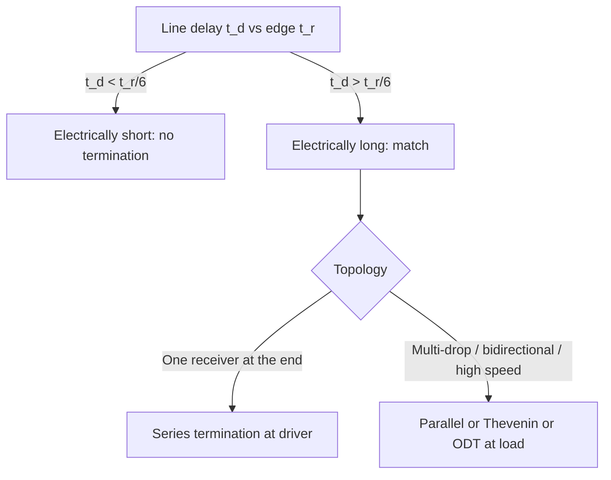

::: testing
Whether you know that "matching" means two different things depending on context and can say which one applies: **reflection-free matching** on a transmission line ($Z_S=Z_0=Z_L$, the aim is a clean waveform) versus **maximum power transfer** ($R_L=R_S$, or $Z_L=Z_S^*$ for reactive sources). Beyond the definition they look for judgement about *when* to match: electrically long lines, RF, cables and multi-Gb/s links, and when *not* to (short traces, slow edges, power rails, low-power signals where bridging is better).
:::

::: why
Matching is the most common fix for signal integrity problems and the basis of all RF design. The wrong choice costs you either performance (ringing, eye closure, lost power) or power (a termination that burns tens of milliwatts per line for no benefit). Knowing the distinction between matched, power-matched and bridged connections explains why 50 Ω appears everywhere in RF and clock distribution, why a 3.3 V logic net often needs no resistor at all, and why you do not match a power supply to its load ([[q0148]]).
:::

::: concepts
- **Characteristic impedance** $Z_0$ and reflection coefficient $\Gamma=(Z_L-Z_0)/(Z_L+Z_0)$ ([[q0710]], [[q0711]]).
- **Maximum power transfer**: with a source resistance $R_S$, load power peaks at $R_L=R_S$ ([[q0141]]).
- **Bridging (voltage) connection**: a low-impedance source into a high-impedance load, for signals where you want voltage, not power.
- **Electrical length**: matching only matters when the line is long compared with the edge ([[q0709]]).
- **Termination types**: series, parallel, Thevenin, AC and on-die ([[q0716]], [[q0717]]).
- **Return loss and VSWR**: frequency-domain measures of match quality.
:::

::: answer
"Impedance matching means making the impedances at a junction line up so the signal passes through without bouncing back. On a transmission line that means the source impedance, the line's characteristic impedance and the load impedance are all the same, say 50 ohms, so the reflection coefficient is zero at both ends and the wave goes from driver to receiver exactly once. In RF it also gives maximum power transfer: with a source resistance $R_S$ the load gets the most power when $R_L=R_S$, half of the source power, and for reactive sources you match to the complex conjugate.

I care because without it you get reflections: overshoot, ringing, false edges and eye closure on digital signals, and standing waves, lost power and instability in RF.

When to use it: whenever the line is electrically long compared with the signal edge, roughly when the one-way delay is more than a sixth of the rise time. So for fast clocks, DDR, USB or PCIe, any RF path, and long cables. When not to: short traces and slow signals, where a termination would only burn power and slow the edge, and power distribution, where you want a low source impedance and a high load impedance rather than a match."
:::

::: technical
**Two meanings of "matched".**

*(a) Reflection-free (transmission-line) matching.* $Z_L=Z_0\Rightarrow\Gamma_L=0$; and/or $Z_S=Z_0\Rightarrow\Gamma_S=0$. Matching at one end is enough to prevent *multiple* reflections: load matching absorbs the wave on arrival; source (back) matching absorbs the one reflection that comes back. Matching at both is called double termination. In digital the launch is $V_1=V_sZ_0/(Z_s+Z_0)$, and with double termination the load swing is half the open-circuit source voltage.

*(b) Power matching.* For a source $V_s$ with resistance $R_S$, load power is $P_L=V_s^2R_L/(R_S+R_L)^2$, maximum at $R_L=R_S$ where $P_{max}=V_s^2/(4R_S)$ and efficiency is 50%. For complex impedances the condition is $Z_L=Z_S^*$ (conjugate match) so the reactances cancel. (Note: power transfer on a lossless line is maximised by making $\Gamma_L=0$ at the load *and* a conjugate match of the source to the line input.)

**Bridging.** For voltage signalling, source impedance $\ll$ load impedance ($\ge10\times$) maximises the voltage transferred and minimises the current: op-amp outputs into ADC inputs, supply rails to loads, buses with one receiver on a short line. This is deliberately *not* matched.

**Techniques.** Series resistor at the driver; parallel/Thevenin/AC termination at the receiver; on-die termination (ODT); resistive pads; transformers and baluns; L-, π- and T-networks; tapered lines and quarter-wave transformers $Z=\sqrt{Z_1Z_2}$.

**When needed (rule of thumb).** Line delay $t_d>t_r/6$ (about 28 mm of FR-4 microstrip for a 1 ns edge), or RF/microwave of any length. Otherwise the cost of matching (power, edge rate, components, area) isn't justified.
:::

::: short
"Impedance matching means making source, line and load impedances equal so there's no reflection: $\Gamma=(Z_L-Z_0)/(Z_L+Z_0)=0$. In RF it's also the condition for maximum power transfer. I match when the line is electrically long compared with the edge, roughly delay over a sixth of the rise time, or any time it's RF; I don't match short or slow nets, or power rails, where I want a low source impedance and a high load impedance instead."
:::

::: long
"Matching means making impedances equal across an interface so a signal passes through with no reflection. On a transmission line, that means source, line and load are all the same impedance, say 50 ohms. Then the reflection coefficient at the load, $(Z_L-Z_0)/(Z_L+Z_0)$, is zero, so the wave is absorbed there and doesn't come back. If I only match the source, the returning wave is absorbed there instead; it costs a round trip of delay but kills the ringing.

There's a second meaning from circuit theory: maximum power transfer. For a source with resistance $R_S$ the load gets the most power when $R_L=R_S$, which is half of the source's power, and for reactive impedances you use the conjugate. That's what RF engineers do with antennas, amplifiers and filters, because there power is what matters. For digital, I don't need maximum power, only a clean waveform.

Why do I care? Without matching, a fast edge on a long trace overshoots, rings and can create false edges, and at gigabit speeds the echoes close the eye. In RF, mismatch means standing waves, reflected power coming back into the amplifier, and loss.

When should I use it? When the line is electrically long: the one-way delay is more than about a sixth of the edge time, which is around 3 centimetres on FR-4 for a 1 nanosecond edge. So fast clocks, DDR, high-speed serial links, RF paths and long cables. When shouldn't I? On short or slow nets, where a termination just burns power and slows the edge, and on power distribution, where I want the opposite: a source impedance far below the load impedance. Also in analog signal chains, an op-amp driving an ADC is a deliberate low-impedance source into a high-impedance input, a 'bridging' connection, not a match."
:::

::: terms
- **Impedance matching**: arranging source, line and load impedances so reflections vanish and/or power transfer is maximised.
- **Conjugate match**: $Z_L=Z_S^*$, the condition for maximum power transfer with reactive impedances.
- **Termination**: a resistor or network at the end (or start) of a line to absorb or damp the wave.
- **Source (back) termination**: matching at the driver so reflections returning to it are absorbed.
- **Double termination**: both source and load matched, as in RF systems.
- **Bridging (voltage) connection**: low source impedance driving a high load impedance to transfer voltage rather than power.
- **Return loss**: $-20\log_{10}|\Gamma|$ dB.
- **VSWR**: $(1+|\Gamma|)/(1-|\Gamma|)$.
- **L-match network**: two reactive elements transforming one resistance to another at a given frequency.
:::

::: exceptional
**An average answer** says "making source and load impedances the same to avoid reflections" and "50 ohms".

**An exceptional answer**:
- Separates **reflection matching** from **power matching** and says which one the situation needs.
- Gives the 50% efficiency at the power-matched point and explains why digital nets don't care about it.
- Explains that matching *one* end is enough to stop ringing, and what each choice costs (delay, amplitude, power).
- Uses the $t_d>t_r/6$ rule with a number to say *when* and says when not to match: short or slow nets, power rails, bridging connections.
- Mentions practical implementations (series resistor, Thevenin, ODT, L-match, quarter-wave transformer) and trade-offs.
- Knows matching is frequency-dependent for reactive loads: a resistor termination is broadband, an L-match is narrowband.
:::

::: mistakes
- **Equating matching with maximum power transfer in all cases.** For a clean digital edge you need $\Gamma=0$, not 50% efficiency; for a power supply you want exactly the opposite of a match.
- **"Always terminate at 50 Ω."** Terminating a short, slow trace wastes power and slows edges. Use the delay/rise-time test.
- **Matching the wrong impedance.** The termination should equal the line's $Z_0$ (including its tolerance), not the driver's output impedance or the "typical" 50 Ω.
- **Ignoring the driver's real output impedance.** A CMOS driver at 10 to 20 Ω needs about 30 to 40 Ω of series resistance; a fixed 50 Ω resistor adds up to too much.
- **Using a narrowband network for a broadband signal.** An L-match at 100 MHz fixes one frequency, not a square wave's harmonics.
- **Confusing the bridge with a mismatch.** An op-amp driving a 10 kΩ input is intentionally not matched; the "mismatch" has no reflections because the line is short.
:::

::: deep
## What "matched" can mean

The word is used for three different ideas, and mixing them up is the commonest source of confused answers.

| Goal | Condition | Used for | Cost |
|---|---|---|---|
| **No reflection** | $Z_L=Z_0$ (and/or $Z_S=Z_0$) | Digital transmission lines, cables | Power (parallel) or amplitude/edge delay (series) |
| **Max power transfer** | $R_L=R_S$ (or $Z_L=Z_S^*$) | RF, antennas, audio amplifier output stages (rarely) | 50% efficiency (resistive source) |
| **Bridging** | $Z_S\ll Z_L$ | Analog chains, supply rails, one short-line receiver | None, but not for long lines |

### Reflection matching in one picture

The first wave launched into the line has amplitude $V_1=V_sZ_0/(Z_S+Z_0)$. If $Z_L=Z_0$, all of it arrives, is absorbed, and nothing returns. If instead only the source is matched ($Z_S=Z_0$), the load end can be open: the wave arrives, doubles, reflects, returns to the source and is absorbed there. The load sees a clean edge of amplitude $2V_1=V_s$ (that is source termination, [[q0716]]).

## Maximum power transfer, derived

For a source $V_s$ with resistance $R_S$ driving $R_L$: $I=V_s/(R_S+R_L)$, $P_L=I^2R_L=V_s^2R_L/(R_S+R_L)^2$. Setting $dP_L/dR_L=0$ gives $R_L=R_S$, with $P_{max}=V_s^2/(4R_S)$. Example: $V_s=3.3$ V, $R_S=50\ \Omega$: $P_{max}=3.3^2/200=54$ mW, half of it dissipated in $R_S$.

```plot
{"title":"Load power and efficiency vs R_L for a 50 Ω source (V_s = 3.3 V)","x":{"label":"load resistance R_L","unit":"Ω","min":5,"max":2000,"log":true},"y":{"label":"P_L (mW) and efficiency (% of 100)","min":0,"max":110},
 "vars":{"vs":3.3,"rs":50},
 "series":[{"label":"P_L (mW)","fn":"1000*vs^2*x/(rs+x)^2","color":"accent"},{"label":"efficiency P_L/P_source (%)","fn":"100*x/(rs+x)","color":"orange","dashed":true}],
 "vlines":[{"at":50,"label":"R_L = R_S: P = 54 mW, efficiency 50%","color":"green"}]}
```
Figure: Load power (solid) peaks sharply at $R_L=R_S$, but the efficiency (dashed) keeps rising with $R_L$. Power matching therefore wastes half the source power as heat in $R_S$, which is acceptable in RF (where signal power is tiny) and unacceptable for supplies and batteries. Power is within 11% of its peak anywhere between $R_L=R_S/2$ and $2R_S$.

```sim
{"id":"max-power-transfer","vs":3.3,"rs":50,"rl":50,"complex":false}
```
Figure: Drag the load away from 50 Ω and watch the power fall on either side while efficiency climbs. Turn on the complex option to see why reactive parts must cancel: you can have all the right resistance and still lose power to reactance.

## When to match a digital line

Matching is a *cost* paid for signal quality. The question is whether you need it.


Figure: The decision starts from the delay-versus-edge test, not the clock frequency. Once the line is electrically long, topology decides: series termination is cheap and silent but only works for end-of-line receivers; parallel termination suits multi-drop and bidirectional links at the price of DC power ([[q0716]], [[q0717]]).

Worked numbers. A 3.3 V LVCMOS clock with 1 ns edges: $\ell_{crit}\approx28$ mm. For a 12 cm clock trace, termination is needed; for a 1.5 cm trace to a neighbouring device, it isn't. For a 100 mm trace the series resistor to add is $R=Z_0-R_{drv}=50-15=35\ \Omega$ (typically use the nearest standard value, 33 or 36 Ω), and the cost is one 0402 resistor and a slightly slower edge.

## When *not* to match

- **Power distribution.** A supply should have output impedance far below the load: a divider or "matched" supply would waste half its power ([[q0148]]).
- **Analog signal chains.** An op-amp (Zout ≈ ohms) driving a 10 kΩ input is a bridging connection. Matching to 50 Ω costs signal and power for nothing. Exceptions: when a long cable is driven (video, instrumentation with 50 Ω coax) you terminate at least one end.
- **Short, slow digital nets**: the termination adds components, area and power and slows the edge.
- **Low-power designs.** A parallel termination to ground on a 3.3 V line burns $3.3^2/50=218$ mW whenever the line is high. A battery product can't afford that on many lines.

## Matching with reactive networks: an L-match

RF loads are rarely 50 Ω resistive. An L-match uses a series and a shunt reactance to transform one resistance to another at a single frequency. To match $R_L=200\ \Omega$ to a 50 Ω source at 100 MHz:

$$Q=\sqrt{\frac{R_{high}}{R_{low}}-1}=\sqrt{\frac{200}{50}-1}=1.73$$
Series reactance on the low-resistance side $X_s=QR_{low}=86.6\ \Omega$ (inductor: $L=X_s/\omega=137.8$ nH). Shunt reactance on the high-resistance side $X_p=R_{high}/Q=115.5\ \Omega$ (capacitor: $C=1/(\omega X_p)=13.8$ pF).

```circuit
{"caption":"L-match transforming a 200 Ω load to look like 50 Ω at 100 MHz","elements":[
 {"t":"term","at":[0,2],"label":"looks like 50 Ω","side":"left"},
 {"t":"wire","pts":[[0,2],[2,2]]},
 {"t":"L","a":[2,2],"b":[8,2],"label":"L = 138 nH"},
 {"t":"wire","pts":[[8,2],[15,2]]},{"t":"dot","at":[8,2]},
 {"t":"C","a":[8,2],"b":[8,6],"label":"C = 13.8 pF","labelSide":"other"},
 {"t":"R","a":[15,2],"b":[15,6],"label":"R_L = 200 Ω"},
 {"t":"wire","pts":[[0,6],[15,6]]},{"t":"dot","at":[8,6]},{"t":"gnd","at":[11,6]}
]}
```
Figure: The shunt capacitor and series inductor give a lossless 4:1 resistance transformation (200 to 50 Ω) at one frequency; away from 100 MHz the match degrades. Check: the load's parallel branch $200\ \Omega\,\|\,(-j115.5)$ equals $50-j86.6\ \Omega$, and the series inductor's $+j86.6$ cancels the reactance, leaving exactly 50 Ω.

For wideband digital matching you use resistors (broadband but lossy) or a quarter-wave section (narrowband, $Z=\sqrt{Z_1Z_2}$, lossless).

## Why 50 Ω keeps showing up

It is a compromise between the minimum-attenuation coax (about 77 Ω for air dielectric) and the maximum-power-handling coax (about 30 Ω), and it became the system impedance of RF ([[q0720]]). Everything in that world (cables, instruments, amplifiers) is specified at 50 Ω, so matched connections just work; digital designers inherit the number so their traces can be measured with the same instruments.

> [!INTERVIEW]
> If you're asked "when would you NOT terminate?", give the electrical-length test and one example: "A 1 cm SPI trace at 10 MHz, I'd leave it alone. A 12 cm clock with 1 ns edges, I'd add a 33 ohm series resistor at the driver."
:::

::: applications
- **High-speed clock distribution**: series terminators near the clock buffer outputs.
- **DDR memory**: on-die termination values (for example 40 to 60 Ω settings) selected for the channel.
- **RF front ends**: 50 Ω matching between antenna, filter, LNA and PA, using L-, π- and T-networks.
- **Coaxial test setups**: 50 Ω terminations on unused scope inputs, cables and splitters; 75 Ω for video.
- **Ethernet and USB**: 100 Ω/90 Ω differential terminations with magnetic or on-chip termination.
- **Audio and instrumentation**: bridging (low Zout, high Zin) connections instead of matched ones, except for long balanced lines.
:::

::: assumptions
- **Resistive, frequency-independent impedances** in the simple rules. Real loads are reactive and frequency-dependent, so matching is only approximate over a band.
- **Linear sources**: CMOS drivers have non-constant output impedance (up to a factor of 2 between rails and mid-swing).
- **Single-ended 50 Ω** examples; for differential pairs the same logic uses differential impedance ([[q0719]]).
- **The $t_r/6$ rule** is an indicator, not a specification ([[q0709]]).
- **Conjugate matching** for reactive sources maximises power only if the source impedance is fixed and independent of load.

Alternative: in some power-electronics contexts people talk about "matching" an input impedance to a source impedance for stability (Middlebrook criterion), which is a different use of the word.
:::

::: followups
### Does matching the source alone prevent ringing?
Yes for a single receiver at the end. If $R_S+R_{driver}=Z_0$ then $\Gamma_S=0$; the open end reflects once, the wave returns to the source and is absorbed; the receiver at the end sees a clean full-swing edge. The costs: the first launch is only half amplitude (so receivers in the middle see a half-amplitude shelf for $2t_d$) and the signal reaches the full level only after the reflection returns.

### What is the difference between matching for power and matching for no reflection?
Power matching sets $R_L=R_S$ so the load gets the most power (50% efficiency). Reflection matching sets $R_L=Z_0$ so a wave isn't reflected from the load. They coincide in RF, where $R_S=Z_0=R_L=50\ \Omega$, but in digital the driver impedance can be much lower than $Z_0$, so you terminate the line at $Z_0$ without caring about power efficiency.

### Compute the termination resistor for a driver with 18 Ω output on a 50 Ω line.
Series termination: $R=Z_0-R_{drv}=50-18=32\ \Omega$; the nearest standard value is 33 Ω (E24) or 31.6 Ω (E96). The driver plus resistor now present 50 Ω to the line, so the launch is half the swing and the open end doubles it back to full swing.

### Scenario: your 100 MHz clock looks fine at the driver but shows ringing at the receiver. What do you do?
First check that it is a real ring (short probe ground). Then estimate the delay: 12 cm of FR-4 is about 0.7 ns, with a 1 ns edge that's above $t_r/6$. I'd add a series resistor at the driver sized $Z_0-R_{drv}$ and re-measure. If the clock goes to several receivers in a star, I'd restructure the topology (or buffer per receiver) instead of terminating in the middle.

### Harder: why not just terminate every net at both ends?
It would work electrically (double termination) but costs half the amplitude, DC power with parallel termination, area and extra components, and it slows edges. For a multi-gigabit differential serial link double termination is standard (source and load both 100 Ω differential), because power per lane is small and eye margin is the priority. For general-purpose single-ended nets, it is overkill.
:::

::: references
- Horowitz & Hill, *The Art of Electronics*, 3rd ed.: the chapters on transmission lines and on maximum power transfer and impedance matching.
- David M. Pozar, *Microwave Engineering*: matching with lumped elements (L-networks) and quarter-wave transformers; reflection coefficient and return loss.
- Howard Johnson and Martin Graham, *High-Speed Digital Design*: termination strategies and the cost of terminating.
- Alexander & Sadiku, *Fundamentals of Electric Circuits*: maximum power transfer theorem.
:::

::: rubric
- Defines matching as making source, line and load impedances equal so reflections vanish :: The core definition, tied to $\Gamma=0$.
- Distinguishes reflection matching from maximum power transfer, with 50% efficiency :: Shows you know the term has two meanings.
- Gives when to match: electrically long ($t_d>t_r/6$), RF, cables, high-speed links :: A quantitative trigger rather than "when it's fast".
- Gives when not to: short or slow nets, power rails, bridging analog connections :: Shows judgement and cost awareness.
- Names techniques: series, parallel/Thevenin, ODT, L-match, quarter-wave :: Demonstrates practical toolkit.
- Notes single-end matching can be enough, with the trade-offs :: Reflects real design decisions.
- Mentions reactive/conjugate matching and frequency dependence :: Covers the RF side.
:::

::: quiz
```json
[
 {"type":"mcq","level":"fundamental","q":"What does a match between source, line and load accomplish on a digital transmission line?","options":["Maximum voltage at the load","Zero reflection coefficient so the wave isn't bounced back","Zero DC power","A higher clock frequency"],"answer":1,"explain":"With $Z_L=Z_0$ the reflection coefficient at the load is zero, so the wave is absorbed once and no echoes remain. Voltage at the load is actually the divided launch voltage, not the maximum."},
 {"type":"numeric","level":"fundamental","q":"A source with $V_s=10$ V and $R_S=50\\ \\Omega$ drives a matched load $R_L=50\\ \\Omega$. What is the maximum power delivered to the load?","answer":0.5,"tolerance":0.01,"unit":"W","explain":"$P_{max}=V_s^2/(4R_S)=100/200=0.5$ W. Another 0.5 W is dissipated in $R_S$, so efficiency is 50%."},
 {"type":"numeric","level":"intermediate","q":"What efficiency do you get when $R_L=2R_S$?","answer":66.7,"tolerance":0.02,"unit":"%","explain":"Efficiency = $R_L/(R_S+R_L)=2/3=66.7\\%$ while load power is $4\\cdot2/9=89\\%$ of the maximum."},
 {"type":"numeric","level":"intermediate","q":"An L-match transforms a 200 Ω load to 50 Ω at 100 MHz. What is the $Q$ of the network?","answer":1.73,"tolerance":0.02,"unit":"","explain":"$Q=\\sqrt{R_{high}/R_{low}-1}=\\sqrt{200/50-1}=\\sqrt3=1.73$."},
 {"type":"numeric","level":"intermediate","q":"A driver has an output impedance of 18 Ω and the line is 50 Ω. What series resistor makes the source match the line?","answer":32,"tolerance":0.02,"unit":"Ω","explain":"$R=Z_0-R_{drv}=50-18=32\\ \\Omega$, so choose a 33 Ω or 31.6 Ω standard value."},
 {"type":"truefalse","level":"advanced","q":"A power supply feeding a load should be impedance-matched to the load to deliver the most useful power.","answer":false,"explain":"Matching would give 50% efficiency and a load voltage that sags by half. Supplies are designed for a very low output impedance compared with the load (a bridging connection), so the load voltage is nearly independent of load current."}
]
```
:::
