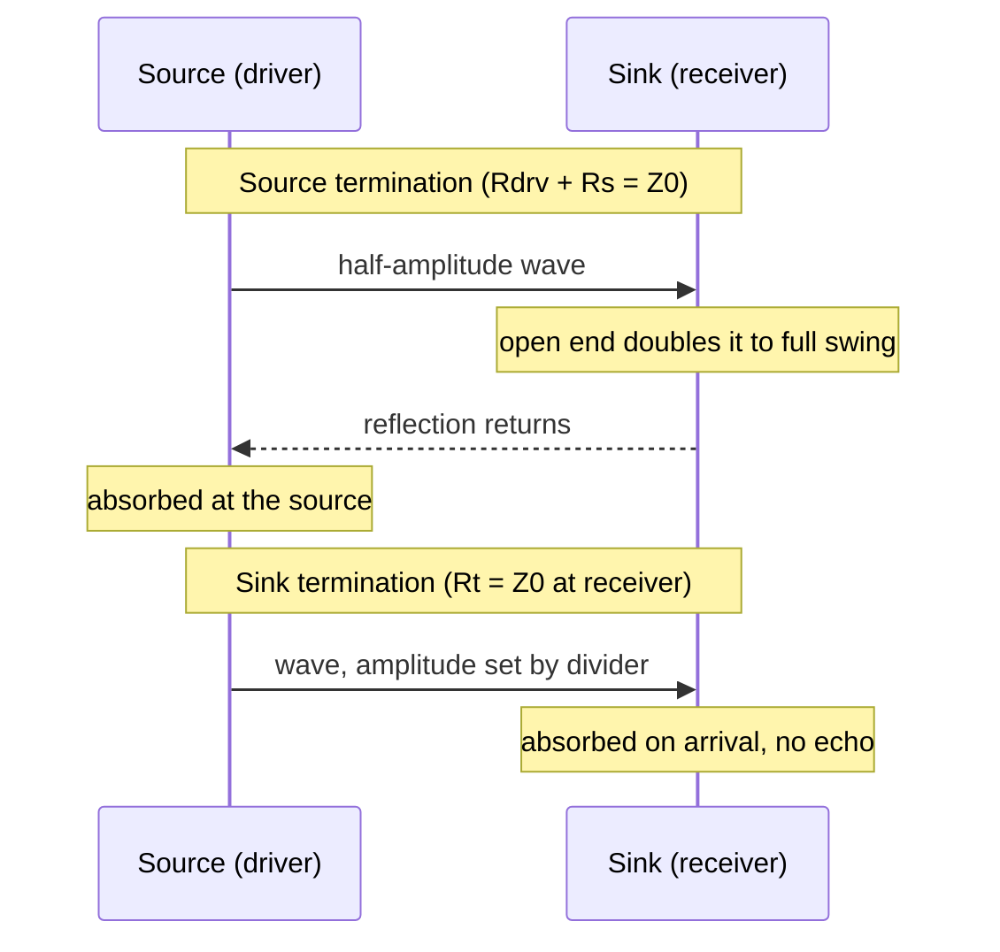
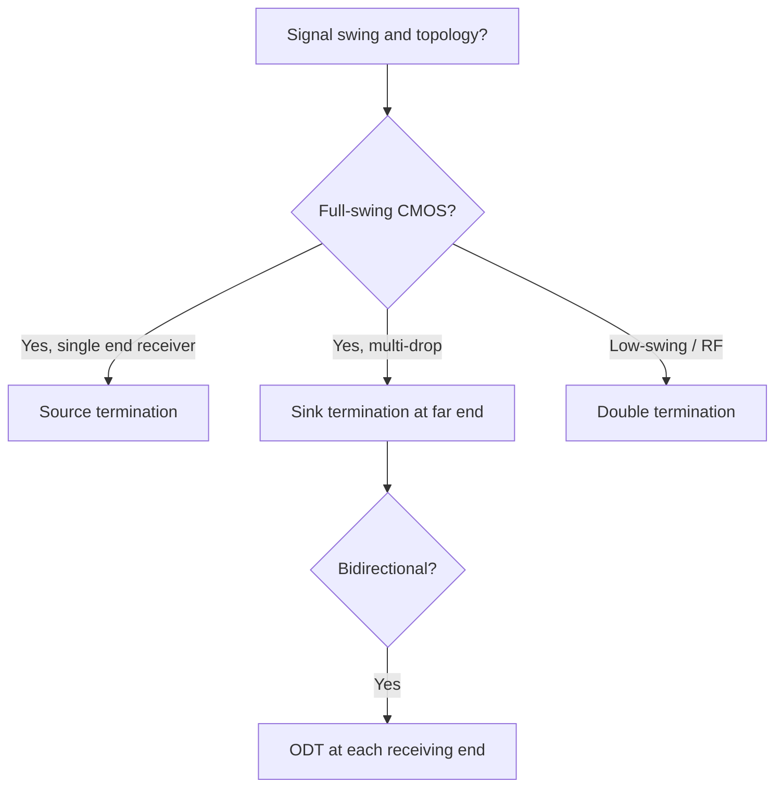

::: testing
Whether you can think in terms of *where* the energy is absorbed. Source (back) termination matches the driver, so the wave reflected from the far end is absorbed at the near end; sink (load) termination matches the receiver, so the wave is absorbed on arrival. The interviewer is checking that you can name the consequences (amplitude, timing, power, topology, bidirectional operation, tolerance to component spread) and that you know the *combination*, double termination, and why it is standard in RF and high-speed links but problematic for full-swing CMOS (half the amplitude). Awareness of on-die termination in memory interfaces is the real-world anchor.
:::

::: why
Every interface has a driver (source) and one or more receivers (sinks), and the designer chooses where to put the termination. That choice decides whether the line behaves well when the driver impedance varies, whether more receivers can be added, how much current the driver must supply, and what happens on a bidirectional bus where each end is both source and sink. The same vocabulary shows up in RF as "source match" and "load match" (S22 and S11), so the answer links digital SI to RF design. It is a natural follow-up to "series vs parallel" ([[q0716]]) and tests whether you understand the physics rather than memorised a table.
:::

::: concepts
- **Reflection coefficient at each end**: $\Gamma_S=(R_S-Z_0)/(R_S+Z_0)$ and $\Gamma_L=(R_L-Z_0)/(R_L+Z_0)$ ([[q0711]]).
- **Round-trip echo** is $\Gamma_S\Gamma_L$ times the incident wave: matching either end kills the multiple bounces ([[q0712]]).
- **Series vs parallel implementation** of the two ([[q0716]]).
- **Impedance matching goals** (no reflection vs max power) ([[q0714]]).
- **Bidirectional signalling**: a node that is a sink for one transfer is the source for the next.
- **Differential signalling** terminates across the pair ([[q0719]]).
:::

::: answer
"Source termination matches the driver to the line, so the driver's output impedance plus any series resistor equals $Z_0$. The wave goes out at half amplitude, the receiver end is high impedance so it doubles, and any reflection that comes back is absorbed at the source. Sink termination matches the receiver: a resistor equal to $Z_0$ at the end of the line absorbs the wave as soon as it arrives, so nothing reflects at all.

The trade-offs: source termination is cheap and burns no DC power, but the signal only reaches full amplitude after a round trip, so it is for one receiver at the end. Sink termination gives a clean, fast wave to every receiver along the way, tolerates a driver with the wrong impedance, but costs DC power and drives a reduced swing. Sink termination also works as a bus: put it at the end of the line.

Doing both is double termination, which is the RF standard: source and load both 50 ohms. Any residual error at one end is absorbed by the other, so it's very forgiving, but the amplitude is only half of the source voltage. That's fine for low-swing differential links and memory with on-die termination, but not for full-swing 3.3 V CMOS, which would only see 1.65 V. For bidirectional buses like DDR every chip acts as both source and sink, so you use termination at the receiving end each time, which is exactly what on-die termination does."
:::

::: technical
**Source (back) termination.** $R_S^{tot}=R_{drv}+R_s=Z_0\Rightarrow\Gamma_S=0$. Launch $V_s/2$; at a high-Z sink $V_{load}=V_s$; reflection absorbed. No DC load; only works for sinks at the end.

**Sink (load) termination.** $R_L=Z_0\Rightarrow\Gamma_L=0$. No wave returns, so the source impedance no longer matters for reflections (only for amplitude): $V_{line}=V_sZ_0/(R_{drv}+Z_0)$. Each receiver sees the first wave; DC current $V/(R_{drv}+Z_0)$ flows.

**Double termination.** $\Gamma_S=\Gamma_L=0$: load voltage $=V_s\,Z_0/(R_S+Z_0)=V_s/2$ (6 dB below the open-circuit source voltage). Echo after one round trip is $\Gamma_S\Gamma_L$, so imperfect matches multiply: with both ends 10% off, $|\Gamma|\approx0.048$ each and the echo is $0.23\%$, versus $4.8\%$ for a single termination with the same error. Delivered power is maximal ($P=V_s^2/(4Z_0)$) when everything is $Z_0$.

**When each fits.**

| Situation | Preferred |
|---|---|
| One receiver at end, low power, full-swing CMOS | Source (series) |
| Several receivers on one line, unidirectional | Sink at the far end |
| Bidirectional bus or multi-drop with many drivers | Sink termination at each receiving end (ODT), often both ends |
| RF cables and links, low-swing differential serial | Double termination |
| Driver impedance unknown or varying | Sink (the divider sets the amplitude, no reflection) or double |
| Receiver impedance unknown or varying (sockets, optional loads) | Source |

**Frequency-domain equivalents.** Source match = output return loss ($S_{22}$); load match = input return loss ($S_{11}$). Both are specified for amplifiers, filters and antennas.
:::

::: short
"Source termination matches the driver so reflections coming back are absorbed at the near end: cheap, no DC power, but the full level only appears after a round trip, so it suits one receiver at the end. Sink termination matches the receiver so the wave is absorbed on arrival: clean edges for every receiver, tolerant of driver impedance, but costs DC power and swing. Doing both is double termination, standard in RF and on-die termination links, very forgiving, but the amplitude is only half the source voltage."
:::

::: long
"The two names just say where the energy is absorbed. 'Source' termination means the driver end is matched: driver impedance plus a series resistor equals $Z_0$. The line is launched with half the amplitude, the high-impedance receiver doubles it, and when the reflection comes back it hits a matched source and is absorbed. There's no DC power, it's one resistor, it also slows the edge a little, which is good for EMI. The catch is that the full amplitude only exists after a round trip, so receivers in the middle see a half-height step, and it's no use for a bus with several receivers.

'Sink' or load termination means the receiver end is matched, usually with a resistor equal to $Z_0$ to ground or to a bias voltage. The wave is absorbed on arrival, there's no reflection, so it doesn't matter much what the driver's impedance is; every receiver on the way sees a clean edge, and it works for multi-drop lines. The cost is DC current, a reduced swing because of the divider with the driver, and a termination component and its stub at the receiver.

Then there's both, double termination, which is what RF does: 50 ohm source, 50 ohm line, 50 ohm load. It's the most forgiving, because the echo after one round trip is the product of the two reflection coefficients, so 10 percent errors at each end only give an echo of about a quarter of a percent instead of 5 percent. The price is amplitude: a divider formed by the source and load means the receiver gets half the source voltage. That's fine in RF or low-swing differential links, but it's no good for full-swing CMOS, where half of 3.3 V isn't a valid high.

On a bidirectional bus, like DDR, every chip is a source sometimes and a sink at others, so the termination has to be switchable at the receiver, which is why memory chips have on-die termination."
:::

::: terms
- **Source (back) termination**: a match at the driver end so waves returning from the far end are absorbed.
- **Sink (load, far-end) termination**: a match at the receiver end so the incoming wave is absorbed on arrival.
- **Double (dual) termination**: matching at both ends.
- **ODT (on-die termination)**: termination resistors inside the chip, enabled when the chip is receiving.
- **Echo**: the part of a signal returning after bouncing at both ends, of size $\Gamma_S\Gamma_L$ per round trip.
- **Return loss ($S_{11}$, $S_{22}$)**: how well an input or output is matched, in dB.
- **Half-swing penalty**: the 6 dB amplitude loss from the divider in double termination.
- **Dynamic ODT**: changing the termination value depending on read/write direction or rank.
:::

::: exceptional
**An average answer** says "source termination is at the driver, sink at the receiver" and lists pros and cons.

**An exceptional answer**:
- Frames each in terms of *where the reflection is absorbed* and shows the consequence for amplitude and timing at every point on the line.
- Shows the **multiplication of reflection coefficients** to explain why double termination is robust: echo $\Gamma_S\Gamma_L$.
- Gives the half-amplitude penalty of double termination and ties it to signalling (low-swing differential/RF) versus full-swing CMOS.
- Handles bidirectional buses: termination must be at the *receiving* end for each transfer, hence ODT and dynamic ODT.
- Mentions the RF equivalents (source match $S_{22}$, load match $S_{11}$) and max power transfer.
- Says what it depends on: topology, power, driver impedance control, signal swing, direction of data flow.
:::

::: mistakes
- **Using source termination on a multi-drop bus.** Receivers along the line see the half-amplitude plateau.
- **Assuming sink termination ignores the driver.** The driver impedance sets the swing ($V_sZ_0/(R_{drv}+Z_0)$) and the current it must supply.
- **Double-terminating full-swing CMOS.** The receiver gets only $V_s/2$ (1.65 V for 3.3 V), which is at or below the input threshold.
- **Putting sink termination at the middle of the line**, or on a long stub. The termination must be at the end of the line, with a very short stub, or the stub reflects.
- **Mixing up "source" and "sink" on a bidirectional bus.** The roles swap per transfer, so the receiver end needs termination, and idle chips must not load the bus unnecessarily.
- **Forgetting that termination values must match $Z_0$ and *include* the driver's output impedance** for source matching.
:::

::: deep
## What "source" and "sink" mean

A *source* is the thing driving the signal, a *sink* is the thing receiving it. A transmission line connects them, and each end can present a reflection coefficient:

$$\Gamma_S=\frac{R_S-Z_0}{R_S+Z_0},\qquad\Gamma_L=\frac{R_L-Z_0}{R_L+Z_0}$$

where $R_S$ includes the driver's output resistance and any added series resistor, and $R_L$ is whatever is at the sink (receiver input, parallel termination).

The waveform follows a bounce pattern ([[q0712]]) in which each round trip multiplies the bouncing wave by $\Gamma_S\Gamma_L$. To stop ringing, make either factor zero:

- **$\Gamma_S=0$**: source termination. The first reflection goes back to the source and is absorbed. The sink may be open.
- **$\Gamma_L=0$**: sink termination. There is no first reflection. The source can be anything.
- **Both zero**: double termination.


Figure: The two schemes differ in time and place of absorption. Source termination absorbs after a round trip (the sink sees full swing at $t_d$, but a mid-line receiver sees half swing until the reflection passes). Sink termination absorbs at the first arrival, so there is nothing to come back.

## The numbers for one example

3.3 V CMOS driver with $R_{drv}=15\ \Omega$, $Z_0=50\ \Omega$, 1 ns line, receiver with high impedance.

| Scheme | Components | Launch | Level at the sink | DC current when high |
|---|---|---|---|---|
| Source | $R_s=35\ \Omega$ series | 1.65 V | 3.30 V (full) after $t_d$ | 0 |
| Sink (parallel to gnd) | $R_t=50\ \Omega$ to ground | 2.54 V | 2.54 V | 50.8 mA |
| Double | $R_s=35\ \Omega$ and $R_t=50\ \Omega$ | 1.65 V | 1.65 V | 33 mA |
| None | none | 2.54 V | 5.08 V first, then ringing | 0 |

The double-termination row shows the problem for CMOS: 1.65 V at the receiver is just the $V_{DD}/2$ threshold, which gives no noise margin. That is why double termination is used with *low-swing* signalling (LVDS: about 350 mV into a 100 Ω differential termination; CML; SSTL: swings around $V_{TT}$) where the receivers are designed for it, and with RF, where only power matters.

Why does the *none* row show 5.08 V? $V_1=3.3\cdot50/65=2.54$ V, open end doubles it: $2\cdot2.54=5.08$ V, then a ring with the factor $\Gamma_S=(15-50)/65=-0.54$ per source reflection.

## Robustness: why the product of coefficients matters

In real life a termination resistor is never exactly $Z_0$: $Z_0$ itself has ±10% tolerance, driver impedance varies by PVT, resistors have tolerances. With one end matched, the echo is the mismatch of the *other* end times the unmatched wave. Let each termination be off by a fractional error $e$ ($R=Z_0(1+e)$), so $|\Gamma|\approx e/(2+e)$.

```plot
{"title":"Echo (fraction of the incident wave) after a round trip vs termination error","x":{"label":"fractional error of each termination, e","min":0,"max":0.5},"y":{"label":"echo amplitude","unit":"%","min":0,"max":22},
 "series":[{"label":"single termination (other end open/short): |Γ|","fn":"100*x/(2+x)","color":"orange"},{"label":"double termination, both off by e: Γ²","fn":"100*(x/(2+x))^2","color":"accent"}],
 "vlines":[{"at":0.1,"label":"10% error","color":"muted"}]}
```
Figure: With a 10% error in the termination, a single termination leaves a 4.8% echo, while double termination with both ends off by 10% leaves only 0.23%. Matching both ends makes the link tolerant to component and impedance tolerance. For wide-tolerance situations (a driver impedance that varies 30% with temperature) this is a big practical advantage. At 50% error (75 Ω terminations on a 50 Ω line, $|\Gamma|=0.2$) a single termination leaves a 20% echo, while double termination leaves 4%.

Numerical check: source total 45 Ω and load 55 Ω on a 50 Ω line: $\Gamma_S=-0.0526$, $\Gamma_L=+0.0476$, echo product $-0.25\%$. Launch $V_1=3.3\cdot50/95=1.737$ V, load first sees $1.737\cdot1.0476=1.82$ V against a final value of $3.3\cdot55/100=1.815$ V: the line looks perfectly settled.

## Source vs sink in a bidirectional bus

On a shared bus (DDR data lines, multi-point links) any device can transmit; the others listen. A series resistor at each driver would terminate waves *from that driver's end only*; waves arriving at a driver that is not transmitting see its high-Z output and reflect. So the correct approach is to terminate at the receiving end of each transfer. DDR memory does this with **on-die termination**: during a write, the DRAM turns on its ODT (sink termination at the DRAM) and the controller drives with a defined output impedance (source match); during a read the roles swap, the controller turns on its ODT and the DRAM drives with its own output impedance. In multi-rank systems, *non-target* ranks may enable an additional ODT (dynamic ODT) to absorb the wave passing by. Typical settings are tens of ohms to a couple of hundred ohms in several steps, set by mode registers.

> [!UNCERTAIN]
> Exact ODT values, enabling rules (nominal, dynamic, park) and drive impedance options depend on the DDR generation and device; check the JEDEC standard and the part's datasheet rather than relying on generic numbers.

## RF and analog view: source match and load match

In RF the same ideas appear as S-parameters. $S_{11}$ is the input reflection (how well the input is matched to the source impedance, "load match" seen from the source) and $S_{22}$ is the output reflection (how well the output is matched, "source match" of the amplifier). A good amplifier has both below, say, $-15$ dB. Double matching maximises power transfer in a 50 Ω system and prevents "standing waves" on the cables between instruments, at the 6 dB loss from the source-load divider (a signal generator with 50 Ω output delivering to 50 Ω shows half the open-circuit voltage, which is why generators have a "high-Z" vs "50 Ω" setting).

## Choosing in practice


Figure: Full-swing CMOS can only afford one termination (the divider would otherwise halve the swing), so topology decides which end. Low-swing and RF signalling are designed for double termination. A bidirectional bus requires the termination to follow the data direction.

```sim
{"id":"tline-lab","z0":50,"rs":15,"rl":"open","td":1e-9,"tr":200e-12,"term":"none"}
```
Figure: With no termination the 15 Ω driver gives a big ring. Choose "series" (source termination) and then "parallel" (sink termination) to compare the waveforms at the load and at the source. Notice that the series case gives full swing at the load but a half-height shelf at the driver, and the parallel case gives a flat reduced swing at both ends.

> [!INTERVIEW]
> One-sentence summary: "Source termination absorbs the reflection after it returns, sink termination prevents the reflection, and double termination does both, at the price of half the signal."
:::

::: applications
- **Clocks and fast GPIO to one receiver**: source (series) termination at the driver.
- **DDR memory buses**: sink termination via ODT at the receiving chip, plus calibrated driver impedance (source match).
- **Instrument interconnects (50 Ω coax)**: signal generators (50 Ω source) into scopes with 50 Ω inputs (sink termination) for clean pulses.
- **Differential serial links (LVDS, PCIe, USB, SATA)**: 100 Ω (or 90 Ω) differential sink termination at the receiver, source-matched drivers.
- **Antennas and RF amplifiers**: input and output match networks (S11/S22).
- **Ethernet over twisted pair**: transformers and matched terminations at both ends (100 Ω differential).
- **Backplane multi-drop buses**: termination at the bus ends (both ends for bidirectional).
:::

::: assumptions
- **Resistive, frequency-independent terminations** and a constant, linear driver impedance; real drivers and ODT values vary with PVT, voltage and drive strength.
- **Lossless, uniform line**; with loss, the returning wave is attenuated and source termination is more tolerant than in the examples.
- **Receiver input as an open circuit** (high impedance); capacitance and clamp diodes add secondary effects.
- **Single-ended 50 Ω**; differential signalling terminates across the pair and uses common-mode termination options ([[q0719]]).
- **The 10% tolerance examples** are generic; use the datasheets.

The terminology differs: some authors call parallel termination "end termination", "load termination", or "sink termination", and series termination "source" or "back termination"; DDR documents say "ODT".
:::

::: followups
### Why does source termination work with the receiver open, but sink termination doesn't need the source to be matched?
With source termination, the open end reflects the whole wave but the reflection returns to a matched source and is absorbed, so the net effect is one echo that is absorbed. With sink termination, there is no first reflection at all, so the source's impedance never plays a role in reflections; the source's impedance only sets the voltage divider at launch. Either one removes the loop that sustains ringing, namely $\Gamma_S\Gamma_L\ne0$.

### What does double termination do to the amplitude and why is it still used?
It halves it: the receiver sees $V_sZ_0/(R_S+Z_0)=V_s/2$ with $R_S=Z_0$. It is used where robustness and power transfer matter more than amplitude: RF (50 Ω everything), cabling between instruments, and low-swing serial links, where the receiver is designed for a small signal. A 3.3 V CMOS line would see only 1.65 V. Also, the echo is the product of two small reflection coefficients, so it tolerates component spread.

### How does DDR handle the fact that the same data line is driven from either end?
Each chip has on-die termination that is enabled when it is receiving, and drivers with calibrated output impedance. For a write, the DRAM's ODT is on; for a read, the controller's ODT is on, and in multi-rank systems idle ranks can add termination too. So the termination is always at the *sink* of the current transfer, with a matched source driving. The settings are programmed into mode registers and trimmed against a reference resistor.

### Scenario: you inherit a board where a 3.3 V clock goes to three receivers by daisy-chain with a 33 Ω series resistor and one receiver misses edges. What do you suggest?
The series-terminated line only reaches full amplitude after the reflection from the far end returns; the mid-chain receivers see half the swing for part of the edge. Options: terminate at the far end (Thevenin, or a resistor to $V_{DD}/2$ with a capacitor for AC termination) and remove the series resistor, or re-route as a star with a clock buffer, each branch with its own series resistor. I'd check with a scope and a short probe at each receiver pin.

### Harder: could you terminate only the source and put the receivers on a stub off the main line?
No. A stub hanging off a source-terminated line sees only the half-amplitude wave on the way out, plus the full wave only after the reflection returns, and the stub itself reflects. If the stub is short enough that its delay is far below the rise time, it acts as a small capacitor and the line works; otherwise it will cause errors. Practically, keep stubs below about $t_r/6$ in delay (a few millimetres for sub-nanosecond edges) or avoid them.
:::

::: interpretations
"Source vs sink termination/matching" is the same distinction as *series* vs *parallel* termination ([[q0716]]) viewed by *location* instead of *topology*: a series resistor is the usual implementation of source matching, a shunt resistor the usual implementation of sink matching. The "matching" in the wording also covers RF-style source and load matching ($S_{22}$ and $S_{11}$) and the double-terminated case. This page focuses on where the energy is absorbed, on double termination, bidirectional links and tolerance; [[q0716]] focuses on the circuit implementations and the power cost.
:::

::: references
- Howard Johnson and Martin Graham, *High-Speed Digital Design: A Handbook of Black Magic*: chapters on termination, including source and end termination and bidirectional buses.
- Eric Bogatin, *Signal and Power Integrity: Simplified*: termination strategies, the value of matching both ends.
- David M. Pozar, *Microwave Engineering*: matching, reflection coefficients and S-parameters (source and load match).
- JEDEC DDR SDRAM standards (JESD79 series): on-die termination operation for the specific generation.
:::

::: rubric
- Defines source termination (driver end matched, absorbs the returning reflection) and sink termination (receiver end matched, no reflection) :: The question's core definitions.
- States the amplitude/timing consequences: half-swing launch and doubling vs reduced swing but full everywhere :: Shows physical understanding.
- Compares power, topology and tolerance: no DC vs DC, point-to-point vs multi-drop :: The practical trade-offs.
- Explains double termination, the half-amplitude penalty and echo $\Gamma_S\Gamma_L$ robustness :: Distinguishes a deep answer from a list.
- Handles bidirectional buses and ODT (termination at the receiving end each time) :: Real-world application.
- Mentions RF equivalents ($S_{11}$/$S_{22}$) and max power transfer :: Connects digital and RF views.
- Notes it depends on swing, topology, driver impedance control and direction of data flow :: Shows judgment.
:::

::: quiz
```json
[
 {"type":"mcq","level":"fundamental","q":"Where is the reflected wave absorbed with source termination?","options":["At the receiver","At the driver (source) end","Midway along the line","It is never absorbed"],"answer":1,"explain":"The open receiver reflects the wave back; the matched source ($R_{drv}+R_s=Z_0$) absorbs it, so no second reflection occurs."},
 {"type":"numeric","level":"fundamental","q":"A 3.3 V source with total series resistance 50 Ω drives a 50 Ω line ending in a 50 Ω termination (double termination). What voltage does the load see?","answer":1.65,"tolerance":0.01,"unit":"V","explain":"$V=3.3\\cdot50/(50+50)=1.65$ V: half the source voltage, the half-amplitude penalty of double termination."},
 {"type":"numeric","level":"intermediate","q":"A single end termination of 55 Ω is used on a 50 Ω line (other end open or short). What is the echo amplitude as a % of the incident wave?","answer":4.76,"tolerance":0.03,"unit":"%","explain":"$\\Gamma=(55-50)/(55+50)=0.0476$, i.e. 4.76%."},
 {"type":"numeric","level":"intermediate","q":"With 55 Ω at the load and 45 Ω total at the source on a 50 Ω line, what is the magnitude of the round-trip echo (as % of the incident wave)?","answer":0.25,"tolerance":0.05,"unit":"%","explain":"$|\\Gamma_S\\Gamma_L|=0.0526\\cdot0.0476=0.0025=0.25\\%$. The product of two small reflection coefficients is far smaller than either alone."},
 {"type":"multi","level":"advanced","q":"Select all that are true of sink (load) parallel termination on a unidirectional line with one driver.","options":["Every receiver along the line sees the full incident wave","The driver impedance does not need to equal $Z_0$ to avoid reflections","It consumes no DC power","The signal swing at the line is reduced by the divider with the driver"],"answer":[0,1,3],"explain":"The wave is absorbed on arrival, so receivers along the line see it at once and no reflection depends on the driver impedance. But a resistor to a rail draws DC current and the divider with $R_{drv}$ reduces the swing."},
 {"type":"truefalse","level":"advanced","q":"On a bidirectional DDR-style bus, a single series resistor at one end is enough to terminate transfers in both directions.","answer":false,"explain":"A series resistor only matches the end where it sits. Waves launched from the other end arrive at a high-impedance, unterminated receiver and reflect. Bidirectional buses need termination at the receiving end each time, hence ODT."}
]
```
:::
