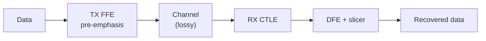

::: testing
Whether you can separate **loss** (amplitude reduction) from **distortion** (shape change), name every mechanism, and propose both **passive** (design) and **active** (equalization) fixes. Interviewers want:

1. Conductor loss (skin effect, roughness), dielectric loss, radiation, and reflection/discontinuity loss.
2. The consequence: frequency-dependent loss plus dispersion produce inter-symbol interference (ISI) and eye closure.
3. Fixes in the right order: shorter or better channel first, then TX pre-emphasis, RX CTLE/DFE, retimers.
:::

::: why
Past a couple of Gb/s, the channel stops being a wire and becomes a low-pass filter with reflections. Designing a USB, PCIe, DDR or Ethernet link is mostly an exercise in budgeting that loss and then recovering what's left with equalization. Interviewers like the question because a good answer shows you know which physical mechanism to blame for a closed eye and what tool applies to each.
:::

::: concepts
- **Insertion loss** $|S_{21}|$ in dB vs frequency, the thing the channel does to your signal. See [[q0724]].
- **Conductor loss**: skin effect and roughness. See [[q0725]].
- **Dielectric loss**: polarization loss with $\tan\delta$. See [[q0723]].
- **Reflections** from impedance discontinuities. See [[q0713]], [[q0526]].
- **Inter-symbol interference (ISI)**: energy from earlier bits spilling into later bits.
- **Equalization**: pre-emphasis (TX), CTLE and DFE (RX). See [[q0726]].
:::

::: answer
"I'd split it into loss and distortion. Loss is the signal getting smaller as it travels. The sources are conductor loss, which is resistance that grows as $\sqrt f$ from the skin effect and gets worse with rough copper; dielectric loss, which grows about linearly with frequency from the loss tangent of the laminate; and radiation, small for stripline but real at discontinuities. Reflections also steal energy from the main wave at every impedance step: vias, connectors, stubs, pads.

Distortion comes from the fact that the loss isn't flat. The channel attenuates high frequencies more than low ones, so a sharp edge loses its high-frequency content and smears out; dispersion also means different frequency components arrive at slightly different times. In the time domain that's ISI: the tail of one bit lands on the next one, and the eye closes. Reflections add their own ghost copies of the signal.

To minimize it: shorter traces, wider traces, smoother copper, a low-loss laminate instead of FR-4, stripline instead of microstrip for radiation, clean impedance control, back-drilled vias, good connectors. Then compensate actively: transmit pre-emphasis or de-emphasis boosts the high frequencies up front, the receiver uses a CTLE to flatten the channel and a DFE to cancel the post-cursor ISI, and if the channel is just too long I'd put in a retimer."
:::

::: technical
**Attenuation constant** for a low-loss line, $\alpha\approx\alpha_c+\alpha_d$:
$$\alpha_c\approx\frac{R'(f)}{2Z_0},\quad R'\propto\sqrt f\ (\text{above skin corner}),\qquad \alpha_d\approx\frac{\pi f\sqrt{\varepsilon_{eff}}\tan\delta}{c}\ \text{Np/m}\ (\times8.686\text{ for dB/m})$$

**Roughness.** Rough copper increases conductor loss by up to a factor of about 2. The Hammerstad-Jensen model gives $K=1+\frac2\pi\arctan\!\big[1.4(\Delta/\delta)^2\big]$ with rms roughness $\Delta$ and skin depth $\delta$. With $\Delta=1$ µm at 5 GHz ($\delta=0.92$ µm), $K\approx1.65$.

**Numbers, 50 Ω FR-4 microstrip (approximate):**

| $f$ | Conductor | Dielectric ($\tan\delta=0.02$) | Total | Total, low-loss ($\tan\delta=0.004$) |
|---|---|---|---|---|
| 1 GHz | 0.05 dB/in | 0.08 dB/in | 0.13 dB/in | 0.07 dB/in |
| 2.5 GHz | 0.08 | 0.21 | 0.29 | 0.12 |
| 5 GHz | 0.11 | 0.42 | 0.53 | 0.20 |
| 10 GHz | 0.16 | 0.83 | 0.99 | 0.33 |

For a 15 in channel the loss at 5 GHz (Nyquist of 10 Gb/s) is therefore about 8 dB on FR-4 and 3 dB on a low-loss laminate, before connector, via and package losses.

> [!UNCERTAIN]
> The conductor numbers are first-order estimates for one geometry, ignoring roughness, and $\tan\delta$ of FR-4 varies from about 0.015 to 0.025 by grade and frequency. Real stackups should be simulated or taken from vendor loss curves (dB/in vs frequency).

**Distortion mechanisms:**
1. Amplitude: $|H(f)|$ drops with $f$, so edges slow and eye height shrinks.
2. Phase / dispersion: non-constant group delay, which spreads pulses.
3. Reflections: $\Gamma$ at discontinuities, creating echoes delayed by $2t_d$ of the stub.
4. Crosstalk and mode conversion: energy coupling in from neighbours or from differential to common mode.

**Compensation tools:**
- TX: FFE, pre-emphasis / de-emphasis (boost high frequencies).
- RX: CTLE (analog high-frequency gain), DFE (subtract post-cursor ISI using past decisions), adaptive tuning.
- Channel: retimer (re-clock and re-transmit), redriver (amplify and equalize only).
:::

::: short
"Loss comes from conductor resistance (skin effect, roughness, rises as $\sqrt f$), dielectric loss (rises roughly with $f$), radiation, and energy lost to reflections at discontinuities. Because the loss grows with frequency, the line is a low-pass filter, so edges smear and ISI closes the eye. I minimize it with short, clean, impedance-controlled routing, smooth copper and low-loss laminate. Then I compensate actively: pre-emphasis at the transmitter, CTLE and DFE at the receiver, or a retimer for long channels."
:::

::: long
"I'd think of it in two parts: how the signal loses energy, and how the loss changes its shape.

Loss mechanisms: first, conductor loss. The copper resistance goes up as the square root of frequency because the skin effect squeezes the current into a thinner layer, and rough copper makes that worse, up to about a factor of two. Second, dielectric loss: the laminate's polarization lags the field and turns energy into heat, and that rises roughly linearly with frequency, set by the loss tangent. In FR-4 that dominates above about 1 GHz. Third, radiation, which is more of an issue for microstrip and at discontinuities. And fourth, reflections: every impedance step, via stub, connector or pad bounces some energy back.

Distortion is the shape change that follows. The loss isn't flat in frequency, so high-frequency content is attenuated more than low. A square edge turns into a slow, rounded one, and a long run of identical bits settles to the full level while an isolated bit never reaches it. That's ISI. Reflections add delayed echoes on top, and crosstalk adds noise.

Mitigation, passive first: shorter and cleaner routes, correct impedance, smooth copper, a low-loss laminate for fast links, striplines, back-drilled vias to remove stubs, and connectors rated for the data rate.

Then active: the transmitter boosts the high-frequency part of the signal with pre-emphasis or de-emphasis; the receiver applies a CTLE, which is basically a high-pass-shaped gain that flattens the channel, and a decision feedback equalizer, which subtracts the trailing ISI based on bits it has already decided. If that's still not enough, a retimer resets the budget in the middle of the channel."
:::

::: terms
- **Insertion loss**: transmitted power relative to input, $-20\log|S_{21}|$ in dB.
- **Return loss**: reflected power, $-20\log|S_{11}|$.
- **Loss tangent** $\tan\delta$: dielectric loss per unit stored energy.
- **Skin depth** $\delta$: depth at which current density falls to $1/e$: $\delta=\sqrt{\rho/\pi f\mu}$.
- **ISI**: inter-symbol interference.
- **Dispersion**: frequency-dependent propagation velocity.
- **CTLE / DFE / FFE**: continuous-time linear equalizer / decision-feedback equalizer / feed-forward equalizer.
- **Retimer / redriver**: devices that regenerate or boost a signal mid-channel.
:::

::: exceptional
**An average answer** says "skin effect and dielectric loss; use better material".

**An exceptional answer**:
- Separates **loss** (magnitude) from **distortion** (shape: frequency-dependent loss, dispersion, reflections, crosstalk) and says how each shows up in the eye.
- Gives scaling laws: conductor loss $\propto\sqrt f$, dielectric loss $\propto f$, so dielectric dominates at high frequency in FR-4.
- Quotes numbers: about 0.5 dB/in at 5 GHz on FR-4, about 0.2 dB/in on low-loss laminate.
- Distinguishes passive fixes (geometry, material, via design) from active (TX FFE, CTLE, DFE, retimer) and says which to try first.
- Treats reflections as part of the loss/distortion budget and mentions back-drilling or stub removal.
:::

::: mistakes
- **Treating loss as flat attenuation.** If it were flat, a gain stage would fix it. It's frequency dependent, which is why equalization (not just amplification) is needed.
- **Blaming only the skin effect.** On FR-4 above 1 GHz, dielectric loss usually dominates.
- **Confusing loss and reflection.** A mismatch reflects energy; it doesn't dissipate it (except as it bounces and gets attenuated). Different fix: termination vs better material.
- **Using more transmit amplitude as the cure.** Boosting everything raises low-frequency content too, and may violate EMI and driver limits. Pre-emphasis boosts only the high-frequency part.
- **Ignoring connectors and vias.** They can dominate the loss budget at 10+ Gb/s.
- **Thinking an equalizer recovers noise-limited signals.** CTLE amplifies noise and crosstalk along with signal; DFE doesn't. The equalizer choice matters.
:::

::: deep
## The channel as a filter

A uniform line of length $\ell$ has the transfer function $H(f)=e^{-\gamma\ell}=e^{-\alpha(f)\ell}\,e^{-j\beta(f)\ell}$. The magnitude $e^{-\alpha\ell}$ is the loss, and the phase $\beta(f)\ell$ is the delay. A distortionless line would have $\alpha$ constant and $\beta\propto f$. Real lines have $\alpha(f)$ rising and $\beta$ slightly nonlinear. See [[q0718]].

In dB the loss per length is $A_{dB}(f)=8.686\,\alpha(f)\,\ell$, which, using the two main terms, can be written
$$A_{dB}(f)\approx\ell\,(a_1\sqrt f+a_2 f)$$
with $a_1$ for conductor loss and $a_2$ for dielectric. That's the simple "$\sqrt f$ plus $f$" model used for first-pass channel estimates.

```plot
{"title":"Loss per inch, 50 Ω microstrip (first-order estimate)","x":{"label":"Frequency","unit":"Hz","min":1e8,"max":2e10,"log":true},"y":{"label":"Loss","unit":"dB/in","min":0,"max":1.2},
 "series":[{"label":"conductor only","fn":"0.051*sqrt(x/1e9)","color":"blue","dashed":true},
  {"label":"dielectric, FR-4 (tanδ 0.02)","fn":"0.083*(x/1e9)","color":"orange","dashed":true},
  {"label":"total FR-4","fn":"0.051*sqrt(x/1e9)+0.083*(x/1e9)","color":"red"},
  {"label":"total low-loss (tanδ 0.004)","fn":"0.051*sqrt(x/1e9)+0.0166*(x/1e9)","color":"green"}],
 "vlines":[{"at":5e9,"label":"Nyquist of 10 Gb/s","color":"muted"}]}
```
Figure: Conductor loss (blue) grows as $\sqrt f$, dielectric loss (orange) grows linearly. In FR-4 they cross near 0.4 GHz in this model, and the linear term dominates beyond that. With a low-loss laminate (green), conductor loss stays dominant until about 9 GHz. At 5 GHz FR-4 loses about 0.53 dB/in versus about 0.2 dB/in.

## From loss to ISI

A pulse sent through a low-pass channel gets a long tail. Say a 1-UI-wide pulse at 10 Gb/s is attenuated at 5 GHz by 8 dB (a factor 0.4) while its DC content is untouched. The main sample (the cursor) shrinks and the following bits (post-cursors) each pick up a fraction of its tail. A long run of identical bits settles to full amplitude, an isolated transition doesn't.

```sim
{"id":"eye-diagram","rate":10e9,"bw":3e9,"noise":0.02,"jitter":0.02,"preemph":0}
```
Figure: At 10 Gb/s with a 3 GHz channel bandwidth (about 6 dB of loss at Nyquist) the eye is still open, but the edges are visibly rounded and the inner height is well below the full ±0.5 V swing. Lower the bandwidth to about 1.5 GHz and the eye closes from ISI; then add 3 to 6 dB of TX de-emphasis or CTLE boost and watch it reopen. Lower the bandwidth further and see when no amount of boost is enough.

**Dispersion** adds to this. If the group delay $\tau_g=-d\phi/d\omega$ varies across the signal's bandwidth, different frequency components of the edge arrive at different times, so the edge spreads. For FR-4 microstrip over a few inches it's small compared with amplitude loss, but it matters in long backplanes.

## Reflections and discontinuities

At each impedance step the reflected fraction is $\Gamma$, and what's transmitted is $1-\Gamma^2$ in power terms. Plus the reflected wave returns later, often as the same data after a delay, which creates an echo: a bump at a fixed time offset from the main pulse. A via stub of length $s$ acts as an open quarter-wave stub with a notch at $f=c/(4\sqrt{\varepsilon_r}\,s)$. In FR-4 ($\sqrt{\varepsilon_r}\approx2$) a 1.5 mm stub notches near 25 GHz, a 3 mm stub near 12.5 GHz and a 6 mm stub near 6 GHz. Short stubs are harmless at 10 Gb/s (Nyquist 5 GHz), but a long stub, for example a connector on the far side of a thick backplane, moves the notch down into the signal band. This is what back-drilling fixes.

## Minimizing: the passive checklist

| Mechanism | Fix | Cost |
|---|---|---|
| Conductor loss | Wider trace (lower $R'$), shorter length, smoother copper (VLP/HVLP foil) | Board area, material cost |
| Dielectric loss | Low-$\tan\delta$ laminate (low-loss FR-4 variants, high-speed laminates, PTFE blends) | Cost and fab compatibility |
| Radiation | Stripline instead of microstrip; ground via fences | Layer count |
| Reflections | Controlled $Z_0$, back-drilled vias, pad cutouts, matched connectors | Fab process |
| Crosstalk | Spacing (3W rule of thumb), stripline, ground guard | Area |

> [!UNCERTAIN]
> Material choices: "low-loss" and "ultra-low-loss" laminate names and $\tan\delta$ values vary by manufacturer. Check datasheets for $D_k$ and $D_f$ at your frequency; datasheet values are often at 1–10 GHz and may not represent your band.

## Active compensation


Figure: A modern serial link equalizes in three places: the transmitter boosts high frequencies, the CTLE flattens the channel response, and the DFE removes remaining post-cursor ISI by feeding back past decisions.

- **TX FFE / de-emphasis**: a short FIR filter in the driver ($y_n=c_0x_n+c_1x_{n-1}+\dots$). It reduces low-frequency amplitude relative to the high-frequency part. Costs: reduced swing at the receiver for the low-frequency content, higher EMI at high frequency. See [[q0726]] and [[q0727]].
- **CTLE**: analog peaking filter with a zero and poles, which gives gain at Nyquist. Amplifies noise and crosstalk too.
- **DFE**: subtracts the ISI from previous bits using decisions; no noise enhancement, but can't fix pre-cursor ISI and risks error propagation.
- **Retimer vs redriver**: a retimer includes clock-data recovery and retransmits a clean signal, resetting jitter; a redriver only amplifies/equalizes.
- **Adaptive tuning** (link training) sets coefficients per channel, as in PCIe and Ethernet.

## Worked budget

A 10 Gb/s link has an allowed channel loss at 5 GHz of, say, 20 dB (value depends on the spec and receiver capability). Suppose the package, connectors and vias take 6 dB. The board gets 14 dB. On FR-4 at 0.53 dB/in that's about 26 in; on a low-loss laminate at 0.2 dB/in about 70 in (ignoring the other effects like roughness, which would shorten both). The real limit is set by the receiver's equalization capability and the spec's loss budget, not a rule of thumb.
:::

::: applications
- **PCIe, SAS, 10/25/100G Ethernet**: spec-defined insertion-loss budgets and equalization (TX FFE, CTLE, DFE) with link training.
- **DDR memory**: shorter traces and fly-by topologies with ODT to limit reflections, DFE in newer generations.
- **HDMI/DisplayPort cables**: active cables embed equalizers or retimers to extend length.
- **USB-C**: redrivers or retimers for long board runs or cable extensions.
- **Backplanes**: low-loss laminates, back-drilled vias and connector-optimized footprints.
- **Oscilloscope probes**: loss and bandwidth of probe cables are part of the same physics.
:::

::: assumptions
- **Low-loss, quasi-TEM line**: $\alpha\approx R'/2Z_0+G'Z_0/2$.
- **Constant $\tan\delta$ and $\varepsilon_r$** over frequency. Real laminates vary.
- **Dispersion** is small compared to attenuation over typical PCB lengths (a few inches) and becomes important over long backplanes.
- **Uniform line**; discontinuities handled separately.
- **Answer changes** with spec: a 1 Gb/s link on 6 inches of FR-4 needs no equalization at all, while 112 Gb/s PAM4 needs everything above and still cuts channel length.
:::

::: followups
### Which dominates on FR-4 at 5 GHz, conductor or dielectric loss?
Dielectric. In the first-order model about 0.42 dB/in dielectric vs 0.11 dB/in conductor at 5 GHz with $\tan\delta=0.02$. Roughness would push conductor loss up by a factor of up to 2 but dielectric still dominates.

### How does surface roughness change loss?
Rough copper lengthens the current path along the surface as the skin depth shrinks to a similar size as the roughness, and increases $R'$ by a factor $K$ up to about 2 (Hammerstad–Jensen). 1 µm rms roughness at 5 GHz gives $K\approx1.65$. Low-profile foil reduces this at higher cost.

### What's the difference between a retimer and a redriver?
A redriver amplifies and equalizes the analog signal but passes jitter and noise through. A retimer recovers the clock, re-samples the data, and transmits a fresh signal, resetting the jitter budget. Retimers add latency and cost and are needed when the channel is longer than a single link's equalization can handle.

### Why does DFE not amplify noise while CTLE does?
CTLE is a linear filter that boosts high frequencies, which boosts noise and crosstalk in that band as well as the signal. DFE subtracts a reconstruction of the ISI built from already-decided bits, so it never amplifies the noise in the received waveform. The risk is error propagation when a decision is wrong.

### How would you decide between a better laminate and adding equalization?
Compare cost and risk: first compute the loss budget at Nyquist. If the channel is within what the receiver's CTLE/DFE can handle with margin, standard FR-4 is fine. If not, try shorter routes, then a mid-loss laminate. Use simulation (S-parameters through a channel model) to compare. Equalization also costs power, so low-power parts often prefer better material.

### Harder: could a perfectly matched, perfectly smooth, lossless-copper line still distort? 
Yes. Dielectric loss and dispersion remain, so a high-$\tan\delta$ dielectric still causes frequency-dependent attenuation and group-delay variation. Causality (Kramers–Kronig) ties the loss to a frequency-dependent $\varepsilon_r$, so a lossy dielectric is always dispersive.
:::

::: interpretations
"Sources of loss and distortion in a TL" includes both material loss and signal-integrity effects such as reflections, crosstalk and dispersion. "Actively compensated" points to equalization and re-driving. I answered both passive minimization and active compensation. The dielectric piece is expanded in [[q0723]], the skin effect in [[q0725]], and the equalization specifics in [[q0726]] and [[q0727]].
:::

::: references
- Eric Bogatin, *Signal and Power Integrity: Simplified*: chapters on lossy transmission lines and on equalization.
- Stephen H. Hall and Howard L. Heck, *Advanced Signal Integrity for High-Speed Digital Designs*: lossy lines, dielectric and conductor loss.
- Howard Johnson and Martin Graham, *High-Speed Digital Design*: skin effect and dielectric loss.
- Hammerstad and Jensen, "Accurate models for microstrip computer-aided design" (IEEE MTT-S 1980), for the surface-roughness correction.
- Pozar, *Microwave Engineering*, chapters on transmission lines with loss.
:::

::: rubric
- Names conductor, dielectric, radiation and reflection losses :: A complete answer covers all four sources.
- Gives frequency scaling ($\sqrt f$ conductor, $f$ dielectric) :: Shows quantitative understanding.
- Explains distortion: frequency-dependent loss, dispersion → ISI and eye closure :: The question asks about distortion, not just attenuation.
- Lists passive fixes (shorter, wider, smoother copper, low-loss laminate, back-drill, stripline) :: Demonstrates layout and material knowledge.
- Lists active compensation (pre-emphasis, CTLE, DFE, retimer) :: This is the "actively compensated" half of the question.
- Gives a number or budget (e.g. dB/in at Nyquist) :: Practical engineers work in loss budgets.
:::

::: quiz
```json
[
 {"type":"mcq","level":"fundamental","q":"Which statement about loss mechanisms in a PCB trace is correct?","options":["Conductor loss rises as $\\sqrt f$ and dielectric loss rises about linearly with $f$","Both rise as $f^2$","Conductor loss is independent of frequency","Dielectric loss falls with frequency"],"answer":0,"explain":"Skin effect makes $R'\\propto\\sqrt f$. Dielectric loss $G'=\\omega C'\\tan\\delta$ is linear in $f$ for constant $\\tan\\delta$."},
 {"type":"mcq","level":"fundamental","q":"Why does a frequency-dependent loss distort a digital edge?","options":["High-frequency components are attenuated more than low-frequency ones, so the edge rounds and ISI appears","Amplitude is reduced equally at all frequencies","Reflections vanish","The line's impedance becomes zero"],"answer":0,"explain":"A square edge contains many harmonics. If the highest ones are attenuated more, the edge slows and bits smear into neighbours."},
 {"type":"numeric","level":"intermediate","q":"A channel on FR-4 loses 0.53 dB/in at 5 GHz. How much is the loss over 12 in at 5 GHz, in dB?","answer":6.36,"tolerance":0.02,"unit":"dB","explain":"$0.53\\times12=6.36$ dB."},
 {"type":"numeric","level":"intermediate","q":"Using $K=1+\\frac{2}{\\pi}\\arctan[1.4(\\Delta/\\delta)^2]$ with $\\Delta=1\\ \\mu$m and $\\delta=0.92\\ \\mu$m, what is the roughness factor $K$?","answer":1.65,"tolerance":0.02,"unit":"","explain":"$(\\Delta/\\delta)^2=1.18$, $1.4\\times1.18=1.65$, $\\arctan(1.65)=1.026$ rad, $K=1+0.6366\\times1.026\\approx1.65$."},
 {"type":"multi","level":"intermediate","q":"Which techniques actively compensate for channel loss? Select all that apply.","options":["TX pre-emphasis / de-emphasis","Receiver CTLE","Receiver DFE","Using a thicker solder mask"],"answer":[0,1,2],"explain":"Pre-emphasis, CTLE and DFE are the standard equalization tools. Solder mask thickness is not an equalizer."},
 {"type":"truefalse","level":"advanced","q":"A DFE amplifies high-frequency noise and crosstalk in the same way a CTLE does.","answer":false,"explain":"A CTLE is a linear filter that boosts high frequencies, noise included. A DFE subtracts ISI computed from past decisions, so it doesn't boost noise, but it can propagate errors."}
]
```
:::
