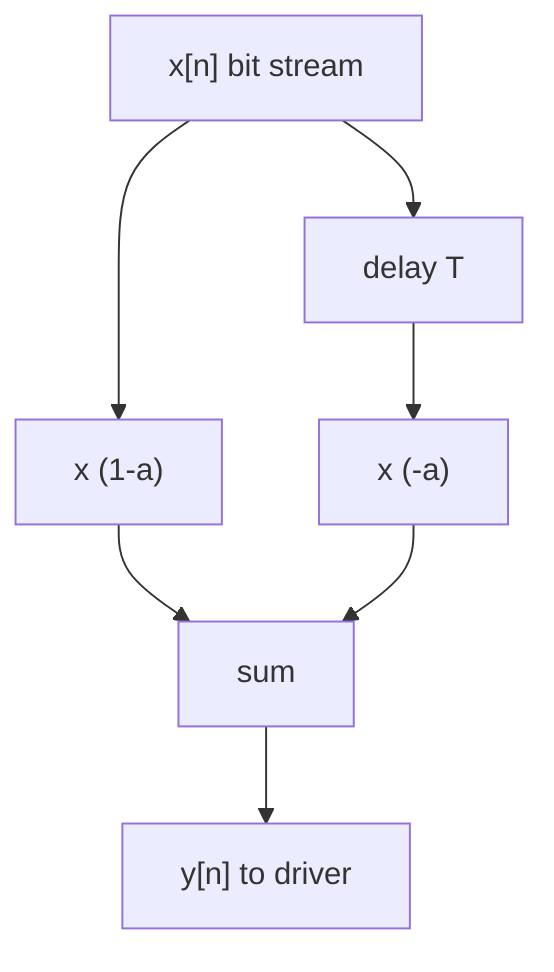

::: testing
Whether you see preemphasis as the **inverse of the channel**: the channel is a low-pass filter, so you pre-boost the high frequencies so that the received signal ends up flat. The interviewer is checking for:

1. The motivation (channel loss rising with frequency causes inter-symbol interference and a closed eye).
2. The concept and the trade-off: boosting high frequencies (or equivalently de-emphasizing low frequencies) costs amplitude or power, EMI and crosstalk.
3. Implementations: a multi-tap FIR in the transmitter driver (FFE), a passive RC lead network, op-amp or audio shelving filters, and link-training adaptation.
:::

::: why
Every multi-gigabit link (PCIe, SATA, USB 3, HDMI, Ethernet) uses transmit equalization. Without it, a few inches of FR-4 would close the eye at 5–10 Gb/s. Preemphasis is also the standard trick in FM radio and vinyl records, so interviewers like it as a bridge question between signals, circuits and communication. A good answer shows you can reason in both the frequency domain (boost the high end) and the time domain (overshoot on the edge, reduced amplitude on the repeated bits).
:::

::: concepts
- **Channel as low-pass filter**: loss rises with $f$. See [[q0722]], [[q0723]], [[q0725]].
- **Inter-symbol interference (ISI)**: the smeared tail of one bit corrupts later bits.
- **Transfer function equalization**: put $H_{TX}(f)\approx1/H_{ch}(f)$ so $H_{TX}H_{ch}\approx1$ up to the data Nyquist frequency.
- **FIR filter**: $y[n]=\sum_kc_kx[n-k]$; with the sign of the taps chosen to boost edges.
- **Pre-emphasis vs de-emphasis**: same filter; either raise the transitions above nominal (preemphasis) or lower the repeated bits below nominal (de-emphasis).
- **Passive high-frequency boost**: a resistor in parallel with a capacitor.
:::

::: answer
"Preemphasis is boosting the high-frequency content of the signal at the transmitter before it goes down a lossy channel. The channel, whether it's a PCB trace, cable or backplane, acts like a low-pass filter: skin effect and dielectric loss attenuate high frequencies more than low. If you send a clean square wave, the edges arrive slow and the energy of each bit smears into the next ones, which is inter-symbol interference, and the eye closes. If I pre-boost the high frequencies by about the amount the channel will take away, the received spectrum comes out flat and the eye opens.

There are two ways of looking at it in the time domain. Preemphasis exaggerates the first bit after a transition. De-emphasis lowers the amplitude of the bits that follow a transition when the data doesn't change. Same filter, just different reference level.

Implementation: usually a small FIR filter in the driver, two or three taps. A 2-tap version is $y[n]=(1-a)x[n]-a\,x[n-1]$: DC gain falls to $1-2a$ and the Nyquist gain stays 1, so that's a boost of $1/(1-2a)$ at Nyquist, for example 6 dB when $a=0.25$. You can also build it passively with a resistor in parallel with a capacitor in the driver's series path. The cost is lower low-frequency amplitude or more power, more high-frequency EMI and crosstalk, and the coefficients have to be tuned per channel, which links do with training."
:::

::: technical
**Principle.** Let the channel be $H_{ch}(f)$ with $|H_{ch}|$ falling with $f$. Choose a TX filter $H_{TX}(f)$ so that $H_{TX}H_{ch}\approx$ flat up to the Nyquist frequency $f_N=\text{bit rate}/2$.

**2-tap FIR (post-cursor de-emphasis):** $y[n]=(1-a)x[n]-a\,x[n-1]$, $x=\pm1$ per bit.
$$H(f)=(1-a)-a\,e^{-j2\pi fT},\qquad |H|^2=(1-a)^2+a^2-2a(1-a)\cos(2\pi fT)$$
- DC: $|H|=1-2a$. Nyquist ($fT=\tfrac12$): $|H|=1$. Boost of Nyquist over DC: $B=1/(1-2a)$.
- Time domain: first bit after a transition has amplitude $|(1-a)+a|=1$; later same bits have $1-2a$.

| $a$ | de-emphasis (DC level) | Nyquist boost |
|---|---|---|
| 0.10 | −1.9 dB | 1.9 dB |
| 0.166 | −3.5 dB | 3.5 dB |
| 0.20 | −4.4 dB | 4.4 dB |
| 0.25 | −6.0 dB | 6.0 dB |

3.5 dB and 6 dB are common de-emphasis settings in standards (check each standard's definition and allowed values).

**3-tap FFE:** $y[n]=c_{-1}x[n+1]+c_0x[n]+c_1x[n-1]$ with $c_{-1},c_1\le0$, $|c_{-1}|+c_0+|c_1|=1$ (swing-limited). The pre-cursor tap $c_{-1}$ handles pre-cursor ISI.

**Passive network.** A resistor $R_1$ in series with the line, bypassed by $C$, with the line (impedance $R_2=Z_0$) as the load:
$$H(s)=\frac{R_2}{R_1+R_2}\cdot\frac{1+sR_1C}{1+s(R_1\parallel R_2)C}$$
DC gain $R_2/(R_1+R_2)$, HF gain 1, zero at $1/2\pi R_1C$, pole at $1/2\pi(R_1\parallel R_2)C$. For $R_1=R_2=50$ Ω, $C=6.4$ pF: zero at 497 MHz, pole at 995 MHz, a 6 dB step.

**Audio/broadcast:** FM broadcast preemphasis uses a time constant of 75 µs (US) or 50 µs (Europe and many others); the receiver applies the inverse de-emphasis, so noise at high audio frequencies is reduced. Vinyl uses the RIAA curve in the same spirit.

> [!UNCERTAIN]
> Standards differ in how they define "de-emphasis dB", "preshoot" and "boost" (amplitude ratios vs power, relative to peak or to DC). Always take the definition from the interface spec.
:::

::: short
"Preemphasis boosts the high-frequency part of the transmitted signal to cancel the low-pass response of a lossy channel, so the received signal is flat and ISI is small. In the time domain it overshoots the first bit after a transition, or equivalently de-emphasizes repeated bits. It's usually a short FIR filter in the driver, like $y[n]=(1-a)x[n]-a\,x[n-1]$, which boosts Nyquist by $1/(1-2a)$. It can also be a passive RC network. The cost is lower low-frequency swing, more high-frequency EMI and crosstalk, and coefficients that need tuning."
:::

::: long
"The motivation is that every real channel is a low-pass filter. The loss from the skin effect and the dielectric grows with frequency, so a few inches of FR-4 at 10 Gb/s might take away 8 dB at the Nyquist frequency while leaving DC alone. A digital signal is made of edges, and the high-frequency parts get removed, so edges slow down. The energy of each bit then spills onto the following bits, that's ISI, and the eye closes.

Preemphasis fixes it by giving the transmitter the inverse response of the channel. If the channel loses 8 dB at 5 GHz, boost 5 GHz by about 8 dB at the transmitter. The product is flat, and the received edges are sharp.

In the time domain it looks like this. If the data is 0 then 1 then 1 then 1, the first 1 is driven at full amplitude, and the following 1s are driven lower. That lower plateau is the de-emphasis. The first bit gets a bigger relative kick which cancels the sluggish rise of the lossy channel; after the line has charged, the signal settles at the lower level, which is what's actually needed.

The implementation is a small FIR. For example $y[n]=(1-a)x[n]-a\,x[n-1]$, which means the driver adds a delayed, inverted copy of the previous bit. The gain at DC is $1-2a$ and at Nyquist it's 1, so the boost is $1/(1-2a)$; $a=0.25$ gives 6 dB. Real drivers use 2 to 4 taps, with coefficients set by link training. An analog alternative is a resistor with a capacitor across it in the signal path: low frequencies see the divider, high frequencies bypass it.

Trade-offs: it reduces the low-frequency swing, so you lose some SNR at the receiver for long runs, it increases high-frequency EMI and crosstalk, and it can't fix reflections, since those aren't a frequency-dependent loss but delayed echoes. So I'd treat it as one piece along with receiver equalization (CTLE and DFE)."
:::

::: terms
- **Preemphasis**: boosting high-frequency content (or transitions) at the transmitter.
- **De-emphasis**: reducing the amplitude of non-transition bits; equivalent filter to preemphasis with a different reference level.
- **FFE (feed-forward equalizer)**: a FIR filter on the transmit or receive side.
- **Tap / cursor**: a filter coefficient; main cursor, pre-cursor and post-cursor refer to the position relative to the current bit.
- **ISI**: inter-symbol interference.
- **Nyquist frequency** $f_N$: half the bit rate for NRZ.
- **Link training**: protocol where TX and RX negotiate equalization coefficients.
- **Peaking / boost**: gain at high frequency relative to low.
:::

::: exceptional
**An average answer** says "preemphasis boosts high frequencies to compensate for loss".

**An exceptional answer**:
- Frames it as the inverse of the channel's low-pass response, with ISI and the eye as the motivation.
- Shows both views: frequency domain (boost around Nyquist) and time domain (overshoot or de-emphasized repeated bits).
- Writes the 2-tap FIR, computes the DC and Nyquist gains, and gives a number (6 dB for $a=0.25$).
- Gives multiple implementations: FIR/FFE in the driver, passive RC network (with the $R\parallel C$ transfer function), analog shelving filters (FM, RIAA).
- Knows the cost: lower swing at low frequency, more EMI and crosstalk, noise at the receiver is not helped.
- Notes that it can't fix reflections and is complemented by RX CTLE/DFE, with adaptive coefficients.
:::

::: mistakes
- **Saying it "amplifies" the signal.** Total swing is limited by the driver. In de-emphasis the *low-frequency* part is reduced, not the high part increased.
- **Confusing preemphasis with equalization at the receiver.** Preemphasis is on the TX side; CTLE and DFE are RX side. Receiver boost also boosts noise; TX preemphasis boosts signal before noise is added.
- **Expecting it to fix reflections.** It shapes a frequency response. A reflection from a mismatch is an echo that preemphasis can't cancel.
- **Over-boosting.** Too much preemphasis overshoots, creates pre-cursor ISI and wastes eye height. The target is a flat total response, not maximum boost.
- **Ignoring EMI.** The boosted high-frequency content radiates more and couples into neighbours.
- **Mixing up units.** Boost in dB of amplitude ratio ($20\log$) vs power; and different standards define the dB reference differently.
:::

::: deep
## The channel is a low-pass filter

For a lossy line $H_{ch}(f)=e^{-\gamma\ell}$ with $|H_{ch}|$ in dB falling roughly as $-\ell(a_1\sqrt f+a_2f)$. As an example, take a 15 in FR-4 link: using about 0.114 dB/in (conductor) plus 0.415 dB/in (dielectric) at 5 GHz, the loss is about 8 dB at 5 GHz. See [[q0722]]. A signal at 10 Gb/s has its fundamental at 5 GHz, so the channel reduces the energy near Nyquist to 40% of its amplitude relative to DC.

The time-domain consequence: a single isolated bit gets a pulse response whose peak is much smaller than the DC-settled level, and whose tail extends over several bit times. A run of identical bits settles toward the full level. So the amplitude at the sampling instant depends on the pattern: a long run of ones reaches nearly full height, an isolated one only reaches a fraction. That pattern dependence is ISI.

## Equalization on the transmit side

If the channel response is $H_{ch}(f)$, the transmitter can apply $H_{TX}\approx1/H_{ch}$ up to Nyquist. A short FIR is enough since the channel changes smoothly. With the 2-tap filter,

$$|H_{TX}(f)|^2=(1-a)^2+a^2-2a(1-a)\cos(2\pi fT)$$

and for $a=0.25$, $T=100$ ps (10 Gb/s) you get DC $-6.0$ dB and 0 dB at 5 GHz.

```plot
{"title":"Channel loss (15 in FR-4) × 2-tap TX FFE (a = 0.25), normalised to DC","x":{"label":"Frequency","unit":"Hz","min":1e7,"max":5e9},"y":{"label":"Gain","unit":"dB","min":-10,"max":8},
 "vars":{"a":0.25,"T":100e-12,"len":15},
 "series":[{"label":"channel alone","fn":"-len*(0.051*sqrt(x/1e9)+0.083*x/1e9)","color":"red"},
  {"label":"TX FFE alone (relative to DC)","fn":"10*log10((1-a)^2+a^2-2*a*(1-a)*cos(2*pi*x*T))-20*log10(1-2*a)","color":"blue","dashed":true},
  {"label":"channel × FFE","fn":"-len*(0.051*sqrt(x/1e9)+0.083*x/1e9)+10*log10((1-a)^2+a^2-2*a*(1-a)*cos(2*pi*x*T))-20*log10(1-2*a)","color":"green"}],
 "vlines":[{"at":5e9,"label":"Nyquist 5 GHz","color":"muted"}]}
```
Figure: The red curve is the channel falling to about −8 dB at 5 GHz. The blue dashed curve is the 2-tap FFE, rising by 6 dB. Their sum (green) is within about 2 dB of flat out to Nyquist, instead of 8 dB down. Because the FFE boost is a cosine of frequency and the channel loss is smooth, a 2-tap filter approximates the inverse only roughly, so real links use 3 taps and a receiver CTLE/DFE as well.

## Time domain: what the driver actually does

For data $\ldots 1,1,1,0,\ldots$: the 2-tap output after a transition is $(1-a)\cdot(+1)-a\cdot(-1)=+1$, the full swing. For the next 1, $(1-a)\cdot1-a\cdot1=1-2a=0.5$ (for $a=0.25$). So the line sees ±1 at each transition and ±0.5 on repeated bits. The lossy channel then adds its low-pass tail, and the received eye is flatter than with ±1 on every bit alone. [[q0727]] draws the time and spectrum pictures.


Figure: A 2-tap TX FIR: the current bit scaled by $(1-a)$ plus the previous bit scaled by $-a$. A real driver implements this as two or three parallel driver slices whose inputs are the current and delayed data bits, and whose strengths are the tap weights.

## Passive analog implementation

```circuit
{"caption":"Passive pre-emphasis: R1 with a bypass capacitor drives the line","elements":[
 {"t":"V","a":[0,2],"b":[0,6],"label":"V_{tx}"},
 {"t":"wire","pts":[[0,2],[0,0],[2,0]]},{"t":"dot","at":[2,0]},
 {"t":"wire","pts":[[2,0],[2,3],[4,3]]},
 {"t":"R","a":[2,0],"b":[8,0],"label":"R_1","value":"50 Ω"},
 {"t":"C","a":[4,3],"b":[8,3],"label":"C","value":"6.4 pF"},
 {"t":"wire","pts":[[8,3],[10,3],[10,0]]},{"t":"dot","at":[10,0]},
 {"t":"wire","pts":[[8,0],[10,0],[13,0]]},{"t":"dot","at":[13,0]},
 {"t":"R","a":[13,0],"b":[13,4],"label":"R_2 = Z_0","value":"50 Ω"},
 {"t":"wire","pts":[[13,0],[16,0]]},
 {"t":"term","at":[16,0],"label":"V_{line}","side":"right"},
 {"t":"wire","pts":[[0,6],[13,6],[13,4]]},{"t":"gnd","at":[6,6]}
]}
```
Figure: At low frequency the capacitor is open and $R_1$ forms a divider with the line load ($R_2$ = line impedance), giving 0.5. At high frequency the capacitor shorts $R_1$ and the full signal reaches the line. The step in between is the preemphasis.

```bode
{"systems":[{"label":"R1 ∥ C network, loaded by 50 Ω","num":["r2*r1*c/(r1+r2)","r2/(r1+r2)"],"den":["r1*r2*c/(r1+r2)",1]}],"vars":{"r1":50,"r2":50,"c":"6.4e-12"},"f":{"min":1e6,"max":1e10},"marks":[{"f":"1/(2*pi*r1*c)","label":"zero 497 MHz"},{"f":"1/(2*pi*(r1*r2/(r1+r2))*c)","label":"pole 995 MHz"}],"show":"mag","magRange":[-10,2]}
```
Figure: The magnitude steps from −6 dB (DC divider) to 0 dB above the pole, a 6 dB boost relative to DC, centred between the zero and the pole. The pole and zero frequencies are chosen to match the channel's loss corner. This passive version costs the full 6 dB of low-frequency signal, like de-emphasis.

## Choosing the boost: a worked example

A 10 Gb/s NRZ link has a Nyquist frequency of 5 GHz. Suppose a design review gives the following loss budget at 5 GHz: 10 in of board trace at about 0.5 dB/in, plus about 1.5 dB each for the two connectors, giving 8 dB in total. At 1 GHz the same channel loses only about 2 dB, so a flat-gain amplifier can't fix it: the loss is steep.

1. Aim to cancel most of it with TX boost, but keep some for the receiver's CTLE to trim: choose roughly 5 dB of TX boost.
2. $1/(1-2a)=10^{5/20}=1.78$, so $1-2a=0.562$ and $a=0.219$.
3. The driver's de-emphasis level is $20\log_{10}(0.562)=-5$ dB below the transition level.
4. If the driver swing is 800 mV peak-to-peak at transitions, repeated bits settle at about 450 mV, which is what the channel and receiver see as the "DC" level before the loss.

Then check the received eye. If the first bit after each transition overshoots, you've over-equalized. If long runs of identical bits still droop toward the following transition, you need more. A real link would let training search the coefficient space automatically.

## The same idea in audio and radio

Preemphasis is much older than gigabit serial links. In FM broadcasting, the transmitter boosts high audio frequencies with a first-order network of time constant 75 µs (US) or 50 µs (many other regions), whose corner is $1/(2\pi\tau)=2.1$ kHz or 3.2 kHz. At 15 kHz that is a boost of $\sqrt{1+(15/2.12)^2}=7.1$ times (17 dB) for 75 µs. The receiver applies the mirror-image de-emphasis, which also attenuates the high-frequency hiss the FM demodulator adds (FM noise rises with frequency), so the signal comes back flat while the noise is reduced. This is the same principle as the serial link, with a key difference: in FM the *noise* is added after the preemphasis and is shaped by the inverse filter, so SNR improves; in a serial link the channel's loss is what is being inverted.

The RIAA curve for vinyl is the same trick: records are cut with low frequencies attenuated (to limit groove excursion) and highs boosted (to keep them above surface noise), and the phono preamp applies the inverse.

## Practical issues

- **Swing limit**: the driver's peak output is fixed, so boosting means lowering the DC level. Relative to a non-equalized driver, the *received* low-frequency amplitude drops, which the channel loss then makes smaller still on long channels. It's SNR vs ISI trade-off.
- **Pre-cursor**: a post-cursor-only filter doesn't address the pre-cursor ISI that long channels also have. Three-tap FFE adds that.
- **Adaptation**: standards like PCIe, USB 3 and Ethernet define training so the receiver tells the transmitter which coefficients to use.
- **EMI**: the boosted high-frequency content radiates and crosstalks more. Shorter channels need less.
- **Too much**: over-equalized signals show overshoot on the first bit and a reduced eye for the following one.

## Experiment with it

```sim
{"id":"eye-diagram","rate":10e9,"bw":2.5e9,"noise":0.02,"jitter":0.02,"preemph":4}
```
Figure: Start with `preemph` at 0 dB and a 2.5 GHz channel at 10 Gb/s: the eye is closed. Raise it to 4–6 dB and the eye opens. Keep raising it beyond about 10 dB and watch the eye close again from overshoot, showing that the best preemphasis matches the channel loss and doesn't maximise.
:::

::: applications
- **PCIe, SATA, SAS, USB 3.x, HDMI/DisplayPort**: TX de-emphasis or FFE with 2–4 taps, with some selected by link training.
- **Ethernet backplanes (10GBASE-KR and beyond)**: TX FFE with trained taps plus RX equalization.
- **FM broadcast and audio**: 75 µs / 50 µs preemphasis at the transmitter and matching de-emphasis at the receiver to reduce high-frequency noise.
- **Vinyl records**: RIAA preemphasis when cutting, inverse equalization in the phono preamp.
- **Long cable drivers (video, RS-485)**: cable-driver chips with equalization controls.
- **Optical transceivers**: TX FFE and driver peaking to compensate for laser and driver bandwidth.
:::

::: assumptions
- **Linear channel** so TX and channel responses multiply.
- **Smoothly falling loss**: a short FIR can approximate its inverse. A resonant notch from a stub can't be undone by it.
- **Fixed swing driver**, so boost is implemented as de-emphasis of the low-frequency part.
- **Noise added after the channel**: preemphasis improves the SNR at high frequency compared with receiver-only boost, which also amplifies noise.
- **NRZ signalling** at one symbol per UI. For PAM4 or other formats the same idea applies with different amplitude considerations.
- **Answer changes** for very short channels: no preemphasis needed; and for very lossy ones: need RX equalization too (the boost needed exceeds what the swing budget allows).
:::

::: followups
### Why de-emphasize instead of boosting the transitions above the nominal level?
The driver has a maximum swing set by its supply and linearity limit. Transitions already use that maximum, so you can't go higher; you can only lower everything else. Voltage-mode and current-mode drivers also have a fixed output amplitude. So the de-emphasis form is the realisable one; preemphasis is the same filter with a different reference.

### What's the effect of preemphasis on the received eye height?
It trades low-frequency amplitude for edge quality. The settled level (DC) is reduced by $(1-2a)$, but ISI falls by more, so the *net* eye opening increases if the channel loss is significant. If the channel is short, preemphasis reduces the eye height because there is little ISI to remove.

### How would you pick the preemphasis for a 10 Gb/s link on 10 in of FR-4?
Estimate the channel loss at Nyquist (about 0.5 dB/in at 5 GHz gives 5 dB for 10 in), then pick a boost close to it: about 4–5 dB, so $a\approx0.2$–0.22. Then verify on a scope or in simulation by sweeping and picking the setting with the widest eye, since real channels have additional losses from vias, connectors and package.

### What does a CTLE do that preemphasis doesn't?
A CTLE (receiver side) is an analog filter that boosts high frequencies *after* the channel. It can adapt to what it actually receives, and it can handle loss that TX can't (limited swing). The downside is that it amplifies noise and crosstalk picked up in the channel. TX preemphasis boosts the signal *before* noise is added.

### Scenario: your eye looks fine at 2.5 Gb/s but is closed at 10 Gb/s with the same cable. What do you try?
First check the loss at the 10 Gb/s Nyquist of 5 GHz compared with what the receiver handles. Enable TX preemphasis, starting from a small value and increasing. If available, turn on the RX equalization. If that's not enough, shorten the cable or use a better one. Watch the eye as I change settings. Overshoot or double edges mean too much boost.

### Harder: can preemphasis fix a reflection from an impedance mismatch?
Not in general. A reflection is a delayed echo with a fixed delay of $2t_d$, and a short FIR (taps within 1–2 UI) only helps if the echo falls within those taps. A far reflection needs a DFE with many taps, or fixing the mismatch. Also note that boosting the transmit signal boosts the reflection by the same factor.
:::

::: interpretations
"How can it be implemented?" is answered at circuit level: FIR taps in the driver and passive RC networks, plus the analog shelving form used in audio/FM. The time-domain/frequency-domain drawing asked in the next question is covered in [[q0727]]. The physics of the loss it fights is in [[q0722]], [[q0723]] and [[q0725]].
:::

::: references
- Eric Bogatin, *Signal and Power Integrity: Simplified*: chapters on lossy lines, equalization and the eye diagram.
- Stephen H. Hall and Howard L. Heck, *Advanced Signal Integrity for High-Speed Digital Designs*: pre-emphasis and equalization.
- Behzad Razavi, *Design of Integrated Circuits for Optical Communications* (equalizer chapters), and *RF Microelectronics* for receiver-side CTLE background.
- Interface specifications such as PCI Express Base, USB 3.x and SATA, for definitions of de-emphasis and preset coefficients.
- Haykin, *Communication Systems*: pre-emphasis and de-emphasis in FM.
:::

::: rubric
- Motivation: lossy channel is a low-pass filter causing ISI and eye closure :: Shows you understand why before how.
- Defines preemphasis as boosting high frequencies (or de-emphasizing low) to flatten the total response :: The basic definition.
- Time-domain description: edge overshoot or reduced amplitude on repeated bits :: Demonstrates you can see it on a scope.
- Gives implementation: FIR/FFE in the driver and/or passive RC network :: The "how can it be implemented" half.
- Quantifies with the 2-tap formula or an example (6 dB at $a=0.25$) :: Numbers show working knowledge.
- States trade-offs (lower swing, EMI/crosstalk, tuning, doesn't fix reflections) and relates to RX CTLE/DFE :: Engineering judgement.
:::

::: quiz
```json
[
 {"type":"mcq","level":"fundamental","q":"Why is preemphasis applied at the transmitter of a lossy link?","options":["To make the DC level higher","To boost high frequencies the channel will attenuate, flattening the overall response and reducing ISI","To reduce the data rate","To remove reflections"],"answer":1,"explain":"Channel loss rises with frequency. Boosting the high-frequency content at the TX approximately inverts the channel response, which reduces ISI."},
 {"type":"numeric","level":"intermediate","q":"A 2-tap FIR $y[n]=(1-a)x[n]-a\\,x[n-1]$ has $a=0.25$. By how many dB does it boost the Nyquist frequency relative to DC?","answer":6.02,"tolerance":0.03,"unit":"dB","explain":"DC gain $=1-2a=0.5$; Nyquist gain $=(1-a)+a=1$. Boost $=20\\log_{10}(1/0.5)=6.02$ dB."},
 {"type":"numeric","level":"intermediate","q":"A passive pre-emphasis network uses $R_1=50$ Ω in parallel with $C$, driving a 50 Ω load. What is its DC gain in dB?","answer":-6.02,"tolerance":0.03,"unit":"dB","explain":"At DC the capacitor is open: divider $R_2/(R_1+R_2)=0.5$, which is −6.02 dB. At high frequency $C$ shorts $R_1$ and the gain is 0 dB."},
 {"type":"mcq","level":"intermediate","q":"For a 2-tap de-emphasis, the amplitude of repeated bits (e.g. the 2nd and 3rd 1) is reduced compared with the first bit after a transition by a factor of...","options":["$1-a$","$1-2a$","$1+a$","$a$"],"answer":1,"explain":"After a transition the output is $(1-a)+a=1$. For repeated bits it's $(1-a)-a=1-2a$."},
 {"type":"multi","level":"intermediate","q":"Which are drawbacks of transmit preemphasis? Select all that apply.","options":["Reduced low-frequency signal swing at the receiver","Increased high-frequency EMI and crosstalk","It cannot remove a long-delay reflection","It increases the dielectric loss of the board"],"answer":[0,1,2],"explain":"De-emphasis lowers the settled level, boosted content radiates and couples more, and a short FIR can't cancel delayed echoes. It does not change the physical dielectric loss."},
 {"type":"truefalse","level":"advanced","q":"Because a CTLE boosts high frequencies at the receiver, it also boosts noise and crosstalk, while TX preemphasis does not boost noise added in the channel.","answer":true,"explain":"TX preemphasis shapes the signal before the channel adds noise and crosstalk. A CTLE acts after, so it amplifies signal and noise in the boosted band alike."}
]
```
:::
