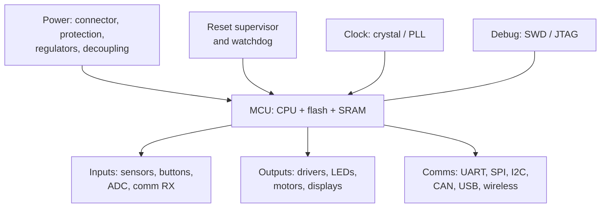

::: basics
### In plain words
An embedded system is a small computer hidden inside a product, such as a thermostat or a washing machine. Its job is to read inputs from the real world, decide what to do, and control outputs. To do that, a processor needs memory to hold its program, power, a clock, a way to start cleanly, and connections to sensors and outputs.

### Picture it
Think of a small restaurant kitchen. The cook is the processor. The recipe book is the program memory, and the counter is the working space for the dish in progress. Gas and electricity are the power, and the kitchen timer is the clock. Orders come in (inputs), and plates go out (outputs). Every shift starts with the same opening routine, like a reset. Without any one of these, the cook can't work.

### Words you need
- **Embedded system**: a computer built into a product to do one specific job.
- **Microcontroller (MCU)**: one chip holding the processor, memory and input/output hardware ([[q0731]]).
- **Flash and RAM**: flash keeps the program (the firmware) with the power off. RAM is working space that is wiped at power-off.
- **Clock**: a steady tick that paces everything the chip does.
- **Reset**: a signal that puts the chip in a known starting state ([[q0736]]).

### The simplest example
A battery-powered temperature logger has a temperature sensor, a microcontroller that stores each reading, a coin cell for power, and a slow clock that wakes the chip every 10 seconds. The chip is awake for 20 ms (thousandths of a second) and draws 5 mA (thousandths of an amp). Over 10 seconds, that averages 10 µA (millionths of an amp). Sleep adds about 1.5 µA. A coin cell rated 220 mAh can supply 1 mA for 220 hours, so this lasts about two years, an upper estimate. That is the whole idea. The rest of this page covers each block, adds protection like a watchdog (a timer that restarts a stuck chip), and shows how to debug a board that won't start.
:::

::: testing
Whether you can describe an embedded system as a **complete product architecture**, not only "a microcontroller". The interviewer is looking for:

1. The processing core and memory (flash, RAM, sometimes EEPROM).
2. The supporting hardware that makes it run: power, clock, reset, programming/debug.
3. The interfaces to the world: sensors in, actuators out, communication links, user interface.
4. Firmware as a component too, plus protection and reliability items (watchdog, ESD, brown-out).

A strong answer organizes them as a block diagram and mentions how data and power flow through it.
:::

::: why
Embedded design interviews usually start here because every later question (buses, GPIO, timers, interrupts, power) hangs on this picture. Interviewers use it to check that you've designed or at least read a real schematic: you know a chip alone does nothing without a stable supply, a clock, a reset, decoupling and a way to program it. It's also the framework for debugging: when a board doesn't boot, you walk the same list.
:::

::: concepts
- **Processor core** (MCU or MPU). See [[q0730]], [[q0731]].
- **Memory**: non-volatile program storage (flash), volatile working memory (SRAM), optional data storage (EEPROM, external flash). See [[q0823]].
- **Clocking and reset**: crystal or oscillator, PLL, reset circuit. See [[q0736]].
- **Peripherals and I/O**: GPIO, ADC, DAC, timers, serial buses. See [[q0733]].
- **Power subsystem**: regulators, battery or supply, decoupling, supervisors.
- **Firmware and debug**: bootloader, application code, RTOS (optional), SWD/JTAG header.
:::

::: answer
"I think of an embedded system as a small computer built into a product, and I'd draw it as a block diagram.

In the centre is the processor, usually a microcontroller, with its on-chip flash for the program and SRAM for variables. Around it are the things that make it alive: a power subsystem, with regulators and decoupling that give it clean supply rails; a clock source, either an internal oscillator or a crystal, maybe with a PLL; a reset circuit or supervisor that holds it in reset until power is stable; and a programming and debug port, normally SWD or JTAG.

Then the interface to the outside world. Inputs are sensors, buttons and communication links, which come in through GPIO, the ADC, timers in capture mode, or serial buses like I2C, SPI and UART. Outputs are actuators like LEDs, motors, relays or displays, driven through GPIO, PWM and the DAC, usually with a driver stage in between because the MCU pin can only supply a few milliamps. Communication might include USB, CAN, Ethernet, Wi-Fi or Bluetooth.

On top of that I'd mention the protection and reliability parts: ESD and reverse-polarity protection on the connectors, a watchdog timer so a software hang resets the system, brown-out detection, and any external memory if on-chip isn't enough. And the firmware itself is a component: a bootloader, drivers, the application, and sometimes an RTOS."
:::

::: technical
**Typical subsystems**

| Subsystem | Typical contents | Why it exists |
|---|---|---|
| Processing | MCU core (Cortex-M, AVR, RISC-V...), or MPU + external DRAM | Run the firmware |
| Memory | On-chip flash (program), SRAM (data), optional EEPROM / external SPI or QSPI flash, SD | Store code, state, calibration, logs |
| Clock | Internal RC, crystal (8–48 MHz), 32.768 kHz RTC crystal, PLL | Timing base for CPU, peripherals, comms |
| Reset | Power-on reset, brown-out detector, reset pin, supervisor IC, watchdog | Known start state and recovery |
| Power | Battery/adapter, LDO or buck, decoupling caps, reverse-polarity and surge protection, power sequencing | Supply the right voltages cleanly |
| Inputs | Sensors (analog/digital), buttons, encoders, comms RX | Observe the world |
| Outputs | LEDs, displays, motors/H-bridge, relays, buzzers, DAC | Act on the world |
| Communication | UART, SPI, I2C, CAN, USB, Ethernet, BLE/Wi-Fi | Talk to other chips and systems |
| Debug/programming | SWD/JTAG header, UART bootloader, test points | Develop and service |
| Protection | ESD diodes, TVS, fuses, input filtering | Survive the real world |
| Firmware | Startup code, HAL/drivers, scheduler or RTOS, application, bootloader | Behaviour |

**Data and power flow.** Power enters at a connector, is conditioned (protection, regulation, decoupling) and distributed in rails (for example 5 V → 3.3 V → 1.2 V core on larger chips). Signals enter through conditioning (filter, level shift, ESD), are sampled by a peripheral (ADC, GPIO, bus), processed by the CPU, and results leave through drivers.

**Worked example: battery-powered temperature logger.** CR2032 cell (about 220 mAh nominal, treat as typical), MCU sleep current 1.5 µA, active 5 mA for 20 ms every 10 s while it samples a sensor and logs:
- Average active contribution $=5\text{ mA}\times20\text{ ms}/10\text{ s}=10$ µA.
- Total average $=10+1.5=11.5$ µA.
- Life $\approx220\text{ mAh}/11.5\text{ µA}\approx19{,}100$ h, about 2.2 years.

This is an upper bound: coin-cell capacity drops at higher pulse currents and low temperature, and self-discharge adds a little.

> [!UNCERTAIN]
> Component lists vary by application. A motor controller has no display, a wearable has no relay; the categories are the stable part.
:::

::: short
"An embedded system is a processor, usually an MCU, with its memory, plus the supporting blocks that make it run: power and decoupling, a clock, reset, and a debug port. Around that are inputs, like sensors and buttons, and outputs like LEDs, motors and displays, plus communication buses such as I2C, SPI, UART, CAN and USB. Protection like ESD, a watchdog and brown-out detection makes it robust, and the firmware, including drivers, a bootloader and maybe an RTOS, is the last component."
:::

::: long
"I'd draw it as a block diagram with the processor in the middle.

The processor is normally a microcontroller, which has the CPU core, flash for program, SRAM for data, and the peripherals integrated on one chip. If it needs more performance or runs Linux, it's a microprocessor with external DRAM and storage.

It needs four support blocks to run at all. Power: a battery or adapter, regulators to make the rails, and decoupling capacitors at each supply pin. Clock: an internal oscillator or an external crystal, often with a PLL to multiply it up. Reset: a power-on reset or supervisor that holds the chip in reset until the supply and clock are stable. And programming and debug: an SWD or JTAG header so I can load code and step through it.

Then the interface to the world. Inputs: sensors that connect through the ADC for analog, I2C or SPI for digital, buttons on GPIO with pull-ups and debouncing. Outputs: LEDs and relays and motors, driven through GPIO or PWM with transistor or driver stages, because an MCU pin only sources a few milliamps. Communication: UART for debug or modems, SPI and I2C to nearby chips, CAN in cars and industry, USB or Ethernet for hosts, BLE or Wi-Fi for wireless.

Then robustness: ESD and surge protection on connectors, a watchdog timer that resets the chip if the firmware hangs, brown-out detection so it doesn't run on a sagging supply.

And finally the firmware: startup code, drivers, the application logic, maybe an RTOS, and a bootloader for updates. When a board doesn't work, I debug in the same order: power, clock, reset, programming access, then peripherals."
:::

::: terms
- **MCU**: microcontroller unit, CPU plus memory and peripherals on one chip.
- **Flash / SRAM / EEPROM**: non-volatile program memory / volatile working memory / small non-volatile data memory.
- **Peripheral**: a hardware block on the chip that does a job (timer, ADC, UART) without CPU effort per sample.
- **PLL**: phase-locked loop that multiplies a reference clock to a higher frequency.
- **Brown-out detector (BOD)**: circuit that resets the MCU when supply drops below a threshold.
- **Watchdog (WDT)**: timer that resets the chip unless firmware keeps "kicking" it.
- **SWD/JTAG**: debug/programming interfaces.
- **Bootloader**: small program that loads or updates the main firmware.
:::

::: exceptional
**An average answer** lists "microcontroller, memory, sensors, outputs".

**An exceptional answer**:
- Draws the block diagram and separates **core**, **support** (power, clock, reset, debug), **I/O** (sensors, actuators), **communications** and **protection**.
- Names the real parts of a design: decoupling, crystal, supervisor, SWD header, ESD diodes.
- Mentions the firmware components and the watchdog/brown-out for reliability.
- Gives a quantitative feel: sleep vs active current and a battery-life estimate.
- Explains how to use the list to debug a dead board (power, clock, reset, programming access first).
:::

::: mistakes
- **Listing only the MCU and sensors.** The supply, clock, reset and debug blocks are what decide whether it boots.
- **Forgetting that pins have limits.** MCU GPIOs source only a few milliamps (often 4–25 mA, part dependent); loads need drivers.
- **Treating firmware as separate from the hardware list.** Bootloader, drivers and the watchdog are part of the system architecture.
- **Ignoring power architecture.** Mixed 5 V and 3.3 V parts need level shifting or compatible rails.
- **Skipping protection.** Connectors face ESD, reverse polarity and hot-plug; the board must survive them.
- **Confusing MCU peripherals with external parts.** An ADC may be on-chip or external; the answer depends on resolution and speed requirements.
:::

::: deep
## The architecture as layers

Think of an embedded product in four layers, bottom to top:

1. **Power and environment**: the supply, protection, regulators, decoupling. Nothing above works if this is wrong.
2. **Silicon platform**: the MCU or MPU and its clock, reset, memory and debug.
3. **I/O and peripherals**: sensors, actuators and communications, plus the conditioning circuits (filters, level shifters, drivers) between the chip pins and the real world.
4. **Software**: bootloader, drivers, middleware, application.


Figure: Power, clock, reset and debug all feed the MCU. Inputs, outputs and communication buses leave from it. When a board is dead, check the four arrows into the MCU first.

## What each block is for, and what to watch

**Processor and memory.** The MCU integrates the CPU with program flash (tens of KB to a few MB), SRAM (KB to hundreds of KB) and often a little EEPROM or emulated EEPROM for settings. If the on-chip memory is too small you add external SPI/QSPI flash for storage or code, or external SRAM/DRAM for buffers (see [[q0823]] and [[q0824]]). Code runs from flash (execute-in-place) or is copied to RAM.

**Clock.** Most MCUs start on an internal RC oscillator (accurate to a percent or a few percent), which is fine for many jobs. A crystal gives parts-per-million accuracy for UART baud rates, USB, radios, and timekeeping. A 32.768 kHz watch crystal drives the real-time clock at microamp power. A PLL multiplies, say, 8 MHz up to 72 or 168 MHz. Crystals need correct load capacitors and layout, and failing to start is a classic bring-up failure.

**Reset and supervision.** At power-up the supply ramps slowly (hundreds of µs to ms). The chip must not start executing until the supply and clock are valid. The power-on reset, brown-out detector and optional external supervisor handle this. The watchdog handles the case when firmware gets stuck at runtime. See [[q0736]].

**Power.** Typical rails: battery or adapter → protection (reverse-polarity diode or P-FET, TVS, fuse) → regulator (buck for efficiency, LDO for low noise) → 3.3 V or 1.8 V digital, sometimes a separate filtered analog rail for the ADC reference. Each supply pin of the MCU gets a 100 nF ceramic capacitor placed close, plus bulk capacitance nearby. Multi-rail chips may need sequencing.

**I/O.** A GPIO pin is usually a push-pull or open-drain output and a digital input with optional pull-up or pull-down. It drives a few mA. Anything heavier goes through a transistor, MOSFET or driver IC. Analog inputs go through an RC filter into the ADC. Inputs from outside the board need protection (series resistor, clamp diodes, TVS).

**Communication.** On-board chips talk via SPI (fast, point to point with chip select), I2C (two wires, many devices, slower) and UART (asynchronous, simple). Off-board, CAN is common in vehicles and industrial, USB and Ethernet for hosts, BLE and Wi-Fi for wireless.

**Debug and programming.** SWD needs two signals plus ground and reset (SWDIO, SWCLK, GND, NRST). Without a debug header, you depend on a UART bootloader or on a debugger pogo-pin fixture.

## Worked example: block list for a temperature logger

Requirements: record temperature every 10 s for two years on a coin cell, store readings, upload over BLE once a day.

| Block | Choice | Reason |
|---|---|---|
| MCU | Cortex-M0+/M4 class low-power MCU with BLE (or MCU plus BLE module) | Sleep in µA, integrated radio |
| Memory | On-chip flash plus SPI flash for the log | Log of about 8,640 samples/day for weeks needs storage beyond a small flash |
| Sensor | Digital I2C temperature sensor | Low power, no ADC accuracy issues |
| Clock | 32.768 kHz crystal for RTC wakeups | RTC at about 1 µA |
| Power | CR2032 plus ultra-low-quiescent LDO or direct battery | Few µA overhead |
| Protection | ESD on any exposed pads, reverse-polarity by battery holder geometry | Low cost |
| Debug | Tag-connect or pads for SWD | No header space |

Average current budget 11.5 µA gives about 2.2 years from the earlier calculation. The same calculation shows what drives the design: the 20 ms active window at 5 mA contributes 10 µA, almost all the budget. Cutting the active time to 10 ms (faster sensor read, higher clock) would give a 6.5 µA average and about 3.9 years.

## Using the block list to bring up a board

The same list is the order in which I debug a new board that does nothing. Each step has a specific measurement:

1. **Power**: with a current-limited bench supply, check the input current is sane (no short, no huge idle draw), then probe every rail at the MCU pins. A 3.3 V rail reading 2.9 V under load points to a regulator or short problem, not to firmware.
2. **Reset**: the reset pin should be high (for active-low reset) after power-up. If it is stuck low, a supervisor, a pushbutton or a debugger is holding it.
3. **Clock**: on a scope, look at the crystal pins or a clock-out pin. No oscillation usually means wrong load capacitors, a cracked crystal or a layout problem. Note that probing a crystal pin with a normal probe adds capacitance and can stop it, so use a low-capacitance probe or measure the clock-out.
4. **Boot mode and memory**: the boot pins decide whether it runs flash, the system bootloader or RAM. A blank flash will do nothing visible.
5. **Debug access**: if the debugger can connect and read the device ID, the core, clock and power are fine and the problem is in firmware or peripherals.
6. **Peripherals**: blink an LED on a GPIO first, then bring up UART for a console, then sensors and buses one at a time.


## Experiment with it

```sim
{"id":"gpio-lab","view":"output"}
```
Figure: The GPIO pin is where firmware meets hardware. Compare push-pull and open-drain outputs and see which transistor conducts. This is the output stage at the edge of the block diagram.
:::

::: applications
- **Consumer products**: remote controls, wearables, thermostats, appliances.
- **Automotive**: ECUs for engine, braking and body control (CAN/LIN connected).
- **Industrial**: PLCs, sensor nodes, motor drives, building automation.
- **Medical**: pacemakers, infusion pumps, glucose meters (with reliability and safety requirements).
- **IoT**: battery-powered sensor nodes with wireless links.
- **Robotics and drones**: flight controllers and motor controllers.
:::

::: assumptions
- **An MCU-centric system**: for MPU systems add external DRAM, boot storage, a PMIC and a Linux or RTOS stack.
- **Battery estimates** use nominal capacity and ignore pulse derating and self-discharge, so they are upper bounds.
- **The block list is a template**; real products omit or merge blocks (for example a module with MCU, radio and antenna integrated).
- **Power rails** and sequencing requirements depend on the chip family. Always read the datasheet.
- **Safety and regulatory systems** (medical, automotive) add redundancy, lock-step cores, and certified components beyond this list.
:::

::: followups
### Which blocks decide whether the board boots?
Power, clock, reset, and the memory containing valid code. If the supply is out of range, the oscillator doesn't start, reset is held low, or the boot pins select the wrong mode, nothing runs. Those are the first four things I'd probe with a scope or DMM.

### Why do you put decoupling capacitors at the MCU?
Digital switching draws current spikes in nanoseconds, and the supply wiring has inductance. A 100 nF ceramic placed close to each supply pin provides local charge, so the rail doesn't dip. Without it you get noise, resets or erratic ADC readings.

### How does adding a crystal differ from using the internal oscillator?
A crystal gives tens of ppm accuracy (vs 1–5% for an internal RC), which is needed for UART at high baud rates, USB, radios and timekeeping. Costs: extra parts, load capacitors, start-up time and layout care. Internal oscillators are fine for noncritical timing.

### Your design uses a 3.3 V MCU and a 5 V sensor. What do you check?
The sensor's output high level versus the MCU's input high threshold and its maximum input rating (many 3.3 V MCU pins aren't 5 V tolerant). If output goes to 5 V, use a divider, level-shifter, or a 5 V-tolerant pin. The reverse direction (3.3 V MCU to 5 V input) needs the sensor's $V_{IH}$ to be satisfied by 3.3 V, often 0.7×VDD = 3.5 V for a 5 V CMOS input, which a 3.3 V output cannot reach, so use a TTL-threshold (HCT-type) input, a 3.3 V-powered sensor or a level shifter.

### Why is a watchdog part of the system architecture and not just firmware?
An independent hardware timer (ideally with its own clock) is the only thing that can recover from a hang that stops all software. It resets the chip if not serviced. A watchdog can also be external, so it survives even a locked-up MCU clock. See [[q0736]].

### Scenario: your board draws 5 mA continuously when you expected 20 µA in sleep. What do you check?
Whether the MCU actually enters low-power mode (a pending interrupt or active peripheral will wake it), then leakage paths: floating inputs, pull-ups to a powered-off neighbour, an LED or regulator quiescent current, debugger left connected (SWD keeps clocks running), and sensors not put into standby. Measure each rail separately.
:::

::: interpretations
"Components/subsystems" can mean hardware blocks, software layers, or both. I covered hardware first and firmware as a component. The follow-on questions go deeper: examples in [[q0729]], MCU vs MPU in [[q0731]], internal blocks in [[q0732]], peripherals in [[q0733]].
:::

::: references
- Elecia White, *Making Embedded Systems*: system-level design and the embedded development cycle.
- Jonathan Valvano, *Embedded Systems: Introduction to ARM Cortex-M Microcontrollers*: system architecture and I/O.
- Horowitz and Hill, *The Art of Electronics*, 3rd ed.: microcontroller chapters and power-supply and interfacing basics.
- Arm, *Cortex-M technical reference manuals* and vendor reference manuals for the on-chip subsystems of a specific MCU.
:::

::: rubric
- Names the processor with its on-chip memory (flash, SRAM) :: The core of any embedded system.
- Lists support blocks: power, clock, reset, debug :: These decide whether the system runs at all.
- Covers inputs (sensors, buttons), outputs (actuators, displays) and communication buses :: The system's interface to the world.
- Mentions protection/reliability: ESD, watchdog, brown-out :: Shows production-level awareness.
- Includes firmware (bootloader, drivers, RTOS) as a component :: The question says components and subsystems; software is one.
- Organizes as a block diagram or layered view, maybe with a concrete example :: Demonstrates structured thinking.
:::

::: quiz
```json
[
 {"type":"mcq","level":"fundamental","q":"Which of these is NOT normally part of the support circuitry needed for an MCU to run?","options":["Decoupling capacitors on the supply pins","A clock source","A reset circuit or supervisor","A hard disk drive"],"answer":3,"explain":"Power with decoupling, a clock and a reset are needed. MCUs store code in flash; a hard disk is not part of a typical embedded design."},
 {"type":"mcq","level":"fundamental","q":"What is the main purpose of a watchdog timer?","options":["To measure temperature","To reset the system if the firmware stops servicing it (hangs)","To generate PWM","To regulate voltage"],"answer":1,"explain":"The firmware must periodically 'kick' the watchdog. If it hangs, the timer expires and resets the chip."},
 {"type":"numeric","level":"intermediate","q":"A node draws 4 mA for 10 ms every 5 s and 2 µA otherwise. What is the average current in µA (treat the active time as part of the cycle)?","answer":10,"tolerance":0.03,"unit":"µA","explain":"Active average $=4\\text{ mA}\\times10\\text{ ms}/5\\text{ s}=8$ µA. Add the 2 µA sleep: 10 µA."},
 {"type":"numeric","level":"intermediate","q":"Using the average from the previous question (10 µA) and a 200 mAh cell, how many years does the battery last (ignore self-discharge)?","answer":2.28,"tolerance":0.03,"unit":"years","explain":"$200\\text{ mAh}/10\\text{ µA}=20{,}000$ h; divide by 8,760 h/year: 2.28 years."},
 {"type":"multi","level":"intermediate","q":"Which are typical ways an MCU talks to nearby chips on a board? Select all that apply.","options":["SPI","I2C","UART","HDMI"],"answer":[0,1,2],"explain":"SPI, I2C and UART are standard on-board serial links. HDMI is a display link and not a typical MCU peripheral bus."},
 {"type":"truefalse","level":"advanced","q":"An MCU GPIO pin can usually drive any load directly, because it is a digital output.","answer":false,"explain":"GPIO pins have limited drive current (often a few to tens of mA, with a package total limit). Motors, relays and high-power LEDs need a transistor or driver stage."}
]
```
:::
