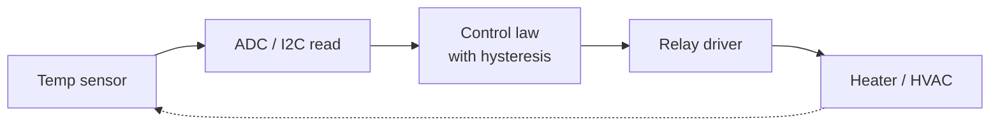

::: basics
### In plain words
The question asks you to name products with a small dedicated computer inside and say what makes each tricky to build. Examples are everywhere: microwaves, thermostats, TV remotes, car brake controllers, pacemakers, drones and routers. Each runs one fixed job, reads the world through sensors, and controls something. The useful way to tell them apart is by their main limit: tight cost, tiny battery, strict timing, or safety.

### Picture it
Picture keeping a bath at the right temperature. You touch the water, decide it is too cold, open the hot tap a bit, and check again. That repeating cycle of sense, decide, act is what most embedded systems do. The difference is the stakes. In a bath, being a few seconds late doesn't matter. In an airbag, a few milliseconds late is a failure. 

### Words you need
- **Sensor**: a part that measures something real, such as temperature or wheel speed.
- **Actuator**: a part that does something physical, such as a motor, heater, valve or lamp.
- **Control loop**: the repeating cycle of reading sensors, deciding, and driving actuators.
- **Real-time**: the answer has to arrive by a deadline to count as correct.
- **Hard real-time**: missing a deadline is a failure, not just a slowdown.
- **Constraint**: a limit on cost, battery life, size or timing.

### The simplest example
A thermostat reads a temperature sensor, turns the heater on at 20 °C and off at 21 °C, and repeats. Nothing is urgent, so a cheap chip is enough. Now take a car engine at 6000 rpm (turns per minute). That is 100 turns per second, so one turn takes 10 ms (thousandths of a second), and one degree of rotation lasts $10\text{ ms}/360 \approx 28$ µs (millionths of a second). The spark must be timed to about that precision, so dedicated timer circuits on the chip handle it. Same loop, very different constraints. That is the whole idea. The rest of this page covers more examples, the timing classes, and how to describe one in depth.
:::

::: testing
Whether you can go beyond "a washing machine" and show what makes a system *embedded*: a dedicated function, tight constraints (cost, power, size, real-time, reliability), and a tight coupling to sensors and actuators. The interviewer is looking for:

1. A range of examples across domains: consumer, automotive, industrial, medical, communications, aerospace.
2. For at least one example, a concrete description: what the sensors are, what the MCU does, what the real-time requirement is.
3. A way of classifying them by constraint (hard real-time, ultra-low-power, safety-critical, cost-driven), which shows engineering judgement.
:::

::: why
This is usually the first question in an embedded interview, and it's a chance to steer the conversation toward what you know. If you pick an example you can talk about in depth (a motor controller, a battery-powered sensor, a flight controller), the interviewer will follow you into it. A good answer also shows that you recognize which constraints drive the hardware choices in each product.
:::

::: concepts
- **Embedded system**: a computer inside a product with a dedicated function, as opposed to a general-purpose PC. See [[q0728]].
- **Real-time requirement**: correctness depends on meeting deadlines (hard, firm, soft).
- **Resource constraints**: cost, power, memory, board area.
- **Sensor → controller → actuator loop**: the common structure.
- **Reliability and safety**: requirements for automotive, medical and industrial products.
- **MCU vs MPU**: sizing the computer to the job. See [[q0731]].
:::

::: answer
"Embedded systems are everywhere, and the common pattern is a small computer dedicated to one job, reading sensors and driving something.

At home: a microwave oven, a washing machine, a thermostat, a TV remote, a smart speaker. In a car: dozens of ECUs: engine control, ABS, airbag, power windows, infotainment. Industrial: PLCs, motor drives, robot controllers, building automation. Medical: pacemakers, insulin pumps, glucose meters, infusion pumps. Communication: routers, modems, base stations. Aerospace and hobby: drone flight controllers, satellites, 3D printers.

The useful way to compare them is by what constrains them. A pacemaker is ultra-low power and safety-critical: it has to run for years on a small battery and never fail. An airbag or ABS controller is hard real-time: the deadline is milliseconds, and a missed deadline is a failure, not a slowdown. A TV remote is cost-driven, a fraction of a dollar of silicon. A router is throughput-driven, so it uses a microprocessor running Linux.

One I could describe in detail is an engine controller: it reads crank position, air flow and temperature, and has to fire the spark within about 28 microseconds per degree of crank angle at 6000 rpm."
:::

::: technical
**What makes a system embedded.** It has (1) a dedicated function; (2) tight coupling to physical sensors and actuators; (3) constraints on cost, power, size or timing; and usually (4) no user-installed software and long life in the field.

**Classification by timing:**
- **Hard real-time**: a missed deadline is a system failure (airbag deployment, ABS, flight control, pacemaker pacing, spark timing).
- **Firm**: late results are useless but not catastrophic (video frame decoding).
- **Soft**: late results degrade quality (UI response, logging).

**Examples and their dominant constraints**

| System | Sensors / inputs | Actuators / outputs | Dominant constraint |
|---|---|---|---|
| Microwave oven | Keypad, door switch, timer | Magnetron relay/driver, display, buzzer | Cost, safety interlock |
| Thermostat | Temperature, humidity, buttons | HVAC relays, display, Wi-Fi | Low power, cost |
| TV remote | Key matrix | IR LED / RF radio | Cost, coin-cell life |
| Washing machine | Water level, motor speed, temp | Motor drive, valves, pump | Cost, robustness |
| Engine ECU | Crank/cam, MAP, O₂, knock | Injectors, ignition coils | Hard real-time, temperature, AEC-Q100-class parts |
| ABS / ESC | Wheel-speed sensors, yaw rate | Hydraulic valves, pump | Hard real-time, functional safety |
| Pacemaker | Cardiac electrodes | Pacing pulse | Ultra-low power, safety |
| Glucose meter | Electrochemical strip (ADC) | LCD, BLE | Low power, accuracy |
| Drone flight controller | IMU, barometer, GPS | ESCs/motors (PWM, DShot) | Hard real-time loop, weight |
| Router / modem | Network PHYs | Network ports, Wi-Fi radio | Throughput (usually MPU + Linux) |
| 3D printer | Thermistors, endstops, encoders | Stepper drivers, heaters | Real-time step timing |
| Smartwatch | IMU, optical HR, touch | Display, haptics, BLE | Low power, size |

**Worked timing example: spark timing.** At 6000 rpm the crank turns $6000/60=100$ rev/s, so one revolution is 10 ms and one degree is $10\text{ ms}/360=27.8$ µs. A 1° ignition-timing error therefore corresponds to 27.8 µs of timing error. That's why engine controllers use hardware timers (input capture, output compare) triggered by a toothed crank wheel, not software polling.

**Worked example: wheel-speed measurement.** A wheel with a 48-tooth tone ring at 100 km/h on a 0.65 m diameter tyre spins at $27.8/(\pi\times0.65)=13.6$ rev/s, giving $48\times13.6\approx650$ tooth edges per second. An MCU with an input-capture timer measures each period to microsecond resolution at essentially zero CPU cost.

> [!UNCERTAIN]
> Specific product internals (which MCU is in which device) vary by model and year. The categories and constraints are the stable part of the answer.
:::

::: short
"An embedded system is a computer dedicated to one job inside a product: a microwave, a thermostat, a TV remote, a car's engine and ABS controllers, a pacemaker, a drone's flight controller, a router, a 3D printer. They differ by what constrains them: pacemakers are ultra-low power and safety-critical, ABS and engine control are hard real-time, remotes are cost-driven, routers are throughput-driven. For example, an engine controller must time ignition to within a fraction of a crank degree, about 28 microseconds at 6000 rpm."
:::

::: long
"The common thread is a small computer dedicated to one function, built into a product, reading sensors and driving actuators, usually with some constraint that rules out a general-purpose PC: cost, power, size or real-time deadlines.

I'd go through domains. In the home: microwaves, washing machines, thermostats, remotes, smart speakers. In vehicles: engine control, ABS and stability control, airbags, body electronics, infotainment, all connected by CAN or LIN. Industrial: PLCs, motor drives, sensors with 4–20 mA outputs, robots, building controls. Medical: pacemakers, insulin pumps, glucose meters, patient monitors. Networking: routers, modems, base stations. Personal and hobby: wearables, drones, 3D printers.

What I find more useful is classifying by constraint. Hard real-time: ABS, airbags, engine ignition, flight control: a late response is a failure. Ultra-low-power: a pacemaker or a coin-cell sensor tag: average current in microamps for years. Cost-driven: a TV remote or a toy, where the MCU is cents. Safety-critical: medical and automotive brakes, where you add redundancy, watchdogs and certified processes. Throughput-driven: routers and cameras, which use a microprocessor with Linux.

To make it concrete, an engine controller: crank wheel with teeth gives position. At 6000 rpm that's 100 revolutions per second, a 10 ms revolution, so one degree of crank is under 28 microseconds. Hitting ignition timing to a degree is therefore done by hardware timers, input capture on the crank signal and output compare for the coil, with the CPU only setting the target values each cycle. That's what separates embedded from desktop programming: timing is part of correctness."
:::

::: terms
- **ECU**: electronic control unit, the embedded computer in a vehicle subsystem.
- **PLC**: programmable logic controller used in industrial automation.
- **Hard real-time**: deadlines must always be met.
- **Functional safety**: systematic design to keep failures from causing harm (for example ISO 26262 in automotive, IEC 61508 generally).
- **Input capture / output compare**: timer features that timestamp events or trigger outputs with hardware accuracy.
- **CAN / LIN**: vehicle buses.
- **AEC-Q100**: automotive qualification standard for ICs.
- **Sensor-actuator loop**: sample → compute → drive, repeated at a fixed rate.
:::

::: exceptional
**An average answer** lists a few appliances and "a car".

**An exceptional answer**:
- Spans consumer, automotive, industrial, medical, communications, aerospace, with specific products.
- Classifies by constraint (hard real-time, low power, safety, cost, throughput) and ties the hardware to the constraint.
- Gives one example in numbers: spark timing at 6000 rpm is 27.8 µs/degree; wheel-speed edges at about 650 Hz.
- Mentions MCU vs MPU selection ([[q0731]]) and why timing is done in hardware timers.
- Notes qualification and safety standards for automotive and medical parts.
:::

::: mistakes
- **Saying a laptop or phone is not embedded.** The line is fuzzy: a phone is a general-purpose computer, but the Wi-Fi chip inside it is an embedded system. A better criterion is dedicated function and tight coupling to hardware.
- **Listing devices without saying what the embedded part does.** Always name the sensors, the outputs and the decision the MCU makes.
- **Equating embedded with "small".** A base station or an automotive domain controller is embedded and very powerful.
- **Assuming all use an OS.** Many run bare-metal or a small RTOS; large ones run Linux.
- **Forgetting real-time.** "Fast" is not the same as "deterministic"; a 1 GHz Linux system can still miss a 100 µs deadline.
- **Ignoring environment.** Automotive under-hood parts see −40 to 125 °C or more; consumer parts do not.
:::

::: deep
## What makes a computer "embedded"

A general-purpose computer is judged by what software you can run. An embedded system is judged by what it does *as a product*: the user doesn't think of it as a computer. Four properties tend to show up together:

1. **Dedicated function.** The firmware does one job (or a small set), shipped with the hardware.
2. **Physical coupling.** It measures and drives real quantities: temperature, current, position, light.
3. **Constraints.** Unit cost, power or battery life, size, temperature range, deadlines.
4. **Long, unattended life.** It may need to run for 10 or 20 years with no reboot, no admin and sometimes no way to update.

Those properties push design decisions toward integration (MCU with everything on one die), determinism (hardware timers, interrupts, an RTOS or bare-metal), and reliability (watchdogs, brown-out reset, ECC memory in safety systems).

## The sensor → controller → actuator loop

Most embedded products reduce to the loop: sample a sensor, compute, drive an output, repeat at a fixed rate or on an event. For example a thermostat:


Figure: A typical embedded control loop: read the sensor, run the control law, drive the actuator; the physical process closes the loop back to the sensor.

The control law might be a simple hysteresis band (turn on at 20.0 °C, off at 21.0 °C to avoid chattering the relay), a PI controller, or for a drone a cascade of PIDs running at several kHz. The rate sets the time budget: at 48 MHz and a 1 kHz loop, the CPU has 48,000 cycles per iteration to read sensors, compute and write outputs. If the control law takes 40,000 cycles, there is little room for communications, so you either move to a faster MCU or run the loop in a timer interrupt and push the rest into the background.

## Classifying by timing: hard, firm and soft

The timing classes tell you what architecture is needed:

- **Hard**: ABS must release a wheel's brake pressure within milliseconds of detecting lock-up. A missed deadline can cause a crash. Architecture: bare-metal or RTOS with priority-based preemption, hardware timers, no dynamic memory, worst-case execution time analysis, redundancy.
- **Firm**: video decoding; a late frame is dropped. Architecture: RTOS or Linux with real-time extensions.
- **Soft**: GUI updates, logging. Best effort.

A common mistake is to confuse hard real-time with "very fast". A system can be slow and hard real-time (a 1 Hz pacemaker pacing pulse that must arrive on time) or fast and soft.

## Four worked examples

**1. Engine ECU, ignition timing.** At 6000 rpm one crank degree is 27.8 µs, and a 4-cylinder four-stroke fires every 180° (5 ms). The crank wheel's teeth go to an input-capture timer; the firmware computes the next spark angle and loads an output-compare register, and the timer hardware fires the coil driver at exactly that tooth plus fraction. Software jitter of even a few microseconds in the interrupt would be fine, but 100 µs would be 3.6° of timing error.

**2. ABS wheel speed.** 650 tooth edges per second at 100 km/h (from the example above) is easy; the hard parts are the fail-safe behaviour, redundancy in the sensors, and the 12 V automotive supply with load-dump transients up to tens of volts (hence the protection circuits).

**3. Pacemaker.** The firmware mostly sleeps. On a timer it senses the heart signal through an ultra-low-noise amplifier and ADC and, if no natural beat arrives by the escape interval (for example 1 s at 60 bpm), delivers a pacing pulse. Average currents are in the microamp range so the battery lasts years. Safety comes from redundancy, hardware limits on pacing rate, and strict development processes.

**4. Drone flight controller.** An IMU is sampled at around a kHz or more, the attitude estimate and PID loops run at a similar rate, and motor commands go out to ESCs. A typical flight controller MCU is a Cortex-M4/M7 at a few hundred MHz; the loop budget at 1 kHz is a million cycles at 1 GHz, but only 168,000 at 168 MHz, so the filter and PID code must be efficient.

```sim
{"id":"timer-lab","fclk":16e6,"psc":15,"arr":999,"ccr":250}
```
Figure: Timers are the workhorse of the examples above (input capture for crank position, PWM for motors, compare outputs for ignition). Try changing the prescaler and compare value to see how counter resolution and period trade off.

## What to say when asked "which example do you know best?"

Pick one from your own work or coursework, and give the same structure each time: **what it senses, what it decides, what it drives, what the deadline is, what the power budget is, what fails if it breaks**. If you built a line-following robot, a quadcopter, a temperature logger or even a home automation node, you have a legitimate example. Interviewers care more about the structured description (and a trade-off or two you made) than about how impressive the product is.
:::

::: applications
- **Automotive**: engine, transmission, braking, airbags, infotainment, body control.
- **Industrial automation**: PLCs, drives, robotics, process instrumentation.
- **Medical devices**: pacemakers, pumps, monitors, glucose meters.
- **Consumer electronics**: appliances, wearables, smart home devices, toys.
- **Telecom and networking**: routers, switches, base stations.
- **Aerospace and defence**: flight controllers, satellites, avionics.
:::

::: assumptions
- **Product-level view**: I treat "embedded" as dedicated-function computing with physical coupling and constraints. Other definitions (any computer inside a product) include phones and set-top boxes.
- **Numbers are examples**: 6000 rpm, 100 km/h, 1 kHz loop rates are illustrative, not product specs.
- **Architecture claims** (bare-metal, RTOS, Linux) are typical, not universal.
- **Standards** (ISO 26262, IEC 61508, IEC 62304 for medical software) apply depending on domain and region.
- **The answer changes** with seniority: for a new grad, a clear project example is enough; for a senior role, add safety, lifecycle and update strategy.
:::

::: followups
### What's the difference between an embedded system and a general-purpose computer?
Purpose and constraints. A general-purpose computer runs arbitrary user software and is judged by flexibility. An embedded system runs fixed firmware for a dedicated function, couples tightly to sensors and actuators, and is built to constraints on cost, power, size, timing and reliability.

### Give an example of a hard real-time embedded system and say why.
Airbag deployment: the controller must decide to fire within a few milliseconds of crash detection. A late deployment is a failure. So the algorithm runs from a high-priority interrupt with bounded execution time, the sensors are redundant, and the system is tested for worst-case timing.

### How does a hardware timer help with a timing-critical task like ignition?
The timer's input-capture unit timestamps the crank tooth edge with hardware resolution (nanoseconds to microseconds), and the output-compare unit fires an output at an exact count. The CPU only sets the values, so interrupt latency and jitter don't affect the timing of the edge itself. See [[q0789]] and [[q0792]].

### How do you choose between an MCU and an MPU for a product?
Use an MCU for deterministic control, low power and low cost: tens of µA in sleep, hard real-time, bare-metal or RTOS. Use an MPU when you need Linux, a rich UI, networking stacks, large memory or heavy computation. Many products use both, an MPU for the application and an MCU for real-time control. See [[q0731]].

### What changes in the design if the product must last 10 years on a battery?
Average current dominates: aim for µA-level sleep, use low-leakage parts, minimize wake time, avoid always-on peripherals, pick battery chemistry with low self-discharge (lithium primary), and derate for temperature. A 220 mAh cell at 11.5 µA lasts about 2.2 years, so for 10 years you'd target under about 2.5 µA, which means the active duty cycle must be tiny.

### Scenario: a customer reports their thermostat sometimes turns the heater on and off every few seconds. What might be wrong?
Likely no hysteresis, or sensor noise crossing a single threshold. Fix: add a hysteresis band (for example ±0.5 °C), a minimum on/off time to protect the compressor or relay, and filter the sensor reading (moving average or low-pass). Also check whether the sensor is self-heated by the board or in a draft.
:::

::: interpretations
"What are some examples of embedded systems?" is open-ended. I treat it as asking for examples across domains plus enough understanding of what makes each one embedded. Components are in [[q0728]], the MCU/MPU question is [[q0731]].
:::

::: references
- Elecia White, *Making Embedded Systems*: embedded product examples and constraints.
- Jonathan Valvano, *Embedded Systems: Real-Time Interfacing to ARM Cortex-M Microcontrollers*: control loops and real-time design.
- Marilyn Wolf, *Computers as Components*: embedded system design and real-time considerations.
- ISO 26262 (automotive functional safety) and IEC 61508 (general functional safety) by name, for safety-critical examples.
:::

::: rubric
- Gives examples across several domains (consumer, automotive, industrial, medical, networking) :: Shows breadth.
- Explains what makes them embedded: dedicated function, sensor/actuator coupling, constraints :: The definition behind the examples.
- Identifies the dominant constraint for each (real-time, power, cost, safety, throughput) :: Shows engineering judgement.
- Provides at least one example described in depth with numbers :: Proves you can go beyond a list.
- Distinguishes hard/firm/soft real-time :: Standard vocabulary for embedded interviews.
- Mentions MCU vs MPU or the OS choice appropriate to each example :: Connects examples to design decisions.
:::

::: quiz
```json
[
 {"type":"mcq","level":"fundamental","q":"Which is the best example of a hard real-time embedded system?","options":["A web browser rendering a page","An airbag controller","A music player's playlist screen","A batch report generator"],"answer":1,"explain":"An airbag controller must act within milliseconds of crash detection; a late response is a failure."},
 {"type":"mcq","level":"fundamental","q":"What is the typical structure of an embedded control application?","options":["Compile → link → run once","Sample sensors → compute → drive actuators, repeated at a fixed rate or on events","Boot Linux and run a desktop","Only read inputs and never output"],"answer":1,"explain":"Embedded control is a sense-compute-act loop tied to the physical process."},
 {"type":"numeric","level":"intermediate","q":"An engine turns at 6000 rpm. How long, in microseconds, does one degree of crankshaft rotation take?","answer":27.8,"tolerance":0.02,"unit":"µs","explain":"$6000/60=100$ rev/s so 10 ms per revolution; $10\\text{ ms}/360=27.8$ µs per degree."},
 {"type":"numeric","level":"intermediate","q":"A wheel has a 48-tooth tone ring and spins at 13.6 rev/s. How many tooth edges per second does the sensor produce (round to nearest 10)?","answer":650,"tolerance":0.03,"unit":"Hz","explain":"$48\\times13.6=652.8\\approx650$ edges per second."},
 {"type":"numeric","level":"intermediate","q":"A CPU runs at 48 MHz and the control loop runs at 1 kHz. How many clock cycles are available per loop iteration?","answer":48000,"tolerance":0.01,"unit":"cycles","explain":"$48\\times10^6/1000=48{,}000$ cycles per iteration."},
 {"type":"truefalse","level":"advanced","q":"A 1 GHz processor running Linux is guaranteed to meet a 100 µs hard deadline because it is fast.","answer":false,"explain":"Speed is not determinism. Linux scheduling, caches and interrupts introduce unbounded latency unless real-time patches and careful design are used, which is why hard deadlines are usually handled by MCUs, hardware timers or a dedicated real-time core."}
]
```
:::
