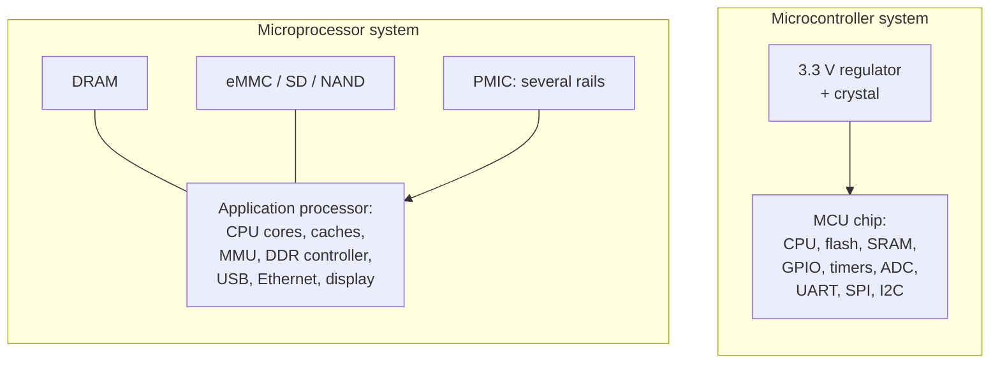

::: basics
### In plain words
A microcontroller (MCU) is a whole small computer on one chip: processor, program storage, working memory and input/output hardware. A microprocessor (MPU) is mostly the processor. It needs separate memory and storage chips and usually runs a full operating system. The trade is simple. The MCU is cheap, frugal and predictable. The MPU is far more powerful but costs more, uses more power and is harder to design with.

### Picture it
An MCU is like a pocket calculator. Switch it on and it works at once, and it takes the same time to do the same job every time. An MPU is like a laptop. It has much more power, but it needs memory and storage installed, takes a while to start, and how fast it answers depends on whatever else is running.

### Words you need
- **Microcontroller (MCU)**: processor, memory and peripherals together on one chip ([[q0730]]).
- **Microprocessor (MPU)**: a processor that relies on external memory and storage.
- **Operating system (OS)**: the software layer, such as Linux, that runs and shares the hardware among many programs.
- **Deterministic**: the same job takes the same time on every run.
- **Interrupt**: a hardware signal that makes the processor drop its work and handle an event right now.
- **Boot time**: how long the chip takes to start doing useful work after power-on.

### The simplest example
A typical Cortex-M MCU starts handling an interrupt in about 12 clock ticks. At 48 MHz that is 12 / 48 million = 250 ns, every time. A Linux MPU might handle the same event in microseconds on one run and milliseconds on the next. The MCU also wakes in milliseconds and can sleep on microamps. So a battery door lock uses an MCU, while a video doorbell uses an MPU. That is the whole idea. The rest of this page covers board and cost consequences, hybrid designs, and the blurring line.
:::

::: testing
Whether you understand the difference as an **architecture and system-level trade-off**, not only the textbook line "MCU has memory on board". The interviewer wants:

1. Integration: an MCU has CPU, memory and peripherals on one die; an MPU is mainly the CPU and needs external DRAM, storage and peripheral chips.
2. Consequences: cost, power, board complexity, boot time, determinism, OS (bare-metal/RTOS vs Linux, MMU).
3. A judgement of when to pick each and awareness that the line is blurring (fast MCUs, SoCs with both).
:::

::: why
The MCU-versus-MPU decision is one of the first architecture choices on any product and it fixes the BOM, board layers, power budget and software stack. Getting it wrong is expensive: a Linux-class processor in a battery sensor wastes power and cost, and an MCU in a vision product won't have the memory or bandwidth. Interviewers also use it to see whether you think in terms of system constraints.
:::

::: concepts
- **Microcontroller**: CPU, on-chip flash and SRAM, and peripherals (GPIO, timers, ADC, serial) in one package. See [[q0730]].
- **Microprocessor**: CPU, usually with caches and an MMU, relying on external memory and peripheral chips or an SoC's integrated I/O.
- **MMU / virtual memory**: needed by Linux for process isolation. MPUs have one; most MCUs have at most an MPU (memory protection unit).
- **Cache and DRAM**: speed up an MPU but add timing variation.
- **Determinism**: predictable timing, which MCUs do best. See [[q0729]].
- **SoC**: integrates an MPU with many peripherals, blurring the line.
:::

::: answer
"A microcontroller is a whole small computer on one chip: CPU, flash for the program, SRAM, and the peripherals you need to talk to the world, like GPIO, timers, ADC, UART, SPI and I2C. You power it, give it a clock, and it runs. A microprocessor is mostly the CPU. It needs external DRAM, storage like flash or eMMC, a power-management chip and often external peripherals, though modern application processors integrate many interfaces.

That integration difference drives everything else. MCUs are cheap, low power, simple to design with a two-layer board, boot in milliseconds, and are deterministic: a hardware interrupt responds in tens to hundreds of nanoseconds. They run bare-metal or an RTOS. MPUs are faster, with caches, an MMU and gigahertz clocks, so they can run Linux with networking, a GUI, cameras and machine learning, but they cost more, draw watts, need DDR routing and four-plus layers, boot in seconds, and have non-deterministic timing.

So for a thermostat, a motor controller or a battery sensor I'd pick an MCU; for a router, a camera or an HMI with a rich display I'd pick an MPU. Often a product uses both: an MPU for the application and an MCU for real-time control. And the line is blurring: Cortex-M7 MCUs run at 600 MHz, and SoCs combine Cortex-A cores with a Cortex-M real-time core."
:::

::: technical
**Comparison**

| Feature | Microcontroller (MCU) | Microprocessor (MPU) |
|---|---|---|
| Integration | CPU + flash + SRAM + peripherals on one die | CPU(s) + caches; external DRAM and storage; many I/O blocks on SoC types |
| Memory | KB to a few MB, on-chip | 100s of MB to GB external DRAM, plus eMMC/SD/NAND storage |
| Clock | kHz to several hundred MHz | 500 MHz to GHz+ |
| Core | Cortex-M, AVR, RISC-V small cores | Cortex-A, x86, RISC-V application cores |
| MMU | Usually none (maybe a memory protection unit) | Yes (virtual memory) |
| OS | Bare-metal or RTOS | Linux, Android, Windows |
| Boot time | Milliseconds | Seconds (multi-stage bootloader, kernel) |
| Interrupt latency | Deterministic; Cortex-M enters the ISR in about 12 cycles (about 170 ns at 72 MHz) | OS-dependent, typically microseconds to milliseconds under Linux |
| Power | µA sleep; roughly 100 µA/MHz order active (vendor dependent) | 100s of mW to W, rarely a true "sleep to µA" |
| Board | 2 layers possible, one 3.3 V rail | 4–8 layers, DDR routing, 3–8 rails and a PMIC |
| Typical cost | cents to a few dollars | several dollars to tens, plus DRAM and storage |

**Determinism.** A cache hit may take one cycle; a miss to external DRAM may take on the order of 50–100 ns, or 50–100 cycles at 1 GHz. Add an OS scheduler, interrupts, page faults, and worst-case latency may be 100× larger than the average. An MCU executing from on-chip flash with fixed wait states is almost cycle-exact.

**Power example.** An MCU at 48 MHz and 100 µA/MHz draws 4.8 mA, about 16 mW at 3.3 V, and sleeps at µA. An application processor running Linux at idle draws in the order of hundreds of mW to a couple of watts at the board level.

**Blurring.** Cortex-M7 "crossover" MCUs reach 400–1000 MHz with caches and external-memory interfaces. Application processors such as NXP i.MX 8 and TI Sitara AM62x integrate Cortex-M real-time cores. SoCs integrate DRAM controllers, USB, Ethernet and display blocks so an "MPU" is not just a CPU.

> [!UNCERTAIN]
> Boundary definitions vary. Some sources call anything running a full OS with an MMU a microprocessor; others use "MPU" for any chip lacking on-board memory. The numbers in the table are typical orders of magnitude, not specs.
:::

::: short
"A microcontroller integrates the CPU, flash, SRAM and peripherals on one chip, so it runs on its own: low cost, microamp sleep, millisecond boot, deterministic timing, bare-metal or an RTOS. A microprocessor is mainly the CPU and relies on external DRAM, storage and a PMIC; it's faster and runs Linux with an MMU, but costs more, draws watts, needs a complex board, and has non-deterministic timing. Use an MCU for control and low power, an MPU for rich software, and often both together."
:::

::: long
"The core difference is integration. A microcontroller puts the CPU, program flash, SRAM and a set of peripherals, such as GPIO, timers, ADC, UART, SPI and I2C, on one chip. With a supply, a clock and a reset you have a working computer. A microprocessor is mainly the CPU, normally with caches and a memory management unit, and it depends on external DRAM for working memory, external flash or eMMC for storage, and usually a power-management chip. Application processors today integrate many interfaces such as USB, Ethernet and display, but memory is still external.

The consequences are what matter in a design. Cost and board: an MCU system can be a two-layer board with one rail; an MPU needs DDR routing, several rails with sequencing, four or more layers. Power: MCUs sleep at microamps and run at milliamps; an MPU running Linux is hundreds of milliwatts to watts. Boot: milliseconds against seconds. Software: bare-metal or an RTOS on an MCU; Linux or Android on an MPU, which needs the MMU for process isolation.

The biggest difference for control work is determinism. On a Cortex-M the interrupt entry is about 12 cycles, so under 200 nanoseconds at 72 MHz, and it's the same every time. On an MPU, cache misses, the OS scheduler and DRAM refresh mean latency varies by orders of magnitude.

So I choose by requirement. Real-time control, battery operation, low cost: MCU. Rich UI, networking stacks, camera or machine learning, lots of RAM: MPU. A lot of products use both, like a Linux MPU for the application with an MCU doing motor control or power management. And the boundary is blurry: crossover MCUs reach hundreds of MHz, and heterogeneous SoCs bundle Cortex-A cores with a Cortex-M core."
:::

::: terms
- **MCU**: microcontroller unit, a computer on a chip.
- **MPU**: microprocessor unit (not to be confused with memory protection unit).
- **Memory protection unit**: block in some MCUs that restricts memory regions; not a virtual-memory MMU.
- **MMU**: memory management unit giving virtual addressing for an OS.
- **PMIC**: power-management IC producing multiple rails with sequencing.
- **RTOS**: real-time operating system.
- **Heterogeneous SoC**: chip containing different core types (A + M).
- **Crossover MCU**: a high-performance MCU approaching MPU capability.
:::

::: exceptional
**An average answer** says "MCU has memory and peripherals built in; MPU needs external ones".

**An exceptional answer**:
- States the integration difference and then derives the consequences: cost, power, board layers, boot, OS, MMU.
- Quantifies determinism: Cortex-M interrupt entry about 12 cycles (about 170 ns at 72 MHz) vs cache misses and OS latency on MPUs.
- Gives power numbers (µA sleep and about 100 µA/MHz vs hundreds of mW to W).
- Describes how to choose and mentions hybrids (MPU + MCU, A + M SoCs).
- Notes the blurring line and caveats, including the acronym clash (memory protection unit vs MPU).
:::

::: mistakes
- **Saying MCUs are slow and MPUs are fast, full stop.** A 600 MHz Cortex-M7 MCU outruns old MPUs; the difference is the system, not only speed.
- **Saying MPUs can't do real-time.** They can with RTOS or PREEMPT_RT Linux, but with looser guarantees than a bare-metal MCU.
- **Thinking "microprocessor" means the PC CPU only.** Application processors in phones and boards are microprocessors/SoCs.
- **Ignoring the BOM.** The cost of an MPU system includes DRAM, storage, PMIC and a more expensive PCB, not only the chip.
- **Confusing MPU with memory protection unit.** Same acronym, different thing.
- **Forgetting boot and update:** an MPU needs a storage image, bootloader, kernel and root filesystem; MCU firmware is a single binary.
:::

::: deep
## Two architectures


Figure: The MCU system is a chip, a regulator and a crystal. The MPU system is the processor surrounded by DRAM, boot storage and a power-management IC, each of which needs its own routing and layout.

## Integration and what it buys you

On an MCU, flash and SRAM sit on the same die as the core, a few hundred µm away. Access takes a few cycles at most, with fixed latency, and there is no external memory bus to route. The peripherals (timers, ADCs, comparators, serial ports) hang off the same internal bus, controlled by registers. Power is simple: one or two rails, and the on-chip regulators create the core voltage.

On an MPU, the CPU is designed for peak performance, with deep pipelines, multiple cores, caches (often L1 and L2), and a DRAM controller. DRAM gives gigabytes, cheaply, but access takes tens of nanoseconds and varies, and DRAM needs a controller, careful length-matched routing, and several supply rails (core, I/O, DRAM). Storage is external, because large non-volatile memory isn't made in the same process as a fast logic die.

## Why determinism differs

On a Cortex-M running from internal flash, a given code path takes the same number of cycles every time (aside from small flash wait-state effects). Interrupt entry is about 12 cycles, so at 72 MHz it is 167 ns, at 168 MHz 71 ns. That lets you generate a PWM edge or sample an ADC at an exact moment with software support, and handle a 100 kHz event stream without an OS.

On a Linux MPU the same code path may run in 1 µs one time and 100 µs the next: a cache miss to DRAM costs tens to 100 ns, a TLB miss and page fault much more, and the scheduler can preempt your thread for milliseconds. Real-time variants exist (PREEMPT_RT patches and dedicated real-time cores), and typical worst-case latencies get down to tens of µs, but guarantees come from engineering and testing, not from the architecture.

```sim
{"id":"cache-lab","lines":8,"ways":1,"block":16,"trace":"conflict"}
```
Figure: A direct-mapped cache with a conflicting access trace: every access misses even though the cache has room. A hit takes a cycle or two; each miss waits for DRAM. This is the mechanism behind variable execution time on caches-and-DRAM systems.

## Power

MCU power is dominated by how little you run. Typical active current is in the 10s to 100s of µA per MHz (vendor-dependent, with the lowest-power parts at the bottom of that range), so 48 MHz is a few mA, and sleep modes with RTC retention can be 1 µA or less. An application processor core cluster at GHz clocks draws far more, and the DRAM, PMIC and storage add their own idle power. A Linux system rarely idles at microamps; suspend-to-RAM can save most power but wakes slowly.

## Worked example: product choice

**Case A: smart door lock.** Battery (4×AA), wakes on a button or BLE, drives a motor, mostly asleep. Needs years of life, µA sleep, fast wake, hard timing for motor control. → MCU (Cortex-M with BLE). An MPU's idle draw alone would drain the batteries in days.

**Case B: video doorbell.** Camera, H.264 encoding, Wi-Fi, cloud streaming. Needs video pipeline, network stack, hundreds of MB of RAM. → MPU (or a camera SoC) running Linux. Add a small MCU if low-power wake-on-motion and battery management are needed.

**Case C: 3D printer.** Real-time stepper motion at tens of kHz step rates plus a touchscreen UI and Wi-Fi. → Often both: an MCU for the motion control, an MPU (e.g. a Raspberry Pi) for the UI, networking and slicing. The two talk over UART or USB.

**Case D: robotic arm controller with Ethernet.** Real-time servo loops at 10 kHz with a networked interface. → A Cortex-M7 MCU may suffice. If the user interface or vision needs Linux, add an MPU.

## Software, boot and updates

The software story differs as much as the hardware. An MCU boots in microseconds to milliseconds: the core reads the reset vector from flash and starts running your code, which initializes clocks and peripherals and enters the main loop or RTOS scheduler. The whole firmware is one binary of tens to hundreds of KB, built with a cross-compiler, and flashed over SWD or a UART bootloader. Updating in the field means writing flash, usually with a bootloader that can fall back to the old image if the new one fails verification.

An MPU boots through stages: a ROM code in the chip loads a first-stage loader from eMMC or SD into on-chip SRAM, which initializes the DRAM controller and loads a bootloader such as U-Boot into DRAM, which loads the kernel and a device tree, which mounts a root filesystem and starts user-space services. That takes seconds, and the software stack is millions of lines of code that needs security patches over the product's life. In return you get networking, filesystems, drivers for USB cameras and displays, and huge libraries for free. Whether that is a benefit or a liability depends on the product: a security-sensitive, long-life, simple product is often better with the small code base of an MCU, while a connected, feature-rich product is better with Linux.

## Rules of thumb for choosing

- If you can state the requirement as "read sensors, run a control loop, drive outputs", start with an MCU.
- If you need more than a few MB of RAM, a GPU or video, a rich GUI, or a full network stack with a filesystem, start with an MPU.
- If battery life is measured in months or years, an MCU is almost always the answer for the always-on part.
- If you need both hard real-time and Linux features, use a heterogeneous SoC or an MPU plus an MCU.
- If the volume is small and time-to-market matters, a pre-made module (MCU module or system-on-module) is usually cheaper than a chip-down design.

## Cost accounting

Compare systems, not chip prices: an MPU design adds DRAM, boot storage, a PMIC, a 4 to 8 layer board with length-matched DDR routing, and years of kernel and security maintenance. That is why a Raspberry Pi prototype often becomes an MCU design, or a System-on-Module design that hides the DRAM and PMIC, in production.
:::

::: applications
- **MCU-based**: appliances, thermostats, motor drives, BMS, sensors, wearables, keyboards, drone flight controllers.
- **MPU-based**: routers, smart displays, in-vehicle infotainment, IP cameras, industrial HMIs, NAS boxes.
- **Hybrid systems**: 3D printers, robot controllers, EV charger controllers, smart speakers with a wake-word MCU.
- **Heterogeneous SoCs**: automotive domain controllers with real-time cores for safety tasks beside Linux/Android cores.
- **System-on-module designs**: MPU modules for low-volume Linux products that avoid DDR layout.
:::

::: assumptions
- **Typical classes**: "MCU" means a Cortex-M/AVR-class chip with on-chip flash and RAM; "MPU" means an application processor with external DRAM.
- **Numbers are orders of magnitude** (latencies, power, cost) for illustration. Specific devices differ widely.
- **The answer changes** for crossover parts, for FPGAs with soft CPUs, and in contexts where "MPU" means a memory protection unit.
- **Linux real-time** can be achieved with PREEMPT_RT and care, but isn't the default configuration.
- **Cost** depends heavily on volume and availability.
:::

::: followups
### Can a microprocessor run without external memory?
Not in the usual sense: an application processor has small on-chip SRAM (for boot ROM and early boot) but needs external DRAM to run an OS. Some very small "MPUs" with on-chip DRAM exist, but they're the exception and blur into SoC or MCU territory.

### Why does Linux need an MMU?
Virtual memory gives each process its own address space, isolates them, and lets the OS map files and swap pages. Without an MMU you can run uClinux, which has no memory isolation, but that's rare. This is why Linux-class chips are Cortex-A and not Cortex-M.

### How would you handle hard real-time on a Linux system?
Offload to a dedicated real-time core or MCU (many SoCs include a Cortex-M or PRU), or use PREEMPT_RT with CPU isolation, high-priority threads and hardware timers. For microsecond deterministic I/O, keep the timing in hardware (PWM and timer peripherals, FPGA or PRU) and only set parameters from Linux.

### An MCU's flash is too small for your firmware. What are your options?
Use a part with more flash in the same family (often pin-compatible), compile with size optimization and prune libraries, compress data or move assets to external SPI flash (execute-in-place or copy to RAM), or move to a bigger MCU or MPU if the need keeps growing. Check RAM too, since it often runs out first.

### Why would a company use an MCU even when an MPU could do the job?
Cost, power, boot time, reliability, and certification. An MCU has fewer parts to fail, a simpler supply chain, instant-on and a smaller attack surface. For safety certification, an RTOS with a small code base is easier to qualify than a full Linux stack.

### Scenario: a Raspberry Pi prototype works, but production needs 10 µA standby and a 10 s battery-powered wake cycle. What do you recommend?
Move the always-on, low-power work to an MCU (sleep at µA, wake on timer or sensor), and wake the Linux part only when required, or eliminate Linux if the function doesn't need it. Estimate the energy per wake including boot time: Linux boot at about 1 W for 10 s is 10 J, versus an MCU waking for 20 ms at 10 mW, which is 0.2 mJ, a 50,000× difference.
:::

::: interpretations
"Microprocessor" here means an application-class CPU or SoC (the contrast with an MCU). The acronym MPU can also mean a memory protection unit inside an MCU; I note that to avoid confusion. Related pages: examples in [[q0730]], internal blocks in [[q0732]], and the MCU/ASIC/FPGA choice in [[q0734]].
:::

::: references
- Elecia White, *Making Embedded Systems*: choosing processors and architecture decisions.
- Jonathan Valvano, *Embedded Systems: Introduction to ARM Cortex-M Microcontrollers*: MCU architecture and interrupts.
- Patterson and Hennessy, *Computer Organization and Design*: caches, memory hierarchy and virtual memory.
- Arm documentation: Cortex-M and Cortex-A architecture overviews; the Linux kernel documentation on PREEMPT_RT for real-time Linux.
:::

::: rubric
- Defines MCU as CPU + memory + peripherals on one chip, MPU as CPU needing external memory/peripherals :: The basic distinction.
- Lists consequences: cost, power, board complexity, boot, OS and MMU :: Shows system-level thinking.
- Explains determinism with a mechanism (caches, DRAM, OS scheduler vs ~12-cycle interrupt) :: The key engineering difference for control.
- Gives typical examples of each and when to choose :: Practical judgement.
- Mentions hybrid systems and the blurring line :: Reflects current reality.
- Quantifies something (µA vs mW/W, ns vs µs latency, MHz) :: Numbers prove understanding.
:::

::: quiz
```json
[
 {"type":"mcq","level":"fundamental","q":"Which item is typically NOT on the MCU die but is needed for a microprocessor to run Linux?","options":["Timers","External DRAM","GPIO","UART"],"answer":1,"explain":"MCUs integrate their flash and SRAM and peripherals. Application microprocessors rely on external DRAM for working memory."},
 {"type":"mcq","level":"fundamental","q":"Why do Linux-class processors have an MMU?","options":["To generate PWM","To provide virtual memory and process isolation","To measure temperature","To speed up ADC conversion"],"answer":1,"explain":"The MMU translates virtual addresses, which lets Linux give each process its own protected address space."},
 {"type":"numeric","level":"intermediate","q":"A Cortex-M core enters an interrupt in about 12 cycles. At 48 MHz, how long is that in nanoseconds?","answer":250,"tolerance":0.02,"unit":"ns","explain":"$12/48\\times10^6=250$ ns."},
 {"type":"numeric","level":"intermediate","q":"An MCU draws 100 µA/MHz at 3.3 V and runs at 48 MHz. What is its active power in mW?","answer":15.8,"tolerance":0.03,"unit":"mW","explain":"$48\\times100$ µA $=4.8$ mA; $4.8\\text{ mA}\\times3.3\\text{ V}=15.84$ mW."},
 {"type":"mcq","level":"intermediate","q":"Which product is the best fit for an MCU rather than an MPU?","options":["IP camera with H.264 encoding and cloud streaming","A coin-cell BLE temperature sensor","A smart TV","A NAS box"],"answer":1,"explain":"A coin-cell sensor needs µA sleep, instant wake and low cost; an MPU would drain the battery quickly."},
 {"type":"truefalse","level":"advanced","q":"Because Linux runs on a fast multi-core CPU, it can guarantee a 20 µs worst-case interrupt response without special configuration.","answer":false,"explain":"Default Linux has no such guarantee: scheduler latency, cache and TLB misses and interrupt handling can produce millisecond-scale outliers. Real-time behaviour needs PREEMPT_RT, CPU isolation or a separate real-time core."}
]
```
:::
