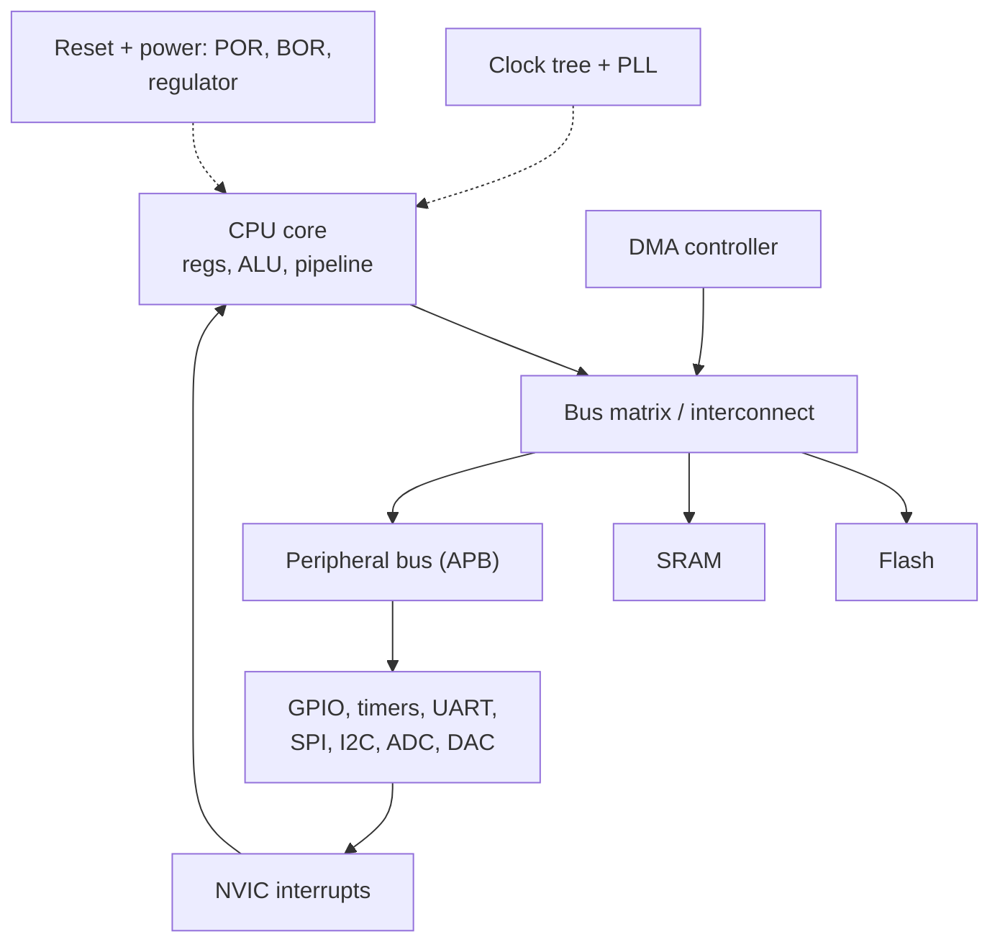
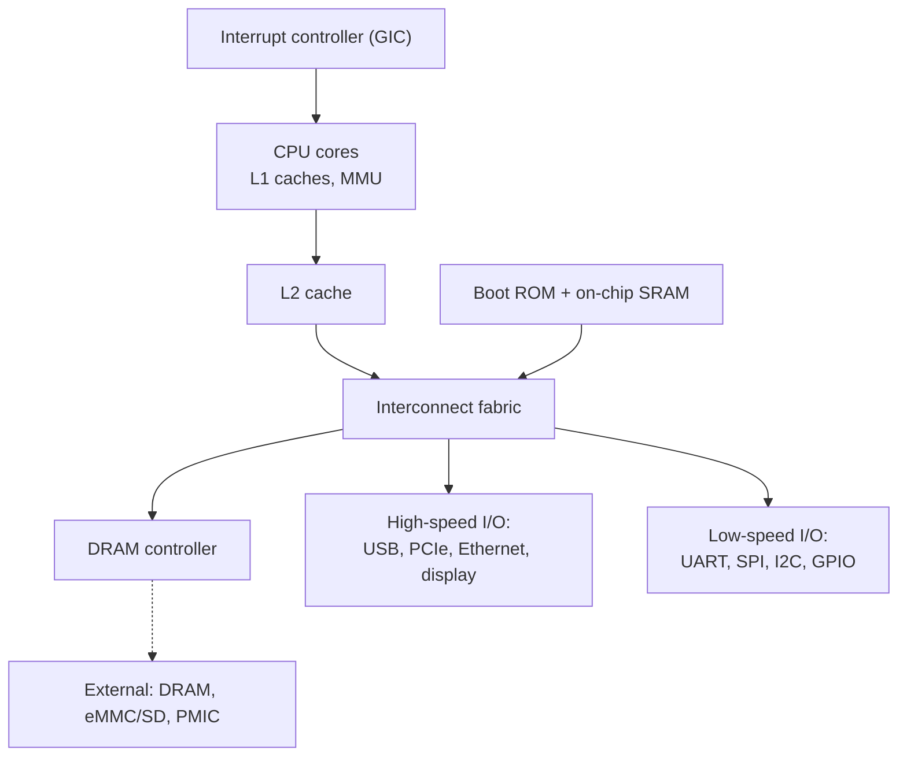

::: basics
### In plain words
Inside a microcontroller, a processor core is joined by wires, called a bus, to the memory and to hardware blocks that do specific jobs, such as timers and serial ports. Support blocks handle the clock, the reset, interrupts and bulk data copying. A microprocessor chip has the processor, a small fast memory called a cache, and controllers that reach outside memory chips. The main memory and storage sit off the chip.

### Picture it
Picture a small office. The manager (the processor core) works at a desk. A filing cabinet holds the written procedures (program memory), and a whiteboard holds today's notes (working memory). A receptionist taps the manager's shoulder when something urgent arrives. A courier carries parcels between departments so the manager doesn't have to. Hallways connect every room, and the wall clock sets the pace.

### Words you need
- **Core**: the part of the chip that runs instructions.
- **Bus**: the shared wires that carry addresses and data between blocks.
- **Peripheral**: a hardware block that does one job, such as a timer, a serial port or an analog-to-digital converter ([[q0733]]).
- **Interrupt**: a signal from a block that makes the core pause and handle an event.
- **DMA**: a helper block that copies data between memory and peripherals without the core.
- **Register**: a small storage slot that controls a block. Software writes to it like writing to a memory address.

### The simplest example
An analog-to-digital converter produces 1 million samples per second. If each sample interrupted the core, and each interrupt cost 100 clock ticks, the core would need 100 million ticks per second. A 72 MHz core has only 72 million, so it is overloaded at 139%. With DMA, the samples are copied into memory automatically, and the core is interrupted only when a whole buffer is full. That is the whole idea. The rest of this page draws full block diagrams for both chip types and shows what is off-chip.
:::

::: testing
Whether you can draw and explain the **internal architecture** of both kinds of chip and say what each block does. The interviewer is looking for:

1. For an MCU: CPU core, flash, SRAM, bus matrix, clock and reset logic, interrupt controller, DMA, timers, serial peripherals, analog peripherals, GPIO, watchdog and debug.
2. For a microprocessor: CPU core(s), caches, MMU, memory controller, buses, interrupt controller, and which blocks sit *outside* (DRAM, storage, PMIC).
3. How the blocks are connected (buses, address map), not only a list of names.
:::

::: why
Every embedded design question about timing, power, interrupts or DMA ultimately depends on how the blocks are connected: whether the CPU or a DMA moves the data, which clock a peripheral runs from, what happens at reset. If you can draw the diagram, you can answer almost any follow-up from it, and datasheets and reference manuals organize their chapters along the same blocks.
:::

::: concepts
- **CPU core**: registers, ALU, control unit, pipeline.
- **Memory**: flash (code), SRAM (data), and in MPUs caches and external DRAM. See [[q0829]].
- **Bus matrix / interconnect**: connects masters (CPU, DMA) to slaves (memory, peripherals).
- **Clock and reset subsystem**: oscillators, PLL, dividers, power-on and brown-out reset. See [[q0736]].
- **Interrupt controller and DMA**: how events reach the CPU and how data moves without it. See [[q0733]].
- **Peripherals**: GPIO, timers, ADC/DAC, UART/SPI/I2C and more.
:::

::: answer
"I'd draw the MCU as a CPU in the middle connected through a bus matrix to everything else on the chip.

The CPU core has registers, an ALU and a control unit, usually a pipeline. On the bus it reaches on-chip flash, which holds the program, and SRAM for data and the stack. Next to those are the infrastructure blocks: a clock subsystem with an internal oscillator, a crystal driver and a PLL with dividers feeding each peripheral; reset logic with power-on and brown-out detection; a voltage regulator for the core; and power modes. The interrupt controller, like the NVIC on Cortex-M, delivers events to the CPU, and a DMA controller moves data between memory and peripherals without CPU work. Then the peripherals: GPIO with pin multiplexing, timers and PWM, UART, SPI and I2C, ADC and DAC, comparators, a watchdog, an RTC, and a debug port such as SWD. Everything is accessed through memory-mapped registers.

A microprocessor has the CPU cores, which are fancier, with L1 and L2 caches and an MMU. There's a memory controller to *external* DRAM, an interrupt controller, a bus fabric, boot ROM, and a set of high-speed and low-speed I/O blocks if it's an SoC. But the working memory, boot storage and power-management chip are separate chips on the board. A classic bare microprocessor, like an old 8086 or Z80, is just the CPU, with memory and I/O as external chips."
:::

::: technical
**MCU blocks (Cortex-M style):**

| Block | Function |
|---|---|
| CPU core | Fetch/decode/execute, registers, ALU, optional FPU/DSP, pipeline |
| Flash | Non-volatile program memory; may have a prefetch buffer or cache and wait states |
| SRAM | Data, stack, heap; sometimes split into banks |
| Bus matrix (AHB/APB) | Connects masters (CPU, DMA) to slaves; peripherals on slower APB buses |
| Clock tree | Internal RC, crystal oscillator, PLL, dividers and per-peripheral clock gating |
| Reset / power | POR, BOR, regulator, low-power modes, wake-up sources |
| NVIC | Prioritized, vectored interrupts, nested |
| DMA | Peripheral↔memory and memory↔memory transfers |
| Timers | Counters, PWM, input capture, output compare, SysTick |
| Comm peripherals | UART, SPI, I2C, CAN, USB, sometimes Ethernet |
| Analog | ADC, DAC, comparators, op-amps, temp sensor, voltage reference |
| GPIO / pin mux | Digital I/O, alternate-function selection |
| Watchdog / RTC | Independent watchdog, real-time clock |
| Debug | SWD/JTAG, breakpoints, trace |
| Security | CRC, crypto accelerators, flash protection |

**Address map.** A Cortex-M MCU maps everything into one 32-bit (4 GB) address space. By architecture, code is around 0x0000_0000, SRAM at 0x2000_0000, peripherals at 0x4000_0000 and the core's own system registers (NVIC, SysTick) at 0xE000_0000. Writing a peripheral register is just a store to an address. For many STM32 parts, flash is also aliased at 0x0800_0000.

**Clock example (STM32F103-style).** 8 MHz crystal × PLL 9 = 72 MHz CPU clock, APB2 at 72 MHz and APB1 divided by 2 = 36 MHz. At 72 MHz the flash needs wait states (two on that family), which the prefetch buffer hides for sequential code.

**Microprocessor blocks:** CPU cores with L1 (instruction and data) and often L2 caches, MMU/TLB, a memory controller (DDR3/4, LPDDR), an interrupt controller (for Arm, the GIC), an interconnect fabric, boot ROM and small on-chip SRAM, security blocks, high-speed I/O (USB, PCIe, Ethernet, MIPI), low-speed I/O (UART, SPI, I2C, GPIO) and often GPU/video/NPU. **External**: DRAM, boot storage (eMMC, SD, NOR), PMIC, clocks, PHYs.

**Bandwidth sanity.** A 32-bit bus at 72 MHz can move up to 288 MB/s. A 1 MS/s ADC with 16-bit samples produces 2 MB/s, trivial for the bus, but servicing each sample with a CPU interrupt of 100 cycles would need $10^6\times100/72\times10^6\approx139\%$ of the CPU, impossible, so DMA moves the samples instead.

> [!UNCERTAIN]
> Exact block names, bus names and addresses are vendor and part specific (for example flash aliasing and peripheral base addresses). Use the reference manual's memory map for the part in front of you.
:::

::: short
"An MCU is a CPU core connected through a bus matrix to on-chip flash and SRAM, plus clock and reset logic, an interrupt controller, DMA, and peripherals: GPIO, timers, serial ports, ADC/DAC, a watchdog and a debug port, all memory-mapped. A microprocessor has the CPU cores with caches and an MMU, a DRAM controller, an interrupt controller and I/O blocks, but the DRAM, boot storage and power management are separate chips on the board."
:::

::: long
"For the microcontroller, I'd draw a big box with the CPU core in the middle: registers, an ALU and control logic, usually pipelined. Connected to it by a bus matrix I'd draw the memories: flash for the program, SRAM for data and stack. Along the same bus, slower peripheral buses carry the peripherals.

Then the supporting blocks that every MCU has. A clock subsystem: an internal RC oscillator, a crystal oscillator driver, a PLL that multiplies the clock up, and dividers feeding each peripheral, with clock gating to save power. A reset and power block: power-on reset, brown-out detection, an on-chip voltage regulator and low-power modes. An interrupt controller, the NVIC on a Cortex-M, which prioritizes events and vectors the CPU to the right handler. A DMA controller, which can move data between peripherals and memory without the CPU. A watchdog and an RTC. And a debug interface, SWD or JTAG.

Then peripherals: GPIO with a pin multiplexer, timers for PWM, capture and compare, UART, SPI, I2C, CAN or USB, ADC and DAC, comparators. They're all controlled by memory-mapped registers, so writing a pin is just a store to an address.

A microprocessor has the CPU cores, which are bigger: deep pipelines, L1 and L2 caches, an MMU for virtual memory. It has a memory controller for external DRAM, an interrupt controller, an interconnect, boot ROM, and an SoC will include USB, Ethernet, display and camera interfaces, and low-speed I/O like UART and SPI. What's *not* in the chip is the DRAM, the boot storage and the power-management IC. And a classic microprocessor like an 8086 or a Z80 is just the CPU, with memory and I/O on separate chips on the board."
:::

::: terms
- **Bus matrix / interconnect**: switch connecting multiple masters to multiple slaves.
- **AHB / APB**: Arm's high-performance and peripheral buses.
- **Memory-mapped I/O**: peripheral registers occupy addresses in the CPU address space.
- **NVIC / GIC**: Cortex-M / Cortex-A interrupt controllers.
- **DMA**: direct memory access engine.
- **Clock gating**: turning off a peripheral's clock to save power.
- **Pin mux**: selecting which peripheral function drives each physical pin.
- **Boot ROM**: immutable code that starts the boot process.
:::

::: exceptional
**An average answer** lists "CPU, memory, I/O" for both.

**An exceptional answer**:
- Draws the MCU with the bus matrix connecting CPU, DMA, flash, SRAM and peripherals, and names clock tree, reset, NVIC, watchdog and debug.
- Explains memory-mapped registers and gives the Cortex-M address map.
- For the MPU, shows caches, MMU, DRAM controller and I/O blocks, and clearly marks what is *off-chip* (DRAM, storage, PMIC).
- Distinguishes a classic microprocessor (CPU only) from a modern application processor SoC.
- Uses a numeric example, such as a DMA vs CPU load comparison for an ADC, to show why the blocks exist.
:::

::: mistakes
- **Leaving out the infrastructure.** Clock, reset, interrupt controller and DMA are as important as the peripherals.
- **Saying an MPU has no memory.** It has caches and on-chip SRAM; what it lacks is on-chip *main* memory.
- **Calling the bus "just wires".** Bus structure sets bandwidth, arbitration and latency.
- **Treating peripherals as software.** Peripherals are hardware state machines controlled by registers; software configures them.
- **Forgetting the debug block.** Without SWD/JTAG nothing can be programmed or inspected easily.
- **Mixing up Harvard and von Neumann.** Many Cortex-M cores fetch code and data on separate buses (Harvard-like) but present a unified address space; classic microprocessors were von Neumann.
:::

::: deep
## The MCU as a bus-connected system


Figure: Masters (CPU and DMA) reach slaves (flash, SRAM, peripherals) through the bus matrix. Peripherals raise events into the NVIC, which interrupts the CPU. Clock and reset blocks feed everything.

**CPU core.** The core fetches instructions from flash, decodes them, and executes with its register file and ALU. A three-stage pipeline (fetch, decode, execute) is typical on Cortex-M0/M3/M4; higher-end M7 is superscalar. The core also includes the system timer (SysTick), the NVIC and debug logic.

**Memory.** Flash is slower than the CPU at high clocks, so a prefetch buffer or small cache hides wait states. SRAM has single-cycle access. Code can also run from SRAM (faster, volatile). Some MCUs add EEPROM or emulated EEPROM, ROM bootloaders, and tightly coupled memory (TCM) for deterministic access.

**Bus matrix.** It lets the CPU read flash while the DMA writes SRAM at the same time, without contention. If two masters want the same slave, an arbiter decides (usually round-robin or fixed priority), which is how DMA can steal cycles and affect interrupt latency. Slow peripherals sit on the APB bus behind a bridge, which is why a peripheral register access takes more cycles than an SRAM access.

**Clock tree.** The CPU clock, bus clocks and each peripheral's clock are derived from the oscillators by multiplexers and dividers. A typical setup is 8 MHz crystal × 9 = 72 MHz system clock with APB1 at 36 MHz. Peripherals can be clock-gated off when unused, and power modes stop the CPU clock or all clocks except the RTC.

**Reset and power.** On power-up a power-on reset (POR) holds the core in reset until the supply is above a threshold; a brown-out detector (BOR) resets or interrupts if the supply sags. An internal regulator derives the 1.2–1.8 V core supply from the 3.3 V rail on many parts. See [[q0736]].

**Interrupts.** Peripherals raise interrupt requests. The NVIC prioritizes, nests and vectors them: on a Cortex-M the hardware pushes registers and jumps to the handler in about 12 cycles.

**DMA.** A DMA channel is configured with a source, destination, count and trigger, such as "ADC end-of-conversion". It then copies data by itself, interrupting the CPU only when a buffer is full. In the ADC example: 1 MS/s × 16-bit is 2 MB/s, trivial for the bus. But interrupting the CPU for every sample at a 100-cycle ISR would need 139% of a 72 MHz core, so without DMA the system can't work at all.

## The memory map

On Cortex-M, everything lives in one address space, so reading an ADC result looks the same as reading a variable:

| Region | Typical address | Contents |
|---|---|---|
| Code | 0x0000_0000 to 0x1FFF_FFFF | Flash / boot memory (often aliased) |
| SRAM | 0x2000_0000 to 0x3FFF_FFFF | Data, stack, heap |
| Peripherals | 0x4000_0000 to 0x5FFF_FFFF | Registers of GPIO, timers, UART... |
| External RAM/devices | 0x6000_0000 and up | Optional external memory interface |
| Core system | 0xE000_0000 to 0xE00F_FFFF | NVIC, SysTick, debug |

In C, setting a GPIO output bit is a write through a pointer to a fixed address, for example `*(volatile uint32_t *)0x40010C10 = (1u << 5);`, which is what a vendor header wraps into a named register like `GPIOB->BSRR`. The `volatile` keyword tells the compiler the location can change by itself or has side effects.

## The microprocessor's block diagram


Figure: The CPU cluster sits behind caches and an MMU, reaches DRAM through a controller, and uses an interconnect fabric for I/O. The dashed line marks what lives off the chip. The boot ROM and on-chip SRAM start the boot sequence before DRAM is initialized.

Compared with the MCU: caches and an MMU appear; flash is gone (replaced by external storage); the memory controller and high-speed I/O appear; and the system needs a separate PMIC. The *interrupt controller* (GIC on Arm A-class) supports many more sources and multiple cores. And the boot process is longer because external DRAM must be trained and initialized before code can run from it.

## Von Neumann, Harvard, and old microprocessors

A classic microprocessor (Intel 8086, Zilog Z80, Motorola 68000) is just the CPU: ALU, registers, control unit and bus interface. Memory (ROM and RAM) and I/O are separate chips connected by address, data and control buses on the board, with address-decode logic selecting which chip responds. That is *exactly* the part that an MCU integrates. Modern MCUs often use a modified Harvard bus (separate instruction and data buses to flash and SRAM) to fetch an instruction and access data in the same cycle, while still presenting one unified memory map to software.

## Experiment with it

```sim
{"id":"interrupt-lab","nesting":true}
```
Figure: Peripheral events flow into the interrupt controller and preempt the main loop. Toggle nesting and see how priorities change the latency each ISR sees. This is the interrupt-controller block in action.
:::

::: applications
- **Reading reference manuals**: chapters follow these blocks (clocks, memory map, NVIC, DMA, each peripheral).
- **Choosing parts**: counting blocks (how many timers, ADC channels, UARTs, DMA channels) against requirements. See [[q0735]].
- **Low-power design**: clock gating and power modes act at block level.
- **Bring-up**: checking clock tree, reset, boot pins and memory map first.
- **Safety work**: ECC on SRAM and flash, lockstep cores, memory protection units are block-level features.
- **SoC architecture**: system designers choose which blocks are on-chip or off-chip to trade cost, speed and flexibility.
:::

::: assumptions
- **Generic Cortex-M style MCU**: other architectures (AVR, PIC, MSP430) have the same categories with different details.
- **Representative application SoC** for the MPU diagram. Real SoCs integrate far more (GPU, NPU, security, audio).
- **Addresses** are architectural for Cortex-M and vendor-specific for peripherals and flash alias.
- **Wait states** and clock figures are family examples; check the datasheet.
- **Diagram level**: simplified; real chips have multiple buses, domains and power islands.
:::

::: followups
### What's the role of the bus matrix and why does it matter?
It connects multiple bus masters to multiple slaves concurrently. If the CPU reads flash while DMA writes SRAM, both proceed at once; only simultaneous access to the same slave is arbitrated. It matters for performance, for DMA/CPU contention, and for deterministic timing.

### Why are peripheral register accesses slower than RAM accesses?
Peripherals usually sit behind a bridge on a slower bus (APB), often at half or quarter of the CPU clock, so each access takes several CPU cycles. It's one reason to keep tight loops from polling peripheral registers.

### What does clock gating do?
It stops the clock to an unused peripheral so its logic doesn't switch, saving dynamic power. Most MCUs reset with peripheral clocks off, and firmware enables each one before use. A common bug is forgetting to enable the clock and seeing registers that don't respond.

### How does DMA reduce CPU load, with numbers?
For a 1 MS/s, 16-bit ADC stream, an interrupt per sample at 100 cycles on a 72 MHz core needs 139% of the CPU. With DMA into a 1024-sample buffer and one interrupt per half buffer (about every 0.5 ms), the CPU handles about 2,000 interrupts per second, a tiny fraction.

### What's different about the boot process on an MPU?
A boot ROM loads a first-stage loader into on-chip SRAM, which initializes DRAM, which loads a bootloader, which loads the kernel. The MCU just starts from its reset vector in flash. See [[q0731]].

### Scenario: a peripheral's registers read back as 0 and writes don't stick. What do you check?
First, whether the peripheral's clock is enabled in the clock-control registers (the commonest cause), then whether the pin multiplexing and power domain are set, whether the code runs privileged or unprivileged if the MPU/protection blocks access, and whether the debugger or compiler optimization removed a missing `volatile` access.
:::

::: interpretations
"The blocks of a microcontroller and microprocessor" is read as a block-diagram question for both. A "microprocessor" can mean a classic CPU-only chip or a modern application SoC; I covered both. The difference in system terms is in [[q0731]]; how the blocks talk to external parts is in [[q0733]].
:::

::: references
- Joseph Yiu, *The Definitive Guide to ARM Cortex-M3 and Cortex-M4 Processors*: core, memory map, NVIC, bus architecture.
- Vendor reference manuals (for example STMicroelectronics STM32 reference manuals) for the clock tree, memory map and bus matrix of a real part.
- Patterson and Hennessy, *Computer Organization and Design*: CPU datapath, caches, virtual memory.
- Elecia White, *Making Embedded Systems*: memory-mapped I/O and embedded system structure.
:::

::: rubric
- Draws the CPU connected via a bus to flash, SRAM and peripherals :: The core structure of an MCU.
- Names clock, reset/power, interrupt controller, DMA, watchdog and debug blocks :: Infrastructure blocks are what separate a good answer from a list of peripherals.
- Lists the peripheral set (GPIO, timers, serial, ADC/DAC) with memory-mapped registers :: Shows understanding of how software controls hardware.
- For the MPU: shows cores with caches and MMU, DRAM controller, I/O blocks, and what's off-chip :: The second half of the question.
- Mentions classic CPU-only microprocessors vs integrated SoCs :: Clarifies the term.
- Uses an example (memory map, clock tree, DMA vs CPU load) :: Demonstrates working knowledge.
:::

::: quiz
```json
[
 {"type":"mcq","level":"fundamental","q":"Which block lets data move between a peripheral and memory without CPU involvement for each transfer?","options":["NVIC","DMA controller","Watchdog","PLL"],"answer":1,"explain":"The DMA controller copies data between memory and peripherals on its own, interrupting the CPU only when a transfer completes."},
 {"type":"mcq","level":"fundamental","q":"Which of these is typically NOT on the microprocessor chip itself?","options":["L1 cache","MMU","Main DRAM","Interrupt controller"],"answer":2,"explain":"Application processors integrate caches, MMU and interrupt controller; the main DRAM is a separate chip connected through the memory controller."},
 {"type":"numeric","level":"intermediate","q":"An 8 MHz crystal feeds a PLL with multiplier ×9. What is the system clock in MHz?","answer":72,"tolerance":0.01,"unit":"MHz","explain":"The PLL multiplies the reference: $8\\text{ MHz}\\times9=72$ MHz, a common maximum for Cortex-M3 parts."},
 {"type":"numeric","level":"intermediate","q":"A 32-bit bus runs at 72 MHz and can transfer one word per cycle. What is the peak bandwidth in MB/s?","answer":288,"tolerance":0.02,"unit":"MB/s","explain":"4 bytes × 72 MHz = 288 MB/s."},
 {"type":"numeric","level":"intermediate","q":"A 1 MS/s ADC interrupts the CPU for every sample, and each ISR takes 100 cycles on a 72 MHz core. What fraction of the CPU, in percent, does this require?","answer":139,"tolerance":0.02,"unit":"%","explain":"$10^6\\times100=10^8$ cycles/s vs $72\\times10^6$ available: 139%. It cannot work without DMA or a faster core."},
 {"type":"truefalse","level":"advanced","q":"On a Cortex-M MCU, writing to a GPIO register is performed with a special I/O instruction that is separate from memory accesses.","answer":false,"explain":"Cortex-M uses memory-mapped I/O: peripheral registers occupy addresses (for example in the 0x4000_0000 region) and are accessed with ordinary load/store instructions, typically through volatile pointers."}
]
```
:::
