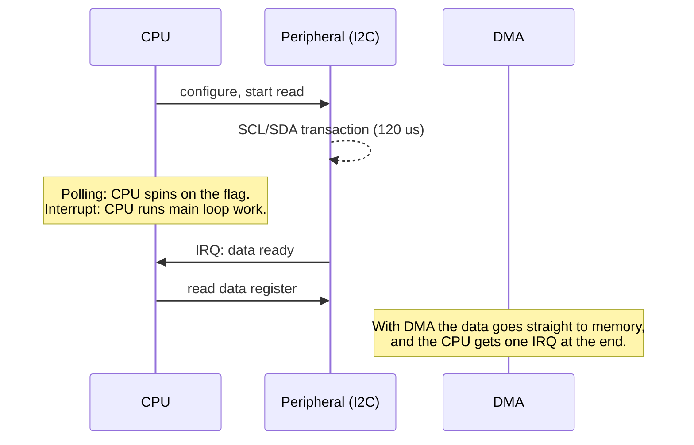

::: basics
### In plain words
A microcontroller doesn't wiggle its pins one by one from software. Each hardware block on the chip, called a peripheral, has a set of control registers at fixed addresses. Firmware writes settings into those registers, tells the block to go, and reads status back. The block then drives the pins with the right timing. Which block you use depends on what is attached.

### Picture it
Picture a control panel on a machine in the next room. You flip switches to choose the settings, press "go", and read the indicator lights to see progress. You never touch the machine's insides. To know when the job is done, you can stare at the light (polling), wait for a bell (an interrupt), or hand the job to an assistant who carries the results to your desk (DMA). The registers are the panel, and the peripheral is the machine.

### Words you need
- **Register**: a control slot at a fixed address. Writing to it sets up a peripheral or sends data.
- **GPIO pin**: a general-purpose pin the firmware can drive high or low, or read as an input.
- **Serial bus**: a few wires that send bits one after another, such as I2C, SPI and UART ([[q0737]]).
- **Polling**: the processor repeatedly checks a status flag until the job is done.
- **Interrupt**: the peripheral signals the processor when it needs attention.
- **DMA**: a helper block that moves data to and from memory without the processor.

### The simplest example
To light an LED, firmware makes three register writes: turn on the clock to the pin's port, set the pin as an output, then write a 1. From 3.3 V, an LED that drops 2.0 V at 5 mA needs a resistor of $(3.3-2.0)/5\text{ mA}=260$ Ω. A standard 270 Ω gives about 4.8 mA. That is the whole idea. The rest of this page covers other peripherals, when to poll, interrupt or use DMA, and the voltage levels and pull-up resistors that often break connections.
:::

::: testing
Whether you understand the **mechanisms** by which firmware turns into electrical activity on pins, and the choices between them. The interviewer is looking for:

1. Memory-mapped registers as the software/hardware interface, and the pin-level options: GPIO, analog (ADC/DAC), timers (PWM, capture), serial buses (UART, SPI, I2C, CAN, USB).
2. The three transfer styles: polling, interrupts, DMA, and when each fits.
3. The electrical side that candidates forget: voltage levels, pull-ups, drive strength, protection and level shifting.
:::

::: why
Almost every embedded task is "make the MCU talk to something": a sensor, a display, a motor driver, a radio. If you can describe the full path from a line of C to a voltage on a wire and back, including what can go wrong (wrong levels, missing pull-up, no clock enabled, blocking polling), you can debug and design interfaces systematically instead of by trial and error.
:::

::: concepts
- **Memory-mapped I/O**: peripheral registers are addresses; writing them configures and drives hardware. See [[q0732]].
- **GPIO**: digital pins as input or output, push-pull or open-drain. See [[q0780]].
- **Serial buses**: UART, SPI, I2C (see [[q0737]]), CAN, USB.
- **Analog interfaces**: ADC to read, DAC or PWM plus filter to produce analog levels.
- **Interrupts and DMA**: event-driven handling and offloaded transfers. See [[q0795]].
- **Electrical interfacing**: logic levels, pull-ups, current limits, level shifting, protection.
:::

::: answer
"From the firmware side, a peripheral is a block of registers at fixed addresses. I write configuration registers to set it up, write or read data registers, and check status flags. The hardware block then drives the pins, so the CPU doesn't wiggle each line itself.

For the actual interface, it depends on what the device is. Simple on/off things, buttons, LEDs, enable lines, use GPIO: configured as output to drive or input to read, with pull-ups or pull-downs as needed. Analog sensors go to the ADC. Things that need a timed waveform, like motor or LED brightness, use a timer in PWM mode, and timer capture measures pulse widths or frequencies. Smarter devices use a serial bus: I2C for many slow devices on two wires, SPI for faster point-to-point links, UART for simple asynchronous links, CAN for noisy multi-node networks, and USB when a host is involved.

To move data I choose between polling, where the CPU waits on a status flag; interrupts, where the peripheral signals when it needs service; and DMA, where a controller moves blocks of data between memory and the peripheral by itself. For example, reading a temperature sensor over I2C at 400 kHz takes about 120 microseconds for a two-byte read; I'd use interrupts or DMA so the CPU can do other work.

And on the hardware side I check voltage levels, pull-ups on open-drain lines like I2C, current limits on pins, and protection for anything that leaves the board."
:::

::: technical
**Register-level view.** Peripheral registers sit in the address map (Cortex-M peripherals around 0x4000_0000). Typical sequence: (1) enable the peripheral clock, (2) configure pin mux and mode (alternate function, push-pull/open-drain, pull-up/down, speed), (3) configure the peripheral (baud rate, mode, resolution), (4) enable it, (5) transfer data via data registers with status/interrupt flags.

**Interface options:**

| Need | Mechanism | Notes |
|---|---|---|
| On/off signals, buttons, enables | GPIO in/out | Add pull-up or pull-down; debounce mechanical switches |
| Analog voltage in | ADC (SAR, 8–16 bit) | RC filter, source impedance limits, reference |
| Analog voltage out | DAC, or PWM + RC filter | PWM for motors/LEDs directly |
| Timing/waveform | Timer: PWM, input capture, output compare | Hardware timing independent of CPU |
| Few wires, many slow devices | I2C | Open-drain with pull-ups, addressable, 100/400 kHz typical |
| Fast, simple link | SPI | 4 wires + 1 CS per device, MHz to tens of MHz |
| Async point to point | UART | Start/stop framing, baud agreement |
| Robust multi-node | CAN | Differential, arbitration, vehicles and industry |

**Transfer styles:**
- **Polling**: simple, wastes CPU, latency limited by loop time.
- **Interrupt**: peripheral raises IRQ; CPU runs an ISR (about 12 cycles to enter on Cortex-M, plus the handler time). Good for sporadic events. See [[q0795]].
- **DMA**: configured once for a buffer; interrupts CPU on half/complete. Best for continuous streams (ADC, audio, SPI displays).

**Electrical.** Pins have $V_{IH}$, $V_{IL}$, $V_{OH}$, $V_{OL}$ and current limits. A 3.3 V MCU talking to a 5 V device needs level shifting if the 5 V output exceeds the pin's tolerance. Open-drain buses need pull-ups: I2C rise time $\approx0.85\,R_pC_b$ (30%–70%). Outputs driving LEDs need a series resistor: $R=(V_{DD}-V_f)/I$.

**Worked numbers.**
- LED: 3.3 V supply, $V_f=2.0$ V, 5 mA target: $R=1.3/5\text{ mA}=260$ Ω; choose 270 Ω, giving 4.8 mA.
- I2C two-byte register read: START, address+W (9 clocks incl. ACK), register pointer (9), repeated START, address+R (9), two data bytes (9 + 9), STOP, about 48 SCL periods. At 400 kHz that is 120 µs; at 100 kHz, 480 µs. Sampling at 1 kHz uses 12% of a 400 kHz bus.
- I2C rise time with $R_p=4.7$ kΩ and $C_b=100$ pF: $0.85\times4.7\text{ k}\times100\text{ pF}=0.40$ µs. That is fine for 100 kHz standard mode (1000 ns allowed) but over the 300 ns fast-mode (400 kHz) limit, so for 400 kHz use about 3 kΩ ($0.85\times3\text{ k}\times100\text{ pF}=255$ ns) or reduce the bus capacitance, subject to the sink-current limit.

> [!UNCERTAIN]
> Exact register names and bit meanings differ across vendors. The sequence (clock, pin, configure, enable, transfer) is general.
:::

::: short
"The firmware talks to hardware through memory-mapped registers: configure a peripheral, then read and write its data and status registers. Depending on the device, the pins are GPIO for on/off signals, ADC for analog in, timers and PWM for waveforms, or a serial bus like I2C, SPI, UART or CAN for smart peripherals. Data moves by polling, interrupts or DMA, depending on rate and latency. And electrically I make sure the levels match, open-drain buses have pull-ups, and pins are protected and current-limited."
:::

::: long
"At the lowest level, the CPU talks to peripherals through memory-mapped registers. Each peripheral on the chip, a UART, a timer, the ADC, has a block of registers at fixed addresses. I enable its clock, configure the pin so it is routed to that peripheral, set its parameters like baud rate or resolution, and enable it. After that, I read and write its data register and check its status flags. The hardware block actually drives the pins, with the right timing, so the CPU is not bit-banging.

Then the choice of interface depends on the external device. For simple digital signals like buttons, LEDs, chip enables, I use GPIO as input or output, with pull-ups or pull-downs, and debouncing for switches. For analog sensors I use the ADC, with an RC filter and attention to source impedance. For a waveform like motor speed or LED brightness, I use a timer in PWM mode; to measure a pulse width I use input capture. For smarter peripherals I use a serial bus: I2C when I have several slow devices and want only two wires, SPI when I want speed, UART for simple point-to-point links, and CAN in noisy multi-node systems.

How the data moves is a separate decision. Polling is simplest but ties up the CPU. Interrupts let the peripheral tell the CPU when something happens, with about a dozen cycles of entry latency on a Cortex-M. DMA moves whole buffers without the CPU. For example, a two-byte I2C read at 400 kHz takes about 48 clock periods, 120 microseconds; polling for that blocks the CPU, so I'd use an interrupt-driven driver or DMA.

The electrical side is where designs fail. Logic levels have to match, so a 5 V device into a 3.3 V pin needs a divider or level shifter. Open-drain buses like I2C need pull-ups sized for the bus capacitance. LED and output pins need current limits. And anything connecting off-board needs ESD protection and series resistors. When something doesn't work, I check in order: clock enabled, pin mux, levels, pull-ups, then software timing."
:::

::: terms
- **Memory-mapped register**: hardware register accessed like a variable at a fixed address.
- **Alternate function / pin mux**: selecting which peripheral drives a pin.
- **Push-pull / open-drain**: output types; open-drain can only pull low and needs a pull-up.
- **Pull-up / pull-down**: resistor setting the idle level of an input.
- **PWM**: pulse-width modulation, a timer-generated waveform with controlled duty.
- **ISR**: interrupt service routine.
- **DMA**: direct memory access, hardware data mover.
- **HAL**: hardware abstraction layer, vendor driver library over the registers.
:::

::: exceptional
**An average answer** says "through GPIO, I2C, SPI and UART".

**An exceptional answer**:
- Starts with memory-mapped registers and the enable-clock, mux, configure, enable, transfer sequence.
- Matches interface type to device: GPIO, ADC/DAC, PWM/capture, I2C/SPI/UART/CAN/USB, and says why.
- Compares polling, interrupts and DMA with a quantitative example (120 µs I2C read, 12% bus load).
- Covers the electrical interface: levels, pull-ups with rise-time calculation, series resistors, protection.
- Gives a debugging order for "peripheral not responding".
:::

::: mistakes
- **Forgetting to enable the peripheral clock or configure the pin mux.** Registers read zero or writes have no effect.
- **Driving high-current loads from a pin.** A GPIO only supplies a few to tens of mA; use a transistor/driver.
- **Missing I2C pull-ups** (or using the internal weak pull-ups at high speed). The bus idles low or rises too slowly.
- **Connecting 5 V outputs to non-tolerant 3.3 V pins.** Check the absolute maximum rating.
- **Busy-waiting inside an ISR or polling long transactions.** It blocks everything else.
- **Ignoring mechanical switch bounce** (milliseconds of chatter) when counting presses with an interrupt.
- **Assuming the peripheral's default configuration** is what you need (for example SPI mode, I2C speed).
:::

::: deep
## The path from C to a voltage

Take the simplest case: turning on an LED. The firmware does three things:

1. Enables the clock to the GPIO port (the port is powered but unclocked by default on many MCUs).
2. Writes the port's mode register to set the pin as an output (push-pull).
3. Writes the output data register (or a set/reset register) to drive the pin high.

Each step is a store to a memory-mapped address: `RCC->AHB1ENR |= GPIOAEN; GPIOA->MODER |= ...; GPIOA->ODR |= (1 << 5);` in an STM32-style header (register names vary by vendor). The store goes over the bus matrix and peripheral bus to the GPIO block, which sets a flip-flop that controls the output transistors. From there it's analog: an output driver, pin capacitance, a trace, a resistor, an LED.

```circuit
{"caption":"Typical external connections of an MCU: button in, LED out, I2C sensor","elements":[
 {"t":"box","at":[8,0],"w":6,"h":14,"label":"MCU","pins":[{"side":"left","pos":3,"name":"PA0"},{"side":"right","pos":3,"name":"PA5"},{"side":"right","pos":10,"name":"SDA"},{"side":"right","pos":12,"name":"SCL"}]},
 {"t":"rail","at":[4,0],"label":"V_{DD}","dir":"up"},
 {"t":"R","a":[4,0],"b":[4,3],"label":"R_{pu}","value":"10 kΩ"},
 {"t":"dot","at":[4,3]},
 {"t":"wire","pts":[[4,3],[8,3]]},
 {"t":"SW","a":[4,3],"b":[4,6],"label":"S1"},
 {"t":"wire","pts":[[4,6],[4,8]]},{"t":"gnd","at":[4,8]},
 {"t":"wire","pts":[[14,3],[17,3]]},
 {"t":"R","a":[17,3],"b":[21,3],"label":"R_s","value":"270 Ω"},
 {"t":"LED","a":[21,3],"b":[25,3],"label":"D1"},
 {"t":"wire","pts":[[25,3],[28,3],[28,5]]},{"t":"gnd","at":[28,5]},
 {"t":"rail","at":[19,6],"label":"V_{DD}","dir":"up"},
 {"t":"R","a":[19,6],"b":[19,10],"label":"4.7 kΩ"},
 {"t":"wire","pts":[[14,10],[26,10]]},{"t":"dot","at":[19,10]},
 {"t":"R","a":[22,13],"b":[22,17],"label":"4.7 kΩ"},
 {"t":"rail","at":[22,17],"label":"V_{DD}","dir":"down"},
 {"t":"wire","pts":[[14,12],[26,12]]},{"t":"dot","at":[22,12]},
 {"t":"wire","pts":[[22,12],[22,13]]},
 {"t":"box","at":[26,8],"w":5,"h":6,"label":"Sensor","pins":[{"side":"left","pos":2,"name":"SDA"},{"side":"left","pos":4,"name":"SCL"}]}
]}
```
Figure: Left: a pushbutton with a pull-up resistor gives a defined high when open and low when pressed (an input, ideally debounced). Top right: an LED with a series resistor on an output pin. Bottom right: an I2C sensor on SDA and SCL, each pulled up to VDD because the bus is open-drain. Each of the three uses a different MCU mechanism: GPIO input, GPIO output, serial peripheral.

## Choosing the mechanism, with numbers

**LED (GPIO output).** $R=(V_{DD}-V_f)/I=(3.3-2.0)/5\text{ mA}=260$ Ω, so 270 Ω gives 4.8 mA. A pin often can source or sink that, but many pins have limits of about 8–25 mA each and a total package limit. For a high-power LED or anything above that, drive a MOSFET from the pin.

**Button (GPIO input).** The pull-up (10 kΩ) sets the idle state; pressing shorts it to ground. A mechanical contact bounces for some milliseconds, so either an RC (10 kΩ × 100 nF = 1 ms time constant) with a Schmitt-trigger input, or software debounce (sample every few ms and require stable states). Use an interrupt for wake-up from sleep, with a debounce timer.

**Analog sensor (ADC).** A thermistor divider or amplifier output goes into the ADC through an RC filter. The SAR ADC's sampling capacitor draws charge at each conversion, so source impedance must be low or the input needs a capacitor. See [[q0804]] for the sensor-connection circuit and the ADC pages for sampling details; the button circuit above is the subject of [[q0805]].

**PWM (timer).** The timer counts from 0 to ARR and the compare register sets the duty. With a 16 MHz clock, prescaler 16 and ARR 1000, the PWM frequency is $16\text{ MHz}/(16\times1000)=1$ kHz, and the duty resolution is 1/1000. A motor driver or LED just sees the waveform; the CPU only changes the compare value.

```sim
{"id":"timer-lab","fclk":16e6,"psc":15,"arr":999,"ccr":250}
```
Figure: Change the compare value (`ccr`) and see the duty cycle change while the frequency stays fixed. The CPU's only job is to write one register.

**I2C sensor.** The CPU asks the I2C peripheral to run a transaction. A two-byte register read is about 48 SCL periods: 120 µs at 400 kHz. If the code polls the status flags, the CPU is stuck for those 120 µs. If the driver uses interrupts, the peripheral interrupts at each byte; with DMA, it interrupts once at the end. See [[q0744]], [[q0745]].

## Polling vs interrupt vs DMA


Figure: The same transaction handled three ways. Polling blocks. An interrupt lets the CPU do other work and costs an ISR per event. DMA removes the per-byte CPU work entirely.

Rules of thumb: poll only for very short waits (microseconds) or when nothing else needs to run. Use interrupts for sporadic events and low-rate bytes. Use DMA for continuous or bulk transfers: ADC streams, audio, display frames, long SPI/UART buffers. On a 72 MHz Cortex-M a 100-cycle ISR is about 1.4 µs, so an interrupt per byte at 115,200 baud (about 11.5 kB/s, one every 87 µs) costs under 2% of the CPU, but at 1 MB/s it would be 140%.

## Electrical interface checklist

1. **Levels**: does the device's $V_{OH}$ exceed the MCU's $V_{IH}$ (typically 0.7×VDD)? Does the MCU's $V_{OH}$ satisfy the device's $V_{IH}$? 3.3 V into a 5 V TTL input is often fine, but into a 5 V CMOS input needing 0.7×5=3.5 V it is not. See the level-shifter sim.
2. **Direction and drive**: who drives the line, and is there ever contention (two drivers)? Open-drain lines avoid contention.
3. **Pull-ups/pull-downs**: define idle states; sized for speed and current.
4. **Protection**: a series resistor (100 Ω to 1 kΩ) and ESD/TVS diode for anything at a connector; avoid hot-plug damage.
5. **Timing and speed**: edge rate versus trace length, bus capacitance (I2C), clock phase and polarity (SPI mode).
6. **Power sequencing**: peripherals powered when the MCU is not can back-feed through input pins.

## Debug order when a peripheral doesn't respond

1. Is the peripheral clock enabled and the pin muxed to it?
2. Do the pins show activity on a scope or logic analyzer (clock edges, start condition)?
3. Are the levels right and the pull-ups present?
4. Is the peripheral address, mode and speed correct (I2C address 7-bit vs 8-bit format, SPI CPOL/CPHA)?
5. Is the device powered and out of reset, and does it need a startup delay?
6. Only then suspect the driver code logic.
:::

::: applications
- **Sensor interfaces**: I2C/SPI IMUs, temperature sensors, ADC-based analog sensors.
- **User interface**: buttons, rotary encoders (timer encoder mode), LED indicators, displays over SPI/I2C.
- **Motor and power control**: PWM outputs to gate drivers, current-sense ADC with timer-triggered sampling.
- **Communications**: UART to GPS/modems, CAN in vehicles, USB to a host.
- **Storage**: SPI flash, SD cards over SPI/SDIO.
- **Wireless modules**: UART/SPI command interfaces to BLE/Wi-Fi modules with interrupt lines.
:::

::: assumptions
- **Cortex-M-style MCU with memory-mapped peripherals.** Other architectures (AVR, PIC) use the same ideas with different register names; some old CPUs used special I/O instructions.
- **Typical pin limits**: vary widely by part; always check the datasheet's absolute-maximum and recommended operating tables.
- **Bus numbers** (400 kHz, 48 clocks) are for standard I2C reads; clock stretching and protocol overhead extend them.
- **ISR cost** estimates are indicative; real handlers add context-save and handler code.
- **The answer changes** with an RTOS (drivers, queues, semaphores wrap the same hardware) and with high-speed interfaces (USB, Ethernet) where DMA and descriptors are mandatory.
:::

::: followups
### How does the MCU know when a sensor has new data?
Three ways: poll a status register or flag, use a data-ready interrupt line from the sensor wired to a GPIO with an external-interrupt input, or use a timer to read at a fixed rate. The interrupt line is best when the sensor produces data on its own schedule, and it lets the MCU sleep between samples.

### What's the difference between bit-banging and using a hardware peripheral?
Bit-banging toggles GPIO from software to emulate a protocol: flexible and requires no special pins, but uses the CPU for every edge, jitters with interrupts, and limits speed. A hardware peripheral generates the timing in logic, so it runs at full speed with no CPU involvement per bit.

### Why would you use DMA for an SPI display?
A 240×240 16-bit frame is 115,200 bytes. At 20 MHz SPI that's about 46 ms of transfer. If the CPU copies bytes it is busy for 46 ms per frame; with DMA it sets up the transfer and does other work, taking an interrupt at the end.

### Your I2C sensor reads fine on a short wire but fails with a 1 m cable. Why?
Bus capacitance rises with cable length (50–100 pF/m for typical cable), so the pull-up RC time constant grows and the rising edge exceeds the spec, causing errors at 400 kHz. Reduce speed to 100 kHz or lower, use stronger pull-ups (lower resistance within sink-current limits), or use a bus extender or differential driver for long runs. See [[q0756]].

### How would you interface a 5 V sensor output to a 3.3 V MCU ADC?
Use a resistive divider: 18 kΩ on top and 33 kΩ on the bottom gives a ratio of 33/51=0.647, so 5 V becomes 3.24 V, just under a 3.3 V full scale (a 10 kΩ/20 kΩ pair would give 3.33 V, slightly over). Add an RC filter and a series resistor or clamp for protection. Check divider output impedance against the ADC's source impedance limit.

### Scenario: your firmware toggles an LED correctly, but writing the SPI data register never produces clock activity. What do you check?
Whether the SPI peripheral clock is enabled, whether the pins are set to the SPI alternate function (not GPIO), whether the peripheral is enabled and in master mode, whether the chip-select handling is right, and whether the baud-rate divider is valid. A logic analyzer on SCK shows whether the failure is before or after the pin.
:::

::: interpretations
"How does a microcontroller interact with external peripherals?" is answered as the interface between firmware and external hardware: registers and pins, the interface types, the transfer styles, and the electrical considerations. The protocol details of I2C, SPI and UART are in the communication-bus questions ([[q0737]]), GPIO in [[q0780]], interrupts in [[q0795]].
:::

::: references
- Elecia White, *Making Embedded Systems*: interfacing, interrupts and drivers.
- Jonathan Valvano, *Embedded Systems: Real-Time Interfacing to ARM Cortex-M Microcontrollers*: GPIO, timers, serial and analog interfacing.
- NXP, *UM10204: I2C-bus specification and user manual*: electrical characteristics and timing of the I2C bus.
- Vendor reference manuals (GPIO, timer, USART, SPI, I2C and DMA chapters) for the register-level details of a specific MCU.
:::

::: rubric
- Explains memory-mapped registers and the configure/enable/transfer sequence :: This is how software controls any peripheral.
- Matches interfaces to devices: GPIO, ADC/DAC, PWM/capture, serial buses :: Shows you know the toolbox.
- Compares polling, interrupt and DMA and when to use each :: Core embedded design judgement.
- Covers electrical details: levels, pull-ups, current limits, protection :: Where real designs often fail.
- Quantifies something (I2C read time, LED resistor, ISR load) :: Numbers prove practical understanding.
- Gives a debug order for non-responding peripherals :: Demonstrates troubleshooting skill.
:::

::: quiz
```json
[
 {"type":"mcq","level":"fundamental","q":"What is the most common reason that writes to a peripheral's registers appear to do nothing on a freshly reset MCU?","options":["The peripheral clock has not been enabled","The compiler removed the writes because they are too fast","The register is read-only in all cases","The CPU is in sleep mode"],"answer":0,"explain":"Most MCUs reset with peripheral clocks gated off to save power, so you must enable the clock before the registers respond."},
 {"type":"mcq","level":"fundamental","q":"Which output type requires an external or internal pull-up resistor to produce a logic high?","options":["Push-pull","Open-drain","Tri-state buffer","Totem-pole"],"answer":1,"explain":"Open-drain outputs can only pull the line low; a pull-up resistor creates the high level. I2C uses open-drain drivers."},
 {"type":"numeric","level":"intermediate","q":"A GPIO at 3.3 V drives an LED with forward voltage 2.0 V at 5 mA through a series resistor. What resistance in ohms is needed?","answer":260,"tolerance":0.02,"unit":"Ω","explain":"$R=(3.3-2.0)/0.005=260$ Ω. Pick the nearest standard value, 270 Ω."},
 {"type":"numeric","level":"intermediate","q":"An I2C two-byte register read takes about 48 SCL periods. How long does that take at 100 kHz in µs?","answer":480,"tolerance":0.02,"unit":"µs","explain":"$48/100\\text{ kHz}=480$ µs."},
 {"type":"numeric","level":"intermediate","q":"A 16 MHz timer clock with prescaler divide-by-16 and an auto-reload counting 1000 steps produces what PWM frequency in Hz?","answer":1000,"tolerance":0.01,"unit":"Hz","explain":"$16\\text{ MHz}/16=1$ MHz counter clock; 1000 counts per period gives 1 kHz."},
 {"type":"multi","level":"advanced","q":"A UART delivers a byte every 87 µs and each interrupt service routine takes 100 cycles on a 72 MHz CPU. Which statements are true?","options":["The ISR takes about 1.4 µs, so the CPU load is under 2%","DMA could reduce the number of interrupts","The CPU load is over 100%","Polling would use less CPU time than interrupts in all cases"],"answer":[0,1],"explain":"100 cycles / 72 MHz = 1.39 µs, which is 1.6% of 87 µs. DMA with a buffer would cut interrupts further. Polling busy-waits and normally uses more CPU time."}
]
```
:::
