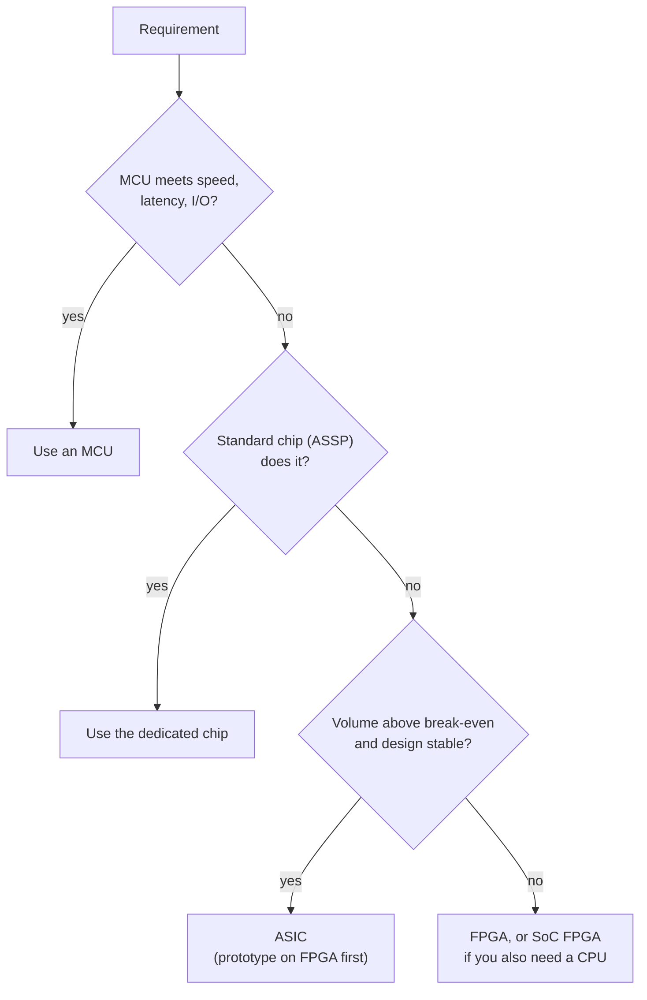

::: basics
### In plain words
A microcontroller (MCU) runs a program one step at a time on a fixed chip. An FPGA is a chip whose internal wiring you configure after it is made, so it becomes custom hardware that does many things at once. An ASIC is a chip designed and manufactured for one job and cannot be changed. The usual rule is to start with the cheapest option that works, an MCU, and move up only when a requirement forces you to.

### Picture it
Think of printing a book. An MCU is a person copying pages by hand: cheap to start and very flexible, but slow. An FPGA is a print shop with rearrangeable type blocks. You set it up once for your job, then it prints many pages at the same time. An ASIC is a press built for that exact book. Each copy is the cheapest of all, but building the press costs a fortune, and if you find a typo the press must be rebuilt.

### Words you need
- **MCU**: a small chip that runs firmware, one instruction at a time ([[q0731]]).
- **FPGA**: a chip you configure after manufacture to form your own digital circuit.
- **ASIC**: a chip custom-made for one job, with wiring fixed at the factory.
- **NRE**: the one-time cost to design the chip and set up manufacturing.
- **Parallelism**: doing many operations at the same moment.
- **Break-even**: the volume at which two options cost the same in total.

### The simplest example
A filter must do 64 multiplications for each of 100 million samples per second. That is 6.4 billion multiplications per second. A 100 MHz MCU does one per tick, 100 million per second, which is 64 times too slow. An FPGA with 64 multiplier blocks at 200 MHz does 12.8 billion per second, so it fits. That is the whole idea. The rest of this page covers cost break-even, schedule, risk and hybrids.
:::

::: testing
Whether you can make a **platform decision** using engineering and business criteria, not just list definitions. The interviewer wants:

1. What each is: software on a fixed processor (MCU), reconfigurable hardware (FPGA), custom silicon (ASIC).
2. The decision axes: required performance and parallelism, power, volume and unit cost vs NRE, time to market, flexibility and risk, team skills.
3. A worked reason, ideally a break-even calculation, and awareness of hybrids (SoC FPGAs, MCU plus FPGA, soft cores, eFPGA).
:::

::: why
Choosing the compute platform is one of the earliest and most expensive decisions in a product: it fixes the team, schedule, BOM and risk. Interviewers like it because there's no single right answer, and a strong candidate walks through trade-offs with numbers and picks the cheapest option that satisfies the requirements. The default should be an MCU; you need a reason to go beyond it.
:::

::: concepts
- **MCU**: fixed-architecture processor executing firmware sequentially. See [[q0731]].
- **FPGA**: array of programmable logic blocks, memory, DSP slices and routing, configured to implement digital hardware (RTL).
- **ASIC**: application-specific integrated circuit, custom-designed and fabricated.
- **NRE vs unit cost**: one-time engineering and mask costs vs per-chip cost.
- **Parallelism and determinism**: hardware does many things in the same clock cycle with fixed latency.
- **Time to market and respin risk**: schedule and the cost of a mistake.
:::

::: answer
"I'd start with the cheapest thing that works, which is almost always an MCU, and only move up if I can show it can't meet a requirement.

An MCU runs software, so it's the most flexible, has the fastest development, lowest cost at any volume, and mature tools. It's limited by sequential execution: a 100 MHz core does about 100 million simple operations per second, so it can't do something like a 64-tap FIR filter at 100 MS/s, which needs about 6.4 billion multiply-accumulates per second.

An FPGA implements the algorithm as parallel hardware. Hundreds of DSP slices working every clock gives many billions of operations per second, deterministic nanosecond latency, and custom interfaces like a nonstandard high-speed bus or a camera sensor link. It's reprogrammable, so low NRE and fast iteration, but the unit cost is high, power is higher than an ASIC, and the design work, RTL and timing closure, is harder.

An ASIC is custom silicon: best performance per watt and lowest unit cost at high volume, but it has huge NRE, in the millions for masks, verification and tools, 12 to 24 months of schedule, and any bug needs a costly respin. It only makes sense at high volume, with a stable algorithm.

The break-even is simple: total cost is NRE plus unit cost times volume. With my example numbers, FPGA at 20 dollars and 150 thousand dollars NRE versus an ASIC at 1.50 dollars and 1.5 million NRE crosses over near 73,000 units. Below that, FPGA; above it, consider the ASIC. In practice many products use an MCU for control and an FPGA for the fast datapath, or an SoC FPGA that has both."
:::

::: technical
**Comparison**

| Criterion | MCU | FPGA | ASIC |
|---|---|---|---|
| Implementation | Firmware on fixed CPU | Configured logic (RTL) | Custom silicon |
| Parallelism | Few cores, sequential | Massive, custom pipelines | Massive, optimized |
| Latency / determinism | µs-level, deterministic if bare-metal | ns-level, cycle-exact | ns-level, cycle-exact |
| Throughput | Up to 100s of MMAC/s | Up to 10s–100s of GMAC/s (DSP slices) | Highest |
| Power efficiency | Good for low duty cycle | Moderate; static power significant | Best |
| Flexibility | Change firmware | Reprogram bitstream | None after tape-out |
| NRE | Low (firmware + board) | Low–medium (RTL, board, tools) | Very high (masks, design, verification) |
| Unit cost | Cents to a few dollars | Several dollars to hundreds | Lowest at volume |
| Time to market | Weeks to months | Months | 12–24+ months (typical) |
| Skills | C/C++, embedded | RTL (Verilog/VHDL), timing, DSP | Full custom/standard-cell flow, DFT, verification |
| Risk | Low | Low–medium | High (respin) |

**Compute example: 64-tap FIR at 100 MS/s.** Required: $64\times100\times10^6=6.4\times10^9$ MAC/s. A 100 MHz MCU with one MAC per cycle manages $100\times10^6/64=1.56$ MS/s, 64× too slow. An FPGA with 64 DSP slices at 200 MHz delivers $64\times200\times10^6=12.8\times10^9$ MAC/s, enough with margin.

**Cost model.** Total cost $=\text{NRE}+c\cdot N$. Illustrative numbers (not real quotes): MCU solution NRE USD 100k, USD 2/unit; FPGA solution NRE USD 150k, USD 20/unit; ASIC NRE USD 1.5M, USD 1.50/unit. FPGA vs ASIC break-even: $N=(1.5\text{M}-150\text{k})/(20-1.5)=72{,}973$ units.

**FPGA-to-ASIC gap.** Published studies of the gap between FPGAs and standard-cell ASICs for soft logic report roughly an order of magnitude or more in area and dynamic power and a few times in speed (Kuon and Rose, IEEE TCAD, 2007 reported figures of order 35× area, 3–4× delay and 14× dynamic power for soft logic; hard blocks like DSP and RAM narrow the gap).

> [!UNCERTAIN]
> Costs (NRE, mask sets, unit prices), schedules and the FPGA-ASIC gap vary hugely with process node, vendor, volume and year. The numbers here are illustrative and for reasoning, not quotes. Advanced-node ASIC NRE can be tens of millions of dollars or more.

**Hybrids.** SoC FPGAs put hard ARM cores beside FPGA fabric; soft cores (MicroBlaze, Nios II, RISC-V) put a CPU into the fabric; MCU + small FPGA/CPLD for glue logic; eFPGA IP inside an ASIC for field flexibility; FPGA prototyping before ASIC.
:::

::: short
"Default to an MCU: it's cheapest, quickest to develop and the most flexible, but it executes sequentially. Use an FPGA when you need massive parallelism, nanosecond deterministic latency or custom interfaces, with low NRE and reprogrammability but higher unit cost and power. Use an ASIC only at very high volume with a stable design, since NRE is in the millions and a bug means a respin. The break-even is NRE plus unit cost times volume, and hybrids like SoC FPGAs are common."
:::

::: long
"I treat it as a ladder. Start at the bottom with an MCU, and only climb if a requirement forces me to.

An MCU runs firmware. It's the cheapest at any volume if it can do the job, the quickest to develop, easy to update in the field, and the team is easy to find. Its limit is sequential execution and fixed peripherals. Say I need a 64-tap FIR filter on a 100 mega-sample-per-second stream: that's about 6.4 billion multiply-accumulates per second, and a 100 MHz MCU does maybe 1.5 million samples per second of that. Also, if I need a custom interface or exact cycle-level timing across many channels, the MCU's fixed peripherals and interrupts won't do it.

That's what an FPGA is for. I describe the datapath in RTL and it runs as parallel hardware: 64 DSP slices at 200 MHz give 12.8 billion MACs a second, with fixed nanosecond latency and any interface I can define in logic. NRE is low because there are no masks, I can fix bugs by reloading the bitstream, and I can ship low volumes. The costs are a higher unit price, more power than an ASIC, and a harder design flow with timing closure.

An ASIC is the next step when volume and stability justify it. It's the lowest unit cost and power and highest performance, but NRE is millions for masks, design, verification and IP licences, it takes a year or two, and any bug means a respin. So it's for high-volume products with a frozen algorithm, like a phone's modem or a video codec.

The way to decide is a cost model: total cost is NRE plus unit cost times volume, plus schedule and risk. With illustrative numbers, the FPGA and ASIC cross over near 73,000 units. Below that the FPGA wins; above it the ASIC pays off if I'm confident in the spec.

And hybrids are everywhere: an SoC FPGA with an ARM core plus fabric, a soft RISC-V core in an FPGA, or an MCU for control with a small FPGA as glue or an accelerator."
:::

::: terms
- **ASIC**: application-specific integrated circuit.
- **FPGA**: field-programmable gate array.
- **NRE**: non-recurring engineering cost, the one-time cost to develop and set up manufacturing.
- **RTL**: register-transfer level hardware description (Verilog/VHDL).
- **Tape-out**: sending the final design to the foundry.
- **Respin**: fixing a mask-level bug and refabricating.
- **Timing closure**: making the design meet clock constraints after place and route.
- **Soft core**: a CPU implemented in FPGA fabric.
- **SoC FPGA**: device with hard CPU cores plus FPGA fabric.
- **CPLD**: smaller, simpler programmable logic device.
:::

::: exceptional
**An average answer** says "ASIC is custom and fast, FPGA is reprogrammable, MCU runs software".

**An exceptional answer**:
- Puts it as a ladder with MCU as the default and states what *forces* a move up.
- Gives a compute-bound example with numbers (6.4 GMAC/s for a 64-tap FIR at 100 MS/s vs 1.56 MS/s on an MCU).
- Uses a cost model with a break-even volume and says the numbers are illustrative.
- Covers time to market, risk (respin), power and skills, not just speed.
- Mentions hybrids (SoC FPGA, soft cores, MCU + FPGA, FPGA prototyping for ASIC, eFPGA).
- Notes that some tasks suit the MCU even at high volume, with fixed-function peripherals.
:::

::: mistakes
- **Treating FPGAs as "faster MCUs".** They're a different paradigm: you design hardware, with parallelism, pipelining and timing closure.
- **Ignoring NRE in the cost comparison.** An ASIC's unit price is low only after millions of dollars of up-front cost.
- **Choosing FPGA for everything because it is flexible.** Higher unit cost, power and design effort; an MCU is usually better if it fits.
- **Forgetting schedule and risk.** A year-long ASIC schedule or a respin can cost more than the silicon savings.
- **Assuming ASIC always has better power.** At low volume or with large idle blocks an optimized MCU may beat a custom chip; and ASIC needs full verification.
- **Overlooking existing off-the-shelf parts (ASSPs).** A dedicated chip for the function (codec, motor driver, PHY) often beats any of the three.
:::

::: deep
## Three ways to compute

A **microcontroller** is a fixed machine: a few processing units with a fixed instruction set. You change behaviour by changing the instruction stream (firmware). Because the hardware is fixed and mass-produced, it's cheap, but the work is serialized through the CPU: one (or a few) instruction(s) per cycle.

An **FPGA** is a sea of configurable logic cells (look-up tables and flip-flops), block RAM, DSP multipliers and a programmable interconnect. You change behaviour by changing the *hardware configuration*: the bitstream rewires cells so, for example, 64 multipliers operate simultaneously. The cost of this flexibility is that routing and configuration overhead takes area, delay and power compared with fixed wiring.

An **ASIC** fixes the wiring at fabrication. The same logic is placed and routed in optimized standard cells (or full-custom blocks), so it's the smallest, fastest and most power-efficient, and it can't be changed without a new set of masks.

## The performance gap in a worked example

Requirement: a 64-tap FIR filter on a 16-bit stream at 100 MS/s.

- **MCU (100 MHz, one MAC per cycle):** 64 cycles per sample, so at most $100/64=1.56$ MS/s: a 64× shortfall. Even a 600 MHz Cortex-M7 (dual-issue, DSP instructions, perhaps 1–2 MAC per cycle) reaches about 10–20 MS/s.
- **FPGA (64 DSP slices at 200 MHz):** each slice does a MAC per clock, so 12.8 GMAC/s. A fully parallel (or transposed) FIR delivers one output per clock, i.e. 200 MS/s, comfortably above 100 MS/s with pipelining.
- **ASIC:** same architecture; clock could be 1 GHz in a modern process with far lower power, but only worthwhile at volume.

Another typical FPGA case is deterministic multi-channel timing: sampling 32 ADCs simultaneously and aligning the data within a nanosecond, which an MCU would have to serialize through its interrupts.

## The cost model

Let total cost $C(N)=\text{NRE}+cN$ with illustrative numbers:

```plot
{"title":"Illustrative total cost vs volume (numbers are placeholders, not quotes)","x":{"label":"Units produced","min":100,"max":10000000,"log":true},"y":{"label":"Total cost","unit":"USD","min":10000,"max":100000000,"log":true},
 "series":[{"label":"MCU (if it meets requirements): 100k + 2 N","fn":"100000+2*x","color":"green"},
  {"label":"FPGA: 150k + 20 N","fn":"150000+20*x","color":"blue"},
  {"label":"ASIC: 1.5M + 1.5 N","fn":"1500000+1.5*x","color":"red"}],
 "vlines":[{"at":72973,"label":"FPGA = ASIC at about 73k units","color":"muted"}]}
```
Figure: Total cost against volume on log axes. The FPGA is cheaper than the ASIC below about 73,000 units and more expensive above it, because its unit cost is 13 times higher. The MCU line stays cheapest *if* the MCU can meet the requirements at all, which is why the first question is feasibility, not cost. (The MCU and ASIC lines cross at the far right only because I gave both similar placeholder unit costs; it is an artefact, not a design rule.)

Per-unit cost makes the same point differently: at 10,000 units the ASIC costs about USD 152 per unit all-in (USD 1.515 million divided by 10,000), versus USD 35 for the FPGA; at 1,000,000 units the ASIC is USD 3.00 and the FPGA USD 20.15.

Real decisions add four factors the formula ignores. **Schedule**: an ASIC at 18 months can lose the market window that an FPGA product would catch; the value of being first can outweigh NRE. **Risk**: a respin costs a mask set and months. **Updateability**: FPGA bitstreams can be updated in the field to add features or fix bugs; an ASIC can't. **Supply**: FPGA and MCU parts are available off the shelf, while an ASIC needs a foundry slot and test.

## Decision flow


Figure: A practical decision order. Start by asking whether a cheap MCU or an off-the-shelf part already does the job, and only then compare FPGA and ASIC on volume and stability.

## Power and efficiency: where each platform sits

Energy per operation is the third axis, after throughput and cost. An MCU executing a 32-bit multiply-accumulate spends most of its energy on instruction fetch, decode and register-file traffic, not on the multiplier itself. An FPGA skips instruction fetch (the configuration is static) but pays for programmable routing, so each operation costs less than on a CPU for parallel dataflow, but more than in an ASIC. An ASIC removes the programmability overhead entirely. A rough ordering for a heavy, regular datapath is CPU (or MCU) worst, FPGA in the middle, ASIC best, with differences of one to two orders of magnitude between the ends, which is why accelerators for video, neural networks and cryptocurrency end up as ASICs once volume exists.

For low-duty-cycle control the ordering flips. A battery sensor that wakes 20 ms every 10 s spends 99.8% of its time asleep, and what matters is sleep current, not energy per operation: an MCU sleeping at 1.5 µA beats an FPGA whose configuration memory and always-on logic leak far more (except for special low-power FPGAs, which still draw more than a deep-sleep MCU).

## Hybrids you should know

- **MCU + FPGA/CPLD**: MCU runs the application; a small CPLD or FPGA provides glue logic, extra I/O, level conversion or a custom interface.
- **SoC FPGA** (hard ARM cores plus fabric): Linux or RTOS on the cores, accelerators in fabric, connected by on-chip buses.
- **Soft cores** (MicroBlaze, Nios II, RISC-V in fabric): software on a CPU you instantiate inside the FPGA; convenient but slower than a hard core.
- **FPGA prototyping of an ASIC**: validate RTL and software on FPGA before tape-out, de-risking the respin.
- **eFPGA IP**: a small FPGA fabric embedded in an ASIC for post-silicon flexibility.
- **Structured ASIC / gate array**: lower NRE than a full custom ASIC with some customization (less common now).
:::

::: applications
- **MCU**: appliances, sensors, motor control, wearables, most consumer and industrial controllers.
- **FPGA**: software-defined radio front ends, high-speed data acquisition, machine vision pre-processing, medical imaging, test equipment, low-volume communications gear, prototyping ASICs.
- **ASIC**: phone SoCs, modems, GPUs, crypto accelerators, video codecs, Bitcoin miners, high-volume consumer chips.
- **SoC FPGA**: industrial motion control with Linux UI, embedded vision, networking and automotive prototypes.
- **Hybrid MCU + CPLD**: bus glue, level shifting and custom timing in industrial controllers.
:::

::: assumptions
- **Illustrative cost model**: NRE and unit prices are placeholders to show the method.
- **Feasibility first**: an MCU is cheapest only if it meets all requirements; the cost model compares platforms that can do the job.
- **Process node** matters: advanced-node ASIC NRE is far larger; mature nodes are cheaper.
- **FPGA-ASIC gap** numbers are literature figures for soft logic and vary by design.
- **Schedule values** (months) are typical, not guaranteed.
- **The answer changes** for very low-power, always-on tasks (an MCU or a small FPGA like iCE40-class could win) and for security-critical designs (ASIC or FPGA with secure boot).
:::

::: followups
### Why is an FPGA more power-hungry than an ASIC for the same function?
Programmable routing and LUTs use more transistors, longer wires and more capacitance per logic function than hard-wired standard cells, and static leakage from the configuration memory and unused resources adds up. Studies of soft logic report on the order of 10× the dynamic power; hard blocks (DSP, RAM) narrow the gap.

### What's an example where an MCU suffices even though the sample rate is high?
A 1 MS/s ADC feeding a 100 MHz MCU with DMA: the DMA moves data without the CPU, and a few operations per sample (for example scaling and averaging) cost under 100 cycles. The platform choice depends on operations per sample times sample rate, not on the sample rate alone.

### How do you decide between an FPGA and a DSP/GPU?
If the algorithm maps to a fixed, deeply pipelined datapath with tight latency and custom I/O, FPGA. If it's software-friendly, iterative, and data-parallel with wide memory bandwidth needs, a GPU or DSP can be cheaper and easier. The decision is also about the toolchain and the team's skill set.

### What is a soft core and when would you use one?
A CPU implemented in FPGA logic (MicroBlaze, Nios II or a RISC-V core). Use it for control code alongside custom hardware without adding an MCU, or when you want a custom set of peripherals. Disadvantages: lower clock and efficiency than a hard core, and it uses fabric resources.

### Why prototype an ASIC on an FPGA first?
It lets you run real software and real I/O against the RTL at a fraction of full speed before committing masks, catching functional bugs when they are cheap to fix. A respin is expensive in dollars and schedule, so FPGA prototyping is standard practice.

### Scenario: a startup expects 5,000 units in the first year with a fast-changing algorithm. Which platform?
At that volume the NRE of an ASIC can't be amortized, and the algorithm will change, so an FPGA (or an MCU if the performance fits) is the right call. With 5,000 units and the illustrative numbers, FPGA total is USD 150k plus 5,000 times USD 20, which is USD 250k, versus about USD 1.51M for the ASIC. Revisit if volume reaches the tens of thousands and the design stabilizes.
:::

::: interpretations
"When do use MCU vs ASIC vs FPGA?" has a typo: "When do you use...". I read it as a platform-selection question. Related: choosing an MCU's specs is [[q0735]], and the MCU/MPU difference is [[q0731]].
:::

::: references
- Ian Kuon and Jonathan Rose, "Measuring the Gap Between FPGAs and ASICs," IEEE Transactions on Computer-Aided Design, 2007: quantifies area, delay and power gaps for soft logic.
- Pong Chu, *FPGA Prototyping by Verilog Examples*, or Brown and Vranesic, *Fundamentals of Digital Logic with Verilog Design*, for FPGA architecture and design flow.
- Weste and Harris, *CMOS VLSI Design*: ASIC design flow, NRE and schedule considerations.
- Vendor documentation from FPGA vendors (AMD/Xilinx, Intel/Altera, Lattice, Microchip) for device families and SoC FPGAs.
:::

::: rubric
- Describes each: MCU (software), FPGA (reconfigurable hardware), ASIC (custom silicon) :: Basic definitions the comparison rests on.
- Gives decision criteria: performance/parallelism, power, volume/NRE, time to market, flexibility, risk :: The question asks "when", so criteria matter more than definitions.
- Uses a quantitative example (compute needed vs MCU throughput, or cost break-even) :: Shows engineering reasoning.
- Defaults to the simplest platform and requires a reason to go beyond :: Good engineering judgement.
- Mentions hybrids (SoC FPGA, soft cores, MCU+FPGA, FPGA prototyping) :: Reflects real practice.
- Notes the numbers are illustrative/vary :: Honesty about uncertainty.
:::

::: quiz
```json
[
 {"type":"mcq","level":"fundamental","q":"Which platform has the highest non-recurring engineering (NRE) cost?","options":["MCU","FPGA","ASIC","They are all equal"],"answer":2,"explain":"An ASIC requires design, verification and mask sets costing millions, while MCU and FPGA solutions use off-the-shelf silicon."},
 {"type":"mcq","level":"fundamental","q":"Which statement best distinguishes an FPGA from an MCU?","options":["An FPGA executes instructions from flash","An FPGA is configured to implement hardware, so many operations happen in parallel","An FPGA cannot be reprogrammed","An FPGA always has lower power than an MCU"],"answer":1,"explain":"An FPGA's configuration defines the logic. Operations run in parallel in hardware, unlike an MCU's sequential instruction stream."},
 {"type":"numeric","level":"intermediate","q":"A 32-tap FIR filter must process 50 MS/s. How many multiply-accumulates per second are required, in GMAC/s?","answer":1.6,"tolerance":0.02,"unit":"GMAC/s","explain":"$32\\times50\\times10^6=1.6\\times10^9$ MAC/s."},
 {"type":"numeric","level":"intermediate","q":"An FPGA solution costs NRE USD 150k plus USD 20 per unit; an ASIC costs NRE USD 1.5M plus USD 1.50 per unit. At what volume (units) do they cost the same?","answer":72973,"tolerance":0.02,"unit":"units","explain":"$150\\text{k}+20N=1.5\\text{M}+1.5N$ → $18.5N=1.35\\text{M}$ → $N\\approx72{,}973$."},
 {"type":"multi","level":"intermediate","q":"Which situations favour an FPGA over an MCU? Select all that apply.","options":["A custom high-speed interface not supported by any MCU peripheral","Throughput of tens of GMAC/s with nanosecond latency","A simple thermostat reading one sensor per second","Cycle-exact synchronization of dozens of parallel channels"],"answer":[0,1,3],"explain":"Custom interfaces, extreme throughput and parallel cycle-exact timing are FPGA strengths. A thermostat is a perfect MCU job."},
 {"type":"truefalse","level":"advanced","q":"If an ASIC's unit cost is lower than an FPGA's, the ASIC is always the cheaper choice for any production volume.","answer":false,"explain":"Total cost includes NRE. Below the break-even volume (about 73k units in the example) the FPGA's lower NRE wins, and schedule/risk also favour the FPGA."}
]
```
:::
