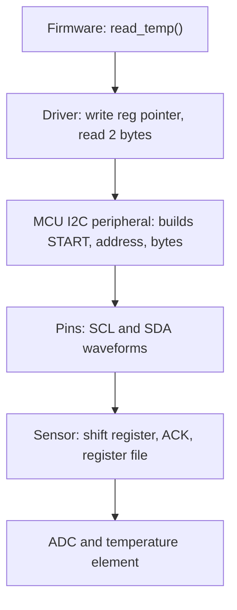
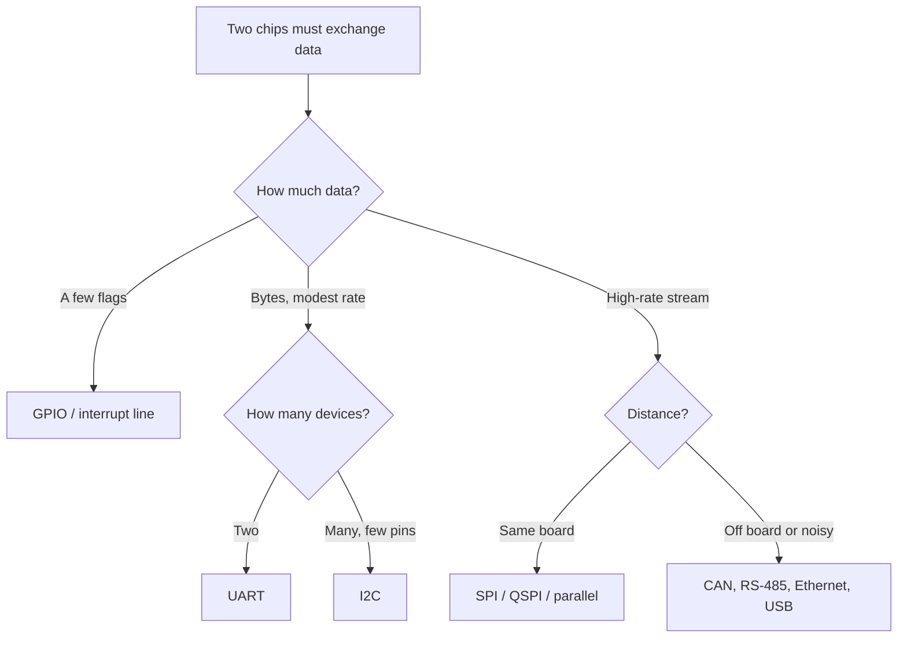
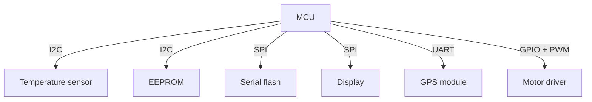

::: testing
Whether you can zoom out from "I2C vs SPI" to a **system-level mental model** of chip-to-chip communication. The interviewer wants to hear that two chips need to agree on (1) voltage levels, (2) timing/clocking, (3) framing and addressing, and (4) what the bytes mean (a register map or command set). They also want to see that you can match a link to a requirement (data rate, pin budget, distance, number of devices, noise) instead of defaulting to one bus. A strong candidate walks through a concrete transaction, such as an MCU reading a temperature sensor, from firmware call down to the voltages on the pins.
:::

::: why
Every product is a collection of chips that must cooperate: sensors, memories, radios, power management ICs, FPGAs, processors. Hardware engineers choose the links, draw the connections, make the voltage levels compatible, and debug them with scopes and logic analyzers. Interviewers ask this open-ended question because it exposes how you think about interfaces: do you jump straight to a protocol name, or do you reason about levels, clocking, bandwidth, pins and failure modes first? Being able to explain the layers also helps you debug: is the failure electrical (wrong voltage, slow edge), timing (wrong SPI mode), framing (wrong address) or semantic (wrong register)?
:::

::: concepts
- **Logic levels**: both chips must agree on what voltage is a 1 or 0 ([[q0742]], [[q0743]]).
- **Clocking**: a shared clock wire or an agreed baud rate lets the receiver know when each bit is valid ([[q0741]]).
- **Serial vs parallel**: fewer wires and less skew with serial; parallel buses still exist for memory and displays.
- **Addressing / selection**: chip-select pins or in-band addresses decide which chip responds ([[q0746]], [[q0766]]).
- **Register map**: most peripherals expose a set of numbered registers; the bus is just the way to read and write them.
- **Peripheral hardware in an MCU**: I2C/SPI/UART controllers turn register writes into pin waveforms ([[q0733]]).
- **Side-band signals**: interrupt, reset, enable and ready pins carry events that the bus alone does not ([[q0736]]).
:::

::: answer
"Chips talk by agreeing on four things: voltage, timing, framing and meaning.

First, voltage. The driving chip's output high has to be above the receiver's input-high threshold, and its low below the input-low threshold, so a 1.8 V sensor talking to a 3.3 V MCU needs checking or a level shifter. They also share a ground reference.

Second, timing. Either a clock wire is shared, like SPI's SCLK or I2C's SCL, so the receiver samples on the clock edge, or both sides agree on a baud rate and the receiver resynchronizes on each start bit, like UART.

Third, framing and selection: how does the receiver know where a message starts, and whether it's meant for it? SPI uses a chip-select line, I2C puts a 7-bit address on the wire, UART assumes there are only two of you.

Fourth, meaning. Almost every peripheral looks like a register map. To read a temperature, the MCU writes the register address, then reads back the bytes, and the datasheet says how to convert them.

Which bus I choose depends on data rate, pin count, number of devices and distance: I2C for many slow parts, SPI for fast ones, UART for point to point, and for long or noisy runs something differential like CAN or RS-485."
:::

::: technical
**Layered view of a chip-to-chip link**

| Layer | Question it answers | Examples |
|---|---|---|
| Physical / electrical | What voltages and currents represent 0/1? Push-pull or open-drain? Single-ended or differential? | LVCMOS 3.3 V, open-drain I2C, RS-485 differential |
| Timing | When is each bit valid? | Shared clock (SPI, I2C) or baud rate + start bit (UART) |
| Framing / addressing | Where does a message start and which device is it for? | CS line, 7-bit address, start/stop bits |
| Transport semantic | Read or write? Acknowledge? Error check? | R/W bit, ACK/NACK, CRC |
| Application | What do the bytes mean? | Register map, command set, packet format |

**Electrical compatibility conditions.** For a driver to reliably drive a receiver: $V_{OH,min}(\text{driver}) > V_{IH,min}(\text{receiver})$ and $V_{OL,max}(\text{driver}) < V_{IL,max}(\text{receiver})$. The margins are the noise margins $NM_H = V_{OH}-V_{IH}$ and $NM_L = V_{IL}-V_{OL}$. A 3.3 V LVTTL output ($V_{OH}\ge 2.4$ V) into a 5 V CMOS input ($V_{IH} = 0.7\times5 = 3.5$ V) fails: $2.4 < 3.5$. Into a 5 V TTL-compatible input ($V_{IH} = 2.0$ V) it passes with 0.4 V margin.

**Choosing a link** depends on:

- **Bandwidth**: bytes per second needed, including protocol overhead (see [[q0739]]).
- **Pin budget** and number of devices ([[q0738]]).
- **Distance and noise**: single-ended logic is for centimetres on a board; use RS-485, CAN or LVDS for metres.
- **Latency and determinism**: SPI and parallel are low latency; USB and Ethernet add scheduling.
- **Power**: I2C pull-ups burn current when low; UART idles high; some buses need clocks that cost power.
- **Complexity**: does the MCU have the peripheral? Is there driver software?

**Worked example.** A sensor on I2C at address 0x48. The MCU wants the temperature in a 16-bit register at pointer 0x00 with 1/128 °C per LSB. Transaction: START, 0x90 (address 0x48 + W), ACK, 0x00 (pointer), ACK, repeated START, 0x91 (address + R), ACK, high byte, ACK, low byte, NACK, STOP. If the bytes are 0x0C and 0x80, raw = 0x0C80 = 3200, so $T = 3200/128 = 25.0\ °C$.
:::

::: short
"Chips talk by agreeing on four layers. Electrical: compatible logic levels and a shared ground. Timing: either a shared clock like SPI and I2C, or an agreed baud rate with start bits like UART. Framing: a chip-select or an address to say who a message is for. And meaning: usually a register map, so reading a sensor means writing a register address then reading bytes back. I pick the bus by data rate, pin count, device count and distance."
:::

::: long
"I think about it as layers, and each layer has to match between the two chips.

The bottom layer is electrical. The driver's output levels must clear the receiver's thresholds with some margin, so I check $V_{OH}$ against $V_{IH}$ and $V_{OL}$ against $V_{IL}$. For example a 1.8 V sensor driving a 3.3 V MCU input might fall short, since 3.3 V CMOS needs about 2.3 V for a high, so I'd use a level shifter. The grounds also have to be shared, because the logic levels are voltages relative to ground.

The next layer is timing. If there's a clock wire, like SPI's SCLK or I2C's SCL, the receiver samples data on a clock edge, and the two chips just have to agree on the edge and polarity, which is SPI's mode setting. If there's no clock, like UART, both sides agree on a baud rate and the receiver re-synchronizes on every start bit.

Then framing and addressing: how does a chip know a message is for it? SPI uses a chip-select pin per device. I2C sends a seven-bit address first and only the matching device answers. UART just assumes two parties.

Finally there's meaning. Almost every peripheral exposes registers. So reading a temperature sensor on I2C means: send the device address with write, send the register pointer, repeat START with read, and clock out two bytes. Then the datasheet gives the scaling, say 1/128 °C per count, so 0x0C80 is 3200, or 25 °C.

To choose, I look at bandwidth, pins, device count and distance. Many slow parts on few pins is I2C. High-rate data like flash or displays is SPI. Two devices that already speak packets, like a GPS or a Bluetooth module, is UART. And between boards or in a noisy environment I'd go differential, such as CAN or RS-485. Plus side-band pins like interrupt and reset, because the bus alone can't wake a sleeping MCU."
:::

::: terms
- **Physical layer**: voltages, currents and driver type of the wires.
- **Logic level**: the voltage range treated as 0 or 1 ([[q0742]]).
- **Level shifter**: a circuit or IC that translates between voltage domains ([[q0743]]).
- **Synchronous / asynchronous**: with or without a shared clock wire ([[q0741]]).
- **Register map**: the table of addresses and bit fields a peripheral exposes.
- **Memory-mapped I/O**: peripheral registers placed in the CPU's address space, so a normal load/store accesses them.
- **Side-band signal**: dedicated pin like INT, RESET, ENABLE or READY outside the data bus.
- **Controller / target**: the device that initiates transfers and the device that answers.
- **Differential signaling**: sending a signal as the difference of two wires to reject noise.
:::

::: exceptional
**An average answer** names the three buses and when each is used.

**An exceptional answer**:
- Presents the **layers** (electrical, timing, framing, meaning) so the answer is structured and extensible.
- Checks **level compatibility with numbers**: $V_{OH}$ vs $V_{IH}$, noise margins, and what to do when they fail.
- Mentions **side-band signals** (INT, RESET, ENABLE) and why a bus alone isn't enough for event-driven systems.
- Walks through **one concrete transaction** with bytes and a conversion ("0x0C80 → 25 °C").
- Gives a **selection rule** that uses data rate, pin count, number of devices and distance, and names the escape hatches (RS-485, CAN, LVDS, USB, Ethernet).
:::

::: mistakes
- **Answering with a single protocol name.** The question is open-ended: show you can choose, not just list.
- **Forgetting the shared ground.** Without a common reference, logic levels are meaningless and the link will be flaky.
- **Ignoring voltage compatibility.** Connecting a 5 V output to a 3.3 V-only input can damage it, and a 1.8 V output may not register as high on a 3.3 V input.
- **Thinking the bus carries events.** A bus carries data on request. To wake an MCU when a sensor crosses a threshold you need an interrupt line ([[q0736]]).
- **Mixing up "protocol" and "peripheral".** A UART peripheral is hardware in the MCU; the protocol is the frame format on the wires; the application protocol (AT commands, NMEA) is above both.
- **Assuming parallel is always faster.** On a board, serial links at hundreds of MHz often beat parallel because skew and pin count limit the parallel bus.
:::

::: deep
## A conversation between two chips

Let's follow what actually happens when firmware reads a temperature sensor, then generalize.


Figure: Each box translates between layers. Firmware sees a function call; the peripheral sees register writes and a state machine; the wire sees voltages; the sensor sees bits that select a register. A failure in any box looks like "the sensor does not work", so debugging means checking each layer in turn.

### Layer 1: electrical compatibility

Two chips can only exchange bits if the driver's output voltage is recognised by the receiver:

$$NM_H = V_{OH,min} - V_{IH,min} > 0, \qquad NM_L = V_{IL,max} - V_{OL,max} > 0$$

Say a 1.8 V sensor drives a 3.3 V MCU. The sensor's output high is about 1.8 V (the supply, less a little drop), but a 3.3 V LVCMOS input typically wants $V_{IH} \approx 2.0$ V (LVTTL) or $0.7 \times 3.3 = 2.31$ V (CMOS-style). So $NM_H$ is negative: the MCU may read a 1 as 0. Options:

- Use an MCU pin that is **1.8 V-tolerant and level-rated** for that bank (many MCUs have per-bank I/O supplies).
- Add a **level shifter** (see [[q0743]]).
- Use a sensor with a **separate I/O supply** (VDDIO) set to 3.3 V.

The opposite direction (5 V to 3.3 V) is a damage risk, not just a signal-quality one: a 5 V output into a pin whose absolute maximum is $V_{DD}+0.3$ V = 3.6 V forces current through the input's protection diodes. Unless the pin is rated 5 V-tolerant, add a divider (slow signals only), a series resistor with limited fault current, or a translator.

```sim
{"id":"gpio-lab","view":"output"}
```
Figure: Compare push-pull and open-drain outputs. Push-pull drives its own high level (so $V_{OH}$ follows the chip's supply), while open-drain relies on the pull-up's voltage, which is why an open-drain bus like I2C can be translated just by choosing the pull-up rail.

### Layer 2: timing

Receivers need to know when to look at the wire. Three common answers:

1. **Shared clock, data stable around an edge** (SPI): the controller makes the clock, so no baud agreement is needed. The mode (CPOL/CPHA) tells which edge samples.
2. **Shared clock with start/stop and ACK** (I2C): same idea, but the clock is shared on an open-drain wire that may be stretched by the target ([[q0752]]).
3. **No clock, start-bit resynchronization** (UART): both sides run their own oscillators within a few percent ([[q0741]]).

A fourth family appears at high speed: **embedded clock** (SerDes, USB, PCIe, Ethernet) where the receiver recovers the clock from data transitions with a PLL. At board level with MCUs you will mostly meet the first three.

### Layer 3: selecting the right device

Several devices can share wires, so the protocol must pick one:

- **Dedicated select pin (SPI CS)**: simple and fast, costs pins.
- **In-band address (I2C)**: costs time (one address byte per transaction) but no pins.
- **Point to point (UART)**: no selection at all.
- **Hybrid (SPI with a daisy chain, or I2C with a mux)**: workarounds for scaling.

### Layer 4: meaning

Most peripherals are register files. A transaction is "write this value into register X" or "read register X". The bus protocol only moves the bytes; the datasheet tells you the scaling. For the worked example, the sensor's 16-bit temperature register has 1/128 °C per LSB:

$$T = \frac{\text{raw}}{128}, \qquad \text{raw} = \text{0x0C80} = 3200 \Rightarrow T = 25.0\ ^\circ\text{C}$$

and for a negative temperature the register is two's complement: raw = 0xFF00 = −256 → −2.0 °C (as an int16, $\text{0xFF00} - 65536 = -256$ and $-256/128 = -2$).

### Layer 5: side-band signals

Real chips need more than data lines:

- **INT / ALERT / DRDY**: sensor tells the MCU "data ready" or "threshold crossed", so the MCU can sleep instead of polling.
- **RESET / ENABLE**: hardware reset or power-down control.
- **CS or address-select pins**: strapped to choose the I2C address ([[q0750]]).
- **Clock output / crystal sharing**: one oscillator feeding several chips.
- **Power sequencing, power-good and reset**: ordering of rails and holding a chip in reset until it is ready ([[q0736]]).

This is why a typical sensor drawn in a schematic has 6 to 8 pins even though the bus uses only two or four of them.

### Choosing a link: a decision flow


Figure: A starting-point flowchart, not a rule. Many real choices come down to what the chip you need supports; for example a sensor that only has I2C settles the question for you.

### A small system


Figure: One MCU, three bus types, and plain GPIO/PWM. Different chips are connected with whichever bus fits each: slow shared parts on I2C, bandwidth-heavy parts on SPI, a packet-speaking module on UART.

### Why not just a parallel bus?

Parallel buses used to dominate (8-bit data, address lines, strobes). They are still used for external RAM and some displays. But serial wins at board level because: fewer pins and traces; no skew between bits; easier routing; and higher per-wire clocks. At the other extreme, very high bandwidth uses many serial lanes (PCIe); DDR memory is the main exception, staying parallel but with source-synchronous strobes and careful length matching.

### Debug checklist when two chips will not talk

1. **Power and ground**: are both chips powered, with a common ground?
2. **Levels**: scope the lines; does the high reach $V_{IH}$ of the receiver?
3. **Timing**: scope SCL/SCLK and data; is the mode/baud correct?
4. **Selection**: is CS going low? Is the I2C address right (7-bit vs 8-bit notation, [[q0749]])?
5. **Meaning**: read an ID register (WHO_AM_I) first; if that works, everything below is fine.
:::

::: applications
- **Wearable**: MCU connects to an IMU (SPI), heart-rate sensor (I2C), flash (SPI) and a BLE radio (UART or SPI).
- **Smart thermostat**: temperature/humidity sensor (I2C), display (SPI), Wi-Fi module (UART or SDIO).
- **Motor controller**: MCU to gate-driver and current sensor ADC (SPI), encoder (quadrature GPIOs), host (CAN).
- **Camera module**: image sensor to processor over MIPI CSI (differential serial), control over I2C.
- **FPGA + MCU system**: SPI or parallel memory-mapped bus between them, plus GPIO interrupt lines.
- **Industrial node**: sensors on I2C, MCU to PLC over RS-485 (UART frames on a differential physical layer).
:::

::: assumptions
- The answer is framed for **board-level embedded systems** with MCUs. On processors and SoCs the same layering applies but with PCIe, DDR, MIPI, USB, Ethernet and so on.
- Voltage numbers use **common LVCMOS/LVTTL thresholds**; actual $V_{IH}$/$V_{IL}$ are in each datasheet and vary by part and supply ([[q0743]]).
- The register-read example assumes a **pointer-register device** (write pointer, repeated START, read). Some sensors use auto-increment, a command byte or a different order.
- "Different chips" includes ICs of different vendors, so the **standardised parts** (the I2C spec, UART framing) matter more than any vendor feature.
- Data rate budgets include **protocol overhead**; the headline clock overstates throughput.
:::

::: followups
### Your 1.8 V sensor's output only reaches 1.7 V when high, but the 3.3 V MCU needs 2.3 V for a high. What do you do?
Don't rely on it; the margin is negative. Options: put the sensor's VDDIO at 3.3 V if it allows, use an MCU pin bank that supports 1.8 V I/O, or add a level shifter. For I2C the usual solution is a bidirectional shifter (a MOSFET-based one or an IC). For SPI/UART use a unidirectional buffer/translator. See [[q0743]].

### How would you make an MCU wake from sleep when a sensor sees motion?
Connect the sensor's INT output to an MCU GPIO that can wake from sleep (EXTI or wake-up pin), configure the sensor's threshold and interrupt-enable registers over I2C/SPI, and put the MCU to sleep. The bus is only used to configure and read; the interrupt line carries the event.

### Why does I2C use addresses but SPI use chip-selects?
It's a pin-versus-time trade. I2C was designed (by Philips) to minimise pins on a board, so it moves selection onto the data wires, paying one address byte per transaction. SPI dedicates a wire to each device, so selection is instant and there is no address overhead, but each new device costs a pin.

### Two chips on a board communicate fine at room temperature but fail when hot. What might be happening?
Margins shrinking: $V_{OH}$ drops and $V_{IH}$ shifts with temperature; SPI setup time may fail as $t_{co}$ grows; I2C rise times increase as $C_b$ and pull-up change; UART baud error may drift if the clock is an RC oscillator. I'd check each at temperature with a scope: levels, edge timing and sampling windows.

### What if the two chips share no common clock and the link must be long, say 3 m in a noisy environment?
Use a differential physical layer: RS-485 for UART-like frames (half duplex, multi-drop), CAN for a robust multi-node bus with arbitration and CRC, or Ethernet/USB if bandwidth and software stacks allow. Keep it away from single-ended logic over 3 m, which has poor noise immunity and ground-shift problems.
:::

::: interpretations
"How do different chips talk to each other?" is deliberately broad. It sits under *Communication Buses* in the question list, after the I2C/SPI/UART overview ([[q0737]]), so the expected answer is the **system-level picture**: physical levels, clocking, addressing, and the register-level conversation, with I2C/SPI/UART as the concrete mechanisms. An alternative reading is "how does an MCU interact with peripherals", which is covered at the architecture level in [[q0733]]. A good answer mentions both.
:::

::: references
- Horowitz & Hill, *The Art of Electronics*, 3rd ed.: chapters on digital logic interfacing and serial communication (logic levels, level translation, serial buses).
- NXP, *UM10204: I2C-bus specification and user manual*: addressing, transaction structure and electrical levels.
- JEDEC JESD8 family (for example JESD8-C.01 for LVTTL 3.3 V and JESD8-7 for 1.8 V): the logic-level definitions used by most digital interfaces.
- MCU reference manuals (SPI, I2C, USART, GPIO chapters) for how the peripherals map to pins and registers.
:::

::: rubric
- Describes the layers: electrical levels, timing/clocking, addressing, register-level meaning :: A structured model works for any bus, not just the three named ones.
- Checks voltage compatibility with $V_{OH}$/$V_{IH}$ and $V_{OL}$/$V_{IL}$ and mentions level shifting :: A very common real-world integration failure.
- Explains timing: shared clock vs baud agreement with start-bit resync :: Core difference between buses.
- Explains selection: chip-select vs address vs point-to-point :: Shows scaling trade-off.
- Gives the register-map picture with a concrete read example :: Connects bits on wires to software.
- Mentions side-band signals (INT, RESET, ENABLE) :: Real chips need more than data lines.
- Gives a selection rule using bandwidth, pins, devices and distance :: Converts knowledge into decisions.
:::

::: quiz
```json
[
 {"type":"mcq","level":"fundamental","q":"Which of the following must two chips share for logic levels to be meaningful?","options":["A common supply voltage","A common ground reference","A common crystal","A common part number"],"answer":1,"explain":"Logic levels are voltages measured relative to ground. Without a common ground reference, the receiver cannot interpret the driver's voltages. Supply voltages can differ if levels are compatible."},
 {"type":"numeric","level":"fundamental","q":"A sensor register holds the raw value 0x0C80 at 1/128 °C per LSB. What temperature does it represent? Answer in °C.","answer":25,"tolerance":0.01,"unit":"°C","explain":"0x0C80 = 12×256 + 128 = 3200. $3200/128 = 25.0$ °C."},
 {"type":"mcq","level":"intermediate","q":"A 3.3 V LVTTL output guarantees $V_{OH} \\ge 2.4$ V. Which receiver input is guaranteed to read it as a logic 1?","options":["A 5 V CMOS input with $V_{IH}=0.7V_{DD}$ (3.5 V)","A 5 V TTL-compatible input with $V_{IH}=2.0$ V","A 3.3 V CMOS input with $V_{IH}=0.8V_{DD}$ (2.64 V)","Any 5 V input"],"answer":1,"explain":"The guaranteed 2.4 V is above 2.0 V (0.4 V of margin) but below 3.5 V and below 2.64 V, so only the TTL-compatible threshold is safe. A 5 V CMOS input is the classic failure: a 3.3 V output cannot reach 0.7 × 5 V."},
 {"type":"truefalse","level":"intermediate","q":"If a sensor needs to wake a sleeping MCU when it detects motion, the I2C bus alone is sufficient, because the sensor can start a transaction.","answer":false,"explain":"Only a controller can initiate an I2C transaction (unless the system is multi-master and the sensor is a controller, which is unusual). A sleeping MCU needs an interrupt line (INT pin) connected to a wake-capable GPIO."},
 {"type":"numeric","level":"intermediate","q":"A signed 16-bit temperature register reads 0xFF00 at 1/128 °C per LSB. What is the temperature? Answer in °C.","answer":-2,"tolerance":0.01,"unit":"°C","explain":"0xFF00 as int16 is 65280 − 65536 = −256. $-256/128 = -2.0$ °C."},
 {"type":"multi","level":"advanced","q":"Which are valid reasons to prefer a serial bus over a wide parallel bus between two chips on a board?","options":["Fewer pins and traces","No skew between data bits","Always higher throughput at the same clock","Easier routing and fewer signal-integrity constraints on length matching"],"answer":[0,1,3],"explain":"Serial buses use fewer wires, avoid inter-bit skew, and are simpler to route. At the same clock a parallel bus carries more bits per cycle, so statement 3 is false; serial wins because it can run at much higher clock rates."}
]
```
:::
