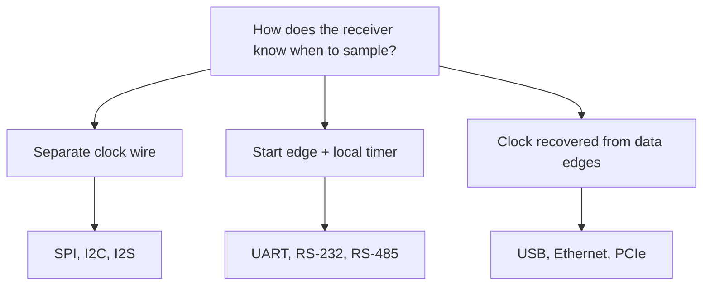

::: basics
### In plain words
Every receiver must decide when to read each bit. Synchronous links, like SPI and I2C, send a clock along with the data, and the receiver reads on the clock's tick. Asynchronous links, like UART, have no clock wire. Both sides agree on a speed beforehand, a start bit marks the beginning of each byte, and the receiver counts time with its own clock.

### Picture it
Picture two rowers. In the synchronous case, a coach beats a drum and both follow it, so they stay together at any speed. In the asynchronous case, there is no drum. Each wears a watch, they start on the same signal, and each counts strokes by their own watch. If the watches differ a little, they stay together briefly and drift apart over a long stretch. That is why asynchronous bytes are short, and each starts with a fresh signal.

### Words you need
- **Synchronous**: sender and receiver share a clock, and bits are read on its edges ([[q0737]]).
- **Asynchronous**: no shared clock. The receiver times each bit with its own oscillator.
- **Baud rate**: the agreed number of bits per second on an asynchronous line.
- **Start and stop bit**: extra bits framing each asynchronous byte, a 0 at the start and a 1 at the end.
- **Oscillator**: the circuit that makes a chip's clock tick. Crystals are accurate, and cheap built-in ones are not.

### The simplest example
A common UART byte (8N1) is 1 start bit, 8 data bits and 1 stop bit, 10 bits in all, so only 80% are data. The receiver reads the last bit 9.5 bit-times after the start edge. If its clock runs 5% fast, it reads 9.5 × 0.05 = 0.475 of a bit early, almost half a bit, so it is near failing. The limit is $0.5/9.5 \approx 5.3\%$. That is the whole idea. The rest of this page covers the tolerance budget and the setup and hold limits that bind synchronous links.
:::

::: testing
Whether you understand the one idea that separates the two: **how the receiver knows when to sample each bit**. Synchronous links share a clock (or recover one from the data); asynchronous links give the receiver only a start edge and trust its own oscillator. From that single difference follow the trade-offs: extra wire vs tolerance to clock error, overhead of start/stop bits, speed ceilings, skew and setup/hold timing, cable length and EMI. The interviewer is also listening for numbers: the baud-error budget of a UART frame, the 20% framing overhead of 8N1, and the setup/hold constraints that appear once you add a clock.
:::

::: why
"Why won't my UART talk?" and "why does my SPI work at 1 MHz but not 20 MHz?" are the two classic bring-up problems, and they are the two sides of this question. The first is a clock-agreement problem (baud error, oscillator accuracy). The second is a clock-versus-data timing problem (setup, hold, skew). Knowing which regime you are in tells you what to measure on the scope. It also drives design choices: a cheap RC-oscillator MCU is fine for SPI but may not hold a 115200 baud UART, and long cables favour asynchronous links with differential drivers because no clock must stay aligned with data.
:::

::: concepts
- **Sampling instant**: a receiver must read each bit when the line is stable, away from transitions ([[q0737]]).
- **Clock tolerance**: crystals are about ±20 to 50 ppm, RC oscillators ±1% to ±5% or worse, which matters when each side has its own clock ([[q0778]]).
- **Framing**: start and stop bits mark byte boundaries on an async line ([[q0771]], [[q0772]]).
- **Setup and hold time**: data must be stable before and after the sampling clock edge in a synchronous link ([[q0770]]).
- **Oversampling**: sampling the line several times per bit to find edges and the bit centre ([[q0779]]).
- **Clock recovery**: some "asynchronous-looking" links embed the clock in the data stream and recover it with a PLL.
:::

::: answer
"The difference is how the receiver knows when to sample.

In a synchronous link like SPI or I2C there's a clock signal shared between the two sides. The transmitter changes data on one edge and the receiver samples on the other, so the sampling instant is directly tied to the data. It doesn't matter exactly how fast the clock runs; it can even stop and start. The costs are an extra wire, and timing constraints like setup and hold, because the clock and data travel on different traces and can skew against each other.

In an asynchronous link like UART there's no clock wire. Both sides agree on a bit rate in advance and each uses its own oscillator. The line idles high, a start bit marks the beginning of a byte, and the receiver then samples each bit at the centre of its time slot using its own clock, and a stop bit finishes the frame. The trade-off: you save a wire and it tolerates long cables, but you pay about 20% overhead for the start and stop bits, and the two clocks must agree within a few percent or the sample point walks out of the bit by the end of the byte.

So sync gives you speed and low overhead; async gives you simplicity and fewer wires."
:::

::: technical
**Synchronous.** A clock is transmitted with (or embedded in) the data. The receiver samples on a defined clock edge; phase is fixed by the clock, so there is **no cumulative drift** between data and sampling point. Constraints are timing relationships between clock and data:
$$t_{su} \le t_{data\ valid\ before\ edge}, \qquad t_{hold} \le t_{data\ valid\ after\ edge}$$
and clock-to-data skew from unequal trace lengths. Frequency is set by the controller, can vary, and can pause. Overhead is low: SPI is 8 clocks per byte (100% payload), I2C 9 per byte (89%).

**Asynchronous.** No clock wire. For UART the receiver detects the start-bit falling edge and then samples each bit at $\left(k + \tfrac12\right)T_{bit}$ after that edge. If the receiver's bit time differs from the transmitter's by a fractional error $\varepsilon$, the sample point after $n$ bit times is displaced by $n\,\varepsilon$ bit times. For a frame of $N$ bits (start + data + parity + stop) the last sample is at $N-\tfrac12$ bit times, and it must stay within $\pm\tfrac12$ bit:
$$\varepsilon_{max} = \frac{0.5}{N - 0.5}$$
For 8N1 ($N=10$): $\varepsilon_{max} = 0.5/9.5 = 5.26\%$ in the ideal case. With 16× oversampling, the start-edge detection is uncertain by up to 1/16 bit, so the budget is $(0.5-0.0625)/9.5 = 4.6\%$ total (transmitter error plus receiver error). Real designs target about ±2% to ±3% total to leave room for edge distortion and jitter.

**Overhead.** 8N1 uses 10 bit times per byte, 80% efficiency, so 115200 baud gives 11,520 B/s.

**Example of baud error.** An AVR-style UART at 16 MHz with a 16× divider: $16\text{ MHz}/(16\times 9) = 111{,}111$ baud for the divisor needed for 115200, an error of −3.55%. Against an exact 115200 transmitter this is within the 4.6% limit but uses most of the margin. With the double-speed (8×) divider the actual rate is $16\text{ MHz}/(8\times17) = 117{,}647$ baud, +2.1%.

| | Synchronous | Asynchronous |
|---|---|---|
| Wires | Data + clock | Data only (per direction) |
| Sampling reference | Clock edge | Start edge + local oscillator |
| Clock accuracy needed | Not critical (shared) | Within a few % between sides |
| Limiting factor | Setup/hold, skew, trace length | Baud error, jitter |
| Overhead | Low | ~20% (8N1) |
| Max speed | Tens of MHz+ | Up to a few Mbaud (UART) |
| Typical | SPI, I2C, I2S, JTAG | UART, RS-232, RS-485 frames |
:::

::: short
"Synchronous means the sender and receiver share a clock, so the receiver samples on that clock's edge. SPI and I2C work this way. It's fast and low overhead but costs a clock wire and has setup and hold timing to meet. Asynchronous, like UART, has no clock wire: both sides agree on a baud rate, a start bit resynchronizes the receiver, and it samples each bit with its own clock. That saves a wire but adds about 20% overhead and needs both clocks within a few percent."
:::

::: long
"The question comes down to how the receiver decides when to sample each bit.

In a synchronous link the clock travels with the data. In SPI, the controller generates SCLK, puts data out on one edge, and the receiver samples on the other edge. Because the sampling instant is derived from the same clock that launched the data, frequency errors don't matter: the clock could be 9.7 MHz or 10.3 MHz and everything still works, and it can even pause between bytes. The costs are the extra clock wire and a set of timing constraints, setup and hold times, and skew between the clock and data traces, which is what limits the maximum frequency.

In an asynchronous link, like UART, there's no clock wire. The two sides agree on a baud rate beforehand and each runs from its own oscillator. The line sits high; a start bit pulling it low tells the receiver a byte is coming. The receiver then counts out its own bit times and samples each bit in the middle. At the end, a stop bit puts the line high again. The cost is overhead: for 8N1 you send 10 bits for 8 bits of data, so 80% efficiency. And the clocks need to match. The last bit is sampled 9.5 bit times after the start edge, and it has to stay within half a bit of the true centre, so the total mismatch is limited to about 5% in theory and 2 to 3% in practice. A cheap RC oscillator that is 4% off can break a UART link that an SPI link would shrug off.

So I'd say synchronous when speed and efficiency matter and the chips are close, asynchronous when wire count or distance matters, like a console or RS-485 across a plant."
:::

::: terms
- **Synchronous**: transmitter and receiver share a clock reference; sampling is tied to clock edges.
- **Asynchronous**: no shared clock; the receiver derives timing from a start edge and its own oscillator.
- **Baud rate**: symbol rate; for binary signaling equals bits per second.
- **Start / stop bit**: framing bits that delimit an async byte.
- **Baud error**: relative difference between actual and nominal bit rate ($\varepsilon$).
- **Setup / hold time**: how long data must be stable before / after the sampling edge.
- **Skew**: difference in arrival time between clock and data (or between data lines).
- **Clock recovery**: extracting timing from data transitions, as in USB, Ethernet and SerDes links.
- **ppm**: parts per million, the unit of oscillator accuracy (10,000 ppm = 1%).
:::

::: exceptional
**An average answer** says "synchronous uses a clock wire, asynchronous doesn't."

**An exceptional answer**:
- Frames the difference as **how the sampling instant is defined**: a clock edge vs a start edge plus a local timer.
- Quantifies the **async tolerance**: $\varepsilon_{max} = 0.5/(N-0.5)$, 5.26% for 8N1, and says why real budgets are 2 to 3%.
- Quantifies the **overhead** (80% efficiency for 8N1) and contrasts it with SPI's 100% and I2C's 89%.
- Lists the **sync-side constraints** (setup, hold, skew, trace length) and the **async-side constraints** (oscillator accuracy, edge distortion).
- Mentions the **hybrid**: high-speed serial links embed the clock in the data and recover it with a PLL.
:::

::: mistakes
- **"Asynchronous means no timing."** There is very tight timing: both sides must agree on the bit rate within a few percent; it just isn't distributed on a wire.
- **"Synchronous is always better."** It costs a pin and a timing budget; a console UART with two wires is a better fit for many jobs.
- **"I2C is asynchronous because it has no baud rate."** I2C has a shared clock (SCL), so it is synchronous, even though its speed can vary and pause.
- **Using an uncalibrated RC oscillator for a UART at high baud.** Drift of a few percent with temperature is enough to corrupt frames.
- **Forgetting that error from both ends adds.** A transmitter at +2% and a receiver at −2% give 4% total, not 2%.
- **Saying a UART has no clock at all.** The receiver has its own oversampling clock, just not one shared with the sender ([[q0779]]).
:::

::: deep
## One question: when do I look at the wire?

Every digital receiver turns a continuous voltage into discrete bits by sampling at the right moment. The interesting part is *who tells it when*.

```timing
{"signals":[{"name":"CLK","wave":"01010101010101010"},{"name":"DATA","wave":"=.=.=.=.=.=.=.=.","data":["1","0","1","1","0","0","1","0"]}],"marks":[{"t":1},{"t":3},{"t":5},{"t":7},{"t":9},{"t":11},{"t":13},{"t":15}],"hscale":0.9}
```
Figure: Synchronous. Data changes at falling clock edges and is sampled at the rising edges (vertical lines). Setup and hold are naturally half a clock period each, and if the clock slows down the data slows down with it. The sampling point is tied to the data by construction.

```timing
{"signals":[{"name":"TX","wave":"101000001011"},{"name":"field","wave":"=3========4=","data":["idle","start","D0","D1","D2","D3","D4","D5","D6","D7","stop","idle"]}],"marks":[{"t":1.5},{"t":2.5},{"t":3.5},{"t":4.5},{"t":5.5},{"t":6.5},{"t":7.5},{"t":8.5},{"t":9.5},{"t":10.5}],"hscale":1.4}
```
Figure: Asynchronous. The vertical lines are where the receiver samples: half a bit after the start edge, then once per bit time. The only reference is the falling start edge. If the receiver's bit time is a few percent off, these lines slide gradually left or right relative to the data.

### Asynchronous: a worked tolerance budget

Let the transmitter's bit time be $T$ and the receiver's be $T(1+\varepsilon)$. The receiver synchronises on the falling edge of the start bit, so at time zero its sample grid and the data grid are aligned (apart from edge-detection uncertainty). The $k$-th sample is nominally at $(k+\tfrac12)T(1+\varepsilon)$ after the start edge, but the centre of bit $k$ is at $(k+\tfrac12)T$. The error after $k$ bits is $(k+\tfrac12)\,\varepsilon T$. For an 8N1 frame the last sample is the stop bit, $k = 9$, giving an error of $9.5\,\varepsilon$ bit times. It must stay within $\pm0.5$ bit (the next transition), so

$$\varepsilon_{max} = \frac{0.5}{9.5} = 5.26\%$$

```plot
{"title":"Maximum total baud-rate mismatch vs number of data bits (1 start, 1 stop)","x":{"label":"Data bits","min":5,"max":9},"y":{"label":"Max total mismatch","unit":"%","min":0,"max":9},
 "series":[{"label":"Ideal: 0.5/(N−0.5)","fn":"50/(x+1.5)"},{"label":"With 16× oversampling uncertainty","fn":"(0.5-1/16)*100/(x+1.5)","color":"orange"}],
 "points":[{"x":8,"y":"50/9.5","label":"8N1: 5.26%"},{"x":8,"y":"(0.5-1/16)*100/9.5","label":"4.6%"}],
 "hlines":[{"at":3,"label":"practical target ±3%","color":"muted","dashed":true}]}
```
Figure: Longer frames tolerate less mismatch because error accumulates over more bits. Even the optimistic curve for 8N1 is about 5%, and quantisation of the start edge pulls it down to about 4.6%. Real budgets are lower still, since the edges are not perfectly sharp.

That is the *total* between the two sides. If each side's oscillator is within $\pm\varepsilon_x$, worst case mismatch is $2\varepsilon_x$. A crystal at ±50 ppm is 0.005%, utterly negligible; an on-chip RC oscillator at ±2% already uses up most of a ±4.6% budget.

#### The divider rounding problem

The actual baud rate is the clock divided by an integer (or a fixed-point number). Say a 16 MHz MCU with a 16× oversampling UART wants 115200:

$$\text{divisor} = \frac{16\text{ MHz}}{16\times115200} = 8.68 \to 9, \qquad \text{actual} = \frac{16\text{ MHz}}{16\times9} = 111{,}111\text{ baud}$$

$$\varepsilon = \frac{111{,}111}{115{,}200} - 1 = -3.55\%$$

That already burns most of the budget before the other chip's error is considered. Using an 8× oversampling mode gives $\text{divisor} = 17$ and 117,647 baud (+2.1%), or choosing a crystal like 18.432 MHz (an exact multiple of 115200) gives 0%. This is why UART-friendly crystals (1.8432, 3.6864, 7.3728, 11.0592, 14.7456, 18.432 MHz) exist. They're 16 × 115200 × integer.

```sim
{"id":"uart-frame","char":"U","baud":115200,"parity":"none","stop":1,"mismatch":4}
```
Figure: Character 'U' is 0x55 so its bits alternate and every edge is visible. At 4% mismatch the last sample is already close to an edge; push the slider above ~5% and the stop bit is sampled in the wrong bit.

### Synchronous: where the timing constraints live

With a shared clock, frequency error vanishes, but a new problem appears: the clock and data must meet each other at the receiver.

$$T_{clk}/2 \ge t_{co} + t_{prop} + t_{su} + t_{skew}$$

(for a half-cycle path as in SPI mode 0; some systems use full-cycle paths). Increase the clock until that inequality fails and bits start to be misread, at tens of MHz on a board, or tens of kHz over a long, capacitive wire. Skew arises from unequal trace lengths or different loads on clock and data. On a PCB, roughly 6 ns per metre of propagation (about 6 to 7 ps/mm for FR-4 surface traces; vendor and stackup dependent), so a 5 cm skew is about 0.3 ns. That is negligible at 10 MHz but serious at hundreds of MHz.

> [!UNCERTAIN]
> Propagation delay depends on dielectric constant and stackup (microstrip vs stripline). Use 5.5 to 7 ps/mm as a rough range and check your stackup if precision matters.

### Trade-off summary

**Synchronous wins when:**

- Speed and efficiency matter (SPI 100% payload, I2C 89%).
- Chips share a board or a short connection.
- One side has a sloppy oscillator (a sensor with an RC clock can still talk SPI to an MCU).
- You need to pause or vary the rate (clock stretching, bursts).

**Asynchronous wins when:**

- Pin or wire count matters: two wires between devices, no clock to route.
- Distance is long or the environment is noisy (RS-232/RS-485 transceivers are UART-compatible).
- Devices are loosely coupled (a GPS module and a host with unrelated clocks).
- You want to avoid a high-frequency clock wire that radiates EMI.

### The third family: embedded clock

High-speed links (USB, Ethernet, PCIe, SATA, HDMI) are technically asynchronous (no clock wire), but they do not rely on a local timer's absolute accuracy: they encode the data so that there are guaranteed transitions (8b/10b, NRZI with bit stuffing, Manchester), and a **clock-and-data recovery (CDR)** PLL locks to those edges. This gives the wire savings of async with the tolerance of sync. UART is the simplest case of the same idea with only one resync edge per byte.


Figure: Three ways to answer the same question. The first two are what the interview question contrasts; the third is how very fast serial links manage to have no clock wire and still be sample-accurate.
:::

::: applications
- **Debug console and modems (async)**: UART at 115200 with a crystal-based clock for an easy 0% baud error.
- **Flash, displays, ADCs (sync)**: SPI so that fast bulk data has low overhead and no baud-rate mismatch.
- **RS-485 industrial networks (async)**: UART frames over differential pairs for hundreds of metres.
- **Audio codecs (sync)**: I2S with bit clock and word clock so that the sample rate is defined exactly.
- **Debug ports**: JTAG/SWD are synchronous so a debugger can slow the clock to match a sleeping target.
- **USB, Ethernet (embedded clock)**: no clock wire, but edges in the data allow the receiver to lock on.
:::

::: assumptions
- Async analysis assumes **8N1 UART with a start-edge resync** and a 16× oversampling receiver, which is typical. Other formats (9 data bits, 2 stop bits, parity) change $N$ and the budget.
- Tolerance figures are **ideal-edge** values; measured margins depend on edge slew, noise and the receiver's actual sampling scheme.
- "Synchronous" here includes I2C and SPI, whose clocks are shared on a wire. Some textbooks reserve "synchronous" for fixed-rate always-running clocks; I2C and SPI clocks can stop, and the answer still holds.
- Skew and propagation numbers assume **FR-4 PCB traces**; cables, flex and different dielectrics change them.
- If the interviewer is thinking of **digital design** (clock domains, asynchronous vs synchronous resets), the idea is related but distinct: see [[q0736]] for reset behaviour.
:::

::: followups
### Your UART works at 9600 baud but fails at 115200 on an MCU running from its internal RC oscillator. Why?
At 115200 the budget is only about 4 to 5% total, and an internal RC oscillator can be 1 to 3% off at room temperature, more across temperature or supply. Add the divider rounding error (e.g. −3.5% at 16 MHz) and the mismatch exceeds the budget. At 9600, divider granularity is much finer, so errors are small. Fixes: external crystal, a better divider, calibrate the oscillator, or lower the baud.

### Why does a UART need a start bit at all?
The start bit provides the one falling edge the receiver can use to align its sampling grid with the transmitter's bit boundaries. Without it, a line sitting idle at 1 and transmitting 1s carries no edge at all, and the receiver would have no phase reference. The stop bit guarantees the line returns to idle (high), so the next start bit is a guaranteed falling edge.

### An SPI link works at room temperature but fails at 85 °C at 20 MHz. What changed?
In a synchronous link the frequency isn't the issue, but the timing margin is: target $t_{co}$ grows with temperature, edge rates slow, and supply droop shifts thresholds, so $t_{co}+t_{prop}+t_{su}$ approaches half a clock period. Reduce the clock, use late sampling, or shorten and terminate traces.

### Can I2C be considered asynchronous because the clock speed can vary?
No. It has a shared clock line (SCL), so the receiver samples on SCL edges. Variable or paused clocks (clock stretching) are possible precisely *because* the data is tied to that clock. An asynchronous link, by definition, has no shared timing wire.

### How do USB or Ethernet get away without a clock wire at 480 Mbit/s or more?
The data is encoded so there are frequent transitions (NRZI with bit stuffing in USB, 4b/5b or 8b/10b-style codes in others), and the receiver uses a clock-and-data-recovery PLL to lock onto those edges and re-time the data. The transmit and receive oscillators only need to be within a defined ppm tolerance, which the PLL tracks continuously.
:::

::: interpretations
In the question list, this sits right after I2C vs SPI vs UART, so the expected reading is "shared clock (SPI, I2C) vs no shared clock (UART)". A second valid reading comes from digital design: **asynchronous vs synchronous logic or resets**. This page answers the **communication** reading. If an interviewer pursues the other one, the core idea is the same: synchronous elements change on a common clock edge; asynchronous ones react to their own events, at the cost of hazards and metastability.
:::

::: references
- NXP, *UM10204: I2C-bus specification and user manual*: the I2C clock and data timing requirements.
- Any MCU reference manual's USART chapter (for example STM32 or AVR families): baud-rate generation, oversampling modes and "baud rate error" tables. The AVR datasheet's table of UBRR values and error percentages is a classic.
- Horowitz & Hill, *The Art of Electronics*, 3rd ed.: serial communication and asynchronous (RS-232) vs synchronous interfaces.
- Dally & Poulton, *Digital Systems Engineering*: timing and synchronization chapters for the clock-versus-data viewpoint.
:::

::: rubric
- Defines the difference as how the receiver gets its sampling instant (shared clock vs start edge + local timer) :: This is the core idea that everything else follows from.
- Names examples of each (SPI/I2C sync; UART async) :: Connects theory to the buses in this section.
- States the async cost: ~20% overhead for 8N1 and a baud-mismatch limit of a few percent :: Shows quantitative understanding.
- Derives or quotes the tolerance, e.g. $0.5/9.5 = 5.26\%$ for 8N1 :: Demonstrates first-principles reasoning.
- States the sync cost: extra wire, setup/hold, skew, and trace-length limits :: Balanced trade-off, not only advantages.
- Gives a practical consequence (RC oscillator problems, crystals chosen as multiples of 115200) :: Evidence of real hardware experience.
- Mentions embedded-clock links as a third family :: Shows breadth beyond the three buses.
:::

::: quiz
```json
[
 {"type":"mcq","level":"fundamental","q":"What is the defining difference between synchronous and asynchronous serial communication?","options":["Synchronous is always faster","Synchronous links share a clock signal; asynchronous links rely on each side's local timing plus start/stop framing","Asynchronous links use more wires","Synchronous links cannot be used for long distances"],"answer":1,"explain":"The difference is how the receiver finds the sampling instant: a shared clock edge (sync) vs a start edge and the receiver's own oscillator (async). Speed and wire count follow, but they are consequences."},
 {"type":"numeric","level":"fundamental","q":"What percentage of the bits on the wire are payload for 8N1 UART framing?","answer":80,"tolerance":0.01,"unit":"%","explain":"Each byte uses 1 start + 8 data + 1 stop = 10 bits, of which 8 are payload: 8/10 = 80%."},
 {"type":"numeric","level":"intermediate","q":"In an ideal 8N1 receiver (sample at bit centres, resync on the start edge), what is the maximum total baud-rate mismatch before the stop bit is sampled in the wrong bit? Answer in %.","answer":5.26,"tolerance":0.02,"unit":"%","explain":"The stop bit is sampled 9.5 bit times after the start edge, and the sample point may move at most 0.5 bit, so $\\varepsilon_{max} = 0.5/9.5 = 5.26\\%$."},
 {"type":"numeric","level":"intermediate","q":"A 16 MHz MCU uses a 16× oversampling UART with an integer divisor to approximate 115200 baud (divisor 9). What is the baud-rate error? Answer in %, with sign.","answer":-3.55,"tolerance":0.02,"unit":"%","explain":"Actual baud = 16 MHz / (16 × 9) = 111,111. Error = 111,111/115,200 − 1 = −3.55%."},
 {"type":"truefalse","level":"intermediate","q":"I2C is an asynchronous protocol because the clock rate can vary and even pause.","answer":false,"explain":"I2C has a shared clock wire, SCL, and all bits are sampled relative to its edges. A variable or stretched clock is allowed *because* the data is tied to that clock; it is therefore synchronous."},
 {"type":"multi","level":"advanced","q":"Which of the following constrain the maximum speed of a synchronous link like SPI but are not the dominant limit for a UART?","options":["Setup time at the receiver","Clock-to-data skew","Baud-rate mismatch between two oscillators","Target clock-to-output delay"],"answer":[0,1,3],"explain":"Setup time, skew and clock-to-output delay are timing relationships between a shared clock and data; they limit sync links. Baud-rate mismatch is the async constraint, since there are two independent oscillators."}
]
```
:::
