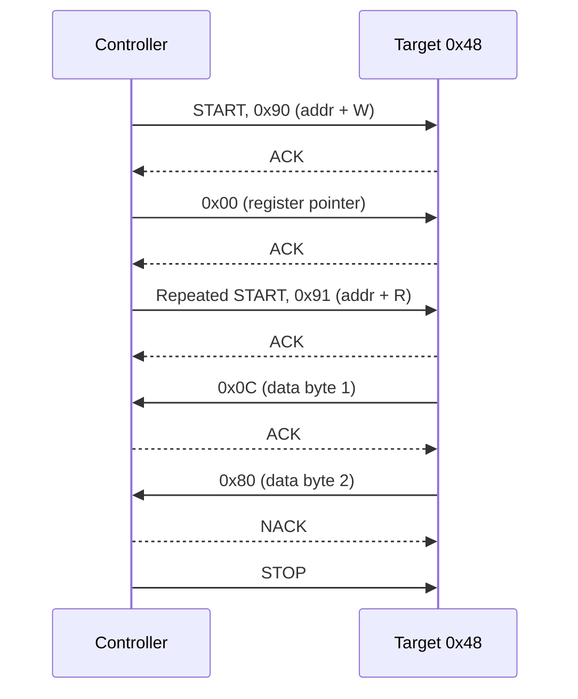

::: basics
### In plain words
An I2C transaction is a fixed script on the two wires. The controller signals START, sends the address of the chip it wants plus a read-or-write bit, and waits for an acknowledge. Then bytes flow, each followed by an acknowledge bit, and the controller signals STOP. Both wires sit high when idle. Data may change only while the clock is low. START and STOP are the only exceptions.

### Picture it
Picture a drive-through window. You pull up, which is START. You say which window you want, the address, and hear "OK", the acknowledge. You say your order, one item at a time, and each gets an "OK". On your last item you say "that's all", which is a NACK. Then you drive off, which is STOP. On a real bus, "OK" is the receiver pulling the data wire low for one clock tick.

### Words you need
- **START and STOP**: special moves of the data wire while the clock is high. START begins a transaction and STOP ends it.
- **Address byte**: the 7-bit address of the chip, plus one bit saying read or write ([[q0749]]).
- **Read/write bit**: 0 means the controller will write, and 1 means it will read.
- **ACK and NACK**: the receiver's reply on the ninth clock. ACK is the data wire pulled low, and NACK is left high ([[q0751]]).
- **Repeated START**: a new START without a STOP before it, which keeps the bus claimed.

### The simplest example
To read two bytes from register 0 of the chip at address 0x48, the controller sends START, 0x90 (the address with the write bit), register number 0x00, a repeated START, and 0x91 (the address with the read bit). Then it clocks in two bytes. That is 5 bytes at 9 clock ticks each, 45 ticks, about 112 µs at 400 kHz. The controller ACKs the first byte, NACKs the last, then sends STOP. That is the whole idea. The rest of this page explains why the rules are what they are.
:::

::: testing
Whether you can narrate an I2C transaction as a **sequence of wire-level events**, in the right order, with the right driver at each step, and explain the two rules that make it all work: SDA may change only while SCL is low (except START/STOP), and every device only pulls lines low. Interviewers want to hear START, 7-bit address, R/W bit, ACK, data bytes with ACKs, STOP, and ideally a repeated START for a register read. Bonus: who drives SDA during each bit, how START and STOP differ from ordinary data edges, and what the wired-AND behaviour buys you (arbitration, clock stretching).
:::

::: why
Debugging I2C means reading waveforms, and you cannot do that without a clear picture of what a correct transaction looks like. A missing ACK, a stuck-low SDA, a START that never occurs or a repeated START the target does not understand are all visible on a scope or logic analyzer if you know the pattern. Interviewers also use this question to test whether you know *why* things are done the way they are (for example, why data may only change when SCL is low), because that is what separates someone who has memorised a diagram from someone who can reason about an unfamiliar waveform.
:::

::: concepts
- **Open-drain wired-AND lines**: any device can pull a line low; a pull-up makes it high ([[q0761]], [[q0755]]).
- **START and STOP**: SDA edges while SCL is high; all other SDA edges happen while SCL is low ([[q0744]]).
- **Address byte**: 7 address bits + R/W bit, sent MSB first ([[q0749]]).
- **ACK/NACK**: 9th clock, receiver pulls SDA low to acknowledge ([[q0751]]).
- **Register pointer and repeated START**: how reads from register-based devices work ([[q0746]]).
- **Clock stretching and arbitration**: consequences of the wired-AND clock and data ([[q0752]], [[q0748]]).
:::

::: answer
"An I2C transaction is a fixed sequence of events on SDA and SCL, and both lines idle high because of the pull-ups.

The controller starts with a START condition: it pulls SDA low while SCL is still high. That tells every device on the bus 'pay attention'. Then it clocks out eight bits, MSB first: the 7-bit address of the device it wants, and a read-write bit. SDA only changes while SCL is low and is sampled while SCL is high.

After the eighth bit, the controller releases SDA for the ninth clock. The device whose address matched pulls SDA low during that clock, which is the ACK. If no one pulls it low, the line stays high, which is a NACK, meaning nobody was there, or it didn't accept the transfer.

Then data bytes follow. For a write, the controller drives each byte and the target ACKs. For a read, the target drives the byte and the controller ACKs, except that it NACKs the last byte to say 'that's enough'. Finally the controller sends a STOP: SDA rises while SCL is high. For register reads it's common to do a write of the register pointer, then a repeated START and a read, without a STOP in between so no other controller can sneak in."
:::

::: technical
**Idle:** SCL = SDA = high (pull-ups). **Bus busy:** between a START and the next STOP.

**Bit transfer rule.** For a valid data bit, SDA must be stable while SCL is high; SDA may change only while SCL is low. The two exceptions create framing:

- **START (S):** SDA high→low while SCL is high.
- **STOP (P):** SDA low→high while SCL is high.
- **Repeated START (Sr):** a START without a preceding STOP; the bus stays busy.

**Byte format.** 8 data bits MSB first, then one ACK clock. During the ACK clock the *transmitter* releases SDA and the *receiver* pulls it low (ACK) or leaves it high (NACK).

**Write (controller → target):** S, ADDR[6:0], W(0), A, DATA₁, A, …, DATAₙ, A, P.

**Read (target → controller):** S, ADDR[6:0], R(1), A, DATA₁, A(controller), …, DATAₙ, **N**(controller NACK), P.

**Register read (combined):** S, ADDR+W, A, REG, A, **Sr**, ADDR+R, A, DATA₁, A, …, DATAₙ, N, P.

**Timing (Fast mode, 400 kHz):** $t_{LOW} \ge 1.3$ µs, $t_{HIGH} \ge 0.6$ µs, START set-up and hold $\ge 0.6$ µs, STOP set-up $\ge 0.6$ µs, bus-free time between STOP and START $t_{BUF} \ge 1.3$ µs. The minimum period is $t_{LOW}+t_{HIGH} = 1.9$ µs of the 2.5 µs period, leaving 0.6 µs for rise and fall times. Standard mode (100 kHz): $t_{LOW} \ge 4.7$ µs, $t_{HIGH} \ge 4.0$ µs.

**Cost:** a transaction of $n$ bytes after the address takes $9(n+1)$ clocks plus START/STOP overhead; for the register read above with $n=2$ data bytes: $9\times5 = 45$ clocks = 112 µs at 400 kHz.
:::

::: short
"Both lines idle high. The controller pulls SDA low while SCL is high, that's START, then clocks out a 7-bit address and a read/write bit, MSB first, changing SDA only while SCL is low. On the ninth clock the addressed device pulls SDA low to ACK. Data bytes follow, each with its own ACK; on a read the controller NACKs the last byte. A STOP, SDA rising while SCL is high, ends it. Register reads use a repeated START between the pointer write and the read."
:::

::: long
"I'll walk through a write to a register and then a read.

Both lines idle high through their pull-ups. The controller begins with a START: with SCL high, it pulls SDA low. Every device on the bus sees that and starts listening. Then it sends eight bits, each one clocked by SCL. For each bit the rule is that SDA only changes while SCL is low and is stable while SCL is high, which is when the receiver samples. The first seven bits are the target's address, the eighth is the read/write bit, zero for write.

On the ninth clock, the controller lets go of SDA. If a device recognised its address, it pulls SDA low, and that's an ACK. If nobody does, the pull-up wins, SDA stays high, and that's a NACK, which the controller treats as 'no device there' or 'device not ready'.

For a write, the controller then sends bytes, say a register pointer and a value, and after each one the target pulls SDA low again for the ACK. The controller finishes with a STOP: SDA goes from low to high while SCL is high, and the bus is free.

For a read it's the same up to the address, but with the read bit set, and now the target drives SDA for the data bits and the controller does the ACK. After the last byte the controller sends a NACK, which tells the target to release SDA so the controller can generate a STOP. For a register read the controller first writes the register address, then sends a repeated START instead of a STOP, re-sends the address with the read bit, and then reads. A repeated START keeps the bus owned so no other controller can slip in between the two halves.

The open-drain wiring gives two more behaviours: if two controllers start together, whoever sends a one while the other sends a zero loses, and a slow target can hold SCL low to stretch the clock."
:::

::: terms
- **START / STOP**: SDA falls / rises while SCL is high; they delimit a transaction.
- **Repeated START (Sr)**: START issued without STOP, to change direction or target while holding the bus.
- **Address byte**: 7-bit address plus R/W bit.
- **R/W bit**: 0 = controller writes, 1 = controller reads.
- **ACK / NACK**: SDA low / high on the 9th clock.
- **Bus busy / bus free**: between START and STOP the bus is busy; $t_{BUF}$ is the minimum gap between STOP and the next START.
- **Wired-AND**: the bus level is the AND of all devices' outputs because lines are open-drain.
- **Arbitration**: resolving two controllers starting together by bit-by-bit comparison on SDA ([[q0748]]).
- **Clock stretching**: a target holding SCL low to slow the controller ([[q0752]]).
:::

::: exceptional
**An average answer** lists "start, address, ack, data, stop".

**An exceptional answer**:
- States the **bit-validity rule** (SDA stable while SCL high) and that START/STOP are the deliberate exceptions.
- Says **who drives SDA** at each phase, including the ACK bit and the read direction.
- Explains the **NACK on the last read byte** and why: to release SDA for the STOP.
- Describes the **repeated START** for register reads and *why* (keep the bus, avoid interleaving).
- Connects open-drain wired-AND to **arbitration and clock stretching**.
- Gives a **number** (9 clocks per byte, $t_{LOW}$/$t_{HIGH}$ minimums, or the clocks in a register read).
:::

::: mistakes
- **"The target ACKs by sending a 1."** An ACK is SDA pulled *low*. A NACK is SDA left high.
- **Changing SDA while SCL is high** (in a bit-banged driver): the target will see a false START or STOP.
- **Forgetting that on reads the controller does the ACK/NACK.** If the controller ACKs the last byte, the target keeps driving SDA and the STOP cannot be generated.
- **Using STOP then START between the pointer write and the read** on devices that need a repeated START. Some work either way; some reset the pointer on STOP.
- **Treating the R/W bit as part of the address.** The 7-bit address is 0x48; the byte on the wire is 0x90 (write) or 0x91 (read) ([[q0749]]).
- **Assuming the controller always drives SCL.** A target can hold it low (clock stretching), so the controller must read SCL back before continuing ([[q0752]]).
:::

::: deep
## The rules of the road

I2C is simple enough that two rules and one wiring fact explain almost everything.

**Wiring fact:** both lines are open-drain with pull-ups. Anyone can pull low; high means nobody is pulling. The bus value is the AND of all outputs.

**Rule 1: data validity.** SDA may only change while SCL is low. While SCL is high, SDA is a data bit and must be stable.

**Rule 2: framing.** The one time SDA *does* change while SCL is high is the START (falling) or STOP (rising). Because ordinary data never does that, the receivers can detect them unambiguously.

```timing
{"signals":[{"name":"SCL","wave":"11010101010101010101010101010101010101"},{"name":"SDA","wave":"10110000110000001100000000001111000000"},{"name":"field","wave":"=.3.............4.5.2...............5.","data":["S","ADDR = 0x48 (1001000)","R","ACK","DATA byte","ACK"]}],"hscale":0.55}
```
Figure: A read-direction frame. The address byte (0x48, 1001000) with R = 1 is driven by the controller; on the ninth clock the target ACKs; then the target drives the first data byte (0x0C here) and the controller's ACK would follow. Look for the rule: every SDA transition sits in an SCL-low window.

## Phase by phase

### 1. Idle and START

SCL and SDA are both high. The controller pulls SDA low while SCL stays high. The targets' START detectors fire and they reset their bit counters to listen for an address. After START the controller pulls SCL low, ready to clock the first bit.

Minimum hold time of this START condition before SCL falls: $t_{HD;STA} \ge 4.0$ µs (Standard), 0.6 µs (Fast).

### 2. Address byte

For each of 8 bits: the controller sets SDA while SCL is low, raises SCL, holds it for $t_{HIGH}$, lowers SCL. The first 7 bits are the address (MSB first), the 8th is R/W.

### 3. ACK clock

After bit 8 the controller releases SDA and clocks the 9th pulse. A target that recognised its address drives SDA low for that pulse. This is the only moment in an address phase when the target drives SDA.

### 4. Data bytes

- **Write:** the controller drives 8 bits, the target ACKs by pulling SDA low on clock 9 (or NACKs if it can't accept more).
- **Read:** the target drives 8 bits and the controller does the 9th-clock job: ACK (low) = "send another byte"; NACK (leave high) = "this was the last".

### 5. STOP (or repeated START)

The controller makes SDA low while SCL is low, raises SCL, then lets SDA rise: STOP. The bus is free after $t_{BUF}$. A repeated START skips the STOP: SDA goes high while SCL is low, SCL rises, SDA falls again.

## The whole read, at byte level

```timing
{"signals":[{"name":"Controller drives","wave":"==z=z==zz=z==","data":["S","0x90","0x00","Sr","0x91","ACK","NACK","P"],"color":"accent"},{"name":"Target drives","wave":"zz=z=zz==z=zz","data":["ACK","ACK","ACK","0x0C","0x80"],"color":"orange"}],"hscale":1.6}
```
Figure: A register read of two bytes. The controller (top row) sends the address+W, the register pointer, a repeated START and the address+R. The target (bottom row) ACKs each of the controller's bytes, then drives the data bytes 0x0C and 0x80. The controller ACKs the first data byte and NACKs the last, then issues STOP. Dashed segments mean the device is not driving.


Figure: The same read as a message sequence. Solid arrows are data the sender drives; dashed arrows are ACK/NACK bits. The only reason for the NACK is to tell the target "stop sending": if it kept driving SDA, the controller couldn't make the STOP edge.

```sim
{"id":"i2c-bus","address":"0x48","rw":"r","data":["0x0C","0x80"],"stretch":false}
```
Figure: Build a read of two bytes and check the "who drives SDA" explanation for each field. Then toggle clock stretching to see the target holding SCL low between bits.

## Why the rules are what they are

- **Why can SDA change only while SCL is low?** The receiver samples on the SCL high period. If SDA could change at any time, sampling would be ambiguous. Restricting changes to SCL-low windows guarantees that SDA is stable when it matters.
- **Why are START and STOP "illegal" data edges?** Because a receiver must be able to detect the start of a transaction asynchronously, with no clock-edge context. A forbidden pattern is perfect for that.
- **Why does the controller NACK the last read byte?** Because only the receiver can release SDA after the ninth clock. If the controller ACKed (pulled low), the target would see "more please" and start driving the next bit while the controller tried to make a STOP.
- **Why a repeated START?** A STOP releases the bus; another controller could grab it and change the target's internal state (such as the register pointer) before you read. Sr keeps the bus busy.

## Electrical interpretation of "who drives what"

| Phase | SDA driven by | SCL driven by |
|---|---|---|
| START / STOP | Controller | Controller |
| Address bits | Controller | Controller (target may stretch) |
| ACK bit after address | Target | Controller |
| Data bits, write | Controller | Controller |
| Data bits, read | Target | Controller |
| ACK/NACK after write byte | Target | Controller |
| ACK/NACK after read byte | Controller | Controller |

Because of the wired-AND, "driven by" means "pulls low when the bit is 0"; for a 1, the device just lets go. Two devices sending a 1 and a 0 at once produces 0 with no damage, which is the basis of arbitration.

## Timing budget example

At 400 kHz the period is 2.5 µs. The spec demands $t_{LOW}\ge1.3$ µs and $t_{HIGH}\ge0.6$ µs, totalling 1.9 µs, leaving 0.6 µs for the rise and fall times. With a rise time of 300 ns and fall time of about 50 ns, that is just enough. If the rise time is 400 ns, as with 4.7 kΩ and 100 pF, either the clock must slow or the pull-up must shrink ([[q0759]]).

Transaction time for the register read above: 5 bytes × 9 clocks = 45 clocks, plus the extra START, repeated START and STOP overhead of around 3 to 4 µs: about 112 µs + 4 µs = 116 µs at 400 kHz, or four times longer at 100 kHz.

## What can go wrong, and how it looks

- **No ACK after the address:** wrong address (7-bit vs 8-bit mix-up), target unpowered or in reset, SDA/SCL swapped, no pull-ups so the lines never rise.
- **SDA stuck low:** a target is mid-byte and lost the clock (for example the MCU reset during a transfer). Recover by clocking SCL up to 9 times until the target releases SDA, then send a STOP.
- **Clock stuck low:** a target is stretching indefinitely or has hung.
- **Garbage data:** rise time too slow; SDA changes while SCL is still rising.
- **Missed repeated START:** the target reset its register pointer on STOP.
:::

::: applications
- **Configuring a sensor at boot**: write the control register once (S, addr+W, reg, value, P).
- **Polling a temperature sensor**: pointer write, repeated START, 2-byte read each second.
- **Reading an RTC**: burst read of 7 time registers using auto-increment.
- **Writing an EEPROM page**: S, addr+W, 2-byte memory address, up to a page of data, P.
- **Bus scan on bring-up**: loop over addresses 0x08 to 0x77 sending just address+W and watching which ones ACK.
- **Logic-analyzer decode**: tools decode S, address, R/W, ACK and bytes exactly in the framing described here.
:::

::: assumptions
- 7-bit addressing and Standard/Fast-mode timing are assumed. 10-bit addressing adds a second address byte ([[q0749]]).
- The register-read sequence assumes a **pointer-register device** that accepts a pointer write followed by a repeated START. Some devices accept a STOP and START instead, and some use auto-increment or command bytes.
- Timing minimums are quoted from the I2C-bus specification's Standard and Fast-mode tables; confirm in the spec or the part's datasheet for design work.
- Descriptions use controller/target terminology; "master/slave" in older material is identical.
- The bit-level figures show ideal edges; real waveforms have slow, rounded rising edges ([[q0759]]).
:::

::: followups
### Why does the controller send a NACK after the last byte it reads?
The target keeps driving SDA as long as the controller ACKs. A NACK (SDA left high on the ninth clock) tells the target to release SDA, which lets the controller pull SDA low then high during SCL high to generate the STOP. ACK on the last byte would leave the target mid-transfer driving the line.

### What is the difference between STOP+START and a repeated START?
STOP releases the bus, so another controller could take it and the target may reset internal state (like its register pointer) at the STOP. A repeated START keeps the bus busy and the target in its transaction. Some devices require Sr; others tolerate either. Check the datasheet's read timing diagram.

### Your target doesn't ACK its address. What do you check, in order?
Power and reset on the target; correct 7-bit address (not the 8-bit write byte, e.g. 0x90 vs 0x48); SDA/SCL not swapped; pull-ups present and the lines actually reach $V_{IH}$; the target's address pins; bus capacitance and rise time; and whether the MCU's I2C peripheral is configured at the right clock. A scope on the address phase shows quickly whether the target pulls low on the ninth clock.

### How long does it take to read 6 bytes from register 0x00 at 400 kHz?
Bytes on the wire: addr+W, reg, addr+R, plus 6 data = 9 bytes × 9 clocks = 81 clocks = 202.5 µs, plus a few µs of START/repeated START/STOP overhead. About 210 µs.

### What if SDA is stuck low after a microcontroller reset in the middle of a transaction?
The target still thinks it's in a transfer and drives a 0 waiting for clocks. Toggle SCL manually (bit-bang up to 9 pulses) until SDA is released, then issue START and STOP to reset the target's state machine. Many MCU libraries include a bus-recovery routine for this.
:::

::: interpretations
"How does it work? Explain its operation." follows the definition question ([[q0744]]), so the expected answer is the **protocol-level walk-through**: START, address, ACK, data, STOP. Detailed treatments of addressing, ACK/NACK, clock stretching and pull-ups appear as their own questions ([[q0746]] to [[q0752]], [[q0753]] onwards). This page covers the whole sequence and the reasoning behind its rules, so each of those sub-topics has context.
:::

::: references
- NXP, *UM10204: I2C-bus specification and user manual*: bit transfer, START/STOP, acknowledge, timing tables for Standard and Fast modes.
- Horowitz & Hill, *The Art of Electronics*, 3rd ed.: serial interfaces (I2C section).
- Your MCU's reference manual I2C chapter (for example STM32 or AVR families) for how the peripheral generates START/STOP and handles ACK.
- A logic analyzer's protocol decoder documentation: shows how real captures map to S, address, R/W, ACK, data, P.
:::

::: rubric
- Describes idle-high lines and a START (SDA falls while SCL high) :: The event that begins every transaction.
- States the address byte: 7 address bits + R/W, MSB first :: The core framing of the protocol.
- Explains ACK on the 9th clock (SDA low) and NACK (high), and who drives it :: Handshake shows reliability and who controls SDA.
- Gives the SDA-stable-while-SCL-high rule and notes START/STOP as the exceptions :: The principle underlying all the timing.
- Describes data byte flow for write and read, including the NACK on the final read byte :: Shows direction awareness.
- Covers STOP and repeated START, with the register-read use case :: Real-world device access pattern.
- Mentions wired-AND consequences (arbitration, clock stretching) :: Depth and connection to later questions.
:::

::: quiz
```json
[
 {"type":"mcq","level":"fundamental","q":"Which event on the lines is a START condition?","options":["SCL falls while SDA is high","SDA falls while SCL is high","SDA rises while SCL is high","SCL rises while SDA is low"],"answer":1,"explain":"START is a high-to-low transition of SDA while SCL is high. The opposite edge (SDA rising while SCL is high) is STOP."},
 {"type":"numeric","level":"fundamental","q":"How many SCL clock pulses does one byte (data or address) occupy on the bus, including the acknowledge bit?","answer":9,"tolerance":0.01,"unit":"clocks","explain":"8 data bits + 1 ACK/NACK bit = 9 clocks."},
 {"type":"mcq","level":"intermediate","q":"During a read, the controller wants to receive exactly one more byte and then stop. How should it respond to the final byte?","options":["Send an ACK, then STOP","Send a NACK, then STOP","Send nothing and release SCL","Send a repeated START"],"answer":1,"explain":"A NACK after the last byte tells the target to release SDA so the controller can generate the STOP. An ACK would make the target keep driving the next byte."},
 {"type":"numeric","level":"intermediate","q":"A register read consists of addr+W, register pointer, addr+R and 3 data bytes. At 400 kHz, how long do the byte clocks take (ignore START/STOP overhead)? Answer in µs.","answer":135,"tolerance":0.02,"unit":"µs","explain":"6 bytes × 9 clocks = 54 clocks. At 400 kHz each clock is 2.5 µs, so 54 × 2.5 = 135 µs."},
 {"type":"truefalse","level":"intermediate","q":"SDA is allowed to change while SCL is high only to form START or STOP conditions.","answer":true,"explain":"For data bits SDA must be stable while SCL is high. START and STOP deliberately violate that rule, which is how receivers recognise them."},
 {"type":"multi","level":"advanced","q":"Which of the following are consequences of I2C's open-drain, wired-AND lines?","options":["Two controllers can start at once and resolve it by arbitration","A slow target can hold SCL low (clock stretching)","The target drives SDA high for an ACK","Devices cannot damage each other by driving opposite levels"],"answer":[0,1,3],"explain":"Wired-AND enables arbitration, clock stretching and contention-free sharing. An ACK is SDA pulled low, not high."}
]
```
:::
