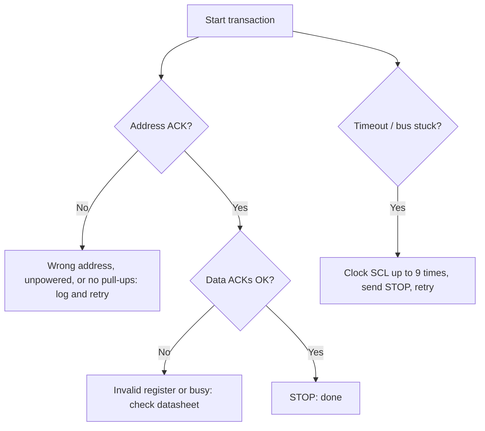

::: testing
Whether you can go from "I2C exists" to **actually talking to a chip**: what you wire, what you configure in the MCU's I2C peripheral, how you address a target, and the standard register read/write patterns. The interviewer is also listening for practical judgment: checking the address (7-bit vs 8-bit), reading a WHO_AM_I register first, using burst reads, handling NACKs and timeouts, and recovering a stuck bus. This is a "have you done it" question; a concrete example (a temperature sensor at 0x48, a pointer write, a repeated START, two data bytes, a conversion) is more convincing than general statements.
:::

::: why
Almost every embedded bring-up involves an I2C target that does not respond the first time. Being able to say "I scan the bus, check the address, check pull-ups, read the ID register" is what interviewers want to hear. It also shows you understand the layering: application code calls a driver; the driver calls the MCU's I2C peripheral; the peripheral turns that into START/address/ACK on the pins; and the target's datasheet defines the registers. Each layer is a place a bug can hide, and knowing which one to look at is a core debugging skill.
:::

::: concepts
- **Controller and targets on one pair of wires**: each target has a unique 7-bit address ([[q0745]], [[q0747]]).
- **MCU I2C peripheral**: hardware block that generates START/STOP, shifts bytes, checks ACK, and runs at a set clock ([[q0733]]).
- **Pull-ups**: required on SDA/SCL; sized from rise-time and sink-current limits ([[q0755]]).
- **Register map**: the target's registers are the "API"; read/write patterns come from its datasheet.
- **Repeated START**: used to switch from writing a register pointer to reading ([[q0745]]).
- **ACK/NACK as error signals**: a NACK on the address means "nobody home" ([[q0751]]).
- **Address selection**: pin straps and multiplexers when addresses collide ([[q0750]]).
:::

::: answer
"I treat it in layers.

Physically, the targets all connect to the same two wires, SDA and SCL, with a pull-up resistor on each line, usually somewhere between 2 and 10 kΩ depending on the speed and how many devices are on the bus. The MCU's I2C pins are set to open-drain, and the peripheral is configured for 100 or 400 kHz.

To talk to a particular target, the controller uses its 7-bit address, which comes from the datasheet and sometimes from pin straps. Each transaction starts with START, then the address with a write bit. For a typical sensor, I first write one byte, the register address, then do a repeated START with the address and a read bit, and clock in the data bytes. For a write, I send the register address followed by the data.

In firmware that's two calls: write the pointer without a STOP, then read N bytes. And I always read an ID register first, because if that works, wiring, pull-ups, address and clock are all fine.

I check the return codes. A NACK on the address means the wrong address or no power; a timeout means a stuck line, which I recover by clocking SCL up to nine times. When there are several targets, I just use each one's address, and I check addresses don't collide. If two parts share one, I use an address pin, a mux or a second bus."
:::

::: technical
**Hardware connection.** SDA and SCL of the MCU to every target's SDA and SCL; common ground; one pull-up per line to the I2C supply (the bus high level). Pull-up sizing from $t_r = 0.8473\,R_pC_b$ and $R_p \ge (V_{DD}-V_{OL})/I_{OL}$ ([[q0755]]).

**Peripheral configuration.** Set pins to alternate-function open-drain; enable the peripheral clock; choose the bus speed by programming a divider. Example (AVR-style TWI): $f_{SCL} = \frac{F_{CPU}}{16 + 2\cdot\text{TWBR}\cdot4^{\text{TWPS}}}$; at 16 MHz, TWBR = 72 gives 100 kHz and TWBR = 12 gives 400 kHz.

**Register access patterns** (pointer-register device at 7-bit address `A`, register `R`):

- **Write register:** S, A+W, R, DATA…, P.
- **Read register:** S, A+W, R, **Sr**, A+R, DATA…(last byte NACKed), P.
- **Burst/sequential access:** if the device auto-increments its register pointer, one transaction can read or write many consecutive registers.

**Efficiency.** Six 8-bit registers read one at a time cost $6\times4\times9 = 216$ clocks; read as one burst they cost $(3+6)\times9 = 81$ clocks, 2.7 times faster.

**Example conversion.** Pointer 0x00, two bytes returned 0x0C, 0x80 → raw = 3200; at 1/128 °C per LSB, $T = 3200/128 = 25.0$ °C.

**Error handling.** NACK on address: absent, unpowered or wrong address. NACK on data: register or command not accepted. Timeout: SDA or SCL held low; recover by pulsing SCL up to 9 times then sending STOP. Arbitration loss: another controller on the bus.
:::

::: short
"All targets share SDA and SCL with one pull-up per line, and each is addressed by its 7-bit address. In firmware I configure the MCU's I2C peripheral for 100 or 400 kHz, then for a sensor I write the register pointer, do a repeated START with the read bit, and read the data bytes. I read an ID register first to prove the wiring and address, check for NACKs and timeouts, and use burst reads for efficiency."
:::

::: long
"I think about it in four layers: wiring, peripheral setup, transactions, and error handling.

Wiring first. Every target's SDA goes to the controller's SDA, same for SCL, with a common ground and one pull-up resistor per line to the bus voltage. Typical values are 4.7 kΩ at 100 kHz and something like 2 kΩ at 400 kHz, sized so the rise time meets the spec without exceeding the sink current rating of the devices.

Then peripheral setup. I switch the MCU pins into open-drain alternate-function mode, enable the peripheral clock, and program the clock divider for 100 or 400 kHz. On an AVR-style TWI at 16 MHz the formula gives 100 kHz with a bit-rate register of 72.

Then transactions. Each target has a 7-bit address from its datasheet, sometimes selectable with address pins. To read a sensor register, I write the register address with the write bit, send a repeated START rather than a STOP, resend the address with the read bit, then clock in the bytes, NACKing the last one. If the device auto-increments its pointer, I read all the bytes I need in a single burst, which is much faster than one transaction per register: about 81 clocks instead of 216 for six bytes. Writes are the same: address, register, then data.

Finally I handle errors. The first call at bring-up is always reading the ID register, like a WHO_AM_I. A NACK on the address means wrong address, no power, or a wiring problem. A timeout means a line is stuck, and I recover by clocking SCL up to nine times and sending a STOP. When two parts have the same address I use an address pin, a multiplexer, or a second bus. And in an RTOS I protect the bus with a mutex so two tasks don't interleave transactions."
:::

::: terms
- **Target address**: the 7-bit identifier of a device on the bus; the byte on the wire is address ≪ 1 | R/W.
- **Register pointer**: internal address inside the target selecting which register is accessed next.
- **Burst read / auto-increment**: reading consecutive registers in one transaction because the pointer increments after each byte.
- **WHO_AM_I register**: fixed ID register used to confirm that communication works.
- **Bus scan**: sending address+W to every address and noting which ones ACK.
- **Bus recovery**: toggling SCL (up to 9 pulses) to release a stuck SDA, then issuing STOP.
- **Clock divider / prescaler**: peripheral setting that derives $f_{SCL}$ from the peripheral clock.
- **HAL / driver**: software layer that wraps the peripheral's registers.
- **Address strap**: a pin tied high/low (or to SDA/SCL) to select among several addresses.
:::

::: exceptional
**An average answer** says "connect SDA and SCL, use pull-ups, send the address."

**An exceptional answer**:
- Walks through **wiring, peripheral setup, transaction pattern and error handling** as layers.
- Gives the **register-read sequence** with the repeated START and the NACK on the last byte.
- Mentions **checking the address format** (7-bit vs 8-bit) and **reading an ID register first**.
- Quantifies something: clock-divider formula, **burst vs single reads** (81 vs 216 clocks), or the example conversion to 25.0 °C.
- Covers **failures**: NACK meanings, stuck bus recovery, address collisions (strap, mux, second bus).
- Notes **concurrency**: mutex, interrupts or DMA so reads don't block or interleave.
:::

::: mistakes
- **Using the 8-bit address from a datasheet as the 7-bit address.** Datasheets quoting 0x90/0x91 mean 7-bit 0x48; passing 0x90 to a library that expects 7-bit sends 0x20/0x21 and gets a NACK ([[q0749]]).
- **Sending a STOP between the register pointer and the read** on a device that requires a repeated START (or vice versa).
- **No pull-ups** (or relying on weak MCU internal pull-ups of tens of kΩ at 400 kHz). Many breakout boards include pull-ups; two boards add them in parallel and the value gets too low.
- **Reading each register separately** when burst reads exist, wasting bus time.
- **Ignoring return codes.** Silently proceeding after a NACK produces stale or garbage data.
- **Calling the bus from an ISR and a task at once.** Without locking, two transactions interleave and the target sees nonsense.
:::

::: deep
## What "interfacing" actually involves

Putting a new I2C part on a board means answering four questions, in this order:

1. **Can the signals physically get there?** Wiring, pull-ups, voltage levels.
2. **Is the MCU's peripheral configured to speak?** Pins, clock, speed.
3. **Does the target answer?** Address, ACK, ID register.
4. **Do I understand its registers?** Datasheet map, scaling, timing (conversion time).

### 1. Wiring

```circuit
{"caption":"Three targets with different default addresses on one bus","elements":[
 {"t":"box","at":[0,3],"w":5,"h":6,"label":"MCU","pins":[{"side":"right","pos":2,"name":"SCL"},{"side":"right","pos":4,"name":"SDA"}]},
 {"t":"wire","pts":[[5,5],[28,5]]},{"t":"wire","pts":[[5,7],[28,7]]},
 {"t":"rail","at":[8,1],"label":"3.3 V","dir":"up"},
 {"t":"R","a":[8,1],"b":[8,5],"label":"R_p","value":"4.7 kΩ"},{"t":"dot","at":[8,5]},
 {"t":"R","a":[10,7],"b":[10,11],"label":"R_p","value":"4.7 kΩ"},{"t":"dot","at":[10,7]},{"t":"rail","at":[10,11],"label":"3.3 V","dir":"down"},
 {"t":"box","at":[12,10],"w":4,"h":4,"label":"Temp\n0x48","pins":[{"side":"top","pos":1,"name":"SCL"},{"side":"top","pos":3,"name":"SDA"}]},
 {"t":"wire","pts":[[13,5],[13,10]]},{"t":"dot","at":[13,5]},{"t":"wire","pts":[[15,7],[15,10]]},{"t":"dot","at":[15,7]},
 {"t":"box","at":[18,10],"w":4,"h":4,"label":"EEPROM\n0x50","pins":[{"side":"top","pos":1,"name":"SCL"},{"side":"top","pos":3,"name":"SDA"}]},
 {"t":"wire","pts":[[19,5],[19,10]]},{"t":"dot","at":[19,5]},{"t":"wire","pts":[[21,7],[21,10]]},{"t":"dot","at":[21,7]},
 {"t":"box","at":[24,10],"w":4,"h":4,"label":"RTC\n0x68","pins":[{"side":"top","pos":1,"name":"SCL"},{"side":"top","pos":3,"name":"SDA"}]},
 {"t":"wire","pts":[[25,5],[25,10]]},{"t":"dot","at":[25,5]},{"t":"wire","pts":[[27,7],[27,10]]},{"t":"dot","at":[27,7]},
 {"t":"text","at":[29,5],"text":"SCL","anchor":"start"},{"t":"text","at":[29,7],"text":"SDA","anchor":"start"}
]}
```
Figure: Targets are told apart only by address; the controller needs no extra pins as devices are added. The addresses shown (0x48, 0x50, 0x68) are common defaults for LM75-style temperature sensors, 24-series EEPROMs and DS3231-style RTCs; always confirm in the datasheet.

If you add a 6-axis IMU such as the MPU-6050, its default address is also 0x68, which collides with the RTC. Its AD0 pin raises it to 0x69. This is the classic example of why you read all the address tables before drawing the schematic ([[q0750]]).

### 2. MCU peripheral setup

A hardware I2C block replaces bit-banging: you write the target address and bytes to registers and it handles timing. The setup steps are generic:

- Configure SDA/SCL pins as open-drain alternate-function (or the MCU's I2C mode). Some MCUs need an explicit pull-up setting; do not rely on internal pull-ups (typically 20 to 50 kΩ) for 400 kHz.
- Enable the peripheral clock and program the speed.
- Optionally set timeouts, enable interrupts or DMA.

For an AVR-style TWI the clock is
$$f_{SCL} = \frac{F_{CPU}}{16 + 2\cdot \text{TWBR}\cdot 4^{\text{TWPS}}}$$
so at 16 MHz and prescaler 1: TWBR = 72 gives $16\text{ MHz}/160 = 100$ kHz and TWBR = 12 gives $16\text{ MHz}/40 = 400$ kHz. Other MCU families use timing-register formulas that program the high and low periods directly; follow the reference manual and check the result on a scope.

### 3. The conversation

```timing
{"signals":[{"name":"Controller drives","wave":"==z=z=z=z=","data":["S","0x90","0x01","0x60","0xA0","P"],"color":"accent"},{"name":"Target drives","wave":"zz=z=z=z=z","data":["ACK","ACK","ACK","ACK"],"color":"orange"}],"hscale":1.8}
```
Figure: Writing a configuration to a (hypothetical) device at 0x48: START, address + W (0x90), register pointer 0x01, then two data bytes 0x60 and 0xA0, each ACKed by the target, then STOP. The first byte after the address selects the register; the following bytes go to that register and, if the device auto-increments, the next one.

Reading, as covered in [[q0745]], uses a pointer write, a repeated START and a read:

```c
// Read a 16-bit temperature (pointer register 0x00) from the target at 0x48
uint8_t reg = 0x00;
uint8_t buf[2];

if (i2c_write(0x48, &reg, 1, /*send_stop=*/false) != I2C_OK) return ERR_NACK;  // S, 0x90, 0x00 (no P)
if (i2c_read(0x48, buf, 2) != I2C_OK)                       return ERR_NACK;  // Sr, 0x91, 2 bytes, NACK last, P

int16_t raw = (int16_t)((buf[0] << 8) | buf[1]);    // 0x0C80 = 3200
float celsius = raw / 128.0f;                        // 25.0 degC
```
Figure: A driver-level read. The library calls and parameter names vary by platform; the point is the shape: write the pointer without a STOP, then read N bytes with the last one NACKed by the peripheral. Notice the conversion in the last two lines: bus transactions give raw bytes; the datasheet gives the scaling.

### Burst vs single-register access

Say you need six consecutive 8-bit registers (accelerometer X/Y/Z low/high bytes):

| Method | Bytes on the wire | Clocks | Time at 400 kHz |
|---|---|---|---|
| 6 separate register reads (addr+W, reg, addr+R, data each) | 4 × 6 = 24 | 216 | 540 µs |
| One burst read (addr+W, reg, addr+R, 6 data) | 9 | 81 | 202.5 µs |

The burst is 2.7 times faster and also guarantees the six bytes are from one coherent sample (no update between reads). That second point matters for sensors that update registers asynchronously.

### 4. Does the target answer? Bring-up checklist

1. **Power and reset**: target powered, EN/RESET released, I/O supply within range.
2. **Pull-ups present?** Measure SDA/SCL idle voltage: should be at $V_{DD}$, not floating or low.
3. **Bus scan**: send address+W for 0x08 to 0x77; at 100 kHz, about 112 × 10 clocks = 11 to 12 ms for the whole scan. Which addresses ACK?
4. **Address check**: compare the ACKing address with the datasheet's 7-bit address (note 8-bit forms 0x90/0x91).
5. **Read the ID register**: confirms data path and byte order.
6. **Configure**, then read data and compare with a known stimulus.
7. **Scope** SDA and SCL at the target pin: rise time, low level ($V_{OL}$), and overshoot.

### Error handling and recovery


Figure: A driver should distinguish "no ACK" (a protocol-level answer from the bus) from "bus stuck" (lines held low, a timeout). The first points at addressing or wiring, the second needs the 9-clock recovery.

### Practical details that bite

- **Timing between commands**: many sensors need a conversion time after you start a measurement; reading too early returns old or zero data.
- **Endianness**: sensors differ on whether the high byte comes first; check the datasheet's register diagram.
- **Multiple tasks**: wrap bus access in a mutex; use interrupt or DMA modes to avoid blocking.
- **Clock stretching**: if a target stretches, a hardware peripheral usually handles it, but a bit-banged master must check SCL after releasing ([[q0752]]).
- **Voltage domains**: if the target is 1.8 V and the MCU 3.3 V, add a level translator ([[q0743]]).
:::

::: applications
- **Reading a temperature/humidity sensor every second** with the pointer-write + repeated-START pattern.
- **Streaming IMU data**: burst-read 6 or 12 bytes of accelerometer/gyro registers per sample.
- **Programming an I/O expander or LED driver** with a handful of register writes at start-up.
- **Reading and writing an EEPROM** with a 2-byte memory address and page writes, then ACK polling for write completion ([[q0751]]).
- **Reading an RTC** (time, date, alarm registers) as a single 7-byte burst.
- **Bus scan tools** in bring-up firmware printing every address that ACKs.
:::

::: assumptions
- The example device is a **pointer-register sensor** with 1/128 °C per LSB and a big-endian 16-bit result; real devices vary in register layout, scaling and endianness.
- The default addresses quoted (0x48, 0x50, 0x68, 0x69) are the commonly seen defaults for typical parts of those kinds; addresses depend on the exact device and pin straps.
- The code is **pseudo-C** in the style of an MCU HAL; function names and arguments differ across vendors.
- The AVR TWI formula is for ATmega-style parts; other MCU families use different timing registers.
- Pull-up values are typical starting points; the right value depends on bus capacitance, supply and speed ([[q0755]]).
- Controller/target terminology replaces master/slave; the question list uses the older terms.
:::

::: followups
### How do you know the I2C address of a device?
Read the datasheet's address section (many list 7-bit addresses and the pin strap options), check whether it is quoted as 7-bit or 8-bit, and confirm with a bus scan: whichever address ACKs is the one the MCU's library should use. If a scan returns an address like 0x48 and the datasheet says 0x90, the datasheet is quoting the write byte.

### What happens if two targets have the same address?
Both ACK and both drive SDA during reads, which corrupts data (and in the worst case causes bus contention at the bit level). Use the device's address pin if it has one, put one behind an I2C multiplexer, use a second I2C peripheral or bus, or choose a different part. See [[q0750]].

### Why read the WHO_AM_I register first?
It's a constant value that proves several things at once: power, wiring, pull-ups, speed, address, pointer/read sequencing and byte order. If it returns the expected value, every later problem is in configuration, not the physical link.

### You see SDA stuck low after a reset in the middle of a read. What do you do?
The target is mid-byte and still driving a 0, waiting for clocks. Pulse SCL (bit-bang or toggle the peripheral's pin) up to 9 times until SDA releases, then generate a STOP. Add this recovery to initialisation so a watchdog reset can't permanently hang the bus.

### Two tasks and an ISR all use the same I2C peripheral. How do you make it safe?
Serialize access with a mutex for the bus (not just the peripheral), keep ISR use to queueing requests rather than blocking transfers, and use interrupt- or DMA-driven transfers with a completion callback. Interleaved START/address sequences from two contexts will confuse both targets and the peripheral state machine.
:::

::: interpretations
"How interface with slaves?" is terse; the intended meaning is **how a controller (master) communicates with and selects the target (slave) devices on an I2C bus**. The core answer is *address-based selection and register access*. A second reading is "how do you wire several targets", covered by the figure and by [[q0747]] (how many) and [[q0750]] (collisions). Physical-layer details (pull-ups, capacitance) are separate questions beginning at [[q0753]].
:::

::: references
- NXP, *UM10204: I2C-bus specification and user manual*: addressing, repeated START, ACK semantics and reserved addresses.
- Microchip (Atmel) ATmega datasheet, TWI chapter: the bit-rate formula quoted above.
- A target's datasheet (temperature sensor, EEPROM, RTC or IMU): register map and the read/write timing diagrams that tell you whether a repeated START is required.
- Horowitz & Hill, *The Art of Electronics*, 3rd ed.: serial buses and interfacing.
:::

::: rubric
- Describes the wiring: shared SDA/SCL, pull-ups, common ground :: Without this the bus will not work and it shows hardware awareness.
- Explains addressing: 7-bit address plus R/W; address from datasheet or straps :: Selection is how multiple targets coexist.
- Gives the register read pattern (pointer write, repeated START, read, NACK last) :: Shows you have actually read a sensor.
- Mentions configuring the MCU peripheral (open-drain pins, clock speed) :: Connects protocol to implementation.
- Uses an ID/WHO_AM_I read and/or a bus scan for bring-up :: Practical debugging technique.
- Handles errors: NACK meanings, timeouts, bus recovery :: Robustness distinguishes experience from theory.
- Mentions burst reads, address conflicts and concurrency :: Real-world efficiency and system issues.
:::

::: quiz
```json
[
 {"type":"mcq","level":"fundamental","q":"How does an I2C controller choose which target to talk to?","options":["A dedicated chip-select line per target","The 7-bit address sent on SDA at the start of the transaction","The baud rate","The order in which the targets are wired"],"answer":1,"explain":"I2C selects targets by in-band address. All targets listen to the address byte; only the matching one ACKs. SPI uses chip-select lines."},
 {"type":"numeric","level":"fundamental","q":"A datasheet lists the I2C write address of a sensor as 0x90. What is its 7-bit address in hex? Give the answer as a decimal number (0x48 = 72).","answer":72,"tolerance":0.01,"unit":"","explain":"0x90 is the 8-bit write byte (address ≪ 1 | 0). Shifting right: 0x90 ≫ 1 = 0x48 = 72 decimal."},
 {"type":"numeric","level":"intermediate","q":"An AVR-style TWI has $f_{SCL}=F_{CPU}/(16+2\\,\\text{TWBR})$ (prescaler 1). With $F_{CPU}=16$ MHz and TWBR = 12, what is $f_{SCL}$? Answer in kHz.","answer":400,"tolerance":0.02,"unit":"kHz","explain":"$16\\text{ MHz}/(16+24) = 16\\text{ MHz}/40 = 400$ kHz."},
 {"type":"numeric","level":"intermediate","q":"You need 6 consecutive registers from a device that auto-increments its pointer. A burst read takes 9 bytes on the wire (addr+W, reg, addr+R, 6 data); six separate reads take 4 bytes each. How many times faster is the burst (ratio of clocks)?","answer":2.67,"tolerance":0.03,"unit":"×","explain":"Burst: 9 × 9 = 81 clocks. Separate: 6 × 4 × 9 = 216 clocks. Ratio = 216/81 = 2.67."},
 {"type":"mcq","level":"intermediate","q":"After the controller writes the register pointer, a pointer-register sensor needs a read. Which sequence is typically correct?","options":["STOP, then wait, then address+W again","Repeated START, address+R, read bytes, NACK the last, STOP","Send address+R immediately without any START","Send NACK then read"],"answer":1,"explain":"The standard combined transaction is S, addr+W, reg, Sr, addr+R, data…, NACK on the last byte, P. A repeated START keeps the bus owned and the pointer set."},
 {"type":"truefalse","level":"advanced","q":"If an I2C bus scan finds two ACKs at the same address from two different physical sensors, the reads from that address will usually be fine because only the addressed target drives SDA.","answer":false,"explain":"Both devices recognise the address and both drive SDA during a read, so the wired-AND of their data corrupts the result. Duplicates must be separated with address pins, a mux, or separate buses."}
]
```
:::
