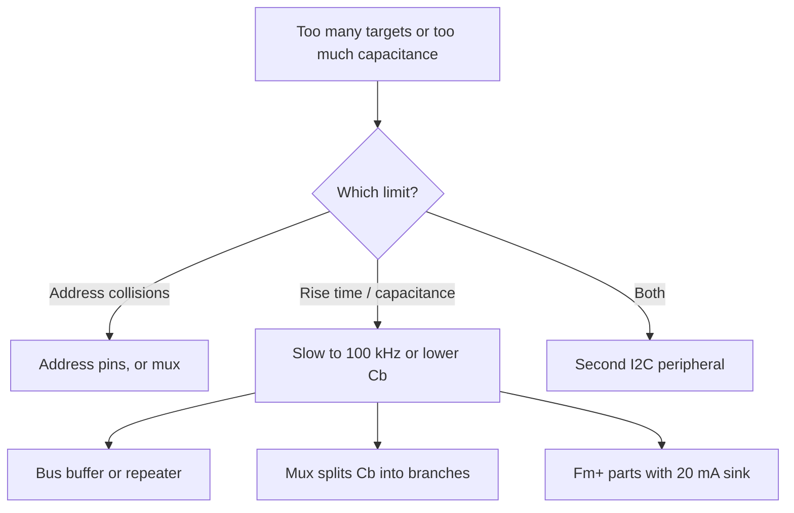

::: testing
Whether you realise there are **two different limits** and can compute both: the *address space* (7-bit addressing gives 128 codes, 16 reserved, so 112 usable; 10-bit addressing gives far more) and the *electrical limit* (total bus capacitance of 400 pF in Standard and Fast modes, which usually bites first). A strong answer then says what you do when you hit either: address pins, multiplexers, bus buffers, or a second bus. Numbers matter: 112, 400 pF, and a quick estimate of how many devices fit.
:::

::: why
"How many devices can I put on this bus?" is a real schematic-review question. Boards grow: a sensor here, an expander there, and suddenly the bus rise time is 600 ns, the scope shows rounded edges, and intermittent NACKs appear at temperature. Knowing the capacitance budget lets you predict that before layout, and knowing the address rules lets you avoid collisions before ordering parts. It also separates people who know the spec's headline number (128) from those who know why it is not the real limit.
:::

::: concepts
- **7-bit address space**: $2^7 = 128$ codes, 16 reserved, 112 usable ([[q0749]]).
- **10-bit addressing**: a two-byte address scheme giving up to 1024 codes ([[q0749]]).
- **Bus capacitance $C_b$**: pins, traces, connectors; spec limit 400 pF (550 pF in Fm+) ([[q0756]], [[q0757]]).
- **Rise time**: $t_r = 0.8473\,R_pC_b$ must meet the mode's limit ([[q0759]]).
- **Pull-up window**: $R_{p,min}$ from sink current, $R_{p,max}$ from rise time ([[q0755]]).
- **Address collisions and workarounds**: pins, muxes, second bus ([[q0750]]).
:::

::: answer
"There are two answers: an addressing limit and an electrical limit.

With 7-bit addressing there are 128 possible addresses, but 16 are reserved, so 112 devices is the theoretical maximum. 10-bit addressing extends that to roughly a thousand.

In practice the electrical limit comes first. The I2C spec caps the total bus capacitance at 400 pF for standard and fast mode. Every device pin adds somewhere around 5 to 10 pF, and PCB trace and connectors add more, roughly 1 pF per centimetre. So you can fit maybe 20 to 40 devices on a compact board, fewer on a long cable. The capacitance matters because the rise time is $0.85\,R_pC_b$ and has to stay under 300 ns at 400 kHz. At 400 pF that forces the pull-up down below about 900 Ω, which starts to run into the sink-current limit.

And even before either limit, a lot of parts share the same default address, so collisions are usually the real constraint. For that I use address-select pins, an I2C multiplexer to split the bus into branches, or a second I2C peripheral."
:::

::: technical
**Address limit.** 7 bits: 128 codes. Reserved: 0x00 to 0x07 and 0x78 to 0x7F (general call, START byte, CBUS, Hs-mode master code, device ID, 10-bit prefix). Usable: 0x08 to 0x77 = **112**. 10-bit: prefix 11110xx plus 8 more bits = 1024 codes; the 10-bit prefix consumes 0x78 to 0x7B of the 7-bit space.

**Electrical limit.** $C_b \le 400$ pF for Standard (100 kHz) and Fast (400 kHz); 550 pF for Fast-mode Plus. Rise-time limits: 1000 ns (Std), 300 ns (Fast), 120 ns (Fm+), with $t_r = 0.8473\,R_pC_b$.

$$R_{p,max} = \frac{t_r}{0.8473\,C_b}, \qquad R_{p,min} = \frac{V_{DD}-V_{OL}}{I_{OL}}$$

At $V_{DD}=3.3$ V, $V_{OL}=0.4$ V, $I_{OL}=3$ mA: $R_{p,min} = 967\ \Omega$. For Fast mode:

| $C_b$ | $R_{p,max}$ (300 ns) | window ($R_{p,max}-R_{p,min}$) |
|---|---|---|
| 50 pF | 7.08 kΩ | wide |
| 100 pF | 3.54 kΩ | wide |
| 200 pF | 1.77 kΩ | 0.8 kΩ |
| 400 pF | 885 Ω | **none** ($<R_{p,min}$) |

So at 400 kHz with a 3 mA sink limit, 400 pF is not actually usable at 3.3 V; around 300 pF is the practical ceiling unless devices can sink more (Fm+ parts sink 20 mA) or you slow to 100 kHz (where $R_{p,max}$ at 400 pF is 2.95 kΩ).

**Device-count estimate.** With 10 pF per device and 60 pF of trace/connector: $(400-60)/10 = 34$ devices at the absolute spec limit; keeping a 25% margin at 300 pF gives $(300-60)/10 = 24$.
:::

::: short
"Addressing-wise, 7 bits give 128 codes, 16 reserved, so 112 targets; 10-bit addressing gives about a thousand. But the real limit is electrical: total bus capacitance is capped at 400 pF, and each device and each centimetre of trace adds capacitance, which slows the rise time. In practice that's around 20 to 40 devices. Beyond that, or when addresses collide, you use address pins, an I2C multiplexer or a bus buffer."
:::

::: long
"There's an address limit and an electrical limit, and the electrical one usually hits first.

On addressing, a 7-bit address gives 128 codes. The spec reserves 16 of them, 0x00 to 0x07 and 0x78 to 0x7F, for things like the general call and 10-bit addressing, so 112 are usable. With 10-bit addressing the count goes up to about 1000, though few parts support it.

On the electrical side, the spec limits the total bus capacitance to 400 pF in standard and fast modes. That limit exists because of rise time. The pull-up has to charge the whole bus capacitance, and the 30 to 70 percent rise time is $0.8473\,R_pC_b$. Fast mode needs under 300 ns, so at 400 pF the pull-up has to be 885 ohms or smaller. But the pull-up also can't be too small: devices only guarantee about 3 mA of sink current, so at 3.3 V the minimum is around 970 ohms. At 400 pF those two bounds cross, which means the practical ceiling at 400 kHz is nearer 300 pF.

Each device pin contributes roughly 5 to 10 pF, and a PCB trace is around 1 pF per centimetre, plus connectors and cables. So 20 to 30 devices on a compact board is already stretching it.

If I run out, there are fixes: slow the bus to 100 kHz, which raises the allowed pull-up, split the bus with an I2C multiplexer so each branch sees only its own capacitance, add a bus buffer or repeater, use Fast-mode Plus parts with stronger drivers, or use a second I2C peripheral. And separately, if addresses clash, use address pins or a mux."
:::

::: terms
- **Reserved addresses**: 0x00 to 0x07 and 0x78 to 0x7F; not for ordinary targets.
- **10-bit addressing**: extended scheme using the 11110xx prefix and a second address byte.
- **Bus capacitance ($C_b$)**: total capacitance on SDA or SCL to ground; limit 400 pF.
- **Pull-up window**: allowable range of $R_p$ between rise-time and sink-current limits.
- **I2C multiplexer / switch**: IC that connects one of several downstream I2C branches to the upstream bus.
- **Bus buffer / repeater**: IC that isolates capacitance between segments.
- **Address strap**: pin(s) selecting among a few addresses for a part.
- **$I_{OL}$**: guaranteed sink current at $V_{OL}$ (3 mA Std/Fast, 20 mA Fm+).
:::

::: exceptional
**An average answer** says "128, or 112 after reserved".

**An exceptional answer**:
- Separates **address-space** from **electrical** limit and states which usually binds.
- Quotes **400 pF** and explains it through $t_r = 0.8473\,R_pC_b$ and the 300 ns Fast-mode limit.
- Shows the **pull-up window collapsing** ($R_{p,max}$ falls with $C_b$ until it meets $R_{p,min}$).
- Gives a **device-count estimate** from per-pin and per-cm capacitance.
- Lists **remedies**: slower mode, mux/switch, buffer, Fm+, second bus, address pins.
- Notes that **collisions** between default addresses are often the real limit.
:::

::: mistakes
- **Answering "127" or "128".** Reserved addresses reduce it to 112.
- **Ignoring capacitance.** The address count is theoretical; the bus fails electrically long before 112 devices.
- **Adding pull-ups on every breakout board.** Parallel pull-ups drive $R_p$ below $R_{p,min}$ and $V_{OL}$ rises ([[q0760]]).
- **Believing a mux "adds" capacity for free.** It adds downstream isolation but its switch resistance and capacitance still load the upstream bus.
- **Treating 10-bit addressing as common.** Most parts and many MCU peripherals only support 7-bit.
- **Forgetting that 8-bit notation hides the real number**: a datasheet 0x90 is 7-bit 0x48.
:::

::: deep
## Limit 1: the address map

```svg
<svg viewBox="0 0 720 150" role="img" aria-label="7-bit I2C address map" font-family="Inter, sans-serif" font-size="12"><rect x="40" y="40" width="40" height="40" fill="var(--d-red)" fill-opacity="0.3" stroke="var(--d-red)"/><rect x="80" y="40" width="560" height="40" fill="var(--d-green)" fill-opacity="0.3" stroke="var(--d-green)"/><rect x="640" y="40" width="40" height="40" fill="var(--d-red)" fill-opacity="0.3" stroke="var(--d-red)"/><text x="60" y="64" text-anchor="middle" fill="var(--d-ink)">rsvd</text><text x="360" y="64" text-anchor="middle" fill="var(--d-ink)" font-weight="600">112 usable addresses (0x08 to 0x77)</text><text x="660" y="64" text-anchor="middle" fill="var(--d-ink)">rsvd</text><line x1="40" y1="82" x2="40" y2="90" stroke="var(--d-muted)"/><text x="40" y="104" text-anchor="middle" fill="var(--d-ink)">0x00</text><line x1="80" y1="82" x2="80" y2="90" stroke="var(--d-muted)"/><text x="80" y="104" text-anchor="middle" fill="var(--d-ink)">0x08</text><line x1="360" y1="82" x2="360" y2="90" stroke="var(--d-muted)"/><text x="360" y="104" text-anchor="middle" fill="var(--d-ink)">0x40</text><line x1="640" y1="82" x2="640" y2="90" stroke="var(--d-muted)"/><text x="640" y="104" text-anchor="middle" fill="var(--d-ink)">0x78</text><line x1="675" y1="82" x2="675" y2="90" stroke="var(--d-muted)"/><text x="675" y="104" text-anchor="middle" fill="var(--d-ink)">0x7F</text><text x="40" y="30" text-anchor="start" fill="var(--d-red)" font-size="11">0x00 general call, ...</text><text x="680" y="30" text-anchor="end" fill="var(--d-red)" font-size="11">0x78-0x7B 10-bit prefix, 0x7C-0x7F other</text><text x="360" y="136" text-anchor="middle" fill="var(--d-muted)">7-bit address space: 128 codes, 16 reserved</text></svg>
```
Figure: The 7-bit space has 128 codes. The lowest 8 (0x00 to 0x07) and the highest 8 (0x78 to 0x7F) are reserved for special functions, leaving the green 112 for ordinary targets. In 10-bit addressing the 0x78 to 0x7B block is the prefix that announces a two-byte address.

Reserved codes include 0x00 (general call and, with R/W = 1, the START byte), and 0x78 to 0x7B (first byte of a 10-bit address, pattern 11110 A9 A8 R/W). High-speed mode uses 0x04 to 0x07 for the master code, and 0x7C to 0x7F are used for the device-ID feature. Check UM10204 for the exact assignment.

With 10-bit addressing the first byte is 11110 A9 A8 R/W and the second is A7 to A0, so 1024 targets are addressable. Few parts implement it. 7-bit and 10-bit targets can coexist on one bus.

Most real parts do not let you pick any address; a chip may offer 2 to 8 choices via pins, so you cannot use all 112 even if the electrical load allowed it ([[q0750]]).

## Limit 2: capacitance, the one that actually bites

Every node on SDA or SCL adds capacitance to ground: the device's pin (typically 3 to 10 pF, check the datasheet), its ESD and package parasitics, the PCB trace (around 1 pF per cm is a rough rule; stackup dependent), connectors and cable. The pull-up resistor must charge the *sum*.

$$C_b = \sum_i C_{pin,i} + C_{trace} + C_{connector} + C_{cable}$$

The I2C-bus spec caps $C_b$ at 400 pF for Standard and Fast modes because with a limited sink current there is no pull-up that meets the rise time beyond that. Let's put numbers on the squeeze at 3.3 V, Fast mode:

```plot
{"title":"Pull-up window (default 400 kHz Fast mode: 300 ns, 3.3 V, 3 mA sink)","x":{"label":"Bus capacitance C_b","unit":"F","min":1e-11,"max":4.5e-10},"y":{"label":"R_p","unit":"Ω","min":0,"max":8000},"vars":{"tr":3e-07,"k":0.8473,"vdd":3.3,"isink":0.003,"rmin":"(vdd-0.4)/isink"},"series":[{"label":"R_p,max = t_r limit / (0.8473 C_b)","fn":"tr/(k*x)","color":"red"}],"hlines":[{"at":"rmin","label":"R_p,min = (V_DD − 0.4 V)/I_OL","color":"muted"}],"vlines":[{"at":"tr/(k*rmin)","label":"window closes","color":"orange"}],"params":[{"name":"tr","label":"Rise-time limit","min":1e-07,"max":1e-06,"value":3e-07,"unit":"s","log":true},{"name":"vdd","label":"Supply V_DD","min":1.8,"max":5.5,"value":3.3,"unit":"V","step":0.1},{"name":"isink","label":"Sink current I_OL","min":0.001,"max":0.02,"value":0.003,"unit":"A","log":true}],"readouts":[{"label":"R_p,min","expr":"rmin","unit":"Ω"},{"label":"Window closes at C_b =","expr":"tr/(k*rmin)","unit":"F"}]}
```
Figure: Allowed pull-ups lie *below* the red curve and *above* the grey line. As $C_b$ grows the curve falls until it meets $R_{p,min}$. At 3.3 V with a 3 mA sink limit that happens near 366 pF, so the real Fast-mode ceiling is below the spec's 400 pF unless devices sink more current. Drag the sink current down to 1 mA: R_p,min rises to 2.9 kΩ and the window closes near 122 pF. Tighten the rise-time limit to 120 ns (Fast-mode Plus) and at 3 mA it closes near 146 pF.

The crossing point is $C_b = t_r/(0.8473\,R_{p,min}) = 300\text{ ns}/(0.8473\times967\ \Omega) = 366$ pF.

```sim
{"id":"i2c-pullup","vdd":3.3,"cb":300e-12,"rp":1500,"mode":"fast"}
```
Figure: Raise Cb toward 400 pF and watch Rp(min) and Rp(max) approach each other; the simulator flags a pull-up that is too weak or too strong. Then switch to the standard mode and see the window reopen.

### A capacitance budget

| Item | Qty | Each | Total |
|---|---|---|---|
| Device pins (sensors, EEPROM, RTC...) | 12 | 8 pF | 96 pF |
| Controller pin | 1 | 10 pF | 10 pF |
| PCB trace, about 25 cm | 1 | 25 pF | 25 pF |
| Connector + 30 cm cable to an off-board sensor | 1 | about 40 pF | 40 pF |
| **Total** | | | **171 pF** |

At 171 pF in Fast mode $R_{p,max} = 300\text{ ns}/(0.8473\times171\text{ pF}) = 2.07$ kΩ, comfortably above 967 Ω, so something like 1.5 kΩ to 2 kΩ works. Add twice the devices and $C_b$ approaches 300 pF and $R_{p,max}$ falls to 1.18 kΩ: tight. The numbers say "about 24 devices at the margin, 34 at the absolute limit".

(Per-pin and per-cm values are estimates; use the datasheet's pin capacitance and measure or simulate $C_b$ for a real design.)

## What to do when you run out


Figure: Collisions and capacitance have different cures. A multiplexer solves both (each branch has its own address space and its own capacitance), but it adds one device and a control register to manage.

### I2C multiplexers and switches

An I2C switch such as TI's 8-channel TCA9548A connects one or more of 8 downstream branches to the upstream bus under software control, and sits on its own address (0x70 to 0x77 range). Identical sensors with the same address go on different channels, and each branch sees only its own capacitance (plus the switch). With 8 channels and 8 addresses per sensor type you can address 64 identical-type sensors. The cost: an extra write to select the channel before each access, and extra bus time.

### Buffers and accelerators

Bus buffers (for example PCA9515-type repeaters) separate the capacitance of two segments so each can meet 400 pF. Static-offset and propagation-delay considerations apply, and buffering direction is automatic on bidirectional open-drain buffers. Active pull-up ("rise time accelerator") ICs add current during the rising edge so a heavily loaded bus can still meet timing.

## Practical estimate in one line

*Number of devices ≈ (400 pF − trace and connector capacitance) / (pin capacitance per device)*, then derate by 25 to 30% for margin and check that $R_{p,max}$ for your speed is still above $R_{p,min}$. If the answer is under 10 or so, expect trouble with long cables; if it is over 30, you will be limited by addresses first.
:::

::: applications
- **Sensor boards** with 10 to 20 I2C parts (IMU, magnetometer, pressure, light) on one bus at 400 kHz.
- **Laptop/server motherboards** use I2C/SMBus buses with multiplexers to reach dozens of voltage regulators, fans and DIMM SPD EEPROMs.
- **Multi-sensor arrays** with identical sensors behind a TCA9548A-style mux.
- **Long-cable runs** to remote sensors using bus buffers or differential I2C extenders.
- **LED driver chains** (many identical drivers using address pins to get up to a few per bus).
- **Battery packs** where a fuel gauge, protector and charger share a small SMBus.
:::

::: assumptions
- The 400 pF figure applies to Standard and Fast modes; Fast-mode Plus allows 550 pF (with 20 mA sink devices); High-speed mode has its own limits.
- Pin and trace capacitance values (about 8 pF per pin, 1 pF per cm) are rough planning values and depend on the part and PCB stackup; **verify with datasheets or measurement**.
- $R_{p,min}$ uses $V_{OL}=0.4$ V and $I_{OL}=3$ mA (valid for $V_{DD} > 2$ V); lower supply voltages use $V_{OL}=0.2V_{DD}$.
- The answer assumes **7-bit addressing**; 10-bit adds capacity but little hardware supports it.
- A bus switch or buffer changes the numbers: each downstream branch must meet its own limits.
:::

::: followups
### Your I2C bus has 20 devices and the rising edges look like slow ramps. What do you check?
Total $C_b$ first (count pins, trace length and connectors), then the pull-up value against $t_r=0.8473\,R_pC_b$ and the 300 ns or 1000 ns limit. If the pull-up is already near $R_{p,min}$, reduce capacitance (split the bus with a mux or buffer), drop to 100 kHz, or use parts with stronger drivers. Measure the rise time at the farthest device.

### How would you connect eight identical sensors that only support one address?
Use an I2C multiplexer or switch so each sensor sits on its own downstream channel, and select one channel before talking to it. Alternatives: separate I2C buses on the MCU, or sensors with an enable pin so you can bring them up one at a time and reassign addresses if supported. See [[q0750]].

### How many addresses does 10-bit addressing give, and what is the catch?
1024 (two bits in the first byte plus eight in the second). The catch is device support: most targets and many MCU peripherals only implement 7-bit, and 10-bit addresses use the reserved 0x78 to 0x7B prefix so those 7-bit codes cannot be used by ordinary targets.

### What if you need a 1 MHz bus with 500 pF?
Fast-mode Plus allows 550 pF but requires 20 mA sink drivers and $t_r\le120$ ns: $R_{p,max}=120\text{ ns}/(0.8473\times500\text{ pF})=283$ Ω, and $R_{p,min}=(3.3-0.4)/20\text{ mA}=145$ Ω. A window exists, but power in the pull-up when low is $3.3^2/283\approx38$ mW per line and every device must be Fm+ rated. Often better: reduce capacitance by splitting the bus.

### Why does adding a second pull-up on a breakout board cause trouble?
Pull-ups combine in parallel. Two 4.7 kΩ resistors make 2.35 kΩ, three make 1.57 kΩ, and eventually the line cannot reach $V_{OL}$ below 0.4 V at the 3 mA rating. Remove or disable pull-ups on all but one board.
:::

::: interpretations
The wording "How many slaves can there be?" has two readings: the **protocol limit** (112 usable 7-bit addresses, or about 1000 with 10-bit) and the **practical electrical limit** (400 pF). Both are given. A third reading is "how many *per address-select configuration*", covered in [[q0750]]. The SPI version of this question ([[q0765]]) has a different answer, since SPI is limited by chip-select pins rather than addresses.
:::

::: references
- NXP, *UM10204: I2C-bus specification and user manual*: reserved addresses, 10-bit addressing, bus capacitance limits and rise-time requirements by mode.
- Texas Instruments application notes on I2C pull-up calculation and on I2C multiplexers/buffers (for example the TCA9548A and PCA9515-family datasheets).
- Horowitz & Hill, *The Art of Electronics*, 3rd ed.: serial buses (I2C section).
- Device datasheets for pin capacitance values.
:::

::: rubric
- Gives 7-bit address count 128 and subtracts the 16 reserved to reach 112 :: The headline number with the correct nuance.
- Mentions 10-bit addressing and its limited support :: Completeness.
- States the 400 pF bus capacitance limit and ties it to rise time :: The actual practical limit.
- Estimates device count from per-pin and per-cm capacitance :: Shows quantitative reasoning.
- Shows how the pull-up window ($R_{p,min}$ to $R_{p,max}$) shrinks with $C_b$ :: Links capacitance to design consequences.
- Lists remedies: slower speed, mux, buffer, Fm+, second bus :: Engineering response.
- Notes address collisions as a practical limit :: Real-world constraint.
:::

::: quiz
```json
[
 {"type":"numeric","level":"fundamental","q":"How many usable 7-bit I2C addresses are there after removing the 16 reserved ones?","answer":112,"tolerance":0.01,"unit":"addresses","explain":"$2^7 = 128$ minus 16 reserved (0x00 to 0x07 and 0x78 to 0x7F) = 112."},
 {"type":"mcq","level":"fundamental","q":"What is the bus-capacitance limit for Standard and Fast mode I2C?","options":["40 pF","100 pF","400 pF","4000 pF"],"answer":2,"explain":"The I2C-bus spec limits the load capacitance on each line to 400 pF for Standard and Fast modes (550 pF for Fast-mode Plus)."},
 {"type":"numeric","level":"intermediate","q":"With $C_b = 200$ pF, what is the largest pull-up that meets the 300 ns Fast-mode rise time? Answer in kΩ.","answer":1.77,"tolerance":0.02,"unit":"kΩ","explain":"$R_{p,max} = 300\\text{ ns}/(0.8473\\times200\\text{ pF}) = 1770\\ \\Omega = 1.77$ kΩ."},
 {"type":"numeric","level":"intermediate","q":"At $V_{DD} = 3.3$ V with $V_{OL}=0.4$ V and $I_{OL}=3$ mA, what is the minimum pull-up resistance? Answer in Ω.","answer":967,"tolerance":0.02,"unit":"Ω","explain":"$R_{p,min} = (3.3 - 0.4)/3\\text{ mA} = 967\\ \\Omega$."},
 {"type":"numeric","level":"advanced","q":"At what bus capacitance does the Fast-mode pull-up window close at 3.3 V (where $R_{p,max}=R_{p,min}=967\\ \\Omega$, $t_r = 300$ ns)? Answer in pF.","answer":366,"tolerance":0.03,"unit":"pF","explain":"$C_b = t_r/(0.8473\\,R_{p,min}) = 300\\text{ ns}/(0.8473\\times967) = 366$ pF."},
 {"type":"truefalse","level":"intermediate","q":"Because there are 112 usable addresses, you can always put 112 devices on one 400 kHz I2C bus.","answer":false,"explain":"Bus capacitance (400 pF), the pull-up window and address-pin limitations stop you well before 112 devices on a typical board."}
]
```
:::
