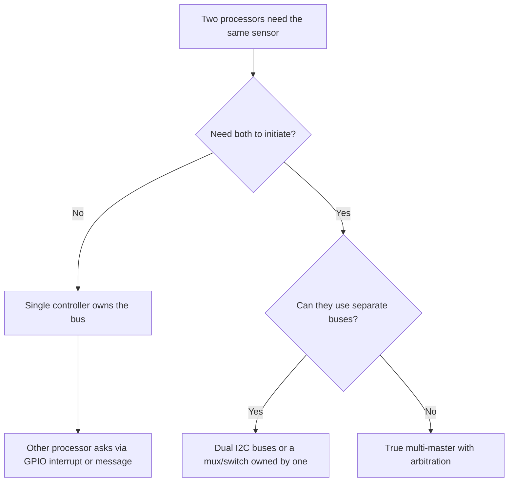

::: testing
Whether you know that I2C supports **multi-master operation by design** and can answer both halves: *when* you would want it, and *how* it works (arbitration and clock synchronization on the wired-AND lines). The interviewer also wants judgment: most designs should avoid multiple controllers because of the extra complexity, so can you name the few real cases and the cheaper alternatives (interrupt line plus a single controller, separate buses, a mailbox)? Stating the arbitration rule precisely ("whoever sends a 1 while the bus reads 0 loses, and does so without corrupting the winner") is the key technical point.
:::

::: why
Real products do have two processors that need the same sensors: an application processor and a low-power sensor hub, a main MCU and a service/debug controller, a battery charger and a host both talking to a fuel gauge, or redundant controllers in a safety system. Getting this wrong causes the nastiest intermittent bugs: bus lockups, corrupted transfers, a controller that thinks it owns the bus when it does not. Interviewers ask to see whether you understand the protocol machinery (arbitration) and whether you would reach for it only when needed.
:::

::: concepts
- **Open-drain wired-AND**: a low always wins, so simultaneous drivers cannot damage each other ([[q0761]], [[q0745]]).
- **Arbitration**: each controller compares what it sends with what it reads back on SDA; a mismatch means it lost.
- **Clock synchronization**: SCL is also wired-AND, so the slowest controller sets the clock low time and the fastest high time.
- **Bus busy/idle detection**: a controller must wait for a STOP (or bus-free time) before starting.
- **Clock stretching**: another form of a device holding SCL low ([[q0752]]).
- **Alternatives**: interrupt lines, separate buses, mailbox registers ([[q0746]]).
:::

::: answer
"You'd need more than one controller when two different devices both have to initiate transactions on the same bus. For instance a main processor and a low-power sensor hub both reading the same sensors, a host and a charger both talking to a battery fuel gauge, or a redundant second MCU for fail-over. Another case is when a target needs to tell a controller something and you'd rather it send the message than have the controller poll, in which case the target briefly acts as a controller.

I2C supports that through arbitration. If two controllers start at the same moment, they both drive the bus, and because the lines are open-drain, a low always wins. Each controller watches SDA while it sends. If one sends a 1, which means it released the line, but sees a 0, someone else is pulling low, so it knows it lost, stops transmitting, and waits for a STOP. The winner doesn't even notice, because the bit it was sending was never corrupted. The clocks synchronize the same way, since SCL is also wired-AND.

That said, I'd avoid multi-master if I could. Every controller has to support it, handle arbitration loss, and wait for the bus to be free, and a hung controller can lock the whole bus. Often an interrupt line, a second bus, or a single controller that owns the bus is simpler and more robust."
:::

::: technical
**Arbitration.** Controllers $A$ and $B$ both generate START (allowed within a hold-time window of each other) and transmit bits MSB first. Each samples SDA when it releases a 1 and compares:

- If the bus equals what the controller sent, continue.
- If the controller sent 1 (released) but the bus is 0, another controller is driving low: **arbitration lost**. It must stop driving SDA (and SCL), and may re-address itself as a target if its address was being sent.

Because open-drain AND is 0 if any driver is 0, the controller transmitting the **lowest** bit pattern wins: for equal first address bits, the one with the numerically lower address (or lower data) wins. No bits are lost or corrupted for the winner. Arbitration can continue through address, R/W and data bits. The spec forbids designs where different controllers could be mid-arbitration across a repeated START or STOP boundary (for example one sending a STOP while another sends data), since the outcome is undefined.

**Clock synchronization.** SCL is wired-AND: the LOW period of the bus clock is the *longest* LOW period of any controller, and the HIGH period is the *shortest* HIGH period. A controller that releases SCL must wait until SCL actually reads high before starting its HIGH count.

**Bus-free detection.** A controller may START only when the bus is free: STOP seen and $t_{BUF}$ elapsed (1.3 µs Fast, 4.7 µs Standard), or SCL and SDA both high for a timeout.

**Costs.** Extra firmware for arbitration-lost handling; need controller hardware support (not all peripherals support multi-master; bit-banged ones rarely do); worst-case latency = time for the other controller's longest transaction; a crashed controller holding a line low blocks everyone (SMBus adds a 25 to 35 ms timeout).
:::

::: short
"You need multiple controllers when two devices both need to start transactions on the same bus: a main processor plus a sensor hub, a host and a charger sharing a fuel gauge, redundant controllers. I2C handles it with arbitration: both drive open-drain lines; whoever releases a 1 but reads back a 0 has lost, stops, and waits for a STOP, while the winner continues uncorrupted. SCL is wired-AND too, so clocks synchronize. But it adds complexity, so I'd prefer an interrupt line or separate buses when possible."
:::

::: long
"You'd want multiple controllers when more than one device genuinely needs to initiate transfers on the same bus. A few concrete cases: an application processor and a low-power sensor hub both reading the same IMU; a host and a battery charger both polling a fuel gauge; a main MCU and a service or debug controller used for production programming; or two redundant MCUs for fail-over. There's also the case where a target needs to push information, so rather than wiring an interrupt and having the controller poll, the target temporarily acts as a controller and writes.

I2C was designed for this. Both controllers can start at the same time: they each drive START, and then both clock out their address bits. Because SDA is open-drain, the bus value is the AND of what everyone drives, a zero from anybody wins. Each controller reads SDA back while it transmits. If it sent a 1, which really means releasing the line, but the bus reads 0, then another controller is pulling low, so it has lost arbitration. It stops driving, waits for a STOP, and tries again. The winner never sees the collision because the bit it was driving was valid all along. In effect the lower address wins. Clocks synchronize in the same way, since SCL is wired-AND: the low time is set by the longest low, the high time by the shortest.

The cost is complexity. Every controller needs hardware that supports multi-master and firmware for arbitration loss, bus-busy checks and retries. A controller that crashes while holding a line low can hang everyone, so you want timeouts. And latency becomes unpredictable. So I'd only use it when needed, and otherwise choose a single controller plus an interrupt line, or give each processor its own bus."
:::

::: terms
- **Multi-master**: more than one device capable of initiating transactions on the bus.
- **Arbitration**: bit-by-bit comparison on SDA to decide which controller keeps the bus.
- **Arbitration lost**: a controller sent a 1 but read a 0; it must back off.
- **Clock synchronization**: wired-AND SCL makes the bus clock follow the slowest low and shortest high.
- **Bus busy / bus free**: busy between START and STOP; free after STOP plus $t_{BUF}$.
- **Wired-AND**: bus = AND of all outputs because of open-drain drivers.
- **Sensor hub**: low-power MCU that handles sensors on behalf of a main processor.
- **Mailbox**: shared register or buffer where one processor leaves a message for another instead of sharing the bus.
:::

::: exceptional
**An average answer** says "when you have two MCUs; I2C supports multi-master".

**An exceptional answer**:
- Gives **specific use cases** (sensor hub plus app processor, charger plus host, redundancy, target-initiated messages).
- States the **arbitration rule exactly**: compare sent vs read bit; loser is the one that sent 1 and saw 0; the winner is not disturbed; lowest address wins.
- Explains **why it works**: open-drain wired-AND and the fact that all controllers drive identical timing.
- Mentions **clock synchronization** and **bus-free detection**.
- Weighs the **costs and alternatives**: peripheral support, firmware, hangs, latency; interrupt lines, separate buses, mailboxes.
- Flags **bit-banged and some hardware controllers** as unsafe for multi-master.
:::

::: mistakes
- **"Both controllers can talk at once."** Only one wins; the other must stop and retry.
- **Assuming arbitration needs a collision-detect circuit.** It is built into the open-drain wiring plus readback of SDA.
- **Thinking the loser corrupts the winner.** It does not: the loser drives only 1s (releases) from the moment of loss and the winner's bits are valid.
- **Enabling multi-master on a peripheral without handling arbitration-loss interrupts.** Firmware then assumes a transfer completed when it was lost.
- **Using bit-banged I2C on one of the controllers.** Many bit-bang libraries never read SDA back or sense SCL, so they cannot arbitrate or synchronize.
- **Forgetting the single-point-of-failure risk.** A controller that crashes mid-transfer can hold SDA or SCL low forever ([[q0745]] describes recovery).
:::

::: deep
## Why would two controllers share a bus?

A single-controller I2C bus is simple: the one controller schedules everything. A second controller adds capability at the price of coordination. Realistic reasons:

1. **Two processors, shared peripherals.** An application processor that sleeps and a low-power sensor hub that reads the IMU continuously; both occasionally need the PMIC or the sensor registers.
2. **Host plus embedded controller.** A laptop's embedded controller and the main CPU both talk to a battery gauge and charger (SMBus is multi-master capable).
3. **Redundancy.** Two controllers in a safety system, one active and one standby, both able to read or reconfigure the targets.
4. **Target-initiated messages.** A device that must notify the controller can become a controller itself and write to a mailbox register, avoiding polling.
5. **Production and service access.** An external programmer or test fixture temporarily joins the bus.

## How arbitration works

Open-drain makes the bus the AND of every driver. Each controller writes a bit to SDA by pulling low (0) or releasing (1), and reads SDA back at the rising SCL edge.

```timing
{"signals":[{"name":"SCL","wave":"1101010101"},{"name":"SDA ctrl A","wave":"u0uu00uuzz","color":"accent"},{"name":"SDA ctrl B","wave":"u0uu0000uu","color":"orange"},{"name":"SDA bus","wave":"1011000011"}],"hscale":0.9,"marks":[{"t":7,"label":"A loses"}]}
```
Figure: Two controllers start together and send the first address bits 1, 0, 1, ... (A) and 1, 0, 0, ... (B). The first two bits match, so neither notices anything. In the third bit A releases SDA (1) while B pulls it low (0). The bus follows B, so at the rising SCL edge A reads 0 where it sent 1: arbitration lost. From then on A stays off the bus (dashed) while B continues with the bit it was sending, completely undisturbed.

The winning rule falls out of the AND gate: for the bit where two controllers differ, the one sending 0 wins. Since address bits go MSB first, **the lower address wins**. If two controllers send identical address, R/W and data, they both complete the transaction and neither ever knows (so the target sees a perfectly valid frame); this is why arbitration can continue into data bits.

```sim
{"id":"gpio-lab","view":"contention"}
```
Figure: Compare with two **push-pull** drivers fighting: one drives high, the other low, and a large current flows through both FETs (the contention view). With open-drain outputs the same disagreement is harmless, because "high" is just the absence of driving. That is the entire reason I2C can arbitrate without damage.

### What the loser must do

On arbitration loss the controller hardware:

- stops driving SDA (releases it),
- stops generating SCL, and
- sets a flag or interrupt (for example "arbitration lost").

Firmware then has to treat the transfer as **not done**, wait for a STOP (bus free), and retry. It should also consider whether it is being addressed as a target: if the winner's address matches this controller's own target address, the hardware should switch to target mode and respond.

### Clock synchronization

Controllers do not share a clock source, so their SCLs differ in phase and frequency. SCL is also open-drain. Each controller releases SCL when its LOW period ends, but the bus stays low until the *last* controller to release does so. Then each starts counting its HIGH period when it *sees* SCL go high; the first controller to finish HIGH pulls it low again. So:

- bus LOW time = the longest LOW among controllers,
- bus HIGH time = the shortest HIGH among controllers.

The result is a clock that is slower than either alone but valid. This is the same mechanism that lets a target stretch the clock ([[q0752]]).

## Bus-free detection and starting a transfer

A controller wanting to start must first know the bus is free. Hardware peripherals track START and STOP events (bus-busy flag); after a STOP the bus is free after $t_{BUF}$ (1.3 µs Fast, 4.7 µs Standard). Then it can issue START. If two do so within the START hold window they proceed to arbitration. If a controller joins mid-transaction (for example after power-up), it must wait for a STOP or for a bus-idle timeout, otherwise it may assume the bus is free when SCL is just idling between bytes.

## Costs and failure modes

| Issue | Description | Mitigation |
|---|---|---|
| Peripheral support | Some MCU I2C blocks have no multi-master mode or arbitration-loss flag | Check the reference manual; avoid bit-banging |
| Firmware | Need retry logic and per-transfer error codes | Use a bus driver with queueing |
| Latency | A transfer waits for the other controller's current transaction | Keep transactions short; use bursts |
| Hangs | A crashed controller holds SDA/SCL low | Timeouts and bus-recovery clocking; SMBus-style 25 to 35 ms SCL timeout |
| State corruption | Controller B changes a target's pointer between controller A's write and read | Use repeated START (not STOP) and keep the pair atomic |
| Debugging | Two sources of traffic on a scope | Decode both, tag with logic analyzer |

> [!NOTE]
> The atomicity issue is subtle: a repeated START keeps the bus busy so the other controller cannot slip in between your register-pointer write and your read, but a STOP followed by START gives the other controller a window.

## Alternatives to multi-master


Figure: Start from the cheapest option. Multi-master is the last resort when both processors must independently reach the same targets and neither can own the bus.

Other patterns: an **I2C switch or mux** that only one processor controls at a time (software arbitration); a **sensor hub** that is the sole bus controller and exposes data to the application processor over SPI or another link; **mailbox registers** in a shared target so only one side ever starts a transfer; or a **second I2C bus** per processor to the same sensor if the sensor has an alternate interface.

## Worked example: charger and host on an SMBus battery

A smart battery pack has a fuel gauge at 0x0B. The host reads state of charge every 2 s; the charger (also a controller) reads the gauge's charging-current request every 1 s. Each transaction is about 5 bytes at 100 kHz: $5\times9/100\text{ kHz} = 450$ µs plus overhead, say 0.5 ms. Utilisation: $0.5\text{ ms}\times(1/2+1) = 0.75$ ms per second, 0.075%. The chance of a simultaneous start is about the transaction time over the period for each, on the order of $10^{-3}$ per transfer, small but not zero: with many transfers per day it will happen, which is why arbitration must work every time rather than "usually". (Probability estimate is rough; it assumes uncorrelated, uniformly timed starts.)
:::

::: applications
- **Laptops and servers**: embedded controller plus CPU/BMC share SMBus devices such as batteries, fans, VRMs and temperature sensors.
- **Phones/wearables**: application processor and always-on sensor hub both access the sensors or PMIC.
- **Redundant automotive/industrial controllers** sharing configuration buses.
- **Battery packs**: charger and host both controllers on an SMBus fuel gauge.
- **Production test**: external programmer clips onto a bus that the product MCU also drives (the product MCU stays quiet).
- **Targets that notify**: a keypad controller that writes to a host mailbox register when a key is pressed.
:::

::: assumptions
- Description follows the NXP I2C-bus specification's multi-master rules. Individual MCU peripherals vary in supported features: confirm "multi-master", "arbitration lost" and "bus busy" in the reference manual.
- Probability and utilisation numbers in the worked example are illustrative.
- "Lowest address wins" holds when the first differing bit is within the address; in general the controller transmitting the numerically lowest bit sequence wins.
- Multi-master over **SMBus** shares these rules but adds timeouts and defined address-resolution behaviour.
- With only two controllers that never transmit at the same time (strict software time-slicing), arbitration is a safety net rather than a design element.
:::

::: followups
### Two controllers send the same address and the same data at the same time. What happens?
Nothing bad: every bit matches, so neither detects a difference and both finish the transfer. The target sees a valid frame. A problem only arises if they diverge later (different data or one sends STOP while the other sends more); the spec forbids arbitration between a repeated START and STOP of different controllers, so designs avoid such situations.

### How does a controller know the bus is free before starting?
It tracks START and STOP conditions in hardware (bus-busy flag) and waits $t_{BUF}$ after a STOP; if it comes up with the bus in an unknown state, it waits for a STOP or for SCL and SDA both to stay high for a timeout period.

### What happens to the loser's byte, is anything lost?
The loser's transaction is simply not performed. Firmware must resend it after the winner's STOP. The winner is undisturbed because during the differing bit the loser was only releasing the line.

### How would you avoid multi-master with two MCUs sharing a sensor?
Make one MCU the bus controller and have the other request data through a GPIO interrupt and a shared message path (SPI, UART or shared memory). Or put the sensor behind an I2C switch that only one MCU owns at a time. Alternatively use two sensors or a sensor with two interfaces.

### What if one controller crashes while holding SCL low?
The bus is stuck: no one can transfer. Mitigate with a hardware watchdog on the faulty controller (resetting releases the pin), a timeout in the others that triggers bus recovery (but you cannot clock SCL while it is held low), and in SMBus systems the 25 to 35 ms SCL-low timeout that makes devices release the bus. Worst case, power-cycle the stuck device or use a switch to isolate its segment.
:::

::: interpretations
"When would you need more masters?" is phrased as a *when* question, so the page leads with use cases and the decision of whether to avoid multi-master. It also explains **how** I2C supports it, since the interviewer's next question is usually "how do they not collide?". Terminology: "master" is the question's wording; the current specification says "controller". Related: clock stretching ([[q0752]]) uses the same wired-AND mechanism.
:::

::: references
- NXP, *UM10204: I2C-bus specification and user manual*: sections on arbitration, clock synchronization and the multi-master rules.
- SMBus specification: timeouts and multi-master behaviour in SMBus systems (for example the smart battery use case).
- Your MCU's reference manual I2C chapter: multi-master mode, arbitration-lost flags and bus-busy detection.
- Horowitz & Hill, *The Art of Electronics*, 3rd ed.: wired-AND buses and open-collector/open-drain logic.
:::

::: rubric
- Gives concrete scenarios requiring multiple controllers :: Shows engineering judgment about *when*.
- Explains arbitration: send vs read-back, loser sent 1 and saw 0 :: The core mechanism.
- Notes that the winner is not corrupted and the lower address wins :: Precise understanding.
- Mentions clock synchronization on wired-AND SCL :: Complete picture of multi-master.
- Mentions bus-free detection and arbitration-loss handling in firmware :: Practical implementation.
- Lists costs: peripheral support, latency, hangs, atomicity :: Balanced view.
- Gives alternatives (interrupt + single controller, separate buses, mux, mailbox) :: Shows you would not over-engineer.
:::

::: quiz
```json
[
 {"type":"mcq","level":"fundamental","q":"Two I2C controllers start simultaneously. How does a controller detect that it lost arbitration?","options":["It sees a collision-detect signal","It sends a 1 (releases SDA) but reads SDA as 0","It receives a NACK","SCL stays low"],"answer":1,"explain":"Because SDA is open-drain wired-AND, another controller pulling low makes the bus 0 while this controller was releasing it (sending 1). The mismatch between sent and read-back bit is arbitration loss."},
 {"type":"mcq","level":"intermediate","q":"Controller A sends address 0x48 and controller B sends 0x44 simultaneously. Which wins?","options":["A, because it has the higher address","B, because 0x44 has a 0 where 0x48 has a 1 at the first differing bit","Neither; the bus locks up","Whichever started first by a nanosecond"],"answer":1,"explain":"0x48 = 1001000, 0x44 = 1000100. The first three bits match; in the fourth, A sends 1 and B sends 0. The bus goes 0, A loses, B wins: the lower address wins."},
 {"type":"truefalse","level":"intermediate","q":"The winning controller's transmitted bits are corrupted by the arbitration collision and must be resent.","answer":false,"explain":"Open-drain wired-AND means the winner's bit is exactly what appears on the bus (it was driving 0, or both drove the same value). Nothing about the winner's frame is damaged."},
 {"type":"numeric","level":"intermediate","q":"Two controllers have SCL low periods of 1.3 µs and 2.0 µs and high periods of 0.6 µs and 1.0 µs. What is the synchronized bus clock period in µs (longest low plus shortest high)?","answer":2.6,"tolerance":0.02,"unit":"µs","explain":"Bus LOW = longest low = 2.0 µs; bus HIGH = shortest high = 0.6 µs; period = 2.6 µs (about 385 kHz)."},
 {"type":"multi","level":"advanced","q":"Which of the following are valid reasons to avoid true multi-master I2C if a simpler option exists?","options":["Some MCU peripherals don't support arbitration or bus-busy detection","A crashed controller can hold a line low and hang the bus","Arbitration corrupts data sent by the winner","Latency becomes less predictable"],"answer":[0,1,3],"explain":"Peripheral support, hang risk and unpredictable latency are real costs. The winner's data is not corrupted by arbitration."},
 {"type":"mcq","level":"advanced","q":"Controller A writes a register pointer and then wants to read the register. To stop controller B from changing the target's pointer in between, A should:","options":["Send a STOP then a START","Use a repeated START","Send a NACK","Slow down the clock"],"answer":1,"explain":"A repeated START keeps the bus busy so B cannot start a transaction in between. A STOP would free the bus and open a window for B."}
]
```
:::
