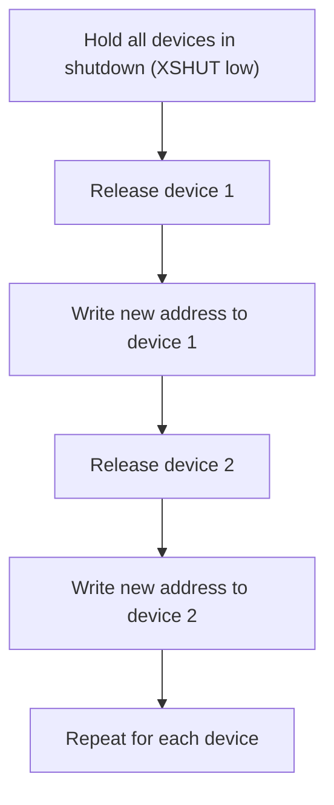
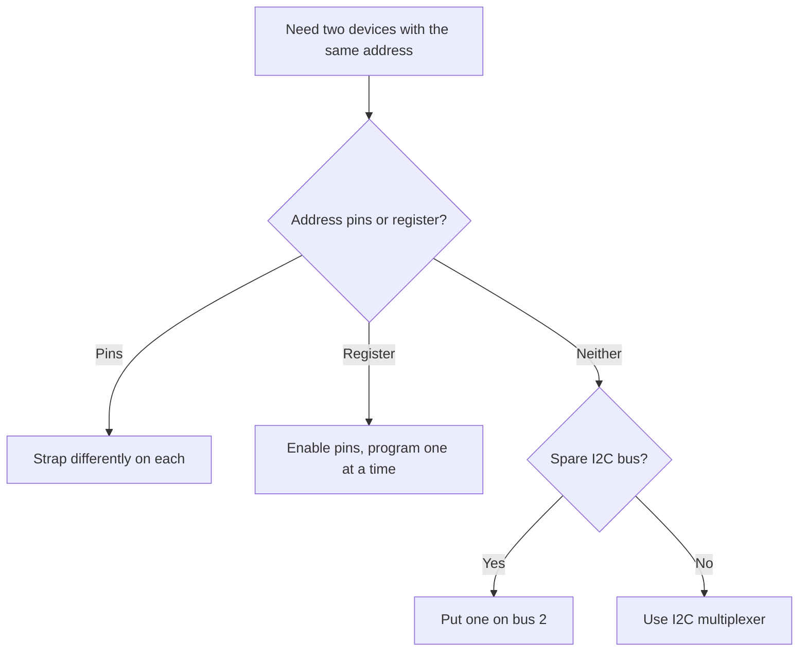

::: basics
### In plain words
Two I2C chips must not answer to the same address, or both respond at once and corrupt each other. Sometimes you can pick different addresses with pins on the chip. Some chips let software write a new address. If a chip's address is fixed, you can keep the two apart with a multiplexer or a second bus instead.

### Picture it
Imagine two houses on a street with the same number. The mail carrier can't tell them apart. You have several fixes. Choose different numbers when building, which is the pins. Repaint one number later, which is a programmable register. Or put the houses on different streets, which is a multiplexer or a second bus. Repainting has a catch: if the paint washes off whenever the power goes off, you must repaint each time.

### Words you need
- **Address-select pin**: a pin you tie to ground, supply or another level to choose one of a few addresses for the chip ([[q0749]]).
- **Default address**: the address a chip answers to right after power-up.
- **Programmable address**: a register where firmware can write a new address.
- **Volatile**: lost when power is removed, so it must be set again at every start.
- **Enable pin**: a pin that keeps a chip switched off until you release it.
- **Multiplexer**: a chip that connects one of several side-branches to the main bus ([[q0747]]).

### The simplest example
Four identical sensors all answer at 0x29 when powered. Each has an enable pin. Hold three disabled and release the first. Write its new address, 0x30. Release the second and write 0x31, and so on. Now all four have unique addresses, though you must repeat the routine at every power-up. A fixed-address chip needs a multiplexer instead. With three address pins, each tied high or low, a chip has $2^3 = 8$ addresses. Behind an 8-channel multiplexer, you can reach $8 \times 8 = 64$ such chips. That is the whole idea. The rest of this page covers each option.
:::

::: testing
Whether you know that a target's address is usually **set by the chip design, selectable by pins, or sometimes programmable**, and that "change" in practice often means "work around a collision". The interviewer wants a ranked list of options: address-select pins, software-programmable address registers (sometimes volatile, sometimes OTP or EEPROM), enable pins to bring identical parts up one at a time, I2C multiplexers, address translators, separate buses, and protocol-level dynamic addressing (SMBus ARP, I3C). Bonus: noticing that "I can't change it" is a real answer, and that 7-bit/8-bit confusion is a frequent false "wrong address" problem.
:::

::: why
Boards routinely need two devices of the same type (two IMUs, four ADCs, eight identical LED drivers), or hit a collision between unrelated parts that share a default address (a common example: an RTC and an IMU both defaulting to 0x68). The fix has to be designed in: the right pin straps on the schematic, a spare GPIO for an enable line, or a mux footprint. Discovering at bring-up that two parts cannot coexist means a respin or a flying-wire workaround. Interviewers ask this to see whether you design for it up front.
:::

::: concepts
- **7-bit address structure**: some bits fixed by the chip, a few configurable ([[q0749]]).
- **Address-select pins**: strapped to GND, VDD, SDA or SCL to pick one of 2 to 8 addresses.
- **Programmable address register**: firmware writes a new address; may be volatile or stored.
- **Enable/shutdown pins**: let you power up identical devices one at a time ([[q0746]]).
- **I2C multiplexer or switch**: gives each device its own branch so same addresses can coexist ([[q0747]]).
- **Dynamic addressing**: SMBus Address Resolution Protocol, I3C dynamic address assignment.
:::

::: answer
"In most cases you don't change a target's address in software; you choose it in hardware, and if that isn't possible you work around it. I'd go through the options in order.

First, address-select pins. Many parts have one to three pins, such as ADDR or A0 to A2, that you tie to ground or supply, and sometimes SDA or SCL, to pick among two to eight addresses. An ADS1115-style ADC, for example, gets four addresses depending on where its ADDR pin goes.

Second, some devices let you program a new address through a register, like many time-of-flight sensors. Those usually come up at a default address with all copies identical, so you hold all but one in shutdown with their enable pins, change the one's address, release the next, and so on. The register is often volatile, so you redo it after every power cycle.

Third, if you can't change addresses, you isolate the devices: an I2C multiplexer like the TCA9548A gives each device its own branch, or you put them on a second I2C bus.

Finally, there's dynamic addressing in SMBus and I3C, where the host assigns addresses. And before any of this, I make sure it isn't just the 7-bit versus 8-bit confusion, like 0x90 versus 0x48."
:::

::: technical
**Where the address comes from.** A 7-bit address is typically a fixed *base* defined by the part (for example 1001 0xx for a family) with 0 to 3 low-order bits selectable. Options, from simplest to most elaborate:

1. **Hard-wired:** one fixed address; cannot change. Fix by isolation (mux, second bus) or choosing a different part/address variant.
2. **Pin-strapped:** $n$ binary pins give $2^n$ addresses (1 pin = 2, 2 pins = 4, 3 pins = 8). Pins tied to a third level (SDA, SCL or a resistor divider) give more: for an ADDR pin tied to GND, VDD, SDA or SCL, there are 4 addresses, e.g. 0x48, 0x49, 0x4A, 0x4B for an ADS1115-style part.
3. **Register-programmable:** write the new 7-bit address to a configuration register (volatile, or committed to EEPROM/OTP). Because identical parts start at the same default, use enable/XSHUT pins to configure them one at a time.
4. **Dynamic assignment:** SMBus **ARP** (devices have a 128-bit UDID; the host assigns addresses to those that arbitrate) and **I3C** dynamic address assignment.
5. **Isolation instead of change:** I2C **multiplexer/switch** (for example 8 channels, 8 sensors of the same address, up to 64 per chip combination), **address translator** ICs, or a second hardware or software I2C bus.

**Counting.** With 3 binary address pins a part supports 8 addresses; 8 of them on one bus use 8 of the 112 usable addresses. With a mux of 8 channels and 8 address options per sensor type, you can address $8\times8=64$ sensors of that type.

**Ordering (identical parts with register-programmable address):** hold all in reset/shutdown; release device 1; write new address to device 1; release device 2 (it still answers at the default); write address 2; and so on. Needs one enable GPIO per device (or a shift register).

**7-bit vs 8-bit.** A datasheet "address 0x90" is the 8-bit write byte for 7-bit 0x48. Passing the wrong form looks like an address problem and is cured by shifting, not by hardware ([[q0749]]).
:::

::: short
"Usually you don't change it in firmware; you set it in hardware. Many parts have address pins strapped to ground, supply, SDA or SCL to pick among two to eight addresses. Some parts have a programmable address register, so with identical parts you use their enable pins to bring them up one at a time and give each a new address. If neither is possible, isolate them with an I2C multiplexer or a second bus. SMBus ARP and I3C also assign addresses dynamically."
:::

::: long
"My first question is whether the part lets you change its address at all, because there are four cases.

The simplest and most common is address-select pins. A part might have one to three pins you strap to ground or supply, sometimes to SDA or SCL too, and each combination gives a different address. With two binary pins you get four addresses, with three you get eight. That's a schematic decision: you tie the pins differently on each footprint.

The second case is a programmable address. Some parts, such as certain time-of-flight sensors, power up at a default address and have a register where you write a new one. If I have four identical ones, they'd all answer at the default address at once, so I hold three in shutdown using their enable pins, program the first, release the second, program that, and so on. It's usually volatile, so I redo it on every boot.

The third is when the address is fixed. Then I don't change it, I isolate. An I2C multiplexer lets me put each identical sensor on its own channel and select the channel before each access. Or I move one device to a second I2C peripheral on the MCU.

The fourth is protocol-level: SMBus has an Address Resolution Protocol, where the host assigns addresses to devices based on their unique IDs, and I3C has dynamic address assignment.

And before any of that I check it isn't a notation problem. A datasheet that says 0x90 and 0x91 is quoting the 8-bit read and write bytes, which is the 7-bit address 0x48. Shifting the address by one is a surprisingly common cause of 'wrong address'."
:::

::: terms
- **Address-select pin (ADDR, A0 to A2)**: pin strapped to set the low address bits.
- **Strap**: tying a pin to a fixed level (GND, VDD, SDA, SCL).
- **Default address**: address a part uses after power-up.
- **Volatile address**: lost at power-off; must be reprogrammed on boot.
- **XSHUT / EN**: shutdown or enable pin that holds a device inactive.
- **I2C mux / switch**: IC that connects one or more downstream branches to the upstream bus.
- **Address translator**: IC that remaps addresses on one side of a bus.
- **ARP**: SMBus Address Resolution Protocol, dynamic address assignment using a UDID.
- **DAA**: I3C Dynamic Address Assignment.
:::

::: exceptional
**An average answer** says "you can use the address pins on the chip".

**An exceptional answer**:
- Lays out a **ranked set of options** (pins, programmable register, isolation, dynamic addressing) and picks based on the situation.
- Explains the **enable-pin sequencing** trick for identical parts, and its **volatility** caveat.
- Counts addresses (**$2^n$** from $n$ pins, **8 × 8 = 64** with a mux) and notes the 112-address ceiling ([[q0747]]).
- Mentions **mux, translator, second bus** as ways to avoid changing anything.
- Brings up **7-bit vs 8-bit notation** as a false "wrong address".
- Mentions **SMBus ARP / I3C DAA** and notes that **layout and BOM** must plan for it (straps, enable lines, mux footprint).
:::

::: mistakes
- **Assuming any I2C device can be reprogrammed.** Many have a fixed address; check the datasheet first.
- **Programming a volatile address once at the factory** and assuming it stays after a power cycle.
- **Strapping two devices to the same address** (swapped jumpers or leaving a three-level pin floating). Leave address pins in defined states.
- **Forgetting that identical parts all answer at the default address at once.** Bring them up one at a time or use a mux.
- **Using the 8-bit value.** Library wants 7-bit 0x48; passing 0x90 sends the wrong byte ([[q0749]]).
- **Adding a mux but forgetting it has its own address**, which can collide too (typically 0x70 to 0x77).
:::

::: deep
## Why addresses collide

A 7-bit space has only 112 usable codes, and chip designers pick base addresses from the same shrinking pool. Popular parts pile up: a common RTC and a common IMU both default to 0x68; many temperature sensors sit at 0x48 to 0x4F; EEPROMs at 0x50 to 0x57. A board with a handful of parts and no planning will find one collision, and the question is how cheaply it can be fixed.

## Option 1: address-select pins

Parts typically fix the high bits and let you choose the low ones:

```circuit
{"caption":"Two identical ADCs on one bus, distinguished by the strap on the ADDR pin","elements":[
 {"t":"wire","pts":[[0,5],[22,5]]},{"t":"wire","pts":[[0,7],[22,7]]},
 {"t":"text","at":[-0.5,5],"text":"SCL","anchor":"end"},{"t":"text","at":[-0.5,7],"text":"SDA","anchor":"end"},
 {"t":"box","at":[3,10],"w":6,"h":5,"label":"ADC #1\n0x48","pins":[{"side":"top","pos":1,"name":"SCL"},{"side":"top","pos":3,"name":"SDA"},{"side":"bottom","pos":3,"name":"ADDR"}]},
 {"t":"wire","pts":[[4,5],[4,10]]},{"t":"dot","at":[4,5]},{"t":"wire","pts":[[6,7],[6,10]]},{"t":"dot","at":[6,7]},
 {"t":"wire","pts":[[6,15],[6,17]]},{"t":"gnd","at":[6,17]},
 {"t":"box","at":[13,10],"w":6,"h":5,"label":"ADC #2\n0x49","pins":[{"side":"top","pos":1,"name":"SCL"},{"side":"top","pos":3,"name":"SDA"},{"side":"bottom","pos":3,"name":"ADDR"}]},
 {"t":"wire","pts":[[14,5],[14,10]]},{"t":"dot","at":[14,5]},{"t":"wire","pts":[[16,7],[16,10]]},{"t":"dot","at":[16,7]},
 {"t":"wire","pts":[[16,15],[16,17]]},{"t":"rail","at":[16,17],"label":"V_{DD}","dir":"down"}
]}
```
Figure: The same part number twice. ADC #1 has ADDR tied to ground (0x48); ADC #2 has ADDR tied to VDD (0x49). For a part like TI's ADS1115, tying ADDR to SDA or SCL gives 0x4A and 0x4B, so four copies can share a bus. (Values quoted from the commonly used device family; confirm in the datasheet.)

Counting: $n$ binary strap pins give $2^n$ addresses. One pin: 2. Three pins: 8. Parts using multi-level straps (GND/VDD/open, a resistor ratio, or a connection to SDA or SCL as on the ADS1115) give 3 or 4 options per pin.

Practical rules: tie strap pins firmly (do not leave them floating), put a 0 Ω/DNP footprint or solder jumper so the address can be changed after layout, and write the final address table on the schematic.

## Option 2: software-programmable address

Some parts offer a register for a new address. A common example is a family of laser time-of-flight sensors: all power up at the same default address, and each has a shutdown pin (XSHUT). The recipe:


Figure: Identical parts cannot be addressed separately until each has a unique address, so the shutdown pins serialise the configuration. Needs one GPIO (or an I/O expander output) per device.

Details to check in the datasheet: the register that holds the address (for the typical ToF part this is a single register that stores a 7-bit value); whether the new address is **volatile** (lost at power-off, so repeat every boot) or can be written to non-volatile memory; and whether the part must be in a specific state first. Some parts store the address in EEPROM or OTP: write once at the factory or in a programming fixture, then all devices of that variant are unique.

> [!UNCERTAIN]
> Register names, addresses and volatility differ per device (for example a ToF sensor's address register is device-specific). Treat the sequence above as the general pattern and confirm the exact registers in the datasheet or API.

## Option 3: isolate instead of change

If the address cannot be changed:

- **I2C multiplexer/switch** (for example an 8-channel part such as TI's TCA9548A): firmware writes a channel-select byte to the mux (at 0x70 to 0x77), then talks to the device on that branch at its default address. Eight channels × eight address options gives 64 sensors of one type. The mux's own address must not clash with anything.
- **Second I2C bus:** many MCUs have two or more I2C peripherals. Put the colliding part on bus 2. Cheapest if a peripheral is spare.
- **Software (bit-banged) I2C** on two spare GPIOs: slow but works for a rarely accessed device.
- **Address translator IC:** remaps one address range to another on a downstream segment (vendor-specific).
- **Choose a different variant or part:** a device with a different default or more strap options.


Figure: A quick decision tree. Strap pins are free; a spare bus costs nothing but pins; a mux costs one IC and firmware.

## Option 4: dynamic addressing

- **SMBus ARP:** each device has a 128-bit unique device ID (UDID). The host runs a protocol where devices arbitrate (using the unique ID) and the host assigns each a free address. Used in PMBus power systems and some PC subsystems.
- **I3C DAA:** the controller assigns dynamic addresses to targets using their unique IDs (provisioned ID); legacy I2C targets keep their static addresses.

Both avoid per-part strap logic but need devices and controllers that implement them.

## Don't forget notation

Half of "my target is at the wrong address" problems are notation. If the datasheet shows 0x90/0x91 and a scan shows 0x48, nothing is wrong: 0x90 = 0x48 ≪ 1. Cross-check with a bus scan and the table in [[q0749]]. Another notation trap: some datasheets give the address with the strap bits as "X": 1001 0A1A0 means choose the last two bits.

## Planning checklist

1. List every I2C part and its default/selectable addresses on one table.
2. Resolve collisions by picking strap options; mark leftover collisions.
3. For leftover collisions decide: enable-pin sequencing, second bus, or mux.
4. Reserve footprints and spare GPIOs now, since layout fixes are expensive later.
5. Add an address-scan step to bring-up firmware and print the result.
6. Verify the mux's own address is free.

### Worked example

A board needs: 4 identical ToF sensors (default 0x29, programmable), an IMU (0x68), an RTC (0x68), and an EEPROM (0x50).

- The IMU/RTC collision: IMU's AD0 pin high changes it to 0x69 (a typical option for that part). Cost: one pull-up. Done.
- ToF sensors: use four XSHUT lines from a GPIO expander or MCU pins; boot sequence assigns 0x30, 0x31, 0x32, 0x33; add a "reprogram on every power-up" step in firmware.
- Total addresses used: 4 + 1 + 1 + 1 = 7 of 112. No mux required, saving a part and its address.
:::

::: applications
- **Multi-sensor arrays**: four identical ToF or proximity sensors programmed to unique addresses at boot.
- **ADC/DAC banks**: several identical converters using ADDR straps (for example 4 on a bus).
- **LED driver chains**: several drivers selected by address pins.
- **Server and PC motherboards**: SMBus muxes and DIMM SPD EEPROMs at different strap addresses (0x50 to 0x57).
- **Multi-camera or multi-IMU robots**: an I2C mux per sensor cluster.
- **Production line**: EEPROM-based address stored once at manufacture to individualise modules.
:::

::: assumptions
- The answer is about **7-bit addressing**. 10-bit devices follow the same ideas.
- Specific parts named (an ADS1115-style ADC, a laser ToF sensor, a TCA9548A-style mux, common RTC and IMU defaults) represent widely used examples, with addresses as typically documented; confirm per datasheet.
- Whether a programmable address is **volatile** depends on the device. Assume volatile unless the datasheet says otherwise.
- The count of addresses assumes no reserved-range overlap and only parts that implement the stated straps.
- "Change a slave's address" is interpreted as *select, program or work around*; some interviewers mean only the programmable-register case.
:::

::: followups
### Four identical sensors all power up at 0x29 and have XSHUT pins. How do you give each a unique address?
Hold all in shutdown. Release sensor 1, write its address register to 0x30, release sensor 2, write 0x31, and so on. The default address 0x29 is only used by the one device that is out of shutdown at that moment. Repeat at each power-up if the address is volatile. Cost: one GPIO per device (or an expander).

### Two parts have fixed identical addresses and you have no spare I2C peripheral. What do you do?
Add an I2C multiplexer/switch and put each on its own channel; select the channel before each access. Or use software I2C on two spare GPIOs for the less frequently used device. Or choose an alternate part or address variant.

### A device's ADDR pin can be tied to GND, VDD, SDA or SCL. How many addresses does it provide, and what is the layout risk?
With GND, VDD, SDA and SCL options it gives 4 addresses (like the ADS1115). Connecting ADDR to SDA or SCL means it is tied to a signal, so layout must route it from the right net; a mistaken jumper picks the wrong address silently. Mark the strap clearly.

### Can you change a device's address while the bus is running?
Only if the device supports it, and then only during a safe moment: after the write completes the device answers on the new address immediately and not on the old, so firmware must stop using the old address. If another controller is also on the bus it needs to know. With a volatile register, a reset restores the default.

### What does the SMBus ARP do that pins can't?
It assigns addresses automatically at run time to devices that share a default address, using each device's 128-bit unique ID to arbitrate. That supports plug-in modules where straps are impractical, at the cost of ARP-capable devices and host software.
:::

::: interpretations
"How can you change a slave's address?" is posed as if the answer is a single technique. In practice the answer is a **menu**: pin straps, programmable registers, dynamic assignment, or avoiding the change via isolation. If the interviewer meant only "can software change it?", say: sometimes (programmable devices), and often the address register is volatile. The address-space limits are in [[q0747]] and frame notation in [[q0749]].
:::

::: references
- NXP, *UM10204: I2C-bus specification and user manual*: addressing and reserved addresses (and the device-ID mechanism).
- SMBus specification: Address Resolution Protocol.
- MIPI Alliance I3C specification: dynamic address assignment.
- Datasheets of address-selectable parts (ADCs, IMUs, RTCs) and I2C mux/switch ICs such as the TI TCA9548A family: the address tables and application notes.
:::

::: rubric
- States that address is set by hardware straps, sometimes programmable, and sometimes fixed :: Correct framing of "change".
- Describes address-select pins and counts addresses ($2^n$) :: The most common practical solution.
- Describes programmable addresses with enable-pin sequencing and volatility :: Handles identical parts.
- Describes isolation: mux, second bus, translator :: What to do when addresses are fixed.
- Mentions SMBus ARP or I3C dynamic addressing :: Shows breadth.
- Mentions 7-bit vs 8-bit notation confusion :: A frequent real problem.
- Notes planning at schematic time (spare GPIOs, footprints, address table) :: Design foresight.
:::

::: quiz
```json
[
 {"type":"numeric","level":"fundamental","q":"A part has 3 binary address-select pins. How many different I2C addresses can it be configured for?","answer":8,"tolerance":0.01,"unit":"addresses","explain":"Each binary pin doubles the choices, so $2^3 = 8$ distinct addresses (for example 0x48 to 0x4F)."},
 {"type":"numeric","level":"intermediate","q":"You put identical sensors that each offer 4 address options behind an 8-channel I2C multiplexer. What is the maximum number of such sensors you can address?","answer":32,"tolerance":0.01,"unit":"sensors","explain":"8 channels × 4 addresses per channel = 32 sensors of that type."},
 {"type":"mcq","level":"fundamental","q":"Which is the most common way to give two identical I2C sensors different addresses on the same bus?","options":["Reprogram the I2C controller","Tie their address-select pins to different levels","Use different pull-up values","Use different clock speeds"],"answer":1,"explain":"Strapping the ADDR/A0..A2 pins to different levels selects different low address bits. If the part lacks such pins, use a mux or a second bus."},
 {"type":"mcq","level":"intermediate","q":"Four identical sensors power up at the same default address and have a shutdown pin and a programmable address register. What is the correct procedure?","options":["Write the new address to all four at once","Hold all but one in shutdown, program that one, release the next, and repeat","Use the general call to give each a unique address","Cannot be done"],"answer":1,"explain":"All copies answer at the default, so writing at once would hit all of them. Shutdown pins let you configure one at a time."},
 {"type":"truefalse","level":"intermediate","q":"A programmable I2C address stored in a register is always retained after power-off.","answer":false,"explain":"Many are volatile and reset to the default at power-up, so firmware must reprogram them on every boot unless the datasheet says the value is stored in non-volatile memory."},
 {"type":"numeric","level":"advanced","q":"A datasheet says the device's write address is 0x96. What 7-bit address should a 7-bit-address library use? Answer in decimal (0x4B = 75).","answer":75,"tolerance":0.01,"unit":"","explain":"0x96 ≫ 1 = 0x4B = 75. The datasheet quotes the 8-bit write byte."}
]
```
:::
