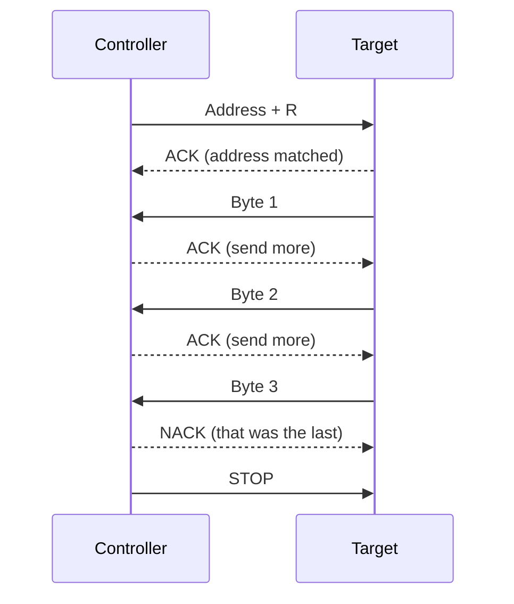
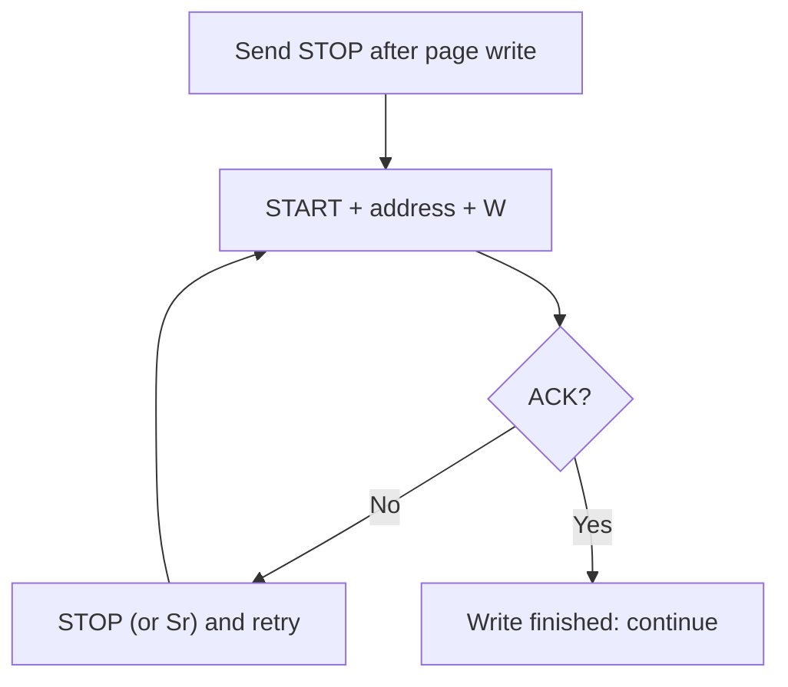

::: basics
### In plain words
After every byte on an I2C bus, there is one extra clock tick, the ninth. On it, the receiver of the byte answers. If it accepted the byte, it pulls the data wire low. That is an ACK. If it does nothing, the wire stays high, which is a NACK. So a NACK is not a message that anyone sends. It is silence. What a NACK means depends on where it happens, and it is not always an error.

### Picture it
Think of a teacher taking roll. The teacher calls a name, and a raised hand means "here". No hand means nothing happened, but you can't tell why. The student might be absent, might not have heard, or might be busy. I2C works the same way. A raised hand is the receiver pulling the wire low, and silence is the wire's pull-up resistor lifting it to high. The silence tells you only that nobody confirmed, and finding out why is your job.

### Words you need
- **ACK**: the receiver pulls the data wire low on the ninth clock, meaning "got it."
- **NACK**: the wire stays high on the ninth clock, meaning nobody confirmed.
- **Receiver**: whichever chip just received the byte. It makes the reply. On a read, that is the controller.
- **Bus scan**: sending each address and noting which chips ACK, to find what is on the bus.
- **ACK polling**: repeatedly addressing a memory chip until it ACKs, which shows its internal write has finished.

### The simplest example
A NACK after the address means no chip answered: wrong address, no power, or missing pull-ups. A NACK after a byte the controller wrote means the chip rejected it. At the end of a read, the controller NACKs the last byte on purpose, so the chip lets go of the wire and a STOP can follow. A memory chip busy with an internal write NACKs its address. One poll takes about 11 clock ticks, 110 µs at 100 kHz, so a 5 ms write is polled about 45 times. That is the whole idea. The rest of this page covers each case and fault-finding.
:::

::: testing
Whether you know the **mechanics** of the ninth bit (the *receiver* pulls SDA low for ACK; leaving it high is NACK), **who is the receiver in each case**, and what a NACK can *mean* depending on where it occurs: after the address (no device, wrong address, busy), after a written data byte (rejected), or from the controller after the last byte of a read (deliberate "I'm done"). Bonus: ACK polling on EEPROMs, how a bus scan works, and why a missing device shows up as NACK purely because of the pull-up.
:::

::: why
ACK and NACK are the only feedback an I2C controller gets, and almost every I2C debugging session boils down to "which byte got the NACK?". A NACK after the address means wiring, power or address trouble. A NACK on a data byte means a register or timing problem. Recognising a deliberate controller NACK versus an error NACK avoids wasted hours chasing a non-problem. It is also a sharp interview probe, since many candidates say "the slave sends a 1 for NACK" and forget that nobody drives a 1 on an open-drain bus.
:::

::: concepts
- **Ninth-clock handshake**: every byte is followed by one acknowledge clock ([[q0749]]).
- **Open-drain bus**: ACK is SDA actively pulled low; NACK is *no one* pulling, so the pull-up makes it high ([[q0761]]).
- **Receiver vs transmitter**: the receiver of the byte drives the ACK bit; roles swap on reads.
- **Address ACK as presence detect**: the basis of bus scans ([[q0746]]).
- **Controller NACK to end a read**: lets the target release SDA so STOP can happen ([[q0745]]).
- **Clock stretching and busy targets**: other ways a target says "not ready" ([[q0752]]).
:::

::: answer
"ACK and NACK are the acknowledge bit that follows every byte, on a ninth clock pulse.

On that ninth clock, the device that just *received* the byte is in charge. The transmitter releases SDA, and if the receiver accepted the byte it pulls SDA low: that's an ACK. If it doesn't pull SDA low, the pull-up leaves it high, and that's a NACK. So an ACK is an active low and a NACK is just nobody driving.

What a NACK means depends on when it happens. After the address byte, it means no device with that address answered: wrong address, not powered, held in reset, or busy. After a data byte written by the controller, the target is rejecting it, say an invalid register, a full buffer or it's busy. And during a read, the controller deliberately NACKs the last byte it wants, which tells the target to stop driving SDA so the controller can send a STOP.

A couple of practical uses: a bus scan just sends each address and sees who ACKs. And EEPROMs use ACK polling: during their internal write cycle they NACK their address, so the controller keeps trying until one ACKs, which means the write finished."
:::

::: technical
**Electrical mechanism.** After 8 data bits the *transmitter* of the byte releases SDA. Clock 9: the *receiver* may pull SDA low and hold it low through the whole SCL high period.

- **ACK** = SDA low during the 9th SCL high. Target must set up SDA low before SCL rises ($t_{SU;DAT}$ ≥ 250 ns Standard, 100 ns Fast) and hold it through the high.
- **NACK** = SDA high during the 9th SCL high (nobody drives; pull-up wins).

**Who ACKs:**

| Situation | Transmitter | Receiver (drives ACK) |
|---|---|---|
| Address byte | Controller | Target (if address matches) |
| Data byte, write | Controller | Target |
| Data byte, read | Target | Controller |

**Meaning of a NACK by position:**

1. **After address+W or address+R:** no target at that address; target absent, unpowered, in reset or sleeping; wrong address (7 vs 8 bit); bus fault; target busy (EEPROM in a write cycle).
2. **After a data byte written by the controller:** target cannot accept it: invalid register or value, buffer full, command not allowed, busy. The controller should stop (send STOP) and handle the error.
3. **After a data byte read by the controller:** *not an error*. The controller NACKs the final byte to end the read; the target then releases SDA.
4. **Controller NACK before the end intentionally** (rare): abort a burst.

**ACK polling (EEPROM write completion).** A 24-series EEPROM does not ACK its address while it is programming the page (a few ms; the datasheet gives the maximum, often 5 ms). The controller repeats START + address+W until ACK appears. At 100 kHz one poll is about 11 clocks = 110 µs, so a 5 ms write is polled about 45 times; polling finishes as early as possible instead of using a worst-case fixed delay.

**Bus scan.** For each address 0x08 to 0x77: START, address+W, check ACK, STOP. Devices that ACK are present.
:::

::: short
"The ninth clock after every byte is the acknowledge. The receiver of the byte pulls SDA low for an ACK; if nobody pulls it, the pull-up leaves it high, which is a NACK. A NACK after the address means no device answered; after a written data byte it means the target rejected it; and on a read the controller deliberately NACKs the last byte so the target lets go of SDA for the STOP. EEPROMs use NACK on their address while busy, so you poll until it ACKs."
:::

::: long
"Every byte on an I2C bus is followed by a ninth clock for the acknowledge, and it's always the receiver of the byte that handles it.

After eight bits, the transmitter lets go of SDA. If the receiver accepted the byte, it pulls SDA low through the ninth clock pulse: that's an ACK. If the receiver does nothing, the pull-up resistor leaves SDA high: that's a NACK. The important detail is that an I2C line is open-drain, so a NACK isn't something a device sends; it's the absence of anyone pulling low.

Who's the receiver depends on direction. For the address byte it's the target. For data written by the controller it's the target. For data read from the target it's the controller, so the controller is the one ACKing or NACKing.

What a NACK means depends where it lands. After the address it means nobody home: wrong address, unpowered, in reset, or busy. After a data byte on a write it means the target rejected the byte, for example an invalid register or a full buffer, so I'd stop and report an error. And at the end of a read, the controller NACKs the last byte on purpose. That's not an error: it tells the target to release SDA so the controller can generate a STOP.

Two nice applications: a bus scan, which is just trying every address and seeing who ACKs, and ACK polling for EEPROMs. While an EEPROM is internally writing, it doesn't ACK its address, so the controller repeats START plus address until it does. At 100 kHz each attempt takes about a tenth of a millisecond, so you stop polling the moment the write completes instead of waiting the worst-case 5 ms."
:::

::: terms
- **ACK (acknowledge)**: receiver pulls SDA low during the 9th clock.
- **NACK (not acknowledge)**: SDA stays high during the 9th clock.
- **Receiver / transmitter**: the device accepting / driving the 8 data bits of that byte.
- **ACK polling**: repeatedly addressing a device until it ACKs, signalling it is ready.
- **Bus scan**: probing addresses to see which ACK.
- **Pull-up**: resistor making SDA high when nobody drives it ([[q0755]]).
- **$t_{SU;DAT}$**: data set-up time before SCL rises.
- **Page write**: EEPROM operation writing several bytes then starting an internal write cycle.
:::

::: exceptional
**An average answer** says "ACK is the slave pulling SDA low, NACK is high".

**An exceptional answer**:
- Specifies **who drives** it (the receiver), that **ACK = low and NACK = nobody driving**, and that it happens on **clock 9**.
- **Maps NACK meaning to position**: address, written data, end of read.
- Explains the **deliberate controller NACK** at the end of a read, and why (target must release SDA for STOP).
- Gives **uses**: bus scan, EEPROM ACK polling with a numeric estimate.
- Mentions **related signals** like clock stretching for "not ready".
- Describes what to **do on a NACK** (STOP, retry, report).
:::

::: mistakes
- **"The target sends a 1 for NACK."** No device drives a 1 on open-drain SDA; the pull-up makes it high.
- **Calling every NACK an error.** The final NACK of a read is correct behaviour.
- **Ignoring return values.** Treating a write as successful after a NACK leads to silent data loss.
- **Reading the data after a NACKed address anyway.** You get 0xFF (or stale data) from a released bus.
- **Forgetting that the controller ACKs reads.** If the controller ACKs the final byte, the target keeps sending and the STOP collides with its data.
- **Waiting a fixed worst-case time for EEPROM writes** instead of polling, wasting milliseconds ([[q0746]]).
:::

::: deep
## The ninth bit as a conversation

Each byte transfer is a short exchange: "here are 8 bits" followed by "got them" or not. Because the physical layer is open-drain, the two answers are asymmetric:

| Answer | What the bus does | Who acts |
|---|---|---|
| ACK | SDA pulled low for the 9th SCL high | receiver actively drives low |
| NACK | SDA stays high (pull-up) | nobody acts |

```timing
{"signals":[{"name":"SCL","wave":"110101010101010101011"},{"name":"SDA controller","wave":"u0uu00uuzz00uuuuzz00u","color":"accent"},{"name":"SDA target","wave":"zzzzzzzz00zzzzzzzzzzz","color":"orange"},{"name":"SDA bus","wave":"101100110000111111001"}],"hscale":0.6,"marks":[{"t":8,"label":"ACK"},{"t":16,"label":"NACK"}]}
```
Figure: Two bytes on the bus. In the first byte (bits 1, 0, 1 shown), the target pulls SDA low on the ninth clock: the SDA-bus row dips low while the controller row shows it released (dashed) and the target row shows it driving low: ACK. In the second byte nobody drives on the ninth clock, so the bus rises to the pull-up level: NACK. Then the controller issues STOP.

Note how a NACK is visible only as "the line stayed up": nothing happened. That makes it also the natural result of a missing device, a dead device or an unpowered device.

## Reading NACKs by position

### NACK after the address

This is the most common failure at bring-up. Check, in order:

1. Is the address right (7-bit vs 8-bit)? ([[q0749]])
2. Is the target powered and out of reset? Is its I/O supply present?
3. Are SDA and SCL connected and not swapped? Do both reach $V_{DD}$ when idle (pull-ups)?
4. Is the clock rate within the target's range? Is the bus capacitance too high ([[q0759]])?
5. Is the target busy (EEPROM writing, ADC converting, MCU target not ready)?

The scope view: on the ninth clock SDA stays high. With a logic analyzer: `S 0x90 W N` (N for NACK).

### NACK after a data byte (write)

The target heard the address but refused the byte. Typical causes: invalid register address, write to a read-only register, device busy, command not valid in the current mode, or a buffer-full condition on a microcontroller target. The controller should stop with a STOP, since further bytes would be meaningless.

### NACK from the controller (read)

The controller is the receiver on read data bytes, so it ACKs ("send the next byte") or NACKs ("that was the last one"). For a 3-byte read the sequence is ACK, ACK, NACK. After the NACK the target releases SDA and the controller makes a STOP.


Figure: A three-byte read. The target drives the data; the controller drives the ACK/NACK bits. The last NACK is a deliberate "enough", not a fault.

## ACK polling in detail

A 24-series serial EEPROM latches a page of data and then performs an internal write that takes several milliseconds. During that time it does not respond to its address. The controller therefore repeats:


Figure: The polling loop. A NACK here means "still busy", not "fault". Add a limit (for example, give up after the datasheet's maximum write time plus margin) so a dead EEPROM doesn't hang the firmware.

Timing: one poll is START plus a 9-clock address frame plus STOP, about 11 clocks. At 100 kHz that is 110 µs, so over a 5 ms write the controller polls about 45 times; at 400 kHz about 27.5 µs per poll. The benefit: if the part finishes in 3 ms, you wait 3 ms, not 5 ms, and across hundreds of page writes that is real time saved.

> [!UNCERTAIN]
> The maximum write-cycle time (commonly quoted as about 5 ms for 24-series EEPROMs) depends on the part. Use the datasheet's value for your device when setting a polling timeout.

## ACK on a bus scan

A scan sends START + address + W + STOP for each address in 0x08 to 0x77 and records ACKs. At 100 kHz that's about 112 × 11 clocks ≈ 12 ms. Cautions: a write-direction probe to an unknown device can have side effects (a few devices treat a lone address+W as a command), and a few targets also respond poorly to read probes. Use scanning in bring-up, not in production.

## Electrical details of the ACK

- The receiver must pull SDA to below $V_{IL}=0.3V_{DD}$ with its $V_{OL}$ ≤ 0.4 V and **hold it stable during the entire high period of the 9th clock**.
- It must set SDA low before SCL rises (set-up time), or the controller may sample a high.
- If the target needs more time to compose the ACK (a software-driven target), it can **stretch the clock** until ready ([[q0752]]).
- A low that is not low enough (high $V_{OL}$, ground offset, weak driver) may be read as NACK, a classic marginal-bus symptom ([[q0760]]).

## What a library does with ACK/NACK

Hardware peripherals set status flags (ACK failure, NACK received, bus error) and raise interrupts. A good driver translates them to error codes: `ERR_ADDR_NACK` (no device), `ERR_DATA_NACK` (rejected), `ERR_BUS` (arbitration or stuck), `ERR_TIMEOUT`. Application code then decides to retry, reset the device or fall back.

## Summary of who does what

| Phase | Transmitter | Receiver | ACK driven by |
|---|---|---|---|
| Address | Controller | Target | Target |
| Write data | Controller | Target | Target |
| Read data (not last) | Target | Controller | Controller (ACK) |
| Read data (last) | Target | Controller | Controller (NACK) |
:::

::: applications
- **Bus scanners** that list responding addresses at bring-up.
- **EEPROM ACK polling** to detect write completion with minimal wait.
- **Presence detection** of optional modules (does the daughterboard ACK?).
- **Error handling in sensor drivers**: retry on NACK, power-cycle the sensor after repeated failures.
- **Logic-analyzer debugging**: finding which byte got the first NACK in a failing capture.
- **Hot-plug detection** of an I2C-based display (DDC/EDID) by trying its address.
:::

::: assumptions
- Standard I2C open-drain operation with pull-ups; the receiver, not the transmitter, drives the ACK bit.
- ACK-polling times assume 100 kHz and a roughly 5 ms internal write time, which are typical for 24-series EEPROMs; the datasheet governs.
- A bus scan using address+W is assumed safe for the devices on the bus; check for special devices that may react.
- Not all targets can distinguish "busy" from "invalid" with a NACK; some use clock stretching or status registers instead.
- Controller/target terminology replaces master/slave.
:::

::: followups
### Why does the controller NACK the last byte it reads?
Because the target keeps driving SDA as long as it is being ACKed. A NACK on the ninth clock tells it the transfer is over, so it releases SDA and the controller can create the STOP (SDA rising while SCL is high). ACKing the last byte would leave the target driving the next bit's data when the controller tries to make a STOP.

### You get a NACK on the register-pointer byte but the address was ACKed. What might be wrong?
The register address is invalid for that device, the register is read-only or the target is in a mode where the write isn't allowed (for example it needs to be unlocked first), or the target is busy (some sensors NACK while converting). Check the register map, the device state and timing; try the ID register to confirm the link, then work towards the failing register.

### How would you tell a dead device from a busy device based on NACKs?
A busy device (EEPROM mid-write) NACKs for a while then ACKs; poll with a timeout equal to the datasheet's maximum busy time. A dead or absent device NACKs forever, and the same address NACKs even right after power-up and reset. Also check pull-ups and supply, because a bus without pull-ups looks like everything NACKs.

### What if the target ACKs everything, including addresses that should not exist?
A stuck-low SDA reads as ACK on every ninth clock: the bus looks like all devices ACK. Measure SDA: if it is held low between transactions, some device is hung (or a short). Run the 9-clock recovery or power-cycle the culprit.

### Can a NACK ever be sent by the target during a read?
No. During read data bytes the controller is the receiver, so only the controller can ACK or NACK; the target's only way to signal trouble mid-read is to stretch the clock or stop providing meaningful data. If the target does not respond to the address, the NACK appears right after the address byte.
:::

::: interpretations
"Explain NACK/ACK" is a protocol-mechanism question; the answer centres on the ninth-clock handshake and what a NACK means in each position. It is a subset of the transaction story in [[q0745]], and the frame layout is in [[q0749]]. Master/slave wording in the source list is retained but controller/target is used here. If the interviewer asks about "NACK vs clock stretching", see [[q0752]].
:::

::: references
- NXP, *UM10204: I2C-bus specification and user manual*: the acknowledge bit, data transfer and the NACK cases (including the controller NACK to end a read).
- 24-series I2C EEPROM datasheets (for example from Microchip or onsemi): ACK polling flow charts and write-cycle times.
- Horowitz & Hill, *The Art of Electronics*, 3rd ed.: serial buses, I2C acknowledge.
- A logic analyzer's I2C decoder documentation, showing how ACK/NACK is annotated in captures.
:::

::: rubric
- Describes ACK as SDA pulled low on the 9th clock and NACK as SDA left high :: The basic mechanism.
- States the receiver drives the ACK (target on address/write data, controller on read data) :: Shows understanding of direction.
- Explains that NACK on an open-drain bus is the absence of driving, via the pull-up :: Connects to the physical layer.
- Gives NACK meanings by position (address, written data, end of read) :: Context-sensitive interpretation.
- Explains the controller's deliberate NACK on the last read byte and why :: A frequent trick question.
- Mentions ACK polling or bus scanning as applications :: Practical use.
- Mentions what the firmware does on NACK (stop, retry, error code) :: Robustness.
:::

::: quiz
```json
[
 {"type":"mcq","level":"fundamental","q":"How is an ACK physically signalled on an I2C bus?","options":["The receiver drives SDA high during the 9th clock","The receiver pulls SDA low during the 9th clock","The transmitter holds SCL low","SCL is pulsed twice"],"answer":1,"explain":"ACK is the receiver actively pulling SDA low during the 9th SCL high. A NACK is SDA left high (pull-up), because no device drives a 1 on an open-drain line."},
 {"type":"mcq","level":"fundamental","q":"The controller sends address+W and sees SDA high during the ninth clock. What does this mean?","options":["The target ACKed","No device acknowledged: a NACK on the address","The controller must send a repeated START","The bus has arbitration loss"],"answer":1,"explain":"SDA high on the 9th clock means nobody pulled it low: NACK. Typical causes: wrong address, target unpowered or in reset, missing pull-ups, or a busy target."},
 {"type":"truefalse","level":"intermediate","q":"When the controller reads from a target, the controller sends the ACK/NACK bit after each data byte.","answer":true,"explain":"The receiver of each byte drives the 9th bit. On reads the controller is the receiver, so it ACKs to request more and NACKs the last byte."},
 {"type":"numeric","level":"intermediate","q":"An EEPROM write takes up to 5 ms. Each ACK poll (START + address frame + STOP) costs about 11 clocks at 100 kHz. About how many polls fit in 5 ms?","answer":45,"tolerance":0.05,"unit":"polls","explain":"One poll = 11/100 kHz = 110 µs. 5 ms / 110 µs = 45.5, so about 45 polls."},
 {"type":"mcq","level":"intermediate","q":"The target ACKs the address but NACKs the first data byte of a write. Which is the most likely cause?","options":["No pull-up resistors","The target is missing from the bus","The target rejected the byte (invalid register/value, or busy)","The clock is too slow"],"answer":2,"explain":"An ACK on the address proves the link works and the target exists; a NACK on a data byte means the target refused that byte: invalid register or command, read-only register, buffer full, or busy."},
 {"type":"truefalse","level":"advanced","q":"If the controller ACKs the final byte of a read and then tries to send STOP, the transaction ends cleanly.","answer":false,"explain":"An ACK tells the target to send another byte, so it keeps driving SDA with the next bit while the controller tries to create the STOP edge. The controller must NACK the last byte so the target releases SDA."}
]
```
:::
