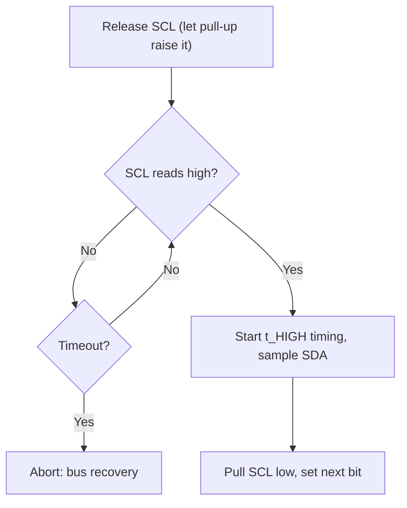

::: basics
### In plain words
Clock stretching is when an I2C target holds the clock wire low to tell the controller "wait, I'm not ready." It works because the clock wire is shared by all chips, and any chip can pull it low. The wire goes high only when everyone lets go. The controller must therefore release the clock, then check that it really went high before going on. It suits slow targets but costs speed.

### Picture it
Imagine a teacher dictating a sentence one word at a time to a student who writes. The teacher says each word and moves on at a steady pace. If the student needs more time, they hold up a hand, and the teacher waits until it goes down. The teacher must look up to see whether the hand is still raised. The hand is the target pulling the clock low.

### Words you need
- **Clock stretching**: a target holding the clock wire low to make the controller wait.
- **Wired-AND clock**: the clock wire is low if any chip pulls it low, and high only if all release it ([[q0761]]).
- **Release and check**: the controller lets go of the clock, then reads it back to see whether it is really high.
- **Timeout**: a limit on how long the controller will wait, so a stuck target can't hang everything.
- **Bit-banging**: running I2C in software by toggling pins by program, which is easy to get wrong here.

### The simplest example
At 400 kHz, one byte takes 9 clock ticks, which is 22.5 µs. Suppose the target stretches the clock 50 µs on every byte. Each byte now takes 72.5 µs, so the effective speed is 9 bits per 72.5 µs, about 124 kHz. A target that never lets go hangs the bus, so timeouts exist. That is the whole idea. The rest of this page covers why targets stretch and how to debug it.
:::

::: testing
Whether you understand that **SCL is open-drain too, so a target can hold it low** to make the controller wait, and that the controller must therefore *release SCL and check that it actually rose* before it continues. A good answer says why targets need it (they are slow, busy, converting, or software-driven), where in the transaction it normally happens, what it costs in throughput, and how it breaks things: bit-banged or hardware masters that ignore it, and a target that stretches forever. Mentioning the SMBus timeout and the arbitration/clock-synchronization link shows depth.
:::

::: why
Clock stretching is behind a whole category of mysterious failures: an I2C sensor that works on one MCU and returns garbage on another, a Raspberry-Pi-style controller that corrupts reads from a particular IMU, a firmware loop that hangs forever because the target never released SCL. It is also how microcontrollers acting as I2C targets buy time to run their ISR. Knowing exactly what the controller is supposed to do (release, wait for high, then count its high time) lets you diagnose it on a scope and write a correct bit-banged master.
:::

::: concepts
- **Open-drain SCL**: any device can hold the clock low; the line is high only when all release ([[q0761]]).
- **Wired-AND clock**: bus SCL = controller's SCL AND target's SCL ([[q0748]]).
- **Release-and-check**: a controller must read SCL back after releasing it.
- **Where stretching happens**: typically after the falling edge of SCL, often after the 8th or 9th bit ([[q0751]]).
- **Throughput cost**: each stretch adds to the byte time.
- **Timeouts**: SMBus 25 to 35 ms; recovery for a stuck-low SCL.
:::

::: answer
"Clock stretching is when a target holds SCL low to tell the controller 'wait, I'm not ready'.

Both lines are open-drain, so the controller isn't the only one that can pull SCL low. Normally the controller pulls SCL low, then releases it so the pull-up brings it high. If the target needs more time, for example a microcontroller target running an interrupt handler, or a sensor finishing a conversion, it holds SCL low after the controller has released it. Since the bus is a wired-AND, SCL stays low as long as the target wants. When the target lets go, SCL rises, and the controller continues.

So the controller has to do two things correctly: after releasing SCL, it must read it back and wait until it's actually high before starting its high-time count and before sampling or changing data. A controller that just waits a fixed time will clock while the target is still busy and get garbage.

The cost is speed, since each stretch adds to the byte time, so a 400 kHz bus with 50 microsecond stretches per byte behaves like about 124 kHz. And a target that never releases hangs the bus, so SMBus defines a timeout of around 25 to 35 milliseconds."
:::

::: technical
**Mechanism.** Controller drives SCL low, then releases it. Target, which also has an open-drain output on SCL, pulls SCL low (typically right after the falling edge, before the controller releases) and holds it for the time it needs, then releases. Bus SCL = controller AND target, so the rising edge occurs only when both have released. The controller must:

1. Release SCL.
2. **Sample SCL until it reads high** (with a timeout).
3. Only then start timing $t_{HIGH}$ and sample/advance SDA.

**Where.** The spec permits stretching on any SCL cycle, though in practice most targets stretch after receiving a byte or an address (between bit 8 and the ACK, or after the ACK) so that firmware can process it. Some peripherals stretch before the first bit.

**Effect on timing.** For a byte time at clock $f$: $T_{byte} = 9/f + t_{stretch}$. At 400 kHz, 9/f = 22.5 µs. With 50 µs of stretching per byte: 72.5 µs, effective bit rate $9/72.5\ \mu s = 124$ kHz. At 100 kHz with 100 µs stretches: 190 µs per byte, 47 kHz effective.

**Limits.** I2C itself has no maximum stretch time. SMBus defines $t_{TIMEOUT}$ of 25 to 35 ms (SCL low longer than that: devices must reset their interface), and the 10 kHz SMBus minimum clock means a device may not stretch indefinitely.

**Relationship to arbitration.** The same wired-AND on SCL implements **clock synchronization** between multiple controllers ([[q0748]]): the bus low time is the longest low, the high time the shortest.

**Who can fail:**

- **Controllers that do not check SCL** (bit-bang loops with delays, or hardware masters that lack stretch support).
- **Targets that stretch without limit** because of a firmware or hardware hang.
- **Pull-up too weak:** a slow-rising SCL after release can be mistaken for continued stretching, or vice versa.
:::

::: short
"Clock stretching is a target holding SCL low to make the controller wait. Because SCL is open-drain, the bus only goes high when both release it. After releasing SCL, the controller must read it back and wait for it to actually go high before continuing. It's used by slow targets like MCUs running an ISR or sensors mid-conversion. The downside is lower throughput and, if a target never lets go, a hung bus, which is why SMBus has a roughly 25 to 35 ms timeout."
:::

::: long
"Clock stretching is how an I2C target slows the controller down. 

The clock line, SCL, is open-drain just like SDA. The controller normally pulls it low and lets the pull-up bring it high. But the target is also connected to SCL with an open-drain output, so it can hold it low too. If it holds SCL low after the controller has released it, the line stays low until the target lets go. The bus is a wired-AND, so it only rises when everyone has released.

A target does this because it needs time: a microcontroller acting as a target may need to run an interrupt service routine to handle a byte or prepare the next one, or a sensor may need to finish a measurement before it can return data. The stretch usually happens right after the falling edge of SCL, often at the end of a byte around the ACK.

For the controller, the rule is: after releasing SCL, read the pin and wait until it's really high, then begin counting the high time. A hardware peripheral with stretch support does that automatically. A bit-banged master that just waits a fixed delay doesn't, and ends up clocking while the target is still busy, which gives corrupted data. Some hardware controllers also have had known issues with it.

The cost is bandwidth: each stretch adds directly to the byte time, so at 400 kHz with a 50 microsecond stretch every byte, the effective rate is about 124 kHz. And there's a hang risk if a target never releases, which is why a controller should have a timeout and SMBus defines a 25 to 35 millisecond limit. The same wired-AND SCL behaviour is what lets two controllers synchronize their clocks."
:::

::: terms
- **Clock stretching**: a target holding SCL low to delay the controller.
- **Wired-AND SCL**: bus clock is low if any device pulls it low.
- **Release-and-check**: controller reads SCL after releasing to detect stretching.
- **Clock synchronization**: multi-controller version of the same wired-AND ([[q0748]]).
- **$t_{TIMEOUT}$**: SMBus SCL-low timeout (25 to 35 ms).
- **Bit-banging**: implementing I2C in software on GPIOs.
- **Target busy**: ISR running, conversion in progress, flash write, etc.
- **Bus recovery**: clocking SCL and issuing STOP to clear a hang ([[q0745]]).
:::

::: exceptional
**An average answer** says "the slave holds SCL low to slow the master".

**An exceptional answer**:
- Explains **why it is possible**: SCL is open-drain and the bus is wired-AND.
- States the controller's obligation: **release, read back, wait for high, then start timing**.
- Names **real reasons** for stretching (ISR, conversion) and **where** it occurs (after the byte / around ACK).
- **Quantifies** the cost ($T_{byte} = 9/f + t_{stretch}$; 124 kHz example).
- Names **failure modes**: bit-banged masters, controllers without support, indefinite stretch, weak pull-up confusion.
- Mentions the **SMBus timeout** and the **link to multi-master clock synchronization**.
:::

::: mistakes
- **"Only the master drives the clock."** Targets can hold it low; the controller must observe SCL.
- **Using a fixed delay in a bit-banged master** instead of waiting for SCL to read high.
- **Treating slow SCL rise as stretching** (or the reverse). A weak pull-up with large capacitance also makes SCL rise slowly; check with a scope to see whether the low is *held* or *RC*.
- **Not putting a timeout on the wait loop.** A target that never releases hangs the firmware.
- **Assuming all controllers support stretching.** Verify the MCU's I2C peripheral (or the single-board computer's) and any errata.
- **Mixing up stretching with clock *synchronization*** or with a NACK. Stretching delays the clock; NACK refuses the byte.
:::

::: deep
## The idea in one picture

A normal bit: the controller pulls SCL low, changes SDA, releases SCL, the pull-up raises it, the receiver samples, the controller pulls low again. Stretching inserts one more actor: the target holds SCL low longer than the controller wants.

```timing
{"signals":[{"name":"SCL controller","wave":"0u0uuu0u0u","color":"accent"},{"name":"SCL target","wave":"zz000zzzzz","color":"orange"},{"name":"SCL bus","wave":"0100010101"},{"name":"SDA","wave":"1100001100"}],"hscale":1.2,"spans":[{"from":3,"to":5,"row":2,"label":"stretched"}]}
```
Figure: The orange row is the target. It begins holding SCL low just after a falling edge (period 2). The controller (blue) releases SCL at period 3 (dashed means "released"), but the bus row (bottom) stays low until the target releases at period 5: the stretch. SDA does not change during it. Only at period 5 does the bus clock rise and the controller can continue; its measured high time starts then.

### Why it works electrically

Both devices have an NMOS pulling SCL to ground and nothing pulling it up except the resistor. The truth table is the AND again:

| Controller SCL | Target SCL | Bus SCL |
|---|---|---|
| released | released | high |
| low | released | low |
| released | low | **low (stretch)** |
| low | low | low |

The controller's *own pin* reads the bus level, so a controller that releases and then reads sees "still low", which is how it knows someone is stretching. That is the only mechanism; no special wire or protocol field exists.

```sim
{"id":"i2c-bus","address":"0x48","rw":"r","data":["0x0C","0x80"],"stretch":true}
```
Figure: With clock stretching enabled, the waveform shows SCL held low by the target between bits. Compare it with the same transaction with stretching off, and notice the longer overall time but identical data.

## Why targets stretch

1. **Microcontroller as a target.** A software or hardware-assisted I2C target needs time to service an interrupt: receive the byte, check the address, prepare the next byte. Stretching lets a slow core keep up with a fast controller.
2. **Sensors finishing a measurement.** Some sensors stretch SCL in a read until the conversion is done instead of requiring a separate wait or polling (certain humidity and gas sensors offer a "clock stretching" measurement mode, as an alternative to polling).
3. **Memory and flash-based devices** that need to complete an internal operation.
4. **Flow control in bridges:** an I2C-to-something bridge stalls the bus while its other side is busy.

## Where stretching occurs

The spec allows it at any SCL cycle, but implementation patterns:

- **After the address byte**, before ACK: "I recognised my address, wait while I get ready."
- **After each data byte**, before or after the ACK bit: so the target can process the byte.
- **Before the first data bit of a read**: the target needs time to fetch data.

A hardware controller's stretch support lets it freeze its clock counter while SCL is held low.

## The controller's job


Figure: What a stretch-aware controller does for every clock pulse. A fixed delay in place of the "SCL reads high?" loop is the classic bug in bit-banged I2C.

A bit-banged implementation sketch (pseudocode):

```c
// release SCL and wait for it to actually go high (target may be stretching)
static bool scl_release_wait(uint32_t timeout_us) {
    scl_release();                      // open-drain: let the pull-up raise it
    while (!scl_read()) {               // still low => someone is holding it
        if (--timeout_us == 0) return false;   // give up: bus hung
        delay_us(1);
    }
    return true;
}
```
Figure: The critical line is the `while (!scl_read())` loop. After it exits, the controller starts counting $t_{HIGH}$ (at least 4.0 µs in Standard mode, 0.6 µs in Fast), then reads or drives SDA and pulls SCL low again.

## Cost: throughput

$$T_{byte} = \frac{9}{f_{SCL}} + t_{stretch}$$

| $f_{SCL}$ | $t_{stretch}$ per byte | Byte time | Effective rate |
|---|---|---|---|
| 400 kHz | 0 | 22.5 µs | 400 kHz |
| 400 kHz | 50 µs | 72.5 µs | 124 kHz |
| 100 kHz | 0 | 90 µs | 100 kHz |
| 100 kHz | 100 µs | 190 µs | 47 kHz |

So a target that stretches 50 µs per byte means a 400 kHz bus is effectively no faster than one running near 124 kHz; running the clock faster gains little. The engineering conclusion: if a target stretches for tens of microseconds per byte, there is little point in 400 kHz; either use the slower mode or choose a faster target.

## Failure modes and what they look like

| Symptom | Likely cause | How to confirm |
|---|---|---|
| Reads return shifted or corrupted data from one specific target | Controller ignores stretching (bit-bang or limited hardware) | Scope: SCL held low longer than the controller's clock expects; data sampled during the low |
| System hangs waiting on I2C | Target stretches forever (hung firmware/brown-out) or SCL shorted low | SCL low for many ms; no timeout in code |
| Intermittent errors only at 400 kHz | Weak pull-up with high $C_b$: slow rise mistaken for stretching or violating $t_{HIGH}$ | Scope the rising edge ([[q0759]]) |
| Works with one MCU but not another | Hardware master stretch handling differs | Check errata; try software master |

> [!UNCERTAIN]
> It is widely reported that the I2C hardware in some single-board-computer SoCs (for example the original Raspberry Pi's BCM2835 peripheral) mishandles clock stretching, so stretch-heavy targets misbehave and people fall back to software I2C or a slower clock. This comes from community reports rather than a vendor document, so check the current errata for the exact part before relying on it.

## Recovery

If SCL is stuck low for longer than expected:

1. Check whether it is the target holding it (scope, then power-cycle or reset the target).
2. SMBus targets must release the bus after the 25 to 35 ms timeout.
3. A controller cannot force SCL high; the only fixes are resetting the offending device, isolating the segment (a bus switch or buffer), or power-cycling.
4. If SDA is stuck low instead, use the 9-clock recovery (SCL toggles) then STOP ([[q0745]]).

## Design guidance

- Prefer targets and controllers that are specified to work with stretching; check datasheet notes like "supports clock stretching up to X µs".
- If using a software I2C master, implement the wait-with-timeout loop.
- Avoid depending on stretching for long operations; use a status register or interrupt line for conversions that take milliseconds.
- When mixing a hardware controller with an unknown target, test at the intended speed with a scope for any SCL-low periods longer than the clock's low time.
:::

::: applications
- **MCU as I2C target**: stretches while the ISR prepares the next byte.
- **Humidity/temperature sensors with a "clock stretching" measurement mode** that holds SCL until the reading is ready.
- **SMBus battery gauges** that may stretch while they update their registers.
- **I2C bridges and expanders** pausing the bus when their downstream side is busy.
- **Embedded Linux boards** where drivers must choose between hardware and bit-banged I2C depending on stretch support.
- **Logic-analyzer debugging** of "slow" transactions: SCL-low periods much longer than the programmed clock indicate stretching.
:::

::: assumptions
- Standard I2C with open-drain SCL; "target" and "controller" terminology (master/slave in older documents).
- Stretching examples assume a target holds SCL low after a falling edge; the spec allows it anywhere, with device-specific habits.
- Effective-rate calculations ignore START/STOP and address overhead.
- The SMBus timeout (25 to 35 ms) applies to SMBus-compliant devices, not to plain I2C where there is no maximum.
- Statements about specific SoCs' stretch handling are reported from community knowledge and flagged above as uncertain.
:::

::: followups
### A bit-banged I2C master reads garbage from one sensor only. How do you test for clock stretching?
Scope SCL and SDA together while reading. If SCL stays low after the controller releases it (the controller's falling-to-rising time is much longer than its programmed low time), the target is stretching. Fix the master to read back SCL and wait for it to go high before continuing, with a timeout.

### Why can't the controller just wait a fixed worst-case time instead of reading SCL?
It could, but then every transaction would run at the worst-case speed, and for targets with unbounded stretch no fixed delay is safe. Reading SCL back adapts to however long the target needs and keeps the fast path fast.

### What is the difference between clock stretching and a NACK?
A NACK refuses or finishes a byte: it is a 9th-clock response. Stretching delays the clock edge: the byte is still pending. A target that is busy may do either: NACK the address (EEPROM mid-write, so the controller polls) or stretch (so the controller waits). The datasheet says which.

### Your 400 kHz bus runs at about 130 kHz effective on one target. What do you suspect?
Clock stretching: roughly 50 µs of extra low time per byte gives $9/(22.5+50\ \mu s) = 124$ kHz. Confirm on a scope; consider reading in larger bursts (fewer stretch events), using the target's interrupt/data-ready line instead of reading while it converts, or running at 100 kHz and accepting the target's pace.

### How does a multi-controller bus use the same mechanism?
Each controller drives SCL open-drain too. The bus low time is set by the longest low and the high time by the shortest high, so the controllers' clocks synchronize. Arbitration then compares SDA bits. See [[q0748]].
:::

::: interpretations
"Explain clock stretching" assumes the I2C context. It is the clock-line counterpart of ACK/NACK ([[q0751]]) and a consequence of open-drain wired-AND wiring ([[q0761]]). In the SPI section there is no equivalent: SPI has no stretching because the controller owns the clock, and devices that need time use a busy/ready pin or a status register.
:::

::: references
- NXP, *UM10204: I2C-bus specification and user manual*: clock stretching and clock synchronization sections.
- SMBus specification: $t_{TIMEOUT}$ and the requirement that devices release the bus.
- An MCU or SoC reference manual's I2C chapter and errata for how the peripheral handles stretching.
- Horowitz & Hill, *The Art of Electronics*, 3rd ed.: open-collector/wired-AND buses.
:::

::: rubric
- Defines stretching as a target holding SCL low to make the controller wait :: The basic definition.
- Explains why possible: open-drain SCL, wired-AND bus :: Connects to physical layer.
- States the controller must release, read SCL back and wait for high :: The critical rule that prevents bugs.
- Gives reasons for stretching (slow MCU target, conversion) and where it occurs :: Practical motivation.
- Quantifies the cost ($9/f + t_{stretch}$; e.g. 124 kHz effective) :: Shows engineering judgment.
- Mentions failure modes (bit-bang masters, unlimited stretch) and timeouts/recovery :: Robust handling.
- Distinguishes it from NACK and from clock synchronization of multiple controllers :: Conceptual clarity.
:::

::: quiz
```json
[
 {"type":"mcq","level":"fundamental","q":"What is clock stretching?","options":["The controller slowing SCL by choice","A target holding SCL low so the controller must wait","A NACK sent after the last byte","Using a lower pull-up resistor"],"answer":1,"explain":"Because SCL is open-drain and wired-AND, a target can keep it low after the controller releases it. The controller must wait until SCL reads high."},
 {"type":"mcq","level":"fundamental","q":"What must an I2C controller do after releasing SCL so that clock stretching works?","options":["Wait a fixed 10 µs","Read SCL and wait until it is actually high","Send a NACK","Pull SDA low"],"answer":1,"explain":"The controller must sample SCL back; only when it reads high (with a timeout) may it start timing its high period and sample or change SDA."},
 {"type":"numeric","level":"intermediate","q":"A 400 kHz bus with a target that stretches 50 µs on every byte. What is the effective bit rate (9 clocks per byte)? Answer in kHz.","answer":124,"tolerance":0.02,"unit":"kHz","explain":"Byte time = 9/400 kHz + 50 µs = 22.5 + 50 = 72.5 µs. Effective rate = 9/72.5 µs = 124 kHz."},
 {"type":"numeric","level":"intermediate","q":"A 100 kHz bus where the target stretches 100 µs per byte: what is the effective rate in kHz?","answer":47.4,"tolerance":0.02,"unit":"kHz","explain":"Byte time = 90 µs + 100 µs = 190 µs; 9/190 µs = 47.4 kHz."},
 {"type":"truefalse","level":"intermediate","q":"A bit-banged I2C master that waits a fixed delay after releasing SCL is compliant with clock stretching.","answer":false,"explain":"A fixed delay cannot adapt to a target that holds SCL low longer. The master must read SCL back and wait until it is high (with a timeout); otherwise it clocks while the target is busy and gets corrupt data."},
 {"type":"multi","level":"advanced","q":"Which can cause SCL to appear stuck low for a long time?","options":["A target that has hung while stretching","SCL shorted to ground","A pull-up that is too strong","A controller without a timeout waiting forever"],"answer":[0,1,3],"explain":"A hung stretching target, a short, or firmware waiting without timeout all give stuck-low symptoms. A too-strong pull-up raises SCL faster; its problem is excess sink current ($V_{OL}$), not a stuck-low clock."}
]
```
:::
