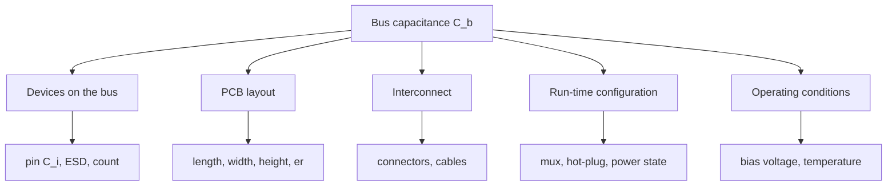

::: basics
### In plain words
Bus capacitance is a sum, so anything you add to the line or change about its geometry moves it. Each device pin adds a few picofarads. The circuit-board trace adds about 1 pF per centimeter. Connectors and cables add more, tens of picofarads per meter for cable. It also shifts while the system runs, such as when you plug in a module.

### Picture it
Think of a backpack. Everything you put in adds weight: each device, each centimeter of trace, each connector, a long cable. Leaving some bags at the door means they don't count, which is what a multiplexer does for unused branches. The load also changes at run time as bags come and go. For the bus, the weight is capacitance, and rise time grows with it.

### Words you need
- **Bus capacitance ($C_b$)**: the total capacitance from one bus wire to ground ([[q0756]]).
- **Trace capacitance**: the trace and the ground layer below act like two plates. A longer or wider trace, or a thinner layer between them, holds more.
- **Dielectric**: the insulating board layer between the trace and the ground layer ([[q0023]]).
- **Multiplexer**: a chip that connects one side-branch at a time, hiding the capacitance of the others.
- **Hot-plug**: connecting a module while the bus is powered, which adds its capacitance suddenly.

### The simplest example
With a 2.2 kΩ pull-up, adding ten sensors at about 8 pF each adds 80 pF. The rise time grows by $0.85 \times 2200 \times 80\text{ pF} \approx 149$ ns. Two boards of the same design show rise times of 150 ns and 280 ns, which means about 80 pF and 150 pF. The extra 70 pF suggests a connector or short cable, not trace tolerance. A 10 cm trace is only about 12 pF. That is the whole idea. The rest of this page sorts the causes and lists fixes.
:::

::: testing
Whether you can reason about **what physically sets** a parasitic capacitance, not just recite "400 pF". The interviewer is looking for:

1. A structured list of contributors: devices and their protection, PCB geometry, connectors and cables, and things that switch in and out (muxes, hot-plugged modules).
2. The physics behind each: parallel-plate-style scaling ($\varepsilon A/d$), junction capacitance versus voltage, fringing.
3. Which changes are design-time (layout, parts) and which are run-time (what is powered, connected, selected).
4. A feel for magnitude, so you know which knob matters first.
:::

::: why
In real products $C_b$ isn't a constant. It changes between board spins, between a bench setup and the enclosure, when someone plugs in a cable, when you power-cycle a rail, even with signal voltage. A bus that passes on one unit and fails on another is often a capacitance story. Knowing the levers lets you design margin in and debug quickly when the scope shows a slower rise than yesterday.
:::

::: concepts
- **Parallel-plate scaling**: $C=\varepsilon_0\varepsilon_rA/d$; more area or thinner dielectric means more capacitance. See [[q0022]] and [[q0023]].
- **Fringing**: field lines at the edge of a trace add to the parallel-plate value.
- **Junction capacitance**: ESD diodes and pad structures have voltage-dependent capacitance.
- **Bus capacitance and rise time**: $t_r=0.8473R_pC_b$. See [[q0756]] and [[q0755]].
- **PCB parasitics**: traces, vias, pads. See [[q0463]].
- **Isolation by switches**: muxes and buffers hide downstream capacitance. See [[q0753]].
:::

::: answer
"Bus capacitance is basically a sum, so anything I add to the line or change about the geometry moves it. The biggest contributors are the devices: each pin is a few pF, more if there's a big ESD structure or a mux. Next is the PCB trace: it scales with length, and with the geometry, so a wider trace, a thinner dielectric to the ground plane, or a higher $\varepsilon_r$ all increase it, roughly 1 pF per cm for a typical 50 Ω trace. Then connectors and cables, which can add tens of pF per metre and are often the dominant term on a modular system.

It also changes at run time. If I hot-plug a module, switch an I2C mux channel, or power a device up or down, the capacitance seen on the bus changes. Junction capacitance depends on voltage, so a pin looks a bit different at 3.3 V than at 0 V.

So to control it I shorten traces, keep the layout tight, choose low-capacitance ESD parts, isolate unused branches with a mux or buffer, and then measure the rise time on a scope to confirm. I'd also add margin, because the number that matters is the worst case, not the nominal."
:::

::: technical
**Where capacitance comes from and what moves it.**

| Contributor | What changes it | Rough effect |
|---|---|---|
| Number of devices | each adds its pin capacitance $C_i$ (2–10 pF typical) | +5 to 10 pF/device |
| Device type | ESD clamps, muxes, level shifters, TVS arrays | up to tens of pF |
| Trace length | linear | about 0.6–1.3 pF/cm depending on geometry |
| Trace width $w$ | wider means larger plate and more fringing | increases $C'$ |
| Dielectric height $h$ | thinner dielectric to the reference plane | decreases $h$ → increases $C'$ |
| $\varepsilon_r$ of the PCB | FR-4 is about 4.0–4.6 (frequency and material dependent) | $C'\propto\sim(\varepsilon_r+1.41)$ |
| Connectors/cables | type and length | pF per connector, tens of pF/m |
| Added parts | probes, test points, jumpers, ESD arrays | 1–15 pF each |
| Run-time config | mux channel, hot-plug, power state | switches whole branches in/out |
| Bias voltage | junction capacitance falls with reverse bias | effective $C$ differs 0 V vs $V_{DD}$ |

**Microstrip estimate (IPC-2141 form).** $C'\approx\dfrac{0.67(\varepsilon_r+1.41)}{\ln\!\big(5.98h/(0.8w+t)\big)}$ pF/inch. For $w=0.38$ mm, $h=0.2$ mm, $t=0.035$ mm, $\varepsilon_r=4.3$ this is about 3.0 pF/in, i.e. 1.2 pF/cm.

**Junction capacitance.** $C_j(V)=C_{j0}/(1+V_R/\phi)^m$. Reverse bias reduces $C_j$ (e.g. 10 pF at 0 V, about 4.2 pF at 3.3 V with $\phi=0.7$ V, $m=0.5$), but a logic swing from 0 to 3.3 V sees an effective large-signal capacitance $Q/\Delta V\approx5.9$ pF.

> [!UNCERTAIN]
> Pin capacitance values and their voltage dependence are device-specific. The diode parameters above are illustrative, not from a particular datasheet.
:::

::: short
"Bus capacitance goes up with everything you hang on the line. Each device pin is a few pF, the trace adds about 1 pF per centimetre and grows with width and shrinks with dielectric thickness, and connectors and cables add tens of pF. It also changes at run time: hot-plugging a module or selecting a mux channel adds or removes branches, and junction capacitance depends on voltage. I'd control it by keeping traces short, picking low-capacitance parts, isolating branches with a switch, and measuring the rise time."
:::

::: long
"Bus capacitance is a sum of parasitics, so I think about what each term depends on.

Start with devices. Each pin has a bond wire, a pad and an ESD structure, typically a few picofarads and sometimes ten. Parts with lots of internal structure, like muxes, level shifters and TVS arrays, can be much more. So adding devices raises $C_b$ roughly linearly. That's why a bus of three parts and a bus of fifteen are different animals.

Then the board. A trace over a ground plane is a capacitor, scaling as epsilon times area over distance. So it grows with trace length and width, and it grows if the dielectric between the trace and the plane is thinner or has a higher $\varepsilon_r$. For a typical 50 Ω microstrip it's about 1 pF per centimetre, a bit less for narrow traces. That's why a long route to a far-end connector costs real picofarads.

Connectors and cables are the other big term. A connector is a few pF; cable can be tens of pF per metre, so a modular system with a metre of cable can easily double the budget.

Next, run-time effects. If I hot-plug a module, the capacitance steps up. If I use an I2C mux, only the selected branch loads the bus. If a device is powered down, its ESD structure might change how it loads the line, and junction capacitance depends on voltage anyway.

The fix is to design margin: short routes, low-capacitance protection parts, isolate branches, and verify with a scope. The rise time tells me the real $C_b$: it's $t_r$ over $0.8473R_p$. If it moves between boards, I look at what differs: parts, cables, layout, assembly."
:::

::: terms
- **Parasitic capacitance**: unintended capacitance from structures like pins, traces, packages. See [[q0030]].
- **Parallel-plate capacitance**: $C=\varepsilon A/d$.
- **Fringing field**: edge fields that add to the plate estimate; significant for narrow traces.
- **Relative permittivity ($\varepsilon_r$)**: dielectric constant of the board material. See [[q0023]].
- **Microstrip**: trace over a reference plane with dielectric below, air above.
- **Junction capacitance ($C_j$)**: voltage-dependent capacitance of a reverse-biased p-n junction.
- **I2C mux/switch**: connects one branch at a time, hiding the others' capacitance.
- **Hot-plug**: connecting a device to a powered bus, changing $C_b$ and possibly glitching it.
:::

::: exceptional
**An average answer** says "more devices and longer traces".

**An exceptional answer**:
- Organizes the answer: devices, board geometry, interconnect, run-time config.
- Uses the physics: $\varepsilon A/d$, with the specific levers (width, dielectric thickness, $\varepsilon_r$), and gives typical numbers.
- Mentions voltage dependence of junction capacitance and that unpowered vs powered devices differ.
- Says which are design-time and which run-time, and gives mitigation for each (mux/buffer, low-cap TVS, route shortening, stackup choice).
- Ties back to the consequence: $t_r$ margin and the measurement method.
:::

::: mistakes
- **Only counting devices.** Cable and connectors, or an unnoticed ESD array, may dominate.
- **Believing a ground plane under the trace reduces capacitance.** It increases it (more coupled area to ground), but it also improves return path and noise. Removing the plane lowers $C$ at a cost in noise and EMI.
- **Treating $C_b$ as a fixed spec-sheet number.** It varies with assembly, temperature, voltage and what's connected.
- **Forgetting probe capacitance** when measuring.
- **Assuming a powered-off module is invisible.** Its ESD diodes and any internal clamp to its (now floating or grounded) supply can load or even clamp the bus.
- **Assuming wider traces for "lower resistance".** I2C currents are mA; wider traces just add capacitance.
:::

::: deep
## A framework: five buckets

When someone asks "what changes bus capacitance?", sort the answer into five buckets:


Figure: Five buckets cover almost everything. Devices and layout are fixed at design time, interconnect is fixed by the product architecture, run-time configuration varies in use, and operating conditions give the small second-order effects.

## Devices

The datasheet gives input capacitance $C_i$ for each I/O pin; add them. A typical sensor is 3 to 8 pF, an MCU pad 5 to 10 pF. Parts that are *intended to be in the signal path* have more: an I2C mux has pin capacitance on both sides plus the switch's on-capacitance, and an ESD or TVS diode array might be anywhere from 0.5 pF (low-cap I2C-rated) to 15 pF (general purpose).

Rule of thumb: every part added costs about 5 to 10 pF; that's about 10 to 20 ns of rise time at 2.2 kΩ. Ten extra devices is therefore 100 pF and about 190 ns of rise time:

$$\Delta t_r=0.8473\times2200\times100\text{ pF}=186\text{ ns.}$$

## PCB geometry

A trace over a plane behaves like a capacitor with a fringing correction. A simple scaling:

$$C\propto\frac{\varepsilon_r\,w\,L}{h}\ \ (\text{plus fringing})$$

The IPC-2141 microstrip approximation gives per-length numbers directly. Plotting it for FR-4 ($\varepsilon_r=4.3$, 1 oz copper) shows how strongly the stackup matters:

```plot
{"title":"Trace capacitance per cm vs dielectric height (FR-4, εr = 4.3)","x":{"label":"Dielectric height h to the plane (mm)","min":0.15,"max":0.6},"y":{"label":"C' (pF/cm)","min":0,"max":2},
 "vars":{"er":4.3,"t":0.035},
 "series":[{"label":"w = 0.15 mm","fn":"0.67*(er+1.41)/ln(5.98*x/(0.8*0.15+t))/2.54"},{"label":"w = 0.30 mm","fn":"0.67*(er+1.41)/ln(5.98*x/(0.8*0.30+t))/2.54","color":"blue"}],
 "hlines":[{"at":1.0,"label":"≈ 1 pF/cm rule of thumb","color":"muted"}]}
```
Figure: A 0.30 mm trace is about 1.3 pF/cm over 0.15 mm of dielectric and 0.7 pF/cm over 0.4 mm; a narrow 0.15 mm trace is lower everywhere. Wider traces and thinner dielectrics (dense stackups) raise capacitance, so the same 10 cm route can cost anywhere from about 5 pF to 13 pF across this range. The plot starts at 0.15 mm because the IPC-2141 formula is only reasonable for roughly $w/h < 2$; for wider traces over thinner dielectric it loses accuracy, so use a field solver there.

Other layout effects: via pads and test points (about 0.5 to 1 pF each), stubs to unused footprints (each centimetre counts), and **long parallel runs** of SDA and SCL, which add mutual capacitance that appears as extra capacitance to ground on each line when they switch against each other (not usually dominant, but real).

Material $\varepsilon_r$ matters less than people think: FR-4 varies roughly 4.0 to 4.6; for the 0.38 mm/0.2 mm example that moves $C'$ from 1.13 to 1.26 pF/cm (±5%).

## Interconnect

Connectors contribute a few pF each, more with ribbon connectors where adjacent lines couple. Cables add roughly tens of pF per metre depending on construction (flat cable and shielded cable differ a lot); a 2 m cable at 80 pF/m is 160 pF, easily the largest term on a small system. These numbers are ballpark: check the cable datasheet.

## Run-time changes

- **Mux or switch channels:** only the selected branch loads the bus; selecting a big branch raises $C_b$ for that transaction only. This is the main tool for managing $C_b$.
- **Hot-plugged modules:** a bus that works with the base unit may fail when a daughter-card adds its own cable and devices.
- **Powered vs unpowered devices:** an unpowered device's ESD structure can look like a different capacitor, and if its supply is at 0 V the clamp diode from the line to $V_{DD}$ can conduct, loading or clamping the bus. See [[q0760]].
- **Enable/shutdown states:** some parts disconnect I/O capacitance when disabled; many don't.

## Voltage and temperature

A reverse-biased junction has $C_j(V)=C_{j0}/(1+V_R/\phi)^m$. With illustrative values $C_{j0}=10$ pF, $\phi=0.7$ V, $m=0.5$: 10 pF at 0 V, 5.5 pF at 1.65 V, 4.2 pF at 3.3 V. As the line swings 0 to 3.3 V, the charge needed is that of an *effective* capacitance

$$C_{eff}=\frac{Q}{\Delta V}=\frac{2C_{j0}\phi\left(\sqrt{1+V/\phi}-1\right)}{V}=5.9\text{ pF}$$

which is why datasheet "typical at 0 V" overstates the rise-time load slightly, and a higher $V_{DD}$ lowers $C_{eff}$ a bit. Temperature moves things only a few percent. Both are second-order compared with adding a connector.

## Seeing it: sim

```sim
{"id":"i2c-pullup","vdd":3.3,"cb":250e-12,"rp":2200,"mode":"fast"}
```
Figure: Start at 250 pF and bring $C_b$ down in steps of 50 pF: each 50 pF buys roughly 93 ns of rise time at 2.2 kΩ. Find the capacitance at which the Fast-mode check turns green; then compare the effect of halving $R_p$.

## Worked scenario: why did unit B come back slow?

Two boards of the same design, same 2.2 kΩ pull-ups. Unit A measures a 30–70% rise of 150 ns; unit B measures 280 ns. Back out the capacitance: A is $150\text{ ns}/(0.8473\times2200)=80$ pF and B is $280/(0.8473\times2200)=150$ pF. So B carries about 70 pF more, which is far more than tolerance on trace or part capacitance could explain. A 70 pF step looks like a connector plus a short cable stub, or a populated option that the other unit lacks (an ESD array, a second mux channel, a debug header with a ribbon attached). Look at the assembly differences first, not the layout.

That is the general habit worth showing in an interview: convert a timing observation into picofarads, then ask which bucket could plausibly supply that many.

## What to do about it

| Lever | Cost |
|---|---|
| Shorten routes; keep devices clustered | Layout effort |
| Use thicker dielectric on I2C layers, or narrower traces | Stackup constraint, narrower traces have more resistance (irrelevant at mA) |
| Choose low-cap ESD parts (≈1 pF) | BOM |
| Put branches behind a mux/switch/buffer | Extra part and latency |
| Choose a device with smaller $C_i$ | May not exist |
| Reduce the speed mode | System throughput |
| Lower $R_p$ (within the window) | Power while low; limited by $I_{OL}$ |

> [!INTERVIEW]
> A great closing line: "I design to the worst-case $C_b$, so I'd budget with the typical numbers, add margin for the cable and ESD parts, and then verify on the first board by measuring $t_r$."
:::

::: applications
- **Choosing ESD diodes for an I2C connector**: low-capacitance TVS arrays so protection doesn't eat the 400 pF budget.
- **Stackup selection**: a thin-dielectric HDI board has higher trace capacitance per cm than a thick-core 4-layer board.
- **I2C mux for multiple identical sensors**: each channel sees only its own load.
- **Modular instruments with plug-in cards**: the bus must meet the rise-time spec for *every* configuration, so design for the fully populated worst case.
- **Debugging unit-to-unit variation**: compare rise times across units to find which assembly option changed $C_b$.
:::

::: assumptions
- **Lumped-capacitance model** for a short bus; for long cables the distributed model applies.
- **Typical per-length and per-pin values**; real numbers depend on the stackup and parts.
- **FR-4 microstrip** assumed; stripline (buried) traces have higher capacitance for the same geometry because the dielectric surrounds them.
- **Resistive pull-up**; active pull-ups change how capacitance affects rise time.

If the interviewer asks about "how it *would* change" in a specific scenario (adding a connector, changing the stackup), reason from the relevant bucket with a number.
:::

::: followups
### If I double the trace length, does the rise time double?
Only the trace's share of $C_b$ doubles. If the trace was 12 pF of a 60 pF total, you go to 72 pF, a 20% increase. The total rise time scales with *total* capacitance, so check what fraction of the budget the trace is.

### How would a thicker or thinner dielectric change it?
Thinner dielectric to the reference plane increases capacitance (smaller $d$ in $\varepsilon A/d$); thicker decreases it. For example, a 0.2 mm trace goes from about 1.3 pF/cm at 0.1 mm height to about 0.6 pF/cm at 0.4 mm. HDI boards with thin dielectrics are worse than thick 4-layer boards.

### Why would capacitance differ between a powered and unpowered device?
Junction capacitance depends on bias, and an unpowered device may have its ESD clamp from the pin to $V_{DD}$ forward-biased by the bus high level, which actually clamps the bus. So an unpowered device on a powered bus can pull the lines down; designers spec "Ioff"/"power-off protection" parts or isolate with a switch.

### How would you reduce the capacitance seen by the master?
Isolate: put distant or heavy branches behind an I2C mux/switch or buffer so the master drives only the selected branch. Also shorten routes, use low-cap ESD, and remove unused footprints and test points on the bus.

### Does changing the signal's logic level change the capacitance?
Slightly. The junction capacitance of ESD structures depends on voltage, so at 5 V the effective capacitance is lower than at 1.8 V for the same device. It's second-order next to a connector or cable.
:::

::: interpretations
"How would bus capacitance change?" could mean (a) what happens when I add/remove things, or (b) how it varies in operation. I cover both. [[q0756]] defines it and gives the baseline budget; this page is the "what moves it" companion, and [[q0759]] covers the same physics from the "why is my rise time too slow?" side.
:::

::: references
- IPC-2141, *Design Guide for High-Speed Controlled Impedance Circuit Boards*: microstrip capacitance and impedance approximations.
- Johnson & Graham, *High-Speed Digital Design: A Handbook of Black Magic*: capacitance of PCB traces and lumped vs distributed models.
- NXP UM10204, *I²C-bus specification and user manual*: bus-capacitance and rise-time requirements.
- Sedra & Smith, *Microelectronic Circuits*: junction capacitance and its voltage dependence.
:::

::: rubric
- Organizes contributors: devices, layout, interconnect, run-time :: Shows structured thinking.
- Device pin and ESD capacitance with typical values :: The most common term.
- PCB trace: scaling with length, width, dielectric height, $\varepsilon_r$ :: Physics of $\varepsilon A/d$ applied to a real board.
- Connectors and cables as often-dominant terms :: Gets system-level.
- Run-time changes: mux, hot-plug, powered/unpowered :: Shows real-world awareness.
- Voltage/temperature as second-order effects :: Shows depth without overstating.
- Mitigations: shorten, low-cap parts, isolate, measure :: Turns understanding into action.
:::

::: quiz
```json
[
 {"type":"mcq","level":"fundamental","q":"Which change raises I2C bus capacitance the most per unit effort?","options":["Switching to a lower pull-up value","Adding a metre of cable","Using a smaller bypass capacitor","Lowering the clock frequency"],"answer":1,"explain":"Cable adds tens of pF per metre. Pull-up value and clock frequency do not change capacitance, and a bypass capacitor on the supply doesn't load SDA/SCL."},
 {"type":"mcq","level":"fundamental","q":"For a trace over a reference plane, which change reduces its capacitance?","options":["Making the trace wider","Using a thinner dielectric to the plane","Using a thicker dielectric to the plane","Making the trace longer"],"answer":2,"explain":"$C\\propto\\varepsilon wL/h$ (plus fringing). Larger $h$ reduces it; wider, longer and thinner all increase it."},
 {"type":"numeric","level":"intermediate","q":"Adding ten devices at 8 pF each to a 2.2 kΩ-pull-up bus increases the rise time by how many ns?","answer":149,"tolerance":0.03,"unit":"ns","explain":"$\\Delta C=10\\times8=80$ pF, so $\\Delta t_r=0.8473\\times2200\\times80\\text{ pF}=149$ ns."},
 {"type":"truefalse","level":"intermediate","q":"Selecting a different channel on an I2C multiplexer can change the capacitance the master sees.","answer":true,"explain":"Only the selected downstream branch (and the mux's own pin and switch capacitance) loads the upstream bus, so the capacitance depends on which channel is connected."},
 {"type":"numeric","level":"advanced","q":"Using $C'=0.67(\\varepsilon_r+1.41)/\\ln(5.98h/(0.8w+t))$ pF/in with $\\varepsilon_r=4.3$, $w=0.2$ mm, $h=0.1$ mm, $t=0.035$ mm, what is $C'$ in pF/cm?","answer":1.34,"tolerance":0.03,"unit":"pF/cm","explain":"$\\ln(5.98\\times0.1/(0.16+0.035))=\\ln(3.067)=1.121$; $C'=0.67\\times5.71/1.121=3.41$ pF/in $=1.34$ pF/cm."}
]
```
:::
