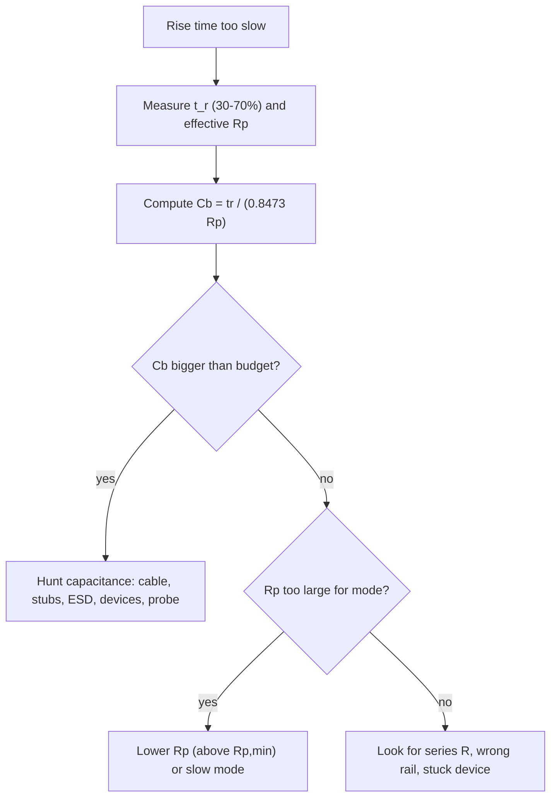

::: basics
### In plain words
I2C is a two-wire connection that lets chips talk. After a chip stops pulling a wire low, a resistor pulls it back up. The "rise time" is how long that climb takes. If it is too slow, the data goes wrong, usually at higher speeds. This page is about finding out why it is slow: either the resistor is too big, the wire holds too much charge, or something extra sits in the path.

### Picture it
Imagine pumping up a bike tire through a thin straw. The straw is the pull-up resistor, and the tire is the capacitance of the wire and everything attached. A thin straw is slow. A bigger tire is slow too. Time the inflation, check the straw, and you can work out the tire size.

### Words you need
- **Rise time**: time for the wire to go from 30% to 70% of the supply voltage.
- **Pull-up resistor**: the resistor that pulls the wire up to the supply. See [[q0755]].
- **Bus capacitance**: the charge the wire, cables and chips soak up as the voltage changes. See [[q0756]].
- **Internal pull-up**: a weak resistor built into a microcontroller pin. Much too big to be useful at I2C speeds.

### The simplest example
Rise time is about $0.85 \times R \times C$. Suppose a bus has a 10 kΩ pull-up and 100 pF. That gives about 850 ns. A 400 kHz bus needs 300 ns or less, so it fails, though it might work at 100 kHz. Now run it backward. If you measure 420 ns and know the resistor is 4.7 kΩ, then $C = 420\text{ ns}/(0.85 \times 4700) \approx 105$ pF. If that is far more than the parts add up to, something else adds capacitance. That is the whole idea. The rest of this page lists the usual suspects, how to measure, and the fixes in order of cost.
:::

::: testing
Debugging method, not recitation. The interviewer wants a **structured diagnosis** from the equation $t_r=0.8473R_pC_b$: if the rise is too slow then either the effective resistance charging the line is too high, the capacitance is too high, or something else is in the path that behaves like extra $R$ or $C$. A strong answer:

1. Starts from the model and splits causes into $R$-side and $C$-side.
2. Gives realistic culprits (wrong or missing pull-up, internal pull-up only, cable, too many devices, series resistors, level shifters).
3. Says how to *measure* which one it is (scope rise time; with $R_p$ known, back out $C_b$).
4. Knows what a too-slow edge breaks (timing, ACK, clock).
:::

::: why
"It works at 100 kHz and fails at 400 kHz" is one of the most common I2C bring-up problems, and the cause is nearly always the rise time. Getting from symptom to cause in a few minutes with a scope and a calculator is a very practical skill, and it's what interviewers want to see from a junior who has actually had to debug a bus.
:::

::: concepts
- **RC charging**: the pull-up charges $C_b$ with $\tau=R_pC_b$. See [[q0755]] and [[q0028]].
- **Bus capacitance**: devices, traces, connectors, cables. See [[q0756]] and [[q0757]].
- **Open-drain asymmetry**: slow rise, fast fall. See [[q0761]].
- **Timing budget**: the clock's high and low phases must be long enough after the edges settle. See [[q0749]].
- **Scope measurement**: 30–70% thresholds, probe capacitance. See [[q0985]].
:::

::: answer
"Rise time on I2C is about 0.85 times the pull-up resistance times the bus capacitance, so if it's too slow, either the resistance or the capacitance is too big, or something extra is sitting in the path.

On the resistance side, the usual suspects are a pull-up that's too large for the speed, like a 10 kΩ copied from a slow design, a missing external pull-up so you're running on the MCU's weak internal one, a pull-up tied to a rail that isn't up, or a series resistor or level shifter between the driver and receiver adding to the RC.

On the capacitance side, I'd look at too many devices, a long cable or connector, high-capacitance ESD parts, long stubs, or a scope probe adding 10 pF to a bus that was already marginal.

To find out which, I'd measure the 30-to-70% rise time on the scope, then compute the capacitance using the known pull-up, $C_b=t_r/(0.85R_p)$, and compare it with what I'd expect from the parts and layout. If the capacitance is much bigger than expected, I hunt for it. If it's about right, the pull-up is just too weak for the speed and I'd lower it, within the sink-current limit, or slow the clock."
:::

::: technical
**Model.** $t_r=0.8473R_pC_b$ (30–70%). Slow means $R_{eff}C_{eff}$ is too large. Limits: 1000 ns (Sm), 300 ns (Fm), 120 ns (Fm+).

**$R$-side causes.**
- $R_p$ too large for the mode (e.g. 10 kΩ at $C_b=100$ pF gives 847 ns).
- No external pull-up: MCU internal pull-ups are typically tens of kΩ, giving microsecond edges.
- Pull-up fitted to the wrong rail, or rail not yet powered, or a DNP placeholder that was never fitted.
- A level shifter or isolation element with high series resistance (resistive "FET" shifters have a low on-resistance, but discrete diode/resistor hacks may not).
- A series resistor for ESD or EMI that is too big; it forms a second RC with the downstream capacitance.
- Pull-up tied through a long, thin trace or a connector with high contact resistance.

**$C$-side causes.**
- Too many devices or breakout modules; cable length; connectors; high-capacitance ESD/TVS or mux.
- Long stubs to unused footprints.
- Probe capacitance (8–15 pF).

**Other.**
- A device holding the line partly low (leakage, contention, a partially powered part's clamp) so the rising edge starts or stalls at a low level.
- Not the "rise time" at all: ringing or slow clock-to-ACK from clock stretching misread as a slow edge.

**Diagnosis.** Measure $t_r$ (30–70%) at the receiver furthest from the pull-up. Compute $C_b=t_r/(0.8473R_p)$ using the *effective* $R_p$ (parallel combination of all pull-ups, measured with the bus off and the DMM across SDA to $V_{DD}$). Compare with the budget.

**Consequences.** The line spends more time between thresholds, which eats setup/hold time and the SCL high period. At 400 kHz the period is 2.5 µs and $t_{LOW}\ge1.3$ µs, so the SCL high phase is at most about 1.2 µs (spec minimum $t_{HIGH}$ is 0.6 µs); if the rise alone takes several hundred ns, the margin shrinks fast and ACKs fail.
:::

::: short
"Rise time is about 0.85 times $R_p$ times $C_b$, so slow means too much R, too much C, or something extra in the path. On the R side: pull-up too big, only internal pull-ups, pull-up on the wrong rail, or a series resistor. On the C side: too many devices, a cable or connector, big ESD parts, or the scope probe. I measure the 30-to-70% rise, back out the capacitance from the known pull-up, and compare it with my budget."
:::

::: long
"I'd start from the model: the rising edge is the pull-up resistor charging the bus capacitance, and the 30-to-70% rise time is about 0.85 times R times C. So 'too slow' means R times C is too big, and I'd split my suspects into the R side, the C side, and weird stuff.

On the R side, the first thing I check is what pull-up is actually there. It might be 10 kΩ because that was copied from a slow design, it might be absent so we're running on the MCU's internal pull-up, which is tens of kΩ and gives microsecond edges, or it might be tied to a rail that isn't up when the bus runs. I'd also look for a series resistor or a level shifter in the path, because it adds to the effective resistance.

On the C side, I'd add up what's on the line: number of devices, connector, cable, ESD parts, stubs. A metre of cable can add around 100 pF. And I'd remember that my scope probe adds around 10 pF, which can make a marginal bus look worse, or if it's disconnected, make a marginal bus look better.

The practical diagnosis goes like this. Measure the 30-to-70% rise on the scope at the farthest device. Measure the effective pull-up with a DMM with the board unpowered. Compute $C_b=t_r/(0.85R_p)$. If $C_b$ is far bigger than my estimate, something's adding capacitance and I find it. If $C_b$ is as expected, the resistor is just too weak for this speed, so I lower it, staying above the minimum from the sink current, or reduce the clock to a mode that allows a longer rise.

Finally, I'd check the consequence: a slow edge eats into setup time and the SCL high time, so failures show up as missing ACKs or garbled reads at higher clock speeds."
:::

::: terms
- **Rise time ($t_r$)**: 30–70% of $V_{DD}$ in I2C; $0.8473R_pC_b$.
- **Effective pull-up**: the parallel combination of every pull-up on the net.
- **Internal pull-up**: the MCU's weak, tens-of-kΩ resistor; not suitable for I2C above very slow speeds.
- **Series element**: resistor, shifter, mux or ferrite in the line adding $R$.
- **Stub**: a branch of trace that adds capacitance without a device.
- **Probe loading**: the scope probe adds capacitance, typically 8–15 pF for 10x passive.
- **Setup/hold time**: data must be stable before and after the clock edge; slow edges eat the budget.
- **$t_{HIGH}$/$t_{LOW}$**: minimum clock phase durations in the spec.
:::

::: exceptional
**An average answer** says "capacitance is too high or the pull-up is too big".

**An exceptional answer**:
- Splits the causes into R, C and other, and says how to tell them apart by measurement.
- Uses the back-calculation $C_b=t_r/(0.8473R_p)$ with the *measured effective* $R_p$ and compares to a budget.
- Has specific candidates: missing/internal pull-up, wrong rail, series resistors, level shifters, cable, ESD arrays, probe.
- Describes the failure signature (works at 100 kHz, fails at 400 kHz; ACK missing).
- Proposes fixes ranked by cost: capacitance, resistor, buffer/accelerator, slower mode.
:::

::: mistakes
- **Blaming the pull-up value without checking what's actually fitted.** Breakout boards, DNP parts and assembly errors change it.
- **Comparing a 10–90% scope reading to the 30–70% spec.** The same edge reads 2.6 times longer.
- **Measuring at the wrong place.** Measure at the far device, not at the pull-up.
- **Ignoring the probe.** A 10x passive probe adds 8–15 pF and a long ground lead rings.
- **Assuming "I2C is digital, so rise time doesn't matter".** It's the physical layer; the edge sets whether a bit is valid.
- **Calling a slow ACK or clock stretching a slow edge.** Look at the waveform shape: an RC rise is exponential; stretching shows a low SCL with no edge activity.
:::

::: deep
## Start from the equation

For a pull-up charging $C_b$,

$$t_r=0.8473\,R_{eff}C_{eff}$$

If a measurement shows $t_r$ larger than allowed, one of the factors is bigger than you think. The job is to figure out which, using only a scope, a DMM, and a calculator.


Figure: The back-calculation of $C_b$ splits the problem. If the capacitance is bigger than the budget, find the extra picofarads. If it isn't, the resistor is the problem or something is adding series resistance.

## Suspects on the resistance side

**1. Pull-up too large for the mode.** $t_r=0.8473R_pC_b$. A 10 kΩ pull-up with 100 pF is 847 ns, fine for Standard but 2.8 times too slow for Fast. Common when a design is copied from a 100 kHz reference.

**2. Only internal pull-ups.** The pull-up enabled in the GPIO is typically 20–50 kΩ (see your MCU datasheet; some are close to 10 kΩ, some above 100 kΩ). With 40 kΩ and 50 pF: $t_r=0.8473\times40\text{ k}\times50\text{ pF}=1.7$ µs. Fails Standard mode too.

**3. Wrong or unpowered rail.** If the pull-up goes to a rail that is off, the bus is held down by whatever leakage there is (or ESD diodes), and the "rise" is a very slow rise to some partial level. Sequence your supplies, and check the schematic net names. See [[q0760]] for what that does to the low level.

**4. Series resistance.** A 100 Ω series resistor for ESD, in combination with 100 pF on the far side, adds 10 ns of its own, which is small. But a few hundred ohms between the pull-up and the capacitance can matter. FET-based level shifters (very low $R_{on}$) are fine; poor level translation circuits using diodes or high-value resistors aren't. Mux and switch channels have on-resistance of a few to tens of ohms, usually negligible.

**5. Parallel resistors going the wrong way.** If the *designer* assumed parallel breakout-board pull-ups would bring $R_p$ down but a module is missing or the board is bare, $R_p$ is bigger than expected. Measure it.

## Suspects on the capacitance side

**1. Cables and connectors**: tens of pF per metre ([[q0757]]).
**2. Device count**: each 5–10 pF.
**3. ESD/TVS parts**: 0.5 to 15 pF each.
**4. Stubs**: unused footprints, test pads, 3 cm of unterminated trace is about 3 pF.
**5. Probe**: 8–15 pF for a passive probe. Use a low-capacitance active probe on marginal buses.

## Other effects that look like slow rise

- **Device pulling partially low**: a leaky or contending device holds the line below the pull-up's final value, so the rise stalls.
- **Cable inductance/transmission line effects**: a long cable might show a stair-step or ringing rather than a clean exponential. The lumped $C_b$ model breaks down.
- **Clock stretching**: SCL held low for longer is not a slow rising edge; look at the waveform ([[q0752]]).

## A worked diagnosis

A 3.3 V board with a 400 kHz bus fails intermittently. The scope at the farthest sensor shows a 30–70% rise of 420 ns. A DMM on the unpowered board reads SDA to $V_{DD}$ as 4.7 kΩ (so $R_p=4.7$ kΩ, no extra breakout boards).

$$C_b=\frac{t_r}{0.8473R_p}=\frac{420\text{ ns}}{0.8473\times4700}=105\text{ pF}$$

The budget estimated 60 pF, so about 45 pF is unaccounted for. Two items explain it: the probe (about 10 pF), and a 20 cm flex cable to a display that nobody counted (about 30 pF at 1.5 pF/cm). Subtract both and you're back to about 65 pF, close to the budget. Now the question is whether the resistor can fix it:

- $R_{p,max}$ at 105 pF for 300 ns is $300\text{ ns}/(0.8473\times105\text{ pF})=3.37$ kΩ.
- $R_{p,min}=967$ Ω.
- Pick 2.2 kΩ: $t_r=0.8473\times2200\times105\text{ pF}=196$ ns, passing with margin.

Replace the 4.7 kΩ with 2.2 kΩ, re-measure, and verify the low level (2.9/2200=1.3 mA, well within 3 mA).

```plot
{"title":"Same bus, 105 pF: before and after the pull-up change","x":{"label":"time","unit":"s","min":0,"max":"1.4e-6"},"y":{"label":"line voltage","unit":"V","min":0,"max":3.6},
 "vars":{"vdd":3.3,"cb":"105e-12"},
 "series":[{"label":"4.7 kΩ: t_r = 418 ns","fn":"vdd*(1-exp(-x/(4700*cb)))","color":"red"},{"label":"2.2 kΩ: t_r = 196 ns","fn":"vdd*(1-exp(-x/(2200*cb)))","color":"blue"}],
 "hlines":[{"at":"0.3*vdd","label":"30%","color":"muted"},{"at":"0.7*vdd","label":"70%","color":"muted"}]}
```
Figure: The 4.7 kΩ edge spends 418 ns between the thresholds, over the Fast-mode 300 ns limit; the 2.2 kΩ edge spends 196 ns. Same capacitance, only the resistor changed.

## What the slow edge breaks

At 400 kHz the SCL period is 2.5 µs. The spec asks for $t_{LOW}\ge1.3$ µs and $t_{HIGH}\ge0.6$ µs. SCL counts as "high" only above 0.7$V_{DD}$, so the usable high time is the ideal high time minus the part of the rise before 70%. A 400 kHz master must keep SCL low for at least 1.3 µs, so its high phase is at most about 1.2 µs; a slow rise that takes 0.8 µs to cross 70% leaves only about 0.4 µs, less than $t_{HIGH}$. (Many controllers start counting the high time only once they see SCL actually high, which is how I2C clock synchronization works. Those stretch the period instead, so the bus quietly runs slower than 400 kHz, and the failures show up on SDA timing.) SDA has the same problem against its setup time $t_{SU;DAT}$ (100 ns in Fast mode). The result is bit errors, not missing edges. Typical symptoms:

- NACK on the address byte that isn't there at lower clock speed.
- Data read back with the last bit wrong or shifted.
- Works with a probe attached, fails without (or the reverse).

```sim
{"id":"i2c-pullup","vdd":3.3,"cb":105e-12,"rp":4700,"mode":"fast"}
```
Figure: Reproduce the diagnosis: with 105 pF and 4.7 kΩ in Fast mode the check fails; change $R_p$ to 2.2 kΩ and it passes. Then try 400 pF and see why no resistor works there.

## Fix list (in order of cost)

1. Remove avoidable capacitance (stubs, cable, big ESD parts).
2. Reduce $R_p$ within the window.
3. Isolate heavy branches with a switch or buffer.
4. Add an accelerator or move to a current-source pull-up.
5. Slow the clock.

> [!INTERVIEW]
> Walk the interviewer through the "measure $t_r$, back out $C_b$, compare with budget" loop. It shows method rather than a list of guesses.
:::

::: applications
- **Bring-up of a new sensor board**: a bus that fails at 400 kHz is diagnosed by comparing $C_b$ to the budget.
- **Connector and cable qualification**: measuring rise time with the real cable to see the margin.
- **Production test**: rise-time check on I2C lines to catch missing pull-ups or shorted/leaky parts.
- **Reference design review**: sanity-check $R_p$ and $C_b$ against the target mode.
- **Camera/display module integration**: modules bring their own cables and pull-ups.
:::

::: assumptions
- **Lumped-RC rise**, valid for short buses with resistive pull-ups.
- **Measurements at the far end** with a low-capacitance probe; a probe at the pull-up reads faster edges.
- **Specification limits** as in the I2C standard; individual parts may be more tolerant.
- **No clock stretching or contention.** If these are present, the waveform will not be a clean exponential.

If the question concerns Fast-mode Plus (120 ns), almost everything above gets tighter; the same method applies with smaller $R_p$ and capacitance budgets.
:::

::: followups
### The bus works at 100 kHz but fails at 400 kHz. Why?
Standard mode allows 1000 ns of rise time and has long clock phases, so a slow edge can fit. Fast mode allows 300 ns and shorter phases (0.6 µs high, 1.3 µs low), so the same slow edge eats a far bigger fraction of the period. The classic cause is $R_pC_b$ between 300 ns and 1000 ns, which is a pass in one mode and a fail in the other.

### How can you tell from the scope whether the pull-up or the capacitance is the cause?
Measure $t_r$, measure the pull-up with a DMM (bus unpowered), and compute $C_b=t_r/(0.8473R_p)$. If $C_b$ is much more than the budget, it's the capacitance. If $C_b$ is close to the budget and $R_p$ is large, it's the resistor.

### What if lowering the pull-up makes the low level worse?
You've found the lower limit: $V_{OL}$ rises because the device has to sink more current. At that point the resistor window is closed and you must change the architecture: remove capacitance, split the bus, add an accelerator, or slow the clock ([[q0758]], [[q0760]]).

### Could a slow rise only on SCL be explained by clock stretching?
No. Stretching holds SCL *low* for a longer time; the rising edge when released is still the same RC shape. If SCL has a slow, exponential rise, it's RC. If it stays low for a long time then rises normally, that's stretching ([[q0752]]).

### How would a scope probe change what you see?
It adds 8–15 pF (passive 10x), which slows the edge a little; on a 100 pF bus that's about 10%. Its ground lead's inductance adds ringing, and a 1x probe adds about 100 pF, so use 10x or an active probe.
:::

::: interpretations
"Why would rise time be too slow on I2C?" is a debugging question; [[q0758]] is the design-lever question and [[q0756]]/[[q0757]] the capacitance background. The answer is the same equation viewed as a checklist. If the interviewer means *fall* time, note that falls are driven by the device's transistor and are fast; the I2C spec in fact limits how fast they may be.
:::

::: references
- NXP UM10204, *I²C-bus specification and user manual*: timing parameters ($t_r$, $t_{HIGH}$, $t_{LOW}$, $t_{SU;DAT}$) and bus-capacitance limits.
- Texas Instruments application reports on I2C pull-up resistor calculation and on I2C troubleshooting.
- Horowitz & Hill, *The Art of Electronics*, 3rd ed.: RC rise time and scope probes.
- Oscilloscope probe application notes from major scope vendors on probe capacitance.
:::

::: rubric
- Starts from $t_r=0.8473R_pC_b$ :: Anchors the diagnosis in the model.
- Resistance-side causes (large $R_p$, internal-only, wrong rail, series R) :: Common, cheap to check.
- Capacitance-side causes (devices, cable, ESD, stubs, probe) :: The other half of the product.
- Measures $t_r$ and computes $C_b$ with the measured $R_p$ :: Turns guesses into evidence.
- Notes 30–70% vs 10–90% and probe loading :: Avoids measurement mistakes.
- Explains the consequences on timing (setup, SCL high) :: Connects the cause to the symptom.
- Ranks fixes: capacitance, resistor, buffer/accelerator, slow down :: Engineering judgement.
:::

::: quiz
```json
[
 {"type":"mcq","level":"fundamental","q":"A bus works at 100 kHz but fails at 400 kHz. The most likely physical cause is","options":["The pull-up is too large or the capacitance too high, so the rise time exceeds the Fast-mode limit","The master's clock is too fast for the slave's internal oscillator","The bus has too few devices","The supply voltage is too high"],"answer":0,"explain":"Standard mode allows 1000 ns of rise time; Fast mode allows 300 ns. An RC between those two values passes at 100 kHz and fails at 400 kHz."},
 {"type":"numeric","level":"intermediate","q":"A bus with $R_p=4.7$ kΩ shows a measured 30–70% rise time of 420 ns. What is the bus capacitance?","answer":105.5,"tolerance":0.03,"unit":"pF","explain":"$C_b=t_r/(0.8473R_p)=420\\text{ ns}/(0.8473\\times4700)=105.5$ pF."},
 {"type":"numeric","level":"intermediate","q":"With the internal pull-up of 40 kΩ and 50 pF on the line, what is the 30–70% rise time?","answer":1.69,"tolerance":0.03,"unit":"µs","explain":"$0.8473\\times40000\\times50\\times10^{-12}=1.69$ µs, beyond even Standard mode's 1 µs."},
 {"type":"truefalse","level":"intermediate","q":"A scope reading of 10–90% rise time can be compared directly with the I2C spec's rise-time limits.","answer":false,"explain":"The spec measures 30–70%. For an RC edge, 10–90% is $2.197RC$ versus $0.8473RC$, about 2.6 times longer."},
 {"type":"mcq","level":"advanced","q":"Rise time is 4 times the expected value, and the measured pull-up is correct. Back-calculating gives a capacitance of about 4 times the budget. Which cause is the most plausible?","options":["A missing pull-up","An uncounted cable or large capacitive load on the bus","The clock frequency is too low","The slave has an incorrect address"],"answer":1,"explain":"With $R_p$ verified, a 4x slower edge means 4x more $C$. Look for an uncounted cable, connector, ESD array or branch."},
 {"type":"numeric","level":"advanced","q":"After finding $C_b=105$ pF, what is the largest pull-up that meets the 300 ns Fast-mode limit?","answer":3.37,"tolerance":0.03,"unit":"kΩ","explain":"$R_{p,max}=300\\text{ ns}/(0.8473\\times105\\text{ pF})=3.37$ kΩ."}
]
```
:::
