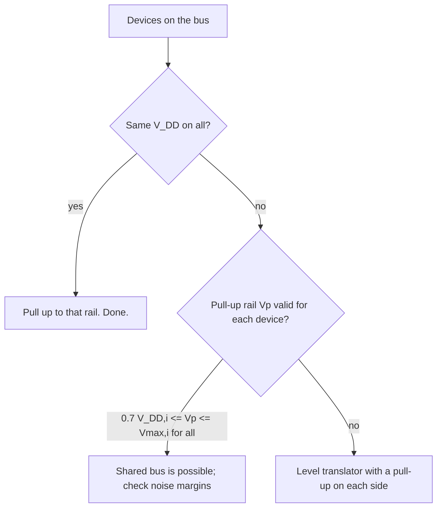

::: testing
Whether you know that **I2C levels are ratiometric** (fractions of the supply), not fixed numbers like old TTL, and whether you can use that to reason about real mixed-voltage buses. The interviewer is listening for:

1. Common bus voltages: 1.8 V, 3.3 V, 5 V (also 1.2 V, 2.5 V).
2. The thresholds: $V_{IL}=0.3V_{DD}$, $V_{IH}=0.7V_{DD}$, and $V_{OL}\le0.4$ V (at 3 mA).
3. That the high level is whatever the pull-up rail is, and what that implies for mixing devices at different supplies.
4. Noise margins and the 3.3 V vs 5 V gotcha.
:::

::: why
Level mismatches are one of the first things that kill a "simple" I2C bring-up: a 5 V sensor on a 3.3 V bus that needs 3.5 V to see a high, a 1.8 V part overvoltaged by a 3.3 V pull-up, or a low that is too high. Knowing the actual thresholds lets you check compatibility on the back of an envelope and decide whether you need a level translator ([[q0877]]).
:::

::: concepts
- **Logic thresholds**: $V_{IL}$, $V_{IH}$, $V_{OL}$, $V_{OH}$; noise margins. See [[q0742]] and [[q0743]].
- **Ratiometric thresholds**: I2C fixes them as fractions of the device's own $V_{DD}$.
- **Open-drain high level**: set by the pull-up rail, not by a driver. See [[q0761]].
- **Pull-up sizing**: ties $V_{OL}$ to $R_p$ and $I_{OL}$. See [[q0755]].
- **Level translation** between voltage domains. See [[q0877]].
:::

::: answer
"I2C is defined relative to the supply rather than at fixed voltages. A device sees a low below 30% of its $V_{DD}$ and a high above 70% of its $V_{DD}$, and an I2C output pulls low to at most 0.4 V when sinking 3 mA. The high level isn't driven at all: it's whatever rail the pull-up resistor goes to, so it equals the bus supply.

The common bus voltages are 3.3 V, 1.8 V and 5 V, with some 2.5 V and 1.2 V. At 3.3 V that means a low is anything under about 1 V and a high is anything over about 2.3 V, which leaves roughly 0.6 V of noise margin on the low side and 1 V on the high side. At 5 V the thresholds are 1.5 V and 3.5 V.

The gotcha is mixing voltages. A 5 V device needs 3.5 V to see a high, so if you put it on a 3.3 V bus it may never see a valid high. And pulling a 3.3 V bus up into a 1.8 V part can exceed its maximum rating. For anything with different supplies I'd either run everything at the same voltage or put a level translator in, with a pull-up on each side."
:::

::: technical
**Spec levels (NXP UM10204, standard/fast mode, $V_{DD}$-related):**
- $V_{IL}\le0.3V_{DD}$
- $V_{IH}\ge0.7V_{DD}$
- $V_{OL1}\le0.4$ V at $I_{OL}=3$ mA (for $V_{DD}>2$ V)
- $V_{OL3}\le0.2V_{DD}$ for low-voltage buses (the spec ties this to a lower sink current, about 2 mA, for $V_{DD}\le2$ V)
- Input hysteresis ($V_{hys}$): at least $0.05V_{DD}$ in Fast mode
- Fast mode: input filters suppress spikes up to 50 ns

**Numbers by supply.**

| $V_{DD}$ | $V_{IL}$ (max) | $V_{IH}$ (min) | $V_{OL}$ (max) | Low margin | High margin |
|---|---|---|---|---|---|
| 1.2 V | 0.36 V | 0.84 V | 0.24 V | 0.12 V | 0.36 V |
| 1.8 V | 0.54 V | 1.26 V | 0.36 V | 0.18 V | 0.54 V |
| 2.5 V | 0.75 V | 1.75 V | 0.40 V | 0.35 V | 0.75 V |
| 3.3 V | 0.99 V | 2.31 V | 0.40 V | 0.59 V | 0.99 V |
| 5.0 V | 1.50 V | 3.50 V | 0.40 V | 1.10 V | 1.50 V |

Low margin = $V_{IL}-V_{OL}$; high margin = $V_{DD}-V_{IH}$ (the pull-up rail is the high level).

**High level.** $V_{OH}=V_{pull-up}$; there's no driver. So all devices should be happy with the pull-up voltage: it must be at least $0.7V_{DD,rx}$ of every receiver and below every device's maximum input rating.

**Legacy.** Older (pre-ratiometric) specs used fixed thresholds of 1.5 V and 3.0 V, appropriate for 5 V. Some old parts still reference them; check the datasheet.

> [!UNCERTAIN]
> The exact $V_{OL}$ versus $I_{OL}$ table for $V_{DD}<2$ V and the version history of the fixed-level thresholds depend on the specification revision. Use the revision of UM10204 your parts claim compliance with, and the device datasheets.
:::

::: short
"I2C levels are ratiometric: a low is below 0.3 times the device's supply, a high is above 0.7 times, and outputs pull low to at most 0.4 V at 3 mA. The high level is just the pull-up rail. Common bus voltages are 3.3 V, 1.8 V and 5 V, so at 3.3 V the thresholds are about 1 V and 2.3 V. The gotcha is mixing supplies, such as a 5 V device needing 3.5 V to see a high, which is where level translators come in."
:::

::: long
"I2C doesn't use fixed voltage levels like old TTL. It defines everything as a fraction of the device's own supply. An input recognises a low when the voltage is below 30% of $V_{DD}$ and a high when it's above 70%. Outputs pull low to at most 0.4 V when sinking 3 mA, or a bit lower than that fraction of the supply on very low voltage buses. And because the bus is open-drain, the high isn't driven at all: it's whatever rail the pull-ups go to.

The typical bus voltages are 3.3 V, 1.8 V and 5 V, with 2.5 V and 1.2 V appearing in low-power designs. At 3.3 V that gives a low threshold of about 1 V and a high threshold of about 2.3 V, so there's about 0.6 V of noise margin on the low side, because the output's 0.4 V sits below the 1 V threshold, and about 1 V on the high side. At 5 V it's 1.5 V and 3.5 V; at 1.8 V it's 0.54 V and 1.26 V, and the low-side margin is only about 0.18 V, so low-voltage buses need more care with ground and pull-up value.

What matters in practice is compatibility. Because the high level is the pull-up voltage, every device on the bus has to accept it as a valid high and survive it. A 5 V part needs 3.5 V to see a high, so it won't work reliably on a 3.3 V bus. On the other side, a 1.8 V part with a 3.3 V pull-up may be overstressed, since its absolute maximum is usually only a few tenths of a volt above its supply. In those cases I either match the voltages or use a level translator with a pull-up on each side."
:::

::: terms
- **$V_{IL}$ / $V_{IH}$**: maximum voltage guaranteed read as low, minimum guaranteed read as high; $0.3V_{DD}$ / $0.7V_{DD}$.
- **$V_{OL}$**: output low; 0.4 V at 3 mA.
- **Ratiometric threshold**: threshold expressed as a fraction of supply.
- **Noise margin**: difference between the worst-case driven level and the receiver threshold.
- **Hysteresis ($V_{hys}$)**: separation between rising and falling input thresholds; at least $0.05V_{DD}$ in Fm.
- **Spike filter**: input filter that rejects pulses shorter than 50 ns in Fm.
- **Level translator**: circuit that links two voltage domains. See [[q0877]].
- **Absolute maximum rating**: voltage beyond which damage may occur.
:::

::: exceptional
**An average answer** says "3.3 V or 5 V logic, low is 0, high is 1".

**An exceptional answer**:
- Gives the ratiometric thresholds (0.3$V_{DD}$/0.7$V_{DD}$) and the 0.4 V at 3 mA $V_{OL}$ with the correct numbers at each supply.
- Explains that the high level is the pull-up voltage, so compatibility is a question about *every* device on the bus.
- Does a compatibility check out loud (5 V part on 3.3 V bus needs 3.5 V; 3.3 V pull-up into a 1.8 V part).
- Shows the noise margins and notes how they shrink at 1.8 V.
- Mentions hysteresis and spike filtering in Fm and legacy fixed levels.
:::

::: mistakes
- **Quoting TTL numbers (0.8 V / 2.0 V).** Many legacy parts used those, but I2C's spec is ratiometric.
- **Assuming "3.3 V device on a 5 V pull-up" is fine** because it's "5 V tolerant". Check the specific part's input rating.
- **Forgetting that a 5 V device's $V_{IH}=3.5$ V on a 3.3 V bus fails the check.** Many 5 V parts have a lower real threshold but the spec number is 3.5 V.
- **Using the 3.3 V margin numbers at 1.8 V.** The low margin falls to about 0.18 V.
- **Believing the master determines the high level.** An open-drain master doesn't drive high; the pull-up rail does.
- **Ignoring $V_{OL}$ increases with current.** The 0.4 V is a limit at 3 mA, not a constant.
:::

::: deep
## Levels as fractions of $V_{DD}$

Older digital standards fixed absolute levels (TTL: 0.8 V and 2.0 V). I2C instead scales the thresholds with the supply so the same protocol works from 1.2 V to 5.5 V:

$$V_{IL}=0.3\,V_{DD},\qquad V_{IH}=0.7\,V_{DD}$$

and $V_{OL}$ is bounded by an absolute 0.4 V (at a stated sink current) for $V_{DD}>2$ V, or by $0.2V_{DD}$ below that.

```plot
{"title":"I2C thresholds vs supply voltage","x":{"label":"Bus supply V_DD (V)","min":1,"max":5.5},"y":{"label":"Voltage (V)","min":0,"max":5.5},
 "series":[{"label":"V_IH min (0.7 V_DD)","fn":"0.7*x","color":"blue"},{"label":"V_IL max (0.3 V_DD)","fn":"0.3*x","color":"orange"},{"label":"V_OL max","fn":"ite(x<2, 0.2*x, 0.4)","color":"red"},{"label":"V_DD (pull-up high)","fn":"x","dashed":true,"color":"muted"}],
 "points":[{"x":3.3,"y":2.31,"label":"2.31 V"},{"x":3.3,"y":0.99,"label":"0.99 V"},{"x":5,"y":3.5,"label":"3.5 V"},{"x":1.8,"y":0.54,"label":"0.54 V"}]}
```
Figure: The blue and orange lines are the thresholds; the red line is the guaranteed output low. The vertical gap between red and orange is the low-side noise margin (0.59 V at 3.3 V, 0.18 V at 1.8 V). The gap between the dashed line and blue is the high-side margin.

## Where the high level comes from

An open-drain output cannot drive a high. The high level is the voltage of the rail at the other end of the pull-up resistor:

$$V_{OH}=V_{pull-up}$$

So **every** receiver has to see that voltage as a high (≥ 0.7 of *its own* $V_{DD}$) and every device must survive it (below its absolute maximum or "5 V tolerant" rating). That's the whole compatibility question. It's different from push-pull logic, where a driver's $V_{OH}$ depends on its own supply.

## Compatibility checks

**5 V device on a 3.3 V bus.** Receiver needs $0.7\times5=3.5$ V; the pull-up gives only 3.3 V. This fails the spec, even though many real parts have lower practical thresholds (e.g. TTL-compatible inputs at about 2 V). Don't rely on that.

**3.3 V device on a 5 V bus.** The pull-up is 5 V; the device's I/O absolute maximum is typically $V_{DD}+0.3$ V = 3.6 V unless it is specified 5 V-tolerant. Overstress risk.

**1.8 V device on a 3.3 V bus.** Similarly, 3.3 V exceeds the abs max of 1.8 V pins unless they are 3.3 V-tolerant.

**Low-voltage master (1.8 V) on a 3.3 V bus.** The master's $V_{IH}=0.7\times1.8=1.26$ V, fine for a 3.3 V high; its open-drain output may tolerate 3.3 V depending on the part. The 3.3 V slave sees the bus high at 3.3 V (good) and the master's low at 0.4 V (good). So this works *if* the master's I/O is rated for 3.3 V on that pin. Many are ("5 V tolerant I/O"). Check.

Rule: the pull-up rail $V_p$ must satisfy, for every device $i$: $0.7V_{DD,i}\le V_p\le V_{max,i}$.


Figure: The decision for mixed voltages. If one pull-up rail satisfies every device's high threshold and maximum rating, you can share a bus; otherwise split it with a translator.

## Noise margins at each supply

Low margin $=V_{IL}-V_{OL}$ and high margin $=V_{DD}-V_{IH}$ (the pull-up supplies the full rail when released).

| $V_{DD}$ | Low margin | High margin |
|---|---|---|
| 5.0 V | 1.10 V | 1.50 V |
| 3.3 V | 0.59 V | 0.99 V |
| 1.8 V | 0.18 V | 0.54 V |
| 1.2 V | 0.12 V | 0.36 V |

The low margin shrinks fastest because $V_{OL}$ is a roughly fixed number set by the device's $R_{on}$ times current. This is why low-voltage I2C is less forgiving about ground bounce, series resistance and parallel pull-ups ([[q0760]]).

## Hysteresis and filters

Fast-mode inputs are Schmitt-triggered with at least $0.05V_{DD}$ of hysteresis (0.165 V at 3.3 V) and a spike filter that ignores pulses up to 50 ns long. They help the slowly rising I2C edge pass through the threshold cleanly without chatter, which is more important here than in a fast push-pull bus. Standard-mode devices don't have the filter requirement.

## Worked check: three devices, one rail

A 3.3 V MCU (pins 5 V tolerant), an EEPROM running at 3.3 V, and a legacy 5 V real-time clock that needs the spec's $0.7V_{DD}$. Proposed pull-up rail: 3.3 V.

- MCU: $V_{IH}=0.7\times3.3=2.31$ V < 3.3 V, abs max 5.5 V. Pass.
- EEPROM: same numbers, pass.
- RTC at 5 V: $V_{IH}=3.5$ V > 3.3 V. **Fail**: the "high" never reaches the threshold.

Options: power the RTC at 3.3 V if its datasheet allows (many do, with a 2.0 V minimum or similar); choose a 3.3 V part; or put the RTC behind a level translator with its own 5 V pull-up. Pulling the whole bus to 5 V instead would satisfy the RTC ($V_p=5$ V ≥ 3.5 V) but needs the MCU and EEPROM pins to be 5 V tolerant. The EEPROM isn't, so that is out.

Writing the check as $0.7V_{DD,i}\le V_p\le V_{max,i}$ for each device takes thirty seconds and settles most "will these talk to each other?" questions before anyone orders boards.

## Practical way to answer in an interview

Say the three numbers (0.3, 0.7, 0.4 V at 3 mA), the typical voltages, and one compatibility example. For example: "On 3.3 V I2C, I want the line under about 1 V for a low and over 2.3 V for a high; my drivers pull to 0.4 V. A 5 V sensor wants 3.5 V for a high, so I'd either power it at 3.3 V or use a translator."

```sim
{"id":"i2c-pullup","vdd":1.8,"cb":100e-12,"rp":1500,"mode":"fast"}
```
Figure: At 1.8 V the pull-up window moves: the minimum drops to about 480 Ω (3 mA) but the low-side margin is small. Compare with the same bus at 3.3 V and 5 V and look at how the allowed $R_p$ range changes.

> [!INTERVIEW]
> The distinctive sentence: "The thresholds are 30% and 70% of $V_{DD}$, and the high level is the pull-up rail, so compatibility means checking every device against that rail." It shows you know it's not TTL.
:::

::: applications
- **Sensor boards at 1.8 V** with an MCU at 3.3 V, using an auto-direction I2C translator.
- **Legacy 5 V peripherals** (e.g. character LCD backpacks) on a 3.3 V MCU bus, via a level shifter.
- **Camera and PMIC buses at 1.8 V** inside phones and SoC designs.
- **Battery packs** with I2C/SMBus-style fuel gauges at 3.3 V.
- **Hot-plug modules** at mixed voltages with bus switches.
:::

::: assumptions
- **Standard/Fast-mode I2C** per NXP UM10204; SMBus and PMBus use different (often fixed) thresholds, e.g. SMBus uses 0.8 V / 2.1 V.
- **Datasheet numbers override spec numbers** for any particular part.
- **DC levels only**; with slow edges and noise, effective margins are smaller.
- **Ideal pull-up rail** equal to the bus supply; a sagging rail changes all the numbers.

If the interviewer asks about a specific device (say a 1.8 V MCU), use its datasheet $V_{IL}$, $V_{IH}$ and absolute-maximum values to do the same compatibility check.

> [!UNCERTAIN]
> SMBus uses fixed thresholds (about 0.8 V and 2.1 V) rather than ratiometric ones; verify the exact values against the SMBus specification before relying on them.
:::

::: followups
### Can I put a 5 V I2C device and a 3.3 V MCU on one bus?
Not directly. A 5 V device needs 3.5 V as a valid high, and the 3.3 V MCU may not tolerate 5 V pull-ups. Use a level translator (pass-FET or auto-direction I2C translator) with 3.3 V pull-ups on the MCU side and 5 V pull-ups on the device side. Alternatively, check if the 5 V part has a 3.3 V variant or its datasheet lets it run at 3.3 V.

### What's $V_{OH}$ for an I2C line?
There is no driven $V_{OH}$: the output stage is open-drain. The high level is the pull-up rail $V_p$ (minus any leakage-induced drop, negligible). Datasheets list "$V_{IH}$" and sometimes $V_{OL}$, but not $V_{OH}$.

### Why do the thresholds scale with $V_{DD}$?
So one protocol can work across supply voltages from about 1 V to 5.5 V and keep a constant relative noise margin on the high side. Absolute thresholds (like TTL's 2.0 V) would fail at 1.8 V.

### How does hysteresis help I2C?
The rising edge is slow, so noise near the threshold could create multiple crossings. A Schmitt input with $0.05V_{DD}$ or more of hysteresis switches once, and the 50 ns spike filter removes short glitches. Together they allow the slow RC edges the bus produces.

### What if the low margin is too small?
Raise the pull-up value (lower sink current), shorten and improve ground paths, remove extra series resistance, and avoid stacked pull-ups. Or move to a higher bus voltage. See [[q0760]].
:::

::: interpretations
"What are typical logic levels?" under I2C Physical Layer means the *voltage levels* of the bus (supply and thresholds), not logical 0/1 meaning. The generic version of the question is [[q0742]]/[[q0743]]; the SPI version is [[q0769]], where levels are not defined by the "standard" but follow the devices' CMOS supply.
:::

::: references
- NXP UM10204, *I²C-bus specification and user manual*: electrical characteristics, $V_{IL}$, $V_{IH}$, $V_{OL}$, hysteresis and spike suppression.
- Texas Instruments application reports on I2C level translation.
- Horowitz & Hill, *The Art of Electronics*, 3rd ed.: logic families, thresholds and noise margins.
- Device datasheets for $V_{IL}$, $V_{IH}$, absolute maximum ratings on SDA/SCL pins.
:::

::: rubric
- Ratiometric thresholds: 0.3 and 0.7 of $V_{DD}$ :: The defining feature of I2C levels.
- $V_{OL}$ 0.4 V at 3 mA :: The output spec that sets pull-up minimum.
- Typical voltages 1.8/3.3/5 V with numbers :: Shows concrete knowledge.
- High level equals the pull-up rail :: Key conceptual point for open-drain.
- Mixed-voltage compatibility check with an example :: Practical application.
- Noise margins and how they change with supply :: Depth.
- Mention translators for mixed domains :: Complete answer.
:::

::: quiz
```json
[
 {"type":"numeric","level":"fundamental","q":"What is the maximum voltage an I2C input on a 3.3 V device must read as a low ($V_{IL}=0.3V_{DD}$)?","answer":0.99,"tolerance":0.02,"unit":"V","explain":"$0.3\\times3.3=0.99$ V."},
 {"type":"numeric","level":"fundamental","q":"What is the minimum voltage that a 5 V I2C device must read as a high ($V_{IH}=0.7V_{DD}$)?","answer":3.5,"tolerance":0.02,"unit":"V","explain":"$0.7\\times5=3.5$ V, so a 3.3 V pull-up is not enough for a spec-compliant 5 V device."},
 {"type":"mcq","level":"intermediate","q":"On an I2C bus, which element determines the high level?","options":["The master's output driver","The slave's output driver","The pull-up rail","The clock speed"],"answer":2,"explain":"Open-drain outputs never drive a high. The line is at the pull-up rail voltage when everybody releases it."},
 {"type":"numeric","level":"intermediate","q":"What is the low-side noise margin ($V_{IL}-V_{OL}$) for a 1.8 V bus using $V_{OL}=0.2V_{DD}$?","answer":0.18,"tolerance":0.03,"unit":"V","explain":"$V_{IL}=0.54$ V and $V_{OL}=0.36$ V, so the margin is 0.18 V."},
 {"type":"truefalse","level":"advanced","q":"A 5 V I2C device can always be used on a 3.3 V bus, since 3.3 V is above the usual TTL high threshold of 2 V.","answer":false,"explain":"The I2C spec requires 0.7$V_{DD}$ = 3.5 V for a 5 V device; some parts work in practice but it's out of spec, and may fail with noise or temperature. Use a translator or check the datasheet's actual $V_{IH}$."},
 {"type":"mcq","level":"advanced","q":"A 1.8 V sensor has an absolute maximum of 2.1 V on its I/O pins. The rest of the bus runs at 3.3 V with pull-ups to 3.3 V. What should you do?","options":["Nothing; I2C is open-drain so it's safe","Add a level translator with a 1.8 V pull-up on the sensor side","Lower the clock to 100 kHz","Add a 100 pF capacitor to SDA"],"answer":1,"explain":"A 3.3 V pull-up would put 3.3 V on the sensor pin, above its 2.1 V maximum. A translator keeps the sensor side at 1.8 V."}
]
```
:::
