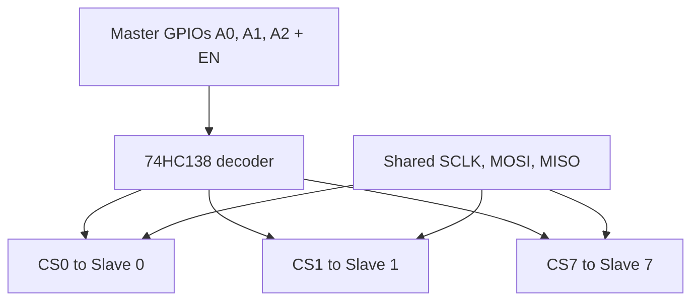

::: basics
### In plain words
SPI has no limit on the number of slaves. The real limits are practical. The master needs one way to pick each slave, and every added chip loads the shared wires a bit more. So "how many" depends on how many chip selects you can make and whether the bus still works.

### Picture it
Think of a teacher speaking to a classroom. Everyone hears the same voice, which stands for the shared clock and data wires. But the teacher points at one student, and only that student answers. Pointing is the chip select. The teacher is limited by how many fingers (pins) are free, not by any rule. The analogy shows one extra rule: students who were not picked must stay silent, or their answers collide.

### Words you need
- **Chip select (CS)**: the per-slave wire that picks it. See [[q0764]].
- **GPIO pin**: a general-purpose pin on the microcontroller that software can switch. See [[q0780]].
- **Decoder**: a chip that turns a binary number on a few wires into one active line out of many.
- **Daisy chain**: slaves connected in a line, each passing data to the next, all sharing one chip select.
- **Tri-state**: an output that can disconnect from the wire, so unselected slaves do not fight on the shared data-return wire, MISO.

### The simplest example
The basic setup shares three wires (clock, MOSI, MISO) and gives each slave its own chip select. Eight slaves need $3 + 8 = 11$ pins. A 3-to-8 decoder chip cuts that. Three pins choose a number from 0 to 7, and the decoder pulls exactly one of its eight outputs low. That needs $3 + 3 = 6$ pins, plus an enable wire. A daisy chain needs just four wires in total. That is the whole idea. The rest of this page covers the traps: unselected slaves must release MISO, decoder outputs can glitch, and extra chips slow the bus.
:::

::: testing
Whether you can answer "how many?" the way an engineer does: **there is no protocol limit, only resource limits**, and you know how to stretch them. The interviewer wants to hear:

1. SPI has no addresses, so the count is set by how many chip-selects you can generate (pins), plus electrical loading and speed.
2. The three ways to scale: one CS per slave, a decoder/GPIO expander on the CS lines, and daisy-chaining.
3. The hidden traps: a shared MISO line must be tri-stated by unselected slaves, and slaves with different modes or speeds.
4. A comparison to I2C's 112-address, 400 pF limits ([[q0747]], [[q0753]]).
:::

::: why
The first design question for any SPI system is "how many chips and how do I select them?" The answer shapes MCU pin choice, board routing and even whether you use SPI at all. Knowing the cost model ($3+N$ wires, or fewer with a decoder or daisy-chain) lets you make a design decision on the spot, which is the kind of reasoning interviewers want to see.
:::

::: concepts
- **Chip select (CS/SS)**: the only thing that distinguishes slaves. See [[q0764]] and [[q0766]].
- **GPIO budget**: each CS needs an output pin. See [[q0780]] and [[q0782]].
- **Decoders and GPIO expanders**: turn $k$ pins into $2^k$ selects.
- **Daisy chain**: slaves in series share one CS. See [[q0768]].
- **Tri-state MISO**: unselected slaves must release MISO. See [[q0761]].
- **Bus loading**: more slaves add capacitance and stubs, limiting speed.
:::

::: answer
"In principle SPI doesn't limit the number of slaves, because there's no addressing: the master picks a slave with a chip-select line, so the real limit is how many chip-selects I can generate and whether the bus still works electrically.

The straightforward way is one CS per slave. SCLK, MOSI and MISO are shared, and each slave gets its own CS from a GPIO. That costs 3 plus N pins, so ten slaves take thirteen pins. If I'm short on pins I have two main tricks. One is a decoder, like a 3-to-8 on the CS lines: three GPIOs select any of eight slaves, and I need to make sure only one CS is ever low and that the outputs idle high. Or I use a GPIO expander. The other trick is daisy-chaining, if the slaves support it: the chips are in series, MOSI goes into the first, each slave's output feeds the next, the last one returns on MISO, and they all share a single CS. That's four wires for any number of devices, at the cost of shifting everyone's data every time.

The electrical limits come in as the bus grows: more loads on SCLK and MISO, more capacitance and stubs, so I might have to lower the clock or add buffers. The other trap is MISO: every unselected slave must tri-state its output, otherwise it fights the selected one. And devices with different SPI modes or max clock can share the bus as long as I reconfigure the mode between transactions."
:::

::: technical
**No protocol limit.** SPI has no address field, so the number of slaves is bounded by the master's ability to generate selects and by electrical loading.

**Options and wire cost** ($N$ slaves):

| Scheme | Wires from master | Notes |
|---|---|---|
| Independent CS | $3+N$ | simplest; each slave can have its own mode/speed |
| Decoder (e.g. 74HC138 3-to-8, 74HC154 4-to-16) | $3+\lceil\log_2N\rceil$ (+ enable) | decoder outputs are active-low and idle high when disabled; add propagation delay on CS |
| GPIO expander (I2C or SPI) | $3+$ (expander bus) | slower CS changes; avoid for time-critical CS timing |
| Daisy chain | 4 total (SCLK, MOSI, MISO, CS) | slaves must support it; every frame shifts through all devices; latency $\propto N$ |
| Multiple SPI controllers | fewer slaves per bus | each controller has its own SCLK/MOSI/MISO |

**Electrical constraints.**
- **MISO sharing:** unselected slaves must be high-impedance on MISO. Parts with a "SDO always driven" output need a tri-state buffer or an analog switch.
- **Loading:** each slave adds pin capacitance (about 3 to 10 pF) to SCLK, MOSI and MISO, plus trace stubs. Longer, more loaded lines reduce the maximum clock and increase ringing; use short stubs and consider series termination at the source.
- **Fan-out of CS:** CS lines are point-to-point (one load each) so they are not an issue.
- **Speed and mode mixing:** the master must set mode, clock rate and word size per transaction (or per CS) when slaves differ.
- **Pull-ups:** a pull-up on each CS keeps slaves deselected during reset/boot.

**Pins needed vs. $N$:** independent $3+N$; decoder $3+\lceil\log_2N\rceil$; daisy-chain 4. E.g. $N=8$: 11, 6 (plus enable), 4.
:::

::: short
"SPI has no addresses, so the slave count is limited by how many chip-selects I can make and how loaded the bus gets. The simple scheme is one CS per slave, costing 3 plus N pins. If I'm short on pins I can use a decoder on the CS lines, three GPIOs for eight slaves, or daisy-chain slaves that support it so they share one CS. The electrical limits are bus loading and making sure unselected slaves tri-state MISO."
:::

::: long
"In theory SPI has no limit on the number of slaves, because there's no address in the protocol. The master selects a slave using a physical chip-select line, so the question becomes how many selects I can generate and whether the bus still works electrically.

The basic topology shares SCLK, MOSI and MISO among all slaves and gives each slave its own CS from a GPIO. So N slaves need 3 plus N pins. For a handful of devices that's fine.

When pins get tight there are two scaling tricks. The first is decoding. A 3-to-8 decoder like a 74HC138 turns three GPIOs into eight active-low chip selects, and a 4-to-16 does sixteen from four. I'd make sure the decoder's outputs idle high when it's disabled, and remember the decoder adds its own delay on CS, tens of nanoseconds for a 74HC part at 3.3 V. The second is daisy-chaining. If the slaves support it, they're connected in series, so the master's MOSI feeds the first slave, its output feeds the second and so on, and the last one returns on MISO. All of them share one CS. That's four wires for any number of devices, but every transaction has to shift through the entire chain, and it only works for parts that are designed for it.

Then there's the electrical side. Every slave adds capacitance and a stub on SCLK, MOSI and MISO, which limits the clock rate and can cause ringing. MISO needs particular care: unselected slaves must tri-state their output, otherwise they'd fight the selected slave. Some cheap parts don't, and need a buffer or switch. Finally, slaves can have different modes and maximum speeds, so the master has to reconfigure per slave, and the slowest device can limit the shared clock if I can't reconfigure between transfers. Compared with I2C, where the limits are 112 addresses and 400 pF, SPI costs pins instead of address space."
:::

::: terms
- **Chip select (CS/SS/CSn)**: per-slave select line, active low.
- **Decoder (3-to-8, 4-to-16)**: logic that converts a binary code to one-hot active-low selects.
- **GPIO expander**: peripheral that adds output pins over I2C or SPI.
- **Daisy chain**: series connection where each slave's output feeds the next one's input.
- **Tri-state (Hi-Z)**: output that can disconnect from the line.
- **Bus loading**: capacitance and stubs that slow edges and reduce maximum frequency.
- **Hardware vs software CS**: CS generated by the SPI peripheral or toggled by a GPIO.
- **Pin-count cost model**: wires needed as a function of slaves.
:::

::: exceptional
**An average answer** says "as many as you have chip-select pins".

**An exceptional answer**:
- States there's no protocol limit and gives the pin-count formulas for each scheme.
- Gives concrete scaling options (decoder with specific parts, expander, daisy chain, multiple controllers) and their costs.
- Names the real hazards: MISO contention, CS floating at boot, decoder glitches/enable, bus loading, mixed modes and speeds.
- Contrasts with I2C: pin cost vs address space.
- Offers a design heuristic: up to about four slaves use independent CS; for many, daisy-chain or decode.
:::

::: mistakes
- **"SPI supports N slaves" with no mention of CS.** The CS is the entire selection mechanism.
- **Forgetting MISO contention.** Two slaves driving MISO at once corrupts data and stresses outputs.
- **Using a decoder without an enable or idle-high default.** CS glitches during decoder address changes can cause false selections; use the decoder's enable or change address only while idle.
- **Assuming daisy-chain works with any slave.** The device must forward the data (SDO output of its shift register) and latch on CS rising edge.
- **Leaving CS floating at reset.** The slave may see random clocks as a command; add a pull-up on each CS.
- **Ignoring that different slaves may use different modes/speeds.** The master must reconfigure.
:::

::: deep
## What "how many slaves" really asks

I2C answers this question with an address space (112 usable) and a capacitance limit (400 pF). SPI has no address space, so the equivalent question is *how do I generate enough selects, and does the shared bus still work?*

```plot
{"title":"Master pins needed vs number of SPI slaves","x":{"label":"Number of slaves N","min":1,"max":16},"y":{"label":"Pins from the master","min":0,"max":20},
 "series":[{"label":"Independent CS: 3 + N","fn":"3+x","color":"red"},{"label":"Decoder: 3 + ceil(log2 N)","fn":"3+max(1,ceil(ln(x)/ln(2)))","step":true},{"label":"Daisy-chain: 4","fn":"4","color":"blue"}]}
```
Figure: Independent chip-selects grow linearly; a decoder grows logarithmically (a 3-to-8 gives 8 slaves for 3 select pins); a daisy chain is flat at four wires. At sixteen slaves it's 19, 7 and 4 pins respectively.

## Option 1: independent chip-selects

```circuit
{"caption":"Three slaves on one SPI bus with independent chip-selects","elements":[
 {"t":"box","at":[0,0],"w":6,"h":21,"label":"Master","pins":[{"side":"right","pos":2,"name":"SCLK"},{"side":"right","pos":4,"name":"MOSI"},{"side":"right","pos":6,"name":"MISO"},{"side":"right","pos":13,"name":"CS0"},{"side":"right","pos":17,"name":"CS1"},{"side":"right","pos":19,"name":"CS2"}]},
 {"t":"box","at":[14,11],"w":8,"h":4,"label":"Slave 0","pins":[{"side":"top","pos":2,"name":"SCLK"},{"side":"top","pos":4,"name":"SDI"},{"side":"top","pos":6,"name":"SDO"},{"side":"left","pos":2,"name":"CS"}]},
 {"t":"box","at":[26,11],"w":8,"h":4,"label":"Slave 1","pins":[{"side":"top","pos":2,"name":"SCLK"},{"side":"top","pos":4,"name":"SDI"},{"side":"top","pos":6,"name":"SDO"},{"side":"left","pos":2,"name":"CS"}]},
 {"t":"box","at":[38,11],"w":8,"h":4,"label":"Slave 2","pins":[{"side":"top","pos":2,"name":"SCLK"},{"side":"top","pos":4,"name":"SDI"},{"side":"top","pos":6,"name":"SDO"},{"side":"left","pos":2,"name":"CS"}]},
 {"t":"wire","pts":[[6,2],[40,2]]},{"t":"wire","pts":[[6,4],[42,4]]},{"t":"wire","pts":[[6,6],[44,6]]},
 {"t":"wire","pts":[[16,2],[16,11]]},{"t":"dot","at":[16,2]},{"t":"wire","pts":[[18,4],[18,11]]},{"t":"dot","at":[18,4]},{"t":"wire","pts":[[20,6],[20,11]]},{"t":"dot","at":[20,6]},
 {"t":"wire","pts":[[28,2],[28,11]]},{"t":"dot","at":[28,2]},{"t":"wire","pts":[[30,4],[30,11]]},{"t":"dot","at":[30,4]},{"t":"wire","pts":[[32,6],[32,11]]},{"t":"dot","at":[32,6]},
 {"t":"wire","pts":[[40,2],[40,11]]},{"t":"dot","at":[40,2]},{"t":"wire","pts":[[42,4],[42,11]]},{"t":"dot","at":[42,4]},{"t":"wire","pts":[[44,6],[44,11]]},{"t":"dot","at":[44,6]},
 {"t":"wire","pts":[[6,13],[14,13]]},
 {"t":"wire","pts":[[6,17],[24,17],[24,13],[26,13]]},
 {"t":"wire","pts":[[6,19],[36,19],[36,13],[38,13]]},
 {"t":"text","at":[48,2],"text":"SCLK (shared)","anchor":"start","muted":true},
 {"t":"text","at":[48,4],"text":"MOSI (shared)","anchor":"start","muted":true},
 {"t":"text","at":[48,6],"text":"MISO (shared)","anchor":"start","muted":true}
]}
```
Figure: SCLK, MOSI and MISO are shared by every slave; each slave has its own CS line from the master. The pin count is 3 + N. Only the selected slave drives MISO, so unselected slaves must tri-state it.

**Pros:** trivial, fast, each slave can have its own mode and speed (the master reconfigures per CS).
**Cons:** pins scale linearly; MISO is loaded by every slave's output capacitance.

## Option 2: decode the chip-selects

A 74HC138 (3-to-8 decoder with three enable inputs) turns three GPIOs into eight active-low outputs. Only one output is low at any time and all are high when the decoder is disabled, which is exactly the "no slave selected" state.


Figure: Three address pins plus an enable replace eight CS lines. The decoder is combinational, so changing the address while EN is active can briefly pulse other outputs low: change the address with the decoder disabled, then assert EN.

Design details: add a 10 kΩ pull-up on the decoder's enable (or gate it) so no slave is selected during reset; account for the decoder's propagation delay (roughly 10 to 30 ns for a 74HC138 at 3.3 V; LVC/AHC-family decoders are faster) in setup before the first clock edge; and remember the datasheet's required CS setup time. A 4-to-16 (74HC154) handles sixteen. Hardware CS from the SPI peripheral often can't drive a decoder directly, so firmware sets the address first and then asserts the enable.

## Option 3: GPIO expander

An I2C or SPI I/O expander adds spare pins for CS. It's cheap and fine for non-time-critical selects (for example a slow ADC read every second), but each select change costs a bus transaction, so it's poor when you need tight CS timing or frequent switching.

## Option 4: daisy chain

Slaves that support it have both SDI and SDO on the data path of their shift register. Connect them in series; all share SCLK and CS. See [[q0768]]. Wire cost is four, but a transaction has to push $N$ words through the chain, and every device sees every frame.

## Option 5: more controllers or a mux

Most MCUs have several SPI peripherals. Put fast devices (flash, display) on one and slow ones on another, which also avoids loading the fast bus. Analog or digital multiplexers on MISO are an alternative when slaves don't tri-state.

## Electrical limits as the count grows

- **Capacitance on SCLK, MOSI, MISO:** each slave adds 3 to 10 pF; ten slaves add 30 to 100 pF plus trace. For a 33 Ω source driver, 100 pF gives $2.2\times33\times100\text{ pF}=7$ ns rise time (10–90%), which matters at 50 MHz (half-period 10 ns).
- **Stubs and reflections:** a star or long branch makes reflections; keep stubs short, or use series source termination. Daisy-chain topology (one line passing each slave) behaves better than a star.
- **MISO contention:** if any slave doesn't tri-state when deselected, it drives MISO against the active slave. Fix with a part that supports high-Z, a tri-state buffer on each slave's SDO, or an analog switch.
- **CS timing:** keep CS lines short and take care that CS setup/hold times from the datasheet are met (typically tens of ns).
- **Mixed modes and speeds:** the master reconfigures CPOL/CPHA/frequency per transfer. Some cheaper MCU drivers don't, which forces a lowest-common-denominator mode.

## Worked example: choosing for a real board

A data-logger MCU has 8 spare GPIOs and needs to talk to a flash (50 MHz), an IMU (10 MHz), an ADC (5 MHz), a display (40 MHz) and four identical DACs. Count pins for three designs, all sharing SCLK, MOSI and MISO (3 pins):

| Design | CS pins | Total |
|---|---|---|
| Eight independent CS | 8 | $3+8=11$ |
| Four independent + 2-to-4 decoder for the DACs (2 address + 1 enable) | $4+3=7$ | $3+7=10$ |
| One 3-to-8 decoder for all eight CS lines (3 address + 1 enable) | $3+1=4$ | $3+4=7$ |
| Four independent + the DACs daisy-chained under one CS | $4+1=5$ | $3+5=8$ |

Two designs fit the 8-pin budget. Full decoding (7 pins) works for any parts, but every CS, including the 50 MHz flash and the display, now goes through the decoder: you lose the peripheral's hardware CS, pay the decoder delay and have to sequence the enable to avoid glitches on every transfer. The daisy chain (8 pins) keeps the fast devices on direct CS lines and updates the four DACs together, which works because they are identical and (if their datasheet supports it) latch on the rising edge of a single CS. I'd take the daisy chain if the DACs support it and the full decoder if they don't.

The reasoning matters more than the final number: put fast devices on the least loaded lines, spend the decoder or daisy-chain tricks on the group where timing is relaxed, and check the datasheet for each trick's requirements.

## A decision rule

| Slaves | Likely choice |
|---|---|
| 1 to 4 | Independent CS |
| 5 to 8 | Decoder or a second SPI controller |
| many identical output devices (LEDs, DACs, shift registers) | Daisy chain |
| time-critical + many | Multiple controllers with independent CS |
| need address-style access, few pins | Consider I2C instead ([[q0738]]) |

> [!INTERVIEW]
> Don't stop at "one CS per slave". Give the cost formula and one scaling trick (decoder or daisy chain) with its main caveat. That's the sentence that shows you've actually run out of GPIOs before.
:::

::: applications
- **Sensor boards** with an IMU, a magnetometer and a pressure sensor on one SPI bus, three CS lines.
- **LED matrix drivers and shift registers** (e.g. 74HC595-type chains) daisy-chained under one latch/CS.
- **Multi-channel ADC/DAC systems** where each converter has its own CS, or are chained.
- **Memory subsystems**: several SPI flash chips selected through a decoder.
- **Instrumentation front-ends** with a dozen identical converters on a 4-bit decoder.
:::

::: assumptions
- **Single master** with push-pull outputs. Multi-master SPI needs extra arbitration and is rare.
- **Slaves tri-state MISO when deselected.** If they don't, add buffers/muxes.
- **Typical loading numbers** (3 to 10 pF per pin); check datasheets.
- **Clock speed matters.** At a few MHz, ten slaves are fine; at 50+ MHz the bus needs layout care or fewer loads.

If the question is "what's the largest practical number?", the honest answer is "limited by pins and loading; dozens are possible with decoders or daisy chains, but at that scale I'd ask whether SPI is the right bus".
:::

::: followups
### How do you connect 8 SPI slaves with only 3 select pins?
A 3-to-8 decoder (such as a 74HC138): GPIOs A0..A2 choose which of the eight active-low outputs goes low, and the decoder's enable pin lets you disable all outputs. Make sure outputs idle high, change the address only while disabled to avoid glitches, and budget the decoder's propagation delay (tens of ns for 74HC at 3.3 V) before the first clock edge.

### What goes wrong if two slaves are both driving MISO?
Bus contention: two push-pull outputs fight, giving corrupted data and extra current (tens of mA). The fix is to ensure unselected slaves tri-state SDO, or isolate them with buffers/analog switches controlled by CS.

### Can slaves with different SPI modes share a bus?
Yes, as long as the master changes CPOL/CPHA (and clock rate) before each transaction and only one CS is active. Some MCU HAL drivers allow per-device configuration; otherwise you must reconfigure manually. Be careful that changing the idle level of SCLK can produce a false edge on a slave whose CS is already low.

### When would you choose daisy-chain over separate CS?
When you have many identical devices that take streaming data (LED drivers, DACs, shift registers), the bus is quiet otherwise, and pin count or board routing is tight. Avoid it when you need random access to one device without updating the others, or when latency matters.

### Compare the slave limit with I2C.
I2C: 112 usable addresses and 400 pF, so the limit is address collisions and capacitance, with two pins to the master. SPI: no addresses, so the limit is selects and bus loading: you pay in pins instead. For many low-speed sensors I2C is cheaper; for fast devices SPI is simpler.
:::

::: interpretations
"How many slaves can there be?" in the SPI section parallels [[q0747]] (I2C). For I2C the answer is about addresses and capacitance. For SPI it is about chip-selects and loading. If the interviewer means "in the daisy-chain configuration", see [[q0768]]; for the basic wiring see [[q0767]] and for the interfacing procedure [[q0766]].
:::

::: references
- Device datasheets for specific SPI parts: SDO tri-state behaviour, CS setup/hold times, daisy-chain support.
- 74HC138 / 74HC154 datasheets (decoders from NXP, TI and others): propagation delay and enable behaviour.
- Horowitz & Hill, *The Art of Electronics*, 3rd ed.: serial buses, decoders and tri-state logic.
- Texas Instruments and Analog Devices SPI application notes on multi-slave topologies.
:::

::: rubric
- No protocol limit; limited by CS lines and loading :: The core conceptual insight.
- Independent CS cost $3+N$ :: Gives a quantitative model.
- Decoder scaling with a named part and caveats (idle high, glitches) :: Shows practical experience.
- Daisy-chain as 4-wire option with its trade-offs :: Another important scaling method.
- MISO tri-state requirement :: The key electrical hazard.
- Bus loading limits clock and signal integrity :: Realistic engineering limit.
- Compares with I2C :: Shows system-level thinking.
:::

::: quiz
```json
[
 {"type":"numeric","level":"fundamental","q":"How many master pins are needed for 6 SPI slaves using independent chip-selects (SCLK, MOSI, MISO plus one CS each)?","answer":9,"tolerance":0.001,"unit":"pins","explain":"Three shared lines (SCLK, MOSI, MISO) plus one CS per slave: $3+N=3+6=9$ pins."},
 {"type":"numeric","level":"intermediate","q":"How many master pins (excluding enable) are needed to select 8 slaves through a 3-to-8 decoder plus SCLK/MOSI/MISO?","answer":6,"tolerance":0.001,"unit":"pins","explain":"3 shared lines + 3 decoder address lines = 6 pins (plus an enable if used)."},
 {"type":"mcq","level":"intermediate","q":"What must unselected SPI slaves do with their MISO output?","options":["Drive it high","Drive it low","Tri-state it (high impedance)","Toggle it with SCLK"],"answer":2,"explain":"MISO is shared; only the selected slave may drive it. Unselected slaves must release it to avoid contention."},
 {"type":"truefalse","level":"intermediate","q":"A 74HC138 decoder used for chip-selects can safely change its address inputs while its outputs are enabled.","answer":false,"explain":"Combinational decoders can glitch other outputs low during address transitions. Disable the decoder, change the address, then enable it."},
 {"type":"mcq","level":"advanced","q":"You have 16 identical 16-bit DACs that need updating together, and very few free pins. Which is the best SPI topology if the DACs support it?","options":["16 independent CS lines","One 4-to-16 decoder","A daisy chain with one CS","Switch to UART"],"answer":2,"explain":"A daisy chain uses four wires total; you shift in 16 words and a single CS rising edge latches all outputs, updating them simultaneously."},
 {"type":"mcq","level":"advanced","q":"Which is NOT a limit on the number of SPI slaves on one bus?","options":["Number of available chip-select signals","Capacitive loading on SCLK and MISO","A 7-bit address space","Contention on MISO if slaves don't tri-state"],"answer":2,"explain":"SPI has no address space. The limits are selects, loading and MISO behaviour."}
]
```
:::
