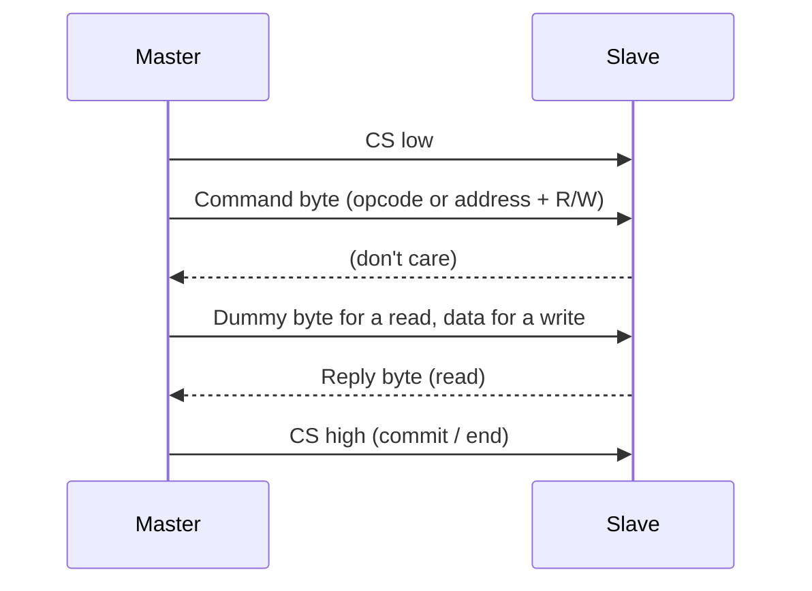

::: basics
### In plain words
Talking to an SPI slave means following a short routine that the chip's datasheet describes. SPI itself only moves bits, so each chip defines its own commands. You set up the master to match the chip's clock mode and speed. Then you pick the chip, send a command, send or collect the data, and let go of the chip.

### Picture it
Picture asking a librarian for a book. You walk up (chip select goes low). You say the shelf code (the command). Then you hold out your hands (dummy bytes), and the librarian places the book in them (the reply). You walk away (chip select goes high). The key detail is that the librarian can only answer after hearing the code. So whatever came back while you were still speaking is meaningless. The real answer arrives afterward.

### Words you need
- **Datasheet**: the chip maker's document that lists the mode, maximum speed and commands.
- **SPI mode**: which clock edge samples each bit. The master must match the chip. See [[q0764]].
- **Register**: a numbered storage cell inside the chip that holds a setting or a reading. See [[q0886]].
- **Dummy byte**: throwaway data the master sends just to generate clock ticks, so the slave's reply can shift back.
- **Chip select (CS)**: the wire that picks the slave and keeps the transfer together. See [[q0765]].

### The simplest example
Say you want to read a chip's ID register at address 0x0F. (Numbers starting with "0x" are hexadecimal, a short way to write a byte.) The datasheet says to set the top bit of the address to mean "read", so the command byte is 0x8F. Pull CS low. Send 0x8F. The byte that comes back during this step means nothing. Next, send one dummy byte, 0x00. The byte that comes back now is the register's value, say 0x33. Raise CS. That is the whole idea. The rest of this page covers the datasheet checklist, writes, chip select timing traps, and debugging.
:::

::: testing
Whether you can go from "four wires" to a **working transaction**: the sequence the master performs and the datasheet details that make it succeed. The interviewer is looking for:

1. The recipe: configure mode, speed, bit order and word size; assert CS; clock out command and data; deassert CS.
2. That SPI has no addressing, so the master selects with CS, and each slave defines its own command protocol on top.
3. Awareness of the usual traps: mode mismatch, CS timing, dummy bytes on reads, MISO tri-state, hardware vs software CS.
4. The ability to read a datasheet timing table and translate it into settings.
:::

::: why
"Interface with a slave" is what you actually do when you write a driver. Most SPI problems in bring-up are not electrical; they're a wrong mode, the reply arriving one byte late, or CS toggling mid-transaction. Showing that you know the checklist suggests you've done it and can debug it quickly. It also parallels the I2C version ([[q0746]]).
:::

::: concepts
- **Chip select framing**: CS low starts a transaction, high ends it. See [[q0764]] and [[q0765]].
- **SPI modes (CPOL/CPHA)**: must match the slave. See [[q0764]].
- **Command protocol**: device-specific opcode/address/data format, often with a read/write bit.
- **Full-duplex shifting**: a read is a write of dummy bytes. See [[q0764]].
- **Datasheet timing**: max SCLK, CS setup/hold, data valid time. See [[q0770]].
- **MCU peripheral**: hardware SPI block, DMA, and GPIO-controlled CS. See [[q0733]].
:::

::: answer
"To talk to an SPI slave I first read its datasheet for four settings: which mode, so clock polarity and phase; the maximum clock; whether data is MSB-first; and the word size. Then I configure the master's SPI peripheral with those.

A transaction goes like this. The master pulls the slave's chip select low. It clocks out a command byte, which is device-specific, often an opcode, or a register address with a read/write bit. Then, for a write, it clocks out the data bytes. For a read, it clocks out dummy bytes while the slave shifts its reply back on MISO, and the master captures those bytes. Finally it raises chip select, which in many devices is what actually commits a write or ends a command.

The things I watch for: the mode must match or the data is shifted or garbage; the reply often arrives one byte after the command, so I have to ignore the byte clocked in during the command; CS must stay low for the entire transaction and meet setup and hold times, so I usually drive it from a GPIO rather than rely on the hardware's per-byte toggling; and with multiple slaves, only one CS may be low at a time. If it doesn't work I'd put a scope or logic analyser on CS, SCLK, MOSI and MISO, which decodes SPI easily, and compare against the datasheet's timing diagram."
:::

::: technical
**Procedure.**
1. **Read the datasheet's SPI section:** mode (CPOL/CPHA), max SCLK ($f_{SCK(max)}$), bit order, word length, command format, CS timing ($t_{CSS}$, $t_{CSH}$, minimum CS-high time between commands), output valid and disable times ($t_V$, $t_{DIS}$).
2. **Configure the master:** mode, baud rate $\le f_{SCK(max)}$ (and consistent with signal integrity), MSB/LSB first, 8/16-bit frame, and CS handled in software or hardware.
3. **Assert CS** (low). Wait the setup time before the first clock edge.
4. **Send command/address**, then **transfer data** (write) or **clock dummy bytes while capturing MISO** (read). Some devices also need dummy *clocks* between address and data (flash fast-read).
5. **Deassert CS** (high); hold it high for at least the minimum between commands.
6. **Verify:** read an ID register at bring-up.

**Typical command patterns.**
- *Register-mapped sensors:* first byte = address with a read bit (often bit 7 = 1 for read) and sometimes an auto-increment bit; then data bytes.
- *Flash memories:* opcode (e.g. 0x03 read, 0x9F read ID on many NOR flash devices), 24-bit address, then data. Writes need a write-enable opcode first.
- *ADCs/DACs:* a 16- to 32-bit frame whose bits include channel select and data; conversion result may come back in the same frame or the next.

**Read timing example (mode 0).** In a mode-0 register read the slave starts shifting the reply after it has received the address: the *second* byte on MISO carries the register value, the first byte is don't-care.

**Pitfalls.** Wrong mode; ignoring the byte clocked in during the command; CS toggling between bytes of one transaction; CS floating during reset; bus contention on MISO; too-fast clock for the slave's $t_V$ (see [[q0770]]); different devices on the same bus needing different modes.
:::

::: short
"I read the datasheet for mode, max clock, bit order and word size, and configure the master. A transaction is: pull CS low, clock out a command, then for a write clock out data, and for a read clock out dummy bytes while capturing the reply on MISO, then raise CS. I watch the mode matching, that the reply usually arrives a byte after the command, and that CS stays low for the whole transaction with proper timing. With several slaves only one CS is low at a time."
:::

::: long
"Interfacing with an SPI slave starts with the datasheet, because SPI has no standard beyond the four wires. I need four things: the SPI mode, meaning clock polarity and phase; the maximum clock rate; the bit order, usually MSB first; and the word size, usually 8 bits. I set those on the master's SPI peripheral.

Then every transaction has the same shape. The master pulls that slave's chip select low, which selects it and starts the frame. It sends a command. What that command looks like is device-specific: for a sensor it's often a register address with a read or write bit in the top bit; for a flash chip it's an opcode like read, followed by a 24-bit address. For a write, the master then clocks out the data bytes. For a read, the master clocks out dummy bytes, because in SPI you can only receive while you clock, and captures what the slave shifts onto MISO. Then the master raises chip select, which ends the frame and in many devices commits the write.

The details that bite: first, the mode. If it's wrong, the data is shifted by a bit or garbage. Second, the reply timing: because the slave only starts answering after it has seen the address, the byte clocked in during the command is meaningless and the real value arrives in the next byte. Third, CS: it has to stay low for the whole transaction, so I usually control it with a GPIO instead of relying on hardware that might toggle it between bytes, and I need to respect the setup and hold times and the minimum CS-high time. Fourth, with more than one slave, only one CS can be active, and unselected slaves must tri-state MISO.

For bring-up, I'd first read an ID register, since it proves the wiring, mode and clock. And if it fails, I'd look at CS, SCLK, MOSI and MISO on a logic analyser, which decodes SPI directly."
:::

::: terms
- **Mode (CPOL/CPHA)**: clock idle level and sample edge. See [[q0764]].
- **Opcode**: command byte that selects an operation (e.g. read, write enable).
- **Register address with R/W bit**: sensor-style command byte.
- **Dummy byte / dummy clocks**: clocks with no meaningful data from the master, to let the slave's reply shift out.
- **$t_{CSS}$, $t_{CSH}$**: CS setup and hold times relative to the clock.
- **Minimum CS-high time**: how long CS must be high between commands.
- **$t_V$ (output valid)**: delay from clock edge to valid MISO.
- **Hardware vs software CS**: peripheral-driven or GPIO-driven chip select.
:::

::: exceptional
**An average answer** says "pull CS low, send data, pull CS high".

**An exceptional answer**:
- Lists the datasheet checks before touching code (mode, clock, bit order, word size, CS timing).
- Distinguishes write from read, including the dummy byte and the reply offset, with a concrete example command.
- Uses a bring-up trick: read an ID register first.
- Names hardware pitfalls: floating CS at reset, MISO contention, mode changes between slaves, per-byte hardware CS.
- Describes how to debug with a logic analyser's SPI decoder and compares to the datasheet's timing diagram.
:::

::: mistakes
- **Wrong CPOL/CPHA.** Data appears shifted or inverted; the most common first-day bug.
- **Using the byte clocked in during the command as data.** The slave hasn't started replying; the real data is later.
- **Letting hardware CS toggle between bytes** of a multi-byte transaction, which terminates it early.
- **Running faster than the slave's datasheet** (or than the board can support): reading works at 1 MHz and fails at 20 MHz.
- **Forgetting CS idle state at boot.** Without a pull-up the slave can see noise as commands.
- **Not waiting for write completion.** Flash, EEPROM and some DACs have internal busy periods.
:::

::: deep
## The datasheet checklist

Before writing any code, extract from the datasheet:

| Item | Why it matters | Typical |
|---|---|---|
| Mode (CPOL, CPHA) | sample edge must match | mode 0 or 3 most common |
| Max SCLK | slave's timing limit | 1 to 100 MHz |
| Bit order | MSB or LSB first | MSB first |
| Word size | 8, 16, 24 bits | 8 |
| Command format | opcode/address/R-W bits | device-specific |
| CS setup/hold ($t_{CSS}$, $t_{CSH}$) | CS must lead and trail the clock | tens of ns |
| CS minimum high time | gap between transactions | tens to hundreds of ns |
| $t_V$ (clock to MISO valid) | limits SCLK for reads | 5 to 50 ns |
| $t_{DIS}$ (MISO disable) | matters on shared MISO | tens of ns |
| Busy/ready | writes or conversions take time | µs to ms |

## Anatomy of a register read

Consider a hypothetical sensor with a register map. To read register 0x0F (an ID register), the master sends the address with bit 7 set to 1 (read), i.e. 0x8F, then clocks another byte to receive the value. In mode 0:

```timing
{"signals":[{"name":"CS","wave":"10................................1","color":"accent"},{"name":"SCLK","wave":"00101010101010101010101010101010100"},{"name":"MOSI","wave":"z=.=.=.=.=.=.=.=.x...............z.","data":["1","0","0","0","1","1","1","1"],"color":"blue"},{"name":"MISO","wave":"zx...............=.=.=.=.=.=.=.=.z.","data":["0","0","1","1","0","0","1","1"],"color":"orange"}],"hscale":0.7}
```
Figure: First byte on MOSI is 0x8F (read, address 0x0F); MISO is don't-care during this byte. The slave drives MISO only during the second byte, here 0x33. CS stays low for both bytes; the master sends dummy data (don't-care) on MOSI in the second byte.

The master code does three steps: CS low, transfer 0x8F then 0x00 (dummy), CS high; the result is the *second* byte received. In C-like pseudocode:

```c
uint8_t spi_read_reg(uint8_t reg) {
    gpio_write(CS, 0);                 // select, respect tCSS
    spi_transfer(reg | 0x80);          // command: read bit set (ignore the reply byte)
    uint8_t value = spi_transfer(0x00); // dummy byte clocks the reply in
    gpio_write(CS, 1);                 // deselect, respect min CS-high time
    return value;
}
```

## Writes, burst reads and flash

- **Register write:** CS low, send address (with bit 7 = 0), send data, CS high. The new value is typically committed on the rising CS edge or after the last bit.
- **Burst read:** many devices auto-increment the address, so after one command you can keep clocking dummy bytes and read consecutive registers (like a 6-byte accelerometer sample) in one transaction. This amortises the command overhead ([[q0763]] shows the same effect for I2C).
- **Flash:** a read is opcode 0x03, a 24-bit address, then as many data bytes as clocked. Writes need a write-enable opcode in a separate CS frame, then page program, then polling the status register until busy clears. Reading the JEDEC ID (opcode 0x9F on many NOR flash parts) is a standard presence check.
- **ADC/DAC:** the frame is 16 to 32 bits; the conversion result may be clocked out in the same frame as the next command (pipelined), so read the datasheet's timing diagram carefully.


Figure: A generic SPI transaction. The slave's reply only starts after it has decoded the command, which is why the first received byte is ignored and the answer arrives in the following byte.

## Configuring the master

Settings that must match the slave: **mode**, **bit order**, **word size**, and a baud rate not above $f_{SCK(max)}$. Choose the divider so that $f_{SCK}=f_{periph}/N$ is at or below the limit, and then check the board can support it ([[q0770]]). On most MCUs:

- Prefer the hardware SPI block, with **CS under software (GPIO) control** for multi-byte transactions, unless the peripheral has a documented "hold CS for the frame" mode.
- Use DMA for bulk transfers (display frames, flash pages), as one frame instead of per-byte interrupts.
- If you must bit-bang, the code toggles GPIOs and is limited to hundreds of kHz to a few MHz.

```sim
{"id":"spi-modes","mode":0,"byte":"0x8F","view":"timing"}
```
Figure: Change the mode and see where the sample edges fall relative to MOSI changes. If your slave's datasheet says mode 3, you can use the same sim to check the idle level of SCLK between frames.

## Multiple slaves and mode changes

Only one CS may be low at a time. When two slaves need different modes, set the mode while all CS lines are high (to avoid a false clock edge reaching a selected slave), then assert the target CS. Some MCU drivers do this per-device automatically.

```sim
{"id":"spi-modes","mode":0,"byte":"0xA5","view":"topology"}
```
Figure: The topology view shows independent chip-selects versus a daisy chain. The interfacing recipe is the same; only the number of CS lines and the frame length change.

## Debugging checklist

1. **ID register.** Read it first. Wrong value points to wiring, mode or clock.
2. **Logic analyser** on CS, SCLK, MOSI, MISO (SPI decoder). Check mode, byte count and that CS is low for the whole transaction.
3. **Scope** on SCLK and MISO at the master pin for signal quality at the target speed.
4. **Slow down** to 100 kHz to separate protocol errors from timing errors.
5. **Check CS** at reset and during other transactions for glitches.
6. **Check MISO** with the slave disabled: it should be high-Z (use a pull-up/down to see it).
7. **Compare** to the datasheet's timing diagram edge by edge.

> [!INTERVIEW]
> Say "first thing I do is read an ID register" and "the reply is a byte after the command". Both show you've done real bring-up.
:::

::: applications
- **IMU or pressure sensor drivers**: register read/write with burst reads for sensor samples.
- **SPI NOR flash**: JEDEC ID read, page program, sector erase and status polling.
- **SD cards in SPI mode**: command frames with CRC and response bytes.
- **Display controllers**: command/data select pin (D/C) plus a high-rate SPI stream.
- **ADC/DAC chains**: framed writes with conversion start pulses and data-ready pins.
:::

::: assumptions
- **Mode 0/3, MSB first, 8-bit words**, the most common. Variants exist.
- **Single master, push-pull lines**, with the slave's datasheet defining the command set.
- **Software-controlled CS**; hardware CS behaviour varies per MCU.
- **Reply offset of one byte** is typical for register reads, but check each part (some ADCs return the result in the same frame).

If the interviewer asks for a *particular* part, the logic is identical; I'd open its datasheet and fill in the table above.
:::

::: followups
### Why do you ignore the first byte received during a read?
The slave can't know what you're asking until it has received the command byte, so while that byte is being clocked in, MISO carries nothing meaningful (don't-care, high-Z or a stale value). The reply starts in the next byte, which is why a typical register read is two bytes: command out, dummy out/value in.

### What if the slave needs mode 3 and another slave on the same bus needs mode 0?
Reconfigure the master (CPOL/CPHA) between transactions, with all CS lines high while you change it, because changing CPOL changes SCLK's idle level and that can look like a clock edge. Alternatively put the devices on separate SPI controllers.

### How do you know if a read is returning real data or garbage?
Read a known ID or constant register first. A wrong or all-0xFF/0x00 value means mode, wiring, power, CS or the clock is wrong. Reading the same ID at several clock speeds helps separate timing from protocol faults.

### My SPI works at 1 MHz but not 20 MHz. Why?
The slave's output delay and board delays no longer fit within half a clock period (see [[q0770]]), or signal integrity breaks down: ringing, long stubs, or an overloaded MISO. Also check that the slave's maximum clock for *reads* (often lower than for writes) isn't exceeded.

### Why drive CS from a GPIO instead of hardware CS?
Hardware CS often toggles between every byte or word, which breaks multi-byte transactions that must stay framed. A GPIO lets you keep CS low for the whole command and burst, and to set up the minimum CS timing. Some MCU peripherals do support frame-length CS control; read the reference manual.
:::

::: interpretations
"How to interface with slaves?" mirrors the I2C Protocol Layer question [[q0746]]. In I2C you interface with addresses; in SPI you interface with chip-selects and device-specific commands. For the physical wiring see [[q0767]]; for multiple slaves see [[q0765]]; for chains see [[q0768]]; for clock limits see [[q0770]].
:::

::: references
- Device datasheets (the real SPI specification for each part): mode, timing diagram, command table.
- Horowitz & Hill, *The Art of Electronics*, 3rd ed.: serial interfaces and SPI.
- MCU reference manuals for the SPI peripheral: mode, baud divider, CS handling, DMA.
- Analog Devices and Texas Instruments SPI application notes on timing and interfacing.
:::

::: rubric
- Reads datasheet: mode, max clock, bit order, word size :: The settings that determine whether anything works.
- Transaction sequence: CS low, command, data/dummy, CS high :: Core recipe.
- Explains read = send dummy and capture, and the reply offset :: The most commonly misunderstood point.
- Mentions CS timing and software vs hardware CS :: Practical, avoids framing bugs.
- Mode mismatch and different modes per slave :: Classic bring-up bug.
- Debug approach: ID register, logic analyser, slow clock :: Shows engineering process.
- Multi-slave rule: one CS at a time, tri-state MISO :: System-level correctness.
:::

::: quiz
```json
[
 {"type":"mcq","level":"fundamental","q":"In an SPI register read, what does the master clock out during the second byte?","options":["The register address again","Dummy data (don't-care), while the slave shifts the register value onto MISO","Nothing; SCLK stops","A CRC"],"answer":1,"explain":"SPI only receives while it clocks, so the master sends dummy bytes and captures the slave's reply on MISO."},
 {"type":"truefalse","level":"fundamental","q":"Chip select must stay low for the whole multi-byte transaction.","answer":true,"explain":"CS frames the transaction. Raising it between bytes ends the command and resets the slave's state."},
 {"type":"numeric","level":"intermediate","q":"A sensor read sets bit 7 of the address as the read flag. What byte do you send to read register 0x2A?","answer":170,"tolerance":0.001,"unit":"(decimal)","explain":"0x2A OR 0x80 = 0xAA = 170 decimal."},
 {"type":"mcq","level":"intermediate","q":"Your data looks correct but shifted by one bit. The likeliest cause is","options":["A missing pull-up on MISO","Mismatched SPI mode (CPOL/CPHA)","Too many slaves on the bus","CS pulled high too late"],"answer":1,"explain":"A mode mismatch makes the master sample at the wrong clock edge, so bits appear shifted."},
 {"type":"mcq","level":"advanced","q":"Two slaves need different SPI modes on one bus. What is the safe way to switch?","options":["Change the mode while both CS lines are high, then assert the target CS","Change the mode while the target CS is low","Never switch; use separate buses","Change the mode in the middle of a byte"],"answer":0,"explain":"Changing CPOL changes SCLK's idle level, which could be seen as a clock edge by a selected slave. Reconfigure with all CS lines high."},
 {"type":"numeric","level":"advanced","q":"How many clocks does a 24-bit-address flash read of 256 data bytes take (8-bit opcode)?","answer":2080,"tolerance":0.001,"unit":"clocks","explain":"8 (opcode) + 24 (address) + 256×8 (data) = 2080 clocks."}
]
```
:::
