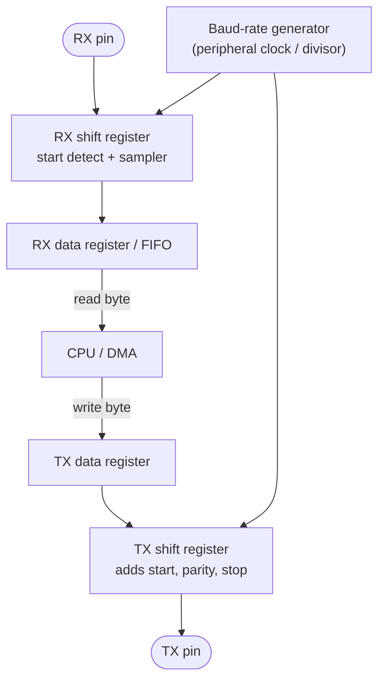

::: basics
### In plain words
UART stands for Universal Asynchronous Receiver/Transmitter. It is a small block of hardware that sends a byte out one bit at a time on a wire, and rebuilds bytes from the bits arriving on another wire. "Asynchronous" means the two chips share no clock wire. They agree on a speed, and marker bits wrap each byte.

### Picture it
Imagine two people who agree to tap a message to each other at a set tempo. To keep in step, the sender gives a distinct first tap that means "a byte starts now". The receiver starts counting beats from that tap. Then the sender taps out eight data beats, and ends with a closing tap that returns to the resting state.

### Words you need
- **Asynchronous**: no shared clock wire. Each side keeps its own time. See [[q0777]].
- **Baud rate**: the agreed speed. For UART it is the number of bits per second on the wire, such as 115200.
- **Start bit and stop bit**: the low bit that begins a byte and the high bit that ends it. The line rests high between bytes.
- **Frame**: one byte plus its start and stop bits. See [[q0772]].
- **TX and RX**: the transmit pin and receive pin. They cross between the two chips.

### The simplest example
Send the letter "A", which a computer stores as the byte 01000001. The line rests high. First comes a low start bit. Then the eight data bits go out starting from the rightmost bit: 1, 0, 0, 0, 0, 0, 1, 0. Last comes a high stop bit. That is 10 bits for one byte. At 115200 baud each bit lasts about 8.68 µs, so a byte takes about 86.8 µs. That is roughly 11,520 bytes per second. That is the whole idea. The rest of this page shows how the receiver locks onto the start edge and why both sides must match speed.
:::

::: testing
Whether you can give the expansion **and** say what the thing physically is. "Universal Asynchronous Receiver/Transmitter" is the easy part. The interviewer is listening for:

1. That UART is a **hardware block** (a peripheral inside the MCU or a chip) that converts parallel bytes to a timed serial bit stream and back. It is not itself a connector or a voltage standard.
2. That "asynchronous" means no shared clock wire, and that this is the defining trade.
3. That you can separate the **framing** (start, data, stop) from the **electrical layer** (TTL, RS-232, RS-485) that people lazily call "UART".
4. A real use: debug console, GPS, Bluetooth/Wi-Fi modules, USB-serial bridges.
:::

::: why
UART is the first thing you bring up on any new board. It is the printf of embedded work: before the debugger works, before SPI or I2C is configured, a byte on a TX pin tells you the chip is alive and the clock tree is right. Modules like GPS receivers, cellular modems and Bluetooth chips ship with UART as their default interface, and bootloaders use it to load firmware. Interviewers ask it as a warm-up because the answer is short, but candidates who also mention framing, baud-rate agreement and voltage levels show they have actually wired one.
:::

::: concepts
- **Serial communication**: one bit at a time on a single wire instead of 8 or 32 wires side by side. Fewer pins and no skew between bits, in exchange for a faster bit rate. See [[q0737]].
- **Asynchronous**: sender and receiver each have their own clock and only agree on the *speed* (the baud rate) in advance. See [[q0777]].
- **Frame**: a start bit, 5 to 9 data bits, an optional parity bit and 1 or 2 stop bits. This is how the receiver finds the byte boundaries. See [[q0772]].
- **Shift register**: the parallel-to-serial and serial-to-parallel conversion inside the peripheral.
- **Logic levels vs. line standards**: 3.3 V or 5 V "TTL-level" UART, RS-232 (about plus/minus 3 to 15 V, inverted) and RS-485 (differential) all carry the same framing. See [[q0774]].
- **Baud rate**: symbols per second. For plain UART one symbol is one bit, so baud equals bits per second on the wire. See [[q0775]].
:::

::: answer
"UART stands for Universal Asynchronous Receiver/Transmitter. It's a peripheral that takes a byte from the CPU, shifts it out one bit at a time on a TX pin, and does the reverse on an RX pin, turning the incoming bits back into a byte.

The important word is asynchronous. There's no clock wire between the two chips. Instead both sides agree ahead of time on a baud rate, say 115200, and each uses its own clock. To keep them lined up, every byte is wrapped in a frame: the line idles high, a start bit pulls it low to say here comes a byte, then the data bits go out least-significant first, and a stop bit takes it high again. The receiver uses that falling start edge to line up its sampling.

In the simplest form it's two data wires, TX and RX, plus a shared ground, and the two chips cross them so one side's TX goes to the other side's RX.

It's slow compared with SPI, but it's cheap, dead simple, and everywhere: debug consoles, GPS modules, Bluetooth and Wi-Fi modules, and the USB-to-serial cable you plug in on day one of any board bring-up."
:::

::: technical
**Name.** Universal Asynchronous Receiver/Transmitter. "Universal" is historical: the word-length, parity and stop-bit settings are programmable, so one block serves many framing conventions.

**What it is.** A digital peripheral containing a transmit shift register, a receive shift register, a baud-rate generator derived from the peripheral clock, and control/status logic (framing, parity and overrun error flags, FIFOs or buffers, interrupts or DMA requests). Software writes a byte to the transmit data register; hardware serialises it with the frame wrapper at the configured baud rate. The receiver detects the start edge, samples each bit near its centre, assembles the byte and raises a flag.

**Frame (the common 8N1 setting).** Idle line is logic high. One start bit (low), eight data bits LSB first, no parity, one stop bit (high): 10 bit-times per byte. At 115200 baud one bit lasts $1/115200 = 8.68\ \mu s$ and a frame lasts $86.8\ \mu s$, so the payload rate is $115200/10 = 11{,}520$ bytes/s: 80% of the raw bit rate.

**Asynchronous.** No clock is transmitted. Each end's baud-rate generator must agree within a few percent, because the receiver re-synchronises on every start edge but then has to hold its timing for the 9.5 bit-times to the middle of the stop bit. See [[q0778]] and [[q0779]].

**Not the same as RS-232.** UART is the framing and the peripheral; the voltage levels are a separate layer. MCU pins talk at logic levels ("TTL UART"). RS-232 drivers translate to roughly plus/minus 3 to 15 V with inverted polarity; RS-485 drivers make it differential for long, noisy runs. Same bytes, different physical layer.

**Topology.** Normally point-to-point between two devices, full duplex because TX and RX are separate wires ([[q0776]]).
:::

::: short
"UART is Universal Asynchronous Receiver/Transmitter. It's a peripheral that serialises a byte onto a TX pin and rebuilds bytes from an RX pin. Asynchronous means there's no shared clock wire. Both ends just agree on a baud rate, like 115200, and each byte is framed with a start bit, the data bits LSB first, and a stop bit so the receiver can lock on. You wire it TX to RX, RX to TX, plus ground. It's slow but simple, and it's what you use for debug consoles, GPS and Bluetooth modules."
:::

::: long
"UART stands for Universal Asynchronous Receiver/Transmitter. At its core it's a little piece of hardware that does parallel-to-serial conversion on the way out and serial-to-parallel on the way in. The CPU writes a byte into a register, the UART shifts it out bit by bit on the TX pin, and on the receive side it collects bits from the RX pin and hands back a byte.

What makes it distinctive is that it's asynchronous. There's no clock line. Both sides just agree on a baud rate beforehand, and each runs from its own oscillator. So the data itself has to carry the timing information, and that's what the frame is for. The line sits high when idle. To send a byte, the transmitter pulls the line low for one bit time, that's the start bit. Then it sends the data bits, least significant first, usually eight of them, optionally a parity bit, and finally at least one stop bit that drives the line high again. A typical 8N1 frame is ten bits for eight bits of data, so at 115200 baud you get about 11.5 kilobytes per second.

The receiver sees the falling edge, waits half a bit, samples the middle of each bit and rebuilds the byte. Because it re-syncs on every start edge, small clock differences are fine, as long as the baud rates match within a few percent.

For wiring, you need TX, RX and a common ground. TX goes to the other chip's RX and vice versa. People often say UART when they mean RS-232 or RS-485, but those are just different voltage standards carrying the same framing.

I'd use it for debug output, GPS or Bluetooth modules, and anything where two devices need a simple point-to-point link. I'd pick SPI or I2C when I need speed or many devices."
:::

::: terms
- **UART**: Universal Asynchronous Receiver/Transmitter; the serial peripheral that frames bytes and shifts them in and out.
- **Baud rate**: signalling rate in symbols per second; for UART equal to bits per second on the line (115200 baud = 115200 bits/s).
- **Start bit**: the single low bit that begins a frame and gives the receiver its timing reference.
- **Stop bit**: the high bit(s) that end a frame and guarantee the line returns to idle so the next start edge is detectable.
- **8N1**: 8 data bits, no parity, 1 stop bit; the default framing of nearly everything.
- **Idle / mark**: the resting high level of the line between frames.
- **TX / RX**: transmit output and receive input of one device. They cross over between devices.
- **TTL-level UART**: UART at the chip's own logic voltage (3.3 V or 5 V), as opposed to RS-232 or RS-485 line levels.
- **USART**: a UART that can also run synchronously with a clock pin.
:::

::: exceptional
**An average answer** gives the expansion, says "serial, two wires, no clock", and stops.

**An exceptional answer**:
- Distinguishes the **peripheral and framing** from the **electrical standard** (TTL, RS-232, RS-485) before being asked.
- Draws or describes one frame with the idle-high line, start bit, LSB-first data and stop bit, and puts a number on it: 10 bits per byte, 11.5 kB/s at 115200 baud.
- Explains *why* the start and stop bits exist: the start edge is the only timing reference, the stop bit restores the idle level so the next edge is detectable.
- States the real constraint: both ends must agree on baud rate to within a few percent.
- Names a practical bring-up use (debug console, bootloader, USB-serial bridge) and one case where you would pick SPI or I2C instead.
:::

::: mistakes
- **Saying UART is a protocol like RS-232.** UART is the peripheral and framing. RS-232 is a voltage standard that usually carries UART framing. Mixing them up causes real damage, since plugging RS-232 levels into an MCU pin can destroy it.
- **"UART has a clock but it is hidden."** No. There is no clock wire and no clock recovery; the receiver just times its sampling off the start edge. A USART *can* be run with a clock, but that is a different mode.
- **Forgetting the common ground.** Two TX/RX wires with no ground reference give garbage, because logic levels are voltages relative to ground.
- **Connecting TX to TX.** Names describe each device's own point of view, so the wires cross.
- **Counting 115200 baud as 115200 bytes/s.** It is bits per second; an 8N1 byte costs 10 bits, so about 11.5 kB/s.
- **Assuming UART is always point-to-point and 3.3 V.** RS-485 makes it multi-drop, and 5 V parts on a 3.3 V MCU need level handling.
:::

::: deep
## What problem UART solves

Two chips need to move bytes. Inside a chip a byte is 8 wires wide, but a board-to-board link of 8 wires plus a strobe costs pins, connector size and routing, and parallel lines skew apart over distance. The cheapest alternative is one wire, one bit at a time. Then the question is purely about **time**: how does the receiver know when each bit starts and ends?

There are two classic answers. Send a clock on a second wire (SPI, and I2C's SCL), or have both sides count time on their own and agree on how fast. UART takes the second route. It is the minimum-hardware solution: nothing but a data wire per direction and a ground.

## The one-frame picture

Take the character "A" (ASCII 0x41 = 0b01000001). The line is sent **least significant bit first**, so the bits on the wire are 1, 0, 0, 0, 0, 0, 1, 0.

```timing
{"signals":[
 {"name":"TX line","wave":"1010000010111","color":"accent"},
 {"name":"bit","wave":"=============","data":["idle","start","D0=1","D1=0","D2=0","D3=0","D4=0","D5=0","D6=1","D7=0","stop","idle","idle"]}
],
"hscale":1.2}
```
Figure: The character "A" in 8N1 at one column per bit time. The line idles high, falls for the start bit, sends 1,0,0,0,0,0,1,0 (LSB first, so 0x41 reads backwards), and ends with a high stop bit. The first falling edge is the only thing the receiver gets to lock onto.

**Why idle is high.** The idle level is called "mark" and it dates back to teleprinter current loops, where an idle loop carried current. The convention stuck, and it gives a useful property: a **start bit is always a falling edge** out of a known state, and a held-low line for longer than a whole frame is recognisable as a **break**.

**Why a start bit and a stop bit.** The start bit gives a unique edge, because an idle line is high and the first bit is forced low. The stop bit guarantees the line goes high at the end of every frame, so the next start bit will again be a falling edge. Without a stop bit, a data byte ending in 0 followed by a start bit would never create an edge.

## The hardware inside


Figure: The block structure of any UART. The only timing source is the local baud-rate generator; the receiver re-aligns it with every start edge. Flags for framing error, parity error and overrun come from the receive side.

## Numbers worth knowing

| Quantity | 8N1 at 9600 | 8N1 at 115200 |
|---|---|---|
| Bit time | 104.17 us | 8.68 us |
| Frame (10 bits) | 1.04 ms | 86.8 us |
| Payload throughput | 960 B/s | 11,520 B/s |

The efficiency is 8 data bits out of 10, so 80%. Adding parity (8E1) or two stop bits (8N2) takes it to 11 bits, so 72.7%.

## Try it

```sim
{"id":"uart-frame","char":"A","baud":115200,"parity":"none","stop":1,"mismatch":0}
```
Figure: Type different characters and watch the frame change. Change parity and stop bits and count how the frame grows. Don't touch the mismatch slider yet; we use it on the sampling pages [[q0778]] and [[q0779]].

## UART vs. the electrical layer

A GPIO pin driving UART at 3.3 V is "TTL UART" or "LVCMOS UART". Many people simply write "UART" for this. RS-232 inverts the polarity and moves to about plus/minus 3 to 15 V for noise margin, with a chip like the MAX232 family translating. RS-485 sends the same frames on a differential pair, which is what industrial buses (Modbus RTU) use. If a datasheet says "RS-232 level" and you connect it straight to an MCU pin, you can destroy the pin. If it says "UART" or "TTL serial", check the voltage: 1.8 V, 3.3 V and 5 V all exist.

## What the CPU actually sees

Software never touches the wire. To send, it checks that the transmit data register is empty, writes a byte, and the hardware does the rest; the peripheral raises a flag (or a DMA request) when it can take the next byte. On receive, the peripheral sets a "byte received" flag after the stop-bit sample. If software is too slow and the next byte finishes shifting in before the previous one is read, the **overrun** flag sets and a byte is lost. That is why higher-baud links use FIFOs, DMA or interrupt-driven ring buffers.

At 115200 baud a new byte can arrive every 86.8 us. If an interrupt handler plus the rest of the system takes 100 us to get round to reading the data register and there is no FIFO, you will lose bytes. At 9600 baud you have 1.04 ms, which is why polling worked fine in the 1990s.

## A worked sequence

Send "Hi" at 9600 8N1. 'H' = 0x48 = 0b01001000 goes out as 0 (start), then LSB first 0,0,0,1,0,0,1,0, then 1 (stop). 'i' = 0x69 = 0b01101001 goes out as 0, then 1,0,0,1,0,1,1,0, then 1. Two bytes cost $2 \times 10 \times 104.17\ \mu s = 2.08$ ms, back to back with no gap if the transmitter is kept fed. Between bytes the line simply stays high; there is no special inter-byte code.

## Why this design has lasted

UART is half a century old and still ships on every MCU because it needs almost no silicon: two shift registers, a counter and a little state machine. It tolerates unrelated clocks, it works over long cheap cables once you add RS-232 or RS-485 line drivers, and it is easy to see on a scope or logic analyser (most analysers decode it directly). The price is that you pay 20% overhead on every byte and you cannot go faster than the worse of the two clocks allows.

## Where UART sits among the buses

UART is point-to-point, asynchronous and only moderately fast. SPI ([[q0764]]) is faster and clocked but needs more pins. I2C ([[q0753]]) is slower but multi-device on two wires. UART wins when you want the simplest possible link and tolerance to unrelated clocks. See the full comparison in [[q0737]] and [[q0738]].
:::

::: applications
- **Debug console**: almost every MCU board brings out a UART TX pin for boot logs and printf debugging, connected through a USB-to-serial bridge (FTDI, CP210x and CH340 are common families).
- **GPS and GNSS modules** stream NMEA sentences at 9600 baud by default on many parts, higher with configuration.
- **Bluetooth, Wi-Fi and cellular modules** accept AT-command or HCI traffic over UART.
- **Bootloaders**: many MCUs ship a ROM bootloader reachable over UART so you can flash firmware without a debugger.
- **Industrial links**: Modbus RTU runs UART framing over RS-485.
- **MIDI** runs at 31.25 kbaud with a current-loop electrical layer.
:::

::: assumptions
- I assume the common **8N1** frame and **TTL-level** signalling unless told otherwise. Data length can be 5 to 9 bits and parity or 2 stop bits can be added.
- "Universal" is a name, not a promise: two devices still need identical framing settings.
- I treat UART as the peripheral and not as a specific voltage standard. If the interviewer means RS-232 specifically, add the level shifting, inversion and connector story.
- Some people use "UART" loosely to include USARTs (which add a synchronous mode) and LPUARTs (low-power, run from a slow clock). The framing is the same.
- Speeds quoted (115200, 921600) are typical; the maximum depends on the MCU's clock and the line.
:::

::: followups
### What does the "A" in UART mean and why does it matter?
Asynchronous: no clock wire, each end has its own oscillator. It matters because data must carry its own timing. Hence the start bit, the stop bit, and the requirement that the baud rates match to within a few percent. A synchronous link like SPI can run at any speed because the clock travels with the data.

### What happens if the two sides use different baud rates?
The receiver samples at the wrong moments. A small mismatch is fine, but because timing drifts across the frame, the sampling point slides by one bit time over roughly $1/\text{error}$ bits. At 115200 vs 57600 you see garbage, usually framing errors because the stop-bit sample lands on a 0. See [[q0778]].

### How much real data does UART carry at 115200 baud?
8N1 is 10 bits per byte, so 11,520 bytes/s of payload, 80% efficiency. With parity and two stop bits (8E2) it is 12 bits per byte, about 9,600 B/s.

### Is UART the same as RS-232?
No. UART is the peripheral and frame format. RS-232 is a voltage and connector standard (about plus/minus 3 to 15 V, inverted) that is commonly used to carry UART frames. An MCU UART pin at 3.3 V needs a level translator such as a MAX232-type transceiver before it can drive a real RS-232 port.

### A newly assembled board prints garbage on the console. What do you check?
First the baud rate on both ends (garbage that is mostly printable but wrong characters points to a baud mismatch), then the clock source: an MCU running from its internal RC rather than the crystal can be several percent off. Then check TX/RX are crossed, grounds are common and the voltage levels match. A scope on TX shows the bit time directly: measure one bit and compare to the expected 8.68 us.
:::

::: interpretations
"What does it stand for?" has a single answer: Universal Asynchronous Receiver/Transmitter. "What is UART?" can also be read as asking about a protocol; I answer it as a peripheral plus frame format, and I note that the physical layer is separate. See [[q0772]] for the working of the frame and [[q0773]] for the wiring.
:::

::: references
- Horowitz & Hill, *The Art of Electronics*, 3rd ed.: the chapter on digital interfaces and serial communication (asynchronous serial and RS-232).
- Vendor MCU reference manuals (for example STM32 or AVR USART chapters): frame format, baud-rate register and status flags.
- TIA/EIA-232-F and TIA/EIA-485-A: the electrical standards commonly paired with UART framing.
:::

::: rubric
- Gives the expansion: Universal Asynchronous Receiver/Transmitter :: It is the literal question and an easy point to lose to a blank.
- Says it serialises/deserialises bytes using TX and RX :: Shows you know what the hardware does.
- Explains asynchronous = no shared clock, agreed baud rate :: This is the defining property that every follow-up builds on.
- Describes the frame: idle high, start, LSB-first data, stop :: Shows you understand how data is recovered without a clock.
- Separates UART framing from RS-232/RS-485 voltage levels :: A common confusion that interviewers probe.
- Mentions a real use and a limit vs SPI/I2C :: Shows judgment about when to use it.
:::

::: quiz
```json
[
 {"type":"mcq","level":"fundamental","q":"What does the \"A\" in UART stand for, and what does it mean?","options":["Analog: the signal is an analog voltage","Asynchronous: there is no shared clock wire between the devices","Automatic: the baud rate is detected automatically","Addressable: each device has a unique address"],"answer":1,"explain":"UART is Universal Asynchronous Receiver/Transmitter. Asynchronous means no clock signal is sent; both ends agree on a baud rate and each uses its own clock."},
 {"type":"numeric","level":"fundamental","q":"An 8N1 UART runs at 115200 baud. How many bytes of payload per second can it move at most?","answer":11520,"tolerance":0.01,"unit":"B/s","explain":"8N1 is 1 start + 8 data + 1 stop = 10 bits per byte. 115200 / 10 = 11,520 bytes per second."},
 {"type":"mcq","level":"fundamental","q":"The character 'A' is 0x41 = 0b01000001. Which bit pattern appears on the TX line after the idle-high state, in time order, including the start bit?","options":["0 then 0,1,0,0,0,0,0,1 then 1","0 then 1,0,0,0,0,0,1,0 then 1","1 then 0,1,0,0,0,0,0,1 then 0","0 then 0,1,0,0,0,0,0,1 then 0"],"answer":1,"explain":"UART sends the LSB first. 0x41 is 01000001, so the data bits in time order are 1,0,0,0,0,0,1,0. A low start bit comes first and a high stop bit follows."},
 {"type":"truefalse","level":"intermediate","q":"UART and RS-232 are the same thing, so a 3.3 V MCU UART pin can be connected directly to a PC's RS-232 port.","answer":false,"explain":"UART is the peripheral and framing. RS-232 is a voltage standard (about plus/minus 3 to 15 V, inverted). Connecting it straight to an MCU pin risks damage; use a level translator."},
 {"type":"mcq","level":"intermediate","q":"Why does every UART frame end with a stop bit that is logic high?","options":["To transmit a checksum","To return the line to the idle level so the next start bit produces a falling edge","To tell the receiver the parity","To synchronise the transmitter clock to the receiver clock permanently"],"answer":1,"explain":"The line must be high before the next start bit so that the start bit is a detectable falling edge. Timing is re-established every frame, not permanently."},
 {"type":"truefalse","level":"advanced","q":"If a UART line is held low for longer than a full frame time, the receiver can interpret it as a break condition rather than data.","answer":true,"explain":"A frame with all-zero data, including a 0 where the stop bit should be, causes a framing error. If the line stays low for longer than a frame, receivers flag a break, which some protocols use as a signal."}
]
```
:::
