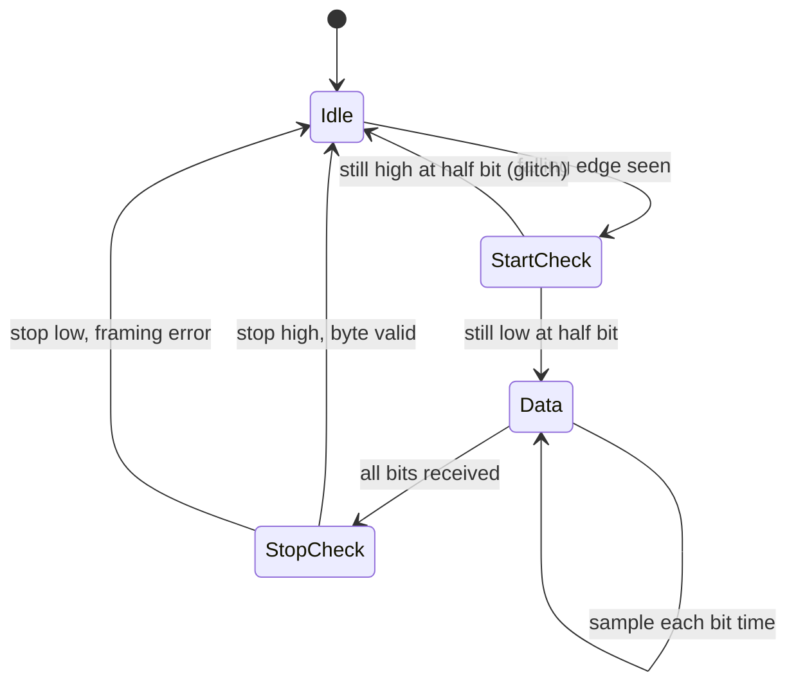

::: basics
### In plain words
A UART has a sending half and a receiving half. To send, it loads a byte into a shift register and pushes out a frame one bit at a time, each lasting one agreed bit time. To receive, it watches for the falling edge of a start bit. Then it waits half a bit, and reads the line once per bit time, near the middle of each bit.

### Picture it
Imagine a starter's pistol and a flashing lamp. The pistol is the start bit. The lamp then shows one bit per beat, and you have a watch that counts beats. You do not look at the lamp when it changes, because that is when it is blurry. You wait half a beat after the pistol, then look at the middle of each beat, when the lamp is steadiest.

### Words you need
- **Shift register**: a row of storage cells that moves bits along one place per tick, turning a byte into a stream or back.
- **Baud-rate generator**: a timer that divides the chip's clock down to the bit rate. See [[q0775]].
- **Start and stop bits**: the low bit that begins a byte and the high bit that ends it. See [[q0771]].
- **Framing error**: the stop bit was read low, which usually means the two speeds do not match.

### The simplest example
Send the letter "H" (0x48) at 9600 baud. Each bit lasts about 104 µs. The line goes low for the start bit, then sends the data bits least significant first: 0, 0, 0, 1, 0, 0, 1, 0. Then it goes high for the stop bit. The receiver sees the falling edge and waits 52 µs, half a bit. It confirms the line is still low, then reads once every 104 µs. It collects the same eight bits and checks the stop bit. That is the whole idea. The rest of this page covers oversampling and what the error flags say about real faults.
:::

::: testing
Whether you can walk through a byte's journey **end to end**: CPU register, shift register, frame, wire, receiver, back to a register. A strong answer has both halves (transmit is easy, receive is where the engineering is) and mentions the pieces that make it work: baud-rate generator, start-edge detection, mid-bit sampling, error flags.

Hidden sub-skills: reading a timing diagram, knowing bit order (LSB first), knowing what parity does and does not catch, and being able to explain what happens when software can't keep up.
:::

::: why
Every time a console prints garbage, a GPS module goes silent or a bootloader refuses to talk, someone has to reason about exactly how those bits get on the wire and off it. Knowing the mechanism turns "it doesn't work" into a checklist: baud divisor, frame format, polarity, levels, flow control. Interviewers use "how does it work?" to see whether you stop at "it sends bits" or can describe the receiver's state machine. It is also the natural lead-in to oversampling ([[q0779]]).
:::

::: concepts
- **Frame format**: start bit, data bits LSB first, optional parity bit, stop bit(s). See [[q0771]].
- **Baud-rate generator**: divides the peripheral clock down to the bit rate (or a multiple of it for the receiver). See [[q0775]].
- **Shift registers**: transmit shifts a stored byte out; receive shifts bits in and then latches the result.
- **Parity**: one extra bit that makes the number of 1s even (or odd) so single-bit errors are detectable.
- **Receiver sampling**: detect the start edge, then sample each bit near its centre. See [[q0778]].
- **Error flags**: framing, parity, overrun and noise flags report what went wrong.
- **Flow control**: RTS/CTS lines (hardware) or XON/XOFF (software) stop the sender when the receiver is full.
:::

::: answer
"I think of it as two independent halves, transmit and receive, each with a shift register and a timer running at the baud rate.

On transmit, software writes a byte into the data register. The UART loads it into a shift register and sends a frame: pull the line low for one bit time for the start bit, shift out the data bits least-significant-bit first, add a parity bit if it's enabled, then drive the line high for one or two stop bits. Then it's idle, high, until the next byte.

Receive is the harder half, because there's no clock to follow. The receiver watches the line for a falling edge. When it sees one, it starts counting. It waits half a bit time to land in the middle of the start bit and checks it's still low, so a glitch doesn't count. Then it samples once per bit time, so each sample lands in the middle of a data bit, where the signal is most stable. The bits shift into a register, it checks parity if enabled, checks the stop bit is high, and then sets a flag so the CPU can read the byte.

If the stop bit isn't high you get a framing error, which usually means the baud rates don't match. If the CPU doesn't read the byte before the next one arrives, you get an overrun."
:::

::: technical
**Transmitter.**
1. CPU or DMA writes a byte to TDR (transmit data register).
2. When the shift register is free, the byte moves from TDR to TSR. TDR is free again, so software can queue the next byte while the first is still being sent (double buffering).
3. A bit counter driven by the baud-rate generator walks through: start (0), data bits D0 to D(n-1), parity (if enabled), stop (1, one or two bit times).
4. The "transmission complete" flag sets only after the last stop bit has left the pin. This matters for RS-485 drivers that must stay enabled until the final bit is gone.

**Baud-rate generator.** A counter divides the peripheral clock: $\text{divisor} = f_{clk}/(\text{oversample}\times\text{baud})$, with the divisor an integer or a fixed-point fraction. Real baud = $f_{clk}/(\text{oversample}\times\text{divisor})$. See [[q0779]] for why the receiver ticks at 8x or 16x the baud.

**Parity.** For even parity, the parity bit is chosen so the total count of 1s (data plus parity) is even. 'A' = 0x41 has two 1s, so even parity bit = 0 and odd parity bit = 1. Parity catches any odd number of flipped bits, misses any even number, and never corrects.

**Receiver.**
1. Idle-high line is sampled every tick of the oversampling clock.
2. A falling edge (1 to 0) arms the state machine.
3. Wait half a bit time (for 16x oversampling, 8 ticks) and re-check low: this rejects glitches.
4. Every full bit time after that, sample the line (often a 3-sample majority vote around the centre) and shift into RSR.
5. After the last data/parity bit, sample the stop bit: high is good; low sets the **framing error** flag.
6. Move RSR to RDR and set RXNE (receive not empty). If RDR was still full, set **overrun**.

**Timing budget.** The stop-bit sample for 8N1 occurs 9.5 bit-times after the start edge, so a relative baud-rate error $\varepsilon$ moves it by $9.5\varepsilon$ bits. It must stay within $\pm 0.5$ bit, giving a theoretical limit of $\pm 5.3\%$ total mismatch; practically keep the combined error below about 3 to 4%. See [[q0778]].

**Throughput.** 8N1 sends 8 payload bits per 10, so a baud rate of $B$ gives $B/10$ bytes/s.
:::

::: short
"Transmit: the UART loads a byte into a shift register and sends a frame, a low start bit, the data bits LSB first, optional parity, then a high stop bit, each lasting one baud period. Receive: it watches for the falling start edge, waits half a bit to confirm it and to centre itself, then samples every bit time in the middle of each bit and shifts the bits into a register. It checks parity and that the stop bit is high, then flags the byte for the CPU. A bad stop bit means a framing error, usually a baud mismatch."
:::

::: long
"I'd split it into transmit and receive. Both sides have a baud-rate generator that divides down the peripheral clock, and a shift register.

Transmit first. Software writes a byte to the data register. The UART copies it into the shift register and then runs a little state machine with one step per bit time. It pulls the line low for the start bit, shifts out the data bits least-significant-bit first, sends a parity bit if enabled, and then drives the line high for one or two stop bits. At 115200 baud, a bit takes 8.68 microseconds and a frame takes 87. Meanwhile the data register is free again, so software can queue the next byte. That double-buffering is what lets you keep the line busy back to back.

Receive is where the cleverness is, because there's no clock wire. The receiver samples the line many times per bit, typically 16 times, and waits for a falling edge. When it sees one, it counts half a bit to land in the middle of the start bit and double-checks it's still low, so a noise spike doesn't trigger a false start. From there it samples once per bit time, each time in the middle of the bit where the signal is steadiest, and shifts the bits into a register. After the data it checks parity if enabled, then checks the stop bit is high. If everything is fine it moves the byte to the receive data register and sets a flag or fires an interrupt.

Errors I'd mention: parity error, framing error when the stop bit is low, and overrun when software didn't pick up the previous byte in time. Framing errors are the classic symptom of mismatched baud rates, and overruns are why you use FIFOs or DMA at high speeds."
:::

::: terms
- **TDR / RDR**: transmit and receive data registers that software reads and writes.
- **TSR / RSR**: the internal shift registers that actually move bits.
- **Baud-rate generator (BRG)**: divides the peripheral clock to make the bit timing.
- **Parity bit**: extra bit chosen to make the number of 1s even (or odd).
- **Framing error**: the stop bit was sampled low instead of high.
- **Overrun error**: a new byte finished arriving while the previous one had not been read yet.
- **FIFO**: a small hardware queue (4 to 16 bytes is common) that buffers bytes so the CPU can respond late.
- **RTS/CTS**: hardware flow-control lines that tell the other side to pause or resume sending.
- **Break**: line held low longer than a full frame.
:::

::: exceptional
**An average answer** says "it sends start bit, data, stop bit" and "the receiver samples the bits".

**An exceptional answer**:
- Describes the **receiver as a state machine** driven by an oversampling tick: idle, start-edge detect, half-bit confirm, data sampling at bit centres, stop check.
- Explains *why* it samples in the middle: the edges are where the signal is changing and noisy, and the centre is farthest from both neighbouring transitions.
- Gives the error flags and the real-world symptom of each (framing for baud mismatch, overrun for slow software, parity for noise).
- Quantifies something: 10 bits per byte, bit time, or the 9.5-bit-times timing budget.
- Knows that the transmit-complete flag is not the same as the data register being empty, which matters for RS-485 turnaround.
:::

::: mistakes
- **Sending MSB first.** UART is LSB first by default. Reading 0x41 backward on a scope is the classic confusion; see the figure below.
- **Believing the receiver samples at the start of each bit.** It samples at the centre, which is why the start-edge detection waits half a bit.
- **Thinking parity corrects errors.** It detects an odd number of flipped bits and nothing more.
- **Treating "TX buffer empty" as "transmission done".** The last byte is still shifting out. Disable an RS-485 driver too early and you chop the last bits.
- **Ignoring overrun.** A UART with no FIFO at 921600 baud gives the CPU only about 10.9 us per byte; loss is normal unless DMA or a FIFO is used.
- **Mismatched frame format.** 8N1 on one side and 8E1 on the other gives parity errors or garbage even when the baud rate is right.
:::

::: deep
## The transmit side: a counter and a shift register

Inside the transmitter there is nothing mysterious: a bit counter, a shift register and a divide-by-N clock. Suppose the CPU writes 0x41 ('A') at 115200 baud, 8N1. The hardware builds the 10-bit frame $\{0,\ 1,0,0,0,0,0,1,0,\ 1\}$ (start, D0 to D7, stop) and shifts one bit per baud tick. Each bit lasts $1/115200 = 8.68\ \mu s$. That is it. The transmit clock is the baud clock; no oversampling is needed because the transmitter is the one setting the timing.

```timing
{"signals":[
 {"name":"TX line","wave":"1010000010111","color":"accent"},
 {"name":"frame","wave":"=============","data":["idle","start","D0","D1","D2","D3","D4","D5","D6","D7","stop","idle","idle"]},
 {"name":"TXE (data reg empty)","wave":"0111111111111","color":"orange"},
 {"name":"TC (complete)","wave":"1000000000011","color":"purple"}
],
"hscale":1.2}
```
Figure: Software writes the byte (TXE drops), and TXE goes high again as soon as the byte moves into the shift register, long before the frame is finished. The line is only done when the stop bit completes, which is what the separate transmission-complete (TC) flag reports.

With parity enabled the frame is one bit longer. For even parity on 0x41 (two 1s), the parity bit is 0; for odd parity it is 1. The parity bit goes between D7 and the stop bit.

## The receive side: find the edge, then walk to the middle

The receiver's problem is that it does not know *when* a byte starts. The line is idle high, then falls. The very first falling edge is the only synchronisation it will get, and from there it must place samples correctly using only its own clock.


Figure: The receiver's state machine. The half-bit check after the edge both rejects glitches and positions every later sample at a bit centre.

With 16x oversampling the receiver's counter ticks every $1/(16\times\text{baud})$, which is 0.54 us at 115200. After the falling edge it counts 8 ticks (half a bit) and checks again; then it counts 16 ticks per bit. This puts the sample about 0.5 bit-times from each neighbouring edge, the point of maximum margin against jitter, edge slew and mismatch. Many UARTs also take three samples around the centre (ticks 7, 8, 9) and use the majority; that suppresses a single-tick noise spike. [[q0779]] has the details.

## Worked example: when does it fail?

Say the transmitter runs at 115200 baud and the receiver's divisor gives 111,111 baud (a real result when a 16 MHz clock is divided by 16x9). The receiver's bit time is 9.0 us instead of 8.68 us, which is $+3.7\%$ longer. After the start-edge alignment, the receiver samples bit $n$ at $(n+0.5)\times 9.0$ us while the true centre is at $(n+0.5)\times 8.68$ us. At the stop bit ($n=9$):

$$\Delta = 9.5\times(9.0-8.68) = 3.04\ \mu s = 0.35\ \text{bit times}$$

That is still inside the half-bit window, so this link works but with only 0.15 bit of margin left. A slightly bigger error, or a slow edge on the line, and it fails. Notice that the error accumulates over the frame and resets at the next start edge: that is why a UART can tolerate a few percent of mismatch but a synchronous clock-less scheme with no resets could not.

## Try it

```sim
{"id":"uart-frame","char":"H","baud":115200,"parity":"even","stop":1,"mismatch":0}
```
Figure: Switch parity between none, even and odd and see the parity bit change with the character. Then raise the mismatch slider until frames start failing. Compare where it breaks with the 5.3% theoretical limit.

## Parity, flow control and FIFOs

**Parity.** Cheap error detection for noisy links, but at this point many designs prefer none (8N1) and rely on higher-level checksums or CRCs. Parity costs 10% more time per byte.

**Flow control.** When the receiver can't keep up, hardware flow control uses two extra wires: RTS (request to send, an output from the receiver's point of view saying "I have room") and CTS (clear to send, an input to the sender). They cross like TX/RX. Software flow control (XON 0x11 / XOFF 0x13) sends characters in-band but breaks binary data. Many debug-console links ignore flow control and just run slow enough.

**FIFOs and DMA.** A 16-byte FIFO gives the CPU 16 byte-times to respond. At 921600 baud one byte is 10.85 us, so 16 bytes is 174 us. With DMA the CPU only gets interrupted per block or when the line goes idle.

## Line idle, break and what you see on a scope

Two more events are useful in practice. A **line-idle** condition (the receiver sees a full frame time of high after data) is how DMA-based drivers detect the end of a variable-length message without knowing its length; many MCUs have an IDLE interrupt for exactly this. A **break** is the line held low for longer than a full frame; the receiver sees all-zero data with a low stop bit, flags a framing error and, on some parts, a separate break flag. LIN and DMX512 use a break on purpose to mark the start of a message.

On a scope, trigger on the falling edge, set the horizontal scale so that about 12 bit-times fill the screen, and measure the narrowest pulse. That is one bit time and gives the real baud rate directly: 8.68 us means 115200, 104 us means 9600. If the narrowest pulse is 2.17 us at what you thought was 115200, the sender is at 460800. Most scopes and logic analysers also have a UART decoder: set baud, bits, parity and polarity and it overlays the characters on the trace, which makes a polarity or LSB/MSB mistake obvious.

## Who sets the timing?

Both sides. The receiver's job is to follow the transmitter's timing without a clock. Both have a baud generator derived from their own oscillator, and crystal tolerances (tens of ppm) are far smaller than the percent-level budget. The problem cases are MCUs running from an internal RC oscillator that can be off by a percent or more, and clock dividers that cannot produce the exact baud rate ([[q0775]]).
:::

::: applications
- **printf debugging over USART2 on an STM32 board**, bridged by the on-board ST-LINK or a USB-serial chip.
- **GPS module streaming NMEA sentences** to an MCU that parses them from a ring buffer filled by a UART interrupt or DMA.
- **Modbus RTU sensors over RS-485**: the UART framing is unchanged; an external driver chip handles the differential line and a GPIO controls driver enable.
- **Bluetooth/Wi-Fi modules** using hardware RTS/CTS flow control so the host can pause the module when its buffer is full.
- **Bootloader entry**: the chip's ROM bootloader waits on a UART for a sync byte then accepts a firmware image.
:::

::: assumptions
- 8N1 at TTL logic levels, 16x receive oversampling, unless stated. Some MCUs support 8x (and a few 4x or 3x) oversampling; the state machine is the same with fewer ticks per bit.
- Parity, 9-bit data and 2 stop bit modes change the frame length but not the mechanism.
- I assume crystal-derived clocks. With an internal RC oscillator the error budget can be consumed by the clock itself.
- Hardware names (RXNE, TXE, TC) are STM32-style; other vendors use different flag names for the same events.
- Some UARTs use a "start-bit noise filter" or sample 3 times; I describe the common case.
:::

::: followups
### Why does the UART send the least significant bit first?
It is a historical convention from teleprinters and early serial hardware, and every UART standard assumes it. It has no deep technical advantage today. In practice: if you decode a UART trace by eye and read the bits left to right as MSB first, 'A' (0x41) looks like 0x82. The logic analyser's UART decoder has an LSB/MSB option for non-standard devices.

### What does a framing error tell you?
The stop-bit sample was low when it should have been high. Typical causes: baud mismatch (the receiver's sample slid across the frame), a break condition, a noisy line, or the wrong number of data bits configured. It is the first thing you see when baud rates disagree. A scope on TX showing a bit time other than the expected 8.68 us (at 115200) confirms it.

### How does the receiver tolerate a slightly different baud rate?
By re-synchronising on every start edge. Error accumulates only across a single frame (9.5 bit-times to the stop-bit centre in 8N1) and resets when the next start bit arrives. A total mismatch under about 5% theoretically keeps every sample within its bit; practical designs aim for under 3 to 4% combined.

### What if the sender is faster than the receiver can process?
Add hardware or software flow control, or use a FIFO or DMA. With no flow control and no buffer, overrun errors lose data. At 115200 baud, a byte arrives every 86.8 us; if the ISR takes 100 us to start, you will lose bytes.

### Harder: what happens to a receiver that powers up in the middle of a byte?
It might see a falling edge inside the data stream and treat it as a start bit, then decode garbage until it sees a stop-bit violation. Receivers recover because idle (high) between frames re-synchronises them: the first real inter-frame idle followed by a falling edge aligns it. Systems that must start cleanly send a break or idle period first, or use a line-idle interrupt.
:::

::: interpretations
"How does it work?" is read here as the whole transmit and receive mechanism with the frame format. The narrower question of how the receiver reads bits without a clock has its own page: [[q0778]], and the oversampling details are in [[q0779]].
:::

::: references
- Vendor MCU reference manuals (e.g. STM32 USART chapter, AVR USART chapter): block diagram, baud-rate register, status flags and receiver sampling description.
- Horowitz & Hill, *The Art of Electronics*, 3rd ed.: asynchronous serial communication and UART framing.
- TIA/EIA-232-F: line coding conventions for asynchronous serial characters (mark/space polarity and framing).
:::

::: rubric
- Describes the frame: start, LSB-first data, optional parity, stop :: This is the unit of transfer; everything else depends on it.
- Explains transmit as shift register plus baud-rate timer :: Shows you know the hardware, not just the protocol.
- Explains receive: detect falling edge, confirm at half bit, sample at each bit centre :: This is the part interviewers care about.
- Mentions parity and what it can/cannot detect :: Shows you know the error-checking limits.
- Names the error flags (framing, parity, overrun) and their causes :: Lets you debug real systems.
- Mentions flow control, FIFOs or DMA for fast links :: Connects the protocol to firmware reality.
:::

::: quiz
```json
[
 {"type":"mcq","level":"fundamental","q":"In which order are the data bits of a standard UART frame sent?","options":["MSB first","LSB first","Alternating","Parity first"],"answer":1,"explain":"UART sends the least significant bit first, right after the start bit."},
 {"type":"numeric","level":"fundamental","q":"How long does one 8N1 frame take at 9600 baud? Answer in ms.","answer":1.042,"tolerance":0.02,"unit":"ms","explain":"10 bits x (1/9600 s) = 1.0417 ms."},
 {"type":"mcq","level":"intermediate","q":"The character 'A' (0x41, two 1 bits) is sent with odd parity. What is the parity bit?","options":["0","1","It depends on the baud rate","Odd parity bit is always 1"],"answer":1,"explain":"Odd parity makes the total count of ones (data + parity) odd. 0x41 has two ones, so the parity bit must be 1 to make three."},
 {"type":"mcq","level":"intermediate","q":"Why does the receiver wait half a bit time after seeing the falling edge before it starts sampling?","options":["To let the line settle after the transmitter","To position its samples at the middle of each bit and to reject glitches","To synchronise the transmitter's clock","To save power"],"answer":1,"explain":"Waiting half a bit puts the first sample at the centre of the start bit. A second low sample there confirms the start. Subsequent bit-time samples then land at the centre of each data bit."},
 {"type":"numeric","level":"advanced","q":"A receiver's bit time is 3.7% longer than the transmitter's. By how many bit-times has its stop-bit sample drifted from the true bit centre in an 8N1 frame? (Stop-bit sample at 9.5 bit-times.)","answer":0.35,"tolerance":0.05,"unit":"bit","explain":"Drift = 9.5 x 0.037 = 0.35 bit. Under the 0.5-bit limit, but with little margin left for jitter."},
 {"type":"truefalse","level":"advanced","q":"The \"transmit data register empty\" flag going high means the last stop bit has finished leaving the pin.","answer":false,"explain":"TXE just means the data register can accept a new byte; the byte is still being shifted out. The separate transmission-complete flag marks the end of the last stop bit, which matters when switching an RS-485 driver."}
]
```
:::
