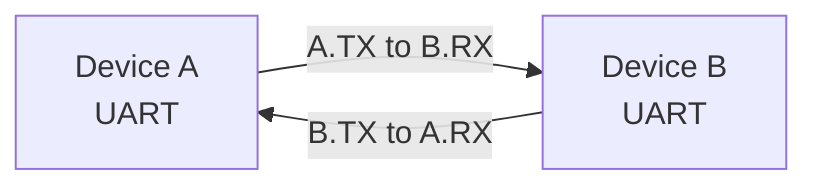
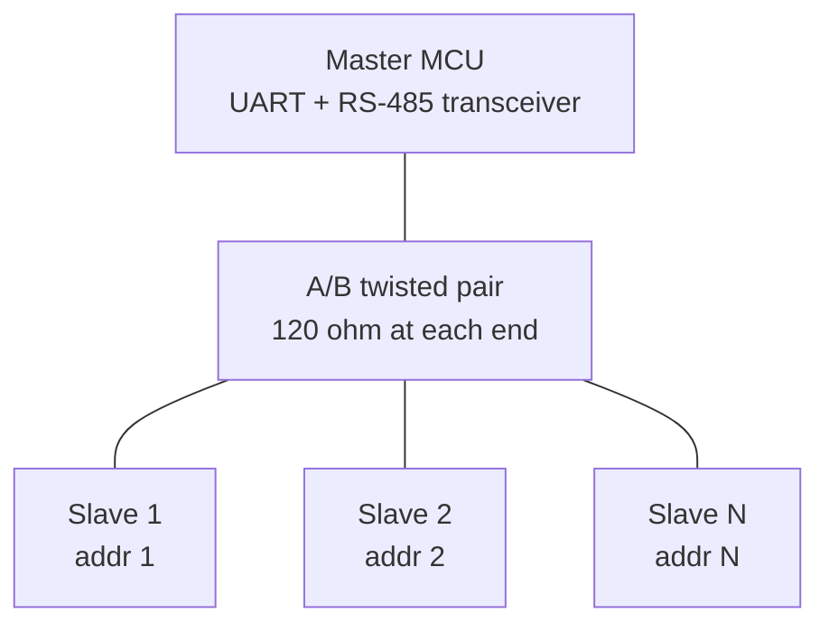

::: basics
### In plain words
A basic UART link joins exactly two devices. Each wire has one sender and one receiver. Because TX and RX are separate wires, both devices can talk at the same moment, which is called full duplex. If you want a third device, you cannot just join its TX onto an existing wire. To reach more devices you add more UARTs, use a shared bus standard such as RS-485 with addresses, or pick a different bus like I2C.

### Picture it
Picture a phone call where each person has their own line, one for speaking and one for listening. Both can talk at once, and nothing collides. Now a third person wants to join by speaking into the same line as someone else. Two voices on one line become a muddle. A group needs a meeting with a chair, where only one person speaks at a time and each is called by name.

### Words you need
- **Point-to-point**: a link between exactly two endpoints.
- **Full duplex**: both directions at the same time, because each direction has its own wire.
- **Contention**: two outputs driving opposite levels onto one wire at once. See [[q0788]].
- **RS-485**: a shared two-wire bus standard whose drivers can switch off, so many devices can take turns.
- **Addressing**: a rule in the message, such as a device number, that says who should answer.

### The simplest example
Take two chips on a 3.3 V board. A's TX goes to B's RX, and B's TX goes to A's RX. Now suppose you tie two TX pins together, and one drives high while the other drives low. If each output switch has about 25 Ω, current flows through both: $3.3/(25+25) = 66$ mA. The wire sits near 1.65 V, which is neither a one nor a zero. That is the whole idea. The rest of this page covers RS-485 direction control and when to switch to I2C or SPI.
:::

::: testing
Whether you understand UART's **topology**: it is a point-to-point link by design, and each wire is unidirectional, which together make it full duplex. Then the follow-on judgment: what do you do when you need more than two devices (RS-485 multi-drop, addressing, multiple UARTs, a different bus)?

Hidden sub-skills: duplex terminology (simplex, half, full), why two drivers on one wire is bad ([[q0788]]), and comparing with SPI and I2C topologies.
:::

::: why
Choosing a bus is a topology decision. If you need to talk to one GPS module, UART is perfect. If you need to talk to eight temperature sensors, UART is the wrong tool unless you add a layer such as RS-485 and an addressing scheme. Interviewers ask this because it exposes whether you know the *limitation* behind UART's simplicity, and whether you can propose the standard workarounds.
:::

::: concepts
- **Point-to-point**: exactly one transmitter and one receiver per wire, so a basic UART link joins exactly two devices. See [[q0773]].
- **Full duplex**: both directions at once, because TX and RX are separate wires.
- **Half duplex / simplex**: one direction at a time, or only one direction ever.
- **Bus contention**: two drivers on one wire fighting each other. See [[q0788]].
- **RS-485 multi-drop**: differential bus with tri-state drivers that lets many UARTs share one pair.
- **Addressing**: a protocol layer (Modbus addresses, or 9-bit address mode) that decides who answers.
:::

::: answer
"Plain UART connects exactly two devices, point to point. Each wire has a single driver: my TX drives your RX, and your TX drives my RX. So the direction of communication is both ways at the same time, which is full duplex. There's no need to take turns, and no arbitration.

That's a strength for simplicity, but it's also the limitation. If I want a third device, I can't just tie its TX onto the same wire, because two push-pull drivers on one line fight each other when one drives high and the other low.

There are standard ways around that. One, use more UARTs: one per device. Two, use RS-485: a differential bus with tri-state drivers where up to 32 standard loads, or more with low-load transceivers, share a pair, and a protocol such as Modbus RTU says who talks when, so it becomes half duplex with addressing. Three, some UARTs have a 9-bit mode where the ninth bit flags an address byte, so each device wakes up only when addressed. Or four, if I need lots of devices, I'd choose I2C or SPI instead."
:::

::: technical
**Topology.** A basic UART connects two nodes. Each signal wire has one driver and one receiver. Two nodes, two data wires, so two independent unidirectional channels.

**Duplex.**
- *Full duplex*: TX and RX active simultaneously. Standard TTL UART and RS-232.
- *Half duplex*: both directions on the same medium, one at a time. RS-485 two-wire; single-wire UARTs.
- *Simplex*: one direction only (GPS output).

**Why not share a TX line.** Push-pull outputs driving opposite levels short VDD to ground through the on-resistances of the two output stages: with 25 Ω each at 3.3 V that is $3.3/(25+25) = 66$ mA, beyond a typical pin rating. See [[q0788]].

**Ways to reach more devices.**

| Method | How | Notes |
|---|---|---|
| One UART per device | separate TX/RX pairs | simple; costs pins and peripherals |
| RS-485 multi-drop | tri-state differential drivers share a pair | master/slave protocol (Modbus RTU); 32 unit loads typical, up to 256 with 1/8-unit-load transceivers |
| Addressing with 9th bit | multiprocessor mode: bit 9 = 1 marks an address byte | slaves ignore data until their address matches |
| Open-drain shared TX with pull-up | wired-AND | no contention damage; one-wire or LIN-style |
| External UART mux or hub | analog switch or bridge IC | for occasional access to multiple devices |
| Use another bus | I2C (address-based), SPI (chip-select) | see [[q0737]] |

**Direction control for half duplex.** An RS-485 transceiver has driver-enable (DE) and receiver-enable (RE) pins. Firmware sets DE before transmitting and clears it only after the *transmission-complete* flag (not the data-register-empty flag), to avoid chopping the last bits. Many UARTs have automatic DE control.
:::

::: short
"Basic UART is point to point: two devices, each wire with one driver. TX of one goes to RX of the other, and vice versa, so both directions work at once, which is full duplex. You can't just wire more TX pins together because push-pull drivers would fight. To reach more devices, use one UART each, or RS-485 with tri-state drivers and an addressing protocol like Modbus, which is half duplex, or the 9-bit address mode. For many devices, I'd move to I2C or SPI."
:::

::: long
"A plain UART link joins exactly two devices. Each wire has one driver and one receiver. My TX is driven by me and read by you, and your TX is driven by you and read by me. So the direction of communication is bidirectional, but on separate wires, which makes it full duplex: both of us can transmit at the same moment with no arbitration.

The limitation is topology. If I wanted a third device on the same wire, I can't just tie the TX outputs together. These are push-pull outputs, so if one drives high while another drives low, current flows from supply to ground through both output stages. With 25 ohms each at 3.3 volts, that's about 66 milliamps, more than a pin should carry, and the voltage in the middle is neither a one nor a zero.

There are standard fixes. The simplest is more UARTs, one per peer. If I need a shared bus, I'd go RS-485: it uses a differential pair and transceivers whose drivers can be turned off, so any number up to about 32 standard loads, more with low-load parts, can share the pair. Only one talks at a time, so it's half duplex, and a protocol like Modbus RTU decides who. There's also a 9-bit multiprocessor mode on many UARTs, where the ninth bit marks a byte as an address, so each device ignores data until it sees its own address.

If the device count is large, though, I'd rather use I2C, which is built for multiple addressed devices on two wires, or SPI with chip selects. UART shines for the one-to-one link."
:::

::: terms
- **Point-to-point**: link between exactly two endpoints.
- **Full duplex**: transmission in both directions simultaneously (separate wires or channels).
- **Half duplex**: both directions possible but only one at a time on a shared medium.
- **Simplex**: one direction only.
- **Multi-drop**: several devices on one shared bus (e.g., RS-485).
- **Unit load**: RS-485 receiver loading unit; the standard allows 32 unit loads on a segment.
- **Tri-state driver**: output that can be disabled into high impedance so others can drive the line.
- **9-bit / multiprocessor mode**: UART mode where the extra bit marks address bytes.
:::

::: exceptional
**An average answer** says "two devices, full duplex".

**An exceptional answer**:
- Gives the topology, the duplex type and the *reason* (separate wire per direction, one driver per wire).
- Explains the **bus-contention reason** you can't just share TX, with a number (about 66 mA for 25 Ω outputs at 3.3 V).
- Offers the standard multi-device solutions (RS-485 multi-drop with DE control, 9-bit addressing, multiple UARTs) and when to prefer I2C/SPI.
- Mentions half-duplex direction control and the TC-flag detail.
- Distinguishes "can talk" from "how they decide who talks": UART has no addressing or arbitration of its own.
:::

::: mistakes
- **"UART is half duplex."** Standard TX/RX UART is full duplex. Half duplex applies to RS-485 two-wire and single-wire variants.
- **"You can connect many devices by tying their TX lines together."** Push-pull outputs contend; use tri-state/open-drain or a bus transceiver.
- **"UART supports multiple devices like I2C."** There is no addressing in the framing; it comes from a higher layer.
- **Confusing "number of devices" with "number of wires".** A fixed three wires connect two devices; adding devices adds wires unless a bus standard is used.
- **Releasing the RS-485 driver as soon as the TX register is empty.** The last byte is still being shifted; wait for transmission complete.
- **Ignoring bus bias and termination on RS-485**, leading to garbage when no one is driving.
:::

::: deep
## One driver per wire

The reason UART is point-to-point is electrical, not just conventional. A standard output stage is push-pull: a PMOS to VDD and an NMOS to ground ([[q0785]]). It actively drives high *and* low. That is great for edge speed but means only one device can safely drive a given wire at a time.


Figure: Two wires, each with exactly one driver and one receiver. The two directions are independent, so A and B can transmit simultaneously (full duplex).

```timing
{"signals":[
 {"name":"A.TX","wave":"1.0101010.1...","color":"accent"},
 {"name":"B.TX","wave":"1...0101010.1.","color":"blue"}
],
"hscale":1.2}
```
Figure: Both devices transmit at the same time, overlapping in time. Nothing collides, because each wire has just one driver. This is what full duplex means and is why UART needs no turn-taking.

## What happens if you share a wire

Wire two MCU TX pins together. When A drives 1 and B drives 0, PMOS of A is on (Ron about 25 Ω, say) and NMOS of B is on (also 25 Ω):

$$I = \frac{3.3\ \text{V}}{25+25\ \Omega} = 66\ \text{mA},\qquad P = 3.3 \times 0.066 \approx 218\ \text{mW}$$

and the wire sits at $3.3\times 25/50 = 1.65$ V: in the forbidden zone between $V_{IL}$ and $V_{IH}$, so receivers read either value, or oscillate. A typical GPIO is rated for tens of mA at most, so this overstresses the drivers. [[q0788]] covers contention in general; try the contention view in the GPIO simulation on that page.

## Multi-device options

**1. One UART per peer.** Easiest and fastest. Limited by the number of UART peripherals and pins. Some MCUs have 4 to 8 UARTs; bridge ICs add more over SPI or I2C.

**2. RS-485 multi-drop.**


Figure: One differential pair shared by all nodes. Each node has a UART plus an RS-485 transceiver whose driver is enabled only while that node transmits. Termination resistors (about 120 Ω) sit at the two physical ends of the pair, not at every node.

The master sends a frame addressed to a node and that node replies. The standard allows 32 unit loads; with 1/8-unit-load receivers up to 256 nodes are possible electrically. This is half duplex: DE/RE is flipped by firmware (or hardware auto-direction). The UART framing is unchanged; addressing is at the protocol level (Modbus RTU puts a device address as the first byte of the message).

**3. 9-bit multiprocessor mode.** Configure 9 data bits. The ninth bit is 1 for an address byte and 0 for data. Each slave's UART stays in "mute" mode, ignoring bytes with the ninth bit 0, and wakes up (hardware match or interrupt) on an address byte that matches its own address. This reduces the per-byte interrupt load on slaves that are not being addressed.

**4. Open-drain shared line.** If all TX outputs are open-drain with one pull-up resistor, a shared wire is a wired-AND and no contention damage occurs. Used in single-wire serial buses; collisions still corrupt data, so a protocol is needed.

**5. A different bus.** I2C is built for addressed multi-device on two wires. SPI uses a chip select per slave. See [[q0737]] and [[q0753]] for sensible limits and why I2C is usually preferred for many low-speed sensors.

## Half-duplex direction control done right

On an RS-485 node the firmware flow is: assert DE, write bytes, wait for the **transmission-complete** flag (last stop bit has left the shift register), then de-assert DE. If you release DE when the data register becomes empty, the last byte is truncated. At 115200 baud the last byte takes up to 87 us, so the error is noticeable. Timing at the other end matters too: the replying node needs a turnaround guard time before it starts to transmit, so the master has time to switch DE off and its receiver on. Many UARTs (and transceivers with auto-direction) handle this in hardware.

## Bias and termination on a shared RS-485 pair

When no node is driving the pair, the differential voltage floats and a receiver can see noise as a stream of start bits. The cure is fail-safe biasing: a pull-up resistor on A (towards the supply) and a pull-down resistor on B at one point on the bus, so the idle differential voltage is a defined "mark" of a few hundred millivolts. Many modern transceivers include a fail-safe receiver that does this internally for the open or shorted case, but an idle bus with all drivers off still wants bias if the receivers are not fail-safe. Termination at both ends (about 120 Ω to match the characteristic impedance of typical twisted pair) stops reflections at higher rates; at 9600 baud over a short run you can often get away without it, at 1 Mbaud over 100 m you cannot.

## Worked example: sizing a sensor network

You have 24 sensors, each answers a poll in 8 bytes, and the request is 8 bytes, at 19200 baud with 8N1. One transaction is 16 bytes = 160 bits = 8.3 ms, plus a turnaround gap of about 2 ms, so about 10.3 ms per sensor and about 250 ms for a full sweep of 24 sensors, or 4 sweeps a second. If you need 20 sweeps a second (50 ms per sweep), raising the baud rate alone is not enough: at 115200 the bits take only 1.4 ms per transaction, so the 2 ms turnaround now dominates and a sweep is still $24\times3.4\approx81$ ms, about 12 sweeps a second. You would also have to cut the turnaround below about 0.7 ms, or split the sensors across two buses at 115200 (12 sensors, about 41 ms per sweep), or let them report on a schedule. This kind of back-of-the-envelope is exactly what an interviewer wants to hear when you propose a shared bus.

## Choosing

| Need | Choice |
|---|---|
| One module, fast, simple | plain UART, full duplex |
| 2 to 4 peers on the same board | multiple UARTs |
| 10s of devices, 100s of metres, noisy | RS-485 with addressing |
| 10s of devices on-board, low speed | I2C |
| Fast peripherals | SPI |
:::

::: applications
- **GPS to MCU**: simplex data in, occasional commands out, full duplex wiring.
- **MCU to Bluetooth module**: full duplex with RTS/CTS.
- **Modbus RTU sensor networks**: RS-485 half duplex, up to tens of nodes with addressing.
- **Multi-drop motor drives in a factory**: RS-485 with 9-bit addressing or protocol addresses.
- **Debug console**: TX only from the MCU (effectively simplex) to a PC terminal.
:::

::: assumptions
- "UART" here means the standard asynchronous TTL TX/RX link. Variants (RS-485, single-wire, 9-bit modes) are noted as extensions.
- The 32 unit load and 256 node figures are standard RS-485 figures for 1 unit-load and 1/8 unit-load receivers; real networks are limited further by cable length, baud rate and termination.
- The contention numbers assume 25 Ω output stages; real pins differ (typically tens of ohms) and some limit current internally.
- Some MCUs offer on-chip hardware address matching and automatic RS-485 direction control; I describe the generic approach.
:::

::: followups
### How many devices can talk to each other on plain UART?
Two. One TX connected to one RX in each direction. Any more needs a bus standard like RS-485 or extra UARTs.

### Is UART full duplex or half duplex?
Full duplex in the standard TX/RX form, since each direction has its own wire. Half duplex when both directions share one medium, such as two-wire RS-485 or single-wire UART variants.

### How would you connect a master to 10 slaves over UART?
RS-485 multi-drop with a Modbus-style address byte in each message, or a 9-bit address mode. Terminate the bus at both ends, bias the idle state, and make the master poll each slave. If the slaves are on the same board and slow, I2C is simpler.

### What goes wrong if two RS-485 nodes transmit at once?
Both drivers are active on the differential pair and fight. RS-485 drivers are rated to survive this (short-circuit current limiting and thermal shutdown), but the data are corrupted. The protocol must prevent it (master/slave polling, timeouts), and CRCs detect the corruption.

### Harder: a master's last byte is cut off on an RS-485 link. Why?
DE was released when the data register went empty, not when transmission completed. Wait for the TC flag (or use hardware auto-direction), and add the turnaround delay, so the final bits reach the line.
:::

::: interpretations
The question has two parts: the *number* of devices (two for plain UART, more with RS-485 or addressing) and the *direction* (each wire is one-way, the link as a whole is full duplex). I answer both and give the workarounds. Wiring details are in [[q0773]] and [[q0774]].
:::

::: references
- TIA/EIA-485-A: balanced multipoint standard, including unit-load definition and the 32-node rule.
- Vendor MCU reference manuals: multiprocessor (9-bit) mode and hardware RS-485 direction control in USART chapters.
- Modbus Organization, *Modbus over Serial Line* specification: RS-485 multi-drop and device addressing.
- Horowitz & Hill, *The Art of Electronics*, 3rd ed.: RS-485 and serial interface discussion.
:::

::: rubric
- States plain UART is point-to-point with two devices :: The core answer to "how many".
- Explains each wire is one-way, giving full duplex :: The core answer to "direction".
- Explains why you can't tie TX lines together (contention) :: Shows electrical understanding.
- Gives at least two multi-device options (RS-485, 9-bit, extra UARTs) :: Shows practical problem-solving.
- Distinguishes half duplex RS-485 and notes direction control :: Real-world detail.
- Knows when to choose I2C/SPI instead :: Demonstrates system-level judgment.
:::

::: quiz
```json
[
 {"type":"mcq","level":"fundamental","q":"How many devices does a basic TX/RX UART link connect?","options":["Two","Up to 8","Up to 127","Unlimited"],"answer":0,"explain":"Each wire has one driver and one receiver, so a plain link joins exactly two devices."},
 {"type":"mcq","level":"fundamental","q":"Standard TX/RX UART is best described as:","options":["Simplex","Half duplex","Full duplex","Synchronous"],"answer":2,"explain":"TX and RX are separate wires, so both devices can transmit simultaneously: full duplex."},
 {"type":"numeric","level":"intermediate","q":"Two push-pull outputs with 25 Ω on-resistance each fight on a 3.3 V line (one high, one low). What is the contention current in mA?","answer":66,"tolerance":0.02,"unit":"mA","explain":"I = 3.3 V / (25 + 25 Ω) = 66 mA, and the line sits near 1.65 V."},
 {"type":"multi","level":"intermediate","q":"Which methods let one master reach several UART slaves?","options":["RS-485 multi-drop with addressing","Tying all slaves' push-pull TX pins together","9-bit multiprocessor address mode on a shared bus","One UART peripheral per slave"],"answer":[0,2,3],"explain":"RS-485 with tri-state drivers, 9-bit addressing on a shared bus and dedicated UARTs all work. Directly tying push-pull TX pins causes contention."},
 {"type":"mcq","level":"advanced","q":"On a two-wire RS-485 node, when should firmware release the driver-enable (DE) line after sending a message?","options":["As soon as the last byte is written to the data register","When the transmit data register becomes empty","When the transmission-complete flag is set","Before the last byte starts"],"answer":2,"explain":"The data register empties while the last byte is still shifting out. Only transmission-complete means the last stop bit has left the pin."},
 {"type":"truefalse","level":"advanced","q":"The RS-485 standard allows up to 256 devices of any type on one segment.","answer":false,"explain":"The standard sets 32 unit loads. Up to 256 nodes is possible only with 1/8 unit-load transceivers and within cable, speed and termination limits."}
]
```
:::
